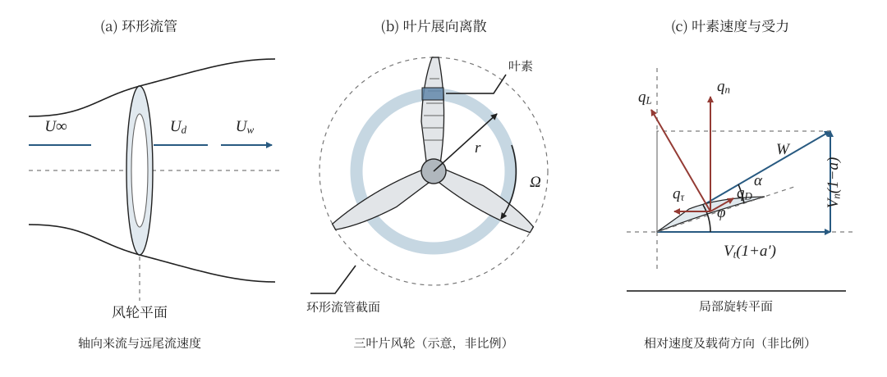

# 3.3 OpenFAST—ROSCO整机气动弹性模型（气动理论修订正文）

### 3.3.1 叶素动量理论与叶片气动力计算

风轮气动力是混合塔架风致振动的主要激励之一。本文采用OpenFAST中的AeroDyn模块，基于叶素动量理论（Blade Element Momentum Theory，BEM）计算叶片分布气动力。BEM将环形流管的动量守恒与叶素截面的二维翼型气动力相结合，通过诱导因子建立来流速度与叶片荷载之间的关系[128-130]。

（1）环形流管动量理论

将风轮扫掠面沿径向划分为若干环形流管，取距旋转轴半径为r、径向宽度为dr的微元。在理想稳态、不可压缩、轴对称轴向来流条件下，忽略环形流管之间的径向交换。设无穷远上游风速为U∞，定义轴向诱导因子a，则叶轮平面风速Ud及远尾流风速Uw分别为

$$
U_d=U_\infty(1-a),\quad U_w=U_\infty(1-2a)\tag{3.3-1}
$$

由质量守恒，环形流管的质量流率为

$$
\mathrm d\dot m=2\pi\rho rU_\infty(1-a)\,\mathrm dr\tag{3.3-2}
$$

式中，ρ为空气密度。设Ω为风轮角速度，a′为切向诱导因子，经典旋转尾流模型的远尾流切向诱导速度幅值为2a′Ωr。由轴向动量与角动量守恒，环形流管的推力和转矩为

$$
\mathrm dT=4\pi\rho U_\infty^2a(1-a)r\,\mathrm dr\tag{3.3-3}
$$

$$
\mathrm dQ=4\pi\rho U_\infty\Omega a'(1-a)r^3\,\mathrm dr\tag{3.3-4}
$$

上述动量方程以无限叶片圆盘的理想流动假设为基础；有限叶片数导致的根部、尖部损失及高诱导区的非理想尾流效应将在后文修正。

图3.3-1  环形流管、叶片离散及叶素截面速度与气动力示意

（2）叶素相对来流及气动力

叶片沿展向离散为若干气动计算截面，各截面的弦长、扭角及翼型系数由DTU 10 MW参考风轮的气动几何与翼型数据确定。取第b片叶片的局部法向及反旋转方向单位矢量分别为en和et，来流速度和气动截面运动速度分别为vw与vs。未计诱导的相对速度分量为

$$
V_{n,b}=\mathbf e_n^{\mathsf T}(\mathbf v_w-\mathbf v_s),\quad V_{t,b}=\mathbf e_t^{\mathsf T}(\mathbf v_w-\mathbf v_s)\tag{3.3-5}
$$

截面运动速度包含风轮旋转、机舱与塔顶运动以及叶片弹性变形引起的速度。在轴向均匀来流、刚性风轮且无整机平动的情形下，Vn=U∞、Vt=Ωr。考虑轴向、切向诱导作用后，局部相对速度分量及其合速度为

$$
W_n=V_n(1-a),\quad W_t=V_t(1+a')\tag{3.3-6}
$$

$$
W=\sqrt{W_n^2+W_t^2},\quad \phi=\operatorname{atan2}(W_n,W_t)\tag{3.3-7}
$$

式中，φ为相对来流方向与局部旋转平面之间的夹角。为说明变桨及结构扭转对攻角的影响，在不随截面扭转的局部参考平面内，攻角可表示为

$$
\alpha_b(r,t)=\phi_b(r,t)-\theta(r)-\beta_b(t)-\theta_{\mathrm{el},b}(r,t)\tag{3.3-8}
$$

式中，θ为初始几何扭角，β为变桨角，θel为弹性扭转角；实际截面姿态由气动与结构模块的坐标变换确定，已计入姿态的弹性扭转不再重复扣除。与固定桨距假设不同，本文的变桨角随控制器输出而变化。

根据二维翼型理论，叶素单位展长升力qL、阻力qD为

$$
q_L=\frac{1}{2}\rho W^2cC_L,\quad q_D=\frac{1}{2}\rho W^2cC_D\tag{3.3-9}
$$

式中，c为叶素弦长；CL、CD分别为升力系数和阻力系数，由局部攻角及翼型气动特性确定。将升阻力投影至风轮局部法向和旋转方向，分别定义法向气动力系数Cn和切向气动力系数Cτ：

$$
C_n=C_L\cos\phi+C_D\sin\phi,\quad C_\tau=C_L\sin\phi-C_D\cos\phi\tag{3.3-10}
$$

叶素单位展长法向力qn、切向力qτ及翼型俯仰力矩ma为

$$
q_n=\frac{1}{2}\rho W^2cC_n,\quad q_\tau=\frac{1}{2}\rho W^2cC_\tau\tag{3.3-11}
$$

$$
m_a=\frac{1}{2}\rho W^2c^2C_m\tag{3.3-12}
$$

其中，qn、qτ的单位为N/m；ma的单位为N·m/m；Cm为翼型俯仰力矩系数。对于具有B片相同叶片的稳态轴对称风轮，环形微元的气动力与转矩为

$$
\mathrm dT=Bq_n\,\mathrm dr,\quad \mathrm dQ=Brq_\tau\,\mathrm dr\tag{3.3-13}
$$

（3）诱导因子与有限叶片数修正

定义局部实度σr为叶片弦长总和与相应圆周长度之比：

$$
\sigma_r=\frac{Bc}{2\pi r}\tag{3.3-14}
$$

有限叶片数使叶尖与叶根附近的环量及诱导速度分布不同于无限叶片圆盘。AeroDyn采用Prandtl叶尖、叶根损失修正[129]，对应损失因子为

$$
F_{\mathrm{tip}}=\frac{2}{\pi}\arccos\!\left[\exp\!\left(-\frac{B(R-r)}{2r|\sin\phi|}\right)\right]\tag{3.3-15}
$$

$$
F_{\mathrm{hub}}=\frac{2}{\pi}\arccos\!\left[\exp\!\left(-\frac{B(r-R_h)}{2R_h|\sin\phi|}\right)\right]\tag{3.3-16}
$$

$$
F=F_{\mathrm{tip}}F_{\mathrm{hub}}\tag{3.3-17}
$$

式中，R为风轮半径，Rh为轮毂半径；Ftip和Fhub分别为叶尖与叶根损失因子。将动量方程（3.3-3）、（3.3-4）乘以F，并与叶素方程（3.3-13）联立，在正常发电、低诱导及分母非零的条件下可得

$$
a=\frac{\sigma_r C_n}{4F\sin^2\phi+\sigma_r C_n}\tag{3.3-18}
$$

$$
a'=\frac{\sigma_r C_\tau}{4F\sin\phi\cos\phi-\sigma_r C_\tau}\tag{3.3-19}
$$

当轴向诱导因子增大时，风轮后方尾流混合增强，经典轴向动量关系不再适用于高诱导区。定义环形推力系数CT,r为环形推力与参考动压乘环形面积之比，在正常轴向来流下有

$$
C_{T,r}=\frac{\mathrm dT}{\frac12\rho U_\infty^2(2\pi r\,\mathrm dr)}=\frac{\sigma_r C_n(1-a)^2}{\sin^2\phi}\tag{3.3-20}
$$

对于高诱导工况，采用含有限叶片数修正的Glauert–Buhl推力关系[128-130]：

$$
C_{T,r}=\begin{cases}4Fa(1-a),&0\le a\le0.4\\(\frac{50}{9}-4F)a^2-(\frac{40}{9}-4F)a+\frac89,&0.4<a<1\end{cases}\tag{3.3-21}
$$

联立上述推力关系与叶素侧推力系数求得高诱导区的轴向诱导因子。该修正使两段推力曲线在a=0.4处连续且一阶导数相等，避免直接外推低诱导公式。偏航及倾斜来流引起的非轴对称尾流影响由AeroDyn的Pitt/Peters偏斜尾流修正处理[121,129]。制动、反向流动及端部奇异状态按软件相应分支计算，不将上述正常发电公式直接用于所有状态。

（4）叶素动量方程的求解

由于诱导因子影响入流角，而入流角又决定攻角与气动力系数，叶素动量方程构成非线性耦合方程。AeroDyn采用Ning提出的入流角单变量求根方法[128,129]。在正常发电且速度分量非零的条件下，令λr=Vt/Vn，可将局部速度三角形的几何约束写为

$$
\mathcal R(\phi)=\frac{\sin\phi}{1-a(\phi)}-\frac{\cos\phi}{\lambda_r[1+a'(\phi)]}=0\tag{3.3-22}
$$

对每一时刻的叶片气动截面，由局部来流、截面速度及姿态确定未诱导速度分量；在给定入流角下计算攻角、翼型气动力系数与根尖损失因子，并根据诱导区间更新a及a′。在适当的入流角区间内对残差方程求根，收敛后计算相对速度及分布气动力。相较于直接对两个诱导因子进行固定点迭代，该方法通过单变量残差及分区间搜索改善收敛鲁棒性。

（5）风轮气动载荷积分

空间非均匀湍流条件下，各叶片瞬时气动载荷不同。对平直叶片及统一风轮轴向的简化情形，第b片叶片的法向、切向单位展长载荷分别为qn,b、qτ,b，则风轮推力和转矩为

$$
T(t)=\sum_{b=1}^{B}\int_{R_h}^{R}q_{n,b}(r,t)\,\mathrm dr\tag{3.3-23}
$$

$$
Q(t)=\sum_{b=1}^{B}\int_{R_h}^{R}r q_{\tau,b}(r,t)\,\mathrm dr\tag{3.3-24}
$$

风轮气动功率定义为

$$
P_{\mathrm a}(t)=\Omega(t)Q(t)\tag{3.3-25}
$$

对于预弯、倾斜和发生弹性变形的叶片，必须考虑气动截面坐标与全局坐标之间的转换。设Φb为截面局部至统一坐标系的旋转矩阵，fb和mb为截面单位展长气动力及力矩，xb为气动作用点坐标，xO为轮毂参考点，则气动力与力矩合量为

$$
\mathbf F_O=\sum_{b=1}^{B}\int\mathbf\Phi_b\mathbf f_b\,\mathrm ds\tag{3.3-26}
$$

$$
\mathbf M_O=\sum_{b=1}^{B}\int[(\mathbf x_b-\mathbf x_O)\times(\mathbf\Phi_b\mathbf f_b)+\mathbf\Phi_b\mathbf m_b]\,\mathrm ds\tag{3.3-27}
$$

式中，s为叶片展向积分坐标。将风轮气动力矩换算到塔顶参考点时，相应的力臂项必须保留；塔顶结构接口的总力和总力矩还包含风轮、传动链及机舱的重力与惯性效应，不能与上述风轮气动合量直接等同。

### 3.3.2 气动模型设置与整机计算工况

本文DTU 10 MW整机筛选模型采用三片叶片。根据归档AeroDyn输入文件，空气密度取1.225 kg/m³，气动特性由六组翼型数据文件及攻角相关系数确定；采用准稳态BEM和稳态翼型气动模型，启用Prandtl叶尖与叶根损失、切向诱导、轴向及切向诱导中的阻力项、翼型俯仰力矩以及Pitt/Peters偏斜尾流修正。主要设置见下表。

表3.3-1  AeroDyn主要气动参数

| 参数 | 设置 | 物理含义 |
|---|---|---|
| WakeMod / AFAeroMod | 1 / 1 | 准稳态BEM／稳态翼型气动 |
| SkewMod | 2 | Pitt/Peters偏斜尾流 |
| TipLoss / HubLoss | True / True | 叶尖／叶根损失 |
| TanInd / AIDrag / TIDrag | True / True / True | 切向诱导及诱导求解阻力项 |
| UseBlCm / AFTabMod | True / 1 | 翼型俯仰力矩／攻角表 |
| AirDens | 1.225 kg/m³ | 计算空气密度 |
| IndToler / MaxIter | Default / 500 | 残差容限／迭代上限 |
| TwrPotent / TwrShadow / TwrAero | 0 / 0 / False | 不计塔架局部流动及塔身气动力 |

上述气动模型用于已有36组随机风工况的整体响应筛选。气动模块未启用动态入流和非定常翼型气动，亦未计算塔身外部气动力。因此，整机输出的推力、转矩、转速及塔底弯矩用于比较所设模型的运行响应；完整混塔外风载仍需独立确定塔身气动力及统一接口载荷。

### 3.3.3 分布气动力的广义力投影与塔顶接口力系

叶素动量理论首先给出叶片沿展向分布的气动力，而混合塔架结构计算需要与其自由度和接口位置相一致的外力。何泽瑜[1]基于简化整机自由度和虚功原理，将叶片法向、切向载荷投影为广义气动力；本文不引入该文的八自由度简化坐标，而采用适用于柔性叶片多体系统及精细塔架的一般虚功表达。

设第b片叶片在展向坐标s处、统一全局坐标系下的单位展长气动力与力矩分别为f_b^G(s,t)和m_b^G(s,t)，相应的虚位移与虚转角为δu_b、δϑ_b，则气动力在叶片上的虚功为

$$
\delta W_{\mathrm a}(t)=\sum_{b=1}^{B}\int_{s_h}^{s_R}\left[\left(\mathbf f_b^{G}\right)^{\mathsf T}\delta\mathbf u_b+\left(\mathbf m_b^{G}\right)^{\mathsf T}\delta\boldsymbol\vartheta_b\right]\,\mathrm ds\tag{3.3-28}
$$

式中，s_h、s_R分别表示气动加载区域的起止展向坐标；m_b^G包含翼型俯仰力矩，不应将其与作用点偏置产生的力矩重复计入。设q为参与结构运动的广义坐标向量，叶片截面的平动、转动虚运动由相应运动学雅可比矩阵J_u,b和J_ϑ,b表征：

$$
\delta\mathbf u_b=\mathbf J_{u,b}\,\delta\mathbf q,\qquad\delta\boldsymbol\vartheta_b=\mathbf J_{\vartheta,b}\,\delta\mathbf q\tag{3.3-29}
$$

将上式代入虚功关系，并利用δW_a=Q_a^Tδq，可得与广义坐标功共轭的气动广义力：

$$
\mathbf Q_{\mathrm a}(t)=\sum_{b=1}^{B}\int_{s_h}^{s_R}\left[\mathbf J_{u,b}^{\mathsf T}\mathbf f_b^{G}+\mathbf J_{\vartheta,b}^{\mathsf T}\mathbf m_b^{G}\right]\,\mathrm ds\tag{3.3-30}
$$

该表达包含叶片刚体旋转、弯扭变形和塔顶运动对叶素位移场的影响，与何泽瑜[1]在指定八个广义坐标及一阶假定振型下得到的式（2.23）—（2.25）属于相同虚功原理的不同自由度表示。本文不将何的八项载荷公式直接作为OpenFAST、Simpack或Abaqus输入，也不把理论积分式误记为已完成的联合求解。

将塔顶接口参考点记为T，定义该点的平动虚位移δu_T和小转角虚转动δϑ_T。以力、力矩同向的右手坐标系表示塔顶六分量力系w_T=[F_T^T,M_T^T]^T时，其虚功满足

$$
\delta W_T=\mathbf F_T^{\mathsf T}\delta\mathbf u_T+\mathbf M_T^{\mathsf T}\delta\boldsymbol\vartheta_T=\mathbf w_T^{\mathsf T}\delta\mathbf x_T\tag{3.3-31}
$$

对于第3.3.1节在轮毂参考点O积分得到的纯气动合力F_O与合矩M_O，将其等效至塔顶参考点T而不改变作用效果时，应采用同一时刻、同一全局坐标系中的力矩换点关系：

$$
\mathbf F_T^{\mathrm a}=\mathbf F_O,\qquad\mathbf M_T^{\mathrm a}=\mathbf M_O+(\mathbf x_O-\mathbf x_T)\times\mathbf F_O\tag{3.3-32}
$$

式中，上标a仅指风轮叶片的气动力合量。实际RNA对塔架的连接界面载荷还包含重力、转动部件与机舱的惯性反力、传动系统作用以及结构运动反馈，不能仅以F_T^a、M_T^a代替。尤其不能把OpenFAST的TwrBsFxt/Fyt/Fzt或TwrBsMxt/Myt/Mzt结构底部响应再次施加成独立塔身外风载；塔身表面气动力须独立建模。

本文历史AeroDyn归档设置中TwrAero=False，未生成精细塔筒所需的塔身分布气动力。故本节的虚功积分与六分量换点公式用于确定物理量的定义和接口校核方法，不构成正式风载映射已完成的证据。后续必须对同一风场、同一结构状态逐时核验六分量的方向、单位、坐标系、力矩参考点和RNA质量/重力归属；在完成合力合矩闭合前，Abaqus高保真塔架的正式气动载荷输入保持待验证状态。

### 3.3.4 塔身分布气动力、接口动力平衡与功共轭校核

在前述BEM积分与广义力投影之外，158 m预应力混凝土—钢混合塔架还承受沿高程分布的塔身气动力。OpenFAST AeroDyn输入参数TwrAero用于控制塔身气动阻力是否计算[129,131]。本文已归档历史工况的TwrAero=False，因此历史输出不包含独立求解的塔身分布气动力。下列公式给出可核查的外力定义及接口条件，属于后续模型建立的理论约束，不应被解释为该载荷时程已经生成。

在忽略塔身周围三维绕流及相邻部件遮蔽影响的横向阻力近似下，取塔身轴线高度坐标z、外径D(z)、局部阻力系数C_{D,t}(z)，空气相对于运动塔身的横向速度为v_{rel,⊥}(z,t)，则作用于塔身的单位高度气动力矢量为

$$
\mathbf p_{\mathrm t}(z,t)=\frac12\rho C_{D,\mathrm t}(z)D(z)\left\|\mathbf v_{\mathrm{rel},\perp}(z,t)\right\|\mathbf v_{\mathrm{rel},\perp}(z,t)\tag{3.3-33}
$$

式中，p_t的单位为N/m，v_{rel,⊥}为风速减去塔身局部结构速度后在塔身轴线法平面上的投影；式（3.3-33）仅为圆柱横向阻力近似，C_{D,t}需根据断面形状、雷诺数和适用规范确定。对于锥形塔身、钢混连接段及相邻构件影响显著的部位，应独立判断该近似的适用性。不得将TwrAero=False解释为真实塔身风阻为零。

定义塔顶连接界面参考点T的全局坐标为x_T，塔身轴线相应受力点为x(z)，则塔身分布外力在T点的等效合力及合矩满足

$$
\mathbf F_{T}^{\mathrm t}(t)=\int_{z_0}^{z_H}\mathbf p_{\mathrm t}(z,t)\,\mathrm dz,\qquad \mathbf M_{T}^{\mathrm t}(t)=\int_{z_0}^{z_H}[\mathbf x(z)-\mathbf x_T]\times\mathbf p_{\mathrm t}(z,t)\,\mathrm dz\tag{3.3-34}
$$

对本研究组合塔架，z_0与z_H应由158 m塔架实际轴线的统一高程基准确定；不得将历史AeroDyn关闭塔身气动力时保留的11个塔节点直接作为158 m完整分布外载网格。式（3.3-34）是分布力的参考点等效关系，不是精细结构离散加载的替代：若需计算沿高程的局部受力，仍应保持与各结构节点相对应的分布载荷。

在统一惯性坐标系下取RNA为独立自由体，规定w_T^{RNA→tower}为RNA作用于塔架T点的六分量载荷（塔架受力为正），w_T^a、w_T^g和w_T^{other}分别为该自由体所受纯气动力、重力及其他已明确归属的外力在T点的等效力系；定义w_T^{in}为同一自由体按Newton–Euler动量定理构成、并已包含运动参考点输运项的惯性力系，则作用—反作用关系给出

$$
\mathbf w_{T}^{\mathrm{RNA}\to\mathrm{tower}}=\mathbf w_{T}^{\mathrm a}+\mathbf w_{T}^{\mathrm g}+\mathbf w_{T}^{\mathrm{other}}-\mathbf w_{T}^{\mathrm{in}}\tag{3.3-35}
$$

式（3.3-35）适用于同一RNA自由体、同一时刻、同一惯性坐标系及同一参考点的力系，且w=[F^T,M^T]^T；不同软件输出的力是施加于RNA还是施加于塔架，必须先统一作用方向。若精细塔架显式保留RNA质量与转动惯量，其惯性、重力项已由结构求解承担，不可再通过接口反力重复施加；若RNA从塔架动力质量中移除，则必须说明接口如何传递相应作用。

以同一T点各项独立源记录建立六分量残差，记式（3.3-35）右端合成力、矩分别为F_T^{bal}和M_T^{bal}，接口实测或独立计算值为F_T^{int}、M_T^{int}，则分别定义

$$
\mathbf r_F(t)=\mathbf F_T^{\mathrm{int}}(t)-\mathbf F_T^{\mathrm{bal}}(t),\qquad \mathbf r_M(t)=\mathbf M_T^{\mathrm{int}}(t)-\mathbf M_T^{\mathrm{bal}}(t)\tag{3.3-36}
$$

r_F以N计，r_M以N·m计，必须分别根据作用力幅值、离散误差和时间采样精度给出事先定义的相对及绝对容差，不能把单位不同的六个分量直接求欧氏范数作为统一误差。还须检查由式（3.3-32）造成的力臂项、坐标轴方向及输出单位，并在相同风场、相同运行状态及相同时间戳上复核。

对于塔顶平动速度v_T和角速度ω_T，采用前述载荷作用于塔架的正向约定，接口瞬时功率及其广义坐标形式为

$$
\mathcal P_T(t)=\mathbf F_T^{\mathsf T}\mathbf v_T+\mathbf M_T^{\mathsf T}\boldsymbol\omega_T=\mathbf Q_T^{\mathsf T}\dot{\mathbf q},\qquad \mathbf Q_T=\mathbf J_T^{\mathsf T}\mathbf w_T\tag{3.3-37}
$$

式中J_T为塔顶六自由度速度对结构广义速度的雅可比矩阵。等式为功共轭的必要一致性条件；对离散传递还应考虑时间积分、滞后、坐标变换及力矩移轴所引起的功率误差。载荷平衡残差或功率偏差若未通过独立核查，不能将整机塔底反力时程、六个分量的非同步峰值或式（3.3-34）的理论积分视为已经验证的精细塔架外风载。

本节只建立风轮气动力、塔身外气动力和RNA接口载荷的力学区分。地震作用另以与结构初始平衡态相容的基底运动或相对坐标等效惯性力表达；两种地震施加方法不能重复计入。同状态风/地震/风震耦合响应、局部材料疲劳寿命及优化结果，均应依据其独立求解和验证证据在后续章节报告，不在本节预先给出结论。

[128] NING S A. A simple solution method for the blade element momentum equations with guaranteed convergence[J]. Wind Energy, 2014, 17(9): 1327-1345. DOI: 10.1002/we.1636.

[129] NING S A, HAYMAN G, DAMIANI R, JONKMAN J. Development and validation of a new blade element momentum skewed-wake model within AeroDyn[R]. NREL/CP-5000-63217, 2014.

[130] BUHL M L Jr. A new empirical relationship between thrust coefficient and induction factor for the turbulent windmill state[R]. NREL/TP-500-36834, 2005.

[131] OPENFAST. AeroDyn input file documentation (TwrAero option)[EB/OL]. https://openfast.readthedocs.io/en/v3.5.3/source/user/aerodyn/input.html.
