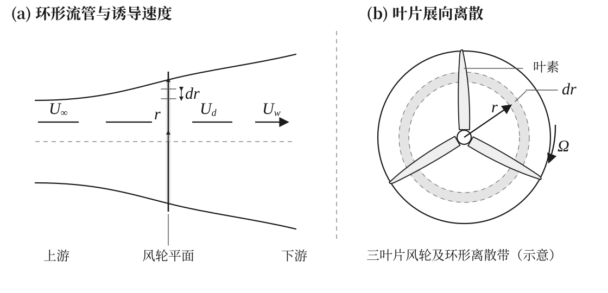
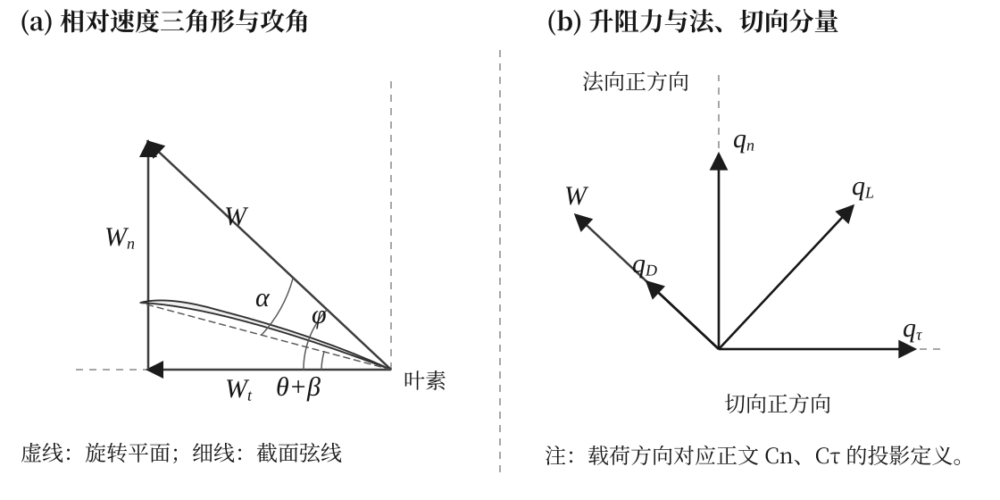

# 3.3 OpenFAST—ROSCO整机气动弹性模型

本节基于叶素动量理论建立风轮气动力的数学表达，结合历史AeroDyn输入说明模型参数，并依据虚功原理推导气动广义力及塔顶接口的力、矩转换关系。

### 3.3.1 叶素动量理论与叶片气动力计算

风轮气动力是混合塔架风致振动的主要激励之一。本文采用OpenFAST中的AeroDyn模块，基于叶素动量理论（Blade Element Momentum Theory，BEM）计算叶片分布气动力。BEM将环形流管的动量守恒与叶素截面的二维翼型气动力相结合，通过诱导因子建立来流速度与叶片荷载之间的关系[128-130]。

（1）环形流管动量理论

将风轮扫掠面沿径向划分为若干环形流管，取距旋转轴半径为r、径向宽度为dr的微元。在理想稳态、不可压缩、轴对称轴向来流条件下，忽略环形流管之间的径向交换。设无穷远上游风速为U∞，定义轴向诱导因子a，则叶轮平面风速Ud及远尾流风速Uw分别为

$$
U_d=U_\infty(1-a),\quad U_w=U_\infty(1-2a)\tag{3.3-1}
$$

由质量守恒，环形流管的质量流率为

$$
\mathrm d\dot m=2\pi\rho rU_\infty(1-a)\,\mathrm dr\tag{3.3-2}
$$

式中，ρ为空气密度。设Ω为风轮角速度，a′为切向诱导因子，经典旋转尾流模型的远尾流切向诱导速度幅值为2a′Ωr。由轴向动量与角动量守恒，环形流管的推力和转矩为

$$
\mathrm dT=4\pi\rho U_\infty^2a(1-a)r\,\mathrm dr\tag{3.3-3}
$$

$$
\mathrm dQ=4\pi\rho U_\infty\Omega a'(1-a)r^3\,\mathrm dr\tag{3.3-4}
$$

上述动量方程以无限叶片圆盘的理想流动假设为基础；有限叶片数导致的根部、尖部损失及高诱导区的非理想尾流效应将在后文修正。

图3.3-1  环形流管与叶片展向离散示意图

（2）叶素相对来流及气动力

叶片沿展向离散为若干气动计算截面，各截面的弦长、扭角及翼型系数由DTU 10 MW参考风轮的气动几何与翼型数据确定。取第b片叶片的局部法向及反旋转方向单位矢量分别为en和et，来流速度和气动截面运动速度分别为vw与vs。未计诱导的相对速度分量为

$$
V_{n,b}=\mathbf e_n^{\mathsf T}(\mathbf v_w-\mathbf v_s),\quad V_{t,b}=\mathbf e_t^{\mathsf T}(\mathbf v_w-\mathbf v_s)\tag{3.3-5}
$$

截面运动速度包含风轮旋转、机舱与塔顶运动以及叶片弹性变形引起的速度。在轴向均匀来流、刚性风轮且无整机平动的情形下，Vn=U∞、Vt=Ωr。考虑轴向、切向诱导作用后，局部相对速度分量及其合速度为

$$
W_n=V_n(1-a),\quad W_t=V_t(1+a')\tag{3.3-6}
$$

$$
W=\sqrt{W_n^2+W_t^2},\quad \phi=\operatorname{atan2}(W_n,W_t)\tag{3.3-7}
$$

式中，φ为相对来流方向与局部旋转平面之间的夹角。为说明变桨及结构扭转对攻角的影响，在不随截面扭转的局部参考平面内，攻角可表示为

$$
\alpha_b(r,t)=\phi_b(r,t)-\theta(r)-\beta_b(t)-\theta_{\mathrm{el},b}(r,t)\tag{3.3-8}
$$

式中，θ为初始几何扭角，β为变桨角，θel为弹性扭转角；实际截面姿态由气动与结构模块的坐标变换确定，已计入姿态的弹性扭转不再重复扣除。与固定桨距假设不同，本文的变桨角随控制器输出而变化。

图3.3-2  叶素相对速度、攻角及气动力分解示意图

根据二维翼型理论，叶素单位展长升力qL、阻力qD为

$$
q_L=\frac{1}{2}\rho W^2cC_L,\quad q_D=\frac{1}{2}\rho W^2cC_D\tag{3.3-9}
$$

式中，c为叶素弦长；CL、CD分别为升力系数和阻力系数，由局部攻角及翼型气动特性确定。将升阻力投影至风轮局部法向和旋转方向，分别定义法向气动力系数Cn和切向气动力系数Cτ：

$$
C_n=C_L\cos\phi+C_D\sin\phi,\quad C_\tau=C_L\sin\phi-C_D\cos\phi\tag{3.3-10}
$$

叶素单位展长法向力qn、切向力qτ及翼型俯仰力矩ma为

$$
q_n=\frac{1}{2}\rho W^2cC_n,\quad q_\tau=\frac{1}{2}\rho W^2cC_\tau\tag{3.3-11}
$$

$$
m_a=\frac{1}{2}\rho W^2c^2C_m\tag{3.3-12}
$$

其中，qn、qτ的单位为N/m；ma的单位为N·m/m；Cm为翼型俯仰力矩系数。对于具有B片相同叶片的稳态轴对称风轮，环形微元的气动力与转矩为

$$
\mathrm dT=Bq_n\,\mathrm dr,\quad \mathrm dQ=Brq_\tau\,\mathrm dr\tag{3.3-13}
$$

（3）诱导因子与有限叶片数修正

定义局部实度σr为叶片弦长总和与相应圆周长度之比：

$$
\sigma_r=\frac{Bc}{2\pi r}\tag{3.3-14}
$$

有限叶片数使叶尖与叶根附近的环量及诱导速度分布不同于无限叶片圆盘。AeroDyn采用Prandtl叶尖、叶根损失修正[129]，对应损失因子为

$$
F_{\mathrm{tip}}=\frac{2}{\pi}\arccos\!\left[\exp\!\left(-\frac{B(R-r)}{2r|\sin\phi|}\right)\right]\tag{3.3-15}
$$

$$
F_{\mathrm{hub}}=\frac{2}{\pi}\arccos\!\left[\exp\!\left(-\frac{B(r-R_h)}{2R_h|\sin\phi|}\right)\right]\tag{3.3-16}
$$

$$
F=F_{\mathrm{tip}}F_{\mathrm{hub}}\tag{3.3-17}
$$

式中，R为风轮半径，Rh为轮毂半径；Ftip和Fhub分别为叶尖与叶根损失因子。将动量方程（3.3-3）、（3.3-4）乘以F，并与叶素方程（3.3-13）联立，在正常发电、低诱导及分母非零的条件下可得

$$
a=\frac{\sigma_r C_n}{4F\sin^2\phi+\sigma_r C_n}\tag{3.3-18}
$$

$$
a'=\frac{\sigma_r C_\tau}{4F\sin\phi\cos\phi-\sigma_r C_\tau}\tag{3.3-19}
$$

当轴向诱导因子增大时，风轮后方尾流混合增强，经典轴向动量关系不再适用于高诱导区。定义环形推力系数CT,r为环形推力与参考动压乘环形面积之比，在正常轴向来流下有

$$
C_{T,r}=\frac{\mathrm dT}{\frac12\rho U_\infty^2(2\pi r\,\mathrm dr)}=\frac{\sigma_r C_n(1-a)^2}{\sin^2\phi}\tag{3.3-20}
$$

对于高诱导工况，采用含有限叶片数修正的Glauert–Buhl推力关系[128-130]：

$$
C_{T,r}=\begin{cases}4Fa(1-a),&0\le a\le0.4\\(\frac{50}{9}-4F)a^2-(\frac{40}{9}-4F)a+\frac89,&0.4<a<1\end{cases}\tag{3.3-21}
$$

高诱导区采用分段推力关系与叶素侧气动力方程联立求解。该表达在轴向诱导因子a=0.4处保持函数及一阶导数连续。对于偏航或倾斜来流引起的尾流偏斜，采用AeroDyn相应的Pitt/Peters修正方法[121,129]；反向流动、制动及数值奇异情形按照软件实现的对应分支处理。

（4）叶素动量方程的求解

由于诱导因子影响入流角，而入流角又决定攻角与气动力系数，叶素动量方程构成非线性耦合方程。AeroDyn采用Ning提出的入流角单变量求根方法[128,129]。在正常发电且速度分量非零的条件下，令λr=Vt/Vn，可将局部速度三角形的几何约束写为

$$
\mathcal R(\phi)=\frac{\sin\phi}{1-a(\phi)}-\frac{\cos\phi}{\lambda_r[1+a'(\phi)]}=0\tag{3.3-22}
$$

对每一时刻的叶片气动截面，由局部来流、截面速度及姿态确定未诱导速度分量；在给定入流角下计算攻角、翼型气动力系数与根尖损失因子，并根据诱导区间更新a及a′。在适当的入流角区间内对残差方程求根，收敛后计算相对速度及分布气动力。相较于直接对两个诱导因子进行固定点迭代，该方法通过单变量残差及分区间搜索改善收敛鲁棒性。

（5）风轮气动载荷积分

空间非均匀湍流条件下，各叶片瞬时气动载荷不同。对平直叶片及统一风轮轴向的简化情形，第b片叶片的法向、切向单位展长载荷分别为qn,b、qτ,b，则风轮推力和转矩为

$$
T(t)=\sum_{b=1}^{B}\int_{R_h}^{R}q_{n,b}(r,t)\,\mathrm dr\tag{3.3-23}
$$

$$
Q(t)=\sum_{b=1}^{B}\int_{R_h}^{R}r q_{\tau,b}(r,t)\,\mathrm dr\tag{3.3-24}
$$

风轮气动功率定义为

$$
P_{\mathrm a}(t)=\Omega(t)Q(t)\tag{3.3-25}
$$

对于预弯、倾斜和发生弹性变形的叶片，必须考虑气动截面坐标与全局坐标之间的转换。设Φb为截面局部至统一坐标系的旋转矩阵，fb和mb为截面单位展长气动力及力矩，xb为气动作用点坐标，xO为轮毂参考点，则气动力与力矩合量为

$$
\mathbf F_O=\sum_{b=1}^{B}\int\mathbf\Phi_b\mathbf f_b\,\mathrm ds\tag{3.3-26}
$$

$$
\mathbf M_O=\sum_{b=1}^{B}\int[(\mathbf x_b-\mathbf x_O)\times(\mathbf\Phi_b\mathbf f_b)+\mathbf\Phi_b\mathbf m_b]\,\mathrm ds\tag{3.3-27}
$$

式中，s为叶片展向坐标。风轮气动力矩在不同参考点之间的换算包括作用点位置引起的力臂矩；转子、机舱及传动部件的重力和惯性作用应另由对应的动力学方程计入。

### 3.3.2 气动模型设置与整机计算工况

本文DTU 10 MW整机筛选模型采用三片叶片。根据归档AeroDyn输入文件，空气密度取1.225 kg/m³，气动特性由六组翼型数据文件及攻角相关系数确定；采用准稳态BEM和稳态翼型气动模型，启用Prandtl叶尖与叶根损失、切向诱导、轴向及切向诱导中的阻力项、翼型俯仰力矩以及Pitt/Peters偏斜尾流修正。主要设置见下表。

| 参数 | 设置 | 物理含义 |
| --- | --- | --- |
| WakeMod / AFAeroMod | 1 / 1 | 准稳态BEM／稳态翼型气动 |
| SkewMod | 2 | Pitt/Peters偏斜尾流 |
| TipLoss / HubLoss | True / True | 叶尖／叶根损失 |
| TanInd / AIDrag / TIDrag | True / True / True | 切向诱导及诱导求解阻力项 |
| UseBlCm / AFTabMod | True / 1 | 翼型俯仰力矩／攻角表 |
| AirDens | 1.225 kg/m³ | 计算空气密度 |
| IndToler / MaxIter | Default / 500 | 残差容限／迭代上限 |
| TwrPotent / TwrShadow / TwrAero | 0 / 0 / False | 不计塔架局部流动及塔身气动力 |

归档的36组随机风工况采用上述AeroDyn参数计算整机运行响应。该模型选用准稳态BEM和稳态翼型气动，未启用动态入流与非定常翼型气动；TwrAero=False对应塔身阻力项未在AeroDyn中单独求解。因此，相关时程主要用于整机运行状态与塔架截面响应的统计分析。

### 3.3.3 分布气动力的广义力投影与塔顶接口力系

叶片展向气动力与结构广义坐标之间可通过虚功关系建立映射。参考文献[1]采用八自由度简化模型得到广义气动力表达；本文采用与结构运动坐标相适应的一般雅可比形式，分别描述叶片平动和转动对广义力的贡献。

设第b片叶片在展向位置处的单位展长气动力及截面力矩均已转换至统一全局坐标系，相应虚位移与虚转角由结构运动决定，则叶片分布气动力的虚功为

$$
\delta W_{\mathrm a}(t)=\sum_{b=1}^{B}\int_{s_h}^{s_R}\left[\left(\mathbf f_b^{G}\right)^{\mathsf T}\delta\mathbf u_b+\left(\mathbf m_b^{G}\right)^{\mathsf T}\delta\boldsymbol\vartheta_b\right]\,\mathrm ds\tag{3.3-28}
$$

式中，积分上下限分别表示叶片气动加载区间的起点和终点；截面力矩项包含翼型俯仰力矩，不能再重复计入相同作用点偏置所产生的力矩。设结构广义坐标涵盖参与运动的刚柔体自由度，叶片截面的平动与转动虚运动分别通过运动学雅可比矩阵表示：

$$
\delta\mathbf u_b=\mathbf J_{u,b}\,\delta\mathbf q,\qquad\delta\boldsymbol\vartheta_b=\mathbf J_{\vartheta,b}\,\delta\mathbf q\tag{3.3-29}
$$

将式（3.3-29）代入式（3.3-28），利用虚功对广义虚位移的功共轭关系，得到气动广义力：

$$
\mathbf Q_{\mathrm a}(t)=\sum_{b=1}^{B}\int_{s_h}^{s_R}\left[\mathbf J_{u,b}^{\mathsf T}\mathbf f_b^{G}+\mathbf J_{\vartheta,b}^{\mathsf T}\mathbf m_b^{G}\right]\,\mathrm ds\tag{3.3-30}
$$

将截面平动和转动雅可比代入虚功表达式，可得到包含叶片刚体运动及弹性变形贡献的广义气动力。该式与参考文献[1]的八自由度表达遵循相同的虚功原理，但广义坐标及自由度划分不同。

设塔顶接口参考点为T，以右手坐标系定义该点三向合力及三向合矩，并将其组成六分量广义力；塔顶平动与小转角组成相应的功共轭广义虚位移。接口荷载的虚功为

$$
\delta W_T=\mathbf F_T^{\mathsf T}\delta\mathbf u_T+\mathbf M_T^{\mathsf T}\delta\boldsymbol\vartheta_T=\mathbf w_T^{\mathsf T}\delta\mathbf x_T\tag{3.3-31}
$$

对于第3.3.1节在轮毂参考点O积分得到的纯气动合力与合矩，将其等效至塔顶参考点T而不改变作用效果时，应采用同一时刻、同一全局坐标系中的力矩换点关系：

$$
\mathbf F_T^{\mathrm a}=\mathbf F_O,\qquad\mathbf M_T^{\mathrm a}=\mathbf M_O+(\mathbf x_O-\mathbf x_T)\times\mathbf F_O\tag{3.3-32}
$$

式中，上标a表示风轮叶片气动力。RNA作用于塔架的接口力系还包含上部部件重力、惯性及传动作用，须按所采用的自由体边界统一表达。塔底截面力和截面弯矩属于结构响应量，与叶片气动力及塔身分布外风载分别定义。

历史AeroDyn工况的TwrAero=False，故塔身阻力未包含在相应气动计算中。风轮气动力、RNA接口反力与塔身分布力在结构模型中分别处理，其参考点转换、作用方向和动力项归属通过相同时间基准进行校核。

### 3.3.4 塔身分布气动力及塔顶力学接口

除风轮叶片气动力外，混合塔架表面还受到沿高程分布的风作用。采用阻力型近似表示塔身横向气动力时，风速应取相对于结构运动的局部来流。AeroDyn输入参数TwrAero控制是否计算塔身气动阻力[129,131]；在本文归档的历史工况中，该参数为False。

对于横向绕流阻力主导的圆形截面，设塔架高度为z、外径为D(z)、阻力系数为C_{D,t}(z)，局部相对风速在截面法平面内的分量为v_{rel,⊥}(z,t)，则单位高度的阻力矢量为

$$
\mathbf p_{\mathrm t}(z,t)=\frac12\rho C_{D,\mathrm t}(z)D(z)\left\|\mathbf v_{\mathrm{rel},\perp}(z,t)\right\|\mathbf v_{\mathrm{rel},\perp}(z,t)\tag{3.3-33}
$$

式中，ρ为空气密度，p_t的量纲为N/m。相对风速为局部来流速度与结构速度之差在截面法平面内的投影。阻力系数与雷诺数、表面粗糙度及截面几何有关；对钢—混转换区等非理想圆柱部位，应采用与实际截面条件相适应的气动参数。

设塔顶参考点T的位置矢量为x_T，高程z处塔架轴线的位置矢量为x(z)。沿高程分布的塔身气动力关于T点的合力和合矩为

$$
\mathbf F_{T}^{\mathrm t}(t)=\int_{z_0}^{z_H}\mathbf p_{\mathrm t}(z,t)\,\mathrm dz,\qquad \mathbf M_{T}^{\mathrm t}(t)=\int_{z_0}^{z_H}[\mathbf x(z)-\mathbf x_T]\times\mathbf p_{\mathrm t}(z,t)\,\mathrm dz\tag{3.3-34}
$$

式中，z_0和z_H分别为塔身受风区间的下、上边界。式（3.3-34）表示分布外力对塔顶参考点的静力等效关系；计算塔架局部响应时，应按结构离散保留相应高程上的分布载荷。历史模型的塔架气动节点设置不构成完整158 m塔身外风载时程。

以RNA为自由体，并将其所受力及力矩统一表示至塔顶参考点T。定义w_T^{RNA→tower}为RNA施加于塔架的六维作用力系，w_T^a、w_T^g和w_T^{other}分别为气动、重力及其他外部作用的等效力系，w_T^{in}为根据Newton–Euler方程建立的RNA惯性力系，则满足

$$
\mathbf w_{T}^{\mathrm{RNA}\to\mathrm{tower}}=\mathbf w_{T}^{\mathrm a}+\mathbf w_{T}^{\mathrm g}+\mathbf w_{T}^{\mathrm{other}}-\mathbf w_{T}^{\mathrm{in}}\tag{3.3-35}
$$

式（3.3-35）中各力系均采用相同惯性坐标、参考点和载荷正方向。RNA重力与惯性贡献由结构质量表示及接口力系的定义共同确定；采用显式RNA质量的结构模型时，应扣除接口中重复包含的对应惯性与重力项。

以独立接口力系与自由体平衡所得等效力系分别记为(F_T^{int},M_T^{int})和(F_T^{bal},M_T^{bal})，则接口合力与合矩的平衡残差定义为

$$
\mathbf r_F(t)=\mathbf F_T^{\mathrm{int}}(t)-\mathbf F_T^{\mathrm{bal}}(t),\qquad \mathbf r_M(t)=\mathbf M_T^{\mathrm{int}}(t)-\mathbf M_T^{\mathrm{bal}}(t)\tag{3.3-36}
$$

其中，r_F和r_M的单位分别为N和N·m。两类残差分别按各自量纲进行归一化和误差评价。时程对比采用一致的时间戳、坐标轴和参考点，并计入力矩换点引起的变化。

定义塔顶平动速度为v_T，角速度为ω_T，以塔架所受力和力矩为正方向，则塔顶接口的瞬时功率及广义功率表达式为

$$
\mathcal P_T(t)=\mathbf F_T^{\mathsf T}\mathbf v_T+\mathbf M_T^{\mathsf T}\boldsymbol\omega_T=\mathbf Q_T^{\mathsf T}\dot{\mathbf q},\qquad \mathbf Q_T=\mathbf J_T^{\mathsf T}\mathbf w_T\tag{3.3-37}
$$

式中，J_T表示塔顶六维速度对结构广义速度的雅可比矩阵，Q_T为相应广义作用力。式（3.3-37）给出力系与运动变量的功共轭条件，离散时程计算中还需考虑时间积分和数值插值误差。

上述关系为风轮气动力、塔身分布力与RNA连接作用建立统一的力学表示。本文历史风工况的塔身独立气动力输入尚未形成覆盖全塔高程的同步时程，因此该部分采用解析阻力与接口平衡关系描述，后续结构响应评价以独立载荷时程和动力条件为依据。

[128] NING S A. A simple solution method for the blade element momentum equations with guaranteed convergence[J]. Wind Energy, 2014, 17(9): 1327-1345. DOI: 10.1002/we.1636.

[129] NING S A, HAYMAN G, DAMIANI R, JONKMAN J. Development and validation of a new blade element momentum skewed-wake model within AeroDyn[R]. NREL/CP-5000-63217, 2014.

[130] BUHL M L Jr. A new empirical relationship between thrust coefficient and induction factor for the turbulent windmill state[R]. NREL/TP-500-36834, 2005.

[131] OPENFAST. AeroDyn input file documentation (TwrAero option)[EB/OL]. https://openfast.readthedocs.io/en/v3.5.3/source/user/aerodyn/input.html.
