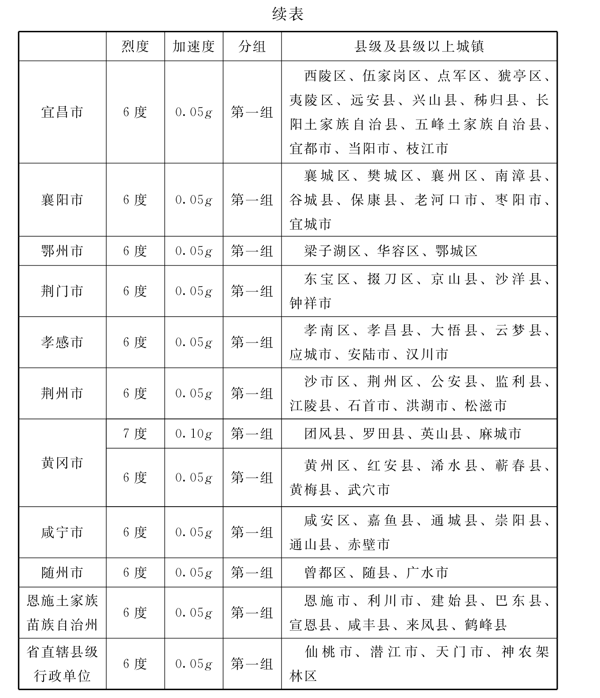
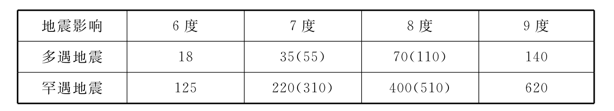
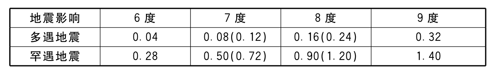
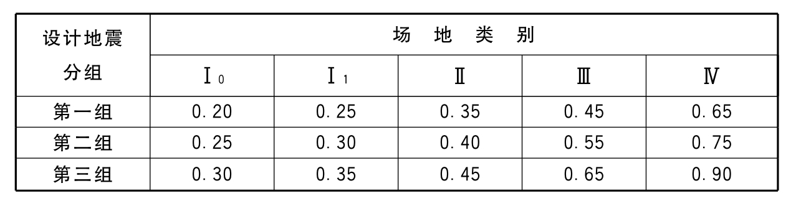
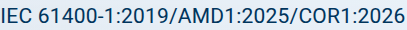
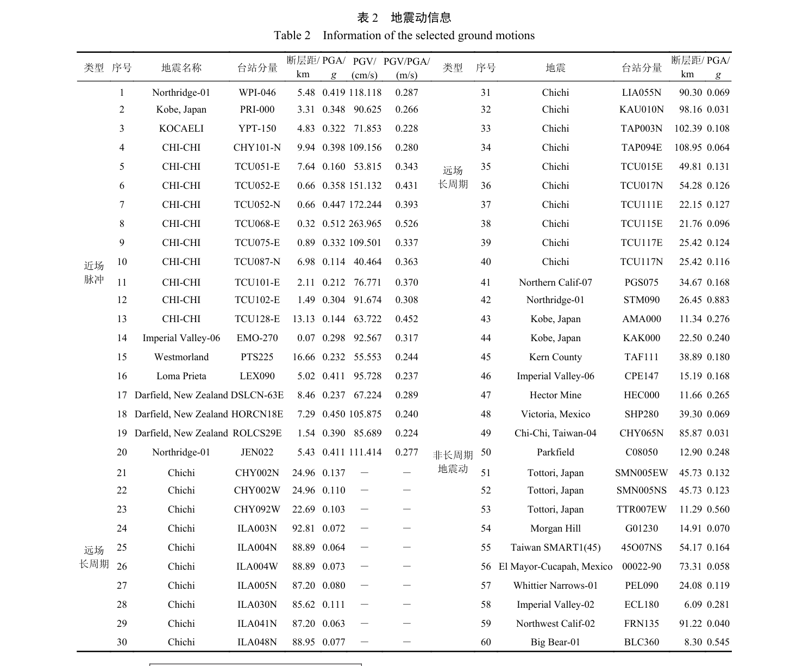
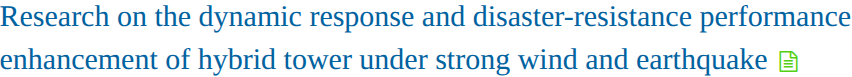
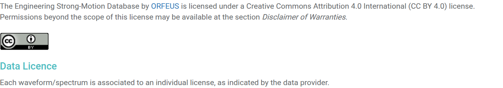

# 地震选波原始证据图册（2026-11-24）

仅显示实际获取并通过格式及来源身份检查的原图；失败保留原始错误。登记页不是规范全文，截图不是地震波原件。完整版权文件不重新分发。

|证据|状态|范围|
|---|---|---|
|GB_A017_JIAYU|CAPTURED|unmodified original source table image; visual content requires review|
|GB_5122_PGA|CAPTURED|unmodified original source table image; visual content requires review|
|GB_5141_ALPHA|CAPTURED|unmodified original source table image; visual content requires review|
|GB_5142_TG|CAPTURED|unmodified original source table image; visual content requires review|
|GB_514_OVER6S|CAPTURED|clause excerpt|
|NBT11600|CAPTURED|registration only|
|NBT10907|CAPTURED|registration only|
|GB18306|CAPTURED|registration only|
|GB18306_AMD2026|HOLD|official notice|
|IEC61400_2025|CAPTURED|registration only|
|IEC61400_COR2026|CAPTURED|registration only|
|DNV0585|CAPTURED|registration only|
|DAI2021_TABLE2|CAPTURED|table crop only; no full paper redistribution|
|ENERGIES2021|HOLD|short method excerpt, open access|
|CHINA_RE2024|HOLD|metadata only|
|DISASTER2025|CAPTURED|metadata only|
|RCNS2026|CAPTURED|metadata only|
|SDEE2026|HOLD|metadata only|
|OCEAN2026_VERIFIED|HOLD|metadata only; corrected DOI 10.1016/j.oceaneng.2026.125907|
|PEER|CAPTURED|database identity only|
|ESM|CAPTURED|database identity only|

## GB_A017_JIAYU

来源：https://gf.cabr-fire.com/Web/uploads/allimg/230914/153403I32-34.jpg
范围：unmodified original source table image; visual content requires review

SHA-256: e9e698c5e9dc0f36af6561a132c0150950985e0729941799190327bf56e3a67a

## GB_5122_PGA

来源：https://gf.cabr-fire.com/Web/uploads/allimg/230518/14192U142-1.jpg
范围：unmodified original source table image; visual content requires review

SHA-256: 37e8e81d3bfa5707f62a0ca9bf88e065fbb8b0906459d60923691f81f48e5581

## GB_5141_ALPHA

来源：https://gf.cabr-fire.com/Web/uploads/allimg/230518/14192Q427-3.jpg
范围：unmodified original source table image; visual content requires review

SHA-256: 98abe4e5a457d5d7948c8258388d389e380cb0605d13959717ee8b831ac627e5

## GB_5142_TG

来源：https://gf.cabr-fire.com/Web/uploads/allimg/230518/14192VM3-4.jpg
范围：unmodified original source table image; visual content requires review

SHA-256: 2df9176531765f1bd7c4a791175b422bf044e9d29059edee63beb77613c8a6eb

## GB_514_OVER6S

来源：https://gf.cabr-fire.com/article-15665.htm
范围：clause excerpt

SHA-256: bf824ce4680eb6cd8ab53c230814643641e115104ea285af5947ecab35ceac17

## NBT11600

来源：https://std.samr.gov.cn/hb/search/stdHBDetailed?id=27F4946613AA0758E06397BE0A0A01BA
范围：registration only

SHA-256: a0254cf46824ddb22d1457a69c048514e7d10135d05bee0dc37e39a65054dd43

## NBT10907

来源：https://hbba.sacinfo.org.cn/stdDetail/95e0a39923ba033c47f917f3691d2f6f940f1e0488ca5b0a4e50e0ae665afcf5
范围：registration only

SHA-256: a70f962158e5ecdaef640ee37a7ea891c9f42ed43220f17d62d48b6a514e572f

## GB18306

来源：https://openstd.samr.gov.cn/bzgk/std/newGbInfo?hcno=EC0585F90CA21ABE02826394F266B623
范围：registration only

SHA-256: f9ba412a06fff50d61a835e32dc7f4838f331a19a20ba3300ea4462e7aed3239

## GB18306_AMD2026

来源：https://dzj.baoji.gov.cn/col3813/col3811/202604/t20260407_1261239.html
范围：official notice

**HOLD：** Page.goto: Timeout 32000ms exceeded.
Call log:
  - navigating to "https://dzj.baoji.gov.cn/col3813/col3811/202604/t20260407_1261239.html", waiting until "domcontentloaded"

## IEC61400_2025

来源：https://webstore.iec.ch/en/publication/111042
范围：registration only

SHA-256: f183a25fd815b4eb18a5407ae588c110839dd1d0e433f682526808fe16513c4f

## IEC61400_COR2026

来源：https://webstore.iec.ch/en/publication/116398
范围：registration only

SHA-256: 6214bcce9a2c0abcc4522e2bb41ccde7e3e8708aa5bccb04ec018933828532c4

## DNV0585

来源：https://www.dnv.com/energy/standards-guidelines/dnv-rp-0585-seismic-design-of-wind-power-plants/
范围：registration only

SHA-256: d59eeca65409f0de7dafd5590011fcdbb51e731c0c8d97a457d5b9bd84309de4

## DAI2021_TABLE2

来源：https://pubs.cstam.org.cn/data/article/em/preview/pdf/2021-0121.pdf
范围：table crop only; no full paper redistribution

SHA-256: 20a5027c9d090630348e4b93f3932dd47292f3efd4bb0d3e8110965074de3362

## ENERGIES2021

来源：https://www.mdpi.com/1996-1073/14/12/3496
范围：short method excerpt, open access

**HOLD：** source HTTP unavailable

## CHINA_RE2024

来源：https://castjournals.cast.org.cn/joweb/kzsny/CN/1154430577907327838
范围：metadata only

**HOLD：** Locator.wait_for: Timeout 10000ms exceeded.
Call log:
  - waiting for get_by_text("刘嘉琳").first to be visible
    22 × locator resolved to hidden 
…

## DISASTER2025

来源：https://ddyj.cbpt.cnki.net/portal/journal/portal/client/paper/acfb3e65a76cba1f749899361584aad4
范围：metadata only

SHA-256: dd002d915da1087463de70088663f8f74b28c65529ddd8aec9d63edc84f0277e

## RCNS2026

来源：https://journal.hep.com.cn/rcs/EN/2026/5/2
范围：metadata only

SHA-256: b207f831fa4af4ccc5ec86de2f759fe545c713e35ee633c75c62cff02bdaf0d9

## SDEE2026

来源：https://www.sciencedirect.com/science/article/abs/pii/S0267726125008577
范围：metadata only

**HOLD：** source HTTP unavailable

## OCEAN2026_VERIFIED

来源：https://www.sciencedirect.com/science/article/abs/pii/S0029801826017415
范围：metadata only; corrected DOI 10.1016/j.oceaneng.2026.125907

**HOLD：** source HTTP unavailable

## PEER

来源：https://ngawest2.berkeley.edu/
范围：database identity only

SHA-256: df9af1e19d413465709056871f3aae46e8ac5b9f6276269932f7e14e124dfc26

## ESM

来源：https://esm-db.eu/
范围：database identity only

SHA-256: 3063cf8d848540f15bde7365ead74d76537fe2e4afba36fb924c463545b5d8c5
