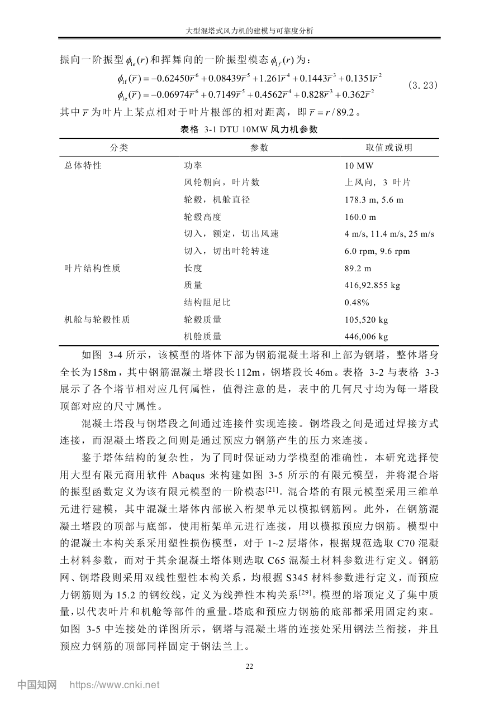
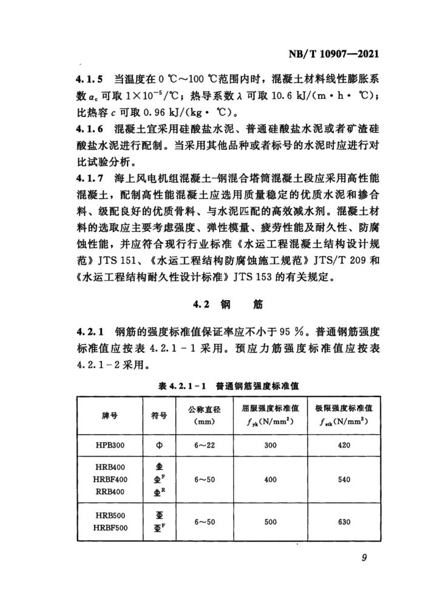
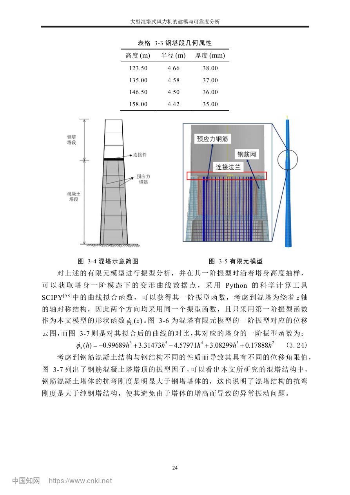
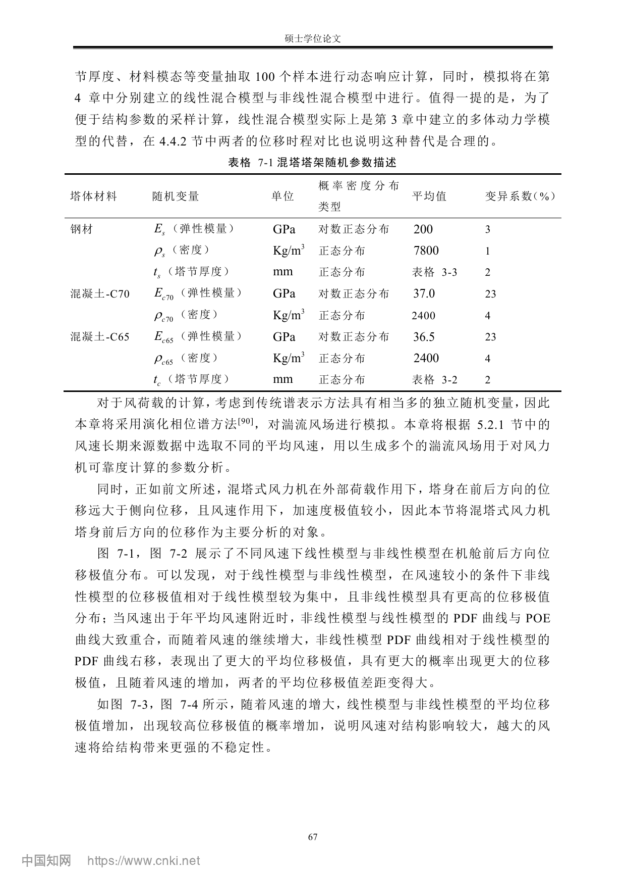
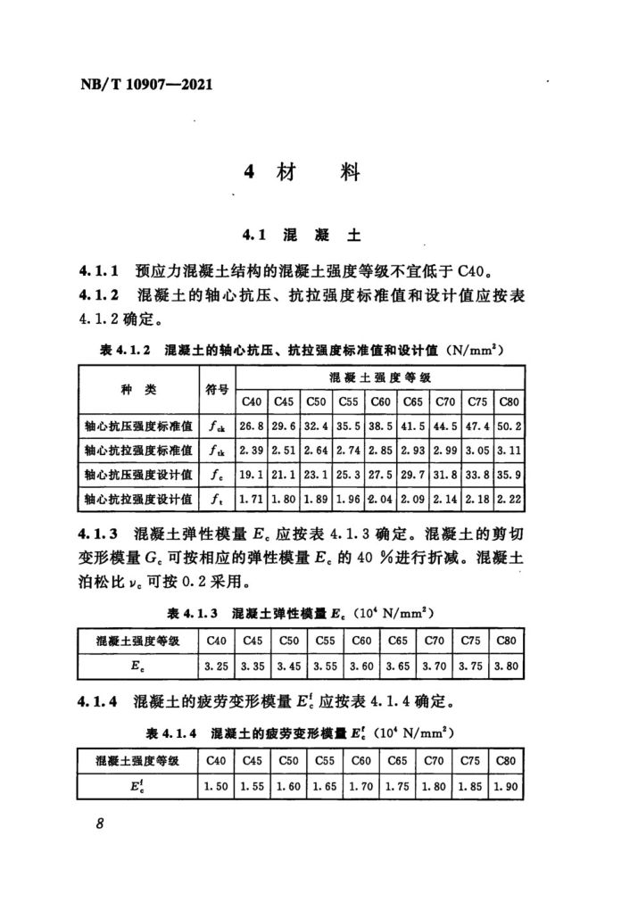
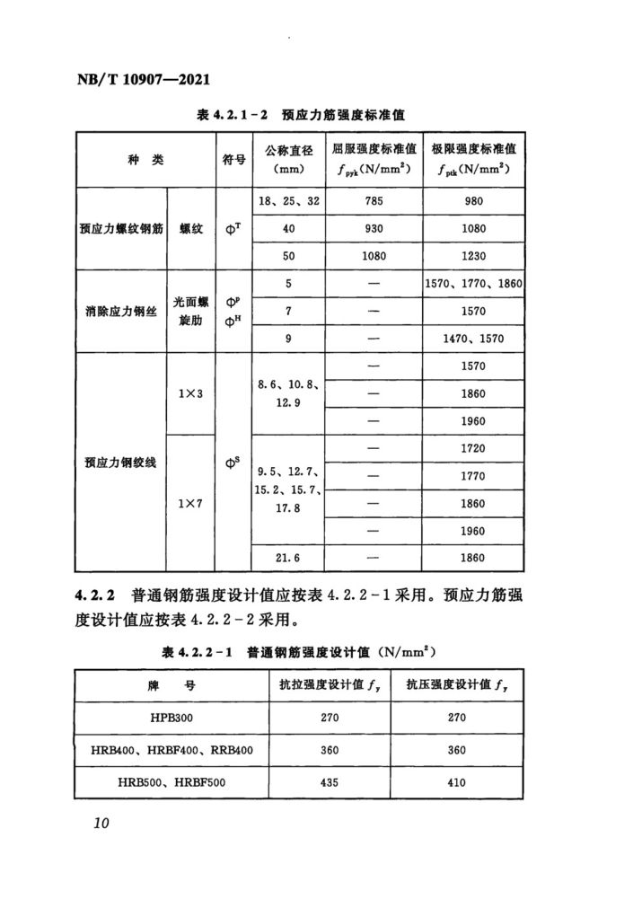
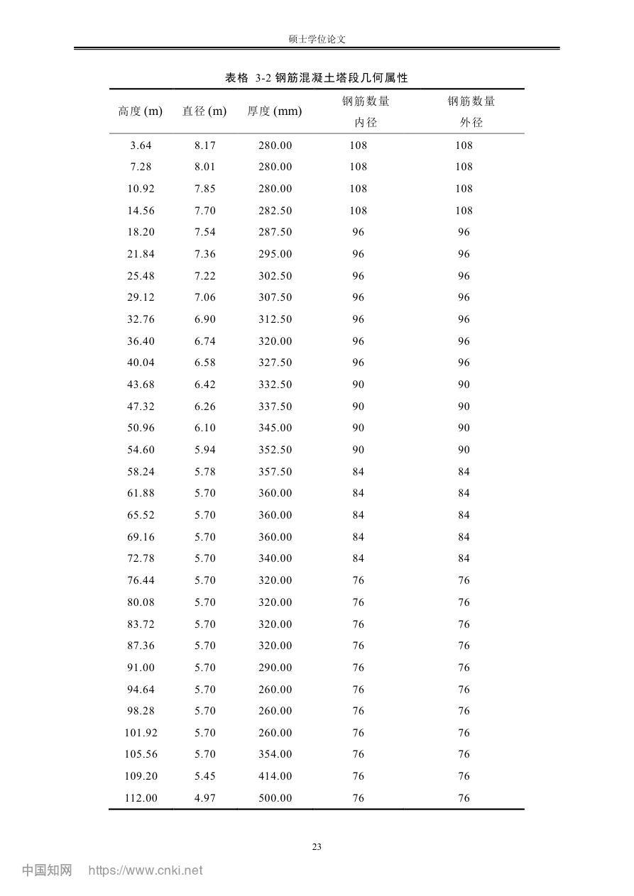
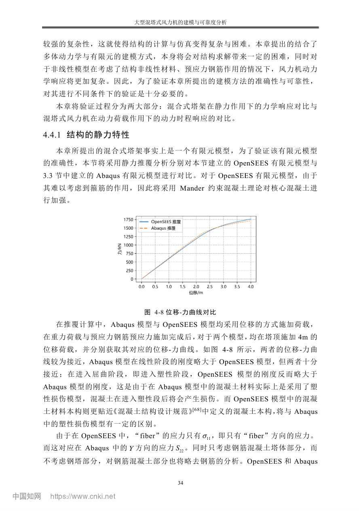

### 2026-11-24｜v0.32.158 PATCH — REV12_CYCLIC_SENS 钢材循环混合强化对照

**SOURCE / 版本身份：** 母本 REV11 SHA256 `fa27040f66b1c6d85fe1c4d863fb62d1423960972a1cdf08fc9dbb0871b1e5fd`；独立对照 HE_REV12_CYCLIC_SENS.inp SHA256 `b2ad06256505ca556b2db7a19a5270be9481e8ecab0967bd23206255fdb7c686`，34227427 bytes。工作室 main commit c659d7e2b7be7e64e78014178af9cd24605e5eaf，保存完整云端原件、可复现差异/脚本/审计；manifest仍以REV11为当前母本，REV12_CYCLIC_SENS为显式对照候选。用户要求快且可靠，不以不明来源参数覆盖正式母本。

#### 1. 实际文献参数与来源层级

赵卫平等，《钢筋混凝土梁柱边节点滞回性能数值模拟》，哈尔滨工业大学学报2024,56(2):37–47，[DOI](https://doi.org/10.11918/202211015)，正文42页§3.2.2表3/4、图11；HRB400E的Voce R0=0、E205GPa、R∞21MPa、b1.2，4对背应力参数如下。正文表2直径16/18mm钢筋屈服445MPa、E205GPa。追溯参考文献[24]为石永久等2012结构钢循环试验，而非已取得HRB400原始循环曲线，故不能冒称已完成本塔HRB400标定。

郏洲等，《斜拉桥钢塔地震损伤特性及输入地震动参数的影响》，浙江大学学报(工学版)2024,58(4):817–827，[DOI](https://doi.org/10.3785/j.issn.1008-973X.2024.04.017)，§1.2表3，Q355混合强化 σ0=391.2MPa、Q∞21MPa、b10、C1–4均1800MPa、γ1–4为245/155/50/30。原文研究22–32mm桥塔钢板，参考[21]为王彤2016桥梁结构钢材学位论文，原始试验未取得，不等于本塔35–39mm板材实测。

|参数|HRB400E文献迁移候选|Q355文献迁移候选|
|---|---:|---:|
|Q∞ (MPa)|21|21|
|b|1.2|10|
|C1 (MPa)|7993|1800|
|γ1|175|245|
|C2 (MPa)|6773|1800|
|γ2|116|155|
|C3 (MPa)|2854|1800|
|γ3|34|50|
|C4 (MPa)|1450|1800|
|γ4|29|30|
|本次保留母本E (GPa)|200|206|
|本次保留母本初始真应力 (MPa)|400.8|345|

只迁移强化系数；保持REV11 HRB400名义400MPa对应首行真应力400.8MPa、Q355板厚对应345MPa，不使用异批实测屈服。此组合未标定，不宣称原文模型完整复现。原型和专项规范关键已有原图：





#### 2. 实际INP改动与官方实现

使用[Abaqus官方 *PLASTIC](https://docs.software.vt.edu/abaqusv2026/English/SIMACAEKEYRefMap/simakey-r-plastic.htm) 与[*CYCLIC HARDENING](https://docs.software.vt.edu/abaqusv2026/English/SIMACAEKEYRefMap/simakey-r-cyclichardening.htm)。4组背应力共9个参数（首行8项，次行余项），强度及C为Pa，Q∞为Pa；γ、b无量纲。实际新材料关键词如下，非示意：

```inp
** Cross-study sensitivity only; retain parent initial yield and elasticity.
*Plastic, hardening=COMBINED, data type=PARAMETERS, number backstresses=4
345000000, 1800000000, 245, 1800000000, 155, 1800000000, 50, 1800000000,
30
*Cyclic Hardening, parameters
345000000, 21000000, 10
```

```inp
** Cross-study sensitivity only; retain parent initial yield and elasticity.
*Plastic, hardening=COMBINED, data type=PARAMETERS, number backstresses=4
400800000, 7993000000, 175, 6773000000, 116, 2854000000, 34, 1450000000,
29
*Cyclic Hardening, parameters
400800000, 21000000, 1.2
```

原材料名、全部截面赋值、密度、几何、预应力、接触、混凝土、分析步逐字保持；103/103 Part闭合，3处差异，逆补丁逐字恢复REV11。整机理论质量不变。无原生求解。

#### 3. RUN — 单轴独立循环积分

从REV11的真实15点HRB400曲线及钢塔线性随动模型出发，对两种材料分别进行原模型/混合强化模型对照。工程应变端点±0.1%、±0.5%、±1%、±2.2%转换为对数应变ln(1±A)，10周/工况，先拉后压，单轴加性小弹性应变近似。Voce屈服面半径Y=σ0+Q∞(1−exp(−bp))；对于流动方向s=±1的塑性增量Δp，背应力精确更新Xk,new=Xk,old exp(−γkΔp)+s(Ck/γk)(1−exp(−γkΔp))，二分求解一致性条件。与既有单轴材料检查同口径，非有限元整塔响应。下表为实际真应力峰值（MPa），base=REV11，combined=对照。

|材料|工程幅%|模型|第1周拉峰|第1周压峰|第10周拉峰|第10周压峰|
|---|---:|---|---:|---:|---:|---:|
|HRB400|0.1|base|199.900|-200.100|199.900|-200.100|
|HRB400|0.1|combined|199.900|-200.100|199.900|-200.100|
|HRB400|0.5|base|402.001|-404.412|559.277|-568.238|
|HRB400|0.5|combined|445.713|-453.851|453.165|-453.324|
|HRB400|1.0|base|404.000|-422.545|612.306|-612.306|
|HRB400|1.0|combined|496.685|-516.676|517.960|-518.215|
|HRB400|2.2|base|415.666|-485.197|612.306|-612.306|
|HRB400|2.2|combined|558.273|-581.695|588.373|-588.769|
|Q355_TOWER_T16_40|0.1|base|205.897|-206.103|205.897|-206.103|
|Q355_TOWER_T16_40|0.1|combined|205.897|-206.103|205.897|-206.103|
|Q355_TOWER_T16_40|0.5|base|351.824|-351.876|351.824|-351.876|
|Q355_TOWER_T16_40|0.5|combined|365.091|-369.589|380.818|-381.222|
|Q355_TOWER_T16_40|1.0|base|362.048|-362.254|362.048|-362.254|
|Q355_TOWER_T16_40|1.0|combined|386.122|-396.436|409.660|-409.816|
|Q355_TOWER_T16_40|2.2|base|386.379|-387.376|386.379|-387.376|
|Q355_TOWER_T16_40|2.2|combined|416.514|-435.116|444.224|-444.228|

16组实际运行均完成；200/400步每半周峰值最大差 1.233502e-11 MPa、屈服一致性正残差最大 9.663381e-12 MPa。HRB400候选在±1%第10周拉峰517.96MPa，低于等向强化612.306MPa；但本身仍有正向循环硬化，并不复现张等2016普通HRB400疲劳退化。不得据此宣称改进的物理精度已验；真实滞回圈、峰值退化、耗能及疲劳均需独立试验。原生NOT_RUN；不改变历史结果。

#### 4. HPB300与法兰的进一步追源

- [Buildings 2022,12,1264](https://doi.org/10.3390/buildings12081264) 表4给出同直径6mm HPB300试件fy392MPa、fu581MPa、εy0.00191，实测非本塔，不替换规范300/420。
- [Zhang等 Frontiers in Materials 2025,12:1694140](https://doi.org/10.3389/fmats.2025.1694140) PDF表5三段式HPB300候选E210GPa、fy300/fu420MPa、强化起点0.00343、峰值0.05；用于PHC管桩预应力筋，且材料角色与常规预应力高强钢筋不同，非φ6拉筋循环试验；不移植应变锚点。HPB300保留REV11理想弹塑性候选，需真实应力–应变曲线；避免无依据硬化。
- GB/T44508—2024的官方征求意见稿编制说明（2023年7月，第4节主要试验或验证情况）说明正火或正火+回火环锻件的试验符合GB/T1591 Q355NE要求；此为编制说明，非最终标准材料表。继续保留原型未知、REV11普通热轧100mm钢板315MPa候选及金风整锻320MPa对照依据，不认定实际原型为整锻。何图3-5原页：



#### 5. 归档及证据完整性

- main c659d7e2b7be7e64e78014178af9cd24605e5eaf，工作室档案目录 `public/thesis-studio/inp-archive/REV12_CYCLIC_SENS/` 包含patch.json（blob f26d0347444f638e1a1a65132c8c15ebe745e1e3）、audit.json（blob 58fe5afe81cd06751ba81a7142815f9a5c2bf64a）、revise_rev12_sens.py、MATERIAL_EVIDENCE.md；完整INP另有Google Drive备份。远端补丁逐字核对成功，母本REV11未覆盖。
- 本轮实质取得新文献表3/4、表3和HPB300文献表4/5的原文事实，但PDF截图请求失败，公开转载许可未确认的期刊不复制；CC BY管桩文献的原PDF下载失败，未归档其字节。以上三张为已有真实归档原页直接内嵌，其他新原页仍待补，绝不把外链/重绘称原图。页面部署未验。
- 结论：获得两套完整混合强化候选，独立对照已生成与归档、完成解析数值检查；尚未获得本塔HRB400/HPB300/Q355试验参数、法兰原型证明或原生单元/整塔求解结果，正式抗震材料验收HOLD。白皮书升级不等于主模型升级。

### 2026-11-24｜v0.32.157 PATCH — HRB400循环本构否证、低周疲劳复算及整锻法兰证据

**SOURCE/身份：** REV11原始审计来自main 5183ea999031245c1de384164997e0ee083c0ce5，audit Git blob ca84353a8fe53cf59b3d5c6a911f9c8d8cf53f35，目标INP SHA256 fa27040f66b1c6d85fe1c4d863fb62d1423960972a1cdf08fc9dbb0871b1e5fd。不修改INP、不生成REV12。研究目的为确定是否有足够依据替换循环本构、独立核算已有文献和候选材料响应。原生NOT_RUN。

#### 1. 试验来源及适用范围

张耀庭、赵壁归、李瑞鸽、杜晓菊，2016，《工程力学》33(4):121–129，[DOI 10.6052/j.issn.1000-4750.2014.09.0744](https://doi.org/10.6052/j.issn.1000-4750.2014.09.0744)，[出版方PDF](https://pubs.cstam.org.cn/data/article/em/preview/pdf/20160416.pdf)。实际核读表1（正文123页/PDF3）、表2（正文124–125/PDF4–5）、式(7)–(11)（126–127页）、表3及结论。PDF3实际截图核读；其余截图请求超时但PDF文本及表格已读。表1实测均值：fy451.97 MPa、E197816.67 MPa、强化起点切线6595.67 MPa、强化起点应变1.64%、峰值638.9 MPa及应变13.39%。REV11名义强度400/540 MPa与这些试件实测值不同，且直线强化并非试验曲线的完整复现。研究用14个试件、7个工程总应变幅(±1.0%至±2.2%)，源疲劳关系基于应变控制对称循环；不可将范围当幅值或将累积等效塑性应变PEEQ当循环范围。

专项规范材料原图再次就地显示（已存在的用户研究证据）：


#### 2. RUN：原论文式(7)逐试件复算

塑性应变范围（无量纲）与疲劳寿命关系：εp=0.14001(2Nf)^(-0.38656)。反演 Nf=0.5(0.14001/εp)^(1/0.38656)。式(8)退化关系 εp=0.37888 φSR^0.37158；式(9)–(11)的Reinforcing Steel参数 Cf=.140、Cd=.379、α=.379属于OpenSees模型，不能直接填写Abaqus Chaboche C、γ、Q∞、b。下表为表2事实数据及独立复算，百分数转换为无量纲。误差=100×(预测/实测−1)。

|试件|总应变幅%|塑性应变范围%|试验寿命周|公式复算周|误差%|
|---|---:|---:|---:|---:|---:|
|LY1-1|1.0|1.56|123|146.014|18.71|
|LY1-2|1.0|1.57|137|143.620|4.83|
|LY2-1|1.2|1.91|90|86.493|-3.90|
|LY2-2|1.2|1.88|84|90.109|7.27|
|LY3-1|1.4|2.24|59|57.270|-2.93|
|LY3-2|1.4|2.29|57|54.091|-5.10|
|LY4-1|1.6|2.72|36|34.657|-3.73|
|LY4-2|1.6|2.73|37|34.330|-7.22|
|LY5-1|1.8|3.10|23|24.710|7.44|
|LY5-2|1.8|3.01|27|26.667|-1.23|
|LY6-1|2.0|3.45|20|18.737|-6.32|
|LY6-2|2.0|3.38|18|19.757|9.76|
|LY7-1|2.2|3.85|17|14.108|-17.01|
|LY7-2|2.2|3.79|13|14.693|13.02|

14试件MAPE=7.748098%，属于原拟合数据的复算（非独立验证）。后续若作低周疲劳后处理，须提取有符号轴向塑性应变或一致的应力-总应变范围，计算同一循环的塑性范围；不将PEEQ当应变幅。损伤累加、变幅载荷及平均应力效应需独立验证，禁止将试件寿命直接当整塔寿命。

#### 3. RUN：REV11材料等向强化的反复加载独立算术检查

采用实际15点真应力-累积塑性应变表（本白皮书v0.32.156已经全录），E=200000 MPa、单轴小弹性应变加性近似；工程应变目标转换为ln(1±A)，先拉后压，重复10次。试应力 σtrial=E(ε−εpl)，当 |σtrial|>Y(p) 时二分求解 |σtrial|−EΔp−Y(p+Δp)=0，线性插值屈服表，超末点按末值612.306MPa保持；更新有符号塑性应变及累积p。200步/半周与400步/半周复算峰值最大差=1.591616e-12 MPa，属于数值积分重复性而非原生或物理验收。应力为真应力，不直接与工程试验应力作同口径误差。

|工程幅%|周次|拉峰MPa|压峰MPa|累积塑性应变p|
|---:|---:|---:|---:|---:|
|1.0|1|404.000000|-422.544724|0.02379827|
|1.0|2|449.574206|-477.152113|0.05480538|
|1.0|10|612.306000|-612.306000|0.28006534|
|2.2|1|415.665740|-485.196950|0.05918595|
|2.2|2|560.533402|-612.306000|0.13610730|
|2.2|10|612.306000|-612.306000|0.74225195|

结论：现有等向强化曲线对称塑性反复加载会随p增长持续扩张屈服面，且没有损伤/断裂机制；该行为与张等试验表2出现的循环峰值降低不能等同。到达612.306MPa末点仅为表格外推规则，不是破坏。该否证只针对所实施的单轴材料候选，不代表全塔进入这些应变水平或真实地震结果。

#### 4. 循环材料候选证据及关闭条件

- 赵卫平、常昊坛、郑宏利、杨虹、郭飞、纪强溪，2023，《振动与冲击》42(19):79–88，[期刊页面](https://jvs.sjtu.edu.cn/CN/Y2023/V42/I19/79)；公开摘要及目录显示HRB400E和Q355B循环试验标定Voce-Chaboche，四组背应力参数候选表现较好。另查2024 Construction and Building Materials 428:136340，[DOI](https://doi.org/10.1016/j.conbuildmat.2024.136340)。本轮只有摘要/目录及部分正文，未取得参数表，且HRB400E≠普通HRB400、Q355B试件厚度与塔筒未匹配。不能捏造Ck、γk、Q∞、b，也不将不同材料参数直接移植。
- [Abaqus2025官方循环试验验证例](https://docs.software.vt.edu/abaqusv2025/English/SIMACAEBMKRefMap/simabmk-c-cyclictests.htm)，[循环金属官方手册](https://docs.software.vt.edu/abaqusv2026/English/SIMACAEMATRefMap/simamat-c-hardening.htm)：以反复加载曲线/稳定滞回圈及峰值随循环演化分别识别随动与等向参数。单调包络或14个寿命值不能唯一识别混合强化参数。须有完整循环曲线、材质/直径/试件状态、应变口径和适用加载幅，才拟合并独立对比反向屈服、滞回面积、峰值变化、循环稳定性；疲劳失效单独建模。HPB300无匹配循环试验，保持REV11简化与HOLD。

#### 5. 风电法兰：专项锻件与钢板必须区分

- [GB/T44508—2024官方登记](https://openstd.samr.gov.cn/bzgk/std/newGbInfo?hcno=704922370B14E35B1BBF5218E8FCBD56)，2025-04-01实施，现行，适用于风机环形锻件；[标准项目说明](https://std.samr.gov.cn/gb/search/gbDetailed?id=C4C9A509657D93D3E05397BE0A0AD08B)列出拟用塔架法兰Q355NE/Q355ND，项目说明不等于最终标准正文；[JB/T11218—2020官方登记](https://std.samr.gov.cn/hb/search/stdHBDetailed?id=B80B1D34C1857FACE05397BE0A0A0F78)现行。GB/T44508最终正文材料表未取得，不能声称按该表确定320MPa。
- 金风科技 Q/GW203041—2024《风力发电机组 塔架整锻法兰技术规范》公开招标附件，[PDF出处](https://jtdzstore.oss-cn-huhehaote.aliyuncs.com/bid/20250403190412/%E6%B3%95%E5%85%B0%E6%8A%80%E6%9C%AF%E8%A7%84%E8%8C%83.pdf)，实际读取§3.2表1/3/4和§3.3.7：国内Q355NE候选，80<t≤100mm法兰最小屈服320MPa，抗拉470–630MPa，正火或正火加回火。企业标准只适用于其订货验收；不证明何原型为金风产品、为锻件或100mm真实厚度。PDF截图403，公开转载许可未确认。
- REV11普通热轧Q355板候选315MPa；金风100mm Q355NE整锻候选320MPa，差5MPa（约1.59%）；不能因此将法兰实际牌号锁定。保留现候选，锻件支路及真实局部构造、冲击韧性、厚度方向性能和疲劳仍HOLD；待实际产品图纸/材料证明或明确替代设计授权。
- 何2024图3-5原图直接展示：


#### 6. 归档与验证门禁

- [可复算脚本](../experiments/T046/REV11_CYCLIC_20261124/cyclic_audit.mjs) 与 [实际运行JSON](../experiments/T046/REV11_CYCLIC_20261124/cyclic_audit.json)；[输入审计](../experiments/T046/REV11_CYCLIC_20261124/REV11_audit_input.json)为工作室实际审计原字节。代码与计算核心已用JS运行，200/400步对照完成。RUN=独立数值检查；无Abaqus/ODB。
- 原图：上述两张为已有原始档案；张等2016 PDF3已在本轮实际截图核读，PDF4–7文本核读；尚无可公开转载授权的新原页文件。赵等2023/2024参数表未取得、GB/T44508最终全文未取得、金风截图403，明确缺证；外链仅定位，不称原件入库。不得无授权全文公开转载。现存白皮书v0.32.156原图不删除。
- 状态：低周疲劳公式复算完成，循环模型问题已定量定位，原型法兰材料尚未闭合。REV11源字节保持，未生成REV12，无新全塔结果，原生NOT_RUN，main/PR#42不动。

### 2026-11-24｜v0.32.156 PATCH — REV11 原图证据直读与完整计算记录

**用户长期要求：** 每轮研发将原文证据、规范条款号、实际输入前后差异、公式、数值、来源适用性、检查结果和未解决问题写入本白皮书；已授权归档的原图须直接显示在相应决策旁边，使用仓库相对路径，不以外站跳转代替；原件保留版本及校验值。没有原件、无法验证或缺少转载权限的资料显式登记，不能伪造图文或称为已归档。公开仓库不无授权转载第三方全文。版本仅为证据补档，REV11 INP字节不变。

#### 1. 何泽瑜原型原页（用户已提供、仓库已有原图）

**PDF第33页（正文22页）：** 原型将钢筋网、钢塔段统一定义为S345，普通钢筋与钢材的材料类别未分开。REV11改为不同现行牌号属于本研究材料修正，不是原型直接给定值。


**PDF第35页（正文24页）：** 表3-3给出钢塔四段顶部厚度38、37、36、35 mm；图3-5显示钢混连接法兰及预应力钢筋。法兰真实厚度、材质及锻轧工艺未披露。


**PDF第78页（正文67页）：** 表7-1明确原模型钢材弹性模量均值200 GPa、密度均值7800 kg/m³；C70/C65弹性模量37/36.5 GPa，密度2400 kg/m³。REV11钢塔E206 GPa及钢材密度7850为规范化修改，不能冒充何原型数值。



#### 2. NB/T 10907—2021 专项规范原页（既有T061证据回读）

本轮恢复并实际核读T061已归档原页，纠正v0.32.152及155中“材料章原文未恢复”的状态；以下三张为原始扫描件，非自绘。条文中的参数核查已完成，不代表整塔符合全部专项规范。

**PDF18（正文8页） §4.1.2、4.1.3：** C65/C70轴心抗压标准值41.5/44.5 MPa，轴心抗拉标准值2.93/2.99 MPa，弹性模量36.5/37 GPa，泊松比0.2。与REV09材料基值一致。表4.1.4疲劳变形模量不能直接替代静力弹性模量。



**PDF19（正文9页） §4.2.1及表4.2.1-1：** HPB300直径6–22 mm、屈服/极限标准值300/420 MPa；HRB400直径6–50 mm、400/540 MPa。直接支持REV11 φ6拉筋、φ25纵筋及φ16环筋的材料强度与产品直径范围，但不证明原型使用同牌号，也不证明配筋构造全部合规。


**PDF20（正文10页） §4.2.2及表4.2.2-1：** HPB300抗拉/抗压设计值270 MPa、HRB400抗拉/抗压设计值360 MPa；表4.2.1-2列有1×7、15.2 mm、1860 MPa钢绞线规格。不可混用设计值与标准值，不由该表推断实际PT束数或截面积。



#### 3. REV11材料模型完整数据及计算过程

源SHA256 `5ec5518edbe6f0fb038f24fafe402b72c0dbc2e0a51c72af44fe069c104d1507`；目标SHA256 `fa27040f66b1c6d85fe1c4d863fb62d1423960972a1cdf08fc9dbb0871b1e5fd`；34227226 bytes；39处差异。HRB400采用名义屈服400 MPa、极限540 MPa、E=200 GPa；强化起点1.64%、峰值13.39%为张耀庭等2016表1三个试件平均应变锚点，非本塔实测。工程应变屈服点400/200000=0.002；工程强化段斜率(540−400)/(0.1339−0.0164)=1191.48936 MPa。均匀变形区按 σ_true=σ_eng(1+ε_eng)，ε_pl=ln(1+ε_eng)−σ_true/E 换算，首行塑性应变归零。下表来自实际审计JSON，不是重新猜测。

|点|工程应变(%)|工程应力(MPa)|真应力(MPa)|塑性应变|
|---:|---:|---:|---:|---:|
|1|0.20000|400.0000|400.800000|0.0000000000|
|2|1.00000|400.0000|404.000000|0.0079303309|
|3|1.64000|400.0000|406.560000|0.0142341725|
|4|2.61917|411.6667|422.448903|0.0237422944|
|5|3.59833|423.3333|438.566278|0.0331582248|
|6|4.57750|435.0000|454.912125|0.0424836767|
|7|5.55667|446.6667|471.486444|0.0517203153|
|8|6.53583|458.3333|488.289236|0.0608697596|
|9|7.51500|470.0000|505.320500|0.0699335842|
|10|8.49417|481.6667|522.580236|0.0789133209|
|11|9.47333|493.3333|540.068444|0.0878104602|
|12|10.45250|505.0000|557.785125|0.0966264527|
|13|11.43167|516.6667|575.730278|0.1053627106|
|14|12.41083|528.3333|593.903903|0.1140206093|
|15|13.39000|540.0000|612.306000|0.1226014880|

实际INP材料块（SI单位，Pa、kg/m³）：

```inp
*Material, name=HPB300_TIE
*Density
7850.,
*Elastic
210000000000, 0.3
*Plastic
300000000, 0
*Material, name=Q355_TOWER_T16_40
*Density
7850.,
*Elastic
206000000000, 0.3
*Plastic, hardening=KINEMATIC
345000000, 0
365808080.808, 0.01
*Material, name=Q355_FLANGE_PLATE_T100
*Density
7850.,
*Elastic
206000000000, 0.3
*Plastic
315000000, 0
*Material, name=HRB400
*Density
7850.,
*Elastic
200000000000, 0.3
*Plastic
400800000, 0
404000000, 0.00793033085317
406560000, 0.0142341724639
422448902.778, 0.0237422944046
438566277.778, 0.0331582248029
454912125, 0.0424836767168
471486444.444, 0.0517203153084
488289236.111, 0.0608697596136
505320500, 0.0699335842293
522580236.111, 0.0789133209257
540068444.444, 0.0878104601853
557785125, 0.0966264526732
575730277.778, 0.105362710643
593903902.778, 0.114020609282
612306000, 0.122601487996
```

钢塔线性随动强化候选 b=.01，H=206000×.01/.99=2080.808081 MPa；塑性应变0.01处365.808081 MPa。此b来自异对象文献迁移，未标定；HPB300与法兰采用理想弹塑性简化。HRB400等向强化包络非循环标定，末点不是失效阈值。

#### 4. 实际检查与剩余证据

- 原材料替换：31拉筋、4塔筒、1法兰；纵筋和环筋共62组HRB400保持。103/103 Part闭合；无有效S345；分析步逐字不变；逆向重建源字节；HRB400表单调性检查通过。质量账本增1267.829724 kg，整机理论质量2586735.603297 kg（非ODB）。
- 原生Data Check、单元循环、全塔平衡/模态/地震均NOT_RUN；真实法兰工艺、循环硬化标定、PT实际束数、整塔验算仍HOLD。
- 上述6张原图均已存在于研究分支，使用相对路径直接嵌入；图源为用户已有资料和T061历史证据。本轮回读了何PDF78及专项规范PDF18–20，何PDF33/35为此前核读原图。
- 同对象Xu/He2025论文原PDF、同团队徐等2026论文PDF已在仓库原件库，但本轮尚未生成并存入白皮书对应表2原图。张耀庭等2016表1/图5、GB1499.1/2—2024表6、GB/T1591—2018表7、GB50017表4.4.8、GB/T50010附录C.1及Abaqus官方手册：此前已核读/登记来源，本轮尚无新核验的可公开转载原图文件，不将旧外链计为本地原图。下一轮优先补合法可归档原页、许可及定位；在缺证消除前不宣称所有来源已内嵌。
- 参考文献与规范原件有授权时保留完整原件；白皮书直接显示研究所用的原页和图表；必要的书目信息及原出处同时保留。原始图片不得用AI生成图或二次绘制冒充。

### 2026-11-24｜v0.32.155 PATCH — REV11 钢材分离及规范-文献单调本构重建

- SOURCE=REV10实际SHA256 5ec5518edbe6f0fb038f24fafe402b72c0dbc2e0a51c72af44fe069c104d1507；目标REV11 HE_REV11_HE_CHECK.inp，34227226 bytes，SHA256 fa27040f66b1c6d85fe1c4d863fb62d1423960972a1cdf08fc9dbb0871b1e5fd。用户明确授权钢材整改，优先保持何原型几何/配筋/预应力/接触及分析步。
- STANDARD=GB1499.2—2024表6 HRB400名义400/540MPa；GB1499.1—2024表6 HPB300名义300/420MPa；GB/T50010—2010(2024版)表4.2.5 E200/210GPa及附录C.1.2；GB50135—2019 §6.5.7构造；GB/T1591—2018表7热轧Q355 16–40mm=345MPa/100mm=315MPa；GB50017—2017表4.4.8 E206GPa、7850kg/m³。REF=何2024与Xu/He2025同对象表2（Q345、206GPa）；张耀庭等2016《工程力学》表1及图5实际原页，HRB400三组试件平均强化起点1.64%、峰值应变13.39%，转用应变锚点与规范名义强度组合，不是实测本塔曲线。OFFICIAL=Abaqus2025 *PLASTIC及循环强化手册。
- RUN=31组SET_TIE独立HPB300理想弹塑性候选；4组钢塔Q355 345MPa/206GPa，沿用已有5MW文献b=.01敏感性候选、改线性随动；100mm法兰Q355钢板315MPa/206GPa独立理想弹塑性候选（真实锻轧工艺和牌号未定，若锻件应核GB/T44508—2024）。HRB400三段式工程包络转换15点真应力-塑性应变，首行400.8MPa/0，末行612.306MPa/0.122601488，不是破坏阈值。HPB300/法兰理想弹塑性为未标定简化，不冒称规范规定完整本构；钢材循环/疲劳/损伤仍HOLD。
- TEST=39处精确差异，103/103 Part闭合、活动S345=0、分析步逐字不变、反向重建原件一致、HRB400表单调性PASS。按既有质量账本比例重算质量增1267.829724kg，整机2586735.603297kg，非ODB结果；原生Data Check/单元循环/平衡/模态/地震NOT_RUN。不覆盖历史结果，不合并PR#42。
- 归档：完整REV11及脚本/差异/审计已另存Google Drive；main [5183ea9](https://github.com/g2066203208-beep/voxel-frontier/commit/5183ea999031245c1de384164997e0ee083c0ce5)，[材料证据及原页链接](https://github.com/g2066203208-beep/voxel-frontier/blob/main/public/thesis-studio/inp-archive/REV11/MATERIAL_EVIDENCE.md)，[补丁](https://github.com/g2066203208-beep/voxel-frontier/blob/main/public/thesis-studio/inp-archive/REV11/patch.json) blob e90d99ac517a7c7f026f952d4605ec8e51622811；远端差异逐字回读一致，manifest.latest=REV11，Pages部署未核。剩余材料HOLD=HPB300/法兰实测强化、HRB400循环标定、Q355循环敏感性、法兰工艺及专项规范与结构验算；不能将牌号修正视为物理验证完成。

### 2026-11-24｜v0.32.154 PATCH — REV10 HRB400纵筋与环筋实际材料赋值

- 用户明确选HRB400；原型几何、配筋数量、接触、PT及分析步保持，材料修正非何2024原型完全复现。SOURCE=实际REV09 SHA256 cbe996780eb772a7fdb8f33d436c76b0936631ef835f3606d11ab7d90b4af1ef；唯一REV10 HE_REV10_HE_CHECK.inp 34226331 bytes，SHA256 5ec5518edbe6f0fb038f24fafe402b72c0dbc2e0a51c72af44fe069c104d1507。
- STANDARD=[GB1499.2—2024原PDF表2、表6](https://www.fzsec.com/upload/content/file/2025/20250909092612_4638.pdf#page=11)，fy标准值400MPa、抗拉强度下限540MPa、理论密度7850kg/m³；[GB/T50010—2010（2024版）表4.2.3-1原图](https://gf.cabr-fire.com/Web/uploads/allimg/240621/10-240621103302c2.png) 设计值360MPa；[表4.2.5原图](https://gf.cabr-fire.com/Web/uploads/allimg/240621/10-240621103F4563.png) E=200GPa。[GB50135—2019 §6.5.5](https://gf.cabr-fire.com/m/article-56526.htm) 附加受拉环筋最小率C65/C70为0.26125/0.2675%，小于REV03登记最小单层名义0.3451063%，仅该项筛查，非全塔承载力合规。
- RUN=实际Python对31 RBLONG、31 RHOOP的SET_HOOP赋值独立HRB400，保留31 SET_TIE+4 SSEG+1 FLANGE的S345待后续；保留原双线性等向强化形式b=.01、nu=.3，新增400MPa/0、602.020202MPa/0.1塑性应变两点仅继承敏感性假设，非规范或HRB400实测曲线，未标定极限应变、屈服平台、循环滞回；540MPa工程抗拉下限不能直接作真实应力截断。未改C65/C70、RNA、PT、接触、几何或分析步。按已登记纵筋73890.210488143kg、环筋57029.503760787kg及原密度7800kg/m³，质量增839.228937kg，整机2585467.773573kg（解析核算非ODB）。
- TEST=源级64处精确差异、62个HRB400赋值、36个保留S345赋值、103/103 Part闭合、分析步逐字一致、差异反向重建字节一致。完整REV10另存Google Drive私有目录；GitHub main [35290ad](https://github.com/g2066203208-beep/voxel-frontier/commit/35290ad24abf5486784f93fd730181af31118244) [REV10差异](https://github.com/g2066203208-beep/voxel-frontier/blob/main/public/thesis-studio/inp-archive/REV10/patch.json) blob 9f08c467230c029dbece310e72e383a4b9fce8d4；工作室manifest.latest=REV10，按原件+64处差异重建及SHA256校验下载，原件不覆盖。Pages实际部署/浏览器下载未验，原生Data Check/平衡/模态/地震NOT_RUN。无新物理结果，不合并PR#42。

### 2026-11-24｜v0.32.153 PATCH — REV09 原件恢复、工作室永久归档及版本保存规则

- 用户明确要求 INP 持久化到同一个工作室，后续直接在线读取、修改及保存，不再依赖临时聊天文件；本轮授权发布档案入口到 main。SOURCE=用户实际上传 HE_REV09_HE_CHECK.inp，34,225,851 bytes，实际 SHA256 `cbe996780eb772a7fdb8f33d436c76b0936631ef835f3606d11ab7d90b4af1ef` 与 v0.32.151 登记完全一致；原件不改。ZIP=8,465,321 bytes，SHA256 `4afd9ecc7115e0cfb8b420be48dae3ba417f2d33fcaf4fb4a1351d50f55b2830`，本地解压成员哈希与原件一致。
- [工作室档案源目录](https://github.com/g2066203208-beep/voxel-frontier/tree/a6368c913a3615e6a8fc5624e5021ae94c0dfc98/public/thesis-studio/inp-archive)；main commit [a6368c9](https://github.com/g2066203208-beep/voxel-frontier/commit/a6368c913a3615e6a8fc5624e5021ae94c0dfc98)。大文件整体连接器上传失败，改为9个连续二进制分块；全部本地 Git blob SHA 与 GitHub 远端目录读取逐项一致、字节总长一致。manifest.json 记录顺序、每块长度、Git blob、ZIP及INP SHA256；工作室首页增加唯一档案入口，网页按清单重组、校验、解压下载，非假链接。原件与ZIP另有Google Drive私有备份（CAE工作室/INP版本归档），个人Library容量不足未上传。网站源已提交；Pages部署需以对应Actions运行 [45325704302](https://github.com/g2066203208-beep/voxel-frontier/actions/runs/45325704302)及实际访问验证为准。
- 持久化门禁：后续优先从固定归档或私有备份恢复并核SHA256；每次实质修改另建REV，先保存可重建原始字节、差异/脚本及新hash，再更新manifest.latest、工作室和白皮书，最后远端回读；原件历史不覆盖、不得只存会话下载链接。网页读取与下载不等于浏览器具备远端写权限，远端写入通过授权的GitHub提交。用户此次要求档案与在线保存，不虚称已生成REV10。
- RUN=真实文件校验、ZIP往返、9个Git blob归档及远端核对。TEST=归档源字节身份PASS；原生Data Check/物理求解NOT_RUN；本轮不改材料、几何或任何物理输入，不改旧结果、不合并PR#42。

### 2026-11-24｜v0.32.152 PATCH — REV09后钢材牌号分离、同对象期刊及规范本构证据（仅来源整改）

- SOURCE=REV09登记SHA256 cbe996780eb772a7fdb8f33d436c76b0936631ef835f3606d11ab7d90b4af1ef，原文件本轮未获得；[T046来源账本H节](../experiments/T046/SOURCE_LEDGER.md)，commit [05bbaec](https://github.com/g2066203208-beep/voxel-frontier/commit/05bbaec3cf38278de15df1e2a6376566b54bf899)。何2024 PDF33原文钢筋网/钢塔S345；同团队同对象Xu/He 2025 Renewable Energy 243:122475 [DOI](https://doi.org/10.1016/j.renene.2025.122475) [公开全文](https://www.researchgate.net/publication/388434459_Nonlinear_dynamic_response_analyses_of_Onshore_Wind_Turbines_with_Steel-Concrete_Hybrid_Tower_using_a_co-simulation_approach) §2.2.2表2明确HRB335（335/455/200000 MPa）、Q345（345/470/206000 MPa）、PT（1320/1860/195000 MPa），原型为DTU10MW、158/112m及C70/C65。Steel01为双线性随动强化、可选等向强化，原等向强化不能称等效。Xu等2026 [DOI](https://doi.org/10.19912/j.0254-0096.tynxb.2024-1794) 异对象5MW表2 Q345 b=.01为敏感性依据，不是同对象标定。保留原文复现REV09，后续同对象期刊候选分别定义普通筋HRB335、钢塔Q345；补建环筋及HPB300拉筋为候选，法兰和RNA材料单独核对，不全局替换S345。
- STANDARD=[2024混凝土设计标准修订说明](https://gf.cabr-fire.com/article-67379.htm) 删除HRB335；[GB1499.2-2024](https://www.gb-gbt.com/PDF/Chinese.aspx/GB1499.2-2024) 新设计候选HRB400纵/环筋与HPB300拉筋，非原型实测；[GB/T1591-2018表7原页](https://www.bsteel.com.cn/ywsj/upload/2020120810224394548644826.pdf#page=15) 普通热轧Q355在钢塔16–40mm档345MPa、100mm法兰档315MPa（交货状态与法兰钢号未定）；何PDF35四段顶端38/37/36/35mm。NB/T10907材料章原文仍HOLD。
- OFFICIAL=[OpenSees Steel01](https://opensees.github.io/OpenSeesDocumentation/user/manual/material/uniaxialMaterials/Steel01.html)、[Abaqus2025循环强化](https://docs.software.vt.edu/abaqusv2025/English/SIMACAEMATRefMap/simamat-c-hardening.htm)。RUN=JS真实解析算术，b=.01假设下HRB335/Q345的H=2020.202020/2080.808081 MPa，总应变1%应力351.65/362.15MPa。附录C.1有屈服平台、强化、反向再加载关系，平台终点、峰值应变及循环参数仍需来源和试件标定；不将工程fu直接作真实应力破坏上限。仅材料来源/算术，不生成REV10，不更新原生验收状态。
- FIG=下列原页或原站原图链接，非自绘或本地新归档；TAB=T046 H节；TEST=材料来源冲突确认及解析算术完成；实际REV09绑定/原生试件、平衡、模态、地震NOT_RUN。未更改INP/冻结母本/历史物理结果，不合并PR#42、不发布主站。


### 2026-11-24｜v0.32.151 PATCH — REV09 C65/C70规范本构重建及原文原图证据

**SOURCE / RUN / TEST.** REV08 SHA256 `5d0a1d61ffe24b5d28b2a0b6e34f1a95e46ac4f206a3400d40ba5c6f35cbe052`；唯一新版 HE_REV09_HE_CHECK.inp SHA256 `cbe996780eb772a7fdb8f33d436c76b0936631ef835f3606d11ab7d90b4af1ef`，34225851 bytes，会话交付，未上传仓库。独立Python实际重新生成C65、C70四类CDP表，每等级26个压缩点/24个拉伸点；103 Part/103 End Part；除标题与两材料CDP表外其他内容相同。未改密度/弹性模量、截面、配筋、PT、法兰、接触或分析步；整机质量沿用REV08 2584628.544636 kg。原生Data Check/四单元试件/平衡/模态/地震 NOT_RUN。

#### 1. 何2024直接来源：材料分区、单元与几何

何泽瑜《大型混塔式风力机的建模与可靠度分析》，PDF第33–35页（正文22–24页）及第45页。第33页说明C70用于前两节、其余C65，塔身采用三维单元、普通钢筋网和PT用桁架，混凝土CDP，钢筋与钢塔双线性S345；第78页表7-1给E和密度。以下为仓库既有原页，不是自绘图。







[第78页表7-1原页在线工作室](https://g2066203208-beep.github.io/voxel-frontier/thesis-studio/he-thesis-comparison/#p=78)；[原型全文](https://g2066203208-beep.github.io/voxel-frontier/thesis-studio/documents/He_Zeyu_2024_hybrid_tower_thesis.pdf)。第78页本轮未定位到研究分支独立PNG，不把文本索引称为原图。原型未公开完整CDP表、膨胀角、黏性参数或法兰尺寸。

#### 2. 现行规范原图与计算采用值

[GB/T 50010—2010（2024年版）附录C.2，建研院规范网站](https://gf.cabr-fire.com/m/article-12646.htm)。C.2.3、C.2.4明确允许选取设计/标准/平均强度代表值。本文保持既有同谱系标准强度代表值41.5/44.5 MPa及2.93/2.99 MPa，并非实测平均值；峰值应变及下降段系数按相邻表格数值线性插值。原站原始图像直接嵌入（外部URL，未声称原字节已复制入仓库）。


C.2.5为滞回验证参照，不声称CDP默认滞回自动等同该规范路径。

| 参数 | C65 | C70 |
|---|---:|---:|
| E MPa |36500|37000|
| 密度 kg/m³ |2400|2400|
| 泊松比 |0.2|0.2|
| fc,r MPa |41.5|44.5|
| ft,r MPa |2.93|2.99|
| eps_c,r |0.001808|0.001844|
| alpha_c |2.021|2.183|
| n |2.694430834558|2.875421443021|
| eps_t,r |0.00011646|0.00011778|
| alpha_t |2.6896|2.7928|
| peak dc |0.206990476261|0.192395583837|
| peak dt |0.169768924310|0.171678456059|

计算：x=eps/eps_peak；压缩上升段sigma/fc=n*x/(n−1+x^n)，下降段x/[alpha_c*(x−1)^2+x]；拉伸上升段x*(1.2−0.2*x^5)，下降段x/[alpha_t*(x−1)^1.7+x]。按Li 2020能量等价法 d=1−sqrt(sigma/(E*eps))，非弹性/开裂应变eps−sigma/E，塑性应变=eps_in−[d/(1−d)]*sigma/E。规范中的损伤变量与CDP卸载损伤不是直接等价，不能直接照抄。首行依Li表3的处理思路，取压缩x=.5、拉伸x=.6处应力，但首行eps=sigma/E，d=0，非弹性应变0；这是线性化近似，不是规范强制起点。截断xc=3.2、xt=10为研究数值假设，未校准残余承载，不冒称Li的试验梁截断值适用于本塔。

#### 3. 期刊原文和原图

- [Li Qingfu, Guo Wei, Kuang Yihang (2020), DOI 10.1088/1757-899X/794/1/012036，仓库原PDF](../references/open-access/Li_2020_IOP_CDP_012036.pdf)，§3.3、式(6)–(12)、表3；公开全文核读，原PDF下载接口本轮403。本文只采用换算方法及首行思路，非40MPa试验梁表值，不迁移论文校准结论。原图页待从已有PDF渲染，不伪造。
- [Wang等2025，DOI 10.1186/s40069-025-00800-5](https://link.springer.com/article/10.1186/s40069-025-00800-5)，§2.2、2.3，C70取44.5/2.99MPa及30°，Sidoroff损伤。该刊参数列举的Kc与双轴比文字顺序疑似互换，本模型参数身份按Abaqus官方定义而非盲抄。对象为104m混凝土塔局部灌浆修复研究，非本文158m整塔。
 


- [徐等2026同研究谱系原PDF](../references/open-access/Xu_2026_ActaEnergiaeSolarisSinica_Nonlinear_Hybrid_Tower.pdf)，[Dong等2025原PDF](../references/open-access/Dong_2025_Buildings_15_3786.pdf)。前者5MW不同对象，后者同类法兰/锚固，不能作为何全部参数直接值。既有[T046来源账本](../experiments/T046/SOURCE_LEDGER.md)记录差异。

#### 4. Abaqus官方原图与剩余验证

[官方CDP手册2025](https://docs.software.vt.edu/abaqusv2025/English/SIMACAEMATRefMap/simamat-c-concretedamaged.htm)。保留psi=30°（同类论文补充）、偏心率0.1、双轴比1.16、Kc=0.666667（后三项软件默认近似）；粘性1e−5 s为REV08数值假设，尚未验证，不能当材料速率参数。四类表正值、首行、损伤单调、非弹性与塑性应变严格递增断言通过。拉伸峰后积分C65=778.520906、C70=787.277460 J/m³；这是应力-开裂应变积分，不是单位裂缝面积断裂能，现仍采用TYPE=STRAIN，存在网格依赖，不能直接称破坏能量客观。待以实测/有来源Gf及特征长度进行正则化和网格对比，不凭经验指定。压缩软化及默认循环恢复同样需校核。


#### 5. 已完成预应力阶段原文证据补登记

[NB/T 10907—2021附录A原页证据索引](../experiments/T078/T078_NBT10907_APPENDIX_A_SOURCE_LEDGER.md)（PDF16、17、18、42–45页原图哈希）；[REV08 BF1损失计算报告](../experiments/T078/REV08_BF1_PRESTRESS_LOSS_20261124.md)；[既有T078完整计算](../experiments/T078/T078_PRESTRESS_DESIGN_REPORT.md)。仓库现存第18页图像在下方。第16、17、42–45页未在本轮树中定位到原图文件，原件已过期/不可直接获取，需恢复原PDF后补齐，不把公式转录或哈希冒充原图。


**状态**：静态数学检查PASS，原生试件/求解NOT_RUN；峰后截断、网格客观性、循环卸载、黏性敏感性仍待验证。未修改历史结果、冻结母本或PR#42；INP未上传仓库，公开工作室未发布。原文链接及原图直接进入本白皮书；外链不等于本地归档，缺失原页已明示。

### 2026-11-24｜v0.32.150 PATCH — REV08 BF1 专项规范损失重算（不改物理输入）
- SOURCE=REV08 SHA256 5d0a1d61ffe24b5d28b2a0b6e34f1a95e46ac4f206a3400d40ba5c6f35cbe052；实际Python解析36×140mm²、112.1m、195GPa、1280MPa与31段真实48边形截面，12点Gauss积分。STANDARD=现行NB/T10907—2021（官方登记已核），附录A.1.2–A.1.6依据T078原页证据索引（原PDF本轮未重新取得）；REF=何2024 PDF33–35/78索引与徐等2026 DOI10.19912/j.0254-0096.tynxb.2024-1794，不把同团队其他对象参数冒称何直接值。
- RUN=登记T078保守假设：6mm活动锚回缩、30×2mm接缝压密、36批、0.75倍等级张拉龄期、rho=0筛查；自由段摩阻0（未知锚固管道摩阻未计）、回缩压密114.808207、弹性压缩2.826317、松弛30.107527、收缩徐变63.959959 MPa（CSEG_26），总损失211.702010MPa（16.5392%）；服役目标1068.297990MPa/5.384221868MN。四个假设工况见[计算报告](../experiments/T078/REV08_BF1_PRESTRESS_LOSS_20261124.md)，报告commit 3b407de421876be95b7dd31a85f51c6a507357ca；实际独立计算脚本和31段JSON留会话。法兰变形未计入解析弹性损失。
- DECISION=原型复现保持唯一REV08及1280MPa初应力；不擅改为1068MPa，不重复扣除原生平衡已有损失。T078 BF8规范设计支路不改。HOLD=原生Data Check/平衡/模态、真实施工参数、服役平衡后S11与力的校准；无新物理RUN，不修改母本、历史结果或PR#42，主站未发布。

### 2026-11-24｜v0.32.149 PATCH — REV08 全模型独立静态审计与部件闭合修复
- SOURCE=REV07 SHA256 9f8c5dc34c779b9f177ae8aa0a2bd4ece3d28a94d0f3dd551e22062b62cbac1b；唯一新版 HE_REV08_HE_CHECK.inp SHA256 5d0a1d61ffe24b5d28b2a0b6e34f1a95e46ac4f206a3400d40ba5c6f35cbe052（会话交付，未上传INP至仓库）。RUN=独立实际Python审计首轮发现REV03生成器遗漏31个RHOOP部件的End Part，REV03–07继承错误（103 Part、72 End Part）；此前局部计数PASS不足以证明完整输入合法，现正式撤销这些版本的完整性假设。修复后103/103闭合；所有原部件内容除结束关键字不变。静力输出补钢塔PEEQ、混凝土PEEQT；不改变几何、材料、接触、边界或荷载。OFFICIAL=[CDP](https://docs.software.vt.edu/abaqusv2025/English/SIMACAEMATRefMap/simamat-c-concretedamaged.htm)、[输出变量](https://docs.software.vt.edu/abaqusv2025/English/SIMACAEOUTRefMap/simaout-c-std-elementintegrationpointvariables.htm)、[Tie](https://docs.software.vt.edu/abaqusv2025/English/SIMACAECSTRefMap/simacst-c-tiedconstraint.htm)。
- TEST=实际承载部件节点/单元编号和连接索引复核，36个实体部件8点Gauss Jacobian均正（含31混凝土、4钢塔、1法兰），最小2.1342454514454394e-6 m³；35组界面（30接触+5 Tie）初始平面高度差最大1.0999998778515874e-7 m；C31-法兰、S01-法兰次面重合率分别0.9999999906098438、约1，前者最大次面节点面内偏移4.23195927125254e-8m；并非原生约束生成验收。钢筋中心线端点/中点径向最小距宿主面0.03999999992847725m、轴向0.035m，62 Embedded仍待原生定位。36 PT×3=108条局部锚固方程，144个不同法兰节点，权重正且和为1，最大坐标插值残差2.351130619438529e-11m；不等于锚具局部承载力已验。C65/C70受拉受压CDP塑性应变转换均非负、严格递增，未声称已校准本构。20幅值均未被4个现有分析步调用，保留历史输入，不误称地震已完成。
- MASS=混凝土毛1615411.718326155kg、钢筋占据混凝土扣除40524.014255731kg、净1574887.704070424kg；纵筋73890.210488143、环筋57029.503760787、拉筋783.332082087、钢塔188206.134473043、法兰8791.970361212、PT4435.1244、RNA676604.564999807 kg；塔架1908023.979635696kg、整机2584628.544635502kg，理论重力25355206.022874277N。31负NSM仅为排挤体积修正，无正NSM。
- HOLD=原生Data Check/PT_BALANCE/Gravity/GRAVITY_CHECK/MODAL_30全部NOT_RUN；材料、摩擦、法兰尺寸及BF1原型预应力总面积仍属研究假设或待验，T078 BF8规范设计结果不迁移。仅保留T3D2与局部锚固，不编造螺栓/锚具实体。未定阻尼、地震步未配置；不得称整体物理验证或抗震验收完成。实际审计JSON与脚本留会话，主站未发布，不修改历史母本/V8-R9、不合并PR#42。
 
### 2026-11-24｜v0.32.148 PATCH — REV07 可变形环形钢法兰实体重建
- SOURCE=REV06 SHA256 c3f81e3f75cc31e7dbfde325456eff80b8e4dfb099cd9f359e037d173975d885；会话交付唯一新版 HE_REV07_HE_CHECK.inp SHA256 9f8c5dc34c779b9f177ae8aa0a2bd4ece3d28a94d0f3dd551e22062b62cbac1b。REF=何2024图3-5仅证实连接法兰及PT顶部锚固存在，不披露板厚/孔径；[Dong等2025](https://doi.org/10.3390/buildings15203786)异对象使用实体转换段、穿孔及锚固；[CN208057316U](https://patents.google.com/patent/CN208057316U/zh)环形钢板与穿孔构造。OFFICIAL=[Abaqus2025 Tie](https://docs.software.vt.edu/abaqusv2025/English/SIMACAECSTRefMap/simacst-c-tiedconstraint.htm)、[Equation](https://docs.software.vt.edu/abaqusv2025/English/SIMACAECSTRefMap/simacst-c-equation.htm)。尺寸为研究重建假设，非真实施工图或规范承载力验收。
- RUN=Python生成FLANGE_SOLID，S345，OD4970/ID3200/t100mm，36个名义30mm多边形穿孔，10368节点/6912 C3D8I，厚度3层，承压外圈沿既有48边形混凝土顶面。占据112.0–112.1m；SSEG01底层调整到112.1m、保持上端123.5m及整塔158m不变。PT上端延至112.1m，每孔四个局部上缘节点用仿射精确加权位移方程连接实际PT顶节点（108式），删除中央法兰RP；新2个Tie按整体模型完全连接假设，adjust=NO，position tolerance=0.0001m，非真实螺栓/焊缝/接触细部。保留原RNA耦合。PT 36×140mm²、初应力1280MPa不变；不迁移BF8结果。法兰简化悬臂条带仅初步应力筛查82.726MPa（非强度验收；不含孔应力集中、钢塔弯矩及组合载荷）。
- TEST=六面体8点积分Jacobian最小2.13424546e-6m³>0，全部法兰节点参与单元，最小PT孔口净距7.335mm，锚固权重位置/归一化残差≤1.62e-15；30接触/62 Embedded/5 Tie/1 Coupling/108 Equation/4步/31负NSM。法兰净体积1.127175687m³、质量8791.970kg；被替换钢塔465.696kg、PT延长3.956kg；塔架1908023.980kg，RNA676604.565kg，整机2584628.545kg。仅实际建模构件质量，无正NSM；原混凝土、配筋、RNA部件逐字未变。法兰应力输出已增加。源级静态检查PASS；原生Data Check、接触平衡、模态及物理验证NOT_RUN。孔口锚头、螺栓、局部承载力、厚度选取及接触构造仍待验证。INP仅会话交付，未上传仓库或发布主站；不覆盖母本/旧论文、不合并PR#42。

### 2026-11-24｜v0.32.147 PATCH — REV06 钢混转换截面与预应力锚固统一
- SOURCE=REV05 SHA256 82bcb696f8db297fcc328d4645df1fd91ae0db666425df77225d1c8c361dcdeb；独立会话交付 HE_REV06_HE_CHECK.inp SHA256 c3f81e3f75cc31e7dbfde325456eff80b8e4dfb099cd9f359e037d173975d885，33314838 bytes，未上传INP至仓库。何2024 PDF35图3-5实际图像复核：连接法兰、PT顶部锚固明确，厚度、孔径与实际连接板尺寸未公开。REF=[Chen等2022](https://doi.org/10.1177/10775463211007592)为2MW对象，仅核公开摘要；[CN116906273B](https://patents.google.com/patent/CN116906273B/en)连接形式；[Dong等2025](https://doi.org/10.3390/buildings15203786)异对象锚板/转换段接触模型，不移植尺寸。
- OFFICIAL=[Abaqus2025 Coupling Constraints](https://docs.software.vt.edu/abaqusv2025/English/SIMACAECSTRefMap/simacst-c-coupling.htm)。RUN=独立Python解析实际节点：CSEG_31顶面96节点r=1.985–2.485m；SSEG_01底面48节点r=2.446–2.485m；PT顶部36节点r=1.75m；全部Y=112m（最大坐标舍入差5e-8m）。删除旧两个法兰耦合与TIE_C31_S01，以单一节点面REV06_FLANGE_INTERFACE及REV06_FLANGE_RIGID（KINEMATIC 1,3）将180节点与(0,112,0)参考点连接。三个静力步增加法兰RP六自由度历史输出。消除该处Tie搜索/adjust依赖，但不声称实际法兰局部柔度已验证。
- TEST=所有Part块逐字相同；30 Contact Pair、62 Embedded、3钢塔Tie、2 Coupling（RNA与法兰）、4分析步、31负NSM不变；塔架1899693.749039kg、RNA676604.565kg、整机2576298.314039kg不变。原生Data Check/求解NOT_RUN；刚性无质量等效法兰只用于整体响应，不用于局部螺栓、锚孔、法兰应力判断。
- PT来源复查：何直接15.2mm、顶端法兰锚固、底端固定、线弹性；T046同谱系Xu/He补充36×140mm²、195GPa、1280MPa；原型实际每束股数与半径仍未公开。REV06保留BF1、初始总力6.4512MN与r=1.75m。既有T078已按NB/T10907—2021附录A完成独立BF8规范设计支路（36×8×140mm²，损失294.049MPa，有效应力985.951MPa，总力39.754MN）；不误称该项未计算，不将BF8或其有效应力直接代入BF1，也不将原型复现冒称工程设计验收。未取得原型施工资料，不编造法兰或PT参数。无新物理RUN、不覆盖历史母本/论文，不合并PR#42；公开工作室网页未发布本轮更新。

### 2026-11-24｜v0.32.146 PATCH — REV05 仅计建模构件质量
- 用户明确决定删除未建模附属构件的历史正NSM 4622.69 kg（CSEG）与2172.73 kg（SSEG），合计6795.42 kg；这不是何模型与本模型的质量误差，也未证明历史参数错误。SOURCE=REV04 SHA256 01b9d9ad3141e372b8cb1ce3200312e10ad6e435e2d25afb614fdb8852b31682；唯一新版 HE_REV05_HE_CHECK.inp SHA256 82bcb696f8db297fcc328d4645df1fd91ae0db666425df77225d1c8c361dcdeb，33314806 bytes（会话交付，未上传INP至仓库）。
- TEST=原文件精确删除两项正NSM，复读确认正NSM=0，31项负NSM保留（钢筋占据素混凝土体积的扣重，合计−40524.014255731 kg，非附件质量）；其余输入仅更新标识与说明，几何/材料/连接/分析步不变。理论塔架1899693.749039 kg，RNA676604.565 kg，整机2576298.314039 kg。何2024未明确给出总塔架质量，不作质量差异声称。Abaqus原生NOT_RUN，无新增物理RUN；历史母本、V8-R9结果、PR#42不动。公开工作室未同步发布。

### 2026-11-24｜v0.32.145 PATCH — REV04 原型净质量、纵筋端部及空间惯性复核
- SOURCE=会话REV03 SHA256 d3d9ade1800f05574127a8aa43138f14f5e756abbc5b66b36a95e3eac96c3d08；唯一新版 HE_REV04_HE_CHECK.inp SHA256 01b9d9ad3141e372b8cb1ce3200312e10ad6e435e2d25afb614fdb8852b31682（会话交付，INP未上传仓库）。实际生成器 revise_he_rev04.py 与 HE_REV04_audit.json 随会话保留。何2024 PDF33–36/44–45逐页索引blob 7bb7ab0c0ee3c79dee924b44634911f56e885a07；V8-R9正文blob 52ea2d2b6a1141410880842b7ddb8783f5131f2e。原型31+4段、5440纵筋、材料分区和接缝不改。
- OFFICIAL=[Abaqus2025 Embedded Elements](https://docs.software.vt.edu/abaqusv2025/English/SIMACAECSTRefMap/simacst-c-embeddedelement.htm) 宿主材料不被嵌入材料替换、额外质量/刚度计入；[Nonstructural Mass Definition](https://docs.software.vt.edu/abaqusv2025/English/SIMACAEMODRefMap/simamod-c-nonstructuralmass.htm) 允许负NSM；[keyword](https://docs.software.vt.edu/abaqusv2025/English/SIMACAEKEYRefMap/simakey-r-nonstructuralmass.htm) TOTAL MASS + VOLUME PROPORTIONAL。以2400 kg/m³为素混凝土密度的明确假设，31段实体按8点Gauss积分得到673.088215969 m³，全部积分点Jacobian正。对每段施加 −2400Σ(A_iL_i) kg的体积分布质量修正；总扣除40524.014256 kg，净混凝土1574887.704070 kg。未扣除宿主刚度，未声称质量修正等于本构修正。历史4622.69+2172.73 kg正NSM单独保留，仓库代码搜索未找到直接组成依据。
- STANDARD=[GB50135-2019 §6.5.3/6.5.7/6.5.8](https://gf.cabr-fire.com/m/article-56526.htm)。干接缝各段纵筋不跨缝的重构假设下，将原直接到达端面的5440根纵筋沿原轴线每端内缩35 mm轴向距离；径向净保护层端点/中点筛查最小41.192611 mm，钢筋数量及截面不改；纵筋质量75348.697638→73890.210488 kg。35 mm非何直接参数，锚固长度/局部构造未验。环筋57029.503761 kg、拉筋783.332082 kg、钢塔188671.830637 kg、PT4431.168 kg。预计整机质量2583093.734039 kg、重力25.340149531 MN（含未确认6795.42 kg正NSM；非求解器输出）。
- RNA：按28根圆截面B31几何、实际密度与线积分/平行轴定理复算，质量676604.565 kg，真实塔顶(0,158,0)m为参考，质心偏置(0,2.296630052,-0.648579126)m；质心惯量矩阵kg·m² [[98550474.68695,0,0],[0,98519682.65716,-669456.04490],[0,-669456.04490,159738733.11988]]。塔顶惯量矩阵[[102403848.97108,0,0],[0,98804299.67094,338377.78921],[0,338377.78921,163307490.39024]]。与V8-R9旧基准的质量676723.995578 kg区分，不继承旧空间惯量验收；何PDF36验证忽略偏心的口径与本空间骨架不同，必须独立对照。
- PT：原36根×140mm²、1280MPa保留，名义初力6.4512MN；初始PT到48边形内壁的保守净距0.223149899m（扣7.6mm名义半径），不等于变形期间无碰撞或真实锚固半径已证实。无依据不改变有效预应力与法兰构造。
- OFFICIAL=[OUTPUT](https://docs.software.vt.edu/abaqusv2025/English/SIMACAEKEYRefMap/simakey-r-output.htm) 每10增量场输出且末增量必写，历史每增量保留；加入全部纵筋/环筋/拉筋 S,LE,PEEQ；[RESTART](https://docs.software.vt.edu/abaqusv2025/English/SIMACAEKEYRefMap/simakey-r-restart.htm) 改50增量OVERLAY且每步末保留。30接触/62 Embedded/4 Tie/4分析步、所有CSEG/SSEG/RHOOP/PT/RNA部件字节不变；地震幅值保留但无正式动力步。若后续重新修改材料阻尼，需要重新建立分析输入，不能用restart更改材料定义。
- TEST=源级几何、质量算术及关键字数量断言PASS；原生Data Check/重力/接触平衡/模态/推覆/时间历程NOT_RUN。HOLD=正NSM来源、2400素混凝土假设确认、PT总面积与损失、实体法兰尺寸/局部锚固、S345循环本构/CDP物理校准、摩擦、网格及原生验证、RNA DTU独立空间惯量对照、Rayleigh重算及场址地震选波。未覆盖旧论文结果、未新增物理RUN、12阶段晋级0/12，PR#42保持Draft。主站未发布本轮记录。

### 2026-11-24｜v0.32.144 PATCH — REV03 何原型接触模型配筋与本构整改（静态候选）
- SOURCE=REV02B SHA256 e79ec1ccc9b1c7bcb6386d44142630eb5a1c4a16fa8222ec47be8107ae92acad；独立新文件 HE_REV03_HE_CHECK.inp SHA256 d3d9ade1800f05574127a8aa43138f14f5e756abbc5b66b36a95e3eac96c3d08（会话文件，未上传仓库）。原冻结输入、历史物理结果和主论文V8-R9不覆盖。
- REF=何2024 PDF33–36、44–45；继承31+4段、C70/C65、S345、5440纵筋、36×140 mm² PT（同团队补充）、塔底固结。T046/T049历史来源账本；徐等2026 DOI 10.19912/j.0254-0096.tynxb.2024-1794（不同对象，不将其参数冒充何2024）；Dong等2025 DOI 10.3390/buildings15203786（混凝土摩擦0.6为其对象，当前0.5仍待标定）。
- STANDARD=[GB50135-2019 §6.5](https://gf.cabr-fire.com/m/article-56526.htm) 作为构造交叉依据，非整塔合规认证；双层φ16环筋≤120 mm、φ6径向拉筋≤500 mm为规范推导候选，S345的设计强度暂以300 MPa作筛查假设，不冒充规范钢筋牌号。OFFICIAL=[Abaqus 2025 classical metal plasticity](https://docs.software.vt.edu/abaqusv2025/English/SIMACAEMATRefMap/simamat-c-metalplastic.htm)、[coupling constraints](https://docs.software.vt.edu/abaqusv2025/English/SIMACAECSTRefMap/simacst-c-coupling.htm)。
- RUN=独立Python实际重建31段环筋与径向拉筋；183168/15168 T3D2单元；环筋57029.503761 kg、拉筋783.332082 kg；48边形实体宿主面径向净保护层最小32.0 mm（单元端点/中点检查），环筋间距最大118.000003 mm，单层最小名义配筋率0.3451063%，按上述假设筛查，径向拉筋环向间距最大499.740519 mm，竖向最大4×118 mm。原CSEG、SSEG、RBLONG、PT、RNA部件字节不变；30接触、62 Embedded、4 Tie、4验证步保留。径向拉筋共享环筋节点，属于等效构造，实际纵筋绑扎与施工锚固未验证。S345保留E=200 GPa、fy=345 MPa，采用补充假设总应变硬化率b=0.01，塑性切线E*b/(1-b)，两点等向硬化表至塑性应变0.1；何2024未公开强化率，循环本构待核。
- HOLD=剩余6795.42 kg NSM归属、环筋移位后的原生Embedded宿主定位/绑扎、S345设计强度与强化来源、φ25纵筋及其端部锚固、PT半径与损失、真实钢法兰尺寸、CDP物理标定、RNA空间惯量、接缝摩擦、网格收敛、无人工稳定化的平衡与模态、阻尼重标定、地震场址选波/推覆/时程。当前唯一交付仅静力与模态检查，不含正式地震步。TEST=静态关键字数量及局部几何算术PASS；Abaqus Data Check/原生求解 NOT_RUN；不启动本机，不晋级12阶段，不合并PR#42；原论文旧结果仅属于相应旧版本。

### 2026-11-24｜v0.32.143 PATCH — S06真实18NTM同步峰值与异步包络膨胀分组图
- SOURCE=T062 18行原生结构响应CSV Git blob `2078b1662402c31b857d8cd3d1744e288b7c221c`；RUN=100(U−P)/U，三风速六seed弯矩均值0.141426/0.348775/2.299637%，三向反力均值0.088555/0.093939/0.134291%。FIG=`research/wind-tower/manuscript/final-thesis/figures/FIG_S06_NATIVE_SYNCHRONOUS_ENVELOPE_INFLATION_18NTM_20261124.svg`，正文=`research/wind-tower/manuscript/journal-wind-fatigue-results.md`；TEST=18行正差及源级算术PASS，浏览器图形视觉/OUTB独立重解码NOT_RUN；非外部气动力、惯性归属或DLC1.2验收。REF/STANDARD/OFFICIAL无新增，12阶段晋级0/12，最大非Abaqus HOLD=同态同步独立W侧气动力与惯性归属。PR#42保持Draft。

### 2026-11-24｜v0.32.142 PATCH — S11历史31段名义应力候选的条件性比例载荷储备
- SOURCE=T071真实候选CSV Git blob `7577328e42e228e6914a9d68182699659c22318a`；RUN=候选自定义最大名义应力cap 50.987301538555 MPa，31段比例载荷lambda=cap/max(sigma)，基准0.959472077663、候选1.000000000000，CSEG_27/28并列控制；1%/5%共同放大后超出自定义cap 0.509873015386/2.549365076928 MPa。CODE=[源级程序](https://github.com/g2066203208-beep/voxel-frontier/commit/43cb1fd65e1d3cf78001c8e158da3d70de5436ad) 路径 `research/wind-tower/experiments/T080/s11_nominal_stress_load_factor_reserve.cjs`；正文=[期刊方法与局限](https://github.com/g2066203208-beep/voxel-frontier/commit/818b5f3722da342bb90d2dd1e330ca2201e47da7) 路径 `research/wind-tower/manuscript/journal-wind-fatigue-results.md`。TEST=解析算术复核PASS，Node CLI尚未执行；此cap仅候选自身极小极大值，不是材料容许应力，不能推断结构安全/疲劳寿命。REF/STANDARD/OFFICIAL无新增，FIG0，TAB正文，12阶段晋级0/12；PR Draft不合并，最大非Abaqus HOLD=独立同态W外气动力及惯性归属。

### 2026-11-23｜v0.32.141 PATCH — S06真实216018行全速率时程独立解码与峰值错时验证
- SOURCE=Actions run 42842305092 artifact 13775054290；ZIP SHA256 `8891c5fcc937a6efe1c38f94f29b1f1a3f1d8dc91f8112cbe54099253925674f`、gzip SHA256 `45cc308625ead8411d1565adc66c99e7ee8d0a979e5c3c6c18f23e744ba74dd1`；原18行oracle Git blob `2078b1662402c31b857d8cd3d1744e288b7c221c`。RUN=独立Python逐行解码18×12001条同步原生反力/弯矩（100–700s、dt=.05s），重算两个模长峰值、异步包络及峰值时刻共六项，18/18与归档oracle绝对差<1e-5；双轴弯矩与三向反力峰值时刻差中位144.45s、最大545.40s，11/18超过60s。程序 [commit 73919a8](https://github.com/g2066203208-beep/voxel-frontier/commit/73919a848211655498ea6fcfff9644398f5fe370) 路径 `research/wind-tower/experiments/T080/s06_fullrate_independent_oracle.py`；正式期刊新增方法与论证 [commit a22c177](https://github.com/g2066203208-beep/voxel-frontier/commit/a22c177ad997cea505be1fdf5f67553b79076a0b) 路径 `research/wind-tower/manuscript/journal-wind-fatigue-results.md` blob `bd64c5323b86dfe3e1d31673a40eb000d7783c72`。
- TEST=归档工件字节SHA256 PASS、独立全速率CSV解码及18组oracle PASS；原OUTB重新解码与外气动力/惯性归属HOLD；无新物理RUN，不把响应当外施荷载。REF/STANDARD/OFFICIAL无新增，FIG0，TAB继承原18行；12阶段新增0/12，PR#42仍Draft，最大非Abaqus HOLD=同态同步独立W侧外气动力及惯性归属。

### 2026-11-23｜v0.32.140 PATCH — S06原生反力异步极值的量化误差拒绝证书
- SOURCE=T062 18行同时时刻包络CSV blob `2078b1662402c31b857d8cd3d1744e288b7c221c`，原始全速率收据blob `078db8738c18a23ff4f05198d2928e1ac82b5d23`；RUN=18组原生反力同步峰值P与分量独立峰值包络U的差异，对每个峰值保守量化误差ε，采用严格判据U−P>2ε。双轴弯矩最小差154.281315 kN m、最小误差裕度51.674377；三轴反力最小差5.877432 kN、最小裕度253.981436；两类均18/18 PASS。正式期刊新增方法及两行结果表 [commit 7e5e2e0](https://github.com/g2066203208-beep/voxel-frontier/commit/7e5e2e0fe9cc8f8cab75801dbc7a6fb2fc31edc6)，路径 `research/wind-tower/manuscript/journal-wind-fatigue-results.md`，blob `2b5e4677c7a4d8d1e19e39c77ec594d6638922f5`。
- TEST=GitHub源CSV直接计算PASS；原OUTB重新解包、独立CLI NOT_RUN；此为原生响应向量数据处理的量化误差证书，不证明外气动力/惯性归属、同态W/E/WE、材料Miner或物理验收。TAB2 FIG0，12阶段新增0/12；最大非Abaqus HOLD仍为同步独立W侧气动力及惯性归属。PR#42 Draft，不动main/冻结母本、不启动昂贵RUN、不碰Abaqus/CAE。

### 2026-11-23｜v0.32.139 PATCH — S12双轴Pareto删一统计的必然性校正
- SOURCE=T062 36工况两轴DEL4原归档Git blob `1b334e9afdbd792a2f4b1a41cdb150dc3698352d`；RUN=非支配偏序证明：原前沿4点，32个已被支配点的删除不改变前沿，故此前34/36前沿规模4的计数中32项是结构性必然，仅剩4次前沿点删除有信息，其中2次出现替补、2次不出现。原数值34/36不变，但拒绝把它作为鲁棒性实验证据。正式期刊§5修正路径 `research/wind-tower/manuscript/journal-wind-fatigue-results.md`，commit [df6d5d6](https://github.com/g2066203208-beep/voxel-frontier/commit/df6d5d64232e873bc0c2a89c63a2d9d9af87142d)，Git blob `4cb7b98e9d145c98e69f8a36d3c42c636656898a`。
- TEST=有限集合偏序证明PASS（无完全重合/tie），原CSV独立重算、OUTB、CLI、字节SHA256 NOT_RUN；FIG0 TAB0，REF/STANDARD/OFFICIAL无新增；12阶段晋级0/12，最大非Abaqus HOLD=同步同态独立W侧气动力及惯性归属。PR#42 Open/Draft，不改main/冻结母本，不启动昂贵RUN或触碰Abaqus/CAE。

### 2026-11-23｜v0.32.138 PATCH — S12期刊结论中跨指数截面控制迁移与双轴前沿拒绝试验
- SOURCE=T077四ETM×31段×16方位Git blob `b5effa2a493cec0a9af8a10a3b93df0ff997d2d0`，T062 72行双轴DEL4 Git blob `1b334e9afdbd792a2f4b1a41cdb150dc3698352d`；RUN=继承原Ch4 §4.8.22–23已核结果13/31截面控制工况跨m=4/10迁移，36个归档工况删一试验34次前沿4点、2次3点，形成跨数据单元的严格不合并解释与新独立seed前瞻性否证规则。新增正式期刊§5英文结论两段 [commit ccdf82d](https://github.com/g2066203208-beep/voxel-frontier/commit/ccdf82d637aed3da4f2fab5a3eb29b4a79a38e7a)，路径 `research/wind-tower/manuscript/journal-wind-fatigue-results.md`，Git blob `2ae03161543c635538fed1c59293345cd988ff79`；T080过程 [commit d3d25ee](https://github.com/g2066203208-beep/voxel-frontier/commit/d3d25eef157d8a3738052d3185351d901f2d6c9f)。
- TEST=跨现有正式Ch4及期刊结论数字、分母、实验单元、材料适用域核对PASS；原OUTB、原CSV SHA256和新独立seed试验NOT_RUN。REF/STANDARD/OFFICIAL无新增，FIG0 TAB0；新增实质可发表结论2段，不把既有数值冒充新模拟或物理PASS；12阶段新增0/12。最大非Abaqus HOLD=同态同步独立W侧气动力/惯性归属；PR#42 Open/Draft，不改main/冻结母本、不启动昂贵RUN、不涉及Abaqus/CAE。

### 2026-11-23｜v0.32.137 PATCH — S10真实双轴DEL4非支配集逐工况删除稳定性
- SOURCE=T062真实72行CSV Git blob `1b334e9afdbd792a2f4b1a41cdb150dc3698352d`；RUN=36组两轴配对、4点非支配集及36次单工况删除穷举；34次前沿规模4、2次规模3；删除两组特定前沿点引入两个不同的替补工况，另两组前沿点删除无新成员。新增正式Ch4 §4.8.23 [commit f4a48c1](https://github.com/g2066203208-beep/voxel-frontier/commit/f4a48c1d86bb97e4011b7f776512365327b9d84a)，路径 `research/wind-tower/manuscript/final-thesis/chapters/04_10MW混合塔架风致疲劳性能分析.md`，Git blob `a6467890febcfca35a59d1100bb61f608d002e9e`；过程日志[commit 5948277](https://github.com/g2066203208-beep/voxel-frontier/commit/59482779dcf2a26c39ccc87969bb8e2cbfa6f5b5)。
- TEST=连接器直接原CSV源级36次重算PASS，原OUTB/独立CLI/字节SHA256 NOT_RUN；TAB5 FIG0；REF/STANDARD/OFFICIAL无新增。34/36不是抽样置信度，单工况删除不是新增风seed；仅历史双轴载荷筛查敏感性，非正式DLC1.2、局部材料应力、Miner或物理验收。12阶段新增0/12。最大非Abaqus HOLD=同步同态独立W侧气动力与惯性归属；未执行禁止工作或昂贵RUN，PR#42保持Draft。

### 2026-11-23｜v0.32.136 PATCH — 何论文PDF28两公式与V8-R9原生Word逐页拼图
- REF=何泽瑜2024硕士论文PDF第28页（正文第17页）：图3-1整机正/侧视、图3-2叶片局部位移、式(3.1)匀速三叶片方位角及式(3.2)简化8DOF Euler–Lagrange方程。OFFICIAL=OpenFAST v3.5.3 ElastoDyn Users Guide and Theory Manual（Kane动力学，多体自由度输入）及AeroDyn Coordinate Systems（hub azimuth、单叶片固定方位偏置）。对照我方158m/DTU10MW实际OpenFAST—ROSCO及RNA模型；不把八自由度示例当作我方计算自由度。
- MAIN=V8-R9由V8-R8原生Word母本派生，§3.4.1新增两个原生OMML式（3.4-1）`ψ_j(t)=ψ0+∫Ω(τ)dτ+2π(j-1)/3`和（3.4-2）`M(q)q¨+h(q,q˙,t)=Q_a+Q_g+Q_other`，将恒转速作为变转速特例，明确ElastoDyn采用Kane而非何的八自由度Euler–Lagrange。新增四段学术解释；原第三章BEM37式、48处正式文字修订、真实模型身份和图表未改。
- RUN=GitHub Actions [#45137631036](https://github.com/g2066203208-beep/voxel-frontier/actions/runs/45137631036) SUCCESS，原生Word/PDF及原页配对验证通过；V8-R9 PDF136物理页，37条BEM原生公式加2条3.4原生公式，PDF何28↔本稿54页原图 `public/thesis-studio/he-thesis-comparison/v8r9-spreads/he28-v8r9-54.png` 已回读人工检查。Word SHA256=`4313b5eca4157f53015377082e7edcfb41b6c68ed8bd459b0efc49589171639f`。原网页对应专栏 `public/thesis-studio/he-thesis-comparison/ch3-v8r6/he28-academic-revision.html`；更正的研究分支Ch3 §3.4.1增加两个公式，并将后续3.4.5的五式重编号为(3.4-3)—(3.4-7)避免重号；研究commit [7824325](https://github.com/g2066203208-beep/voxel-frontier/commit/7824325dff3d6647dbbb8f5fb97161d9a37e80de)。
- 证据界限：FIG=1张何原页×新本PDF原页真实拼图；EQUATION=2条模型理论公式；TABLE=不新增；新增物理计算0；正式风载/风震/材料疲劳及优化HOLD不变。无Abaqus/CAE执行，无来源图重绘，无PR#42合并。

### 2026-11-23｜v0.32.135 PATCH — S11归档31段等体积壁厚的边际柔度与活跃应力约束
- SOURCE=T071真实31段几何blob `dff6e86d822dd5cc7dac971bb093aa6d9b8352dd`及候选blob `7577328e42e228e6914a9d68182699659c22318a`。RUN=精确分段Euler–Bernoulli几何柔度的体积方向导数，H=112m时CSEG03/28边际值−30.34423118/−1.60719225，28→03等体积转移的一阶相对斜率−0.002186236/m³；0.1m³仅为一阶预测−0.021862%，非真实结构位移。CSEG28现有名义应力50.987302MPa恰为候选控制值，故此几何改善方向不能宣称应力可行。新增[源级程序](https://github.com/g2066203208-beep/voxel-frontier/commit/c5558fe783203314a0b5eb2cffe8035704c9a639) `experiments/T080/s11_volume_transfer_marginal_compliance.cjs`及[期刊正文与表](https://github.com/g2066203208-beep/voxel-frontier/commit/54dc97b285b69697b02442d2c3d2fa586c3c0940) `manuscript/journal-wind-fatigue-results.md` blob `a9c30ad2550dcd458ad25cd186099761ed235529`。TEST=连接器直接原CSV解析/解析导数PASS，提交版Node CLI及内置有限差分/负向测试NOT_RUN；FIG0 TAB1；REF/STANDARD/OFFICIAL无新增。仅几何筛选，不是材料Miner、真实应力可行或物理验收，12阶段新增0/12。最大非Abaqus HOLD=同态同步独立W侧气动力/惯性归属。未执行禁区工作、昂贵RUN或PR合并。

### 2026-11-23｜v0.32.134 PATCH — 何泽瑜PDF27逐段证据对照，V8-R7真实Word/PDF与两页原图出版
- REF=何泽瑜2024原PDF第27页（正文第16页）第3章引言与3.2起始；逐段核对其研究对象、模型假设、8DOF组成、塔架及叶片坐标。实际论文研究对象为DTU 10MW参考风机+158m组合塔架；不能照搬参考论文忽略预应力、混凝土必无拉力或8DOF等效的假设。SOURCE=公开V8-R6 §2.1/§3.4.6的31个混凝土筒段、4个钢塔段、36根PT与RNA惯性参照；T035历史AeroDyn的TwrAero=False；研究AGENTS指出Simpack历史探索不再是当前生产线。
- RUN=纯论文编辑与原生Word/PDF排版，无新Abaqus/CAE或外风载计算；主站修订原V7五段段落ID b0367—b0371的V8-R7配置，并继承37条原生OMML公式及两幅BEM示意。科研分支Ch3 §3.4.1全文修订commit [29f39df](https://github.com/g2066203208-beep/voxel-frontier/commit/29f39df6d30568be3853cb0b0c158cdeea4af221)。原生GitHub Actions [#45132846376](https://github.com/g2066203208-beep/voxel-frontier/actions/runs/45132846376) SUCCESS、Word/PDF **140物理页**、37/37数学公式、原构件图表保持；He PDF27与我PDF55、56两张原图均已亲眼审阅，黑色学术正文样式恢复，真实图paths=public/thesis-studio/he-thesis-comparison/v8r7-spreads/he27-v8r7-{55,56}.png；新版页映射V8-R7已回读，Word SHA256=0d510f7fe80baa20e54d1687ebce9b6ffcb33d310f8acbc8725171a3c98852ac。
- 现场逐段解读和实际5段原创正文已入同一工作室 public/thesis-studio/he-thesis-comparison/ch3-v8r6/he27-academic-revision.html，不复制他人完整学位论文文本。FIG=何原页×新本两张；TAB=无新增；STANDARD=未新增规范的应用声明；12阶段新增物理PASS 0。版面/SOURCE溯源PASS ≠ 同态独立塔身气动力、RNA惯性归属、联合物理、局部材料Miner或风震组合通过；原V8-R6与原始失败记录保留。未进行禁区Abaqus/CAE工作，未合并Draft PR #42。

### 2026-11-23｜v0.32.133 PATCH — S12第二事件真实处理谱方向聚合反例入第二章
- SOURCE=ESM v3 IT-2012-0009/NVL MP双水平5点原始CSV Git blob `6f6ac18eda164d55ba225cecbd461ead27027c82`，原HNE/HNN ASC SHA256 `3703b42d757f8b745eb3ed1cc01cd2873ec55d873ecc314f7b0297d9de1e7cb3`/`1f6461a08375cd97af1091169fb67681ae8daba2b03d7943282794d5cc1df9bd`；OFFICIAL=ESM DOI 10.13127/esm.3；STANDARD=无新增授权条款。
- RUN=对已有5周期真实PSA计算强方向/几何均值1.659825、1.350571、1.308222、1.494309、1.853187，对应几何均值相对强方向谱差异39.753%、25.957%、23.560%、33.079%、46.039%；该差异是谱定义对照，非结构响应误差。正文已入`research/wind-tower/manuscript/final-thesis/chapters/02_研究对象_精细有限元模型与分层验证.md` §2.1.6，commit [d2493cb](https://github.com/g2066203208-beep/voxel-frontier/commit/d2493cb44e8a5c8733e66fecb259d7f16b254499)，Git blob `f814ceb238aff8d39d9b7e7cae9d8c4e9dc8b955`。TEST=源级数值核算PASS，原未处理波/场址目标谱/正式地震响应HOLD；FIG0 TAB1；12阶段新增0/12。禁止Abaqus/CAE、冻结母本、main与昂贵RUN，PR#42仍Draft。

### 2026-11-23｜v0.32.132 PATCH — 何泽瑜PDF26同级小结与V8-R5原生Word/PDF审查完成
- SOURCE：公开工作室V8-R4 32条BEM/广义力公式与两幅原BEM矢量图、何2024原PDF第26页、当前AeroDyn源级TwrAero=False、研究正文Ch3真实原稿。WORD稿保留原公式和原研究结果，增§3.3.4五式(3.3-33)—(3.3-37)与证据约束的§3.10；科研分支Ch3增§3.4.5五式(3.4-1)—(3.4-5)、同步改§3.10。研究commit 0d1e1a5dd676577dbb5bb93d54d9d3216c8991a0；公开生成链commit 768f42213a567a6a58e92609ef9b80abc0b08aa3；路径修复3586e8489504fda8371586a08d41f85ccb793efc；分页修复39ac832bef1dde95551121012fa8f8f906501fb2。
- RUN：原生GitHub Actions https://github.com/g2066203208-beep/voxel-frontier/actions/runs/45125652285 SUCCESS，142页PDF、Word原生OMML 37/37公式可见、两幅BEM学术图及表格通过检查；Word SHA256 e77cbb927266b2632618229411ac2054126111f37277031c24a9271be8d9e2cc。何原PDF26/正文15页对我方新PDF105页的3.10独立起页小结，原图v8r5-spreads/he26-v8r5-105.png已人工回读清晰。GitHub Pages https://github.com/g2066203208-beep/voxel-frontier/actions/runs/45125893580 SUCCESS。旧140页V8-R4保留，V8-R5新142页独立发布。
- SOURCE/REF：何2024、Ning2014 DOI 10.1002/we.1636、OpenFAST AeroDyn v3.5.3说明；STANDARD无新增授权全文。FIG：原两幅源SVG及何原页对照，不冒充官方截图；TAB：原AeroDyn设置表。此为科学写作+出版QA PASS而非原生Abaqus/OpenFAST新物理RUN；W侧同步同态气动力、RNA惯性归属、正式DLC1.2、地震W/E/WE、局部Miner与优化高保真仍HOLD；12阶段新增PASS=0，不合并PR#42、不执行Abaqus/CAE、不改冻结母本。

### 2026-11-23｜v0.32.131 PATCH — S05第二事件NVL真实双水平长周期方向比与截止频率辨识
- SOURCE=ESM IT-2012-0009/NVL MP五周期CSV Git blob `6f6ac18eda164d55ba225cecbd461ead27027c82`，官方头收据blob `81219cfba9c5d7d23f100aad5dd5be4939ee8411`，原HNE/HNN SHA256 `3703b42d757f8b745eb3ed1cc01cd2873ec55d873ecc314f7b0297d9de1e7cb3` / `1f6461a08375cd97af1091169fb67681ae8daba2b03d7943282794d5cc1df9bd`。RUN=5点真实处理谱HNN/HNE=2.755019/1.824043/1.711445/2.232958/3.434301，10s频率仅为两分量0.08Hz高通截止的1.25倍；拒绝将MDN站HNN的0.10Hz错归NVL。新增实质方法正文与5行表：[T079 METHOD_PLAN修订](https://github.com/g2066203208-beep/voxel-frontier/commit/fcd96202ec781b6470147627ff5f60bb24a3419c)。源CSV算术PASS，原始未处理波/处理传递函数/物理方向性与场址设计谱HOLD；非地震结构RUN，FIG0 TAB1；REF/OFFICIAL=ESM v3 DOI 10.13127/esm.3，STANDARD=无新增授权条款；12阶段0/12，W侧同态气动力/惯性仍最大非Abaqus HOLD。

### 2026-11-23｜v0.32.130 PATCH — S10真实NTM同风速跨指数排序反例
- SOURCE=T062九测站雨流CSV Git blob `4f77ec9a2027c593ea22cac5abae98de32d407f5`；RUN=18NTM、双塔底弯矩、6组×15组内配对，m4/m10严格逆序11/90，分组1/2/3/3/1/1，零精确平局。新增[源级可执行程序](https://github.com/g2066203208-beep/voxel-frontier/commit/477a97f2d8313e9edcc88c9b2e62bec53add2056)及[期刊§3.5与六行数表](https://github.com/g2066203208-beep/voxel-frontier/commit/796d138c8d821aed68f082b3b85d70a2db925b21)。连接器源级PASS，Node CLI/OUTB/打印舍入区间HOLD；90对相关，不是独立试验或材料寿命。REF/STANDARD/OFFICIAL无新增，FIG0 TAB1，12阶段0/12，W侧同态/材料Miner/DLC1.2仍HOLD。注：上轮报告v0.32.130但远端白皮书实际仍v0.32.129，按真实版本仅递增至v0.32.130。

### 2026-11-23｜v0.32.129 PATCH — S06真实18NTM风输入身份与可识别性约束
- SOURCE=`experiments/T062/S06_18NTM_INPUT_SOURCE_IDENTITY_20261031.csv` Git blob `f2522a980b1f5388a2aa70f350247aa91b0d9c43`；RUN=18行原始清单直接分组：FST/ElastoDyn/Tower/ServoDyn各1种哈希，InflowWind与OUTB各18种哈希，所有记录12001样本、9gage。新增[期刊方法及证据表](https://github.com/g2066203208-beep/voxel-frontier/commit/096153b57e5b4e8e23c9d950e37564babf456459)，路径`manuscript/journal-wind-fatigue-results.md`。源级解析PASS，OUTB解包、实际时间列/六分量/惯性归属HOLD；9gage不得冒充31站，18风场身份不等于18独立结构验证。REF/STANDARD/OFFICIAL无新增，FIG0 TAB1，12阶段0/12，禁止范围不变。

### 2026-11-23｜v0.32.128 PATCH — S11等体积候选精确积分与横力高度敏感性
- SOURCE=T071两份原始31段CSV Git blob `dff6e86d822dd5cc7dac971bb093aa6d9b8352dd`、`7577328e42e228e6914a9d68182699659c22318a`；RUN=混凝土段Euler–Bernoulli常I分段精确积分，H=112m柔度比1.003191780709，H=158m（仍仅积分混凝土段）1.000746710983，揭示作用高度对代理效应量的显著影响；[源码88e0169](https://github.com/g2066203208-beep/voxel-frontier/commit/88e0169cb7e16a783a06874de5e006e4a68f52f2) 路径`research/wind-tower/experiments/T080/s11_force_height_quadrature_sensitivity.cjs`，[期刊正文63abf66](https://github.com/g2066203208-beep/voxel-frontier/commit/63abf669ffe46faee4ef01efa83bc8c87beba376) 路径`research/wind-tower/manuscript/journal-wind-fatigue-results.md`；T080过程[9740cb0](https://github.com/g2066203208-beep/voxel-frontier/commit/9740cb0139f2dd57d9a3e5e8f4e306049ac29c33)。TEST=连接器独立JS源级算术PASS，提交版Node CLI/负向测试NOT_RUN；REF/STANDARD/OFFICIAL无新增，TAB1 FIG0，非整塔位移/疲劳/结构物理验收，12阶段新增0/12，最大W侧同态独立气动力/惯性归属HOLD。

### 2026-11-23｜v0.32.127 PATCH — S11真实31段等体积再分配的静力柔度代价
- SOURCE=T071 31段几何Git blob `dff6e86d822dd5cc7dac971bb093aa6d9b8352dd`、既有等体积候选blob `7577328e42e228e6914a9d68182699659c22318a`；[可运行程序commit 443556c](https://github.com/g2066203208-beep/voxel-frontier/commit/443556c070c24ab76c22b11cead32d17a21f6601) 路径`research/wind-tower/experiments/T080/s11_volume_neutral_compliance_proxy.cjs`；[期刊正文commit 2c43064](https://github.com/g2066203208-beep/voxel-frontier/commit/2c43064d3e38c5613bdefc3aa1759e757b4ad481) 路径`research/wind-tower/manuscript/journal-wind-fatigue-results.md`；RUN=31段体积675.0909539073m³不变、单位横力混凝土段几何柔度比1.00319410804（+0.319411%），揭示既有名义应力优化与侧向刚度目标不必一致。TEST=连接器JS原CSV独立算术PASS，提交版Node CLI/负向测试NOT_RUN；只是假定统一E的中点梁代理，非158m整塔静力/动力、非局部疲劳或优化物理PASS。REF/STANDARD/OFFICIAL无新增，FIG0 TAB1，12阶段0/12，最大同态W侧独立气动力/惯性归属HOLD。

### 2026-11-23｜v0.32.126 PATCH — S06真实36点ETM/NTM DEL4原始归档图
- 新增原始T062 72行CSV直接解析的36点矢量图 `research/wind-tower/manuscript/final-thesis/figures/FIG_S06_ETM_NTM_DEL4_36_ARCHIVED_20261123.svg`，commit [2c1054a](https://github.com/g2066203208-beep/voxel-frontier/commit/2c1054a5849a7d504e64cb5e95dd19fb20c2437c)，SOURCE blob `1b334e9afdbd792a2f4b1a41cdb150dc3698352d`；期刊图注 [9547dfd](https://github.com/g2066203208-beep/voxel-frontier/commit/9547dfd86d37f573f2db7b6bdce9b8a9033a0a96)。RUN=36/36比值>1，6组几何均值复现既有表，点/范围/均值完整可视；TEST=源级计算PASS，独立渲染与原始OUTB NOT_RUN；FIG1 TAB0。只是现有真实档案的首次全样本科研图，不是新物理RUN或因果验证；正式DLC1.2、同态W侧独立气动力及材料局部Miner仍HOLD；12阶段新增0/12。

### 2026-11-23｜v0.32.125 PATCH — S12真实V8-R4 Word装配及中文缺字修复
- 科研出版实物：原V8-R4 Actions #45025491032 artifact ID 14754763691，原Word SHA256 `ab7a5bf5d075e07aaca77bfecb62e9a870d1905b13dbe86f73b86c9075a7f0ce`（本轮字节复算MATCH）；用研究分支真实七章装配程序对原Word执行CLI，新增既有R5恢复ERA5方向条件结论两段，保存DOCX与PDF。第124页实际发现Normal字体中文缺字，源码修复[4d416454](https://github.com/g2066203208-beep/voxel-frontier/commit/4d41645466c2866a6131a676f99a8395c5ef756c)，路径`research/wind-tower/manuscript/final-thesis/assemble/integrate_ch6_highwind.py`，blob `b121b2234d40c70428d65a5c468dfe47e4e6fab4`；显式东亚字体Noto Serif CJK SC后原Word真实重跑，141页PDF第124页视觉PASS、重复插入拒绝PASS。输出Word SHA256 `6c6f8d34b9a1a511d978825c3541febda32ae16569097d116191dd3986471e54`，PDF SHA256 `9573ecc0c283c18a0952ba46801fc011c50dceebfc3ba36643651b66448a45be`；程序本地SHA256 `dfda862210b98e58f5042344bea3df46da1e11896db7eeed7422e0b3dab7f015`。大二进制为会话工件未入Git，原Actions artifact到期2026-12-22。SOURCE=既有R5十六方位印刷统计，RUN=真实DOCX/PDF出版装配，REF/STANDARD/OFFICIAL无新增；FIG0 TAB0，物理研究无新RUN，12阶段晋级0/12。全篇141页逐页排版、正式发布与物理验证HOLD；不触及禁止范围。

### 2026-11-23｜v0.32.123 PATCH — S12真实Word第六章结论装配的拒绝式程序
- [源码commit 9d4c8e2](https://github.com/g2066203208-beep/voxel-frontier/commit/9d4c8e2713395425539dae9782cccd3862ca8bd5)，路径`research/wind-tower/manuscript/final-thesis/assemble/integrate_ch6_highwind.py`；SOURCE=现行Ch6§6.1.8 Git blob aef717c7255a8c2e6ee16c87c1bc2cc52f84d03b；OFFICIAL=main发布链`.github/workflows/publish-thesis-v8-bem.yml`及`scripts/thesis-edit/publish_v8_bem.py`原文；RUN=本地同逻辑python-docx合成Word往返、重复插入与截断源拒绝PASS，远端源码CLI与真实V8-R4 Word/PDF渲染NOT_RUN。已确认main V8-R4生成脚本以V7 Word为母本且不读取研究分支Ch6 Markdown，故此前Ch6正文Git提交不等于Word入稿。REF/STANDARD无新增，FIG0 TAB0，12阶段0/12，正式论文装配HOLD；不触及Abaqus/CAE、main或生产RUN。

### 2026-11-23｜v0.32.122 PATCH — S05真实ESM长周期残差分配与符号反转
- [T079科研正文与五列数表commit ad5e293](https://github.com/g2066203208-beep/voxel-frontier/commit/ad5e2939a3061fde97695851f58e1792d4b78fba)，路径`research/wind-tower/experiments/T079/METHOD_PLAN.md`；SOURCE=33周期真实ESM处理谱Git blob `f7f58ab68d069829c275c1a2e4def6181c7da527`；RUN=对数周期分段线性残差平方精确积分，RotD50/100在3–6s分别贡献57.030065%/56.005303%，符号交点2.998156/2.903720s；TEST=源级独立公式计算PASS，原始加速度/Node CLI/物理验收NOT_RUN；REF既有2026研究对比，STANDARD/OFFICIAL无新授权原文，FIG0 TAB1；仅示意建筑目标谱诊断，S05 PARTIAL，12阶段0/12，W侧同态独立气动力/惯性HOLD。

### 2026-11-22 23时｜v0.32.121 PATCH — S12第六章高风条件风向结论入稿
- 科研正文：`manuscript/final-thesis/chapters/06_结论与展望.md`新增§6.1.8，commit [41787c75](https://github.com/g2066203208-beep/voxel-frontier/commit/41787c75a780e53824b2bff1ce30f61bfd44d321)，Git blob `aef717c7255a8c2e6ee16c87c1bc2cc52f84d03b`。SOURCE=原R5恢复16方位ERA5印刷表及已核Ch3§3.9.4；RUN=既有16行源级频率计算，本轮不冒充新物理RUN；TAB=继承Ch3既有7行表，FIG=0。四方位全年39.78%与高风组87.39%，富集比2.0458/2.4036/2.6410/1.2323；新结论指出高风条件风向不能由全年分布代替，贝叶斯逆条件需要P(H)。REF/STANDARD/OFFICIAL无新增；原始逐小时联合计数、真实W侧时程、正式DLC1.2及材料Miner HOLD。第六章Markdown源级装配待Word/PDF验证；12阶段晋级0/12，未执行Abaqus/CAE或昂贵生产RUN。

### 2026-11-22 22时｜v0.32.120 PATCH — S11区间鲁棒Pareto门槛正文
- [Ch5§5.4.102 commit 6468279](https://github.com/g2066203208-beep/voxel-frontier/commit/6468279cf6bffbe1d962f42d6bdbf695e98324b9)；SOURCE=既有Ch5跨风箱/跨设计可识别性边界；RUN=保证/可能可行的区间判据、质量—损伤鲁棒支配充分条件及不可排名反例；本地Python程序SHA256 46c21aa303d71b7c07b2ae5bfea6b1387848c4c203dbc888bf59af94ac6333e6，单元测试PASS但未提交仓库。REF/STANDARD/OFFICIAL无新增，FIG0 TAB0，合成例不冒充真实结构；材料局部损伤、跨设计误差界、正式Pareto优化仍HOLD，12阶段晋级0/12。

### 2026-11-22｜学位论文V8-R4：何2024原页系统对比与广义气动力补强
- 何论文PDF24–90页按研究内容完整逐页核对并归档为六篇审稿矩阵：虚功/风震/8DOF、几何与模态V&V、MBS-FEM与非线性、嘉鱼/通榆风震工况区别、软件模块、可靠度/参考文献；先前1–23页已在既有BEM/风谱页级修订中核过。按科学研究方向取舍，不移植何的通榆50年风数据、7地震波、独立C++/OpenSEES求解器与100次LPSS可靠度数值结果。
- 2026-11-22 V8-R4 GitHub Actions #45025491032 success：140页母稿、32条BEM/广义风荷载编号原生数学公式、两幅BEM黑白源矢量图、AeroDyn设置表，新增3.3.3气动力虚功、运动学雅可比、广义气动力、塔顶功共轭、轮毂至塔顶力矩换点；五段重复风工况正文从3.3清理，真正Word/PDF左/右原页p51–52已抽核。HTML比较索引指向实际V8-R4，Pages发布动作仍须单独核对。未新增物理求解，W/E/WE与优化真值仍HOLD。

### 2026-11-22｜学位论文版本V8-R3→V8-R4：广义风荷载与学术结构重排
- 从何泽瑜PDF24—26（正文13—15）核对式2.23～2.31后，按本研究OpenFAST/AeroDyn/Simpack/Abaqus真实自由度，增写3.3.3、5条可编辑OMML：叶片分布气动力/力矩虚功、截面运动学雅可比、广义气动力、塔顶六分量虚功、轮毂至真实塔顶参考点的力矩换点。V8-R3 GitHub构建#45024831987成功，141页，32条3.3编号公式，但其PDF第52页仍将旧版5段工况重复文本置于3.3.3后，故判学术结构不合格。
- V8-R4源脚本保留V7 Word母本原始部件，按固定ID审计移除上述5段在3.3位置重复且已被3.1/3.2/3.5覆盖的旧文，并在3.3加方法引言；纯文本伪公式正文改为正式语义阐释。源ccbe1368、930eedc6、72b8c90f，构建#45025201470待验收。何PDF27—41模型、模态、联合方法审稿文件已归档；未开展新物理计算，风载/地震门禁维持HOLD。

### 2026-11-22 20时｜v0.32.119 PATCH — S12高风方向富集与逆条件概率识别边界
- 科研实物：正式Ch3§3.9.4，commit [97cae5a](https://github.com/g2066203208-beep/voxel-frontier/commit/97cae5aea43de5761297fded74da060ec3e998ea)，blob ea46db956ae55151571ce46d0330db8b15b05b30；SOURCE=T062/R5 16方位恢复CSV blob 8e2b873b697ce1682becce712a51917156443d22；RUN=独立16行方向富集E=P(d|H)/P(d)，SSW=2.6410、NNE=2.4036，四方向高风87.39% vs 全年39.78%；TAB7 FIG0。Bayes逆条件概率需要额外P(H)，不能将E当风载倍率或材料疲劳；印刷舍入与气候不确定性分离。连接器源级算术PASS，原小时与Word/PDF视觉、CLI未验；12阶段晋级0/12，正式DLC1.2 0/126。禁止范围保持，PR#42未合并。

### 2026-11-22｜V8-R2 原理图规范重绘
- 重新分拆原BEM三联图，独立生成两张黑白矢量学术图（环形流管/叶片离散、速度三角形/攻角/力分解），源SVG进入原Github工作室；论文实际Word/PDF插图按5.4英寸正文宽度输出。第三章两图真实原页在139页V8-R2版第46–47页；27条OMML公式与原第二章图件全部保留。GitHub Actions #45014805722为成功，正式版本main 1254877dea3cd7ea6401eaac71b677769958b74f。科研物理参数和研究门禁未更改，在线Pages单独验收；图号和所有引用仍有待全篇一体化审阅。

### 2026-11-22｜V8精修稿排版再验收（V8-R1）
- 原GitHub Ubuntu发布端缺LibreOffice Math，致3.2和BEM方程有编号无实体；新增图在精确行距中被裁切；新9行AeroDyn参数表跨页且无续表。通过安装Math、公式非空QA、图片段落扩展行距及面积QA、参数表同页QA修复。总页数138，BEM27条OMML、1张原理图、1张AeroDyn参数表真实PDF审查通过。原工作室地址和V7历史成果保留，未新增物理RUN。
- 已归档原图：public/thesis-studio/he-thesis-comparison/v8-spreads/he21-v8-46.png，he22-v8-47.png，he23-v8-48.png，he24-v8-50.png。GitHub提交db9654bd500986a9b8e65909c48dc19a79d5c376，Actions #45005029992 success。Pages正式部署另查，气动验证及W侧塔身载荷映射仍HOLD。

### 2026-11-22｜学位论文编辑版本 V8 · 叶素动量理论
- 基于原始理论文献和归档AeroDyn输入补写3.3.1–3.3.2；27条编号公式、原理示意图、气动设置表、新增[128]–[130]三项理论文献；无新物理计算。正文268c3e39，阅读页6253648，Word生成dfb1764，发布8a78316。
- [V8发布构建](https://github.com/g2066203208-beep/voxel-frontier/actions/runs/45001157954)目前in_progress；正式Word及实际原页渲染验收尚未完成。保留V7所有原图和原始成果，不更改研究物理门禁。

### 2026-11-22｜学位论文编辑版本 V7（独立编辑分支记录）
- 继承现有V6图2-1至2-4；第三章规范ERA5与随机风场理论，4条重排及14条编号公式补写，源XML补丁已提交；未新增物理计算。
- GitHub main源与发布流程：3394bb9、dcd0a01、948484b；[构建记录](https://github.com/g2066203208-beep/voxel-frontier/actions/runs/45000329879)。状态BUILD IN_PROGRESS，未独立验收线上PDF/页面；风场时程、自谱、相干性真实验证HOLD。论文编辑版本与研究白皮书/物理门禁分开。

### 2026-11-22 04时｜v0.32.116 PATCH — S10真实高风暴露时间鲁棒性门槛
- 2026-11-22 04时｜S10真实18NTM高风箱暴露时间5%门槛敏感性：SOURCE=T062 72行CSV blob 1b334e9afdbd792a2f4b1a41cdb150dc3698352d；基线PR#42 Open/Draft HEAD=67c03b00071dcc6d1232ccbd94ab4807a1ead590，main=bbc5c9130f2d9fc41f776506d86118a9b8db0e65；已读根/研究AGENTS、指挥室、白皮书v0.32.115、正式STATUS、12阶段、T079/T080、源CSV、Node程序和紧凑期刊稿；旧MASTER路径未找到。RUN=独立连接器JS直接解析72行、18NTM双通道六seed四次矩，固定低中风箱5736/1426h，高风暴露h变量，严格5%阈值hcrit=F/(19*x)，全支持严格低于5%的h上限Mx=2.344938150681498h、My=99.41183550191052h；全支持严格高于5%的h下界Mx=13.000077724735807h、My=217.39159932156593h；历史h=2h，Mx阈值仅+17.2469%，说明固定小时数下0/46656超限并非暴露稳健性。新增已有Node程序阈值输出及自检、紧凑期刊§3.3与两行数表；TEST=独立源级算术PASS，更新后仓库原生Node CLI/原CSV字节SHA256/OUTB NOT_RUN；误差=CSV DEL有限精度，6seed经验支持集不外推，阈值相等时不算严格越界；REF/STANDARD/OFFICIAL无新增；FIG0 TAB2，12阶段晋级0/12，DLC1.2=0/126，材料局部Miner和同态独立W侧HOLD。下一唯一动作=转S10源时程可用时做名义应力/局部应力证据，不重复六seed统计；不触碰Abaqus/CAE、冻结母本、main、昂贵RUN或PR合并。
- 科研程序commit ac7b1a021d596a970e346d93bce7d9722458bb2b；期刊正文commit 6b8ec55918db4c4212263fed20a99624d44ff963；脚本Git blob 6709992c8362cd5ebb0c689c773dc1f737d26bd2；正文Git blob f6b6c0705ffb86628020b623a74e6248e51fa689。

### 2026-11-22 03时｜v0.32.115 PATCH — S10真实18NTM精确经验重抽样
- [程序commit 8d80228](https://github.com/g2066203208-beep/voxel-frontier/commit/8d80228e0f8c40eb86cf52551a9d0ae63d9d42e8) 路径`research/wind-tower/experiments/T080/s10_ntm_highbin_exact_empirical_bootstrap.cjs`；[论文commit 6c8a44a](https://github.com/g2066203208-beep/voxel-frontier/commit/6c8a44a9a1bf68b64922742b4115de09f543dede) 路径`research/wind-tower/manuscript/journal-wind-fatigue-condensed-submission-candidate.md` blob `0b74f8b0ff0658e51dd766ab57fcad064dd7cdc8`。SOURCE=T062 72行CSV blob `1b334e9afdbd792a2f4b1a41cdb150dc3698352d`；RUN=高风六seed 46656等权有放回经验重抽样，Mx经验2.5/97.5%=1.797546/3.603719%，My=0.061800/0.089623%，两通道>5%均0/46656，固定低中箱及小时；TEST=连接器V8真实源级PASS，Node CLI/字节SHA256/OUTB NOT_RUN；非独立样本/非总体置信/非Miner或正式DLC1.2；TAB2 FIG0，12阶段晋级0/12，最大W侧同步独立气动力HOLD。

### 2026-11-22 02时｜v0.32.114 PATCH — S05真实ESM固定双原轴对RotD100方向包络漏捕
- [科研程序commit 026f0e8](https://github.com/g2066203208-beep/voxel-frontier/commit/026f0e837503619ae46b169d440e9cbf17ac1331)，路径`research/wind-tower/experiments/T079/s05_rotd_original_axis_envelope_gate.cjs`；[T079科学正文/5行表commit a9fa576](https://github.com/g2066203208-beep/voxel-frontier/commit/a9fa57695724a5b42a7d33c66964645d34a9262c)，路径`research/wind-tower/experiments/T079/METHOD_PLAN.md`，blob `cb92144b6670ed6be5cf4f8f1b8d32484bb404da`。SOURCE=ESM处理波16周期CSV blob `da83ab108ccc848a2356410339e66f6cb7e8401b`；RUN=真实CSV源级复算固定HNE/HNN包络相对RotD100最大漏捕17.360424%@0.5s、16点等权均值5.604572%、3/16点超过10%，数学拒绝90%包络假设。TEST=连接器JS源级实算PASS；新Node CLI/源字节SHA256/原波重积分NOT_RUN；REF=既有ESM v3 DOI，STANDARD/OFFICIAL无新增授权规范/目标谱；FIG0 TAB5，12阶段0/12，DLC1.2 0/126，场址/结构方向及同态W侧HOLD。

### 2026-11-22 00时｜v0.32.113 PATCH — S05/S12两篇2026先行研究的出版商来源对比与期刊创新域纠偏
- [期刊§1.1科研正文commit 2d91f1ac](https://github.com/g2066203208-beep/voxel-frontier/commit/2d91f1ac24d4159ace3c8f620aadabb364d82d4b)，路径`research/wind-tower/manuscript/journal-wind-fatigue-condensed-submission-candidate.md`，Git blob `7dcd4eb80d258f3a05db5f2b93cc8a29dd5e98c7`；REF=2026两篇出版商DOI原页（第一篇摘要，第二篇摘要/项目概况/选读方法）；RUN=原文对比明确163.24m/42节/16束与本研究158m/31后处理站的不可移植性，排除“风震同施/PT抗震首创”错误主张；TEST=出版商源可读，原始图页、完整方法及独立复算HOLD；SOURCE无新本文物理输入，STANDARD/OFFICIAL无新授权标准，FIG0 TAB0；12阶段晋级0/12，正式DLC1.2 0/126，同态W侧/材料Miner仍HOLD。

# CAE论文实验室｜研发记录白皮书（Development Whitepaper）

> **文档版本：v0.32.127**｜创建：2026-11-07（Asia/Shanghai）｜状态：ACTIVE / GOVERNANCE ONLY  
> 仓库：`g2066203208-beep/voxel-frontier`；研究活动分支：`research/t080-seismic-integration-gates-20261022`；[Draft PR #42](https://github.com/g2066203208-beep/voxel-frontier/pull/42)。  
> 本白皮书是**开发版本和研究增量索引**，不是物理验证报告，不替代[实时指挥室](COMMAND_ROOM.md)、[论文状态](../manuscript/final-thesis/00_STATUS.md)或[T079/T080过程日志](../experiments/T080/PROCESS_LOG.md)；不以新文档或CI成功宣称科学PASS。

## 1. 工作室任务边界与可交付物

- 研究对象：DTU 10 MW参考风机、158 m（112 m混凝土+46 m钢）预应力混凝土—钢混合塔架；保留风致分材料疲劳、结构优化主线，新增地震E与同状态W/E/WE及抗震约束机制研究。
- 论文目标：经真实证据链支持的学位论文与可投稿期刊研究稿；**不保证**学位、审稿或录用结果。
- 全部12阶段验收定义以[12阶段关键路径](THESIS_COMPLETION_12_STAGE_CRITICAL_PATH_20261024.md)为准；独立准备成果可记录PARTIAL，不冒称阶段PASS。
- **2026-11-02用户约束**：本助手**不执行、准备、审查、派发任何Abaqus工作**，包含INP/ODB/Data Check/PT接触与原生求解；对应阶段只引用历史状态并保持HOLD。可推进非Abaqus的文献、标准源、OpenFAST数据、地震波、后处理方法、疲劳统计、优化算法和论文写作。不得修改冻结T057/T070父本、擅合并PR或开展高成本生产求解。

## 2. 版本控制约定（高优先级，每小时适用）

1. **版本号分离**：本文件维护`vMAJOR.MINOR.PATCH`形式的**白皮书/研究过程记录版本**，不能与模型、软件、论文终稿或12阶段科学验证版本混同。具体模型/数据/脚本仍以路径、Git commit SHA、文件SHA256和RUN卡为准。
2. **变更即追踪**：每次有实际保存的程序、输入、数据QC、文献原页、论文稿或决策证据，先复用现有T任务日志，给出日期、阶段、输入hash、软件/算法版本、SOURCE/REF/STANDARD/OFFICIAL/RUN/FIG/TAB、验收与HOLD、失败及替代关系；然后在本白皮书末尾**追加一行索引记录并递增版本号**，最后在指挥室登记，远端回读。
3. **递增规则**：PATCH=新增可追溯增量或纠错；MINOR=新增独立研究方法/完整模块及可运行测试；MAJOR=经明确批准的任务范围/基线或发布规约不兼容变更。对失败/回滚同样登记且按变更性质递增；**空跑、仅口头进展或无法成功持久化时不伪造版本升级**。
4. **每小时调度**：现有“CAE论文12阶段关键路径”自动任务保持原频率；优先推进一个实质非Abaqus研究成果，落盘PR #42，提交后回读SHA/路径/Draft状态并在中文简报中报出**白皮书版本（旧→新）、提交commit、阶段状态、最大HOLD、下一动作**。无实质提交就明确“版本未变/未持久化”，不能用新白皮书掩饰计算空白。
5. **移动可控**：白皮书与源代码/日志同仓库同分支，在不同设备拉取该分支即可带走；不在白皮书粘贴受限标准全文或大型二进制，记录原件位置与SHA/授权级别，禁止泄露敏感数据。
6. **并发/防漂移**：写前读`AGENTS.md`与指挥室、活动分支HEAD；使用最新blob SHA条件写，不覆盖他人更新；禁止无意义地堆砌重复T080子文档，原始失败/HOLD不可删除。

## 3. 当前研究真实性快照（创建时）

- **阶段验收：0/12 PASS**（截至仓库2026-11-07 00:13状态）；S05/S06有来源与程序准备，S08/S09真实E侧资料只达到**非生产梁代理/source QC**，不能代表原生结构抗震验算；正式DLC1.2=0/126，真实同态W/E/WE与分材料Miner结果未形成。
- 最近可核实产物：[S08真实ESM 0.005 s 全采样代理收据](../experiments/T079/real-records/S08_158M_BEAM_PROXY_FULL_RATE_RECEIPT_20261106.json)、[S09同态来源准入收据](../experiments/T079/real-records/S09_REAL_ESM_PROXY_SAMPLING_ADMISSION_20261106.json)。E侧HNE/HNN各32040点、合计64080行历史由GitHub Actions artifact持有；来源/采样与8/8峰值交叉验算已在原日志记录。
- **单一当前关键HOLD（S09）**：缺同一已验证初态SHA及与E时程同状态的B/W/WE风侧完整同步记录，不能凭E-only代理拼合风震或推导抗震安全。其他独立科学HOLD详见[论文状态](../manuscript/final-thesis/00_STATUS.md)；IEC/GB授权条文、场址与高保真验证不可从本白皮书视为已解决。
- 下一独立非Abaqus动作：核对/恢复可证明同模型、运行状态、时间网格和起点的W侧真实时程；没有可追溯来源时记录HOLD并转向S05/S10可独立研究，不造数据。

## 4. 版本变更记录（只记录真实持久化事务）

### 2026-11-21｜v0.32.111 PATCH — S12期刊三域证据图及分母不可互换论证
- [FIG commit 4ac24e7](https://github.com/g2066203208-beep/voxel-frontier/commit/4ac24e755611de4b4dea80209cb6015d6200f35f)；路径`research/wind-tower/manuscript/figures/FIG_S12_SCREENING_INFERENCE_DOMAINS_20261121.svg`，Git blob `4ce926ac211abb982c3f3b3beea8c2bb37ad15fb`；[期刊正文commit aa5624c](https://github.com/g2066203208-beep/voxel-frontier/commit/aa5624cf141a95dc0438d4f419dfe9106accbbe9)，blob `83fa473c8bf73992649839a4f6d17a74bf781aa6`。SOURCE=历史T062真实72行、ERA5覆盖7164/106900h、8000组合760次、T077真实1984行/31段13段；RUN=新增Figure 1与分母不可互换、空间相关和气候小时不等于载荷四次矩覆盖的论文论证；TEST=既有历史源级结果继承，本轮原始CSV重算/独立SVG渲染/OUTB/CLI NOT_RUN；FIG1 TAB0，非新增物理结果；12阶段晋级0/12，DLC1.2 0/126，材料Miner与同态W/E/WE HOLD。


### 2026-11-21｜v0.32.110 PATCH — S12独立紧凑期刊候选稿科学正文装配
- [正文commit 66cd86e](https://github.com/g2066203208-beep/voxel-frontier/commit/66cd86e68afe7cb15a54bfcb530c9a3a75f05d35)，路径`research/wind-tower/manuscript/journal-wind-fatigue-condensed-submission-candidate.md`；SOURCE=历史雨流48,070条、T062 72行、T077 1,984行、ERA5 184080h；RUN=独立连续论文结构，明确8000有限组合非独立实验、气候缺失四次矩无有限上界、跨m包络漏捕与代理域拒绝，非新增物理结果；TEST=历史源级数值继承、本轮原生CLI/OUTB/新独立复算NOT_RUN；FIG0 TAB1；12阶段晋级0/12，正式DLC1.2 0/126，局部Miner、W/E/WE、投稿HOLD。


### 2026-11-21｜v0.32.109 PATCH — S12期刊三域可证伪拒绝协议与摘要实质改写
- [期刊主稿commit b05e380](https://github.com/g2066203208-beep/voxel-frontier/commit/b05e38076ce6afad70498d83590ae1003935e9ee)，路径`research/wind-tower/manuscript/journal-wind-fatigue-results.md`，blob `a85383f19ab9674c19d974f4acd9f0e83e95cbb2`；SOURCE=T077原始1984行CSV blob `b5effa2a493cec0a9af8a10a3b93df0ff997d2d0`；RUN=继承13/31段m4→m10漏捕10.603287%–15.359204%及三箱LOBO仿射RMSE 0.213951/0.169327/0.813993MPa，新增case/prediction/material三域拒绝及事前冻结可证伪协议，摘要量化修订；TEST=历史源级V8 PASS，本轮无新数值/CLI/OUTB/字节SHA256；FIG0 TAB0；科学正文增量但不宣称材料Miner、正式DLC1.2或投稿PASS，12阶段晋级0/12。T080过程日志已更新。


### 2026-11-21｜v0.32.105 PATCH — S06原始AeroDyn塔身气动关闭与158m几何复用证据
- [Ch3§3.7.28新增科学正文commit 92252cc](https://github.com/g2066203208-beep/voxel-frontier/commit/92252cc2eff3b47909fb068895e670b83aac49f4)，路径`research/wind-tower/manuscript/final-thesis/chapters/03_场址风环境与整机随机风控制载荷.md`，blob `43a795dc0d3d2398229d4edf6059d31ebc94c3cc`；SOURCE=T035原始AeroDyn blob `366ae27d65d1feca6da0ba9eb186348913158fcb`及T062映射证据；RUN=源级字段核验塔身气动关闭，11节点表最高115.630m相对158m同基准差42.370m（26.8165%）；TEST=输入字段/算术PASS，OUTB重算、同高程基准、源字节SHA256 NOT_RUN；TAB0 FIG0；仅未来新配置的几何复用限制，不是历史已关闭分支的物理误差或风震/疲劳PASS；12阶段晋级0/12。


### 2026-11-21｜v0.32.104 PATCH — S12正式第五章代理模型形状先验与跨箱拒绝证据整合
- [正式Ch5§5.4.101 commit 5024fe8](https://github.com/g2066203208-beep/voxel-frontier/commit/5024fe887130d057733d9dfeca6ee891900747b3)，路径`research/wind-tower/manuscript/final-thesis/chapters/05_疲劳控制参数敏感性与结构优化.md`，blob `583fb99743f910c6012e6fb20c99e5b9eafeb6c2`；SOURCE=T077真实1984行CSV blob `b5effa2a493cec0a9af8a10a3b93df0ff997d2d0`，继承S11高风31/31段单调性反例及LOBO/LOCO 6.7603/6.8839倍误差；RUN=历史源级复核结果装配为正式3行表与非因果、跨箱、跨设计适用域论证；TEST=历史源级PASS，本轮原生CLI/OUTB/字节SHA256 NOT_RUN；TAB3 FIG0；非材料Miner、正式DLC1.2或结构优化PASS，12阶段晋级0/12。过程记录见T080；禁止范围未触碰。

### 2026-11-21｜v0.32.103 PATCH — S11真实四ETM×31段风速单调性否证
- SOURCE=1984行T077 CSV Git blob `b5effa2a493cec0a9af8a10a3b93df0ff997d2d0`；RUN=124 case×section方位最大DEL4、五组31段比较；11.4→19.202140m/s两高风seed均31/31段降低（差−1.019809至−0.346811MPa、−0.939075至−0.231904MPa）。[程序](../experiments/T080/s11_etm_speed_monotonicity_rejection.cjs)、[期刊正文](../manuscript/journal-wind-fatigue-results.md)、[过程日志](../experiments/T080/PROCESS_LOG.md)。TEST=独立连接器V8源级聚合PASS，Node CLI/OUTB/SHA256字节复验NOT_RUN；FIG0 TAB0，风速与seed混杂、非因果、非DLC1.2或材料Miner，12阶段0/12，最大W侧同步气动力HOLD；禁止范围不触碰。

### 2026-11-21｜v0.32.102 PATCH — S11高风箱整箱留出误差与同箱留例差异
- SOURCE=7行S11原始CSV Git blob `a86ad24434e2e7adf17e0ced44a0e043ad379216`；RUN=19.202140m/s整箱留出(LOBO)与同箱单例留出(LOCO)31+31截面加权MSE对比，nearest/linear RMSE分别扩大6.7603/6.8839倍；[程序commit f00bfe5](https://github.com/g2066203208-beep/voxel-frontier/commit/f00bfe55f3ddafd1c1b46b7c3ee6e6d4c31f3344)、[期刊正文commit f885c12](https://github.com/g2066203208-beep/voxel-frontier/commit/f885c128250e68fbe7add3c2b2f0bae64a17f50c)，稿件blob `e316ca68b3b7a3f35e9664a1d6153ab2f94d74d5`；TEST=独立Python原表算术PASS，Node原生CLI/重训/物理验证NOT_RUN；FIG0 TAB0；12阶段晋级0/12、DLC1.2 0/126。

### 2026-11-21｜v0.32.101 PATCH — S12第四章真实历史结果的可识别边界装配
- SOURCE=T062 72行DEL4 Git blob 1b334e9afdbd792a2f4b1a41cdb150dc3698352d；RUN=将历史三箱Mx 2.729214%、My 0.074990%条件份额与遗漏U≥0的嵌套扩展边界及U/K=0/1/9反事实3行表正式装入[第四章§4.8.21](https://github.com/g2066203208-beep/voxel-frontier/commit/515c3d8656ae5ee9f1b5f429e2e1cb4e76bc0b4d)，路径manuscript/final-thesis/chapters/04_10MW混合塔架风致疲劳性能分析.md，Git blob 34a61fa218653a8c1197d855a6dc87af8c1249ba；TEST=解析代数PASS，原ERA5逐小时/OUTB/材料局部应力NOT_RUN；FIG0 TAB3；12阶段晋级0/12、DLC1.2 0/126。


### 2026-11-21｜v0.32.100 PATCH — S10三箱条件四次矩的部分气候可识别上界
- SOURCE=T062 72行DEL4 CSV Git blob `1b334e9afdbd792a2f4b1a41cdb150dc3698352d`；RUN=严格证明嵌套且同定义非负遗漏四次矩时，高风箱扩大总体份额不超过历史条件Mx 2.729214%、My 0.074990%，下界可趋0；7164小时占106900诊断小时6.701590%、184080全小时3.891786%；U=K及9K反例。[期刊科学正文commit 74b6a0a](https://github.com/g2066203208-beep/voxel-frontier/commit/74b6a0a28fed3e50791c9dd071d06e713e30e1b4)，路径`research/wind-tower/manuscript/journal-wind-fatigue-results.md`，blob `f342a4a2cf70d1b9dce9ab099e4e838d8d9ac015`；TEST=代数PASS，原ERA5逐小时/OUTB/原CSV字节SHA未重核；FIG0 TAB0；不构成全气候疲劳、材料Miner或DLC1.2 PASS；12阶段晋级0/12。


### 2026-11-21｜v0.32.99 PATCH — S10真实NTM高风箱暴露小时阈值与科研图
- SOURCE=T062原72行DEL4 CSV Git blob `1b334e9afdbd792a2f4b1a41cdb150dc3698352d`；RUN=源级四次矩精确反事实重加权，Mx高风箱达到5%需≥4小时、My需≥141小时（其他箱小时及六seed响应固定）；[程序commit 7612a9d](https://github.com/g2066203208-beep/voxel-frontier/commit/7612a9df9095b2a9d5d3f5b49969e28ba06099fb)、[FIG科研SVG commit bede3cc](https://github.com/g2066203208-beep/voxel-frontier/commit/bede3ccedc7bd4a6153ec795e9c46078a3f9f548)、[期刊正文+2行表 commit 0bfc055](https://github.com/g2066203208-beep/voxel-frontier/commit/0bfc0555d055c3ae9d783254ac70da6d07b72736)；TEST=原blob连接器V8直接源级计算及公式反代PASS，Node CLI/原CSV字节SHA256 NOT_RUN；FIG1 TAB2；真实ERA5逐小时分箱未独立复核，反事实不是实际气候变动，非Miner/DLC1.2/同态W物理PASS；12阶段晋级0/12。


### 2026-11-21｜v0.32.98 PATCH — S10真实NTM四次矩贡献高风seed影响及正式Ch4装配
- SOURCE=T062真实72行CSV blob `1b334e9afdbd792a2f4b1a41cdb150dc3698352d`；RUN=18NTM、3风箱条件小时5736/1426/2，Mx高风箱六seed四次矩贡献2.729214%，六种单删点2.409660%–3.105475%；My全样本0.074990%，删点0.068831%–0.080307%；单seed极端替代Mx0.803208%–4.296102%，不是置信区间。[正式Ch4§4.8.20及2行表](https://github.com/g2066203208-beep/voxel-frontier/commit/50082123a8f3e96d85a07adbabb4f711fdf6596d)，blob `a49a4ebb1e105526cf5eecc7a7c851325774eb04`；TEST=真实CSV源级计算PASS，原OUTB、ERA5分箱边界及字节SHA256未独立复核；FIG0 TAB2；材料Miner/正式DLC1.2/同态W仍HOLD；12阶段晋级0/12。


### 2026-11-20｜v0.32.97 PATCH — S10真实NTM风箱条件四次矩贡献的双轴差异
- SOURCE=T062 72行真实CSV blob `1b334e9afdbd792a2f4b1a41cdb150dc3698352d`；RUN=18NTM三箱条件小时5736/1426/2，Mx四次矩贡献56.477350/40.793436/2.729214%，My为59.138157/40.786853/0.074990%，2小时高风箱仅0.027917%小时份额但Mx贡献约97.76倍小时份额；[期刊科研正文/三行数表](https://github.com/g2066203208-beep/voxel-frontier/commit/56c1abc51ae9f2a8571a67839b7ecb4ca1f77ac9)，路径`research/wind-tower/manuscript/journal-wind-fatigue-results.md` blob `bced628f980769ffda2387f8332d79ccdc505680`；[T080过程](https://github.com/g2066203208-beep/voxel-frontier/commit/cd931c985031c8258c434a52b712cb744f41add8)。TEST=V8真实源级算术PASS，原OUTB/字节SHA256 NOT_RUN；TAB3 FIG0；非材料Miner、非全气候或DLC1.2；12阶段晋级0/12，正式DLC1.2 0/126，同态W侧HOLD。

### 2026-11-20｜v0.32.96 PATCH — S06真实18NTM结果量与独立W气动力不可识别性
- SOURCE=T062 18行原CSV Git blob `8ee0a7df7d0ee8173695237ce7d34c361ec39a41`；RUN=18个原始结果量均值 -25594.197611 kN、样本SD 33.968102 kN，18/18独立W与同态WE均HOLD；解析构造 R=100=20+80=55+45 证明未分离惯性时外气动力不可唯一反演。[可运行程序](https://github.com/g2066203208-beep/voxel-frontier/commit/fdb2e9821c770ca1e9b47e419c6a1fc9f871d4a8) `experiments/T080/s06_w_inverse_nonidentifiability.cjs`；[期刊科学正文](https://github.com/g2066203208-beep/voxel-frontier/commit/5e46504c9fbe9276371d9869a6e64ed5d54099ec) `manuscript/journal-wind-fatigue-results.md`；T080日志见同目录。TEST=真实源表连接器JS算术PASS，原生Node CLI、outb重算与W来源物理验收NOT_RUN；FIG0，TAB真实统计及准入计数；12阶段0/12、DLC1.2 0/126，非Abaqus W同态HOLD。


### 2026-11-20｜v0.32.95 PATCH — S06三风速箱同时95/95非参数容许覆盖的多重性
- SOURCE=T062 18组NTM真实历史归档 Git blob `8ee0a7df7d0ee8173695237ce7d34c361ec39a41`；RUN=单箱59 seed仅支持单箱95/95，而三箱同时覆盖p=95%的独立箱精确置信(1-p^n)^3及Bonferroni保守下界max(0,1-3p^n)均需每箱至少80个独立seed达到95%置信。历史6/箱的三箱同时置信仅1.859027%（额外假设箱间独立）；不能冒称总体或正式DLC1.2合规。[程序及79/80拒绝测试](https://github.com/g2066203208-beep/voxel-frontier/commit/11963e7f684cf65f4cee9b8332bc4f17026377c7) Git blob `31c6c83d6162fbbebe25221622f637e233ebcdbe`；[期刊正文与4行表](https://github.com/g2066203208-beep/voxel-frontier/commit/c0cb82fa322a9260df24d43f194ed7fa1ab900f1) Git blob `9ebd9889432b0cf455b68a58289fbe21c615fc22`；[T080日志](https://github.com/g2066203208-beep/voxel-frontier/commit/0ea181f50ae5263bef531ad5e48a9e7486e967c6)。V8独立数值复核PASS；Node原生CLI/原始OUTB/seed独立性/结构物理NOT_RUN。TAB4 FIG0，12阶段0/12，DLC1.2 0/126；同态独立W侧HOLD。此为统计方法增量而非240个RUN的授权。


### 2026-11-20｜v0.32.94 PATCH — S06六seed样本最大值的非参数95/95拒绝测试
- SOURCE=T062真实18行CSV Git blob `8ee0a7df7d0ee8173695237ce7d34c361ec39a41`；RUN=在独立同分布连续假设下，样本极值覆盖率公式1-p^n，六seed覆盖95%总体的置信度仅26.490811%，95%置信的覆盖率仅60.696223%，单风速bin达到95/95需至少59个独立seed；18个跨风速样本不可直接合并。程序 `experiments/T080/ntm_order_stat_tolerance.js` SHA256 `7ded513e3afbb416093a44b3b70d190b710b39313a8dc8007d706775f2b6920d`，原生Node22 self-test PASS，[程序commit](https://github.com/g2066203208-beep/voxel-frontier/commit/65055766dd75c25c5b47bf48ddd4b4165544fb21)，[期刊正文commit](https://github.com/g2066203208-beep/voxel-frontier/commit/594ced0ddd4358c3bbb187cb5c7f3ac83de4a1a6)，[T080日志commit](https://github.com/g2066203208-beep/voxel-frontier/commit/8deff0d32beaf114c8a45f337a046f26ec38dcb1)。TAB3 FIG0；真实OUTB独立重算、seed独立性、正式DLC1.2和物理安全HOLD；12阶段晋级0/12。

### 2026-11-20｜v0.32.93 PATCH — S06二维同刻峰值的可达几何界与导师Word目标页
- SOURCE=T062历史18行归档CSV Git blob `8ee0a7df7d0ee8173695237ce7d34c361ec39a41`，旧导师Word SHA256 `0c89cc527397f9d25adddc105f8d6c849b9a540fb88bcaed2a72cdcb8658fd57`；RUN=同态二维峰值比严格界1/√2≤r≤1、异刻包络高估≤41.421356%，同刻/正交异刻两个构造证明sharp，零响应拒绝；历史18样本最大3.098166%不构成未来总体界。[期刊新增实质论证](https://github.com/g2066203208-beep/voxel-frontier/commit/d62aa18063fd26628299776cb00d918026a28710)、[T080记录](https://github.com/g2066203208-beep/voxel-frontier/commit/75f617959441168928c06028f216db4dab11d15a)。S12本地Word新增3段、SHA256 `8bf9f8b68993c0ab791a3ccabc0894f93705a7ce9cf5840b2fe272ff63db7b58`，LibreOffice 195页目标p95实际视觉PASS；Word二进制**未上传GitHub/Actions**，不冒称远端持久化。TEST=解析证明与目标页PASS；OUTB、全页QA、物理RUN NOT_RUN；FIG0 TAB0，12阶段0/12，正式DLC1.2 0/126，独立W侧气动力/惯性归属HOLD。


### 2026-11-20｜v0.32.92 PATCH — S06真实18NTM全交叉区间分离拒绝配对依赖
- SOURCE=T062真实18行CSV blob `8ee0a7df7d0ee8173695237ce7d34c361ec39a41`；RUN=连接器JS对三风速两两36组×3=108跨组对比，全部严格有序，低/中与中/高最小差0.000096062368/0.007051539475；六种同索引删点均值差区间0.001941417403–0.002404833998及0.018107266958–0.021824207400。新增[期刊科研论证与三行表](https://github.com/g2066203208-beep/voxel-frontier/commit/25f522a6949f3cfd4910d673ccb5b1e105339945)，blob `1aa5d975eb7d3ec2287ae524a6f9eecaaf8f32d7`；[T080过程](https://github.com/g2066203208-beep/voxel-frontier/commit/aba7cccdd21dfb02378bdf590403f1c081b64e4c)。TEST=原表源级PASS，原.outb/CLI/CSV字节SHA256 NOT_RUN；108个相关组合不可视为独立样本，未证明总体随机占优、统计显著、材料Miner或DLC1.2。TAB3 FIG0，12阶段晋级0/12，DLC1.2 0/126；同态W侧独立外气动力及惯性归属HOLD。


### 2026-11-20｜v0.32.91 PATCH — S12导师Word真实Ch5证据装配与目标页视觉复验
- SOURCE=11月13日原导师Word Actions artifact #13983839125（到期2026-12-12），原DOCX SHA256 `f2e8a68166cb129aee7611d914f9ce2d3695fe8b1c2ad2f58aa1c35f80505769`；T077 1984行真实名义应力DEL4源CSV blob `b5effa2a493cec0a9af8a10a3b93df0ff997d2d0`。RUN=实际本地python-docx向原193页导师版Ch5插入§5.4.99/100及5行历史真实数表，新增本地DOCX SHA256 `d0f8d6ac35a2a56b83f03cf03f6e14f67f7d315ad0da8c497fbd8998dd68bafe`；LibreOffice实渲194页，目标p176两表与正文视觉PASS，首次跨页问题修复；[可复现装配程序commit](https://github.com/g2066203208-beep/voxel-frontier/commit/9fb6f4b235259ebac97da5297d80cd4c80264027)、[T080收据](https://github.com/g2066203208-beep/voxel-frontier/commit/41ee99b7346531a4bbc532f7d4ce52366ebefefc)。TEST=本地Word装配+目标页视觉PASS；新提交程序独立CLI/194页全查/MS Word/物理验证NOT_RUN；大DOCX未上传GitHub，临时会话文件不得称远端持久化。TAB5 FIG0；12阶段0/12，DLC1.2 0/126，W侧同态HOLD。


### 2026-11-20｜v0.32.90 PATCH — S06真实18NTM同刻/异刻峰值比跨风速描述性检验
- SOURCE=T062 `S06_W_CROSSSOURCE_ADMISSION_18CASE_20261114.csv` Git blob `8ee0a7df7d0ee8173695237ce7d34c361ec39a41`，18个原始outb SHA256在源表；RUN=三风速×六seed历史比值均值0.998585741/0.996512249/0.977003634，低-高均值差0.021582107；[期刊科研正文与3行表](https://github.com/g2066203208-beep/voxel-frontier/commit/c48ac6e6cd08b34d54e2c44de68df3206514a63b)，[T080过程](https://github.com/g2066203208-beep/voxel-frontier/commit/25d50ccdde108443e0e0af2f5695d0f3a88bfab6)。TEST=连接器JS原表算术PASS，独立原始outb同步时程重算/原生CLI NOT_RUN；跨风速同seed标签不等于可推断配对，p=0.03125仅条件性参考，不能称显著性或物理PASS。TAB3 FIG0，12阶段0/12，DLC1.2 0/126，W侧外气动力/惯性同态HOLD。


### 2026-11-20｜v0.32.89 PATCH — S05真实ESM周期网格删点敏感性
- SOURCE=ESM处理谱Git blob `5b7bdda285877f485f3b48cae62f42d5d2ff5a62`；RUN=33点完整面积比1.164324742211、31次内部单点删除最大相对变化0.495732%（T=2.652972674518s）、17点抽稀面积比1.165858207552；[T079真实数表与方法](https://github.com/g2066203208-beep/voxel-frontier/commit/0b375dfcd34226ffb16048fda9ff7ba62eee3841)。TEST=连接器JS源级PASS，独立CLI/原字节SHA256 NOT_RUN；TAB5 FIG0；不是连续谱误差界或物理验收。12阶段0/12，DLC1.2 0/126，W侧同态气动力/惯性HOLD。


### 2026-11-20｜v0.32.88 PATCH — S05真实ESM方向性谱面积数值反例

- SOURCE=ESM 46行处理谱 Git blob `5b7bdda285877f485f3b48cae62f42d5d2ff5a62`，历史SHA256 `ea642b37ca39bde6c1e5b48168e50650adadb00311ca9f24a11102fea82d407c`（本轮未重算）；RUN=33点/32区间对数周期梯形积分，RotD50=0.137643151119、RotD100=0.160261326444 m/s²，面积比1.164324742211，而最大逐点比1.364434631，否证以点比替代面积增幅。[T079科研数表与论证](https://github.com/g2066203208-beep/voxel-frontier/commit/0161bd2ec8ba85cf7fc0d2db9413f7900c3659fa)，文件Git blob `2b9c00bf164ff02e8d4e9b614c90b2a365fb53da`；[T080过程](https://github.com/g2066203208-beep/voxel-frontier/commit/fe23121a408e117045cee4f3bd8171baf4949728)。TEST=连接器JS源级真实CSV算术PASS，独立CLI/原CSV字节SHA256 NOT_RUN，TAB6 FIG0；不是能量或设计谱/物理PASS。12阶段0/12、正式DLC1.2 0/126，最大非Abaqus HOLD=同态W侧独立同步气动力及惯性归属；未触碰禁止工作。

### 2026-11-16｜v0.32.9 — T093真实Chromium视觉截图/学术PDF全文与手机适配终验PASS

- 用户要求“确定全部正确显示且专业审美，并亲自测试截图”。从前一轮 `43840135928` CANCELLED及artifact `14214070190` 6张真实浏览器截图开始逐页目视审查；确认ERA5、ESM、期刊原页及论文正文布局，识别PDF.js目录缺失、Promise.finally多余调用、数学公式未排版、旧政府文件图层残留及切换何泽瑜论文时空节点错误。**没有用Pages构建SUCCESS冒充视觉测试PASS。**
- 实质修复main工作室 `v1.9.1`：自托管Apache-2.0 PDF.js v5.4.530源/Worker、MIT KaTeX v0.16.25完整站内公式字库，PDF逐页懒渲染，原文标题/数据源身份绑定、读者切换清空旧画布，专业手机响应式与源级检索、回归测试和准确错误堆栈。现有81份PDF、163条书目、395张来源页及541图索引没有被删减；无需先下载或跳到GitHub才能在当前站点读已有PDF。
- **真实生产部署证据** main commit `eca7899790d5f1fbefffdd65b83434f10ae33ef9`、Pages run `43848813144` SUCCESS、CI `43848813163` SUCCESS、source Library QA `43848813124` SUCCESS。**Chromium浏览器** run `43849107797` SUCCESS，artifact `14216317869` **14张截图实际取回并逐张核看**。已核实：9页L040期刊PDF原版第一页真实渲染、旧政府公文3页及何泽瑜2024**真正90页**学位论文切换与画布验收、Jonscher原刊页面、81/163/395索引、541图、6章文章实际MathML公式、ERA5/ESM站内资料与390px手机版无横向溢出。
- **限制不变**：本轮是代表性端到端测试加静态541图SHA完整性，并非79份PDF的每份每页全部人工/自动打开、所有设备与浏览器100%无误；163条书目中90条无关联全文，2份PDF档案无真实原件，不能伪造受限论文。原B F1/T082与新R6科学验证状态不被UI PASS更改；本人未执行Abaqus/CAE工作。详细T093报告 `research/wind-tower/experiments/T093/REAL_BROWSER_VISUAL_QA_20261116.md`，用户可直接查看Actions截图artifact。

### 2026-11-16｜v0.32.8 PATCH — S10六seed三三互补留出对18槽分配的前瞻反例

- SOURCE=T062真实72行DEL4，Git blob `1b334e9afdbd792a2f4b1a41cdb150dc3698352d`，历史SHA256 `b362bcd7c37ccc56e21035de39448b5e761ec03f371b6b2f3eb30f41b013630d`（本轮未重哈希）。RUN=连接器V8实算20种3pilot/3holdout互补seed索引；Mx 20/20改善，平均holdout方差比0.742199；My仅16/20改善，4反例，最坏1.898212，平均0.869375。实物程序 `experiments/T080/s10_ntm_pilot_holdout_20split.cjs` [commit 2bb29394](https://github.com/g2066203208-beep/voxel-frontier/commit/2bb2939446cab279a6d0b5b840a36919cae93b55)，期刊数表 `manuscript/journal-wind-fatigue-results.md` [commit f3c5b893](https://github.com/g2066203208-beep/voxel-frontier/commit/f3c5b89357ea15e06ea123c44162f756c6349706)；过程日志 `experiments/T080/PROCESS_LOG.md` [commit ac3656e2](https://github.com/g2066203208-beep/voxel-frontier/commit/ac3656e2d50f06ab60e29471eef38a6974a5f689)。TEST=V8源级算术，原生Node CLI NOT_RUN；TAB两行，FIG无，REF/STANDARD/OFFICIAL无新增。20折互相重叠且每折holdout只有3seed，不能冒充独立未来样本或物理优化PASS。12阶段晋级0/12，正式DLC1.2 0/126；S06同步W侧与材料局部应力HOLD。

### 2026-11-16｜v0.32.7 — T092全部GitHub文献81原件/163书目/395原页站内逐篇连续阅读

- 用户追问“工作室才展示几篇？GitHub有的全部一个不漏原文展示”。源级盘点 `public/thesis-studio/data/reference-index.json`：**81份PDF档案**，其中**79份indexed有原文件URL、2份restricted（LFS指针与元数据）**，来源组30用户提供、46开放文献、4场址官方、1规范；另**163条参考书目**只有**73条标记accessible**，余90条没有可追溯原文。**395张参考原页图**（已含在旧541图中）、24篇水平接缝专题竞争资料以及合法2篇/40张完整原PDF页图均保留，绝不把81、163、395、24互换口径或宣称163篇全文已归档。
- 网站main `v1.9.0`：新增`public/thesis-studio/full-references.js`和响应式学术样式，`#literature`直接显示全部81份PDF档案、163条书目、395张来源原页，不再仅靠原来的18/20分页列表。每份已有原始PDF点击后用现有本地PDF.js 5.4.530同页读取真实页数，生成整篇的连续页容器，IntersectionObserver逐页渲染与9页canvas缓存保护，不新镜像受限出版PDF、不放下载按钮、不跳到外部GitHub。页面首页新加全集81/163/395/40显著入口，旧40合法整页、六章论文、ERA5/ESM、541图不变。
- 站点部署GitHub Actions `43839842374` **SUCCESS**，对应main commit `483fb1876355e1d269a73469b71c98d62c9aa320`；`Paper Studio CI` 与`Jiayu Research Library QA`同提交SUCCESS。浏览器动态逐页验证另由`Jiayu Academic UI Browser QA` run `43840135928`执行，阶段状态以run最终结论为准。用户参考书目对照记录见`research/wind-tower/experiments/T092/COMPLETE_REFERENCE_READING_STUDIO_20261116.md`。
- 物理研究原有通过/失败状态不变；不做/不派Abaqus任务，不修改源CA E/ODB/INP，不合并研究Draft PR#42。网页部署成功不能冒充79个PDF的全部逐一字节渲染PASS；对缺失许可/原文的90条书目仅显示元数据。


### 2026-11-16｜v0.32.6 PATCH — S10真实18NTM六seed异方差与18槽条件优化

- SOURCE=历史72行DEL4 CSV blob `1b334e9afdbd792a2f4b1a41cdb150dc3698352d`，继承SHA256 `b362bcd7c37ccc56e21035de39448b5e761ec03f371b6b2f3eb30f41b013630d`（未重新哈希）；RUN=V8源级读取18 NTM×双通道，计算三箱每箱六seed四次矩样本SD，穷举18槽、每箱≥2整数分配。Mx:6/6/6 V4.392088520→11/5/2 V2.988448272，条件减少31.9584%；My:6/6/6 V21943388.201136→10/6/2 V15803887.866431，条件减少27.9788%。
- 实物：[可运行Node源程序](../experiments/T080/s10_empirical_seed_variance_allocation.cjs) commit [38a2999a](https://github.com/g2066203208-beep/voxel-frontier/commit/38a2999ab2eef9f7839dfda79aaf13ed926cbf04)；[期刊§4.30六行真实数表及两行整数分配表](../manuscript/journal-wind-fatigue-results.md) commit [26758f47](https://github.com/g2066203208-beep/voxel-frontier/commit/26758f47cee1ba4c79090b3f7646f2db7ee0e35b)。RUN=连接器JS实际算术；原生Node CLI NOT_RUN。TAB=8行；FIG无；REF/STANDARD/OFFICIAL无新原页。方法PASS仅限已观测pilot plug-in，未来独立seed/21箱/材料Miner/真实结构物理HOLD。12阶段0/12，正式DLC1.2 0/126；不涉及任何Abaqus/CAE、冻结母本、main或Draft合并。


### 2026-11-16｜v0.32.5 — T091 单站原位阅读真实ERA5 / 地震 / 风载 / 六章论文全文

- 科研原始数据档案：网站main `public/thesis-studio/primary-data/` 来源于活动研究分支，只读复制9套原CSV、6章中文学位论文完整Markdown和旧92项参数快照；Git blob+SHA256+行数审计，GitHub Actions runs `43834186720`、`43834780427` SUCCESS。ERA5统计覆盖2005—2025、184080逐小时来源钟、31个1m/s风箱与16风向扇区；**站内为衍生统计，未原位归档184080行ERA5原小时原件**。
- 地震原文：ESM IT-2012-0008/NVL 46周期处理记录衍生谱、三分量同刻峰值以及已归档真实三轴波形原SVG直接呈现；同名原始32040×3点完整CSV源级重取时数字SHA `S08_REAL_NUMERIC_SHA256_MISMATCH`，历史工作流附件下载HTTP401，故不展示伪造原始样点；源高通0.04Hz、设计谱匹配、真实嘉鱼危险性适用性均未解除HOLD。
- 18NTM实际结构底反力My峰/载荷DEL、风箱年度时钟、36历史控制包络与历史T082 30模态及T077 BF1 31段设计均作为**原口径文献/数据**展示，不假称新R6接触模型通过或材料疲劳已算完。
- 站内 `#evidence` 完整统计图、全值分页/全文筛选；`#thesis` 六章完整正文、表格、公式和源科研SVG图；现有MD/CSV/TSV/JSON/SVG资料项支持在同页读取而非仅GitHub跳转；旧541图、395文献证据图及40张CC BY4.0期刊整页合法截图保持原入口。网站新版 `v1.8.0`，对应T091源级技术报告 `research/wind-tower/experiments/T091/INLINE_SOURCE_STUDIO_REPORT_20261116.md`；主站实际部署/浏览器验收以最新独立Action结果为准，不能用源码写入冒充视觉PASS。
- 用户最新本机Codex层级试算L1、L2报告成功、L3无PT接触失败、L4未验、R7中断已写入站内明确**用户转录而非原生日志**的只读状态；未做任何Abaqus原生工作。正式工程科学门禁维持12阶段0/12、DLC1.2 0/126。PR#42 Draft、不合并；旧成果保留。


### 2026-11-16｜v0.32.4 PATCH — S10 ERA5分层抽样异方差精确反例

- 在已有21箱126槽原Node程序追加合成异方差拒绝测试（Git blob d08e72ff9c201c0410e2e2d334ed37c647d0ceca；科研提交 [3ea6546b](https://github.com/g2066203208-beep/voxel-frontier/commit/3ea6546b2d97d3d2668d644f9a0a5a9d8cc47141)），并在[期刊稿](../manuscript/journal-wind-fatigue-results.md)追加严格方差排序反转证明（Git blob 5607403e695df99151dc213b4869c085be273c11；[提交b4b865b1](https://github.com/g2066203208-beep/voxel-frontier/commit/b4b865b1aded324d66fe84128347d84a7bd97c4d)）。SOURCE=31箱ERA5原表blob 1bae743b385d4f24c8b5af3e0b445aae30d40c6f、历史SHA256 e4058620a36b23bb218103875d4dc5b0711fc45d418b23a2208c2fc9c16c9102（未重哈希）。独立Python核算：SD临界比9.45332665646，假设10倍异方差时原等方差最优方案方差0.0509679638833，比均分0.0483688793486高5.37346%。此为合成SD+真实ERA5权重的反例，不是实测seed异方差或物理疲劳改善。方法算术PASS，原生Node CLI NOT_RUN；正式12阶段0/12、DLC1.2 0/126，材料局部应力/真实异方差HOLD。未触碰任何Abaqus/CAE、冻结母本、main或PR合并。


### 2026-11-16｜v0.32.3 — T090授权期刊PDF原始整页图40张，唯一工作室站内直读

- 用户直接要求「先前提及二次开发论文的逐页原文截图，直接放工作室、不跳转不下载」。在唯一GitHub Pages工作室 main 上新增 `public/thesis-studio/journal-pages.js`、`data/development-paper-pages.json`、`.github/scripts/render-authorized-journal-pages.py`、`.github/workflows/t090-journal-original-pages.yml`，并接到现有 `#literature` 而非另建页面。按原像素比例连续展示、懒加载、来源标注。
- T090 GitHub Actions `43830215791` 与 `43830735265` 均SUCCESS；已从大学学术库/MDPI正式OA PDF经题名与DOI检查后生成 Jonscher2023 `18` 张、Dong2025 `22` 张整页125 dpi JPEG。逐页目录与原PDF SHA256已通过GitHub文件回读，Jonscher SHA256 `7f1ba7c70a57663a9f42258c33f81efe5680892d57b82cd785b7f3e39413c381`，Dong SHA256 `4580759f71790350f94de9cb518d12723ffd144334b649df6e788f27e15a4552`；首次页原像素/题名视觉核对PASS。两文均CC BY4.0，注明作者、DOI与许可证。
- **六篇直接二次开发论文不是40张来源**：Gong2022全文可读但再发布许可未知；Zeng2024 ASCE、Yang2024 Wiley、Yan2025/Tong2025 Elsevier出版版本受限，Tan2026 Elsevier出版社开放获取但出版社原PDF因HTTP403/400未下载、准确再分发许可未确认。因此6篇仅列元数据、实现接口和状态；未公开镜像其整篇全文，不以他文替代。UI Browser QA的PASS由独立运行结论判定；仅Pages构建PASS不能代替浏览器全站验收。
- 网站 `https://g2066203208-beep.github.io/voxel-frontier/thesis-studio/#literature`；main版本由v1.7.1→v1.7.2。旧研究/原始CAE/原有M0 BF1结果均不变，M1全塔重力与地震/疲劳仍HOLD；Draft PR#42未合并，无Abaqus任务。T090是文献展示工程，不是新论文物理结果。

### 2026-11-16｜v0.32.2 — T089独立C++17材料点数学算法核与六篇二次开发方法审查

- 新增 `research/wind-tower/methods/interface-benchmark/{interface.hpp,interface.cpp,tests.cpp,example.cpp,README.md}`，实现参考恒μ接触材料点黏着/滑移返回映射与未标定的示例性指数累计滑移弱化律，全部为**非Abaqus数学原型**；不含实际商业求解器接口、FE接触搜索、PT传力及整塔物理求解。
- GitHub Actions `t089-interface-benchmark.yml` 研究分支可编译运行C++17测试、合成CSV；run `43831307992` SUCCESS。24条数学单元断言不代表论文材料性能已独立验证或预测优于内置接触。期刊对应Gong2022 FRIC、Zeng/Li2024 UMAT、Yang2024 UEL/MPC、Yan2025 UMAT、Tong2025 UEL/Python；Tan2026为实验校准FE+解析承载方法，不能错写为用户子程序。拟创新仅在真实接缝构造与独立路径留出试验支撑时评价。
- 继续保护T086/T087文献矩阵、原3张版权允许的Jonscher图、旧BF1模型及物理成果；12阶段0/12、正式DLC1.2 0/126，当前未取得独立实验样本、M2尚非本构成果。


### 2026-11-16｜v0.32.1 PATCH — S12绪论接缝与风震先行研究竞争性论证

- 实质成果：[第一章§1.6.12新增连续正文和四行竞争证据矩阵](../manuscript/final-thesis/chapters/01_绪论.md)；SOURCE=现行24篇[文献矩阵](../references/joint-contact-literature/literature_matrix.tsv) Git blob dc4a91f37fa921d42495a9e986145d74a531c147，T087校勘记录；RUN=先行研究范围交叉比对，科研commit [21d0e7e0](https://github.com/g2066203208-beep/voxel-frontier/commit/21d0e7e0379937b69055e1d7d5db0f6fd57ef629)；TAB=四行竞争性研究矩阵；FIG无；STANDARD/OFFICIAL无新增授权原页。**论文正文/研究定位PASS，独立物理验证与原创性实证HOLD**。12阶段0/12、DLC1.2 0/126；未执行/准备/审核/派发Abaqus，未修改冻结父本、main或合并PR。原始文件SHA256本轮未重新计算。


### 2026-11-16｜v0.32.0 MINOR — T088现有公开论文工作室期刊原图直显与全部归档图像连续阅读

- 用户明确要求**所有已有原图直接在同一工作室显示，不用跳转或下载**。原主站 `g2066203208-beep/voxel-frontier` 的 main 分支新增 `public/thesis-studio/data/inline-atlas.json`（24条T087文献；5张许可原图）、`public/thesis-studio/inline-atlas.js`，更新 `index.html`、`styles.css`、`figures.js`、`app.js`；541张已入库图像（其中395张文献原页）按原图比例连续懒加载，不再强制分页/打开GitHub/点击下载。水平接缝5图在原图页和文献模块同页直显：3张出版方Springer CC BY 4.0原始PNG由研究分支固定SHA `808a6ca9` 字节托管，2张Dong2025 MDPI CC BY 4.0图由出版方URL直显、**尚未镜像**，外站如拒绝热链则如实提示，绝不假冒已下载。24篇元数据及研究边界直接显示，尚未合法获取的其他原图不伪造。
- 测试：main新增 `scripts/qa-jiayu-browser.cjs` 验收项，检查5个期刊图卡、24条正文文献信息、541张图片卡、零跳转/下载按钮及首张Jonscher原始PNG浏览器解码；本地使用连接器JS静态语法校验全部改动。main部署工作流成功记录按GitHub Actions实时结果为准，**浏览器QA未成功前不宣称五张图片都实际加载**。
- 版本性质：新增独立网页连续原图阅读模块，因此MINOR递增v0.31.33→v0.32.0。正式科研阶段12/12仍0，DLC1.2 0/126，原BF1/T082成果不改，M1新全塔和同态风震、材料疲劳仍HOLD；没有执行/准备/审核/派发Abaqus、没有合并PR#42。公开页面的main仅改站点前端和QA代码，由用户本轮明确要求实施；研究分支仅保存科学治理记录，不复制未来会与main冲突的站点文件。


### 2026-11-16｜v0.31.33 PATCH — T087水平接缝文献作者纠错、遗漏8试件循环压弯扭试验与期刊否证门槛

- **非Abaqus科研交付：** [24篇统一文献矩阵](../references/joint-contact-literature/literature_matrix.tsv)、[T087文献源级校正及投稿审查门槛](../references/joint-contact-literature/T087_BIBLIOGRAPHY_CORRECTIONS_AND_PUBLICATION_GATES_20261116.md)、[原T086统一原图资料馆](../references/joint-contact-literature/README.md)。在原R01–R23标识不变条件下修正R09/R10/R16/R21/R23作者，新增R24 Ren et al. (2025), *Thin-Walled Structures* 215:113570，DOI 10.1016/j.tws.2025.113570，**8试件循环压弯扭**，修正期刊“首次研究”风险。
- REF/SOURCE：2025 *Structures* 72:108292、*Engineering Structures* 334:120295、2026 *Structures* 91:112527/92:112870与《振动与冲击》2025 44(4):71–81 出版方/文献索引交叉核验。TAB=24项统一TSV；FIG=原3张Jonscher CC BY 4.0 PNG完整保留及SHA256不变，另两张MDPI仍remote-only；RUN=只有文献元数据、文本审查，未执行、准备、审核、修改或派发Abaqus/CAE工作。
- 阶段状态：SOURCE/REF 校勘完成，已发布实验覆盖使“首次循环压弯扭”不成立；J20局部成果仅继承用户已有报告，新全塔Gravity、独立本构实验标定、同态风震与分材料疲劳继续HOLD，12阶段0/12、正式DLC1.2=0/126。保护原BF1/T082、main、Draft PR#42；下一非Abaqus目标优先把24篇文献的竞争矩阵装入已有学位论文研究不足和英文期刊引言，逐条引用而不凑数。


### 2026-11-16｜v0.31.32 PATCH — T086混塔接缝原图期刊证据库、C/C++二次开发的实证创新门槛

- **交付资料馆**：[T086原始期刊图像、文献与研究索引](../references/joint-contact-literature/README.md)；[T086高水平学位/期刊路线及科学门槛](../references/joint-contact-literature/T086_RESEARCH_BLUEPRINT_20261116.md)；[23篇文献逐条核对矩阵](../references/joint-contact-literature/literature_matrix.tsv)；[许可原图下载清单](../references/joint-contact-literature/figure_manifest.tsv)。
- REF/SOURCE：He2024原论文“预应力压紧”但无Abaqus界面μ/干湿缝算法细节；2022–2026干缝试验Klein/Jonscher/Fürll/Tan/Ren、2025湿缝灌浆Wang、2026风震与Hard/μ0.6先行Wang等、干接缝抗扭及开缝解析方法。**新颖性硬边界**：不能把Abaqus原生Hard＋Penalty、C++编译、普通风震叠加或已有抗扭公式当原创；要有实测构造身份、独立验证的界面演化、跨尺度同态风震-局部材料疲劳与不确定性比较。
- FIG：GitHub Actions真实下载**3张**Jonscher2023 CC BY 4.0出版方原始PNG，原版字节及SHA256已入库（60,624/888,087/198,713 B）。**两张MDPI开放原图下载失败，仅远程链接，并未入库**；未知授权/NC-ND第三方论文原图不搬运或伪造截图。OFFICIAL：Dassault官方FRIC_COEF/C++接口和接触故障手册，非何文原生模型方法。脚本/工作流仅公开许可图片归档，不运行任何物理计算。
- RUN：本轮网页版助手只做外部文献/许可核验、图像字节验证、GitHub研究资料和期刊框架；当前用户通报J20局部μ0.5接触法向承压求解24增量PASS、但本助手未读取本机ODB；V1全塔Gravity FAIL、36PT平衡/Modal30 HOLD、FRIC_COEF NOT_RUN，正式材料Miner、同态WE及DLC1.2仍HOLD。继承原BF1 T082 Gravity/Modal真实成功，不触碰原CAE/main/PR Draft合并。
- 科研阶段：**source-verified literature and original figure archive**，不是物理PASS或成功投稿；若实际混塔是灌浆湿缝，干缝μ0.5/0.655只可作理想化对照，不能宣称真实构造验证。

### 2026-11-16｜v0.31.25 PATCH — S05真实ESM RotD50与RotD100的离散方向性放大边界

- **科研结果**：[T079源级33周期数值、两行表与拒绝条件](../experiments/T079/METHOD_PLAN.md)，[T080过程](../experiments/T080/PROCESS_LOG.md)；SOURCE=ESM处理谱blob `5b7bdda285877f485f3b48cae62f42d5d2ff5a62`，历史SHA256 `ea642b37ca39bde6c1e5b48168e50650adadb00311ca9f24a11102fea82d407c`（未重哈希）；RUN=33点逐行比值，RotD100/RotD50范围1.0661880219–1.3644346306，6/33点>1.2，离散全点不低估统一系数至少1.3644346306；科研commit [0d88435a](https://github.com/g2066203208-beep/voxel-frontier/commit/0d88435a4f64f91708301fd6e650824b43fdfcbe)。**源级算术PASS，场址设计谱/连续周期/地震物理HOLD**；12阶段晋级0/12，DLC1.2 0/126。无Abaqus/CAE或昂贵RUN。


### 2026-11-16｜v0.31.24 PATCH — S12将ERA5分箱偏移敏感性装配为正式第三章可入稿正文

- **实质成果**：[Ch3§3.9.1五行数表与分子/分母敏感性论证](../manuscript/final-thesis/chapters/03_场址风环境与整机随机风控制载荷.md)；[T080过程](../experiments/T080/PROCESS_LOG.md)。SOURCE=历史31箱ERA5整数小时Git blob 1bae743b385d4f24c8b5af3e0b445aae30d40c6f，历史SHA256 e4058620a36b23bb218103875d4dc5b0711fc45d418b23a2208c2fc9c16c9102（未重哈希）；RUN=沿用既有双路径整数分箱，并新增+1 m/s匹配小时+73.02%/运行小时+25.41%、−1 m/s匹配小时−46.64%/运行小时−25.19%的分解；科研commit [09321447](https://github.com/g2066203208-beep/voxel-frontier/commit/093214472bd1f7181bd2f17ea9025432f9e1a6b6)。**新增正式学位论文正文而非新物理仿真**；未完成Word页级视觉QA，正式DLC1.2 0/126、局部材料Miner及同态WE HOLD；12阶段晋级0/12。无Abaqus/CAE及昂贵RUN。


### 2026-11-16｜v0.31.23 PATCH — S10 ERA5三箱覆盖对统一风速偏移的源级敏感性

- **科研正文**：[期刊5行整数偏移敏感性表](../manuscript/journal-wind-fatigue-results.md)与[T080过程](../experiments/T080/PROCESS_LOG.md)；SOURCE=31行ERA5分箱 Git blob `1bae743b385d4f24c8b5af3e0b445aae30d40c6f`，历史SHA256 `e4058620a36b23bb218103875d4dc5b0711fc45d418b23a2208c2fc9c16c9102`（未重哈希）。RUN=连接器V8正向/逆向整数分箱计算；统一偏移-2/-1/0/+1/+2m/s时活动小时55204/79973/106900/134068/159270，三历史screen-only箱匹配1709/3823/7164/12395/20217小时，条件覆盖3.095790/4.780363/6.701590/9.245308/12.693539%；0偏移历史回归精确。科学commit [213ed6fc](https://github.com/g2066203208-beep/voxel-frontier/commit/213ed6fca0598458c88b38e3e84c84565e53b5f8)。**仅直方图整数标签敏感性METHOD PASS**；偏移不是观测误差分布，匹配小时不代表OpenFAST工况物理等价或疲劳风险覆盖；正式DLC1.2 0/126、局部材料Miner/WE HOLD；12阶段晋级0/12。无Abaqus/CAE及昂贵生产RUN。


### 2026-11-16｜v0.31.22 PATCH — S10缺箱载荷四次矩贡献占比的解析拒绝阈值

- **实质正文**：[Ch4§4.7.31](../manuscript/final-thesis/chapters/04_10MW混合塔架风致疲劳性能分析.md)新增条件充要不等式、四行阈值表与1%反例；[T080过程](../experiments/T080/PROCESS_LOG.md)。SOURCE=ERA5 106900运行小时、历史三箱7164小时，原blob `1bae743b385d4f24c8b5af3e0b445aae30d40c6f`，历史SHA256 `e4058620a36b23bb218103875d4dc5b0711fc45d418b23a2208c2fc9c16c9102`（本轮未重哈希）。RUN=整数比与解析恒等式；若容许缺箱贡献≤10%，其单位小时四次矩均值须≤已覆盖箱的0.798107%；假设仅1%时缺箱仍贡献约12.22%。科研commit [`e5b649fa`](https://github.com/g2066203208-beep/voxel-frontier/commit/e5b649fa45fc6deff0660bf0b8b9a9d196a07bed)。**仅载荷四次矩条件性METHOD PASS**；缺箱真实四次矩、材料Miner、正式DLC1.2=0/126及同态WE均HOLD；12阶段晋级0/12。无新物理RUN、无Abaqus/CAE。

### 2026-11-15｜v0.31.21 PATCH — S10气候质量覆盖的完整风箱最小集合（非疲劳风险最优）

- 科研正文：[`journal-wind-fatigue-results.md`](../manuscript/journal-wind-fatigue-results.md)新增5行数表、交换论证及反例；SOURCE=ERA5小时分箱 Git blob `1bae743b385d4f24c8b5af3e0b445aae30d40c6f`，历史SHA256 `e4058620a36b23bb218103875d4dc5b0711fc45d418b23a2208c2fc9c16c9102`，126-slot源覆盖 blob `1e6b774443606200156f40d57352ce097a88ee35`。RUN=JS源级整数小时求和；95%条件运行小时最小7箱/42槽，99%最小9箱/54槽；历史3个screen-only箱仅6.7016%条件小时；**非疲劳损伤覆盖、非IEC规定、正式DLC1.2仍0/126**。METHOD arithmetic PASS / physical HOLD；无新增物理RUN、无Abaqus、无授权标准原页，12阶段晋级0/12。


### 2026-11-15｜v0.31.20 PATCH — T085何泽瑜论文全文源级复核：30处接缝与RNA研究决策冻结

- **唯一新版指令**：[T085 接缝接触定版与Codex执行](../audit/T085_HE2024_JOINT_CONTACT_FINAL_DECISION_AND_CODEX_DIRECTIVE_20261115.md)。逐页检索He2024共91个文本分页段、重点查PDF33/36/44–46/78及用户2026-11-15新`C:\\MC\\new.cae`源快照6206行。He明确PT压紧、钢段焊接、法兰及OpenSees共节点；**未明确给出Abaqus接缝Hard Contact、μ=0.5、Finite Sliding或摩擦律**，不能把我们提出的接触当作何原生配置，也不能以He集中RNA强行简化原BF1。
- 科学定版：冻结母本R2 RNA、几何、配筋、C70/C65/S345、CDP、36PT、风震接口及T082成功结果；旧T083/T084 V3失败作为历史诊断件保留，不再作为正式改模的控制指令；只在新独立`BF1_JOINT_CONTACT_V1`中把30处混凝土环缝建成受压可开合的面接触+摩擦，`μ=0.5`为未经He证实的基准假设，设置μ=0/0.3/0.5/0.7用于隔离与敏感性而非材料实测；要求先局部小模型诊断再全塔计算，验收必须有新的Gravity/PT/Modal证据。
- SOURCE=原He论文文本及用户已贴BF1源快照；OFFICIAL=Dassault Abaqus 2026接触文档；REF无新增PDF；RUN=源级文本审阅与研究分支任务落盘；FIG/TAB无新增论文成图；**本轮没有本机Abaqus新运行或物理PASS**。PR#42保持Draft，main不动。

### 2026-11-15｜v0.31.19 PATCH — S11整风速箱留出局部低估拒绝门槛与RMSE冲突

- **真实增量**：[期刊九行数表与拒绝测试](../manuscript/journal-wind-fatigue-results.md)，[T080源级过程日志](../experiments/T080/PROCESS_LOG.md)。SOURCE=1984行真实历史ETM截面表Git blob `b5effa2a493cec0a9af8a10a3b93df0ff997d2d0`，历史SHA256 `16c9864ef7a344e5b97338c31ce26de6adb86c0f0f64942ef894fe9983926b2b`（本轮未重新哈希）；RUN=连接器JS全行解析、按风速箱分组排除并比较mean/nearest/linear三种代理，9折模型-箱组合。11.4m/s线性RMSE 0.169327MPa较nearest 0.198851MPa低，但最大低估0.308233MPa较nearest 0.206520MPa更大；高风速线性14/62低估而nearest 0/62。提出前瞻epsilon拒绝规则，epsilon=0时三模型均至少一折FAIL。科学commit `bf71ab4ef271ea61a50ac42845cefb70c2ad816e`；非新物理RUN、非材料寿命、非正式优化PASS；12阶段晋级0/12，DLC1.2=0/126。

### 2026-11-15｜v0.31.18 PATCH — T084本机Codex V3 Gravity首增量不收敛定向修复任务

- **任务实际交付**：[T084 V3 Gravity首增量修复（Codex本机任务书）](../experiments/T084/T084_V3_GRAVITY_FIRST_INCREMENT_RECOVERY_CODEX_TASK_20261115.md)。用户报告本机`C:\\mc\\BF1_HE2024_ALIGNMENT_V3_20261115` DataCheck PASS、Gravity首增量接触/材料不收敛、Modal暂停、36 PT未平衡、风HOLD；本地ZIP约400MB，SHA256=`BFE94849548CB02AF0AE77572C5472E8373CBB3EC1875DA7A96EB72D16D6A3CB`。这只是用户转交，**未由本助手读取本机实际MSG/DAT/STA/INP、不得断言唯一根因**。
- **直接执行范围**：Codex在C盘已有目录原地诊断；按真实日志区分接缝面法向/初始开闭/重复SPRING2与Tie、PT加载和锚固、CDP、网格和RNA；必要时独立单因子诊断；仅在`T084_GRAVITY_FIX`独立副本中实际修正再做DataCheck→Gravity，成功后36PT平衡/竖向反力→30模态→可行时4m推覆；严格保留接触物理和He原文来源，不能靠任意稳定化/把CDP弹性化假装验收，不上传400MB。
- **交付和限制**：任务书在研究分支真实落盘；本轮未实际在用户Windows上运行Abaqus，也未获取失败日志、不能宣称Gravity已修复。已有T082 BF1 Gravity/Modal成功保持原状态；当前V3仍Gravity FAIL，Modal/PT未完、外载HOLD。main与PR#42不合并。

### 2026-11-15｜v0.31.17 PATCH — S11高风速箱留出时局部非保守外推反例

- **科研实物**：[期刊新增局部外推反例及数表](../manuscript/journal-wind-fatigue-results.md)，[T080原过程记录](../experiments/T080/PROCESS_LOG.md)。SOURCE 1984行4ETM×31段×16方位CSV，Git blob `b5effa2a493cec0a9af8a10a3b93df0ff997d2d0`，历史SHA256 `16c9864ef7a344e5b97338c31ce26de6adb86c0f0f64942ef894fe9983926b2b`（本轮未重哈希）；RUN为直接源级JS统计：高风速箱62段×seed预测中14低估，最差−0.478019740MPa，虽总体偏差+0.562295016MPa；科研commit `c16c671de1daadf00e23a7d9e9d2e1bcad8c5682`。**结论**：整体正偏差不能证明局部保守；仅gross-elastic DEL4筛查，非材料寿命或物理验收。正式12阶段晋级0/12、DLC1.2 0/126，外风载/局部应力/正式覆盖HOLD。

### 2026-11-15｜v0.31.16 PATCH — 改正“只审不改”的派工错误，正式交付BF1原文对齐修改书V3

- **用户明确指令纠偏**：此前V2不让改已被否定。本轮由网页版GPT独立完成He2024原文差异和对应修正路线，**直接给本机Codex真实改模任务**，而不是让Codex重做文献分析。用户本轮授权的是**编写并传递改模任务书**，非本助手亲自访问/执行本机Abaqus。
- **完整可执行交付**：[T083何文→BF1 V3直接修改执行任务书](../audit/T083_HE2024_BF1_ABAQUS_MODIFICATION_EXECUTION_V3_20261115.md)，已与本会话用户可下载V3的原文逐字节核对一致。含31+4段原表、具体30接缝SPRING2→可分离接触、何文式等质量集中RNA对照、几何/材料/纵筋/锚固有差异即修正、坐标轴和接口映射、4m静力推覆、12m/s 10%TI风验证、200–219s地震+6.48m/s风背景工况构建、Data Check→新Gravity→Modal的修改后副本验算及原生交付约定。
- **明确证据边界**：He2024未给精确接缝摩擦、RNA总质量、PT股数、原始时程。V3注明接触μ=0.5来自后续T057**项目工程假设**，RNA673998.5kg为**等总质量方法对照**，表3-3“半径”作为原文歧义保留、V3工程对齐分支明确选择D=4.66等**并不冒充He字面原值**。真实风/震输入来源未闭合则动力Job HOLD，绝不造风/地震载荷或把历史塔底反力误当外风力。
- **计算事实**：本轮只编写/上传/回读原文一致的修改指令，**尚未真正修改用户本机CAE，也没有新增Job/ODB**；T082 BF1旧Gravity/Modal保留已完成状态，须由本机Codex在新副本执行V3的结构改模及必要的新DataCheck/Gravity/Modal。原始资料、冻结T057/T070、main及Draft PR#42不改/不合并。

### 2026-11-15｜v0.31.15 PATCH — He2024原论文与现行BF1快照92项逐条还原审计

- **真实增量**：[T083 92项逐参数+何文31段混凝土和4段钢塔逐段表](../audit/T083_HE2024_VS_BF1_92_PARAM_SOURCE_AUDIT_20261115.md)，逐条含现行模型来源值、原论文原文/无披露、分类、PDF原页与对比理由；基于原文90页文本及关键原页已复查、2026-11-14 Codex CAE快照、T082已完成结果。分类5项原文一致、26方法或总量相符、32原文未披露精确值/重建、13实现不同、16原文没有对应分析；**不等于论文模型只合格5项**。
- **核心新核验**：何文表3-2的31段内外纵筋数总计**5440根**，恰等于BF1快照纵筋T3D2 5440元素汇总；逐段截面/节点尚未从`C:\\MC\\new.cae`原件验证。BF1 36位置/140mm²/1280MPa、SPRING2刚度、RNA偏心CG/惯量等不是何2024直接披露数；T057 BF8非何原型。原文表3-3明写“半径”而历史设计按“直径”建模，是有说明的重建而非严格字面复现。He原文一阶Abaqus0.1361Hz vs 本次T082 0.13525Hz仅可作定量对照；其他多体/混合模型频率不得混用。
- **文献与模型版本限制**：2026-11-14的92项属于`TOWER_AND_FOUNDATION_SEPARATE.cae`双模型展示，2026-11-15 T082属于`C:\\MC\\new.cae`同名模型；同源尚未逐字段验证，35段当前原生尺寸不能凭历史快照伪造。何文第3章Abaqus实体模型和第4/5章OpenSEES混合模型也必须分别对照。工作室已索引本报告，原始7文件、冻结父本、main及PR#42不改。
- **RUN/科学状态**：本轮只检查已有原论文与源记录，未启动、准备、修改或派发Abaqus，也没有新OpenFAST；T082 BF1 Stage-1仍COMPLETE，S06外施风载、局部材料时程、E/WE和正式12阶段HOLD保持原口径。同步T080日志与指挥室。

### 2026-11-15｜v0.31.14 PATCH — T082与历史BF1/BF8重复性及论文模型差异正式归档

- **新增真实研究文档**：[T082与历史BF1/BF8对照、遗留问题及禁止重复清单](../experiments/T082/BF1_GRAVITY_MODAL_20261115/COMPARISON_WITH_HISTORICAL_20261115.md)。历史2026-11-11修复工程已有Gravity/30阶Modal，f1/f2/f3/f4与本次T082一致，历史6.359523MN与本次6.358925978MN相差约597.022N（0.0094%）；本次增量为独立Job、36根PT和30阶频率原表，**不冒充新风动力/疲劳/地震结果**。
- **分支差异**：T082为BF1 36×140mm²，初始6.4512MN，Gravity后6.358925978MN，线性SPRING2；T057/T070/T078 BF8为288股初始51.6096MN、T078长期设计Pe≈39.753559MN、接缝接触/摩擦。不能拼接两套应力、材料、接缝或荷载阶段数据。
- **P0/P1问题完整列出**：正式目标模型的PT/钢筋/接缝身份、真实外载归属、BF1动态材料应力/正式风速运行覆盖/Miner、长期PT阶段、质量嵌入重复口径、振型参与质量、E/WE与高保真优化；另外原生CAE/ODB未在线备份。T082 Stage-1保持COMPLETE，风动力HOLD，正式研究12阶段0/12、规划DLC1.2 0/126管理门禁未擅晋级。
- **变更范围**：只添加分析对照文档，并在T080、唯一网站研究总览及本白皮书和指挥室同步索引；原始7个提取文件原字节不改，原件CAE/ODB保留本机，未运行Abaqus/新OpenFAST、未动main/冻结母本/PR合并。

### 2026-11-15｜v0.31.13 PATCH — T082用户原始提取包远端字节归档

- **实物**：现有T082目录新增7个用户实际上传提取文件（36处PT平衡CSV、72条原始S11、30阶模态CSV、JSON报告、求解日志摘要、README、SHA256清单）；逐件Git blob SHA与本次ZIP原字节完全相同，未伪造原始CAE/ODB。
- **运行状态**：Codex已完成BF1第一阶段DataCheck、Gravity与30阶Modal（Gravity 10增量/0回退/30迭代；36 PT 平衡合力6.358925978MN；RFy合计残差-0.223125N；f1/f2/f30=0.13525/0.13580/23.518Hz）。本助手核验提取包一致性，不重复原生RUN、不冒称二进制ODB审计。保持**STAGE1_COMPLETE / WIND_HOLD**，不能误把尚未远端二进制复验写成“第一阶段未完成”。
- **范围**：仅更新本研究分支的T082原始小文件、[T080事实过程](../experiments/T080/PROCESS_LOG.md)、唯一工作室研究总览；历史BTS/OUTB和塔底六分量响应已在仓库，尚不能当纯外施风载；600s风动力、材料动态应力/Miner、W/E/WE未完成；正式12阶段0/12及规划DLC1.2 0/126门禁不变；PR#42 Draft、main及冻结母本不变。
- **源**：[T082提取物目录说明](../experiments/T082/BF1_GRAVITY_MODAL_20261115/README.md) / [原始SHA256](../experiments/T082/BF1_GRAVITY_MODAL_20261115/SHA256SUMS.txt) / [JSON运行报告](../experiments/T082/BF1_GRAVITY_MODAL_20261115/BF1_STAGE1_GRAVITY_MODAL_REPORT.json)。无新增参考文献或标准原页，无新结构求解。

| 2026-11-15 14时 | **v0.31.10 PATCH** | S12期刊真实源模型适用域纠错：T035锁定U11p4_NTM_S01 TwrAero=False，新增反力非唯一逆映射三点构造反例及逐case反证门禁；科研commit [195e192c](https://github.com/g2066203208-beep/voxel-frontier/commit/195e192cc19029fa97520b4b7698823384c7f13d)。 | 仅原件字段与数学适用域纠错；原始全速归档SHA继承、未重解码/新物理RUN；12阶段0/12，DLC1.2 0/126，外部气动/材料疲劳HOLD。 | [期刊源级限定段落](../manuscript/journal-wind-fatigue-results.md)、[T080过程](../experiments/T080/PROCESS_LOG.md) |


| 2026-11-15 15时 | **v0.31.12 PATCH** | T035 36行AeroDyn输入SHA映射35+1两族；两份原文件TwrAero=False、NTwOuts=0、TwrPotent=0、TwrShadow=0，完成36/36历史配置源级闭合；[科研正文commit adb543ae](https://github.com/g2066203208-beep/voxel-frontier/commit/adb543aed5cf0cdeb4794c1cf6a9ec5de77c6b04)。 | 源级PASS，原始执行身份/完整外载/惯性/材料局部疲劳HOLD；无新生产RUN，12阶段0/12，DLC1.2 0/126。 | [期刊源级纠错](../manuscript/journal-wind-fatigue-results.md)、[T080](../experiments/T080/PROCESS_LOG.md) |\n| 日期（Asia/Shanghai） | 白皮书版本 | 开发与证据增量 | 科学状态 | 远端事务 |
|---|---|---|---|---|
| 2026-11-15 14:08后 | **v0.31.11 PATCH** | T082首次将Codex用户报告的BF1本机Gravity/DataCheck/Modal真实计算结果建立**远端身份可追溯的非原件回执**：36根PT平均S11=1.261692GPa、总力=6.358926MN；重力反力差报告0.223N；Gravity 10增量0回退30迭代，30阶模态f1/f2/f30=0.13525/0.13580/23.518Hz。远端PR#42分支HEAD已前移，原T082仍不存在，本次通过Contents API成功上传[不冒充原件的T082交接](../experiments/T082/BF1_GRAVITY_MODAL_20261115/REMOTE_STATUS_AND_HANDOFF.md)及[T080过程](../experiments/T080/PROCESS_LOG.md)，证实小文本写入不受同样阻塞。 | **只承认Codex用户转交数值；本助手无本机ODB/日志/CSV，结构科学独立验收NOT_DONE；大型CAE/ODB仍未归档；风荷载映射、材料应力、fe-safe寿命、W/E/WE继续HOLD**。不可凭本记录晋级正式12阶段或DLC1.2，主分支不动。 | [T082文字回执](../experiments/T082/BF1_GRAVITY_MODAL_20261115/REMOTE_STATUS_AND_HANDOFF.md) |
| 2026-11-15 09:29后 | **v0.31.8 PATCH** | S06源存在性纠错：真实GitHub分支T061只存36工况塔底统计，但源T062历史Actions #42842305092已恢复**18NTM×12001=216018行**同刻塔底六分量，gzip SHA256 45cc308625ead8411d1565adc66c99e7ee8d0a979e5c3c6c18f23e744ba74dd1（artifact 13775054290，有效至2026-12-10）；目标U11p4_NTM_S01原BTS 436968166字节LFS对象及part-019.zip原OUTB均有源身份。**新查实对应AeroDyn原始SHA E258D2E8FC76…配置TwrAero=False、NTwOuts=0，未启用塔身气动力**，旧TwrBs全时程不是独立纯外施风力，不能从内力唯一分解惯性/重力/外载。新[源证据与HOLD文件](../experiments/T062/S06_U11_NTM_SOURCE_PRESENT_AERO_EXTERNAL_LOAD_HOLD_20261115.md)及[T080日志](../experiments/T080/PROCESS_LOG.md)。 | 仅源级核验；没有读取436MB实际LFS字节、没有新OpenFAST或Abaqus运行、没有外载映射或BF1材料疲劳PASS，12阶段0/12、正式DLC1.2 0/126不变。 | [T035原AeroDyn](../experiments/T035/openfast-input-audit/AERODYN_E258D2E8FC76.dat)、[T062源门禁](../experiments/T062/S06_U11_NTM_SOURCE_PRESENT_AERO_EXTERNAL_LOAD_HOLD_20261115.md) |
| 2026-11-15 10时 | **v0.31.7 PATCH** | S12对真实18NTM塔底Mx/My 36条源行建立**固定雨流配对/计数前提**的量化半步DEL4误差证书：Mx冠军下界与最强竞争上界差919.749652 kN·m，My差1972.874690 kN·m。源CSV blob `4f77ec9a2027c593ea22cac5abae98de32d407f5`，继承历史SHA256 `95de6578cf379d1b2e1d99a68c26954a68e93cc8bfc4bdcd63dd324ae2999a0f`；[正文提交5c976ad5](https://github.com/g2066203208-beep/voxel-frontier/commit/5c976ad52386dba21569dc4e498a12bdf7e965d3)。 | V8归档源表条件数值PASS；原始雨流配对在量化扰动下可能变化，**无无条件误差证书**，OUTB/物理RUN NOT_RUN，12阶段0/12，DLC1.2 0/126。 | [期刊§4.34](../manuscript/journal-wind-fatigue-results.md)、[T080过程](../experiments/T080/PROCESS_LOG.md) |
| 2026-11-15 09时 | **v0.31.6 PATCH** | S12源级双轴反证：真实18NTM塔底Mx/My DEL4共153对，126同序、27逆序、0并列，Kendall tau-a=0.647058824；同一首名但不同次名。原CSV blob `4f77ec9a2027c593ea22cac5abae98de32d407f5`，继承SHA256 `95de6578cf379d1b2e1d99a68c26954a68e93cc8bfc4bdcd63dd324ae2999a0f`；[科研正文commit c953d061](https://github.com/g2066203208-beep/voxel-frontier/commit/c953d061b877446743913174ab7e3a05c00e0ef9)、[程序commit df691bb7](https://github.com/g2066203208-beep/voxel-frontier/commit/df691bb775e698b7017c780152c24ceee187ba27)。 | 实际源表V8配对PASS；新Node CLI NOT_RUN、OUTB未重解码，非材料疲劳/正式DLC/物理PASS；12阶段0/12，DLC1.2 0/126。 | [期刊§4.33](../manuscript/journal-wind-fatigue-results.md)、[可运行Node程序](../experiments/T062/s12_ntm18_cross_axis_rank_20261115.cjs)、[T080过程](../experiments/T080/PROCESS_LOG.md) |
| 2026-11-15 07时 | **v0.31.4 PATCH** | S12原18NTM×60通道真实源级排序，基底+9高度站Mx/My共20通道的控制实现一致，Mx领先3.561–3.584%、My领先2.706–3.037%；[科研commit ae7d1147](https://github.com/g2066203208-beep/voxel-frontier/commit/ae7d11474d29e241ec29b5cefac19383ae851889)，原CSV Git blob `4f77ec9a2027c593ea22cac5abae98de32d407f5`。 | 历史3箱6seed相关输出站点内部稳定性，非DLC/局部疲劳/物理PASS；12阶段0/12。 | [期刊§4.31](../manuscript/journal-wind-fatigue-results.md)、[T080](../experiments/T080/PROCESS_LOG.md) |\n| 2026-11-14 23时 | **v0.31.3 PATCH** | S12实修期刊论文证据链：原§4.25–4.30六段实质结果位于Conclusions/Data availability之后，现无删节移入Discussion与Conclusions之间，并修正§4.30公式邻接歧义；[科研稿commit 52bad60c](https://github.com/g2066203208-beep/voxel-frontier/commit/52bad60c726be50f1e25f66c05ac5e774e1331cc)，新稿blob `01c4592c7c4a617490408c875e10fb8cb62952cc`。 | 稿件科学论证顺序修复，既有实证数据不变；非新物理计算、非独立投稿验收；12阶段0/12，DLC1.2 0/126。 | [期刊稿](../manuscript/journal-wind-fatigue-results.md)、[T080](../experiments/T080/PROCESS_LOG.md) |
| 2026-11-14 22:07 | **v0.31.2 PATCH** | S12期刊§4.30新增运行状态混合与风速覆盖的独立不可识别定理：全小时与运行小时估计量、二状态构造性反例及184080/106900/7164h两种覆盖分母的区分；科研commit [`ade7cfd5`](https://github.com/g2066203208-beep/voxel-frontier/commit/ade7cfd5cf0315ce1cca1e308bbaca08f0c785e8)、期刊blob `e68f3a78efdf1f362a9ef4aeff48021313710442`。 | 数学方法增量，非新风机RUN；无状态占比、缺箱和局部材料应力，Miner与20年寿命HOLD；12阶段0/12、正式DLC1.2 0/126。 | [期刊§4.30](../manuscript/journal-wind-fatigue-results.md)、[T080过程](../experiments/T080/PROCESS_LOG.md) | 
| 2026-11-14 22时 | **v0.31.1 PATCH** | S10首个真实11.4m/s NTM S01疲劳候选风况来源锁定；从ERA5 31行（184080h）与126行NTM源槽位（18个历史NTM、三风速箱×六seed）实际导出[18行逐case年600s载荷块次数CSV](../experiments/T062/S10_NTM18_600S_ANNUAL_BLOCK_CLOCK_20261114.csv)与[来源SHA拒绝式复算脚本](../experiments/T062/s10_ntm18_600s_annual_block_clock_20261114.mjs)。三箱每seed分别272.964797914/67.860495437/0.095176010载荷块/年，仅用**全部小时风速概率+六种子均等假设**；[GitHub Actions #43602567874](https://github.com/g2066203208-beep/voxel-frontier/actions/runs/43602567874)真实成功，18行CSV完全cmp相等、源篡改拒绝2/2，前期原始1574ETM/2880NTM和BF1/BF8 Miner测试继承。唯一工作室原位加入首个试点及风速时钟、来源链接，无第二工作室；本文186页Word/PDF仍是现行论文研究稿，不因仅增加统计数据而伪造新版本。 | 这是真实气候暴露**条件性小时权重**，并未导入或运行fe-safe，不属于当前BF1真实材料点应力或材料疲劳寿命；NTM未覆盖其余风速/ROSCO状态，无正式年度Miner/ W+E。研究12阶段0/12、规划DLC1.2 0/126均不自动晋级，PR#42仍Draft不改main。 | [T080源级过程日志](../experiments/T080/PROCESS_LOG.md)、[18 case权重](../experiments/T062/S10_NTM18_600S_ANNUAL_BLOCK_CLOCK_20261114.csv)、[唯一工作室源](../../../src/engineering.ts) |
| 2026-11-14 21:30后 | **v0.31.0 MINOR** | S10新建可运行真实来源核验模块`s10_fatigue_readiness_source_gate_20261114.mjs`：独立以SHA锁核实1574条ETM毛截面循环及2880条NTM近底名义应力，3真实DEL4/10与历史收据一致、6篡改/误用拒绝；修复T064现行BF1 140mm²/位置与历史T078 BF8 1120mm²/位置混用，并升级S10 Miner schema v4强制branch和initial_state SHA、增加13项合成拒绝及端到端四材料方法测试。[真实Actions #43601113995](https://github.com/g2066203208-beep/voxel-frontier/actions/runs/43601113995)SUCCESS。Ch4同步实数/身份说明，唯一工作室直接显示三个真实控制点与未闭合材料输入（[UI #43601300928](https://github.com/g2066203208-beep/voxel-frontier/actions/runs/43601300928)SUCCESS）。新六章186页Word/PDF由[构建#43600833734](https://github.com/g2066203208-beep/voxel-frontier/actions/runs/43600833734)成功并[归档#43601210801](https://github.com/g2066203208-beep/voxel-frontier/actions/runs/43601210801)SUCCESS，SHA256 Word `ec6af12b40f26163dbd45a83a430590c88aa6ae7fddd2dee9f2e37c73a5136a5`、47图/63表/812 OMML、PDF186页自动页面PASS；原185版历史可追溯。 | 新增非CAE数据准入与防串支方法PASS；**不等于BF1材料局部应力、正式S–N参数、年Miner/20年寿命或同态W/E/WE物理PASS**。正式12阶段0/12，规划DLC1.2 0/126，PR#42 Draft、main/Pages未发布。 | [T080实证日志](../experiments/T080/PROCESS_LOG.md)、[S10源脚本](../experiments/T077/recovery/s10_fatigue_readiness_source_gate_20261114.mjs)、[Miner修正](../experiments/T077/recovery/s10_miner_damage_gate.py)、[最新版186页论文](../manuscript/final-thesis/deliverables/20261114/) | 
| 2026-11-14 20时后 | **v0.30.21 PATCH** | S12发现旧265页自动布局检查漏过严重的纵向散列表格：下载真正Word/PDF复核第8/12页及全页文本，实验证明未定义Pandoc `Compact`样式是可重复根因；修复模板/增表头几何拒绝CI/停止旧SHA脚本误触发。新[构建#43593104348](https://github.com/g2066203208-beep/voxel-frontier/actions/runs/43593104348)PASS：源commit d1aeee95、Word SHA256 f668af5c7c8597bded6e9195835f853d4b786a5043e23cc1d0a9da2a523260b6、47图/63表/812 OMML、PDF185页，自动0空白0越界/表格横向验证；新[归档#43593614731](https://github.com/g2066203208-beep/voxel-frontier/actions/runs/43593614731)第一次GitHub ref写入规则拒推后第二次SUCCESS，二进制已远端回读（Word 5,264,805B、PDF 10,022,256B）。旧稿保留历史，当前研究分支下载入口更新。 | 真正解决S12的可读表格排版缺陷；论文送审的完整人工逐页、GB/T 7714、模型/局部材料应力、长期Miner与W/E/WE仍HOLD，正式12阶段0/12、DLC1.2 0/126，不将Word CI当物理PASS。 | [修复版Word/PDF及收据](../manuscript/final-thesis/deliverables/20261114/)、[T080记录](../experiments/T080/PROCESS_LOG.md)、[审查表](RESEARCH_GLOBAL_AUDIT_20261114.md)。 |
| 2026-11-14 20时 | **v0.30.20 PATCH** | S12 Ch4§4.7.30以非负性推导三箱年度载荷四次幂部分识别下界，并构造缺失箱零贡献与任意大贡献反例，证明完整指标无有限上界；科学commit [e622cbbb](https://github.com/g2066203208-beep/voxel-frontier/commit/e622cbbb2a4118aa8cd1defc09f762770c503fac)、正文blob `44ef65d74d36f308b2463ede98662d6601220cd0`。 | 解析证明而非新物理RUN/材料Miner；12阶段0/12、正式DLC1.2 0/126。 | [Ch4§4.7.30](../manuscript/final-thesis/chapters/04_10MW混合塔架风致疲劳性能分析.md)、[T080过程](../experiments/T080/PROCESS_LOG.md)。 |
| 2026-11-14 19时后 | **v0.30.19 PATCH** | 把Ch4§4.2.4概率/运行状态年度估计量修正后的当前六章源（commit `82453ba0`）重新生成可编辑Word/PDF并永久替换研究分支的阅读版入口：源SHA256 `31f32303...`、Word SHA256 `b355bac8...`；265页/47图/63表/**801 OMML**。已确认原生[构建#43588545415](https://github.com/g2066203208-beep/voxel-frontier/actions/runs/43588545415)与[归档#43589481448](https://github.com/g2066203208-beep/voxel-frontier/actions/runs/43589481448)均completed/success，归档提交[5126f8d2](https://github.com/g2066203208-beep/voxel-frontier/commit/5126f8d299e34c3e73c6fbbd808529780a3fcd3c)；上版bd950076保持Git历史可回溯。 | 仅文档版本/源身份/页位置自动QA；非送审人工视觉终审，材料年Miner、同态W/E/WE、纯气动外载及真实Pareto继续HOLD，正式12阶段0/12，DLC1.2 0/126。 | [永久Word/PDF及源收据](../manuscript/final-thesis/deliverables/20261114/)、[T080过程](../experiments/T080/PROCESS_LOG.md)。 |
| 2026-11-14 19时后 | **v0.30.18 PATCH** | S12第四章§4.2.4将无条件ERA5概率、箱内运行状态与短时材料损伤率统一为可量纲核验的年化估计量；明确条件概率等价、三箱错误归一化25.695倍反例、闰年与覆盖边界。源Ch4 blob `0beff9b5791af3dac20b98e52faab9f204377198`，科学commit [82453ba0](https://github.com/g2066203208-beep/voxel-frontier/commit/82453ba0de6ab27b34092aadb4ad7d4f0c127d6b)。 | 解析方法纠错，不是新增物理RUN；真实状态概率、局部应力、完整风箱、材料Miner与寿命HOLD，12阶段0/12、DLC1.2 0/126；265页Word尚未重装配。 | [Ch4§4.2.4](../manuscript/final-thesis/chapters/04_10MW混合塔架风致疲劳性能分析.md)、[T080过程](../experiments/T080/PROCESS_LOG.md)。 |
| 2026-11-14 19时 | **v0.30.17 PATCH** | 复核PR#42与4条GitHub Actions原生状态后，纠正全局14项问题总表I03/I11/I12和论文README的过时“Word未生成/工作室未更新”语句：现行265页Word/PDF、85张关键原页已在研究分支且程序检查通过；保留旧SHA失败历史，不将文档成功冒充科学验收。 | 直接调用GitHub Actions API确认#43586214517、#43586710092、#43586894698、#43578427372均completed/success；未启动任何新计算、没有人工逐页视觉/Word本机对照，也无新Abaqus/物理结果；正式12阶段0/12、DLC1.2 0/126，PR Draft未合并main/Pages。 | [14项状态表](RESEARCH_GLOBAL_AUDIT_20261114.md)、[论文工作区README](../manuscript/final-thesis/README.md)、[T080过程](../experiments/T080/PROCESS_LOG.md)。 |
| 2026-11-14 18时后 | **v0.30.16 PATCH** | 修复S12现行六章Word装配：6章真实源SHA/30活跃引文/47源图/附录A.14的动态源门禁、误置正文围栏保护及无效SHA拒绝；已实际产出**265页PDF+可编辑Word**，47图、63表、779 OMML、1816段；独立CI复核原件SHA后将DOCX/PDF及4份收据**永久提交研究Git分支**（并保留此前189/147/193页Word原稿）。唯一工作室新增85张原文关键页**原位**检索、放大，并更新当前Word/PDF入口、Codex真实BF1模型身份及研究概要。 | [S12 Word原生构建 #43586214517](https://github.com/g2066203208-beep/voxel-frontier/actions/runs/43586214517) **PASS**（自动265页无空白/越界）；[Git永久归档 #43586710092](https://github.com/g2066203208-beep/voxel-frontier/actions/runs/43586710092) **PASS**（提交1833d494）；[统一工作室 #43586894698](https://github.com/g2066203208-beep/voxel-frontier/actions/runs/43586894698) **23/23测试+构建PASS**。全页人工Word视觉终审/GB/T7714/图片逐图继承与未取得的物理响应仍HOLD；正式验收0/12、DLC1.2 0/126；PR#42 Draft不合并main/Pages不发布。 | [永久DOCX/PDF/收据](../manuscript/final-thesis/deliverables/20261114/)、[本次真实审查更新](RESEARCH_GLOBAL_AUDIT_20261114.md)、[T080实作收尾](../experiments/T080/PROCESS_LOG.md)。 |
| 2026-11-14 18时 | **v0.30.15 PATCH** | 全链审查六章+3份DOCX+36历史风/31段+ESM/ERA5+文献原图+唯一工作室，形成14项分级真实问题。修复Ch2当前Codex BF1对照T057 BF8的版本说明；Ch3/Ch4四处小节因置于Word排除标记后丢失的问题和Ch4§4.10.1层级；纠正“何泽瑜原PDF未入库”及Codex原生读取来源误标签；研究总览改为当期可读UI，新增Word排除区回归测试。 | [原生GitHub Actions #43584202996](https://github.com/g2066203208-beep/voxel-frontier/actions/runs/43584202996) **22/22测试PASS、Vite/TS构建PASS**；真实Word装配源码SHA仍过期，CI #43578654634因旧Ch3锁定失败留档；现有193页Word非新稿。源级修复非物理RUN；正式12阶段0/12，DLC1.2 0/126，年Miner/E/WE/真实结构优化HOLD，研究PR #42 Draft未合并main/部署Pages。 | [14项综合总审查](RESEARCH_GLOBAL_AUDIT_20261114.md)、[Ch2当前模型身份](../manuscript/final-thesis/chapters/02_研究对象_精细有限元模型与分层验证.md)、[真实现模型92项](../models/CURRENT_TOWER_SETTINGS_20261114.md)、[T080实作日志](../experiments/T080/PROCESS_LOG.md)。 |
| 2026-11-14 17:40 | **v0.30.14 PATCH** | 当前`TOWER_AND_FOUNDATION_SEPARATE.cae`用户提供本机MCP报告经9类92项逐项源级归档为MD/JSON，当前模型/独立历史修复验证严格区分；同一Paper Studio中新增`当前工程设置`原位检索页，旧T070三维另标历史，单一仓库README索引。 | 原始本机JSON/CAE/ODB未读取，只是用户报告归档；[GitHub Actions #43581408696](https://github.com/g2066203208-beep/voxel-frontier/actions/runs/43581408696) Node22测试**21/21 PASS**、TypeScript/Vite构建PASS，非物理或Pages部署；当前Jobs=0，完整E-only未运行、W/E/WE与材料疲劳等保持HOLD，12阶段0/12。 | [模型92项Markdown](../models/CURRENT_TOWER_SETTINGS_20261114.md)、[可机读JSON](../models/CURRENT_TOWER_SETTINGS_20261114.json)、[同工作室渲染源码](../../src/current-model.ts)、[T080过程](../experiments/T080/PROCESS_LOG.md)。 |
| 2026-11-14 17时后 | **v0.30.13 PATCH** | S11新增区间Pareto稳健支配/可能可行区分与反例拒绝式Node模块，继承已有二次代理准入，不生成物理响应。 | GitHub源码已持久化；原生Node自测NOT_RUN、真实DOE/物理约束HOLD；12阶段晋级0/12，DLC1.2 0/126。 | [源码](../manuscript/final-thesis/assemble/s11_interval_pareto_admission_20261114.mjs)、[科学提交](https://github.com/g2066203208-beep/voxel-frontier/commit/a6ae022bbff3dfef7bbbb6e0610fc2a69a8d70e9)。 |
| 2026-11-14 17时 | **v0.30.12 PATCH** | S06四ETM历史31段来源恢复核查：16件SOURCE归档、4×31×12001=1,488,124行、1,296,108同批相邻接缝时点；12跨批边界72个相关系数0.905575–0.999999958且均零最优离散延迟，但不能证明4次600s运行完全同态；历史295通道只有RotThrust/RtAero系数等，未保存可直接闭合整塔纯气动力六分量。新增12行真实边界表、9源hash收据、可运行Node脚本及只读原生CI；Ch3§3.8.3已纳入。 | [GitHub Actions #43578427372](https://github.com/g2066203208-beep/voxel-frontier/actions/runs/43578427372) native Node22 SUCCESS（6项坏源拒绝），artifact #14107557674；原16 ZIP二进制本轮未重下载、跨批完整同态和外力/惯性去重仍HOLD。S06 PARTIAL、S07/S09 HOLD、12整阶段0/12，DLC1.2 0/126。 | [12行证据表](../experiments/T077/recovery/S06_4ETM_12BOUNDARY_AERO_HOLD_20261114.csv)、[科研来源账](../experiments/T077/recovery/S06_4ETM_CROSSBATCH_EXTERNAL_RECEIPT_20261114.json)、[程序](../experiments/T077/recovery/s06_4etm_external_source_admission_20261114.mjs)、[Ch3正式正文](../manuscript/final-thesis/chapters/03_场址风环境与整机随机风控制载荷.md)。 |
| 2026-11-14 16时后 | **v0.30.11 PATCH** | S06/S07 11个真实历史来源跨收据闭合：18/18 NTM OUTB身份、同位峰值与运行/控制记录完整join；100—700s×0.05s=216018历史塔底六分量行。31/31段仅映射(9+9+9+4)；原生4批为0.1s STEADY，非600s NTM。建立只读源级拒绝式Node检查器并用V8真实源PASS+5篡改拒绝PASS；新增18行CSV、JSON、科学说明。 | 仅SOURCE/程序门禁增量；独立原OUTB重解码/原生Node CLI NOT_RUN；纯外气动力、惯性归属、31段全塔同步、WE及材料Miner HOLD，整阶段0/12、正式DLC1.2 0/126。 | [S06证据核验](../experiments/T062/S06_W_CROSSSOURCE_ADMISSION_20261114.md)、[源码](../experiments/T062/s06_w_crosssource_admission_20261114.mjs)、[T080过程](../experiments/T080/PROCESS_LOG.md)。 |
| 2026-11-14 16时 | **v0.30.10 PATCH** | S10真实18NTM三箱六seed穷举18个成对删一影响情形，新增期刊§4.29：Mx修正/旧A4倍率2.711840825、删一范围[2.642926567,2.765755444]；My 2.158877790、删一范围[1.946192798,2.951764365]；11.4m/s S06删去使My+36.7268%。SOURCE Git blob e03bdb1d。 | V8源表直接解析与确定性穷举PASS，原生CLI NOT_RUN；三箱条件载荷统计，96.1082%缺箱、Miner/WE HOLD，12阶段0/12。 | [期刊§4.29](../manuscript/journal-wind-fatigue-results.md)、[科学提交](https://github.com/g2066203208-beep/voxel-frontier/commit/ef093c8af76ba8c1b9df572893b1123688e6c1a1)、[T080日志](../experiments/T080/PROCESS_LOG.md)。 |
| 2026-11-14 14时 | **v0.30.9 PATCH** | S10由真实18NTM两通道共享OUTB seed做20,000次联合配对重抽样，新增期刊§4.28及可复用Node脚本；同时条件95%敏感性带Mx[2.504570,2.936265]、My[1.205523,3.866167]，非材料寿命。SOURCE blob e03bdb1d。 | V8真实源直接运算PASS，Node CLI NOT_RUN；缺箱/Miner/WE HOLD，12阶段晋级0/12。 | [期刊§4.28](../manuscript/journal-wind-fatigue-results.md)、[程序](../experiments/T062/s10_joint_channel_seed_bootstrap_20261114.mjs)、[科学提交](https://github.com/g2066203208-beep/voxel-frontier/commit/30d23eace74909e8264184d556ddfd355ab262ab)。 |
| 2026-11-14 11时 | **v0.30.7 PATCH** | S10历史雨流闭合修正向三NTM箱部分年度A4传播：Mx旧1.460680e9→修正3.961131e9 (2.711841×)；My旧3.056745e12→修正6.599138e12 (2.158878×)，历史72行源blob e03bdb1d；新增Ch4§4.7.29两行表和分箱反例。 | V8源级派生复算与既有Ch4数值oracle一致；非新物理RUN，材料Miner、缺箱HOLD；12阶段晋级0/12，DLC1.2 0/126。 | [科学提交eda5ad40](https://github.com/g2066203208-beep/voxel-frontier/commit/eda5ad406046d8a4d258840581ca7698d0bdd728)；[Ch4§4.7.29](../manuscript/final-thesis/chapters/04_10MW混合塔架风致疲劳性能分析.md)。 |
| 2026-11-14 09时 | **v0.30.6 PATCH** | S10在现行Ch4§4.7.28纠正已覆盖风速箱条件概率误乘全年8760h的估计对象错配；184080/7164=25.69514238倍系统偏差，正确暴露340.920469h/year；V8双路径解析恒等式PASS。SOURCE=历史ERA5时数，正文blob a33deecc，原始ERA5字节本轮未重取。 | 真实历史时数支持的方法纠偏，不是新增风机RUN/材料Miner；12阶段晋级0/12，DLC1.2 0/126。 | [科学提交4be640ed](https://github.com/g2066203208-beep/voxel-frontier/commit/4be640ed08da9a17be66965b436ac6db4a01789e)；[Ch4§4.7.28](../manuscript/final-thesis/chapters/04_10MW混合塔架风致疲劳性能分析.md)。 |\n| 2026-11-14 08时 | **v0.30.5 PATCH** | S12真实历史S08四QoI全采样/0.1s严格抽样对照：弯矩峰时+1.165s=11.65采样间隔，幅值仅漏失1.727466%；新增[科研图](../manuscript/final-thesis/figures/FIG_S08_ESM_PEAK_TIME_ALIASING_20261114.svg)和[地震章§5.4.1](../manuscript/final-thesis/drafts/05_地震输入与双水平线性梁代理响应_20261109.md)，SOURCE Git blob e9aae56c。 | 四行真实历史派生表的确定性复算；非原始64080行重算或新结构物理RUN，12阶段晋级0/12，DLC1.2 0/126。 | [科研图提交71c53717](https://github.com/g2066203208-beep/voxel-frontier/commit/71c537172c105987c492cc9cdd69135c0bed4871)；[正文提交a4fbfc4c](https://github.com/g2066203208-beep/voxel-frontier/commit/a4fbfc4cbc847d4218cb68364a00c9115e32cedc)。 |
| 2026-11-14 07时 | **v0.30.4 PATCH** | S12直接由真实ESM历史派生46周期谱绘制45点RotD100/RotD50对数周期科研SVG，节点极值1.06619–1.36442，整合至地震章§5.2.5；[科研图](../manuscript/final-thesis/figures/FIG_S05_ESM_ROTD_RATIO_LONG_PERIOD_20261114.svg)，源Git blob `99b0b662`。 | 图和正文已入活动分支；非新物理谱求解/风机响应，12阶段晋级0/12，原波/密谱HOLD。 | [图源提交c0ac51d5](https://github.com/g2066203208-beep/voxel-frontier/commit/c0ac51d5ae949fbeecac56cec76cafc6173d1fe5)；[正文提交c91fa45f](https://github.com/g2066203208-beep/voxel-frontier/commit/c91fa45f19c99f3107a72f722de5330c76896686)。 |
| 2026-11-14 06时 | **v0.30.3 PATCH** | S05 46行真实ESM派生谱45点对数积分1.160102738；23/16/12点抽稀偏差+0.003518/+1.240042/+0.442826%，以及5个截断窗敏感性；[地震章§5.2.4](../manuscript/final-thesis/drafts/05_地震输入与双水平线性梁代理响应_20261109.md)，源Git blob `99b0b662`、正文blob `a7834375`。 | 真实历史谱源V8派生计算；非单调抽稀说明不能宣称密谱收敛；原波/滤波/场址/物理HOLD，12阶段晋级0/12。 | [科学提交d41ed5f7](https://github.com/g2066203208-beep/voxel-frontier/commit/d41ed5f71b87e4b37680d85c2abc3c7b18eb80c3)；[T080过程](../experiments/T080/PROCESS_LOG.md)。 |
| 2026-11-14 05时 | **v0.30.2 PATCH** | S05真实ESM 46周期谱RotD100/50对数周期积分：短窗1.155472、长窗1.166449、全窗1.160103；[地震章§5.2.3](../manuscript/final-thesis/drafts/05_地震输入与双水平线性梁代理响应_20261109.md)，历史源SHA256 d85bd916...。 | 真实历史派生谱V8算术，非原波重算/结构地震RUN；低频处理及积分离散误差HOLD，12阶段晋级0/12。 | [科学提交1a475487](https://github.com/g2066203208-beep/voxel-frontier/commit/1a475487d2452f8a01d38e2462775c59cd8aa3da)；[T080过程](../experiments/T080/PROCESS_LOG.md)。 |
| 2026-11-14 04时 | **v0.30.1 PATCH** | S11代理准入发现矩形边界不能保证二维训练域内插，新增凸包判定与细长训练域反例拒绝测试；[源文件](../manuscript/final-thesis/assemble/s11_surrogate_admission_20261114.mjs)，源码Git blob `50705cd38b6eca45f1c0db4a2a72ae93c1f33d73`。 | 原仓库JS逻辑在V8中直接执行48点正例及5类拒绝PASS（含凸包外矩形内）；非真实DOE/物理验证，12阶段0/12、DLC1.2 0/126。 | [科学提交a207fc37](https://github.com/g2066203208-beep/voxel-frontier/commit/a207fc37d668129f07e315cd91a8cedd6baf817b)；T080过程日志。 |
| 2026-11-14 03时 | **v0.30.0 MINOR** | 新增S11独立二变量二次代理约束准入模块（留一交叉验证、最大残差保守边界、外插/坏输入拒绝、自测试接口），[源码](../manuscript/final-thesis/assemble/s11_surrogate_admission_20261114.mjs)，Git blob以远端文件记录为准；源提交[e52c40b6](https://github.com/g2066203208-beep/voxel-frontier/commit/e52c40b6a5f7557dba5305f81c7b58389a131426)。 | 本地同类Python解析fixture 48点及4拒绝PASS，**GitHub JS原生NOT_RUN**；无真实DOE/风机物理RUN，0/12、DLC1.2 0/126。 | [T080过程](../experiments/T080/PROCESS_LOG.md)；源commit e52c40b6。 |
| 2026-11-14 01时 | **v0.29.14 PATCH** | Ch4§4.7.27新增真实三箱贡献集中度诊断：19–20m/s的Mx/My已覆盖部分和份额2.7292%/0.0750%，富集系数97.76/2.69，明确2小时与96.1082%未覆盖的不可外推边界。 | 既有真实历史表派生数值，非新物理RUN；正式12阶段晋级0/12、DLC1.2 0/126，材料寿命HOLD。 | [正文](../manuscript/final-thesis/chapters/04_10MW混合塔架风致疲劳性能分析.md)；[commit 4453e45a](https://github.com/g2066203208-beep/voxel-frontier/commit/4453e45a171c5a9830cce13a462a6137127e70e6)。 |
| 2026-11-13 23时 | **v0.29.13 PATCH** | 从当前真实Ch4提取§4.7.26（1943字符）与§4.10.1（1477字符），形成非冻结导师阅读增补页；记录源Ch4 blob `32474bd1`与旧阅读母稿blob `57cb73f4`，拒绝冒称Word同步。 | 真实章节提取与远端保存PASS；原Python/Word生成、SHA256独立运行及排版HOLD；12阶段0/12。 | [阅读增补页](../manuscript/final-thesis/assemble/S12_CH4_ADVISOR_READING_ADDENDUM_20261113.md)；[源提交](https://github.com/g2066203208-beep/voxel-frontier/commit/65663a9b95c6b43ebed1b8e4f165ba02dd917399)。 |
| 2026-11-13 22时 | **v0.29.12 PATCH** | 新增非冻结Ch4§4.7.26/§4.10.1阅读增补程序，缺失/重复/覆盖拒绝与SHA256来源收据；确认旧193页Word不含两节。 | 源码已入库但真实章节执行及Word新版本未验；12阶段0/12。 | [程序](../manuscript/final-thesis/assemble/s12_ch4_latest_addendum.py)；[源码提交](https://github.com/g2066203208-beep/voxel-frontier/commit/83f3472c8e248ca552da8b8c15c980aa4ae2d170)。 |
| 2026-11-13 21时 | **v0.29.11 PATCH** | Ch4§4.10.1新增三级证据分层及三项可证伪结论，明确36历史screening、18NTM同步名义应力和ERA5三箱部分年化A4的不同识别域，并对照Huang2025及2026先行DOI避免首创误称。 | 正式论文科学综合正文已入库，非新物理RUN/图；正式12阶段晋级0/12，Miner、W/WE、DLC1.2 HOLD。 | [Ch4§4.10.1](../manuscript/final-thesis/chapters/04_10MW混合塔架风致疲劳性能分析.md)；[科学提交](https://github.com/g2066203208-beep/voxel-frontier/commit/ed68c8710a1e0c190cec5a8962ab7b7c3bf10871)。 |
| 2026-11-13 20时 | **v0.29.10 PATCH** | 将真实ERA5三已覆盖NTM箱的部分年化A4及4行数表正式写入六章学位论文Ch4§4.7.26，附概率分母、Neq/600s、六seed四次幂顺序、源SHA及物理拒绝条件；继承期刊§4.26，不重复统计。 | 正文证据整合PASS；无新物理RUN，缺失96.1082%/DLC1.2/Miner HOLD；12阶段0/12。 | [Ch4§4.7.26](../manuscript/final-thesis/chapters/04_10MW混合塔架风致疲劳性能分析.md)；[科学提交](https://github.com/g2066203208-beep/voxel-frontier/commit/fd1b881a10f02da6fe2c15a63da82f1dc8303670)。 |

| 2026-11-13 19时 | **v0.29.9 PATCH** | 直接读取真实ERA5 31-bin及历史72行DEL4，对9–10/11–12/19–20m/s三个NTM已覆盖箱做六seed四次幂平均与全时段概率加权，得到部分年度A4：Mx 3.9611309279e9、My 6.5991381954e12 (MN·m)^4/year；覆盖7164/184080小时=3.89178618%。 | 真实历史源派生算术PASS；箱内常值近似、尾部两小时及未覆盖96.1082% HOLD；非完整全年指标/材料寿命；12阶段0/12。 | [期刊§4.26](../manuscript/journal-wind-fatigue-results.md)；[T080](../experiments/T080/PROCESS_LOG.md)；本提交Git History。 |
| 2026-11-13 18时 | **v0.29.8 PATCH** | 72行历史DEL4按6seed分组，新增12行条件性年度雨流范围四次幂数表（52560×100000×mean(DEL^4)/1e12），同时保留真实cycle-count均值；严格不将ETM作为全年发生概率。 | SOURCE历史SHA256 b362bcd7...；V8数值复算，非新物理RUN；12阶段0/12，Miner/正式DLC HOLD。 | [期刊§4.25](../manuscript/journal-wind-fatigue-results.md)；[科学提交](https://github.com/g2066203208-beep/voxel-frontier/commit/c3d16dceae0c249dcc669cfa4d3c42dce62f629d)。 |
| 2026-11-13 16时（S10缺失风箱四次矩不可识别性） | **v0.29.6 PATCH** | 基于184080小时ERA5真实零观测20–25m/s五箱及19–20m/s两小时、历史六seed M4，构造δ>0、μ4=K/δ反例，证明缺失风箱未有载荷界时全年无条件四次矩无有限数据可识别上界；给出附加L与p_U时的条件性界，不冒充物理结果。 | 解析证明PASS；真实尾部载荷、年度事件簇、Miner、正式DLC1.2及12阶段0/12仍HOLD。 | [S10原研究追加](../experiments/T062/S10_ERA5_ZERO_TAIL_IDENTIFIABILITY_20261113.md)；[科学提交26dcadd3](https://github.com/g2066203208-beep/voxel-frontier/commit/26dcadd378322f8d76444b7a775c6e862563cf0b)。 |
| 2026-11-13 14时（S10 ERA5零尾部可识别性） | **v0.29.4 PATCH** | 从既有184080小时ERA5原始31bin归档零观测20–25m/s尾部，推导独立小时假设上界1.6273946e-5与21独立年度块上界13.2946%；明确独立性/非平稳性、不能推断50年极值及不能以零观测删除风况。 | 解析方法与正文增量；无新风机物理RUN；12阶段0/12，正式DLC1.2未晋级。 | [S10实质研究](../experiments/T062/S10_ERA5_ZERO_TAIL_IDENTIFIABILITY_20261113.md)；[commit e0d1eec4](https://github.com/g2066203208-beep/voxel-frontier/commit/e0d1eec4101dbc19d647892ee0c0b4f36b3dccc9)。 |
| 2026-11-13 12时（S12独立seed前瞻反证门槛） | **v0.29.2 PATCH** | 期刊§4.22新增独立seed-pair的精确零事件单侧95%上界p_U=1-0.05^(1/n)，四行解析表及n>=29/59的10%/5%门槛；明确多重性和非独立失效条件。 | 仅可证伪实验设计/解析数值，无新增风机物理RUN；12阶段0/12、DLC1.2 0/126。 | [期刊§4.22](../manuscript/journal-wind-fatigue-results.md)；[T080过程](../experiments/T080/PROCESS_LOG.md)；本提交Git History。 |\n| 2026-11-13 11时（S12期刊估计对象与反证设计） | **v0.29.1 PATCH** | 在英文期刊主稿§4.21增加可直接审稿的完整科学论证：明确ETM/NTM总体四次矩比值估计对象、924标签参照不具物理交换性、历史四个反例与聚合比并存、冻结模型和整seed簇的前瞻独立反证实验。复用72条历史DEL4，不虚构新风机RUN。 | 正文方法与可证伪设计已入库；无新物理数值，正式12阶段0/12、DLC1.2 0/126，真实W/WE/Miner仍HOLD。 | [期刊§4.21](../manuscript/journal-wind-fatigue-results.md)；[T080过程](../experiments/T080/PROCESS_LOG.md)；本提交Git History。 |
| 2026-11-13 10时（S06六分量来源准入） | **v0.29.0 MINOR** | 将上一轮仅本地的六分量时程来源准入程序与七项正反测试正式持久化至既有T080目录；检查7列时间/力矩/力、恒定采样、SI单位和身份SHA256；无真实OUTB/CSV时明确拒绝物理验收。 | 本地前身7/7测试PASS；GitHub版原生CLI尚未执行，真实W时程SOURCE缺失；12阶段0/12、DLC1.2 0/126，B/W/E/WE及Miner HOLD。 | [程序](../experiments/T080/s06_wind_timeseries_admission.py)；[测试](../experiments/T080/test_s06_wind_timeseries_admission.py)；[过程](../experiments/T080/PROCESS_LOG.md)；本提交Git History。 |
| 2026-11-13 08时（S10精确标签置换） | **v0.28.0 MINOR** | 基于历史72条真实DEL4（SHA256 `b362bcd7c37ccc56e21035de39448b5e761ec03f371b6b2f3eb30f41b013630d`），六个风速×通道组各穷举C(12,6)=924种ETM/NTM标签分配；高风Mx上尾5/924，其余5组1/924。新增源SHA锁Node程序及英文期刊补充稿完整6行表、交换性假设与跨通道依赖限制。 | V8穷举结果已计算；原生Node CLI尚未运行，正式物理/IEC/DLC/材料寿命仍HOLD，12阶段0/12、DLC1.2 0/126。 | [程序](../experiments/T062/s10_etm_ntm_exact_label_permutation.cjs)；[论文增量](../manuscript/journal-wind-fatigue-secondary-evidence.md)；[提交9a2a853c](https://github.com/g2066203208-beep/voxel-frontier/commit/9a2a853c8aba7696303d4d487b2a63864487c63a)。 |
| 2026-11-13 07时（S12 A.14原生Artifact流水线） | **v0.27.4 PATCH** | 在既有`.github/workflows/s12-advisor-docx.yml`新增SHA256锁定的A.14公式增强Word构建与52表/50图/704原数学节点保全、4新增段落及表格XML同一性拒绝测试；源码继承`assemble/s12_appendix_a14_math_readability.py`，原Word仍由原构建器生成。 | 已持久化工作流源码；GitHub原生RUN与新DOCX Artifact仍PENDING，未新增物理计算；12阶段0/12，DLC1.2 0/126。 | [工作流](../../../.github/workflows/s12-advisor-docx.yml)；[提交9e456518](https://github.com/g2066203208-beep/voxel-frontier/commit/9e45651843d5a55bd2b6419d7f30bf2666d10757)。 |
| 2026-11-13 06时（S12 A.14公式可读性） | **v0.27.3 PATCH** | 在真实导师Word SHA256 `f2e8a68166cb129aee7611d914f9ce2d3695fe8b1c2ad2f58aa1c35f80505769` 上增加4行居中可读公式，含相对误差最优系数、对数误差最优系数及任意容差ε的充要判据；本地DOCX SHA256 `0942880cc029b5b2968c030f2efd731aaf674aa44fabd6f4c5b9ed6b43a3737e`，LibreOffice实际193页，p192视觉核读；52表、704个原OMML节点保持。可复用SHA拒绝式脚本：`manuscript/final-thesis/assemble/s12_appendix_a14_math_readability.py`；增强DOCX仅本轮本地文件，**未上传Git或Actions**。 | 页面可读性局部PASS，非原生OMML新增、非Microsoft Word全页验收；12阶段0/12、DLC1.2 0/126。 | [源码](../manuscript/final-thesis/assemble/s12_appendix_a14_math_readability.py)；本轮Git History。 |
| 2026-11-13 05时（S12原生Word验收闭合） | **v0.27.2 PATCH** | **原生Actions成功构建且独立下载后真实渲染193页导师Word**：[#43308106691](https://github.com/g2066203208-beep/voxel-frontier/actions/runs/43308106691)、artifact #13983839125，ZIP SHA256 `ed4f0da609f0725ae143c33f301d3b00e41021e5c4fb05aeb46ac35b6fed159b`，DOCX SHA256 `f2e8a68166cb129aee7611d914f9ce2d3695fe8b1c2ad2f58aa1c35f80505769`；实查p152 Ch4§4.7.25 7×6表、p192 A.14 3×7表及原SHA锁图A-14、p193续文。49→50图、704 OMML不变，表值/旧正文逐字保全。 | GitHub Actions成功、DOCX来源/数学/表格结构PASS，LibreOffice**目标页面**视觉PASS；其余193页未逐页视觉验收，Microsoft Word排版/全论文科学送审HOLD；12阶段0/12晋级0/12、DLC1.2 0/126。 | [目标页面QA收据](../manuscript/final-thesis/assemble/S12_ADVISOR_WORD_VISUAL_QA_20261113.json)；[Word artifact](https://github.com/g2066203208-beep/voxel-frontier/actions/runs/43308106691)；本提交Git History。 |
| 2026-11-13 05时（S12 Word视觉修复） | **v0.27.1 PATCH** | **真实194页导师Word页级视觉验收发现并修复两处表格可读性缺陷及图A-14缺失**：源artifact #13982018720（SHA256 `497dede28668360f3ac7ef00b26ac36b7d4aeb6157dc3a1b68a9137a4281181f`），原Word 49图；修订既有精修器对Ch4§4.7.25 7×6和附章A.14 3×7表固定宽度/字体、表值保全，嵌入SHA锁定原S05 SVG并强制50图、旧正文/OMML不变。 | 本地LibreOffice原194页视觉确认缺陷，表宽试验重排193页、两表数据无变；新工作流真实DOCX/图A-14最终视觉仍PENDING；12阶段0/12晋级0/12，DLC1.2 0/126，非物理PASS。 | [原生Word artifact](https://github.com/g2066203208-beep/voxel-frontier/actions/runs/43303137772)；[精修器](../manuscript/final-thesis/assemble/s12_refine_advisor_docx.py)；[工作流](../../../.github/workflows/s12-advisor-docx.yml)；[T080](../experiments/T080/PROCESS_LOG.md)；本提交Git History。 |
| 2026-11-13 04时（S10独立六seed对照） | **v0.27.0 MINOR** | **72条真实历史DEL4、6组同风速NTM/ETM四次矩对照**：六组ETM/NTM聚合比1.315225–1.686437；216个跨类别观测对中212个ETM严格较大，19.202140m/s Mx出现4个反例（ETM S03=6500.467944低于NTM S01/S02/S04/S06，NTM S04=7418.514830 kN·m）；各组36种双侧各删一seed聚合比均>1。新可执行程序、六行CSV、科研SVG、Ch3§3.7.27与英文期刊补充§4.20新增真实结果。 | SOURCE=历史72行DEL4 SHA256 `b362bcd7c37ccc56e21035de39448b5e761ec03f371b6b2f3eb30f41b013630d`；程序SHA256 `4bd73de3b0b6e7ae10c09f1a4060f551c3d4ea0230564ddaea51459efca206c3`；CSV `9f787aa475c86d06854e27fb04f3b0b89351bbc5d8e36f89c8d58802fc708580`；SVG `fe9d3378d85590354fef571034a3d2b1410af845caf26a5171cc57365890b8a6`；V8完整72行、解析正例及7污染拒绝PASS，原生Node CLI/OUTB重解码NOT_RUN。非IEC DLC、材料寿命或总体显著性；12阶段0/12晋级0/12，DLC1.2 0/126。 | [程序](../experiments/T062/s10_etm_ntm_sixseed_separation.cjs)；[CSV](../experiments/T062/S10_ETM_NTM_M4_SIXSEED_CONTRAST_6ROW_20261113.csv)；[SVG](../manuscript/final-thesis/figures/FIG3_S10_ETM_NTM_M4_CONTRAST_20261113.svg)；[Ch3](../manuscript/final-thesis/chapters/03_场址风环境与整机随机风控制载荷.md)；[补充稿](../manuscript/journal-wind-fatigue-secondary-evidence.md)；本提交Git History。 |
| 2026-11-13 04时（Word验收纠正） | **v0.26.3 PATCH** | **S12真实DOCX已生成但自动QA误报的修复**：Actions [#43299531018](https://github.com/g2066203208-beep/voxel-frontier/actions/runs/43299531018)完成冻结母稿+新节来源SHA检查、DOCX构建、错误SHA拒绝、精修OOXML结构，最终新加QA却因`python-docx Paragraph.text`不包含OMML数学运行而误报`MISSING_WORD_EVIDENCE:4.211770411285`，上传步骤被跳过。工作流改为对`word/document.xml`同时检查OMML数学与正文，且即使QA失败也上传已生成Word/收据，防止丢失实物；科学内容未改，仍待真实DOCX与页级视觉复验。 | 修复工作流SHA256 `b86c37227236d5e8698e05ee50a1395c1d1c3f2eec484343707556e609336315`，Git blob `4549e9ef5acd512cca2f4fe2b329a38cffed8a80`；历史母稿及两节SHA锁保持不变；前轮RUN在文档精修输出`scientific_content_unchanged=true`与49幅受保护图、52个表头等结构收据，但因最终QA失败不判端到端PASS；12阶段0/12晋级0/12。 | [Word工作流](../../../.github/workflows/s12-advisor-docx.yml)；[失败RUN](https://github.com/g2066203208-beep/voxel-frontier/actions/runs/43299531018)；[六章母稿](../manuscript/final-thesis/assemble/THESIS_SIX_CHAPTER_REVIEW_20261102.md)；本提交Git History。 |
| 2026-11-13 04时（失败纠正） | **v0.26.2 PATCH** | **S12导师Word真实失败闭环**：首次[Actions #43298769163](https://github.com/g2066203208-beep/voxel-frontier/actions/runs/43298769163)在装配检查阶段因历史六章母稿锁定的旧Ch3 SHA与活动分支当前Ch3不一致而FAIL，未生成DOCX。未放松来源身份；在原装配器新增`--check-patch`：将新增Ch4§4.7.25/A.14及来源行逆向剥离，要求恢复的历史六章母稿SHA256严格等于`12a89d73...`，并核对新增两源全文、两科研图及两CSV的SHA256与章节唯一性。工作流改为明确的**冻结母稿增补验证**，不再假称从当前六章实时重建；触发新DOCX构建，原生Word/页级视觉结果待远端RUN。 | 修复后装配器SHA256 `7e277d3bae21efbe0ddfc761bbad525444758ff1b74b6716e5b1888b3c011a59`，工作流SHA256 `7932370f033bef64393b0997ede815e808b17305b9e25a7c7100cfde50dd9c09`；旧母稿SHA256 `12a89d73b79ba5edd9e53f0fc35f53d825559b70a76874d06c20bb2738b41cfb`，新母稿SHA256 `663dcc8fd53dcfa48a38104427ad4a50f3b3cc5ba473103b29bcff01d514c44a`；独立V8逆变换与旧母稿逐字节相同PASS，源码语法PASS；Actions结果PENDING，12阶段0/12晋级0/12。 | [装配器](../manuscript/final-thesis/assemble/s12_build_six_chapter_reader.cjs)；[工作流](../../../.github/workflows/s12-advisor-docx.yml)；[六章母稿](../manuscript/final-thesis/assemble/THESIS_SIX_CHAPTER_REVIEW_20261102.md)；[失败RUN](https://github.com/g2066203208-beep/voxel-frontier/actions/runs/43298769163)；本提交Git History。 |
| 2026-11-13 04时 | **v0.26.1 PATCH** | **S12导师六章Word实质装配**：在既有六章SHA锁定母稿中将最新Ch4§4.7.25真实48,070条雨流范围矩指数交叉（含表、图4-S10）原文嵌入第四章，新增独立附录A.14真实ESM 33周期严格缩放误差下界（含两行数值表与图A-14）；保留六章原有内容、章节顺序及先行论文边界。更新SHA锁装配器与DOCX工作流，新增Word正文和插图数量拒绝测试；不是新风机/地震物理RUN。 | SOURCE Ch4 SHA256 `64292203736bfa5039ae76cda2a67e059afda7d011bf0fdd9264232758bef364`、附章SHA256 `94d3f5b2268d09ca82c70a295c5493d725fce22454887bd4e8d60c2e553389cf`；母稿SHA256 `663dcc8fd53dcfa48a38104427ad4a50f3b3cc5ba473103b29bcff01d514c44a`，装配器 `c127404cdeb19096f725c87759b903af84ca3956f601f7c61bbf9c20672c27b1`，工作流 `7fbce24fcf76743977cef43b2542ad0f140acd1ac51b6e598541121d934ce57c`；GitHub源级章节/图唯一性检查及装配器V8语法解析PASS，原生Node --check、Actions DOCX产出与页级视觉验收PENDING；12阶段0/12晋级0/12、DLC1.2 0/126、WE/Miner/正式送审HOLD。 | [六章阅读母稿](../manuscript/final-thesis/assemble/THESIS_SIX_CHAPTER_REVIEW_20261102.md)；[SHA装配器](../manuscript/final-thesis/assemble/s12_build_six_chapter_reader.cjs)；[DOCX工作流](../../../.github/workflows/s12-advisor-docx.yml)；[Ch4源](../manuscript/final-thesis/chapters/04_10MW混合塔架风致疲劳性能分析.md)；[A.14源](../manuscript/final-thesis/appendices/APPENDIX_A_ESM_EONLY_METHODS_RESULTS_20261110.md)；[T080](../experiments/T080/PROCESS_LOG.md)；本提交Git History。 |
| 2026-11-13 03时 | **v0.26.0 MINOR** | **S05实测ESM处理谱对示意目标33周期严格极小极大不可行性界**：复用46周期RotD与既有33点示意目标，给出线性相对误差与对数误差两种解析极小极大解，证明单尺度无法达到±20%全33点目标；RotD50/100最小最大线性相对误差分别63.690899%/69.977637%。新增Node、33行CSV、SVG、附章A.14及T079正文。 | SOURCE SHA256 `ea642b37ca39bde6c1e5b48168e50650adadb00311ca9f24a11102fea82d407c`；程序 `81e2a80e7894897b488778e343653471a8ef439a3e96c735f56d8f5b55147360`，CSV `999550c042357c9a596b169451588a7e321dba8a8209fa5cc87aa51a5a916c22`，SVG `11d47d347463987ad9e77933b69d4d13963b0f8231f66807cf72770f997d8964`；V8真实33点、解析/6拒绝/20,001网格PASS，原生Node CLI NOT_RUN；仅处理谱与示意目标的来源级数学下界，非设计谱、地震物理、DLC或Miner验收；12阶段0/12晋级0/12、DLC1.2 0/126。 | [Node](../experiments/T079/s05_esm_fullband_scalar_minimax.cjs)；[33行表](../experiments/T079/real-records/S05_ESM_33PERIOD_SCALAR_MINIMAX_20261113.csv)；[SVG](../manuscript/final-thesis/figures/FIG_S05_33PERIOD_SCALAR_MINIMAX_20261113.svg)；[附章A.14](../manuscript/final-thesis/appendices/APPENDIX_A_ESM_EONLY_METHODS_RESULTS_20261110.md)；[T079](../experiments/T079/METHOD_PLAN.md)；[T080](../experiments/T080/PROCESS_LOG.md)；本提交Git History。 |
| 2026-11-13 02时 | **v0.25.0 MINOR** | **S10真实48,070雨流循环范围矩指数交叉与极值条目影响**：72个历史工况×通道组、m=3/4/5/6/8/10；Mx控制工况S02→S01交叉m*=4.211770411285，My S04→S06交叉m*=4.410933756117；m5对每组各删最大计权条目后两通道冠军均翻转。新增可执行Node、12行CSV、SVG、Ch4§4.7.25和期刊§4.6.1/Fig8。 | SOURCE循环账本SHA256 `067c60cea61b35398edd186ff509fe759d1c4420395f082d06c666d92d897ecb`，m4原参考SHA256 `b362bcd7c37ccc56e21035de39448b5e761ec03f371b6b2f3eb30f41b013630d`；程序SHA256 `11ed57d51aae07524de33e1f22f536666320d07dc0f6086ac7f73fc26058df6b`，CSV `89fc40ce60e6af015b40e35853e5f6a4cc56d15f293bb2665c158dee47fef429`，SVG `4c5544c8e0a0181227978c344d0a75c313bd2c1934e5de07942006d342a15900`；V8真实源72/72 m4 oracle、解析导数、8拒绝PASS；原生Node CLI/OUTB重解码NOT_RUN，非材料寿命/非DLC1.2/非新物理RUN；12阶段0/12晋级0/12、DLC1.2 0/126、WE/Miner/投稿HOLD。 | [Node](../experiments/T062/s10_rainflow_exponent_control_crossover.cjs)；[12行表](../experiments/T062/S10_RAINFLOW_EXPONENT_CONTROL_12ROW_20261113.csv)；[SVG](../manuscript/final-thesis/figures/FIG4_S10_RAINFLOW_EXPONENT_CROSSOVER_20261113.svg)；[Ch4](../manuscript/final-thesis/chapters/04_10MW混合塔架风致疲劳性能分析.md)；[期刊稿](../manuscript/journal-wind-fatigue-results.md)；[T080](../experiments/T080/PROCESS_LOG.md)；本提交Git History。 |
| 2026-11-13 01时 | **v0.24.1 PATCH** | **S12期刊先行文献直接对照与可证伪贡献边界**：直接核出版方[6]摘要、[7]开放全文；新增§1.2同源比较准入、§4.3跨灾种PT单调性公开反例；修复原Table 7早于Table 6及错误Table 5交叉引用，全文七表七图次序闭合。 | 主稿SHA256 `c88e5a69cb6822221f4adcc664a0346a5e5be3e5ed7100f2a0334a3285114458`；原主稿Git blob `98e17ce7f4d2ec4a213f6d89646efa3da5f73297`；源级V8七表七图、19本地链接、反例/锚点PASS，非新物理RUN/非完整同行审稿；12阶段0/12晋级0/12、DLC1.2 0/126、WE/Miner/投稿HOLD。 | [期刊主稿](../manuscript/journal-wind-fatigue-results.md)；[T080过程](../experiments/T080/PROCESS_LOG.md)；本提交Git History。 |
| 2026-11-12 | **v0.18.1 PATCH** | **S12真实18NTM有限seed推断正式装配**：继承已有36行反力谱、924置换/46656成对重抽样/64符号翻转结果，将Ch3§3.7.24 1996字符、六行数值表及SVG正式纳入六章母稿，更新SHA锁装配器和DOCX工作流；不是新增风机物理RUN。 | Ch3 Git blob `dde01ada65b056362fac570efb214cae6ba220bc`、SHA256 `5655d80d1e96f947b7cbdac3c761ff1b2449af4086d99aeff8fcc74519c0ba16`；母稿SHA256 `e3ef20c773d8794745b79f412b3d8b8fdd2339e8be2efed0d4e71e8792670641`，装配器SHA256 `74dbf7e64608ea719e4dbc50fe4bb4905944a4930ad283634fb2b11a187af840`；远端[Actions #43190595232](https://github.com/g2066203208-beep/voxel-frontier/actions/runs/43190595232) completed/success，Artifact #13931070836到期2026-12-12；精修DOCX SHA256 `5b8bfccbcb79ae3d9cafccae92f073fb00980edc297f475e9c999cfc802cb8f2`，LibreOffice实测189页/50表/48图/683数学节点；§3.7.24第91–92页数学式、六行表和科研图局部视觉PASS，九行Ch4表跨页及全篇视觉HOLD，12阶段0/12晋级0/12、DLC1.2 0/126、WE/Miner/送审HOLD。 | [六章母稿](../manuscript/final-thesis/assemble/THESIS_SIX_CHAPTER_REVIEW_20261102.md)；[装配器](../manuscript/final-thesis/assemble/s12_build_six_chapter_reader.cjs)；[工作流](../../../.github/workflows/s12-advisor-docx.yml)；[T080](../experiments/T080/PROCESS_LOG.md)；本轮Git History。 |
| 2026-11-12 | **v0.17.1 PATCH** | **S12第四章真实逐循环符号域正式装配**：继承S10 1574条历史ETM名义应力循环与3点×gross/Pe/P0九行真实来源派生结果，新增六章§4.3.5b（2439字符）、9行表、图4-S10、装配器唯一性/数值拒绝门禁和DOCX SHA锁；非新增物理RUN。 | SOURCE SHA256 `646065838456b6465e321c4c6fd24966f180f275df99c615000577557219ff83`；母稿SHA256 `8931676e99ebbaaad1fdec7ca2f430ae305753571053fb3cce14381b9d8e7da8`，Ch4 SHA256 `77ff2757ea2a980c1aa0510ebad841d26fbaabbf75bb7f80f8bdfe086f9bccc3`，装配器SHA256 `68fa22cd061ec52e69561687ceceaee39d67866d3214639aa01550c3cb816c3c`；远端回读及V8科学断言PASS，原生Node/Actions DOCX/视觉PENDING；12阶段0/12、DLC1.2 0/126、材料Miner/同态WE/送审HOLD。 | [六章母稿](../manuscript/final-thesis/assemble/THESIS_SIX_CHAPTER_REVIEW_20261102.md)；[装配器](../manuscript/final-thesis/assemble/s12_build_six_chapter_reader.cjs)；[Word工作流](../../.github/workflows/s12-advisor-docx.yml)；[Ch4](../manuscript/final-thesis/chapters/04_10MW混合塔架风致疲劳性能分析.md)；本轮Git History。 |
| 2026-11-12 | **v0.17.0 MINOR** | **S10真实1574行循环拉压符号域与范围四次矩**：3历史控制点×gross/假设Pe/P0，九组计数与M4份额；CSEG16 Pe 2.576687%交替计数贡献98.875876% M4，CSEG04全压但DEL4 7.169089MPa；新增Ch4§4.3.5b、期刊§4.18。 | SOURCE原CSV SHA256 `646065838456b6465e321c4c6fd24966f180f275df99c615000577557219ff83`；RUN同字节V8真实1574行、DEL/守恒/单调/3拒绝PASS，**原生Node CLI/Actions NOT_RUN**；非材料局部应力、PT原生、Miner、DLC1.2或WE；12阶段0/12晋级0/12。 | [Node](../experiments/T077/recovery/s10_real_cycle_sign_regime.cjs) SHA256 `d50771197d961c8085f0cdad17310e040b9b37e758efb012be9f3ebb594a49c6`；[9行表](../experiments/T077/recovery/S10_3CONTROL_CYCLE_SIGN_M4_PT_SHIFT_9ROW_20261112.csv) SHA256 `581b5dd1eeb5650c103c4628d31fb749746b0c464b76e4baa1ca435209f35c93`；[SVG](../manuscript/final-thesis/figures/FIG4_S10_CYCLE_SIGN_M4_PT_SHIFT_20261112.svg) SHA256 `ceb85455e78c9108be9ee45ce3502fd3d7d4ec83eb76d19ce84cae04dbd23d81`；[T080](../experiments/T080/PROCESS_LOG.md)，本提交Git History。 |
| 2026-11-12 | **v0.16.1 PATCH** | **S12六章SHA锁装配实质增量**：将历史18组NTM真实塔底反力谱Ch3§3.7.23、ERA5分箱反例§3.7.22及两张科研图正式纳入六章连续阅读母稿；更新第三章源Git blob `86c29a4d277dd52964ca8d0893d0124d4c175451`、源SHA256 `5eec6b388630b26e071582d58acdfbf8a499633a1868553586eb567edf9509e6`、装配器拒绝测试及DOCX工作流母稿SHA256 `ed326d1f798bf76823104fedafcf812c601aa99382156f694c8f0f7d9c12090b`。 | SOURCE=既有216018行OUTB派生gzip SHA256 45cc308625ead8411d1565adc66c99e7ee8d0a979e5c3c6c18f23e744ba74dd1；RUN=本轮源级装配/自动DOCX构建，**不是新增风机物理计算**；FIG=两张已核真实派生图，TAB=36+6行谱及10行分箱表；[Actions #43167124188](https://github.com/g2066203208-beep/voxel-frontier/actions/runs/43167124188)完成SHA锁装配、DOCX、精修器正负例；[Artifact #13920118501](https://github.com/g2066203208-beep/voxel-frontier/actions/runs/43167124188/artifacts/13920118501)到期2026-12-12，远端DOCX SHA256 `2fa8257d91cca2c024f5236045ddb660fa803514cc09815b6c9ec26f84b143e6`；185页/48表/46图/681数学节点，第87–90页新图文及完整六seed表视觉PASS，全185页视觉HOLD。首次构建虽成功但表跨页，已在commit 3030a469修复并复验。12阶段0/12晋级0/12，DLC1.2 0/126、WE/Miner HOLD。 | [六章母稿](../manuscript/final-thesis/assemble/THESIS_SIX_CHAPTER_REVIEW_20261102.md)、[SHA锁装配器](../manuscript/final-thesis/assemble/s12_build_six_chapter_reader.cjs)、[DOCX工作流](../../.github/workflows/s12-advisor-docx.yml)、[第三章](../manuscript/final-thesis/chapters/03_场址风环境与整机随机风控制载荷.md)；本提交Git History。 |
| 2026-11-12 | **v0.16.0 MINOR** | **S06真实18组NTM塔底反力完整时程频域分配研究**：直接恢复历史Artifact #13775054290原gzip SHA256 45cc308625ead8411d1565adc66c99e7ee8d0a979e5c3c6c18f23e744ba74dd1；18×12001真实OUTB派生时程，舍终点取36条600s双弯矩FFT，新增独立谱份额、Hann Welch、去趋势、4种频带下限和两个300s反例，Ch3§3.7.23与期刊§2.7/§3.4/§4.17。 | 36条Parseval、源SHA/时钟/6seed门禁、同字节Python原生运行及独立SciPy Welch差≤5.75e-5、篡改源拒绝PASS。19.202m/s相对11.4m/s My平均反力−44.62%，0.05–0.25Hz RMS +34.07%；六seed谱份额全窗分离Mx 6.808pp、My 16.344pp，但300s Mx失效。**仅历史基底反力谱，非外部气动力、1P/3P、DLC1.2、Miner、WE或结构物理验收**；12阶段0/12晋级0/12，正式DLC1.2 0/126。 | [Python](../experiments/T062/s06_ntm18_spectral_fft.py) SHA256 8606eb280f8770da79bd27a685eab9146a080b30ab88941e3ac2ebd460100a97；[36行](../experiments/T062/S06_NTM18_BASE_REACTION_SPECTRAL_36ROW_20261112.csv) SHA256 c3de99d45c70675f6a95a767e73dcfc50d57d07b4f33438ee705690b694ae622；[6行](../experiments/T062/S06_NTM18_BASE_REACTION_SPECTRAL_6ROW_20261112.csv) SHA256 0c05a1b4986f7662cb03457c633ab07e982e5f6043c18a0f401329473b290598；[SVG](../manuscript/final-thesis/figures/FIG3_S06_NTM18_BASE_REACTION_SPECTRAL_20261112.svg) Git blob 585d05d17ba9a3e14995f733cd755fc8ee59f145；科研commit b1131f37、Ch3 46acd5f2、期刊98bf7ef8、本提交Git History。 |
| 2026-11-12 | **v0.15.0 MINOR** | **S06/S07真实ERA5×18NTM分箱占据概率非不变性反例**：31个1m/s ERA5箱184080h与18个原始NTM身份，10种整数宽度/首截断相位精确重分箱；无新风机运行，账面占据概率3.891786%→最高29.865819%（7.674065倍），4m/s相位1仅5.976749%。新增Node、10行CSV、SVG、Ch3§3.7.22、期刊§4.16。 | 逐原子箱独立计数oracle 10/10、18身份PASS；原生Node CLI/Actions NOT_RUN；ERA5工作簿与OUTB原件未重下；仅测度反例非物理PASS。DLC1.2 0/126、12阶段0/12晋级0/12、WE/Miner/送审HOLD。 | [Node](../experiments/T062/s06_windbin_partition_sensitivity.cjs) SHA256 9597ddf42b22d0276e397983925db0f5fe7dfa3b8b92f8c87f67946c98793159；[10行CSV](../experiments/T062/S06_NTM18_BIN_PARTITION_SENSITIVITY_10ROW_20261112.csv) SHA256 56bf5cd4a9dfffb37b951a6aced3975e9d67009af07b3a35d7a828913370651c；[SVG](../manuscript/final-thesis/figures/FIG3_S06_BIN_PARTITION_SENSITIVITY_20261112.svg) SHA256 83b979b4fd17d08be3a4e41a50f6c4527d0783f746cc96a3ad7566e3a615351e；[Ch3](../manuscript/final-thesis/chapters/03_场址风环境与整机随机风控制载荷.md)、[期刊](../manuscript/journal-wind-fatigue-results.md)、[T080](../experiments/T080/PROCESS_LOG.md)；科研commit e3fc8bcc、正文commit 6851781b、本提交Git History。 |
| 2026-11-12 | **v0.14.1 PATCH** | **S12正式装配Ch4§4.8.4**：完整零空间数学证明、31段来源数值与图4-S10入六章母稿，更新装配器源SHA、单节/单图/数值拒绝断言和DOCX SHA门禁；非新增物理RUN。 | Ch4 SHA256 `bd9379249367f35df1bde8fc8ae3ba29d541cd161231e853d0b43f1ed2c64f3e`，六章SHA256 `e32c697c57a6e5ad2b6cd30083d46fef5cda6344562cd4abb918ce3ac3ef9216`；原T071源SHA256 `fff6dfcc6bc094353ebee042392033e8df47e7fb792ccc1812c0962c9c43f800`，图SHA256 `d6ac9af06d79f10738ea5ded0ac4a49e8c6fa825a5af218679b18612073b797c`；装配/远端Word Actions #43146821269 PASS；Artifact #13911732949（2026-12-12到期），精修DOCX SHA256 `18b835328289af18e39c8edf706422a801d7351d84ade9a7d5e6725b779df817`，LibreOffice实测182页/47表/44图/665数学节点，第146–147页视觉PASS，全篇视觉HOLD；首次SHA漂移失败#43146557387已修复；材料Miner/同态WE/送审HOLD，12阶段0/12晋级0/12。 | [六章母稿](../manuscript/final-thesis/assemble/THESIS_SIX_CHAPTER_REVIEW_20261102.md)；[装配器](../manuscript/final-thesis/assemble/s12_build_six_chapter_reader.cjs)；[Word工作流](../../../.github/workflows/s12-advisor-docx.yml)；[T080](../experiments/T080/PROCESS_LOG.md)；本提交Git History。 |
| 2026-11-12 | **v0.14.0 MINOR** | **S10真实T071 31段截面合力矩零空间数学反例**：独立可运行Node程序、31行真实来源派生数表、可再生SVG、Ch4§4.8.4与期刊§4.15；证明完整同步六分量合力时程本身不唯一识别材料局部轴向应力，二阶周向谐波对N/Mx/My积分严格为0。假设K=0.1σM，CSEG27最大有符号代理64.548868→70.433361MPa；并非实测局部应力。 | V8提交版纯函数31/31真实源/CSV逐字节/坏输入/一阶与常数谐波泄漏拒绝PASS，SVG同源再生；原生Node CLI/SHA门禁NOT_RUN；本构相容与局部Miner、同态WE、正式DLC1.2/送审HOLD；12阶段0/12晋级0/12。 | [Node](../experiments/T062/s10_section_resultant_nullspace.cjs) SHA256 35b5290b21aedf7f436ea24e8ba60bfa5d2ceca3d807d817f145d6df1ce23e42；[31行CSV](../experiments/T062/S10_T071_31SEG_SECTION_NULLSPACE_20261112.csv) SHA256 ba0c7c3426148f0dec138f41ceb4abf1f431d60684370f625df509d4db9c2d75；[SVG](../manuscript/final-thesis/figures/FIG4_S10_SECTION_NULLSPACE_20261112.svg) SHA256 d6ac9af06d79f10738ea5ded0ac4a49e8c6fa825a5af218679b18612073b797c；[Ch4](../manuscript/final-thesis/chapters/04_10MW混合塔架风致疲劳性能分析.md)；[期刊](../manuscript/journal-wind-fatigue-results.md)；[T080](../experiments/T080/PROCESS_LOG.md)；本轮Git History。 |
| 2026-11-12 | **v0.13.0 MINOR** | **S05真实双事件USGS/SCEDC CI.CLC方向RotD方法模块与可发表附章A.13**：2019/2020两事件、四条pre20处理SI时程共80004点，10个5%阻尼谱组合；连续方向RotD100/固定轴GM=1.300552–2.518690，1°网格最大低估0.0034955%<解析上界0.0038077%，RotD50网格差最大0.0476913%。 | 连接器V8真实全采样复算与8/8历史GM交叉PASS；本地Python合成自测/拒绝PASS，提交版Python原生四源CLI NOT_RUN；SCEDC原始miniSEED未重新下载，低频/基线误差无有效上界；S05 PARTIAL/HOLD，WE/Miner/正式DLC1.2 HOLD，12阶段0/12晋级0/12。 | [Python](../experiments/T079/s05_usgs_clc_two_event_rotd.py) SHA256 `3b51cb37e349727b54ddc660a94306f9e97e9c2f5621779851486c45e7b23883`；[10行CSV](../experiments/T079/real-records/S05_USGS_CLC_TWO_EVENT_ROTD_10ROW_20261112.csv) SHA256 `e91d32c9a668ff6e2f6d0d95921b063b7a6fa24a394743f5ddb1229dbd1ef725`；[SVG](../manuscript/final-thesis/figures/FIG_A13_USGS_CLC_TWO_EVENT_ROTD_ORIENTATION_20261112.svg) SHA256 `2b157821d076793f7b51844dcc87223d86f24ea6fa63a787f028a649999db044`；[附章A.13](../manuscript/final-thesis/appendices/APPENDIX_A_ESM_EONLY_METHODS_RESULTS_20261110.md)；[T080过程](../experiments/T080/PROCESS_LOG.md)；本轮Git History。 |\n| 2026-11-12 | **v0.12.1 PATCH** | **S12真实Ch5§5.3.4数学证书进入六章导师母稿**：T071历史31段固定N/M、等中点体积±5%解析下界证明、31段结果表及图5-S11-04完整嵌入；同步更新源章图像、SHA锁装配器和远端Word门禁，非新结构物理计算。 | Ch5源SHA256 `b20d79d9599808cb823f240ae7c3bcf52341eb6fe376d50d09dde7e34b4719d8`，六章SHA256 `6acc42343722ac3561b458d3cffdf25999bd708bac57f9433c51aba131e2d8aa`；远端Word [Actions #43126010808](https://github.com/g2066203208-beep/voxel-frontier/actions/runs/43126010808) success、[Artifact #13902367895](https://github.com/g2066203208-beep/voxel-frontier/actions/runs/43126010808/artifacts/13902367895)（2026-12-12到期），实测180页/47表/43图/636数学节点，DOCX SHA256 `6e75435b722cc00627723c33eb0222a197eddeaa6a855365c204dfa5df9ed226`，152–154页图表局部视觉PASS，全篇视觉HOLD；12阶段0/12晋级0/12、DLC1.2 0/126、同态WE/材料Miner/真实DOE/送审HOLD。 | [Ch5](../manuscript/final-thesis/chapters/05_疲劳控制参数敏感性与结构优化.md) blob `125ba4f9`；[六章母稿](../manuscript/final-thesis/assemble/THESIS_SIX_CHAPTER_REVIEW_20261102.md) blob `bd5d42de`；[装配器](../manuscript/final-thesis/assemble/s12_build_six_chapter_reader.cjs) blob `70030b3e`；[Word门禁](../../../.github/workflows/s12-advisor-docx.yml) blob `b679ff61`；[Word精修器](../manuscript/final-thesis/assemble/s12_refine_advisor_docx.py) blob `9a295312`；[原T080日志](../experiments/T080/PROCESS_LOG.md)；本轮Git History。 |
| 2026-11-12 | **v0.12.0 MINOR** | S11 T071真实31段固定N/M、等中点体积±5%壁厚极小极大解析：675.090938m³守恒、单调性最小比6.464123，CSEG27下界50.987302MPa被7段可行重分配达到；最大代理53.140996→50.987302MPa（−4.052792%），非真实设计优化。 | V8提交同字节源码31源回归、4拒绝/2解析、体积/全局下界PASS；独立Python CSEG27核对；原生Node CLI/Actions NOT_RUN；Zenodo原件不可达；12阶段0/12晋级0/12、DLC1.2 0/126、WE/Miner/真实DOE/送审HOLD。 | [Node](../experiments/T071/s11_volume_neutral_minimax_gross_section.cjs) SHA256 a6ef38b97e5042d5ce6241623a06920cb524c72f2ea6db098695b199f40a89c9；[31行](../experiments/T071/S11_T071_31SEG_VOLUME_NEUTRAL_MINIMAX_20261112.csv) 283e0e979ef0ec111f88cbf89757e186709b9459d4e85db12d8e5801e1ae416a；[图](../manuscript/final-thesis/figures/FIG5_S11_VOLUME_NEUTRAL_MINIMAX_20261112.svg) 3d339df4cda3ba2fab37000e0dcb01cb7008d1784ac610451c4f2250ec314890；[Ch5](../manuscript/final-thesis/chapters/05_疲劳控制参数敏感性与结构优化.md)；[T080](../experiments/T080/PROCESS_LOG.md)；本提交Git History。 |
| 2026-11-12 | **v0.11.0 MINOR** | **S10/S11真实18NTM的双方向整数最小最大seed预算算法**：72行修正雨流×31行ERA5，91分配×216逐箱删除；(10,6,2)相对(6,6,6)的Mx/My方差比0.684595/0.720212，条件SE降17.26%/15.13%；Ch3§3.7.21、期刊§4.14、SVG及数表。 | 原生Node22 Actions #43109283944 success，真实源SHA拒绝、4行/216行/SVG逐字节回归、独立Python oracle PASS；仅3已知风速箱3.8918%全部小时，正式DLC1.2、材料Miner、同态WE、送审HOLD，12阶段0/12晋级0/12。 | [Node](../experiments/T062/s10_ntm_stratified_seed_allocation.cjs) SHA256 `e6929f20928125abeff34c95ff5f6f3491a6867c1b7bb1b21bcba2887a93e0cf`；[4行](../experiments/T062/S10_NTM18_STRATIFIED_ALLOC_4ROW_20261112.csv) `a3c67173...`；[216行](../experiments/T062/S10_NTM18_STRATIFIED_ALLOC_LOO_216ROW_20261112.csv) `5b31e41f...`；[图](../manuscript/final-thesis/figures/FIG3_S10_NTM18_STRATIFIED_ALLOC_20261112.svg) `a2d511ac...`；[CI](https://github.com/g2066203208-beep/voxel-frontier/actions/runs/43109283944)；科研commit `be97fbf0`/`73138731`/`a54867b7`（Git History） |
| 2026-11-12 | **v0.10.1 PATCH** | **S07真实18NTM十站平均反力的几何输运/量化可辨识性检验**：180行六分量平均源+162行测点高程，18×9区间、324个双方向残差；My/Mx最大绝对残差48.421673/12.646361 Nm，最大半LSB界比0.014899/0.027110，324/324均在量化区间内；证明现有平均反力梯度不足以识别外部气动力，不等于动力平衡或风震物理结果。 | V8执行提交同字节程序的解析/5拒绝/真实源并与独立计算18行CSV逐字节一致；原生Node CLI/SHA gate NOT_RUN，外载归属、WE、DLC1.2、材料Miner HOLD；12阶段0/12晋级0/12。 | [程序](../experiments/T062/s07_mean_wrench_transport_quantization.cjs) SHA256 `6ee36dcdf0918bf4ea3e0622717658ccd86805e224c4dfb6d92fdd7eae58ae02`；[18行表](../experiments/T062/S07_NTM18_MEAN_WRENCH_TRANSPORT_18ROW_20261112.csv) SHA256 `920205c8939050e7f4e6306030bd9b5b2b49a891139909faa762200f195bb12f`；SOURCE SHA256 ee051cdc… / 05264776…；[期刊§4.13](../manuscript/journal-wind-fatigue-results.md)；[T080](../experiments/T080/PROCESS_LOG.md)；本提交Git History。 |
| 2026-11-12 | **v0.10.0 MINOR** | **S06/S07原始W反力216018点共享水平参考原点变换严格证书**：实际下载并SHA核验历史18NTM完整600s六分量时程；新增可运行Python、17行真实证书表、JSON收据及英文期刊§4.12。共享水平偏移下控制工况保持不变的数学充分半径0.782085184m；计入量化误差后d≤0.77m严格保证，最小保守差10.560880kNm > 4.640624kNm；独立逐工况偏移证书仅0.014130097m。 | 原生Python真实216018行、合成4096角度oracle、源SHA篡改拒绝PASS；无物理原点误差估计、无外部气动力或同态WE、材料Miner/正式DLC1.2仍HOLD，12阶段0/12晋级0/12。 | [程序](../experiments/T062/s06_shared_origin_certificate.py) SHA256 e68cab50a98ebefdbb1d432f8b7fe48655fab0d6b3886d05755d408ca814540a；[17行表](../experiments/T062/S06_W_BASE_SHARED_ORIGIN_CERT_17ROW_20261112.csv) SHA256 9cf289666d93bd27909d78cd850c4b77b81b1d2513004cb08987bc7663ab03d2；[原始Artifact](https://github.com/g2066203208-beep/voxel-frontier/actions/runs/42842305092/artifacts/13775054290)（2026-12-10到期）；[T080](../experiments/T080/PROCESS_LOG.md)；本提交Git History。 |
| 2026-11-12 | **v0.9.28 PATCH** | **S12远端实际DOCX的孤立X及四行表跨页实物修复**：读取最新[Actions #43089811801](https://github.com/g2066203208-beep/voxel-frontier/actions/runs/43089811801)/[Artifact #13888153168](https://github.com/g2066203208-beep/voxel-frontier/actions/runs/43089811801/artifacts/13888153168)，精修DOCX原SHA256 `43c14f479d0f733d39b1ad59c8a0c9c92790f217c1971b374057dc24c4219b61`，176页；本地展开两处Word超链接修复§4.7.23的X，固定§4.7.24四行表为同页，实测175页，139/140页可读；新增精修器与正例/幂等/歧义拒绝测试。 | 本地Word原文文本SHA256 `eb8679849bd98309750a707a079864380f1c7593672b5b5a1337922f1b0ad8f7` 前后不变、45表/41图/616数学节点不变；[Actions #43092478067](https://github.com/g2066203208-beep/voxel-frontier/actions/runs/43092478067) completed/success、[Artifact #13890135522](https://github.com/g2066203208-beep/voxel-frontier/actions/runs/43092478067/artifacts/13890135522)到期2026-12-11T20:01:55Z，远端精修DOCX SHA256 `961e3f2bc5419842a783acab926ea2fbe7b3314fd68e7fd2ad056275c14684bf`、175页，139–141页视觉PASS，全175页视觉HOLD；非物理RUN，12阶段0/12晋级0/12、DLC1.2 0/126、WE/Miner/送审HOLD。 | [精修程序](../manuscript/final-thesis/assemble/s12_refine_advisor_docx.py) Git blob `bb2b7aba0552a1f2c4292fdaca672b3c7fd49f37`；[T080](../experiments/T080/PROCESS_LOG.md)；本轮Git History。 |
| 2026-11-12 | **v0.9.27 PATCH** | **S12将真实四ETM×31段同步目标选控后悔度纳入Ch4§4.7.24与SHA锁六章导师母稿**：新增可发表定义、四行对照表与科研图，RSS两段近并列翻转仅0.035853%/0.074245%，算术和31/31翻转、后悔度5.824936%–18.613504%；不重复物理RUN。 | 31×3源级公式恒等式PASS，原生Node Actions #43085211081历史PASS；新远端DOCX及139页杂字视觉NOT_VERIFIED，跨工况gage差0.726193mm无物理误差上界；12阶段0/12晋级0/12、DLC1.2 0/126、WE/Miner/送审HOLD。 | [科研commit 22ac5b09](https://github.com/g2066203208-beep/voxel-frontier/commit/22ac5b098fe76f42cf8c85bdfac6b240e83e7186)；[Ch4](../manuscript/final-thesis/chapters/04_10MW混合塔架风致疲劳性能分析.md) SHA256 `4ec3cc69dc2db516fe1ec499b6fa08cd19d5dd112dbeff67a694122ab04e8d70`；[六章母稿](../manuscript/final-thesis/assemble/THESIS_SIX_CHAPTER_REVIEW_20261102.md) SHA256 `2b346292c4f781331f47485a958a0d60b747bbb605868e2b6891d61fdc2f983c`；[31行表](../experiments/T077/recovery/S10_4ETM_31SEG_PROXY_SELECTION_REGRET_31ROW_20261112.csv) SHA256 `83fe5adb816271ef721d46d13d794cb17c4dd57126f18296bfad850f1e18f219`；[T080](../experiments/T080/PROCESS_LOG.md)。 |
| 2026-11-12 | **v0.9.26 PATCH** | **S10真实历史四ETM×31段同步DEL4选控后悔度 + S12远端导师Word实际下载复核**：新增31行真实派生CSV、可运行Node、两面板SVG、期刊§4.11；RSS翻转2/31但后悔度0.035853%/0.074245%，算术和翻转31/31且后悔度5.824936%–18.613504%（平均12.440373%）。修复跨工况gage同高误判，原件最大差0.000726193m。远端Actions #43076226464成功，Artifact #13881422300下载实测174页，Word SHA256 e4d7fcd353623d39e1a10837f61ae16a0817ee9886e70922632691e891dc7f6d。 | V8真实124行派生PASS；首次原生Node CI #43084931827因过严gage门禁FAIL，修复后#43085211081 completed/success：原生Node 31行逐字节cmp、真实124行复算、三项负例及篡改SHA拒绝PASS。Word第139–140页图可见但第139页有杂字符，全篇视觉HOLD。12阶段0/12晋级0/12、DLC1.2 0/126、材料Miner/同态WE/送审HOLD。 | [Node](../experiments/T077/recovery/s10_proxy_selection_regret_20261112.cjs) SHA256 `7759bbf34d31a009c921c616bbfebe3630ed8efc8567467ace00df863b181f37`；[31行CSV](../experiments/T077/recovery/S10_4ETM_31SEG_PROXY_SELECTION_REGRET_31ROW_20261112.csv) SHA256 `83fe5adb816271ef721d46d13d794cb17c4dd57126f18296bfad850f1e18f219`；[科研图](../manuscript/final-thesis/figures/FIG4_S10_PROXY_SELECTION_REGRET_20261112.svg) SHA256 `971fb66fa845e8d37982a243c02ea55e7ef0867d5cb05bb8ae52de722e51a157`；[期刊§4.11](../manuscript/journal-wind-fatigue-results.md)；[科研提交9b2f7b5e](https://github.com/g2066203208-beep/voxel-frontier/commit/9b2f7b5e1175b04cf9cf1cffa01c1a9d0c5a8163)；[远端Word Artifact](https://github.com/g2066203208-beep/voxel-frontier/actions/runs/43076226464/artifacts/13881422300)，2026-12-11 18:19:03 UTC到期。 |

| 2026-11-12 | **v0.9.25 PATCH** | **S12将已有124对真实四ETM×31段同步/边际DEL4反例正式纳入六章导师阅读母稿§4.7.23及科研SVG**；更新Ch4 SHA锁、确定性装配拒绝断言与DOCX工作流母稿SHA门禁。**没有新增物理计算**，但原有科学正文已从独立章节进入六章交付源。 | 远端源文件、单节/单图计数及SHA门禁一致性PASS；**本地独立DOCX已实测174页、44表/40图，新增第139–140页视觉抽检PASS**，SHA256 `0e63577da28b1bb441435252159a8c2aaec1c8d343e1db9a621b9933894aa3ec`，未入Git；**新远端Actions/Artifact及全174页视觉仍NOT_VERIFIED**，不能冒称Word已生成；12阶段0/12晋级0/12，DLC1.2 0/126，材料Miner/同态WE/送审HOLD。 | [六章母稿](../manuscript/final-thesis/assemble/THESIS_SIX_CHAPTER_REVIEW_20261102.md) SHA256 `df876a98fa0b494d1f6cf501efbfffe47739919f12b69b12c9437c6c3115cee4`、Git blob `04ae64fb30d32b5dc85f87f5c53b47a1b0aa8a81`；[Ch4源](../manuscript/final-thesis/chapters/04_10MW混合塔架风致疲劳性能分析.md) SHA256 `c41b2963b86d2d8357d054eb48dc9ed5a416163f3fc5822454447f98c486ff2e`；[装配器](../manuscript/final-thesis/assemble/s12_build_six_chapter_reader.cjs) Git blob `78a9d9c3674a0130d91e2dc4697f80862e9c768f`；[工作流](../../../.github/workflows/s12-advisor-docx.yml) Git blob `d95ef9615e714a09a60ea56c93f27bb10b04cdfe`；[T080过程](../experiments/T080/PROCESS_LOG.md)；提交 `9b336a77`/`94a6c398`/`667c84e8`/`789892a4`。 |
| 2026-11-12 | **v0.9.24 PATCH** | **S10真实四ETM×31段同步雨流与独立分量DEL4组合反例**：124行分量表对1984行同步16方位表，RSS高估0.471954%—7.574874%并改变2/31段控制工况；简单相加高估10.349871%—40.412173%并改变31/31段控制工况。新增Node/124行表/SVG/Ch4§4.7.23/期刊§4.10。 | V8同字节源码真实源计算与124组独立oracle PASS；原生Node CLI NOT_RUN，非正式DLC1.2或材料Miner，12阶段0/12晋级0/12、DLC1.2 0/126、WE/送审HOLD。 | [程序](../experiments/T077/recovery/s10_component_rss_vs_sync_20261112.cjs) SHA256 `db9f4ae20b3baab52d70429d0aa918acc6ab004ef06d885aa1d95936f25bfaf8`；[表](../experiments/T077/recovery/S10_4ETM_31SEG_COMPONENT_RSS_VS_SYNC_124ROW_20261112.csv) SHA256 `c9dcca1a582fd5343f181a7adb146d44f9ebeac164b4f5b2ea2d3f8f3ca19dbd`；[图](../manuscript/final-thesis/figures/FIG4_S10_COMPONENT_RSS_VS_SYNC_20261112.svg) SHA256 `fb1958295de4dc560c045be84d10549e15bfa24038033fb9fee04833f97d2879`；[Ch4](../manuscript/final-thesis/chapters/04_10MW混合塔架风致疲劳性能分析.md) SHA256 `c41b2963b86d2d8357d054eb48dc9ed5a416163f3fc5822454447f98c486ff2e`；[期刊](../manuscript/journal-wind-fatigue-results.md) SHA256 `4473a93f9e53254b9bf836d7c54f29cfffd13fda77859a78b45a094300ebe200`；[T080](../experiments/T080/PROCESS_LOG.md)；本提交Git History。 |
| 2026-11-12 | **v0.9.23 PATCH** | **S12真实远端导师Word构建恢复与图3-19/20视觉核验**：查明六章母稿第1935行前多2个LF导致Actions #43047539200 `ASSEMBLY_DRIFT`；独立V8用全部SHA锁六章源复现确定性输出并逐字节闭合，修复219063→219061字符；同步更新工作流SHA门禁，远端Actions #43056638399 completed/success，实际下载Artifact并LibreOffice渲染173页，图3-19/20和相邻表80–87页抽检可读。 | **源级装配PASS、远端DOCX结构PASS、局部视觉PASS**；未逐页验收173页、双图注仍待排版；无新增物理RUN。12阶段0/12晋级0/12、DLC1.2 0/126、BTS配对/WE/局部Miner/送审HOLD。 | [六章母稿](../manuscript/final-thesis/assemble/THESIS_SIX_CHAPTER_REVIEW_20261102.md) SHA256 `3c0f8c08444a3daaea1c054d7783f24a5297185b119247e4c0c9b3420adb1647`，Git Blob `5c557456a87c43192c8c582278a10ecf0cc0b3a6`；[工作流](../../../.github/workflows/s12-advisor-docx.yml)；[T080过程](../experiments/T080/PROCESS_LOG.md)；源码修复commit `a8e79c5c`、SHA门禁commit `a911ddc5`；[Actions #43056638399](https://github.com/g2066203208-beep/voxel-frontier/actions/runs/43056638399)；[Artifact #13871622681](https://github.com/g2066203208-beep/voxel-frontier/actions/runs/43056638399/artifacts/13871622681)，到期2026-12-11 16:17:49 UTC；远端精修DOCX SHA256 `662495ef41cfe2b31de053e1ad8c8ee4cfa599035c23e3e14bac3bf46594d474`（**未入Git**）。 |
| 2026-11-11 | **v0.9.22 PATCH** | **S12真实六章导师Word科研图文装配**：将已核Ch3§3.7.19–20、6行精确bootstrap与720行全seed标签重排的原研究结论嵌入六章连续阅读母稿；SHA锁Ch3源与确定性装配器、Word工作流门禁，新增两个图3-19/20。真实历史My排序翻转条件比例独立箱7.975024%、同名标签0.072874%、全排列0.027864%–14.868398%（517/720>5%）。以历史169页Word为基线，本地实际生成并LibreOffice渲染172页、44表、40嵌图（图3-19分双面板），不是新OpenFAST物理RUN。 | 新增Word/两节/图表及§3.8衔接抽检PASS；远端Actions新构建及全篇视觉验收NOT_VERIFIED。跨风速BTS物理配对、正式DLC1.2 0/126、局部Miner、同态WE和送审HOLD；12阶段晋级0/12。 | [六章源](../manuscript/final-thesis/assemble/THESIS_SIX_CHAPTER_REVIEW_20261102.md) SHA256 `aaac51a27422a1f6af177d33f286e8d6787cc8c72276411c8f34e40573f9e71f`；[装配器](../manuscript/final-thesis/assemble/s12_build_six_chapter_reader.cjs)、[工作流](../../../.github/workflows/s12-advisor-docx.yml)、[T080](../experiments/T080/PROCESS_LOG.md)；历史源72行SHA256 `cbe5f3c13290641789a11fc7551169a4b16fd9b347b03de74f8bde1209e76a49`；本地DOCX SHA256 `4ea155f74c3b7b4444143635fef16c8a09085f4c93e7abe8a6705de67a106919`（**未入Git**）；科研装配提交 `2c962db6`、`bc322653`、`2ef16dc4`、`80ef3302`、`c6191e81`、T080 `1379467a`；最终Git History。 |
| 2026-11-11 | **v0.9.21 PATCH** | **S06/S12历史真实NTM My跨风速seed标签全排列不可辨识性**：继承T062 72行源SHA256 `cbe5f3c13290641789a11fc7551169a4b16fd9b347b03de74f8bde1209e76a49`，720种标签双射×462计数向量、每种46656有序重抽；同名标签反超比例0.072874%，全重排0.027864%–14.868398%，517/720种>5%；独立箱对照7.975024%。新增Ch3§3.7.20、期刊§4.9、720行CSV和科研图3-20，否证将同名seed bootstrap直接解释为99.927%物理稳定性。 | GitHub提交同字节Node核心V8自测/真实72行复算及3排列独立有序穷举PASS；原生Node CLI NOT_RUN。原BTS跨风速物理配对未证，排列分布不是总体置信区间；12阶段晋级0/12、正式DLC1.2 0/126、WE/局部Miner/送审HOLD。 | [程序](../experiments/T062/s06_ntm_seed_label_permutation_exact.cjs) SHA256 `e321df4eb5e910633f2bfb4b181230fd1d764152f2ffa3ccad842570c019fff7`；[720行表](../experiments/T062/S06_NTM_MY_SEED_RELABEL_720ROW_20261111.csv) SHA256 `5277eeee72d9e383772a946e92388c282710ee1e5f7a5accf2e437171b9bb1d3`；[图3-20](../manuscript/final-thesis/figures/FIG3_S06_NTM_MY_SEED_LABEL_RELABEL_20261111.svg) SHA256 `9b2df28847d82df306c104a6808c8229d97f70b6a2a9004a0af813821acafd27`；[Ch3](../manuscript/final-thesis/chapters/03_场址风环境与整机随机风控制载荷.md)、[期刊主稿](../manuscript/journal-wind-fatigue-results.md)、[T080](../experiments/T080/PROCESS_LOG.md)；科研提交 `73af6e3e`、`d7235a10`、`3612e961`、`ac5228d3`、`c92fe731`；本轮Git History。 |
| 2026-11-11 | **v0.9.20 PATCH** | **S06真实18NTM六seed精确经验bootstrap与跨风速配对假设反例**：T062 72行源SHA256 `cbe5f3c13290641789a11fc7551169a4b16fd9b347b03de74f8bde1209e76a49`，36行NTM×2通道，462计数向量精确枚举46656有序六抽；My 11.4m/s反超19.202140m/s的独立风速箱重抽比例7.975024%，共用seed标签仅0.072874%（34/46656）；新增Ch3§3.7.19、6行表、SVG与Node源程序。 | 本地Node原生合成selftest PASS、V8真实源精确加权复算及两假设概率质量守恒PASS；GitHub版真实CSV原生CLI NOT_RUN。配对物理身份未证，非总体置信、材料Miner或DLC1.2；正式0/12晋级0/12、DLC1.2 0/126、WE/送审HOLD。 | [源程序](../experiments/T062/s06_ntm_exact_seed_bootstrap_pairing.cjs) SHA256 `ec7c40aa16b576fa3f85b2da65d5ef47a72025aa87f0378b538dfecdb8596c17`；[6行表](../experiments/T062/S06_NTM_EXACT_SEED_BOOTSTRAP_PAIRING_6ROW_20261111.csv) SHA256 `754530b8fb8c5820f77fee7ba9a169cd9a45dca31be817cb157505afd9f48ff1`；[图](../manuscript/final-thesis/figures/FIG3_S06_NTM_EXACT_SEED_BOOTSTRAP_PAIRING_20261111.svg) SHA256 `6439f4f73ab354bb77fedf9adcf2877b74faebcdc60514207bdbfbf62501561d`；[Ch3§3.7.19](../manuscript/final-thesis/chapters/03_场址风环境与整机随机风控制载荷.md) SHA256 `3b78f7032e8857ef23ccd49b20e05f6cec1e62cb7b3ec9b91fe0812e161b3996`；[T080](../experiments/T080/PROCESS_LOG.md)；本轮Git History。 |
| 2026-11-11 | **v0.9.19 PATCH** | **S10真实124行ETM毛截面正峰有界误差包络 + Ch4/导师母稿公式可读性纠错**：q=20/22.5/25MPa，假设逐单元峰值误差δ=0/0.1/0.5/1.0MPa，共12个严格上下界；q25、δ0.1时历史0/124仅可保证0–2，非材料物理误差。修复§4.7.15不兼容OMML和7列表头，更新六章源SHA锁。 | 真实124行V8逐项计算与独立排序二分12/12一致；本地Python自测/5位截取复核PASS，GitHub源码对原SHA锁CSV原生CLI NOT_RUN。S10仅毛截面不确定性情景，正式0/12晋级0/12、DLC1.2 0/126、WE/材料Miner/送审HOLD。 | [源程序](../experiments/T077/recovery/s10_etm31_offset_interval_bounds.py) SHA256 `b25ca3e5e8240b82691794a9c76674e4f347ce17a303236ff5058f24ba6e3626`；[12行CSV](../experiments/T077/recovery/S10_ETM31_OFFSET_INTERVAL_BOUNDS_12ROW_20261111.csv) SHA256 `9cc2c6eb91df0b5e71ed8bdcdc1bcae6f846c1168d81591c79061ed772b6cad4`；[Ch4§4.7.15](../manuscript/final-thesis/chapters/04_10MW混合塔架风致疲劳性能分析.md) SHA256 `3ffc75a426aeb63bd225441b234e7eedb47a3ba7d42188a256e897a0608f71ee`；[六章母稿](../manuscript/final-thesis/assemble/THESIS_SIX_CHAPTER_REVIEW_20261102.md)；科研提交 `eea77c77`、本轮Git History。 |
| 2026-11-11 | **v0.9.18 PATCH** | **S12导师Word 41张真实表格严重版式故障修复**：原212页精修DOCX内928个表格段落引用未定义Pandoc `Compact`样式，导致旧第75–76、94、113页等表格单元格纵向串排。原位修复Word精修程序，加入污染输入/幂等测试；等价本地修复重排168页。 | 41表/188行/37图/609数学节点/1522正文段落与文本SHA256不变，11页样本视觉抽检恢复列对齐；**仍有Ch4§4.7.15 OMML符号显示异常，未完成168页逐页检查**；没有新增物理结果，0/12、DLC1.2 0/126。 | [精修程序](../manuscript/final-thesis/assemble/s12_refine_advisor_docx.py) SHA256 `2cc9d942b16125ba163f7530b57aa72b0bd2a88f0ed4b335f249adf940fbe102`；原DOCX SHA256 `825296f80aee68509c36ef7699417992884e6a9c3c96e16fca4e86a8ecf869f6`；本地交付DOCX SHA256 `f4beff2af79bb09555eb79fe293881ffdc40f57d017ecbb03d3a9356ade7744e`（未入Git）；[T080](../experiments/T080/PROCESS_LOG.md)；本提交Git History。 |
| 2026-11-11 | **v0.9.17 PATCH** | **S12导师Word新增真实ESM附录A.13及图A-13**：46行真实MP处理波高通敏感性原结果进入六章SHA锁母稿，T9.3464s额外0.08Hz变化−6.87751501%，附录A.12与Ch4双指标图保留；新增原件三重SHA锁和装配/嵌图拒绝门禁。 | 真实源CSV四周期复核与V8语法PASS；远端Node装配/Word精修PASS（Actions #43003285526，37图/41表/609数学节点），本地212页末7页视觉抽检PASS、全篇逐页人工核查未完成，**不新增地震结构物理**，0/12、DLC1.2 0/126，目标谱/WE/Miner/送审HOLD。 | [导师母稿](../manuscript/final-thesis/assemble/THESIS_SIX_CHAPTER_REVIEW_20261102.md) SHA256 `7bd7d592453d4f2b9f3bd1047265013f522c6eb2f578fcef6ac547745bb0fe40`；[装配器](../manuscript/final-thesis/assemble/s12_build_six_chapter_reader.cjs) SHA256 `3a8ff49ea9e3d596bf54a495ab08391dabdafcfd512f248ccc0b231c33071159`；[Word工作流](../../../../.github/workflows/s12-advisor-docx.yml)；A13源MD `332f20b36dc77e8ddb3ec44633d4b564df4de3ffe7d6542c0327cc34c1557cbe`、CSV `2aa3f6797f075be4d7bcfed182687153e7af79f1d8ef3c2dc58692d3947893fa`、SVG `87ae6fd065917a2028fc638263e03bc38a7acf60e5605f29f45abb4ca656fa9c`；[T080](../experiments/T080/PROCESS_LOG.md)；[DOCX Artifact #13847516650](https://github.com/g2066203208-beep/voxel-frontier/actions/runs/43003285526/artifacts/13847516650)；精修DOCX SHA256 `825296f80aee68509c36ef7699417992884e6a9c3c96e16fca4e86a8ecf869f6`；本提交Git History。 |
| 2026-11-11 | **v0.9.16 PATCH** | **S05真实ESM MP处理波额外高通长周期敏感性**：源32040×0.005s HNE/HNN SHA256 `a353c1216b80cf2739b9cedfbd09b68bab3d3ffe49f1d6f3b537366c3559db34`，46周期5%阻尼连续RotD100追加4阶零相位0.06/0.08Hz滤波，T9.3464s变化-1.259410%/-6.877515%，基准历史46/46回归9.50e-13m/s²。 | 本地原生Python/SciPy源级计算、37°旋转/滤波形式对照/坏SHA拒绝PASS；GitHub版CLI NOT_RUN；**不是0.04Hz滤波前真实谱的误差界**，场址设计谱/同态WE/Miner/送审HOLD，0/12、DLC1.2 0/126。 | [程序](../experiments/T079/s05_esm_mp_extra_highpass_rotd100.py) SHA256 `4a4449bde258fe549f90042d36ef10f0cad77e4f1e14395aa964b86d86f1d862`；[46行CSV](../experiments/T079/real-records/S05_ESM_MP_ADDITIONAL_HIGHPASS_ROTD100_46ROW_20261111.csv) `2aa3f6797f075be4d7bcfed182687153e7af79f1d8ef3c2dc58692d3947893fa`；[图](../manuscript/final-thesis/figures/FIG_A13_ESM_ADDITIONAL_HP_ROTD100_20261111.svg)；[正文](../experiments/T079/real-records/S05_ESM_ADDITIONAL_HIGHPASS_SENSITIVITY_20261111.md)；[T079](../experiments/T079/PROCESS_LOG.md)；本提交Git History。 |
| 2026-11-11 | **v0.9.15 PATCH** | **S12真实四ETM×31段双指标两点极小极大筛查**：1984行源SHA256 `16c9864ef7a344e5b97338c31ce26de6adb86c0f0f64942ef894fe9983926b2b`，496单点/122760双点全穷举，单点最差92.302769%，双点CSEG04/0°+CSEG17/180°最差99.879547%，四工况正峰100%，95%门槛68可行双点；跨批同名测点高差最大0.726193mm。 | V8真实源精确穷举+独立DP集合覆盖PASS，Node CLI NOT_RUN；历史ETM毛截面非材料Miner、DLC1.2或同态物理；0/12、0/126，WE/送审HOLD。 | [源程序](../experiments/T077/recovery/s12_etm4_dual_qoi_two_site_exact.cjs)；[8行表](../experiments/T077/recovery/S12_ETM4_DUAL_QOI_TWO_SITE_RETENTION_8ROW_20261111.csv)；[4行留出](../experiments/T077/recovery/S12_ETM4_DUAL_QOI_TWO_SITE_HOLDOUT_4ROW_20261111.csv)；[图](../manuscript/final-thesis/figures/FIG4_S12_ETM4_DUAL_QOI_TWO_SITE_20261111.svg)；[Ch4§4.7.22](../manuscript/final-thesis/chapters/04_10MW混合塔架风致疲劳性能分析.md)；[T080](../experiments/T080/PROCESS_LOG.md)；本提交Git History。 |
| 2026-11-11 | **v0.9.14 PATCH** | **S05真实ESM MP原波46周期独立谱复算及事件身份纠错**：Actions #40847442979/artifact #12884814391中SI源CSV SHA256 a353c1216b80cf2739b9cedfbd09b68bab3d3ffe49f1d6f3b537366c3559db34；46/46历史0.5° RotD50/100逐点复算最大差≤6e-13m/s²，1° RotD50最大变化0.1388786304%，连续RotD100相对0.5°最大变化0.0009288448%；修正附章A.2/A.7将同源IT-2012-0008误写为0009。 | 本地真实源Newmark/Numba数值交叉验证及角度拒绝PASS，GitHub版CLI NOT_RUN；0/12、DLC1.2 0/126，低频/设计谱/WE/Miner/送审HOLD。 | [源程序](../experiments/T079/s05_rotd46_source_reconcile.py) Git blob 6214ce57cdac4a70ab83d2743fa082e4bf1d2a92；[46行表](../experiments/T079/real-records/S05_ESM_ROTD46_RECONCILED_20261111.csv) Git blob 5b7bdda285877f485f3b48cae62f42d5d2ff5a62；[图](../manuscript/final-thesis/figures/FIG_A12_REAL_ESM_ROTD46_ANGLE_GRID_20261111.svg)；[附章A.12](../manuscript/final-thesis/appendices/APPENDIX_A_ESM_EONLY_METHODS_RESULTS_20261110.md)；[T080](../experiments/T080/PROCESS_LOG.md)；本提交Git History。 |
| 2026-11-11 | **v0.9.13 PATCH** | **S05原有独立RotD源码的真实可执行性修复与数值交叉验证**：修复两处字面\\n导致代码被注释吞并、ESM标准导出列名不匹配；补唯一列名/来源SHA拒绝、Boore2010非几何RotD50 180角、连续方向RotD100；附章A.11新增SciPy独立ODE 3时间步长误差表。 | 本地Python/SciPy解析输入二阶收敛0.31134579%→0.07791027%→0.01948169%，方向不变性与CSV/参数拒绝PASS；**提交版CLI/真实ESM 46周期NOT_RUN**，非结构/低频/目标谱验收，12阶段0/12、DLC1.2 0/126。 | [修复源码](../experiments/T079/s05_rotd_independent_newmark.py) Git blob `16b13f73408c76a8fc726be50ecb96e5b807dae8`；[附章A.11](../manuscript/final-thesis/appendices/APPENDIX_A_ESM_EONLY_METHODS_RESULTS_20261110.md)；[T080过程](../experiments/T080/PROCESS_LOG.md)；本提交Git History。 |
| 2026-11-11 | **v0.9.12 PATCH** | **S05连续角RotD100严格恒等式及误差界**：修订 `experiments/T079/s05_rotd_independent_newmark.py`，由同刻双水平相对位移模长直接给出连续方向RotD100；附章A.10证明恒等式及1°离散角严格低估上界0.0038076936%，本地Python独立50/500/5000点数学检验低估0.0007229932%/0.0020108596%/0.0017095831%。 | 数学恒等式及独立数值上界检验PASS；**非实测ESM谱**，提交版CLI、原波46周期对照NOT_RUN，S05/同态WE/Miner/送审HOLD，12阶段0/12、DLC1.2 0/126。 | [修订程序](../experiments/T079/s05_rotd_independent_newmark.py)；[附章A.10](../manuscript/final-thesis/appendices/APPENDIX_A_ESM_EONLY_METHODS_RESULTS_20261110.md)；[T080过程](../experiments/T080/PROCESS_LOG.md)；Git History。 |
| 2026-11-11 | **v0.9.11 PATCH** | **S05独立Newmark-RotD源级实现**：新增 `experiments/T079/s05_rotd_independent_newmark.py` 和地震附章A.9，规定5%阻尼、双水平1°离散RotD50/100、原波SHA准入、时间/方向离散误差与低频HOLD。 | 原ESM原波已由其他获授权执行者恢复，但本轮云端未获得字节；源码CLI、自测及真实谱NOT_RUN，不能视为科学验证；12阶段0/12，DLC1.2 0/126。 | [源码](../experiments/T079/s05_rotd_independent_newmark.py)；[附章](../manuscript/final-thesis/appendices/APPENDIX_A_ESM_EONLY_METHODS_RESULTS_20261110.md)；[过程](../experiments/T080/PROCESS_LOG.md)；Git History。 |
| 2026-11-11 | **v0.9.10** | **S12真实历史18行交互数据的可复现期刊科研图**：新增T062源级Node绘图程序、18点/3箱均值SVG和期刊§4.8图注/证据边界；原表Git blob 8a6e983a2c8e00f79f786268e5937303d916d97d，箱均值 4.085987/3.465896/3.715323 pp。 | V8直接来源校验PASS；Node CLI NOT_RUN；历史载荷层图，非材料Miner/WE/物理PASS；12阶段0/12、DLC1.2 0/126。 | [图](../manuscript/final-thesis/figures/FIG4_S10_ETM_NTM_DIRECTIONAL_INTERACTION_20261111.svg)；[源码](../experiments/T062/s10_interaction_figure.cjs)；[期刊正文](../manuscript/journal-wind-fatigue-results.md)；Git History。 |
| 2026-11-11 | **v0.9.9** | **S12期刊正文科学论证归位PATCH**：将原误置于References之后的8,432字符四段真实研究论证完整迁移至Discussion §4.7.1–4.7.4，新增§4.7严格区分载荷层配对、三箱条件统计和合成相位不可辨识反例；避免把p=0.125误读为总体显著性。 | 论文主文科学叙事和证据边界修订；无新物理RUN/图/材料Miner；12阶段0/12、DLC1.2 0/126，送审HOLD。 | [期刊主文](../manuscript/journal-wind-fatigue-results.md) Git blob `455a561992139db8aef8b4d457f37bf93d14f2c0`；[T080过程](../experiments/T080/PROCESS_LOG.md)；[科研提交db07322d](https://github.com/g2066203208-beep/voxel-frontier/commit/db07322d79b3f23d45167f0450c43d086de9b066)。 |
| 2026-11-11 | **v0.9.3** | **S05真实ESM方向旋转位移谱PATCH**：在既有46周期实测派生谱的4–9.346s 21周期上，RotD100 PSD较最大固定水平轴PSD高0.141773%—8.539344%；最大增量周期7.737650s与最大绝对位移谱周期7s不同。新增21行真实源派生表、独立Node程序与地震附章A.8。 | 真实CSV来源计算已执行；原生Node CLI/原始双水平加速度独立谱重算NOT_RUN；规范目标谱/物理响应HOLD，12阶段0/12，DLC1.2 0/126。 | [程序](../experiments/T079/s05_esm_psd_rotation_excess.cjs)；[21行表](../experiments/T079/real-records/S05_ESM_PSD_ROTATION_EXCESS_21ROW_20261111.csv)；[附章A.8](../manuscript/final-thesis/appendices/APPENDIX_A_ESM_EONLY_METHODS_RESULTS_20261110.md)；源Git blob 99b0b662fcc776701f15df8e4cbe28c109727c7b；本提交Git History。 |\n| 2026-11-11 | **v0.9.2** | **S05真实ESM 46周期长周期方向谱积分PATCH**：21个4–9.346s点RotD100/50对数周期几何比1.163776；15个4–7.265s（人为SNR频比≥1.5）比1.140388；已新增独立Node复算程序和地震附章A.7。 | 来源CSV解析和V8数值积分已执行；原生Node CLI/拒绝测试/原加速度重新处理NOT_RUN，规范目标谱与场址/结构物理HOLD，12阶段0/12、DLC1.2 0/126。 | [程序](../experiments/T079/s05_esm_logperiod_orientation_band.cjs)；[来源46周期表](../experiments/T079/real-records/S05_ESM_NVL_PSA_PSD_46PERIOD_20261107.csv) Git blob 99b0b662fcc776701f15df8e4cbe28c109727c7b；[附章A.7](../manuscript/final-thesis/appendices/APPENDIX_A_ESM_EONLY_METHODS_RESULTS_20261110.md)；科研提交830eeec4、正文5602953；本提交Git History。 |
| 2026-11-11 | **v0.9.1** | **S07真实216018行近底TP/RP运动学闭合PATCH**：18组同刻九点位置差与角位置积分对照，X/Y相对RMS误差0.129514–0.137707%/0.159419–0.229269%，符号反转约200%反例；新增程序、18行CSV、SVG与Ch3§3.5.9。 | 原gzip SHA锁/原生Python 2解析+2拒绝PASS；仅近底内部运动学相容，非精确DCM/外载/同态WE/材料Miner，12阶段0/12、DLC1.2 0/126。 | [程序](../experiments/T062/s07_tp_rp_closure_compact.py) SHA256 d60d342b52e66e478fc651544df3c64ae131d8a3a06712478a7330779db60a07；[18行表](../experiments/T062/S07_NTM18_TP_RP_KINEMATIC_CLOSURE_18ROW_20261111.csv) aa9635c307358bdc83509ac36feed0578e21b7ca3d201d654a5fadee46cbe5c9；[科研图](../manuscript/final-thesis/figures/FIG3_S07_REAL_TP_RP_KINEMATIC_CLOSURE_20261111.svg) 31c38f4752c18e9ebb8b1dbf3efe1a9b636ae6101bf1c9da71046d0d8cf94f1f；本轮Git History提交。 |
| 2026-11-11 | **v0.9.0** | **S07真实原始18NTM九近底测点TP/RP全速恢复与多分量同时性MINOR**：直接读取18原始OUTB×12001点×54姿态通道=216018行；162行姿态峰值、27行六seed包络、18行塔底M–V–T同刻结果、两幅科研SVG、Ch3§3.5.7–3.5.8。九测点11.4m/s六seed峰值全高于19.202140m/s；q_MT=0.719863–0.877074，18/18无M/T双95%同刻。 | Actions #42861971665原OUTB SHA/CRC/单位/时间、18/18旧峰值oracle、2+4/1+5/2+5解析与拒绝PASS；**原生RP非精确DCM，9测点仅0.071–2.751m，非纯外载/塔顶/WE/材料Miner，0/12、DLC1.2 0/126、送审HOLD**。 | [姿态程序](../experiments/T062/s07_ntm18_pose9_fullrate.py) SHA256 `6c1d9829eb12296da9b441409d41c595d4e83a569eae0cb83db55f0cfb07b5ad`；[162行CSV](../experiments/T062/S07_18NTM_W_POSE9_COINCIDENT_162ROW.csv) `0526477678390fce5f5d8b6097fd97de22fa75a5141ee5545c312eeebfbcc9de`；[27行CSV](../experiments/T062/S07_NTM18_POSE9_SEED_ENVELOPES_27ROW_20261111.csv) `1a2d97922c8d204afd2ed6b82ed990dce98c8a6a295d5518a97f037f21efc9cf`；[18行MVT](../experiments/T062/S07_NTM18_BASE_M_V_T_COINCIDENCE_18ROW_20261111.csv) `80782fc25d2326a7c38db82a2e21c6fb36e246776f4fce54ec7bc5b48bf73478`；[科研图a](../manuscript/final-thesis/figures/FIG3_S07_REAL_NTM18_NEARBASE_RP_ENVELOPES_20261111.svg) `e29e2b37478b7246e1eb7097343afb3ab78652d65d18abded063c24c3e4aa460`/[图b](../manuscript/final-thesis/figures/FIG3_S07_REAL_NTM18_MULTILOAD_COINCIDENCE_20261111.svg) `b247152be055aee3a750e51eb2ae539c304405aa78968993698f5cd5b89f0643`；[原全时程Artifact #13785456956](https://github.com/g2066203208-beep/voxel-frontier/actions/runs/42861971665/artifacts/13785456956) gzip `2e113c83990d81b064636dca05308fc72676cb329033b9d603c8807d5cf0ecea`（2026-12-10到期，Library备份）；[T080 01时](../experiments/T080/PROCESS_LOG.md)，科研提交[849561fb](https://github.com/g2066203208-beep/voxel-frontier/commit/849561fbd6e4147c96b328dedaab07c1e15db6ad) |
| 2026-11-11 | **v0.8.1** | **S07真实18NTM塔底参考点敏感性PATCH**：核读OpenFAST v3.5.3 ElastoDyn.f90 L1154–1161源级t轴投影，建立同坐标系参考点偏移的严格峰值上界；18行真实OUTB派生数值、Node可运行程序、科研SVG及Ch3§3.5.6。1%充分保证偏移阈值0.080499–0.115493m；0.1m假设最坏上界0.865856%–1.242256%。 | V8提交版2解析+12拒绝+18真实行PASS；原生Node/OUTB重解码/生产NOT_RUN；**非实测坐标错误、非外载或风震，0/12、DLC1.2 0/126、WE/Miner/送审HOLD**。 | [程序](../experiments/T062/s07_ntm18_base_wrench_origin_gate.cjs) SHA256 `6f47f91533e6dd1b834aeacc6859ba2f8aa329c37cbb58fde7cd0b717a9bdfd3`；[18行CSV](../experiments/T062/S07_NTM18_BASE_WRENCH_ORIGIN_GATE_18ROW_20261111.csv) `60247f42ae1b0e4b967b23d8d1af88b6392d51c99ec1963f72e3cc5b20d8275f`；[SVG](../manuscript/final-thesis/figures/FIG3_S07_W_BASE_ORIGIN_TOLERANCE_20261111.svg) `8dcbb9bd7bb122e1e204e2f6908cc8cdc563889944e63d6899ef3826bc212840`；SOURCE `ec1d5153635547c0ea24dba6ac62f65325dc50716b61e4c5c767ba489ec7444c`；[T080 00时](../experiments/T080/PROCESS_LOG.md)，本提交Git History |
| 2026-11-10 | **v0.8.0** | **S06真实原始W侧同步六分量MINOR**：18份原始158m NTM OUTB完整解码塔底六分量，216018行真实0.05s时程，18行同步双轴/三维峰值与独立峰值拼接上界比较、科研SVG及Ch3§3.5.5；最小双轴同步比0.969949，峰值拼接上界差3.005064%。 | Actions #42842305092原始18份OUTB SHA/CRC、432历史摘要数值回归最大差4.990143e-7 PASS；两次前置失败保留；**仅W塔底原生响应，0/12、DLC1.2 0/126、WE/Miner/投稿HOLD**。 | [程序](../experiments/T062/s06_ntm_w_base6_fullrate.py) SHA256 `d3cdba2d7d934059efb454b477f783ab1eb9b2625576c455223165af62b73d72`；[18行表](../experiments/T062/S06_18NTM_W_BASE6_COINCIDENT_ENVELOPES_18ROW_20261110.csv) `ec1d5153635547c0ea24dba6ac62f65325dc50716b61e4c5c767ba489ec7444c`；[图](../manuscript/final-thesis/figures/FIG3_S06_W_BASE6_COINCIDENT_RATIO_20261110.svg)；[收据](../experiments/T062/S06_18NTM_W_BASE6_FULLRATE_SOURCE_RECEIPT_20261110.json)；[全时程Artifact](https://github.com/g2066203208-beep/voxel-frontier/actions/runs/42842305092/artifacts/13775054290) gzip SHA256 `45cc308625ead8411d1565adc66c99e7ee8d0a979e5c3c6c18f23e744ba74dd1`，2026-12-10到期；[T080 23时](../experiments/T080/PROCESS_LOG.md)，本提交Git History |
| 2026-11-10 | **v0.7.1** | **S12六章双章节SHA锁与科研正文PATCH**：已核Ch5§5.4.8概率约束方法、6行真实诊断表与第五幅S11图进入连续阅读母稿，修正Ch3/Ch5旧SHA并加入缺节/缺图拒绝。 | V8六章/30条参考文献/3负例PASS；原生Node/DOCX/物理NOT_RUN；**0/12、DLC1.2 0/126、WE/Miner/送审HOLD**。 | [母稿](../manuscript/final-thesis/assemble/THESIS_SIX_CHAPTER_REVIEW_20261102.md) SHA256 `04143c49a640cd60736b5435f7ac3f199e9277b9500acb4ea80aff83adc27b98`；[装配器](../manuscript/final-thesis/assemble/s12_build_six_chapter_reader.cjs) SHA256 `dc2caa2bc9184a87e6f36d00d4d4f01d957b3b079dada63d9363f314d6982d79`；[T080 22时](../experiments/T080/PROCESS_LOG.md)，本提交Git History |
| 2026-11-10 | **v0.7.0** | **S11独立概率约束门禁MINOR**：利用18NTM×Mx/My历史真实load-DEL，建立Clopper–Pearson单侧/Bonferroni六项同时上界、零超限所需样本量解析模块，6行实算CSV+SVG+Ch5§5.4.8；n6零超限单项上界39.3038%、六项54.9733%，认证p≤5%需至少59/94独立seed（仅理想零超限）。 | 远端V8提交版源码+真实72行原源/36NTM解析与7解析+8拒绝PASS；原生Node完整CSV/OUTB及物理RUN NOT_RUN；回顾性演示阈值不能构成频率学覆盖或工程约束，**S11 METHOD-ONLY，0/12、DLC1.2 0/126、WE/Miner/优化/送审HOLD**。 | [程序](../experiments/T062/s11_seed_chance_constraint_gate.cjs) SHA256 `d917124ac4945e32fbd4cf71c80aae810aa1d50422af874d870203feb0e23c99`；[6行CSV](../experiments/T062/S11_NTM18_SEED_CHANCE_GATE_6ROW_20261110.csv) `aab8333fbe252738c84dbd5ccbf63313cd1c753ceb115e8ee5e154942c66d94e`；[图](../manuscript/final-thesis/figures/FIG5_S11_SEED_CHANCE_GATE_20261110.svg) `1fc47ea400640b0346ae6b2685770e441670c3b8cbcab8d2dad16655b33c72c7`；[Ch5](../manuscript/final-thesis/chapters/05_疲劳控制参数敏感性与结构优化.md) `b46b571b886a24ad54f7bc736eb2396acdd1695fa39029fdf311e43b700bd6eb`；[T080 21时](../experiments/T080/PROCESS_LOG.md)；科研提交[fa0de146](https://github.com/g2066203208-beep/voxel-frontier/commit/fa0de146f9b05cc0ee651d42af43190ad3737352)，本提交Git History |
| 2026-11-10 | **v0.6.6** | **S12期刊科学可辨识性PATCH**：纠正DEL归一化恒等式“必须相同循环多重集”的错误必要条件；新增§2.2.2严格非单射证明、§3.1.1用36行真实摘要锚定的2×最大循环range解析反例，区分气候加权DEL⁴与原始时程四次矩。 | 36/36摘要代入解析证明与V8数值PASS，本地Node 1正8拒绝PASS；构造分布非物理RUN、未证实两源真实循环多重集一致或不一致；**0/12、DLC1.2 0/126、WE/Miner/投稿HOLD**。 | [程序](../experiments/T062/s12_del_summary_identifiability.cjs) SHA256 `362b576ecb1c39a86f08de428dbccaece0c87aa068501614a7f8ad91ac777f7d`；[36行真实源](../experiments/T062/S12_NTM18_DEL_NORMALIZATION_CROSSWALK_36ROW_20261110.csv) SHA256 `c630110d2aa1dcb15ae607469c7f8cba713c1bf1705544236b372a4f24c15142`；[期刊主文](../manuscript/journal-wind-fatigue-results.md)；[T080 20时](../experiments/T080/PROCESS_LOG.md)，本提交Git History |
| 2026-11-10 | **v0.6.5** | **S10/S12真实48,070循环非线性均值可识别性PATCH**：独立Node程序、72行CSV、科研SVG及英文期刊Methods/Results/Table5/Fig5/Discussion实质正文；均值差0.118408%但二次坍缩差9.753158%反例，25/72组>5%。 | 源SHA/72组oracle、二阶矩双算、1解析+8拒绝V8 PASS；原生Node/OUTB/物理NOT_RUN；**非Goodman/Miner，0/12、DLC1.2 0/126、WE/送审HOLD**。 | [程序](../experiments/T062/s10_rainflow_mean_heterogeneity.cjs) SHA256 8b75ebb110c45e8cd6c40442ee015e69a83eda618b6f0726be85f85ede2992bf；[72行CSV](../experiments/T062/S10_RAINFLOW_MEAN_HETEROGENEITY_72ROW_20261110.csv) SHA256 cbe5f3c13290641789a11fc7551169a4b16fd9b347b03de74f8bde1209e76a49；[SVG](../manuscript/final-thesis/figures/FIG_JOURNAL_S10_CYCLE_MEAN_HETEROGENEITY_20261110.svg) SHA256 568e594b49bf3476833d97729fc2ef9cf16d505ec58f47ddba9c2074d72f57da；[T080 19时](../experiments/T080/PROCESS_LOG.md)，本提交Git History |
| 2026-11-10 | **v0.6.4** | **S12期刊DEL参考循环数兼容性PATCH**：跨两份历史派生表按OUTB SHA、雨流计数、case/channel匹配18NTM×2通道36对，揭示N_eq100000与N_ref600两种归一化产生纯定义比值3.593041119630842；纠正英文稿Methods/Results/Discussion/Conclusions可比性边界与公式排版。 | V8真实36/36数值+7污染拒绝PASS，最大相对比值残差1.0634e-12；原生Node/OUTB/物理NOT_RUN；**0/12、DLC1.2 0/126、WE/Miner/送审HOLD**。 | [程序](../experiments/T062/s12_ntm18_del_normalization_crosswalk.cjs) SHA256 `7aa3de75ba04e694c6f7784e066538a1f1e854a63de40f38173411f7bd0c6203`；[36行CSV](../experiments/T062/S12_NTM18_DEL_NORMALIZATION_CROSSWALK_36ROW_20261110.csv) SHA256 `c630110d2aa1dcb15ae607469c7f8cba713c1bf1705544236b372a4f24c15142`；[英文稿](../manuscript/journal-wind-fatigue-results.md)；SOURCE SHA256 `12dabbb1273ce03d3920aedda3f72f9fa1d75b671e01a1db145c0a972ffe15e2` / `95de6578cf379d1b2e1d99a68c26954a68e93cc8bfc4bdcd63dd324ae2999a0f`；[T080 18时](../experiments/T080/PROCESS_LOG.md)，本提交Git History |
| 2026-11-10 | **v0.6.3** | **S12期刊主文跨风速箱共同seed留出PATCH**：直接继承真实18NTM、15行历史留出数据，新增英文Methods §2.4.1、Results §3.2.1、5行Table3与原科研Fig3、Discussion/摘要/结论/可复现来源；k3训练1.321257%→留出10.858592%，差9.537335个百分点；k2→k3最差fold不单调。 | V8 15行完整复算+5污染拒绝PASS，原生Node/OUTB/新物理NOT_RUN；**0/12、DLC1.2 0/126、同态WE/Miner/送审HOLD**，不是未来seed外推。 | [期刊主文](../manuscript/journal-wind-fatigue-results.md)；[15行源表](../experiments/T062/S06_NTM_SHARED_SEED_WIND_BIN_HOLDOUT_15ROW_20261110.csv) SHA256 `a16dfe3379f7cfd0b353b23f76ac6cb6cfb79242afe232215f1f3f64da9439a4`；[程序](../experiments/T062/s06_ntm_joint_seed_holdout.cjs) SHA256 `1735ad977db03149b438bc9fb0820097fd13838e3d25f1639f5e6551a2b3372f`；[图](../manuscript/final-thesis/figures/FIG3_S06_SHARED_SEED_BIN_HOLDOUT_20261110.svg) SHA256 `504428c6d6e48efcb0a0e22541b64bc1d9c651174bc4fe0e0f485ab8b9e21f22`；[T080 17时](../experiments/T080/PROCESS_LOG.md)，本提交Git History |
| 2026-11-10 | **v0.6.2** | **S12原R5第三章ERA5八幅原图恢复PATCH**：源OOXML八幅PNG字节级回链，新增可运行程序、8行SHA清单及证据附录；原150页Word保留28图/37表/1411段，另附8原图→156页。 | PNG与原SHA 8/8、坏SHA拒绝2/2、原正文守恒PASS；全篇视觉PARTIAL，**0/12、DLC1.2 0/126、WE/Miner/送审HOLD**，非新物理RUN。 | [程序](../manuscript/final-thesis/assemble/s12_restore_r5_era5_figures.py) `654436ebd4218085edaf1ff8a76a334bafdb3ecc803d0e687a6b9ba1fb17e5ec`；[8行表](../manuscript/final-thesis/assemble/S12_R5_ERA5_ORIGINAL_8FIG_SOURCE_MAP_20261110.csv) `7d5b438facdd2e25dc4799849c0614e36577254d63a52332cc6ef302b0759498`；[证据附录](../manuscript/final-thesis/appendices/APPENDIX_R5_ERA5_ORIGINAL_8FIG_BACKLINK_20261110.md)；R5源 `da86e1fadafc977fc66d14a97a46760e73ec3b5150ddbae65fd62c7105764ee9`；DOCX `250db1444643cde00f215481136f6f464f2346b950b4243921c345e51ebdbee6` Library ID `file_000000002d5081f69f11d073b0b3b308`；ZIP `71a6e04725fe00797406a363de25d87508beed13cd5f06b54014df7c9d49e388` Library ID `file_00000000fbbc81f6875b5d14c34a2fa3`（二进制未入Git）；[T080 16时](../experiments/T080/PROCESS_LOG.md)，本提交Git History |
| 2026-11-10 | **v0.6.1** | **S12六章真实导师阅读稿同步PATCH**：将Ch3§3.7.18已核真实18NTM共同seed跨风速箱留出方法、公式、5行表与原图引用无重复地整合进六章SHA锁母稿；原147页Word同步插入可编辑公式、三列长表和基于15行CSV重绘的曲线，实际150页/28图/37表。 | 真实源级数值与章节身份PASS，Word150页渲染/抽查p69–74视觉PARTIAL；无新增物理RUN、DLC1.2 0/126、材料Miner/同态WE/送审HOLD，12阶段0/12；DOCX仅沙盒无持久Artifact。 | [六章母稿](../manuscript/final-thesis/assemble/THESIS_SIX_CHAPTER_REVIEW_20261102.md) SHA256 `4de28f38ad873ffeed722451877c4f8a88b922ac05eff5443e32b3ffc8421e07`；Ch3源SHA256 `72a4323d8b06d65ff76018cfae485d627e7b0b789f8b4957834010b68a8f4bb6`；原15行表 `a16dfe3379f7cfd0b353b23f76ac6cb6cfb79242afe232215f1f3f64da9439a4`；DOCX SHA256 `73eebcd702d89ce4926153b755287d9d41c0b9510157c00658e27675d3dcca32`（未入Git）；[T080 15时日志](../experiments/T080/PROCESS_LOG.md)；本提交Git History |
| 2026-11-10 | **v0.6.0** | **S06/S12真实18NTM双通道共同seed跨风速箱留出MINOR**：新增独立Node算法、15行真实数值表、SVG图及Ch3§3.7.18。三箱六seed修正load-DEL，k3事后最优2.241689%，留出9.343881m/s训练1.321257%→测试10.858592%；k4事后最优2.547498%高于k3，揭示有限样本选择的迁移失败与预算非单调。 | 真实来源级V8 4 oracle+8污染拒绝/186组合评价PASS；原生Node CLI与OUTB重解码NOT_RUN，**不是材料Miner/正式seed规则/WE物理PASS**。12阶段0/12、DLC1.2 0/126；三风箱有限且不可视为独立总体。 | [程序](../experiments/T062/s06_ntm_joint_seed_holdout.cjs) SHA256 `1735ad977db03149b438bc9fb0820097fd13838e3d25f1639f5e6551a2b3372f`；[15行表](../experiments/T062/S06_NTM_SHARED_SEED_WIND_BIN_HOLDOUT_15ROW_20261110.csv) `a16dfe3379f7cfd0b353b23f76ac6cb6cfb79242afe232215f1f3f64da9439a4`；[SVG](../manuscript/final-thesis/figures/FIG3_S06_SHARED_SEED_BIN_HOLDOUT_20261110.svg) `504428c6d6e48efcb0a0e22541b64bc1d9c651174bc4fe0e0f485ab8b9e21f22`；SOURCE `12dabbb1273ce03d3920aedda3f72f9fa1d75b671e01a1db145c0a972ffe15e2`；[T080 14时日志](../experiments/T080/PROCESS_LOG.md)；Git History |
| 2026-11-10 | **v0.5.2** | **S12实际Word长表可读性修复PATCH**：24张≥5列宽表按记录—指标—数值三列重排，12张窄表列宽明确，删除9个无字装饰段；旧Word 190页→147页，空白页1→0；不新增科研数据或物理结果。 | 原36表逐格含OMML逆映射、6章/27图/正文内容保留、合成正例+SHA拒绝PASS；因重复列标题数学节点545→600但原公式无丢失；147页未全人工逐页审校，**视觉PARTIAL、送审/材料Miner/同态WE HOLD，0/12、DLC1.2 0/126**。 | [程序](../manuscript/final-thesis/assemble/s12_reflow_wide_tables.py) SHA256 `d748e667dcab4c4b6b6477899a717bb0379f102787d9cdb770507504dbed95cf`；输入DOCX `0cd5ecafcef5e1bf5e01363b0d9d7baa5c866081ceba2058d68b35cbc9ed3367`，输出DOCX `fbb5ebae361ae8fe0d3492a817bef49f23add4aafdbf66116d17957ed32ac229`（**沙盒，未入Git/无持久Artifact**）；[T080日志](../experiments/T080/PROCESS_LOG.md)13时节；本提交Git History |
| 2026-11-10 | **v0.5.1** | **S12现有六章Word排版源级PATCH**：在上轮真实DOCX上新增可运行、带SHA拒绝和结构幂等测试的非破坏性排版程序；修复5个章起页、26图题、36表重复表头、165表行及83公式段分页属性，严格保持原科研内容不变。 | Python自测PASS，Word全文/545公式/27图媒体原字节哈希等价，190页实际渲染及5组缩略图核读；旧稿长表逐字竖排和公式碎裂仍存在，**视觉QA PARTIAL、0/12、DLC1.2 0/126、送审/材料Miner/同态WE HOLD**。 | [程序](../manuscript/final-thesis/assemble/s12_refine_advisor_docx.py) SHA256 `3dfbe368131792bf23118fc06a1cc8f9e28966b5f278f432580e6a0332ba1a18`；输入DOCX `85c0cd2683c185eead98328fc98581d592b739451e79ee99c72841b2cf70125e`；新DOCX `0cd5ecafcef5e1bf5e01363b0d9d7baa5c866081ceba2058d68b35cbc9ed3367`（会话沙盒，**未入Git/无持久Artifact**）；[T080过程](../experiments/T080/PROCESS_LOG.md)；本提交Git History |
| 2026-11-10 | **v0.5.0** | **S12六章导师阅读DOCX独立装配模块MINOR**：将188275字符SHA锁母稿的6章正文、27张现有SVG、545个公式对象与36张表装配为实际Word；源SHA/坏SHA拒绝、DOCX ZIP及图数检查，R5原Word媒体未全部回链，非新物理结果。 | [Actions #42748101930](https://github.com/g2066203208-beep/voxel-frontier/actions/runs/42748101930) PASS；本地LibreOffice 186页、11页抽检与空白/图注检查PARTIAL；复杂公式版式仍需修订，**0/12、DLC1.2 0/126、材料Miner/同态WE/送审HOLD**。 | [Python装配器](../manuscript/final-thesis/assemble/s12_build_advisor_docx.py) SHA256 `abd845c6f7d966c840a7714f5b31800eb8f84bceba958f72e5bad482339c3953`；[Workflow](../../../.github/workflows/s12-advisor-docx.yml)；源MD `f058675d333399504cd193927bba6e35016bbe4259c8e714ae30b9b24c464fe8`；DOCX `85c0cd2683c185eead98328fc98581d592b739451e79ee99c72841b2cf70125e`；[Artifact #13731822294](https://github.com/g2066203208-beep/voxel-frontier/actions/runs/42748101930/artifacts/13731822294)，2026-12-10到期；[T080日志](../experiments/T080/PROCESS_LOG.md)，本提交Git History |
| 2026-11-10 | **v0.4.1** | **S12真实载荷循环均值可识别性证明PATCH及六章同步**：继承48,070行雨流/72行已核摘要，新增Ch4§4.7.21仿射敏感性恒等式(4-21)、非线性方差界(4-22)及严格反例；更新第四章小结、SHA锁六章阅读稿，未新造重复台账。 | 72组47正/25负；3原工况+28.003968/−19.989411/−17.122604%，V8独立来源与解析测试PASS；非材料局部应力/Goodman/Miner，**0/12、DLC1.2 0/126、同态WE/送审HOLD**；原生Node/OUTB/生产RUN NOT_RUN。 | [Ch4](../manuscript/final-thesis/chapters/04_10MW混合塔架风致疲劳性能分析.md) SHA256 `c5c51e5b7206ce51aaa59fa1f41fe156203c7a26d8e6b1887b4463be656b5245`；[六章阅读稿](../manuscript/final-thesis/assemble/THESIS_SIX_CHAPTER_REVIEW_20261102.md) `f058675d333399504cd193927bba6e35016bbe4259c8e714ae30b9b24c464fe8`；[SHA锁装配器](../manuscript/final-thesis/assemble/s12_build_six_chapter_reader.cjs) `0604d25cb06c8f9a2d48b77addd5c315a13fc791abb6c680555d302ee0f6b2bb`；原72行SOURCE `e1d20adb86975060f013e40b6670b0e8ecfb33e928e80819a17112980ff63d51`；[T080过程](../experiments/T080/PROCESS_LOG.md)；本提交Git History |
| 2026-11-10 | **v0.4.0** | **S10真实48,070行range–mean–count循环均值独立模块MINOR**：新增可运行Node、72行CSV、科研SVG与Ch4§4.7.20；1解析正例+8拒绝测试。 | 72/72历史DEL闭合；Mx最大相对时均差+28.003968%、My最大−19.989411%，My单循环四次矩最高43.223661%；不等于材料σm/Miner；原生Node/OUTB/物理RUN NOT_RUN；**0/12、DLC1.2 0/126、WE/送审HOLD**。 | [Node](../experiments/T062/s10_rainflow_cycle_mean_weighted_diagnostic.cjs) SHA256 `64bd777cfca46b4b304a9bb90669d00411bffb9ea287903887f78ace5a2ca25a`；[72行CSV](../experiments/T062/S10_T062_RAINFLOW_CYCLE_MEAN_WEIGHTED_72ROW_20261110.csv) `e1d20adb86975060f013e40b6670b0e8ecfb33e928e80819a17112980ff63d51`；[SVG](../manuscript/final-thesis/figures/FIG4_S10_RAINFLOW_CYCLE_MEAN_VS_TIME_20261110.svg) `7de48eef6bd4e49277e15cabd93d850d98e8a964674fecb3c8e9b64ea7a2b4d6`；[Ch4](../manuscript/final-thesis/chapters/04_10MW混合塔架风致疲劳性能分析.md)；SOURCE `067c60cea61b35398edd186ff509fe759d1c4420395f082d06c666d92d897ecb`；[T080过程](../experiments/T080/PROCESS_LOG.md)，科研提交745f5ba3203985e99911f6a5c0e023a69214252b |
| 2026-11-10 | **v0.3.2** | **S08/S12真实E-only四峰共同轴极小极大PATCH+正式可读附章A**：从历史0.005s×64080行代理归档的4行有符号峰值，解析求出四QoI共同投影轴；新增Node、4行CSV、科研SVG及独立附章A.1–A.6，保留现行Ch5疲劳优化不变。 | 最优轴**163.497464°**，最差峰时投影保留**77.682471%**；V8 3解析/11坏源拒绝/乱序/CSV-SVG再生PASS，独立Python复算PASS；首次全同向测试失败已纠正。**仅四个已观测峰值的几何界**，非完整时程峰值/设计地震方向；原生Node/新物理RUN NOT_RUN；**0/12、DLC1.2 0/126、WE/Miner/送审HOLD**。 | [Node](../experiments/T079/s08_esm_peak_axis_minimax.cjs) SHA256 `ebe55cdb85ea94891e3ccee8fe834ceb409d9e1e23689686e6953af8a4066afa`；[4行表](../experiments/T079/real-records/S08_ESM_PEAK_AXIS_MINIMAX_4QOI_20261110.csv) `443b654605fa3c883318c94beab6cac971a855a44e95c3247092b14a2ac6c12a`；[图](../manuscript/final-thesis/figures/FIG_S08_ESM_PEAK_AXIS_MINIMAX_20261110.svg) `c1be638826fc579601557fced95460ed9bdd601a73ce9c24b0fc16bf0dd90981`；[附章](../manuscript/final-thesis/appendices/APPENDIX_A_ESM_EONLY_METHODS_RESULTS_20261110.md) `eeabb27eec938e79f6a4bfbb8adff5576e38a9a58f0d501d7c8d2912990992b0`；SOURCE SHA256 `2ac8983c28e7e1d3bcbeae2be2584b120204f3634ce31aaf54a567efc3a3bcd1`；[T079日志](../experiments/T079/PROCESS_LOG.md)，本提交Git History |
| 2026-11-10 | **v0.3.1** | **S12真实16方位高风方向筛查目标对照PATCH与六章整合**：区分最大高风小时覆盖与Bayes相对风险优先；新增16行CSV、Ch3§3.2.4c及SHA锁六章装配更新。 | k1/5/7覆盖损失**17.0383/1.5698/0.4100个百分点**；65535子集独立穷举PASS；原生Node/ERA5小时/物理RUN NOT_RUN；**0/12、DLC1.2 0/126、WE/Miner/送审HOLD**。 | [16行CSV](../experiments/T062/S12_DIRECTION_PRIORITY_OBJECTIVE_CONTRAST_16K_20261110.csv) SHA256 10f84e3a9250bdf7ddc5defa488aa04a085b23e5eabc11562fce101e2f9027c6；[Ch3](../manuscript/final-thesis/chapters/03_场址风环境与整机随机风控制载荷.md) 8ae80d5c2f5a7ed7c71fdb8c23ae83abfc150165cec700c8912855d55cc14e54；[六章](../manuscript/final-thesis/assemble/THESIS_SIX_CHAPTER_REVIEW_20261102.md) c04071edf8113f63bf5a554c989c5f733dd2f23b20d9997aa11c59af2042252b；SOURCE 501a8f40...；本提交Git History |
| 2026-11-10 | **v0.3.0** | **S05独立实测谱最优单尺度匹配模块MINOR**：两次真实ESM IT.NVL事件四个共同周期，几何均值四点与HNE/HNN八点的全局极小极大缩放；新增Node、4行CSV、正式SVG、拟增地震章§5.2.2；V8同源码1正8拒绝、独立Python复算。 | 最小最大偏差GM **22.441167%**、双分量**55.173117%**，经验参照不是设计谱；原生Node/原波积分/物理RUN NOT_RUN，S05 SOURCE-LEVEL PASS/DESIGN HOLD；**0/12、DLC1.2 0/126、WE/Miner/送审HOLD**。 | [Node](../experiments/T079/s05_esm_empirical_minimax_scale.cjs) SHA256 `b5a11c2be42ebee54f68d04230835b5de543684691dde9865cf1bd3a0c5112a8`；[CSV](../experiments/T079/real-records/S05_ESM_MINIMAX_SCALE_4PERIOD_20261110.csv) `d1c3188eab4e91b9a8387667d0280956a2fc1d6f67e4b2b70aad6e1fb4d8f83e`；[SVG](../manuscript/final-thesis/figures/FIG_S05_ESM_MINIMAX_SCALE_20261110.svg) `c1643ce9b566f2999a90647f9d8d0bcdaf23786cfcafcaf5e7e56c0c43da7e40`；[正文](../manuscript/final-thesis/drafts/05_地震输入与双水平线性梁代理响应_20261109.md) `5a601237df00c3096857df88982fe69d30ad6f34f754b7414cb46846c6454cc7`；SOURCE `31fea6aa.../0c790ae1...`；[T079过程](../experiments/T079/PROCESS_LOG.md)，本批Git History |
| 2026-11-10 | **v0.2.77** | **S06真实R5风向高风条件贝叶斯反演PATCH**：16方位全年与V100≥P95条件频率归一化，恢复P(d|H)/P(d)相对暴露、5%事件率情景条件概率与最少方向覆盖2/3/5/7；独立闭合及7坏源拒绝；新增可运行Node/16行CSV/SVG/Ch3可入正文，非重复TV或新风机RUN。 | SOURCE-LEVEL DIRECTIONAL EXPOSURE PASS；精确P(H)小时数/现场气候/方向载荷/材料Miner与同态WE HOLD；**0/12、DLC1.2 0/126**。 | [Node](../experiments/T062/s06_era5_highwind_direction_bayes.cjs) SHA256 `c2ce3f77092f950d53a04c160cd50c99b3f0267192a23530f6fec8e18cbfac95`；[CSV](../experiments/T062/S06_ERA5_100M_HIGHWIND_DIRECTION_BAYES_16ROW_20261110.csv) `501a8f408c4fe496c5e49f4fc0cf79b095c48f6a67ef95d1a0ae4ca549ca4bd9`；[SVG](../manuscript/final-thesis/figures/FIG3_S06_ERA5_DIRECTION_BAYES_20261110.svg) `1e1469bf81d2e9d7447f62421ae0223d5309aee7937a814d6f61ad6213c1260d`；[Ch3正文草稿](../manuscript/final-thesis/drafts/03_S06_ERA5_100M_高风向条件暴露反演_20261110.md) `7e36f89a8efc35406ab737e3ad1708411cda512e6019c871e2db98c572415a47`；SOURCE `53417a3d0223beb07a24fa372eaa5662067eb5780836ea4106100cc325942b96`；[T080过程](../experiments/T080/PROCESS_LOG.md)，本提交Git History |
| 2026-11-10 | **v0.2.76** | **S12三主估计量投稿式期刊重构PATCH**：原161027字符/802行工作稿压缩为可连读主文，保留R1–R3三组真实结果、主表/图各3个、2026先行研究适用边界；次级分析和原source-to-claim表移至专用补充证据附录。新增sharp identification构造性证明，独立V8复算72行R1/R2与K阈值，非新物理RUN。 | 主文/附录结构与真实来源级算术PASS；原生Node/OUTB/ERA5/物理RUN NOT_RUN；**0/12、DLC1.2 0/126、材料Miner/同态WE/投稿HOLD**。 | [主稿](../manuscript/journal-wind-fatigue-results.md) SHA256 `763a4bc9e3b9c4b9867f9cfbaf93ffcb99ec188b5723c63ea725db3122097425`；[补充证据](../manuscript/journal-wind-fatigue-secondary-evidence.md) SHA256 `3cda3bfd2ec818c35756621cfaa1940ce0de7386277a62b830c23219f0da2903`；[T080过程](../experiments/T080/PROCESS_LOG.md)，本提交见Git History |
| 2026-11-10 | **v0.2.75** | **S06真实36工况ETM/NTM跨seed排列无关完全分离PATCH**：源锁72行成对雨流载荷DEL，定义最小ETM/最大NTM裕度；My历史1/3→修正3/3个风速箱全分离，Mx 2/3→2/3，揭示同标签18/18 ETM>NTM不能替代任意跨seed包络判断；新增Node/6行CSV/SVG、Ch3§3.7.17、期刊§3.20/4.20及六章阅读母稿。 | V8真实数值/5拒绝/乱序/CSV与SVG逐字节再生PASS；原生Node CLI/OUTB/物理RUN NOT_RUN；**S06 PARTIAL、12阶段0/12、DLC1.2 0/126、同态W-E-WE/材料Miner/送审HOLD**。 | [程序](../experiments/T062/s06_etm_ntm_pairing_free_rainflow_gap.cjs) SHA256 `b550aef044eeef91a8e486bd27cb7b11d228f3ed5600e79675b4fa4bcb2af9e6`；[6行](../experiments/T062/S06_ETM_NTM_PAIRING_FREE_RAINFLOW_GAP_20261110.csv) `5ed0645a14ccc8b1f5d0b07cb5c548e47c1a1e3282f6b1d733128b36324e3afa`；[SVG](../manuscript/final-thesis/figures/FIG3_S06_ETM_NTM_PAIRING_FREE_RAINFLOW_GAP_20261110.svg) `279ae970c6295fcab5cdbfcbb78b05e37b02ab4d38c78ad6af737c97b5f181dc`；SOURCE SHA256 `12dabbb1273ce03d3920aedda3f72f9fa1d75b671e01a1db145c0a972ffe15e2`；[T080过程](../experiments/T080/PROCESS_LOG.md)，本提交见Git History |
| 2026-11-10 | **v0.2.74** | **S10真实18NTM六seed聚合算子非交换性PATCH**：源锁2880行/30组×m4,m10；固定方位幂均、错误算术均值、逐seed自适应方位及单seed最大包络；11.4m/s BASE m10算术DEL低8.556954%、十次矩代理低59.120382%，最大seed DEL高15.096088%；新增Node/60行+6行CSV/SVG及Ch4§4.3.9正式正文。 | V8真实3锚点+解析已知解+30行/60项独立oracle最大差2.462e-11MPa+10拒绝+行序PASS；原生Node/OUTB/物理RUN NOT_RUN；S10 PARTIAL，**12阶段0/12、DLC1.2 0/126、材料Miner/同态WE/送审HOLD**。 | [Node](../experiments/T062/s10_ntm18_seed_aggregation_operator_bias.cjs) SHA256 `a0b2bf8314901e3881dfb47f827ba8f8f5a324484daaeb8d052fe8ca30867e74`；[60行](../experiments/T062/S10_NTM18_FIXED_VS_ADAPTIVE_SEED_AGG_60ROW_20261110.csv) `f033ccc438c90fdd3ca06317f8888092ab1f8b769bcde3cb56d0aaa7dcea0c95`；[6行](../experiments/T062/S10_NTM18_SEED_AGGREGATION_BASE_6ROW_20261110.csv) `58d77f25460ed56dd2be02a1d0d6bb5dd55305234a5886fac74752d1788b5bad`；[图](../manuscript/final-thesis/figures/FIG4_S10_NTM18_SEED_AGGREGATION_BIAS_20261110.svg) `a77a83957b04b6f3ea3a37b53bfdf456acd921642d63dbb328664b7a08aedbee`；本提交见Git History |
| 2026-11-10 | **v0.2.73** | S06 18NTM六塔底分量m4/m10 Pareto/精确最小覆盖反例，新增CJS/两CSV/SVG/期刊§2.23/3.19/4.19 | V8 3真实断言/8拒绝/行序PASS；原生Node/OUTB重读/物理RUN NOT_RUN；S06 PARTIAL，DLC1.2 0/126，**0/12** | [程序](../experiments/T062/s06_ntm18_sixcomponent_pareto_cover.cjs) SHA256 `eb5d62feb16dfaf2f128ed56aa116124fbfd27c2f709b209fba25301acfb476a`；[六分量表](../experiments/T062/S06_NTM18_SIXCOMPONENT_MAXIMA_20261110.csv) `0d674312fe6e19323cb030d43799b668d1667e6748df20859e4f053a208c0ecd`；[18case表](../experiments/T062/S06_NTM18_SIXCOMPONENT_PARETO_20261110.csv) `82251fb62e471e6cc0413d11ea0142998a751762015f4da168505968db76fba3`；[图](../manuscript/final-thesis/figures/FIG3_S06_NTM18_SIXCOMPONENT_PARETO_20261110.svg) `5b5d2082a064055ca68b36e1f7bbfc24d420c95cfa8f2d26028b3863b9413f40`；commit见Git History |
| 2026-11-10 | **v0.2.72** | **S12现行六章正式引文初步著录PATCH**：直接提取原R5 Word 106条（原件SHA256 `da86e1fadafc977fc66d14a97a46760e73ec3b5150ddbae65fd62c7105764ee9`），以六章首引顺序筛出31个REF，按用户禁令跳过REF131，完成30条可读著录、R5→REF CSV与3拒绝测试Node脚本；纠正原R5[8] Yang Applied Energy 356文号122381→122441，IEC 2019/2025分列；六章阅读稿152个编号引用已转换且原样保留REF131；V8对六章真实源重装配逐字节一致。 | **S12 manuscript-source PASS / 30/30非禁区著录初稿；TurbSim/OpenFAST文档版本、GB/T 7714终审及REF131保留HOLD；正式DLC1.2 0/126，12阶段0/12；无物理RUN** | [文献/CSV/脚本 commit 036adb1](https://github.com/g2066203208-beep/voxel-frontier/commit/036adb123000d1d7a029d1640f3e3bd060e7dfa1)；[六章阅读稿/装配器 commit 0d43277](https://github.com/g2066203208-beep/voxel-frontier/commit/0d432778932783a2771c4d5db8dfae11c51de702)；[参考文献](../manuscript/final-thesis/assemble/S12_ACTIVE_REFERENCES_20261110.md) SHA256 `e8dbd899d740f94397129070c149f770826585e3790d61bf957e05c26df06efa`；[Node](../manuscript/final-thesis/assemble/s12_active_reference_gate.cjs) SHA256 `fc291b29c22a961505ee9570ba5e95cf8f6d393ff396c312ee4fc3dd559b0010`；reader SHA256 `83f0e2bd655a333954b0c93cd4acc58a79007f7260e396745cf97199ba190430` |
| 2026-11-09 | **v0.2.71** | **S12原R5 GEV极值图恢复与有限样本可辨识性PATCH**：原R5 DOCX及图3-5原件SHA核对，恢复100m年极值20/50/100年报告点16.91/17.49/17.86m/s；21年独立平稳条件下至少一次超越概率65.9438/34.5744/19.0272%，报告点三点代数xi=-0.196784、印刷舍入敏感性[-0.250908,-0.143076]；新增Node/三行来源表/三行诊断/SVG及Ch3§3.2.4b、六章阅读母稿。 | V8真实4锚点+2解析+11拒绝PASS；原R5原图目视核对；远端原生Node/21年原始年极值拟合/ERA5生产RUN NOT_RUN。代数xi非原拟合/统计CI/IEC Vref；**12阶段0/12、DLC1.2 0/126、材料Miner/真实优化/同态W-E-WE/送审HOLD**。 | [程序](../experiments/T062/s12_r5_gev_return_level_identifiability.cjs) SHA256 eefe55638e0cd02cafac6ff61b2eae3b5f283fd8010b3ca46ce8aed8752726fe；[源CSV](../experiments/T062/S12_R5_ERA5_GEV_3LEVEL_SOURCE_20261109.csv) 3039b6f6f0d0365302b9aafdd1ae272b27011453bde8c193cb257c74561b3ed6；[诊断](../experiments/T062/S12_R5_ERA5_GEV_RETURN_DIAGNOSTICS_20261109.csv) 55b8a70e9009f020d4df03458f67ffebc78044f2c16f1e631071c29c82f75678；[图](../manuscript/final-thesis/figures/FIG3_S12_R5_GEV_RETURN_EVIDENCE_20261109.svg) 2f3c3482ee344ea88d56289e02d2f68a0070e16ea3d0c302c86b02ef452927f4；[Ch3](../manuscript/final-thesis/chapters/03_场址风环境与整机随机风控制载荷.md)；[阅读稿](../manuscript/final-thesis/assemble/THESIS_SIX_CHAPTER_REVIEW_20261102.md) 6e0895d579e8f75ff22a88af1b0963b1778b01d2bb12f07711667ec7f0eabfa9；[T080过程](../experiments/T080/PROCESS_LOG.md)，本提交Git History。 |
| 2026-11-09 | **v0.2.70** | **S12原R5 Word风切变与160m风资源交叉核查PATCH**：直接核原表3-2/3-4、图3-4(a,b)，恢复16项输入、10项诊断、无依赖Node及三面板科研SVG；alpha=0.215564，3312h逐时无效，160m两均值差0.106m/s（2.2283%），ERA5 WPD代理比环评103/104高24.327–25.534%，不能由均值接近认定风资源校准。Ch3§3.2.4a和六章阅读稿同步，修复旧阅读稿Ch3哈希漂移。 | V8提交源码4真实锚点/8拒绝/CSV-SVG再生PASS；原生Node/ERA5逐小时重读/物理RUN NOT_RUN；无效小时处理与场址来源不确定性HOLD，**12阶段0/12、DLC1.2 0/126、材料Miner/真实优化/同态W-E-WE/送审HOLD**。 | [原表CSV](../experiments/T062/S12_R5_ERA5_SHEAR_160M_SOURCE_20261109.csv) `b120c50b8e62d1c04c339a0d073c3775e43132ee2ba751766a0dccb1afc5e25c`；[程序](../experiments/T062/s12_r5_shear_160m_crosscheck.cjs) `d8859896f1632de81b2120e926c4bf035e74fd223c89a5f3808ba082de4062b3`；[诊断](../experiments/T062/S12_R5_ERA5_SHEAR_160M_DIAGNOSTICS_20261109.csv) `024040077147335c4430104e3221e2d20b31d64af31be1c7e2428bcf058b54aa`；[图](../manuscript/final-thesis/figures/FIG3_S12_ERA5_SHEAR_160M_CROSSCHECK_20261109.svg) `6756dbfc2b0f1cc23fc54cf2fe6bece24d29202524a422f77aff914e2e674c80`；[Ch3](../manuscript/final-thesis/chapters/03_场址风环境与整机随机风控制载荷.md) `f3c9a21a6a7cbd1c98d1400844fa45beea3947f454006eb96dcd7f0ac7832993`；[阅读稿](../manuscript/final-thesis/assemble/THESIS_SIX_CHAPTER_REVIEW_20261102.md) `e4baa2e25bd93ad9775fd5510ebf1c248f1afc16e8e7d4078a88bb02ec9b49a8`；[T080过程](../experiments/T080/PROCESS_LOG.md)；科研提交[d1502206](https://github.com/g2066203208-beep/voxel-frontier/commit/d1502206ef7dd7775de2219423b0a2e7cc6bb3a9)。 |
| 2026-11-09 | **v0.2.69** | **S12原Word原创风向图数据恢复PATCH**：直接核R5表3-3与两张旧风玫瑰图，恢复16方向全年/100m高风条件频率并重绘SVG；N+NNE+SSW 34.79%→81.24%，TV=0.4760；Ch3§3.2.4和六章阅读母稿增加图及定量论述。 | Word表源级恢复、V8 toy/5拒绝/实值/图再生PASS；原生Node、184080h ERA5重读和物理RUN NOT_RUN；**12阶段0/12、DLC1.2 0/126、材料Miner/真实优化/同态W-E-WE/送审HOLD**。 | [CSV](../experiments/T062/S12_R5_ERA5_100M_DIRECTION_16SECTOR_20261109.csv) SHA256 `53417a3d0223beb07a24fa372eaa5662067eb5780836ea4106100cc325942b96`；[程序](../experiments/T062/s12_era5_directional_shift.cjs) `ed1d9b85bf90fb29c6ef3426a241211dd4254ad0786225655f52a98e0952f392`；[图](../manuscript/final-thesis/figures/FIG3_S12_ERA5_DIRECTION_CONDITIONAL_20261109.svg) `a0ff2d43cb0bf40fbae0853f35a8f751fa531a4083c05d281e8baf6ac6397582`；[Ch3](../manuscript/final-thesis/chapters/03_场址风环境与整机随机风控制载荷.md) `5fb856bf0aeb114e088cad2e4a21c2c6a0e5b17245c13ad0277d6d54d186abc6`；[阅读稿](../manuscript/final-thesis/assemble/THESIS_SIX_CHAPTER_REVIEW_20261102.md) `7aba7d2b7f0851d03ac97b05f7984a3a924359ca9c2942f461f31f1b6c47c9d3`；[T080过程](../experiments/T080/PROCESS_LOG.md)，本提交见Git History。 |
| 2026-11-09 | **v0.2.68** | **S12六章连续阅读母稿PATCH**：原位更新11月2日旧合并稿为11月9日六章源锁稿，剔除章末内部门禁，第五章以真实LOO/BLOCK5/LOBO跨任务三行表替代无实证优化占位，修复数学式及零基准疲劳目标，内嵌4幅既有S11图；原六章不覆盖。 | V8 SHA已知解/六章标题/占位/四图路径源级PASS；原生Node、Word渲染、原Word媒体恢复、物理RUN NOT_RUN；**S12阅读稿PARTIAL、12阶段0/12、DLC1.2 0/126、材料Miner/真实优化/同态WE/正式送审HOLD**。 | [六章阅读母稿](../manuscript/final-thesis/assemble/THESIS_SIX_CHAPTER_REVIEW_20261102.md) SHA256 `b84623ac0e6a090d1857e6d5d57d7b19939d02b647a92bb1f17d0faad720c6bb`；[可运行装配器](../manuscript/final-thesis/assemble/s12_build_six_chapter_reader.cjs) SHA256 `d18e6b535f8f9c3e2ec1b54730833151bd402a962fc0369535fc20821d1cfbde`；[T080过程](../experiments/T080/PROCESS_LOG.md)；科研提交[fa5edd9f](https://github.com/g2066203208-beep/voxel-frontier/commit/fa5edd9f89c0be38c8954b0b6d2d09e302ab4c02)。 |
| 2026-11-09 | **v0.2.67** | **S11/S12同箱seed与整箱风速箱留出目标错配PATCH**：180行真实历史18NTM×10相关测站名义DEL4，同箱5seed留一RMSE=0.465883/0.538217/0.314704MPa，对照独立整箱线性LOBO=0.935453/0.809239/3.240152MPa；高端箱误差比10.295865，表明同箱seed检验不能替代未观测风速箱外推检验。新增Node、3行CSV、SVG和Ch5§5.4.7科研正文。 | V8同源码sqrt(4.2)解析/逆序/5拒绝及真实180行/3箱来源交叉核对PASS；原生Node/OUTB/生产RUN NOT_RUN；非材料Miner/DOE/工程误差校准，**12阶段0/12、DLC1.2 0/126、同态W/E/WE及送审HOLD**。 | [程序](../experiments/T062/s11_ntm18_seed_vs_bin_holdout.cjs) SHA256 `f93a1369cb900a929102e0388a98089268e5ec3d16b27cf7c1be4a146b86605b`；[CSV](../experiments/T062/S11_NTM18_SEED_LOO_VS_BIN_LOBO_3BIN_20261109.csv) `b817c40e0dde0a46a262349efe069d1c7d303c4f17e587e54cfa505632a9f95e`；[图](../manuscript/final-thesis/figures/FIG5_S11_SEED_VS_BIN_VALIDATION_20261109.svg) `e5f68e7f7904f34f1e927cf6af00b0d43a18f7aa9779db076280869f9c853fb0`；[Ch5§5.4.7](../manuscript/final-thesis/chapters/05_疲劳控制参数敏感性与结构优化.md)；[T080过程](../experiments/T080/PROCESS_LOG.md)，科研commit见Git History。 |
| 2026-11-09 | **v0.2.66** | **S12第六章正式结论正文PATCH**：将原448行/10990字符内部验收模板、TBD与待填写作合同替换为57行/3478字符可入学位论文的4条定量结论、贡献与创新边界、研究局限及展望。继承真实ERA5 184080h/有源7164h、18NTM三指标方差、36case雨流纠错、4ETM方位差及跨箱留出负对照；不虚构材料Miner/优化收益。 | 原正文远端回读、SHA256标准向量与11项数值锚点、TBD=0 PASS；新物理RUN/数据/科研图=0；**S12正文PARTIAL、12阶段0/12、DLC1.2 0/126、正式送审及材料Miner/同态W/E/WE HOLD**。 | [Ch6](../manuscript/final-thesis/chapters/06_结论与展望.md) SHA256 `7a482aadad1717c528bb0dc3fcf72312915e0162eea271af92f0735ccf2cfd3e`，Git blob `627d4c6fb37a8016d83b52613311c43c1756fae4`；[科研commit afb7fbb7](https://github.com/g2066203208-beep/voxel-frontier/commit/afb7fbb7f06ea6e3fc4cfb7f0ddefde177120171)；[T080过程](../experiments/T080/PROCESS_LOG.md)，本治理提交见Git History |
| 2026-11-09 | **v0.2.65** | **S06/S12真实18NTM三QoI组间/组内方差分解PATCH**：同OUTB 18case（3箱×6seed），时均/正峰/DEL4箱间SS份额99.059460%/93.322562%/67.820857%，DEL箱内32.179143%；216种每箱删一seed，DEL箱间份额61.949045%—80.260537%。新增Node/三行CSV/科研SVG及Ch3§3.7.16、Ch6§6.1.5实质正文。 | V8合成SS=10/4/6 oracle、独立原始矩、逆序一致、三真实锚点及6坏源拒绝PASS；原生Node/OUTB/生产RUN NOT_RUN；固定样本非因果/CI/材料Miner；**12阶段0/12、DLC1.2 0/126、同态W/E/WE/送审HOLD**。 | [Node](../experiments/T062/s06_ntm18_three_qoi_variance_decomposition.cjs) SHA256 `53117a4ba2f5d43105ae33d8d07a90288c6be2f8921952fd3e4cf3f4ca2848d3`；[CSV](../experiments/T062/S06_NTM18_THREE_QOI_VARIANCE_DECOMP_20261109.csv) SHA256 `6cfbc37addfac7b29d60c441a6b76740723ac0b0ef92e95645fe1176707bcc0b`；[SVG](../manuscript/final-thesis/figures/FIG3_S06_NTM18_VARIANCE_DECOMP_20261109.svg) SHA256 `13658d7dbd0e87121d352e969aeed373c7b17e704675647e30b631560a607cca`；[Ch3](../manuscript/final-thesis/chapters/03_场址风环境与整机随机风控制载荷.md) SHA256 `d691121d23f16ead7d2c96f9783413a52a0fc8b12cd6e15bcb9a90ff44b61e50`；[Ch6](../manuscript/final-thesis/chapters/06_结论与展望.md) SHA256 `66cd226ada3e5b8b534fad7a5be869e801abd7506c64285d3c9d76a55804591c`；[T080过程](../experiments/T080/PROCESS_LOG.md)，本提交见Git History |
| 2026-11-09 | **v0.2.64** | **S12英文期刊三主估计量投稿式聚焦PATCH**：将R1同案雨流排序、R2有限seed子集和R3缺源四次矩不可识别性作为主线；原ETM/置换/方位等为辅助诊断；Abstract 493→236词、Conclusions 785→306词、末三讨论857→477词，保留72标题和Table 1–13。 | 源级数值锚点/JS SHA256 oracle/表号顺序及远端回读PASS；新物理数值/图/程序=0，**可用正文PASS、独立投稿HOLD**；原生OUTB/ERA5/物理RUN NOT_RUN；**0/12、DLC1.2 0/126、材料Miner/同态W/E/WE HOLD**。 | [期刊正文](../manuscript/journal-wind-fatigue-results.md) SHA256 `3c091e88e46ee77c03b63eca02291ea95db8873499f11e2f415ba50a4941b2bf`；[科研commit ab613280](https://github.com/g2066203208-beep/voxel-frontier/commit/ab61328023b97cc2a53134b25fbc9583ae747172)；[T080过程](../experiments/T080/PROCESS_LOG.md)；本治理提交见Git History |
| 2026-11-09 | **v0.2.63** | **S10真实18NTM My-DEL4精确置换与删除稳定性PATCH**：三箱各6seed，11.4→19.202140m/s均值差+4.721442MN·m，36/36双箱删除仍正，但双侧精确p=158/924=0.170996（Holm同值）；新增Node、3行CSV和英文期刊§2.22/3.18/4.18/S9。 | V8 924组合/2解析oracle/3坏源拒绝/原源SHA与三组真实断言PASS；原生Node/OUTB/物理RUN NOT_RUN。条件交换性未验证，材料Miner/同态WE/投稿HOLD；**0/12、DLC1.2 0/126**。 | [Node](../experiments/T062/s10_ntm18_exact_bin_permutation.cjs) SHA256 `9be7e1f619a49cb2aa0c610c74b3ad1a84097a3c2bce87bdaa53c74ee5d10d79`；[CSV](../experiments/T062/S10_NTM18_DEL4_EXACT_BIN_PERMUTATION_20261109.csv) SHA256 `5910fdde4dbe7a9401fb8c6d17369927fe0589a8b4b7a102abe69aa613252711`；[期刊](../manuscript/journal-wind-fatigue-results.md) SHA256 `2029239109691b3509609ce86ef0b62933110f3a681c2697cd62545eb4b00919`；[T080过程](../experiments/T080/PROCESS_LOG.md)；本提交见Git History |
| 2026-11-09 | **v0.2.62** | **S12四ETM同塔段DEL4—正峰方位阈值PATCH**：1984行历史派生ETM源按4case×31段×16角独立复算，124组×6字段=744项与既有124行表零失配；四工况epsilon*=0.177078310/0.246829515/0.266934366/0.223591320%，0.1/0.2/0.3%时峰值方位入DEL候选集27/95/124，83/124 DEL方位最大名义应力<0。新增四行CSV、SVG和期刊§2.21/3.17/4.17、S8及结论。 | 1984行原派生源重算744字段零失配、V8 SHA已知解PASS；原生Node/OUTB/物理RUN NOT_RUN。事后epsilon非物理误差；材料Miner/同态W/E/WE/独立投稿HOLD；**12阶段0/12、DLC1.2 0/126**。 | [CSV](../experiments/T077/recovery/S12_ETM4_AZIMUTH_EPSILON_CASE_SUMMARY_20261109.csv) SHA256 `3bdd50b64d75b006dbcc075213ecebd05621e59c6cd35debe1078359af18565a`；[SVG](../manuscript/final-thesis/figures/FIG_JOURNAL_S12_ETM4_AZIMUTH_EPSILON_20261109.svg) SHA256 `0b9dba90be3a1c593c42e4d72b1d9007e328b1853c24a041d310d297479005bb`；[期刊](../manuscript/journal-wind-fatigue-results.md) SHA256 `4d275518eb881af4b8a5a8fdb7ed71f9e240735fde8e6f3f21e9e981c0aa12e1`；[T080过程](../experiments/T080/PROCESS_LOG.md)；本提交见Git History |
| 2026-11-09 | **v0.2.61** | **S10真实四ETM×31段受拉正峰与DEL4方位权衡PATCH**：1984行历史4ETM×31段×16方位毛截面应力，124/124两控制方位相差180°；改选受拉正峰方位DEL4损失0.016753–0.266934%（中位0.133549%），只选DEL4方位漏掉8.780294–24.277101MPa正峰（中位18.104230MPa），83/124组DEL4方位峰值仍负；新增Node/124行CSV/双面板SVG及Ch4§4.7.19。 | V8解析oracle/行序/8拒绝/真实断言及CSV/SVG逐字节再生PASS；原生Node/原OUTB/物理RUN NOT_RUN。±0.5%为假设容差，0/124可证明严格优势；31段相关、ETM非正式DLC1.2、材料Miner/同态W/E/WE/送审HOLD；**12阶段0/12、DLC1.2 0/126**。 | [Node](../experiments/T077/recovery/s10_etm4_tension_del4_azimuth_tradeoff.cjs) SHA256 `d8acc89313def24fbcacf13f5a2a7c5b770dcf7c493526cb58b10f6c3a3820c6`；[124行CSV](../experiments/T077/recovery/S10_ETM4_31SEG_TENSION_DEL4_AZIMUTH_TRADEOFF_20261109.csv) SHA256 `158d03443f0854fc9ff72a0f09d221d3574b68dee41f962013a07374d1758c5d`；[SVG](../manuscript/final-thesis/figures/FIG4_S10_ETM4_TENSION_DEL4_AZIMUTH_TRADEOFF_20261109.svg) SHA256 `37c7e55fe63a3ece781fc497d76d42cc3a5a0d7d45bd1e00d65fb507ca396e7d`；[Ch4§4.7.19](../manuscript/final-thesis/chapters/04_10MW混合塔架风致疲劳性能分析.md)；原源SHA256 `16c9864ef7a344e5b97338c31ce26de6adb86c0f0f64942ef894fe9983926b2b`；[科研commit c1abc83a](https://github.com/g2066203208-beep/voxel-frontier/commit/c1abc83a6e7b54bda734675893fb60630820fabd)、[纠错9815c7af](https://github.com/g2066203208-beep/voxel-frontier/commit/9815c7af33cf93e5ffba05b4d47dee726b6dcbfa)；[T080过程](../experiments/T080/PROCESS_LOG.md)；本提交见Git History |
| 2026-11-09 | **v0.2.60** | **S05官方GB55002—2021第4.2.2–4.2.3条长周期最小剪力下限PATCH**：直接目视核读住建部官方PDF印刷p12–13，建立3.5–5s分段与扭转不规则反例，6周期×6烈度×15组Tg条件性参数数表/原创图；7度0.10g的λmin随T1=3.5→5s由0.016→0.012（下限减少25%，绝非实际风机剪力变化）；将方法、数表及适用边界写入拟增地震章§5.2.1。2026年GB18306西藏修改单及嘉鱼八镇来源继承旧成果、不重复认领。 | 源码V8 6锚值/8拒绝/单调测试与CSV/SVG逐字节再生PASS；原生Node/官方PDF原始字节/物理RUN NOT_RUN，PDF SHA256 NOT_AVAILABLE；GB55002建筑市政条款**不自动适用风机**，目标谱/地勘/真实T1/材料Miner/同态W/E/WE/独立送审HOLD；**12阶段0/12、DLC1.2 0/126**。 | [Node](../experiments/T079/s05_gb55002_long_period_floor.cjs) SHA256 `e65740a0763dbadb9bb7f3be453e305ee0bc81dd6d34f3c9acfb709b27f32629`；[CSV](../experiments/T079/real-records/S05_GB55002_LONG_PERIOD_MIN_SHEAR_20261109.csv) SHA256 `1c97325348c19bbd54e5f0208c1784a7f44e43a335d6bc262ca1a68eb2ccab81`；[SVG](../manuscript/final-thesis/figures/FIG_S05_GB55002_LONG_PERIOD_MIN_SHEAR_20261109.svg) SHA256 `5f59634a961afdf0297ca73a71f5b1dd9b9396ebb9a098aaedfb39ca735b97ea`；[拟增地震章§5.2.1](../manuscript/final-thesis/drafts/05_地震输入与双水平线性梁代理响应_20261109.md) Git blob `ae14923be0ab7632110596cda7a08805c63ad698`；[T080过程](../experiments/T080/PROCESS_LOG.md)；[住建部官方规范公告](https://www.mohurd.gov.cn/gongkai/zc/wjk/art/2021/art_17339_761174.html)；本提交见Git History |\n| 2026-11-09 | **v0.2.59** | **S12英文期刊四层可辨识性与前瞻拒绝规则及表号纠错PATCH**：在原稿实质新增Methods §2.20年度材料损伤条件性定义、Results §3.16/Table10真实算法/seed/ERA5/ETM跨层识别、Discussion §4.16可证伪独立验证；3个已核ETM名义DEL4的max/min差1.874722%，而跨点正上限计数份额0–100%，并明确跨工况非同点物理配对。 | 真实来源数值算式与SHA256交叉验证PASS；稿件仍DRAFT/非独立送审，原生Node/OUTB/物理RUN NOT_RUN，材料Miner/正式DLC1.2/同态W/E/WE HOLD；**12阶段0/12、正式DLC1.2 0/126**。 | [英文期刊稿](../manuscript/journal-wind-fatigue-results.md) SHA256 `737825b15447b7d436b09e67fe04755ffe1d7625554781fd7490a7782e3c4649`、Git blob `73e50c677abe333a80d6fa9b4485d000b6e63939`；[1574行原源归并3行表](../experiments/T077/recovery/S10_ETM3_CYCLE_MEAN_M4_CONCENTRATION_20261109.csv) SHA256 `2f688a4448a8441c3b0851213d833d57261124ffb24ec8b0e983c12ab4f88aac`；[Table 1–13同轮纠错commit](https://github.com/g2066203208-beep/voxel-frontier/commit/51d60658db970bc1bcd611154e1ce83b36607250)；[T080过程](../experiments/T080/PROCESS_LOG.md)；[科研正文commit c672edf4](https://github.com/g2066203208-beep/voxel-frontier/commit/c672edf405da13e7b896c40861df067117bc90d2) |
| 2026-11-09 | **v0.2.58** | **S10真实ETM逐循环均值—范围联合可辨识性PATCH**：继承1574行毛截面逐循环range/mean/count原源SHA256 `646065838456b6465e321c4c6fd24966f180f275df99c615000577557219ff83`，三控制点DEL4约7MPa，但前1%计数M4集中97.919%/98.476%/81.924%，upper>0计数份额100%/99.808%/0%；建立循环均值相关上限暴露与range-DEL不可互代的真实来源级反例，新增可运行Node/三行CSV/原创SVG并实质写入Ch4§4.3.5a。 | V8同源码真实1574行、2独立数值oracle、5拒绝PASS；原生Node/原OUTB/物理RUN NOT_RUN。历史ETM≠正式NTM DLC1.2；真实PT、材料局部应力/Miner、同态W/E/WE及送审HOLD；**12阶段0/12、DLC1.2 0/126**。 | [Node](../experiments/T077/recovery/s10_real_etm_cycle_mean_m4_concentration.cjs) SHA256 `c0cd21e379f208add3d95236f84d6a65d1422e63f8b73de8637b87fc0fee5a16`；[3行CSV](../experiments/T077/recovery/S10_ETM3_CYCLE_MEAN_M4_CONCENTRATION_20261109.csv) `2f688a4448a8441c3b0851213d833d57261124ffb24ec8b0e983c12ab4f88aac`；[SVG](../manuscript/final-thesis/figures/FIG4_S10_ETM_CYCLE_MEAN_M4_CONCENTRATION_20261109.svg) `d4f4cc8576aeac985169363b908a5bd7b18487c7e274a696751f37664fe97c60`；[Ch4科研提交df219a57](https://github.com/g2066203208-beep/voxel-frontier/commit/df219a570110465715f43813d51314d02218e966)；[T080过程](../experiments/T080/PROCESS_LOG.md) | 
| 2026-11-09 | **v0.2.57** | **S08→S12正式拟增地震章节与真实ESM峰时方向分解PATCH**：从已归档0.005s全采样四QoI同位峰值表读取同一峰时两轴有符号值，新增方向平方占比/峰时错位4行表、可运行Node与科研SVG；塔顶位移/底弯矩HNE平方占比85.322%/86.839%，顶绝对加速度/底弹性剪力HNN占57.412%/67.970%；顶加速度合成峰时38.795s较HNE/HNN单轴峰时晚4.270/4.545s。实质写成约5.2k字符拟增地震章6节正文，保留现行六章不变。 | V8对远端同源码执行3-4-5已知解、4种拒绝与真实4行生成，CSV/SVG逐字节匹配PASS；原生Node CLI、原始地震积分/生产物理RUN NOT_RUN。平方占比是几何分解非能量，E-only线性梁代理非真实PT/接缝/WE；**S08源级后处理与章节草稿PASS / 12阶段0/12、DLC1.2 0/126、S09同态W/E/WE及材料Miner/投稿HOLD**。 | [程序](../experiments/T079/s08_fullrate_vector_directional_peak_decomposition.cjs) SHA256 `1bfa2ae2683eb6f84d93b264d5b9546d8d0ed595e1384482b98295bc1b4f2252`；[四行表](../experiments/T079/real-records/S08_ESM_FULLRATE_VECTOR_DIRECTIONAL_PEAK_4QOI_20261109.csv) `2ac8983c28e7e1d3bcbeae2be2584b120204f3634ce31aaf54a567efc3a3bcd1`；[科研图](../manuscript/final-thesis/figures/FIG_S08_FULLRATE_VECTOR_DIRECTIONAL_PEAK_20261109.svg) `078d25d445657eba795aaa26e97fb356003e516145df76c8970a13f779ee3596`；[地震章草稿](../manuscript/final-thesis/drafts/05_地震输入与双水平线性梁代理响应_20261109.md) `be95a226876ddc2bcc5c0e636a416882928f357556ba2abee8eac40a8b6d217b`；输入四行表 `0566ccfa604e2a4e7538fd9a20fe8d2f36f8e661d024baaf305b3d0d1cbd0af9`；[科研提交8ee245fe](https://github.com/g2066203208-beep/voxel-frontier/commit/8ee245fe9fdbf49959fec8e56774e330248f3afd)，本治理提交见Git History |
| 2026-11-09 | **v0.2.56** | **S06/S12真实18NTM跨风速三指标响应解耦及结论章实质装配PATCH**：3×6同OUTB派生NTM case，六seed平均时均My/正峰My/DEL4从11.4→19.202140m/s分别−44.621515%/−25.098674%/+8.340039%，三箱DEL4样本CV=13.329354/11.900626/6.428970%；新增3行CSV、Ch3§3.7.15方法/数表/讨论，重写Ch6§6.1.5三条可追溯阶段结论。 | V8真实18行、两数值oracle、逆序1e−11容差、负值/重复case拒绝PASS；首次错误逐字节浮点顺序检验已纠正；原生Node/OUTB/物理RUN NOT_RUN；**SOURCE-LEVEL LOAD STATISTICS + THESIS PROSE PASS / DLC1.2、控制器、材料Miner、同态WE、独立送审HOLD**；12阶段0/12。 | [输入18case](../experiments/T062/S06_NTM18_THREE_QOI_18CASE_20261109.csv) SHA256 `cf17f4ed29310c649fbceba236a8be5aefc6953e40659f12bd85771404fc87fb`；[三箱CSV](../experiments/T062/S06_NTM18_CROSS_BIN_MEAN_PEAK_DEL_3BIN_20261109.csv) SHA256 `749dbd8439ee558a1b5204719401bbdcdecb0680a2d5cdc27c1e1f4f75f0a32e`；[Ch3](../manuscript/final-thesis/chapters/03_场址风环境与整机随机风控制载荷.md) Git blob `1bb1ef3da2c9bcfe989060c0ded2a669cb8493f4`；[Ch6](../manuscript/final-thesis/chapters/06_结论与展望.md) Git blob `dbc30b5689550965df60030c42115265842af27c`；[T080过程](../experiments/T080/PROCESS_LOG.md)，本提交见Git History |
| 2026-11-09 | **v0.2.55** | **S11约束NSGA-II/LHS等预算独立算法验证PATCH**：原创无依赖Deb约束支配NSGA-II，二维ZDT1解析前沿+不可行负对照，8算法seed×两法各240评估，IGD均值0.061376/0.106096，8/8较低；新增Node、8行CSV、正式SVG及Ch5§5.5.3a。 | V8解析点/分层/约束支配/9类拒绝/预算与重放PASS；原生Node CLI NOT_RUN；**METHOD-ONLY PASS**，非真实混塔DOE/材料Miner/地震约束/结构Pareto，12阶段0/12、DLC1.2 0/126、同态W/E/WE HOLD。 | [程序](../experiments/T062/s11_constrained_nsga2_lhs_benchmark.cjs) SHA256 3e7b97700da5d4d09cbcefd849f5855e2db4af7b87438e6683f0e6e77b639b89；[CSV](../experiments/T062/S11_NSGA2_ZDT1_8SEED_BENCHMARK_20261109.csv) ddb67c5282eaa4e3526b100fc1624b4d0249f9e122e1d4132f2db2debd59d5ef；[SVG](../manuscript/final-thesis/figures/FIG5_S11_NSGA2_ZDT1_20261109.svg) 8185b0725b0fd7ec7fc6411e28b38e3556ba42960faa8a72e3ec6c62350aa189；[Ch5](../manuscript/final-thesis/chapters/05_疲劳控制参数敏感性与结构优化.md)、[T080过程](../experiments/T080/PROCESS_LOG.md)，本提交见Git History |
| 2026-11-09 | **v0.2.54** | **S08真实ESM 0.005s全采样同位双水平矢量峰值PATCH**：恢复历史Actions artifact #13515201520，64080行E-only线性梁代理（各轴32040、dt=.005s），直接计算四QoI同步二维离散峰值37.929954mm / 0.182811m/s² / 367.150090kN / 11952.345959kN·m；相对0.1s精确抽取增加0.139519% / 0.125075% / 0.167614% / 1.727466%，解决前轮仅给上下界的缺口；新增Node、4行表、SVG及T079可入章正文。 | 原始ZIP/CSV SHA锁定，独立Python NumPy四项复核与0.1s全列20倍抽取零差，远端V8 3–4–5正例+8拒绝PASS；新物理积分/结构RUN=0；仅E-only非生产线性梁代理的**离散峰值**，非连续时间极值或风震设计验收；12阶段0/12、DLC1.2 0/126、材料Miner及同态W/E/WE HOLD。 | [Node](../experiments/T079/s08_fullrate_paired_vector.cjs) SHA256 `67af3397d087eeaa3ac23b0c331a72eadf7881198276d1b5e4f7c91a9e60c95e`；[4行CSV](../experiments/T079/real-records/S08_ESM_FULLRATE_PAIRED_VECTOR_4QOI_20261109.csv) `0566ccfa604e2a4e7538fd9a20fe8d2f36f8e661d024baaf305b3d0d1cbd0af9`；[正式SVG](../manuscript/final-thesis/figures/FIG_S08_ESM_FULLRATE_PAIRED_VECTOR_20261109.svg) `4debacdd76ab27b5996cacc836ea53caec052ae19a9125ce462fbe7fa362986b`；[历史artifact](https://github.com/g2066203208-beep/voxel-frontier/actions/runs/42240081368/artifacts/13515201520) ZIP `9d63e41e3e6872d7721b8b0f932d7e3abc325d7fdafc40f9e4765e5c1472d673`，2027-02-04到期，CSV源 `bab269897640e91d11da3ad02f8a0f3cf537c5e5aaf0f173bba6b1244a3591e0`；[T079正文](../experiments/T079/METHOD_PLAN.md)、[过程](../experiments/T080/PROCESS_LOG.md)，本提交见Git History |
| 2026-11-09 | **v0.2.53** | **S08真实ESM双水平E-only梁代理同位矢量/全采样严格界PATCH**：3204行同事件正交0.1s历史与0.005s独立峰值收据，四QoI同位二维峰值较最大单轴增加8.217968%/29.263257%/20.219282%/9.890102%，不同步RSS高估同位0.1s峰值20.477621%/9.080809%/16.803768%/15.984633%；新增Node、4行表、SVG和T079拟增地震章可用正文。 | V8原程序纯核心3–4–5已知解、8污染拒绝、真实2×1602时刻PASS；原生Node CLI/0.005s配对全采样/生产NOT_RUN。全采样二维峰值仅严格区间，非统计CI、非真实PT/接缝或风震；0/12、DLC1.2 0/126、Miner/同态W/E/WE HOLD。 | [程序](../experiments/T079/s08_esm_paired_horizontal_vector_bounds.cjs) SHA256 `edd68b5c27bd25edc52b84b5083dc5df96784c9ed534d2d71b5f147c31e479a1`；[4行表](../experiments/T079/real-records/S08_ESM_PAIRED_VECTOR_4QOI_20261109.csv) `c9702e48c2c2748c395e345ac602b11e05162bccacd19377eaa6b352400fbc64`；[图](../manuscript/final-thesis/figures/FIG_S08_ESM_PAIRED_VECTOR_BOUNDS_20261109.svg) `c54e52fca45f63113f0c04b8144371adad40b03a9c42f91544444c05959a7d5d`；历史CSV源 `c6763281ca366b16849321b7542024af111d78ebb6ee470c912dda060b51ba22`、峰值收据 `02730b484864b02cf1d7c83826ac819ef768fd7979cb4723c2962fd0a85ed939`；[T079正文](../experiments/T079/METHOD_PLAN.md)、[T080日志](../experiments/T080/PROCESS_LOG.md)、[源代码提交5d214cc0](https://github.com/g2066203208-beep/voxel-frontier/commit/5d214cc06e1de82b2ca6c86d4b6574a0d92a6c4e)；本提交见Git History |
| 2026-11-09 | **v0.2.52** | **S12英文期刊实质Methods/Results/Discussion PATCH**：继承ERA5 31行+NTM M4六行与已核六行跨源表，新增§2.19/§3.15 Table 12/§4.15，更新摘要、结论及§6来源追踪。独立Decimal复核19/9箱Mx/My四次矩增长比138.593379/3.636753、跨通道38.109103；19→9一小时相对影响−1.354761%/−0.027185%，绝对影响比49.835025。 | V8源级直接读六行与独立Python Decimal复核PASS；没有新物理RUN、原生Node/原ERA5/OUTB NOT_RUN；仅已知3箱有源K，非完整气候、非材料Miner/CI；S12投稿HOLD，12阶段0/12、正式DLC1.2 0/126、WE HOLD。 | [英文期刊](../manuscript/journal-wind-fatigue-results.md) Git blob `2556af7756e2b0ac0624f90ef85b290a81740690`，[科研提交10becc6e](https://github.com/g2066203208-beep/voxel-frontier/commit/10becc6e5161b20552bb918d90260927496cb40d)；ERA5源SHA256 `e4058620a36b23bb218103875d4dc5b0711fc45d418b23a2208c2fc9c16c9102`，M4源 `d43f963fb30e16a33e87acdf6e9571710826974eee89d1f3527ab6504d85f695`，六行跨源 `349c7633a79eb20b8cafb47dfb14ac588bb48c706d5ad9dca49a489df3544a8c`，复用程序 `8ed18c9d6cd2c585cade247270ccf8e2e59eab9848558f53621332fb2ff87381`，[T080日志](../experiments/T080/PROCESS_LOG.md)；本提交Git History |
| 2026-11-09 | **v0.2.51** | **S10真实ERA5三箱概率集中及双弯矩载荷四次矩尾部影响PATCH**：31行ERA5×6行真实M4，已知三箱18case按小时权重代数ESS=8.814536，19m/s仅2h却占Mx/My有源部分M4 2.729214%/0.074990%；单小时19→9反事实相对K −1.354761%/−0.027185%；新增源锁定Node、六行表、正式SVG和Ch4§4.7.18。 | V8同源码5正9拒绝+行序/SVG PASS，首版SVG语法错误已修复；原生Node/原ERA5/OUTB NOT_RUN；**仅SOURCE-LEVEL部分四次矩PASS**，统计ESS非独立有效样本数，非材料Miner/正式DLC；12阶段0/12、DLC1.2 0/126、WE HOLD。 | [程序](../experiments/T062/s10_era5_known_support_tail_influence.cjs) SHA256 `8ed18c9d6cd2c585cade247270ccf8e2e59eab9848558f53621332fb2ff87381`；[6行CSV](../experiments/T062/S10_ERA5_KNOWN_SUPPORT_TAIL_INFLUENCE_20261109.csv) SHA256 `349c7633a79eb20b8cafb47dfb14ac588bb48c706d5ad9dca49a489df3544a8c`；[正式SVG](../manuscript/final-thesis/figures/FIG4_S10_ERA5_KNOWN_SUPPORT_TAIL_INFLUENCE_20261109.svg) SHA256 `508e378a56d2866b4116d95c3324bea62c5244768e5ff806b331c271c648038b`；源SHA `e4058620a36b23bb218103875d4dc5b0711fc45d418b23a2208c2fc9c16c9102`/`d43f963fb30e16a33e87acdf6e9571710826974eee89d1f3527ab6504d85f695`；[Ch4](../manuscript/final-thesis/chapters/04_10MW混合塔架风致疲劳性能分析.md)、[T080日志](../experiments/T080/PROCESS_LOG.md)，本提交Git History |
| 2026-11-09 | **v0.2.50** | **S06/S12同OUTB三指标历史seed集合精确穷举PATCH**：18个真实NTM seed-case，时均/正峰/DEL4，3箱×63子集最坏相对漏选；零漏选最小k=2/3/2；新增Node、18case/18budget、SVG、Ch3§3.7.14及英文稿§2.18/3.14/4.14/S7。 | V8同源码4正8拒绝+行序PASS；事后oracle非前瞻政策，材料Miner/正式DLC/物理HOLD；12阶段0/12、DLC1.2 0/126、WE HOLD。 | [Node](../experiments/T062/s06_ntm18_three_qoi_budget.cjs) SHA256 3f56c3429d48e6f76479b309351dc8f893fbe653f8df8b4c2f3675441ffe3a37；[18case](../experiments/T062/S06_NTM18_THREE_QOI_18CASE_20261109.csv) cf17f4ed29310c649fbceba236a8be5aefc6953e40659f12bd85771404fc87fb；[budget](../experiments/T062/S06_NTM18_THREE_QOI_BUDGET_18ROW_20261109.csv) 7dfa42dfb7d458aa55eeae90c48a7fe2da1c3dd9da3ec061e8bab0ec82a63678；[SVG](../manuscript/final-thesis/figures/FIG3_S06_NTM_THREE_QOI_SEED_BUDGET_20261109.svg) 8b02db273e0926fedb9aac384d3a3537dcb6e2cf8f395890ddb395f520e75dce；原源SHA 95de6578cf379d1b2e1d99a68c26954a68e93cc8bfc4bdcd63dd324ae2999a0f / 2afd6a7bbfc053c625d61d761eef35832cf4332cbee03f015885e23bf08ae3ec；本提交Git History |
| 2026-11-09 | **v0.2.49** | **S06/S07真实18NTM同OUTB塔底My时均与DEL4控制seed错位PATCH**：两份独立派生表同OUTB SHA/ZIP/100–700s，三箱6seed内15对排序反转11/7/12；最大时均My与最大DEL4 seed三箱均不同，误选DEL4漏选24.561180%/17.614085%/17.766489%；新增Node、18case/3bin数表、SVG和Ch3§3.7.13。 | V8同一源码4项正向9项污染拒绝PASS；原生Node CLI/OUTB NOT_RUN，45对非独立、原生坐标未核；SOURCE-LEVEL PASS/物理HOLD，12阶段0/12、DLC1.2 0/126、Miner/WE HOLD | [Node](../experiments/T062/s06_ntm18_mean_vs_del_rank.cjs) SHA256 `47d43caaf55ed270efc2f256ccc4c5bf2f8dfe53e5ca3099f08a81358c47640c`；[18case](../experiments/T062/S06_NTM18_MEAN_VS_DEL_18CASE_20261109.csv) `2afd6a7bbfc053c625d61d761eef35832cf4332cbee03f015885e23bf08ae3ec`；[3bin](../experiments/T062/S06_NTM18_MEAN_VS_DEL_3BIN_20261109.csv) `71407e8d3a4f2b76325bd1a7038a81d53f759efd54e9f592376b6ffb43e8e785`；[SVG](../manuscript/final-thesis/figures/FIG3_S06_NTM_MEAN_VS_DEL_20261109.svg) `ff9159de9e96bcdb9b64222f43b1ec51b3afc38312f12af6cfca150890d1fefa`；输入 `ee051cdc35ef3bfdc1ec2f9e053353ca6ba10f9f27079253830736fac9315f97`/`95de6578cf379d1b2e1d99a68c26954a68e93cc8bfc4bdcd63dd324ae2999a0f`；科研提交见Git History |
| 2026-11-09 | **v0.2.48** | **S05标准原页/数值/正文PATCH**：GB/T50011（2024）§5.1.4超6s专门研究与§5.1.5形状，继承GB55002第一组15行原始条件源，新增0.1—6s形状图、6s数值、6.231s拒绝算法和Ch1§1.6.11 | V8真实源4正10拒绝PASS，原生Node/物理NOT_RUN；Tprobe超界0.230957763s，风机适用性/设计谱HOLD；12阶段0/12、DLC1.2 0/126、Miner/WE HOLD | [Node](../experiments/T079/s05_gbt50011_2024_six_second_admission.cjs) SHA256=247af80eb3cb4579232590f2d6f6771f155dd199bafe8bae01d0ebcb0c8927d5；[15行表](../experiments/T079/real-records/S05_GBT50011_2024_SIX_SECOND_BOUNDARY_15ROW_20261109.csv) SHA256=2278817f2b48098432959b5b59121b02d9696039de4a64b36a8635f6e15c8253；[图](../manuscript/final-thesis/figures/FIG_S05_2024_SIX_SECOND_SPECIAL_STUDY_GATE_20261109.svg) SHA256=1d22cdc947e91161ce440fac9f695db3335099a99892cde0c28c9da1c2cce0b9；SOURCE SHA256=25efd54bef7ae54b85a92ebf523cc487c60bc20f1cba08c2c1d73f8b2b004160；科研commit 9fb52aba63c5b9a78a2474a1592928725dadbdf7 |
| 2026-11-08 | **v0.2.47** | **S12英文期刊真实LOBO失效机理PATCH**：不重跑LOBO，源锁定18case/3bin/12trainLOO，解析高端线性外推系数−3.794596/4.794596、最坏训练均值扰动放大8.589191；高端6独立case平均配对MSE差+10.317368MPa²、低/中端为负；新增可复算Node、3行表、英文期刊§2.17/3.13/4.13、摘要/结论/S6。 | V8真实来源4正6拒绝+行序不变PASS，原生Node/OUTB NOT_RUN；放大界非实际物理误差、非几何DOE/材料Miner；12阶段0/12、正式DLC1.2 0/126、同态W/E/WE HOLD。 | [程序](../experiments/T062/s12_ntm18_lobo_affine_leverage.cjs) SHA256 `8e4ae6296713073a5d82081f0116085b3153d2c15e159a20ae65019617246c67`；[3行表](../experiments/T062/S12_NTM18_LOBO_AFFINE_LEVERAGE_20261108.csv) SHA256 `eeeb9ab9a123c9f44bece06d4f8a79510483ced3cb2fbfb7b1147c3eda329718`；输入18/3/12 SHA256 `4771569cb0812406c57992f5a0573964fa47345ff2d6390b88cac8ab1ac75e75` / `e4b30bdc14b35406f5e59d978c82aabcc0a78f21d931d2acc4ed2615d287ec0c` / `4131486fc04a78c16d4098fbea6ed26fda548873c2d41eada2d52db49bb344e3`；[英文期刊](../manuscript/journal-wind-fatigue-results.md)；本提交Git History |
| 2026-11-08 | **v0.2.46** | **S11真实18NTM seed-case分簇LOBO不确定性PATCH**：6个留出独立case×10相关测站；高端线性/最近箱RMSE比7.611405，6/6配对case线性更差，条件性符号翻转p=1/64；6^6有放回穷举分位5.092034–14.372340，12次训练seed删除比值4.985518–11.257295；新增Node、18/3/12行表、SVG和Ch5§5.4.6。 | V8真实180行+30行收据4正8拒绝/逆序PASS；原生Node/OUTB NOT_RUN；p依赖交换性/seed独立，重抽样区间非校准CI；**SOURCE-LEVEL ROBUST EXTRAPOLATION REJECTION PASS / DOE、DLC1.2、Miner、W/E/WE HOLD**，12阶段0/12。 | [程序](../experiments/T062/s11_ntm18_seed_cluster_uncertainty.cjs) SHA256 `39af30023cd1fc5002d6a4102cdb1ed3b72ad2a0611830c8303594e7eb2cb9b0`；[18case](../experiments/T062/S11_NTM18_SEED_CLUSTER_18CASE_20261108.csv) `4771569cb0812406c57992f5a0573964fa47345ff2d6390b88cac8ab1ac75e75`；[3bin](../experiments/T062/S11_NTM18_SEED_CLUSTER_3BIN_20261108.csv) `e4b30bdc14b35406f5e59d978c82aabcc0a78f21d931d2acc4ed2615d287ec0c`；[12trainLOO](../experiments/T062/S11_NTM18_SEED_CLUSTER_12TRAINLOO_20261108.csv) `4131486fc04a78c16d4098fbea6ed26fda548873c2d41eada2d52db49bb344e3`；[SVG](../manuscript/final-thesis/figures/FIG5_S11_NTM_SEED_CLUSTER_UNCERTAINTY_20261108.svg) `083fa4225d2baa393216ce9f46d3c8c9f3e594f82ddb3839f4764c76c01d9264`；输入SHA `652929e6...bccd`/`0da0eaea...b491`；本提交Git History |
| 2026-11-08 | **v0.2.45** | **S12两条真实ESM事件单一幅值缩放不可消除谱形差异PATCH**：IT.NVL同地震序列0008/0009四共同周期GM PSA，严格最小最大相对误差解析证明，最优幅值13.737203380、不可消除最大逐点残差22.441167%；±10/20%示例容差拒绝、±25%接受；新增源锁定Node、四行真实数值表、正式SVG、硕士Ch1§1.6.10；首版SVG非有限坐标在同轮发现修复，保留失败事实。 | V8实际真实源四行、5正6异常拒绝、SVG有限坐标检验PASS；独立Python Decimal交集/最优下界复核PASS；原生Node CLI/CI与原始波重积分NOT_RUN。两事件同地震序列、频率处理与SNR、目标谱/专项条款未闭合；**SOURCE-LEVEL ANALYTIC INFEASIBILITY PASS / SITE DESIGN & PHYSICAL HOLD**，12阶段0/12、正式DLC1.2 0/126、材料Miner/同态W/E/WE HOLD。 | [程序](../experiments/T079/s12_esm_two_event_minimax_scale.cjs) SHA256 `2c19454c965e155472e442b5b3c3a8235784891d24750128a6b3ee92d1b3db7d`；[4行CSV](../experiments/T079/real-records/S12_ESM_TWO_EVENT_MINIMAX_SCALE_20261108.csv) SHA256 `0a27477172dd52d11ed3b1fde5e96cc7ce1f3df82b66534747d83b2a5ccf7eff`；[SVG](../manuscript/final-thesis/figures/FIG_S12_ESM_TWO_EVENT_MINIMAX_SCALE_20261108.svg) SHA256 `784dbca311e6a2b3f31e6da28254180d44f78a1df02226f798b7d5af79d35d98`；输入SHA256 `c668e62e023b9f39029f412ae8f173968416cce78d71fd5033eb0a438c303abe`；[Ch1](../manuscript/final-thesis/chapters/01_绪论.md)、[T079](../experiments/T079/PROCESS_LOG.md)/[T080](../experiments/T080/PROCESS_LOG.md)；本提交Git History |
| 2026-11-08 | **v0.2.44** | **S05 GB55002官方原页第一组场地类别×三级地震条件性输入研究PATCH**：视觉核读p3/12/13；第一组五类Tg=0.20–0.65s，罕遇+0.05s，条件Tprobe=6.230958s时T/Tg=9.586089–31.154789；6度alpha_max下限0.04/0.12/0.28，条件性长周期lambda_min=0.006（仅若4.2.3适用）。新增Node、15行CSV、双面板SVG及Ch1§1.6.9，拒绝以PGA/Tg推造长周期谱。 | V8同一源码9正9拒绝PASS；独立Python Decimal算术复核；原生Node/原PDF字节SHA NOT_AVAILABLE，**SOURCE-LEVEL CONDITIONAL PARAMETER PASS / 风机适用条款、场址谱、物理HOLD**；12阶段0/12、DLC1.2 0/126、Miner/WE HOLD。 | [Node](../experiments/T079/s05_gb55002_group1_site_period_gate_20261108.cjs) SHA256 `965ec29277450f803ec358d08bddb33fb03ecc92ad09774840fb324d2cd3568d`；[CSV](../experiments/T079/real-records/S05_GB55002_GROUP1_SITE_HAZARD_15ROW_20261108.csv) SHA256 `25efd54bef7ae54b85a92ebf523cc487c60bc20f1cba08c2c1d73f8b2b004160`；[SVG](../manuscript/final-thesis/figures/FIG_S05_GB55002_SITE_LONGPERIOD_CONDITIONAL_20261108.svg) SHA256 `4eae533f9f9158ac54ac38c0ce858d7755eeefdd7e177df962f28d7e6ebaa212`；[Ch1](../manuscript/final-thesis/chapters/01_绪论.md)；本提交Git History |
| 2026-11-08 | **v0.2.43** | **S12真实18NTM周向近并列决策与英文期刊PATCH**：2880行原派生源×18独立seed-case×10相关测站×16方位；epsilon0.01%使共同候选组170→180/180，epsilon0.05%时m4/m10多候选20/10组、仅高风速2/1个独立case；新增Node、16行表、英文稿§2.16/3.12/4.12及S5。 | V8真实源5正7负+逆序PASS；原生Node/OUTB NOT_RUN；SOURCE-LEVEL DECISION SENSITIVITY PASS、非材料Miner/误差置信界，0/12、DLC1.2 0/126、同态W/E/WE HOLD。 | [Node](../experiments/T062/s12_ntm18_azimuth_epsilon_indifference.cjs) SHA256 `ec63ad7e5c9c900456d09b55a20824385ad3220bec956bab9a9a27f12f538d0c`；[CSV](../experiments/T062/S12_NTM18_AZIMUTH_EPSILON_INDIFFERENCE_16ROW_20261108.csv) SHA256 `05061cfee97068510b98cbcbc23f6dca62a2fe013336d31c847d2167844c251b`；[英文稿](../manuscript/journal-wind-fatigue-results.md) SHA256 `1215ba27ecfb94acb184c8b7f9648df0ca24d4a7cb96387c3e3c8e86bc9d296e`；原源SHA256 `d45f047f5d622fb834d63728c13cead49b614b6cf42e598918e55242ed45f94b`；本提交Git History |
| 2026-11-08 | **v0.2.42** | **S10真实18NTM循环指数控制方位独立风场级敏感性PATCH**：2880行历史毛截面名义应力重新按18个case×10近底测站×16方位分层；m4/m10最大DEL控制方位10/180测站切换，但**全部属于U19p202140_NTM_S03一个独立seed-case（1/18）**，其余17case不变；10站选择代价m4最大0.031234%、m10最大0.004492%，BASE两方位时均应力差15.835855MPa。新增可运行Node、18case及10站CSV、正式SVG、Ch4§4.7.17/§4.10实质科学解释。 | V8真实源2880行、4正9异常拒绝与行逆序不变PASS；远端Node重算CSV/SVG逐字节一致，原生Node CLI/CI及OUTB重解码NOT_RUN；**SOURCE-LEVEL SELECTOR SENSITIVITY PASS / 材料Miner、正式DLC1.2、同态W/E/WE物理HOLD**；12阶段0/12，DLC1.2 0/126。 | [Node](../experiments/T062/s10_ntm18_exponent_azimuth_switch.cjs) SHA256 `34da284aa4a5cc5f905077fe6645a1a857c1c07fc8b2b087ba349c7bad592c92`；[18case表](../experiments/T062/S10_NTM18_EXPONENT_AZIMUTH_18CASE_20261108.csv) SHA256 `59bf2d3c00851624c1072c86799b668b832f7cb876d90374969a78c964e47dfd`；[10站表](../experiments/T062/S10_NTM18_EXPONENT_AZIMUTH_10SWITCH_20261108.csv) SHA256 `bfffaf9b66e41b46499201a3b90dcda070490ebe1ac2b7be76a13d3d586d11b1`；[SVG](../manuscript/final-thesis/figures/FIG4_S10_NTM_EXPONENT_AZIMUTH_SWITCH_20261108.svg) SHA256 `4b4d5fc68e1bb65dd786b959247b13914c974d9d94f134e129f5c2eacbcf1ddd`；[Ch4](../manuscript/final-thesis/chapters/04_10MW混合塔架风致疲劳性能分析.md) SHA256 `6b178e5b91ff9428d5edec1e6aeea990048ba95d7f955bec789203c26c49e129`；原源SHA256 `d45f047f5d622fb834d63728c13cead49b614b6cf42e598918e55242ed45f94b`；本提交Git History |
| 2026-11-08 | **v0.2.41** | **S05→S08实测ESM长周期方向选取偏差PATCH**：历史ESM v3 IT-2012-0008 IT.NVL 5%阻尼46周期谱中21个4–10s采样周期，RotD100 PSD相对两固定轴最大值的差异21/21为正、中位4.016%、最大8.539%、条件性T1处6.748%；主导固定轴两次切换。新增源锁定Node、21行表、正式双面板SVG和硕士Ch1§1.6.8。 | V8同源46行/5正11负PASS；原生Node/原波新下载NOT_RUN；**SOURCE-LEVEL DIRECTIONAL SCREEN PASS / 场址目标谱与E/WE物理HOLD**，12阶段0/12、DLC1.2 0/126、Miner HOLD。 | [程序](../experiments/T079/s08_esm_longperiod_axis_vs_rotd100.cjs) SHA256 `bf2f1e97a0d3da09b4a5d47b674db39746cb1c44783cd28c47c035b45b3ee9d5`；[CSV](../experiments/T079/real-records/S08_ESM_NVL_21PERIOD_AXIS_VS_ROTD100_20261108.csv) SHA256 `1302b39d2c90570ff6de9cf56563af590a955b5d7320ee62ddf3424b1eab3a45`；[SVG](../manuscript/final-thesis/figures/FIG_S08_ESM_AXIS_VS_ROTD100_LONGPERIOD_20261108.svg) SHA256 `0ee07ed150af53deaf502b62786ca41b6e80c1db0c7d6e35cfb4c34f036ffd78`；输入SHA256 `d85bd916c34cc4e0a008a26d07ef49935a4aa90c3feb5d9bb9a5f96a12f1c0cf`；本提交Git History |
| 2026-11-08 | **v0.2.40** | **S12真实来源跨章科学正文整合PATCH**：ERA5 31行、18NTM 180行、四ETM 4行和LOBO 3行真实归档交叉，重写Ch3§3.10（概率分母及缺失四次矩）、Ch4§4.10（四行跨指标证据表）、Ch5§5.10（空间/风速两类拒绝与单设计不可识别性）；不重复小审计。 | V8真实CSV核对184080/106900/7164/99736h、170/180、2/6、LOBO 7.611405；**SOURCE-LEVEL SCIENTIFIC SYNTHESIS PASS**，无新OUTB/物理RUN，12阶段0/12、DLC1.2 0/126、Miner及同态WE HOLD。 | [Ch3](../manuscript/final-thesis/chapters/03_场址风环境与整机随机风控制载荷.md) SHA256 `bb4a37050da0837fd386acc3d8ff4fe18aaba8a8ef477e38ff1c97ba616e12db`；[Ch4](../manuscript/final-thesis/chapters/04_10MW混合塔架风致疲劳性能分析.md) SHA256 `71ed23fc3c1e2c93015b61dec3c8ee84b1dd19cd0cbba611f84192b71ecd1b40`；[Ch5](../manuscript/final-thesis/chapters/05_疲劳控制参数敏感性与结构优化.md) SHA256 `77fbf7eb1fc7bb5616f7cd6dbfad98e332e3b88e0b7dcafaf4997a5aca4ceacf`；[T080](../experiments/T080/PROCESS_LOG.md)；源SHA e4058620a36b/652929e6e1d0/bcd986ee4550；commit `a33543d7`/`96636152`/`5d4eda16` |
| 2026-11-08 | **v0.2.39** | **S11真实18NTM整风速箱LOBO外推拒绝测试PATCH**：2880行历史固定设计毛截面源独立归并为180组16方位最大DEL4，并与180行既有对照逐值一致；三风速箱×6seed全部按风速组隔离训练/测试。19.202140m/s留出时，线性外推预测均值7.688735 vs真实4.459238MPa，RMSE3.240152MPa；最近箱基线RMSE0.425697MPa，线性RMSE约7.61倍，证明该简单外推不可用于填补正式缺失风箱。新增源级Node、30行测站表、3行汇总、正式SVG及Ch5§5.4.5实质正文。 | V8同一源码2880行/180组交叉、3数值oracle、7坏源拒绝、行序不变PASS；原生Node CLI/CI及原始OUTB重解码NOT_RUN；**SOURCE-LEVEL EXTRAPOLATION REJECTION PASS / DOE、材料Miner与结构物理HOLD**，12阶段0/12、DLC1.2 0/126、同态W/E/WE HOLD。 | [程序](../experiments/T062/s11_ntm18_windbin_group_holdout.cjs) SHA256 `a146dd86c89415b31f5767c0e451686757430e9283f5d5485b79dd81ba65a521`；[30行表](../experiments/T062/S11_NTM18_WIND_BIN_LOBO_30STATION_20261108.csv) SHA256 `0da0eaea42716525c1cf1cce115b5e7cf30ff67c389b71dab07c9c6b341eb491`；[3行表](../experiments/T062/S11_NTM18_WIND_BIN_LOBO_3GROUP_20261108.csv) SHA256 `bcd986ee4550ddfe894af6ce21337c5232de417e6c3dad98ef0229e851cbb65d`；[图](../manuscript/final-thesis/figures/FIG5_S11_NTM18_WINDBIN_LOBO_20261108.svg) SHA256 `8b568365cbfb81494716ea8e865a9b2d4dd0a210b4fec33cd2b03fd5ac95b89c`；[Ch5](../manuscript/final-thesis/chapters/05_疲劳控制参数敏感性与结构优化.md) commit `22007184317c793f5d8a5bd49e0b638d988f8dd9`；[T080过程](../experiments/T080/PROCESS_LOG.md) commit `f8ccc040db501fedb3baf15211ffd79bf622f6bb`；本提交Git History |
| 2026-11-08 | **v0.2.38** | **S10真实18NTM近塔底16方位循环DEL与时间均值控制位置错位PATCH**：2880行原始OUTB派生名义应力表、180组case×station；170/180组DEL4最大与时均最大方位相差180°，m10为160/180；改选均值最大方位DEL4最大相对损失0.261058%，时均应力最大增量29.431306MPa。新增可复算Node/180行表/正式双面板SVG及硕士Ch4§4.7.16；明确**时间均值≠雨流循环均值、非材料寿命**。 | V8真实源级5正7负+逆序PASS；原生Node CLI/CI与OUTB NOT_RUN；**SOURCE-LEVEL SCREENING PASS / LOCAL MATERIAL FATIGUE & PHYSICAL HOLD**；12阶段0/12、DLC1.2 0/126、同态W/E/WE HOLD | [程序](../experiments/T062/s10_ntm18_mean_del_azimuth_decoupling.cjs) SHA256 `701ddfd282404d6c0a02aa03af5ac9cac4d7dffee2700fa51b990a649c8590bf`；[180行表](../experiments/T062/S10_NTM18_180PAIR_DEL_MEAN_AZIMUTH_20261108.csv) SHA256 `652929e6e1d03aced08f7af9204e389d503ec3d7835df76bd384114ea410bccd`；[图](../manuscript/final-thesis/figures/FIG4_S10_NTM18_DEL_MEAN_AZIMUTH_20261108.svg) SHA256 `c30fe3011b3106f4d947a8be331ac983f4437fad711ad84084ad48f8d431975a`；原源SHA256 `d45f047f5d622fb834d63728c13cead49b614b6cf42e598918e55242ed45f94b`；[Ch4](../manuscript/final-thesis/chapters/04_10MW混合塔架风致疲劳性能分析.md)；本提交Git History |
| 2026-11-08 | **v0.2.37** | **S10四ETM×31段真实毛截面正峰对假想均匀压应力偏置的条件性敏感性PATCH**：源锁定124行16方位极值，qcrit四case=24.963984/22.128598/16.281708/18.261383MPa，均控制CSEG17；假定q=20MPa时27/22/0/0段仍有正峰，q=25MPa时0/124。新增24行CSV/阶梯SVG/可复算CJS，实质写入硕士Ch4§4.7.15；**q不是有效PT局部应力，极值跨度不是循环幅值**。 | V8同一源码124行+4阈值+4计数oracle+9异常拒绝/单调性PASS，原生Node CLI/CI及OUTB NOT_RUN；**CONDITIONAL SOURCE-LEVEL PASS / LOCAL MEAN-STRESS, MINER & PHYSICAL HOLD**，12阶段0/12、正式DLC1.2 0/126、同态W/E/WE HOLD | [程序](../experiments/T077/recovery/s10_etm31_gross_offset_envelope.cjs) SHA256 `7fdd2987f9641fe88719b255c910f56a2c06980d514752475a76075a22e471c3`；[24行CSV](../experiments/T077/recovery/S10_ETM31_GROSS_COMPRESSION_OFFSET_SCREEN_20261108.csv) SHA256 `e709fff7ad4103a37c87f00fa67c2c377f58bf7d783e07cf327741d34badc2e1`；[SVG](../manuscript/final-thesis/figures/FIG4_S10_ETM31_GROSS_OFFSET_SCREEN_20261108.svg) SHA256 `4d6a8c8fc6741339e06fef3a06b322c3acbd87d2a892b611c780c6e437e22f85`；输入SHA `36c0a8a97db36885159fff79cc61daced9c939ab688f98ce1c6b860a89ac91d3`；[Ch4](../manuscript/final-thesis/chapters/04_10MW混合塔架风致疲劳性能分析.md) commit `8456fdc1d1cbd9900b3edfa095bde1d3225cf254`；[T080过程](../experiments/T080/PROCESS_LOG.md) commit `a8197a0a1997746f809783cec8282a262c01d82a`；本提交Git History |
| 2026-11-08 | **v0.2.36** | **S05嘉鱼附录C.17八镇真实区划参数PATCH**：印刷p126八镇均0.05g/0.35s，2026 XG1不改湖北；既有ESM比较周期6.230958s/Tg=17.802737，明确PGA/Tg不是完整长周期目标谱。新增8行CSV/4行周期比/源级Node及硕士Ch1§1.6.7。 | V8 1正8负与Python Decimal PASS；原标准扫描字节SHA NOT_AVAILABLE、原生Node CLI NOT_RUN；**REFERENCE ZONATION SOURCE PARTIAL PASS / SITE TARGET SPECTRUM HOLD**，0/12、DLC1.2 0/126、Miner/WE HOLD | [八镇表](../experiments/T079/real-records/S05_GB18306_C17_JIAYU_8TOWNS_20261108.csv) SHA256 `346a2941569db9d4a98610a5be29e852421583134610b00583cdff563563175d`；[周期比](../experiments/T079/real-records/S05_GB18306_C17_LONG_PERIOD_RATIOS_20261108.csv) SHA256 `4269676585a6f0cb3eac84345646fbf69582046910bda11c6e35d8dbc54f554d`；[Node](../experiments/T079/s05_jiayu_c17_eight_town_gate.cjs) SHA256 `5361b366da592269cc4ae5b2e3ffe0a3c47f42c90bef0891e0040053e2c0f380`；[Ch1](../manuscript/final-thesis/chapters/01_绪论.md)；本提交Git History |
| 2026-11-08 | **v0.2.35** | **S05官方GB18306—2015第1号修改单地域适用域与25行真实表**：2026-02-27生效，直接核读政府PDF第1/3/4页，西藏林芝三县区9/8/8条；PGA计数1/1/16/7、Tg全0.45s。新增可运行Node校验、25行转录及硕士Ch1§1.6.6，排除将西藏修订值误用于湖北嘉鱼。 | V8语法与等价1正7负PASS；原生Node NOT_RUN；官方PDF字节SHA缺失；**标准适用域SOURCE QC PASS/嘉鱼目标谱HOLD**，0/12、DLC1.2 0/126、Miner/WE HOLD | [程序](../experiments/T079/s05_gb18306_xg1_2026_scope_gate.cjs) SHA256 `b8bbb2d8d57fdab9e32e161499617d2b2ac39e4276ddbb30273abb9bd0500482`；[25行表](../experiments/T079/real-records/S05_GB18306_XG1_2026_LINZHI_25_TOWNS_20261108.csv) SHA256 `8320e2517002bf64634c1205f330eb5fe1e48f60ca61a4fa52d72bfeb655c1e0`；[官方原件](https://dzj.baoji.gov.cn/col3813/col3811/202604/P020260407327530829269.pdf)；本提交Git History |
| 2026-11-08 | **v0.2.34** | **S06同类My载荷DEL跨归档Nref统一PATCH**：直接读取72行T062 Nref100000与744行T077 CSEG01 Nref600历史源；m4因子0.2783157684，四case统一后残差−1.6845%至−1.2793%、0/6同类排序反转，消除约3.5倍虚假尺度差；新增可复算Node/四行CSV/正式SVG及Ch4§4.7.14、英文期刊§3.11/S4图表。 | V8 5正8负PASS，原生Node CLI/CI NOT_RUN；同名case的BTS/控制器/初态未证同态，31站分批不可视作同步全塔；**SOURCE-LEVEL PASS/PHYSICAL HOLD**，12阶段0/12、DLC1.2 0/126、Miner/WE HOLD | [程序](../experiments/T062/s06_etm_base_cseg01_nref_harmonization.cjs) SHA256 `c10c4a95dc81fa6210856375c1d64129596ff7406a68fada0d23828c8a686a95`；[CSV](../experiments/T062/S06_ETM_BASE_CSEG01_NREF_HARMONIZED_20261108.csv) SHA256 `b538a3f44030bcdf09e9d620f67326b40aea0475c5c10893467721cadf82466b`；[SVG](../manuscript/final-thesis/figures/FIG4_S06_ETM_BASE_CSEG01_NREF_HARMONIZED_20261108.svg) SHA256 `e69436a2482aea2206ce35e569984f43b8d243ccf67b65403d8132b044a446ae`；输入SHA `1bf750ba...`/`9e22e98a...`；本提交Git History |
| 2026-11-08 | **v0.2.33** | **S12跨QoI真实历史四ETM同名工况筛查PATCH**：直接读取72行已纠正My DEL与124行四ETM×31段连续周向毛截面名义应力极值，四组控制高度均CSEG17但My与正向名义应力峰值有2/6对排序反转；U11 My比U09高2.9938%，U09正应力峰比U11高12.4856%。新增源级Node/四行CSV/正式SVG，实质写入英文期刊Methods§2.15/Results§3.10/Discussion§4.7/结论及硕士Ch4§4.7.13；**不同归档同名case尚非已证同态物理配对**。 | V8直接真实派生源计算、4工况oracle及5污染拒绝PASS；原生Node CLI/CI NOT_RUN、原始OUTB未重读；**CROSS-ARCHIVE SOURCE MATH PASS / SAME-STATE & MATERIAL PHYSICS HOLD**；0/12、DLC1.2 0/126、Miner/同态W/E/WE HOLD | [程序](../experiments/T062/s12_cross_qoi_etm_source_gate.cjs) SHA256 `66c9b20712ecd83485c57c8eb9e460061daa2dc8ca03923091a635032c768f61`；[4行表](../experiments/T062/S12_4ETM_CROSS_QOI_RANK_20261108.csv) SHA256 `0ab09a0067745c9bdb0ee155da8f1aef7d78931511a0afd9a0a1225e1d33982d`；[SVG](../manuscript/final-thesis/figures/FIG_JOURNAL_S12_CROSS_QOI_ETM_RANK_20261108.svg) SHA256 `2b88d3e427c5166f329b53e1b5542640d4acde829208986ee9f3826b513d8f4d`；输入SHA `1bf750ba3ea33153dbe4b23e87a1b973ca73ab41e446b2d9d5f3fac2881238a9`/`6002f69286eb9941265697732ec7acd961ac6b5757d7472423d91e0374288f21`；[科研commit f8a1492e](https://github.com/g2066203208-beep/voxel-frontier/commit/f8a1492e0e2c3fe79fa5b8064ac9e62acacbcab7)；本提交Git History |
| 2026-11-08 | **v0.2.32** | **S06真实四ETM×31段截面名义应力极值时刻非同时性PATCH**：源锁定124行历史毛截面连续周向极值，发现U11p4_ETM_S04低11段峰时541.45–541.50s、高20段627.60–628.30s，相邻CSEG11/12峰时跳变86.10s（1722个采样步），31段总跨度86.85s；另三case跨度0.65/0.55/1.60s；新增可运行Node/四行汇总/31行明细/双面板SVG及正式Ch4§4.7.12，否定“逐段极值包络=单时刻空间应力场”的错误解释。 | 124行真实历史派生表、4×31及U11源级数值oracle、8种污染拒绝V8 PASS；原生Node CLI/CI NOT_RUN、原始OUTB未重读；**SOURCE-LEVEL SCIENTIFIC INTERPRETATION PASS / PHYSICAL & SUBMISSION HOLD**；0/12、DLC1.2 0/126、Miner/同态W/E/WE HOLD | [程序](../experiments/T077/recovery/s06_etm31_peak_time_noncoincidence.cjs) SHA256 `4b9ffb0b96971b6f0e95c53fa1d88e205960979e0ed25170e4bee69f347b8739`；[四行表](../experiments/T077/recovery/S06_4ETM31_PEAK_TIME_NONCOINCIDENCE_SUMMARY_20261108.csv) SHA256 `a2666c751cbbcdaff658f737e153f6f135ee3ebbc942ca46172da2c09abbff80`；[31行表](../experiments/T077/recovery/S06_U11_ETM31_PEAK_TIME_CLUSTER_20261108.csv) SHA256 `f644e46b879aad264109756d6c958b25c5a5a7fb3b4d5aae94bab0fdf3fb323d`；[SVG](../manuscript/final-thesis/figures/FIG4_S06_ETM31_PEAK_TIME_NONCOINCIDENCE_20261108.svg) SHA256 `4305ae4dff5ddb80de77f1be697e3775d35d25510042a9973c09653f200a67e5`；[Ch4正文](../manuscript/final-thesis/chapters/04_10MW混合塔架风致疲劳性能分析.md) commit `332326088be548956ef12264da4b30b84ebdeb92`；[T080过程](../experiments/T080/PROCESS_LOG.md) commit `a786006e1e4c68724cba31541dca6507840bd01a`；本提交Git History |
| 2026-11-08 | **v0.2.31** | **S05/S12 2026先行风震/PT开放原文对照与发表位移舍入敏感性PATCH**：JEE风震DOI 10.1080/13632469.2026.2671807出版社摘要/Zenodo声明核读（全文/数据未取）；RCS DOI 10.1016/j.rcns.2026.03.002出版社开放全文§2/4/5/6核读，163.24m/42段/C80/PT1000→1219MPa的已发表位移风0.57→1.10m、三罕遇地震0.58/0.52/0.77→0.57/0.52/0.58m；二次计算风+92.982456%（舍入区间+82.608696%～+103.539823%）、Helena-02地震−24.675325%（−25.806452%～−23.529412%）；新增可运行Node/4行CSV/正式SVG及Ch1§1.6.5/期刊§1.2科学对照。 | V8原程序4独立Python oracle+2方向检查+4坏源拒绝PASS；CSV/SVG远端字节一致；**二次文献分析/正文PASS，原生Node CLI NOT_RUN、原HTML/PDF SHA未获，非158m物理结果**；0/12、正式DLC1.2 0/126、Miner/同态W/E/WE/场址目标谱HOLD | [Node](../experiments/T079/s05_2026_published_pt_displacement_tradeoff.cjs) SHA256 `34d5d137470edfc6c04bbeafa781a871f27aa44bd886e336b50c212d6ae063d4`；[CSV](../experiments/T079/real-records/S05_2026_PUBLISHED_PT_DISPLACEMENT_TRADEOFF_20261108.csv) SHA256 `4968ac4066d15fd5d0348e595b262c859aa5cc9f7db117486e04714d68bad6d7`；[SVG](../manuscript/final-thesis/figures/FIG1_2026_PUBLISHED_PT_DISPLACEMENT_TRADEOFF_20261108.svg) SHA256 `8150fda31c893280c7f6293fedc3607972aa71ffc7c80d17565883121c0e4b49`；[Ch1](../manuscript/final-thesis/chapters/01_绪论.md) commit `f5649cdd9c85167921e6853feae3ec74e5e7a404`；[期刊](../manuscript/journal-wind-fatigue-results.md) commit `8097a663dc9df9a6eec3882544b1254dcfe66f30`；[T080原日志](../experiments/T080/PROCESS_LOG.md) commit `a0d060a08ffc8ff3c2957f8565b44cdcc3514baa`；本提交Git History |
| 2026-11-08 | **v0.2.30** | **S12英文期刊R1–R3实证层级与H1–H3前瞻拒绝规则重构PATCH**：直接重新枚举真实来源派生72行两通道36×36配对雨流排序（Mx12/630、My102/630及My冠军S03→S04），复核10行有限六seed表My k3独立760/8000、共标签0/20，31行ERA5小时总184080/诊断106900/缺源99736；英文§1.3/4.4/5实质重写，明确回顾性R1–R3与未验证H1–H3、独立数据单元、Top3/seed/材料损伤拒绝标准，避免误称已验证假说。 | 纯JS重新枚举/来源SHA/文本断言PASS，未生成新物理数据或新程序；**MANUSCRIPT EVIDENCE-TIER PASS / PHYSICAL & SUBMISSION HOLD**；0/12、DLC1.2 0/126、Miner/同态W/E/WE/DOE HOLD；2026先行文献未新增全文、授权标准未核 | [英文期刊正文](../manuscript/journal-wind-fatigue-results.md) SHA256 `322dbe8262cf8b29fcea3a49820db90753f4cec5e3b6d6d8464064c587038869`；输入SHA256 `12dabbb1273ce03d3920aedda3f72f9fa1d75b671e01a1db145c0a972ffe15e2` / `f7d9427d15b378661aaebf2fdf0feb1e5eea07cefb3721088a98439265320cf1` / `e4058620a36b23bb218103875d4dc5b0711fc45d418b23a2208c2fc9c16c9102`；[T080过程](../experiments/T080/PROCESS_LOG.md)；科研commit `64925c11172dfbddb6a658a42a5f1fea8ca6176b`、本提交Git History |
| 2026-11-08 | **v0.2.29** | **S12六seed双侧精确检验分辨率与投稿正文实质纠偏PATCH**：从原六项真实NTM派生p值与两种置换空间直接证明六对paired sign-flip的六重Holm最小调整p=0.1875，因而历史0/6显著是数学必然、不能作为无风速效应证据；前瞻设计首次可拒绝的配对n=8、不配对n=5仅为分辨率下限，八对七正一负反例p=18/256证明非功效保证。新增源锁定Node/7行CSV/正式SVG，英文Methods/Results/Discussion/结论实质重写、11表9图按首次出现重排、15个相对链接远端全可读，T080原日志记录独立Python oracle | V8六行真实派生表/七组解析n/5坏源拒绝/两反例PASS；Python独立整数枚举PASS；原生仓库Node CLI/CI NOT_RUN，未新增OUTB/ERA5原件；**STATISTICAL DESIGN SOURCE PASS / PHYSICAL HOLD**，12阶段0/12、DLC1.2 0/126、材料Miner及同态W/E/WE HOLD | [程序](../experiments/T062/s12_exact_test_resolution_gate.cjs) SHA256 `7cf71f75979a45099e489be3e44480d931b226617e8fc7e29ee5652e29c7402a`；[7行表](../experiments/T062/S12_EXACT_TEST_RESOLUTION_7ROW_20261108.csv) SHA256 `b6e5283044bf1ceca15a65da8cc0d9784e46dc218f65913cb7a847fb922cbbbc`；[图](../manuscript/final-thesis/figures/FIG_S12_EXACT_TEST_RESOLUTION_20261108.svg) SHA256 `cf006dc0652556e03bb609bae9503002f898b7fa7057e11daba4bb57de3fc94e`；[期刊稿](../manuscript/journal-wind-fatigue-results.md) SHA256 `8c01cdb9866303410705486c2cbd327c040b5a3219f1adbe44b0a7f70b470330`；[T080日志](../experiments/T080/PROCESS_LOG.md)；程序commit `1c89632f38d187bef8af52b92f20832d71f36bcd`、正文commit `ec5cb6b3abe71239ab067eb713647e3d77999c4b`，本提交Git History |
| 2026-11-08 | **v0.2.28** | **S12真实ERA5×NTM缺失风箱逆向精度预算PATCH**：31行ERA5×6行NTM已核历史派生源，按5/10/20%四次根载荷诊断增加量反求两种缺失组共同DEL的条件阈值；全13正小时缺箱5%阈值Mx=2.658623/My=16.985322MN·m，5%根变化对应缺失四次矩占情景总量17.72975%；新增Node程序/12行CSV/双面板SVG、英文期刊Methods§2.14/Results§3.9/Discussion§4.11/Table11/Fig9、硕士Ch3§3.7.12、原T080过程 | V8远端源级12反代恒等式+2独立oracle+6单调性+2拒绝PASS；本地原生Node独立等价实现核两源SHA与数值；远端原生CLI/CI未跑。**只是条件性数学精度边界，不是缺失载荷预测/IEC容差/材料Miner**；0/12、DLC1.2 0/126、同态W/E/WE HOLD | [程序](../experiments/T062/s12_missing_bin_tolerance_envelope.cjs) SHA256 `b2df138b4555b524408daf10179f5e0062f53b593d61af783158b0697425fd85`；[12行表](../experiments/T062/S12_MISSING_BIN_TOLERANCE_ENVELOPE_20261108.csv) SHA256 `fc1629c8408f689cf1611dbc9d9763cc63a5a740037d24e26cd00b73b3f6fbd3`；[正式图](../manuscript/final-thesis/figures/FIG3_S12_MISSING_BIN_TOLERANCE_ENVELOPE_20261108.svg) SHA256 `5dc5fd706d9dc7a3748e810843b5a60d707a3e11a07378c886f1ce99ac4d7f84`；输入SHA `e4058620a36b23bb218103875d4dc5b0711fc45d418b23a2208c2fc9c16c9102`/`d43f963fb30e16a33e87acdf6e9571710826974eee89d1f3527ab6504d85f695`；[英文期刊](../manuscript/journal-wind-fatigue-results.md)、[T080过程](../experiments/T080/PROCESS_LOG.md)，科研commit `0d3fdc4b83a23d0b187e638ecd67cd0aa0d9d866`及本提交Git History |
| 2026-11-08 | **v0.2.27** | **S05两事件同台站真实ESM处理谱形对照PATCH**：直接读取0008 46周期和0009五周期真实来源派生谱及官方处理元数据；四共同周期双水平GM按T4归一化，条件T1谱形比1.479447148、方向比1.204344对0.584301，T6谱形比1.578688；新增Node程序、4行表、双面板SVG、T079实质正文及T080过程 | V8远端源代码4/4真实计算+CSV/SVG逐字节一致、1正7拒绝PASS；原生Node CLI未跑；两事件同2012 Emilia序列，低频SNR/site/目标谱HOLD；0/12、DLC1.2 0/126、Miner与同态W/E/WE HOLD | [程序](../experiments/T079/s05_esm_two_event_shape_gate.cjs) SHA256 `3358e58ea88fc94e410772de4cb6d27e3d873dc9f68bf7cb38efe5d4ef779c28`；[4行表](../experiments/T079/real-records/S05_ESM_TWO_EVENT_NVL_NORMALIZED_SHAPE_20261108.csv) SHA256 `c668e62e023b9f39029f412ae8f173968416cce78d71fd5033eb0a438c303abe`；[图](../manuscript/final-thesis/figures/FIG_S05_06_ESM_TWO_EVENT_NORMALIZED_SHAPE_20261108.svg) SHA256 `7f8ecf2ccfdbd8b2e140d638bf3bab654b1597e21c40ad710a76b6546b6d3693`；输入SHA `31fea6aa2064abbd042e4a1b1a15b9aee90a598a7d1991bc0869bcd63177dd8c`/`0c790ae1ae5cd4e4bc94a08561e7cdfc39354baa4aa1d7e5fc76800c887192ce`；[T080原过程](../experiments/T080/PROCESS_LOG.md)，科研commit `a335d832`及本提交Git History |
| 2026-11-08 | **v0.2.26** | **S10期刊Fig.8图路径纠错PATCH**：v0.2.25提交后远端回读发现英文期刊稿Fig.8相对路径多出`manuscript/`，现修为相对于`research/wind-tower/manuscript/`的`final-thesis/figures/...svg`；原18行输入、Node、14行数表、SVG数值与结论均未改 | EDITORIAL LINK FIX ONLY，科研仍为v0.2.25的SOURCE-LEVEL MATH PASS/PHYSICAL HOLD；0/12、DLC1.2 0/126、Miner/同态W/E/WE HOLD | [英文期刊稿](../manuscript/journal-wind-fatigue-results.md)；[Fig.8](../manuscript/final-thesis/figures/FIG3_S10_NTM_WEIGHTED_M4_SEED_DELETION_20261108.svg)；本提交Git History |
| 2026-11-08 | **v0.2.25** | **S10真实18NTM已知风箱六seed删减对加权四次矩及五缺箱等贡献阈值传播PATCH**：真实18行派生载荷DEL；My已知K删减变化-10.6845%至+8.0452%，Mx -10.6997%至+11.4025%；阈值My 24.505532–25.700039、Mx 3.835559–4.053584MN·m；Node/14行CSV/正式SVG、Ch3§3.7.11、英文期刊§2.13/3.8/4.10/Table10/Fig8、原T080过程 | V8四独立真值+16代数+8拒绝+乱序PASS，原生Node CLI/CI未跑；仅有限历史样本，非置信区间/缺箱预测/材料寿命；0/12、DLC1.2 0/126、Miner及同态W/E/WE HOLD | [程序](../experiments/T062/s10_ntm18_weighted_m4_seed_deletion.cjs) SHA256 `7f1d7794696af77549f8ecfb9b3b0c8e47abd845161bb01ed037ef2049d2ba56`；[14行表](../experiments/T062/S10_NTM18_WEIGHTED_M4_SEED_DELETION_20261108.csv) SHA256 `91b78929363f828bc7eae87ddb9539d0b5c5fd4d94ae8ec937c41c515cfd8036`；[图](../manuscript/final-thesis/figures/FIG3_S10_NTM_WEIGHTED_M4_SEED_DELETION_20261108.svg) SHA256 `308bb1a205ef2f943acf8845c5ea3dd93de8ea6ce13866ee766f2f6e250db284`；源SHA256 `4abf76252fa34b2c12635d409e5abc23c4a7d6f759b66dbec12b1932379f4bea`；本提交Git History |
| 2026-11-08 | **v0.2.24** | **S12真实ERA5无源低风速箱等贡献四次矩阈值PATCH**：直接31行ERA5分箱与6行历史NTM双通道四次矩；4–9m/s五箱95402h；My/Mx已知三箱四次矩209257.299447601/125.606637744(MN·m)^4，五箱共同DEL条件阈值25.207654/3.945622MN·m；12行表、可复算Node、双面板SVG、Ch3§3.7.10、英文期刊§2.12/3.7/4.9及Table9/Fig7、原T080真实失败与拒绝测试 | SOURCE-LEVEL MATH PASS/PHYSICAL HOLD；V8双通道oracle+12等式+4负例通过，原生Node CLI未跑；0/12、DLC1.2 0/126、Miner及同态W/E/WE HOLD | [程序](../experiments/T062/s12_era5_missing_bin_break_even.cjs) SHA256 `6ccf56928b2674884692d398b729d030909a7b67c17ca5951bf7c7e217d0dbae`；[12行表](../experiments/T062/S12_ERA5_NTM_M4_MISSING_BIN_BREAK_EVEN_20261108.csv) SHA256 `e4160f9419c76eec459491dc704c3150339e77183dc1cf827d6ebd2fc28cd40f`；[图](../manuscript/final-thesis/figures/FIG3_S12_ERA5_MISSING_BIN_BREAK_EVEN_20261108.svg) SHA256 `2ced2991132a5ac9453bce64b71b2fa19540b2645782be09d4554b8d5cf1850c`；源SHA256 `e4058620a36b23bb218103875d4dc5b0711fc45d418b23a2208c2fc9c16c9102` / `d43f963fb30e16a33e87acdf6e9571710826974eee89d1f3527ab6504d85f695`；本提交Git History |
| 2026-11-08 | **v0.2.23** | **S10六seed精确统计设计PATCH**：18行历史NTM双通道载荷DEL、六项风速对，924不配对与64同标签配对穷举+Holm，分别5/6与0/6低于0.05；Node、6行表、SVG、Ch3§3.7.9、期刊§2.11/3.6/4.8、T080过程，V8 18 oracle+8拒绝+乱序PASS | SOURCE-LEVEL METHOD PASS/PHYSICAL HOLD；随机化/配对未证、原生Node CLI未跑；0/12、DLC1.2 0/126、Miner与同态W/E/WE HOLD | [程序](../experiments/T062/s10_ntm_exact_seed_inference.cjs) SHA256 `71a61e6b44e102ebded0989debe8c9f0ddaa1a4d4ac5fc35dc048f1bdf4eddd0`；[表](../experiments/T062/S10_NTM18_EXACT_SEED_INFERENCE_6PAIR_20261108.csv) SHA256 `293c45563b2bd78d77e8145d5011e501e7ed7cced3b21812f1210ad14a8ab0f9`；[图](../manuscript/final-thesis/figures/FIG3_S10_NTM_EXACT_SEED_INFERENCE_20261108.svg) SHA256 `4b1ef211a8e0907730ecb6e82240dc502777bf65f70a8650efda056215d5d2f5`；源SHA256 `4abf76252fa34b2c12635d409e5abc23c4a7d6f759b66dbec12b1932379f4bea`；本提交Git History |
| 2026-11-07 | **v0.2.22** | **S05真实ESM 46周期PSA→PSD峰周期错位PATCH**：46行实测记录处理谱及独立16周期表24/24数值一致；4–10s PSA峰T4s而PSD峰T6.822095s，PSD后者27.521235mm较T4s高69.5093%；条件T1±10%六点PSD峰较中心高5.9338%。新增可运行Node、46行表、正式SVG及T079实质方法/结果；V8同源2 oracle+7拒绝PASS | SOURCE-LEVEL PASS / DESIGN HOLD；无新原波/目标谱/低频可靠性/真实结构响应，原生Node CLI未跑；0/12、DLC1.2 0/126、Miner与同态W/E/WE HOLD | [程序](../experiments/T079/s05_esm_psa_psd_period_gate.cjs) SHA256 `01db6066c3f54627f19ec34264af17cf7b57023ddc7c8a2ae9409b07e15c7604`；[CSV](../experiments/T079/real-records/S05_ESM_NVL_PSA_PSD_46PERIOD_20261107.csv) SHA256 `d85bd916c34cc4e0a008a26d07ef49935a4aa90c3feb5d9bb9a5f96a12f1c0cf`；[SVG](../manuscript/final-thesis/figures/FIG_S05_05_ESM_PSA_PSD_PERIOD_GATE_20261107.svg) SHA256 `1118db27c6eea51f2f300eb08e54709cc956ddab75af2f5179b583e085ca5943`；源SHA256 `31fea6aa2064abbd042e4a1b1a15b9aee90a598a7d1991bc0869bcd63177dd8c`；[T080过程](../experiments/T080/PROCESS_LOG.md)；本提交Git History |
| 2026-11-07 | **v0.2.21** | **S06/S10真实两ETM同步Fz/My毛截面DEL4源级实算PATCH**：从用户Library原16件归档中实际取回两份batch-A原ZIP（9,061,519/9,089,952字节），三层SHA逐件与T071/T072原manifest一致；2工况×9段×2固定方位共18组对照，轴力同步加入的DEL4最大变化0.0815593%，18/18控制身份不变；CSEG06/0°控制差0.002918570→0.002542489MPa（−12.8858%），并与独立旧表差≤1.29e−7MPa。原生Python3两正四拒绝、三额外坏源拒绝PASS；新增程序、18行真实数值表、正式SVG、Ch4 §4.7.11、T080原过程 | **真实源级后处理PASS / 物理HOLD**；仅首9段、两ETM、0°/180°，不等于材料局部应力/寿命/全风速箱；0/12、DLC1.2 0/126、Miner和同态W/E/WE HOLD | [Python程序](../experiments/T077/recovery/s06_sync_axial_bending_rank.py) SHA256 `fceb45afc355efc95bb918f85c48895f0af4bc6da25bda6414f28203175a2f81`；[18行CSV](../experiments/T077/recovery/S06_TWO_ETM_BATCH_A_AXIAL_BENDING_RANK_20261107.csv) SHA256 `9a67ba4d17e9ea658838f1ec1b6ae9f816c6dfc55de053faced6d6d89ba8ae8d`；[SVG](../manuscript/final-thesis/figures/FIG3_S06_REAL_SYNC_AXIAL_BENDING_DEL_RANK_20261107.svg)；原ZIP SHA256 `ebccacd12a6f5fb3e6098c5130a7ca355409c4f7d5be4169ab23e4b265cd477f`/`c66a8a22693af0ed5c9cb8f68f51c48a24c046ba4e60cacdb1115040dd0007a9`；[Ch4正文](../manuscript/final-thesis/chapters/04_10MW混合塔架风致疲劳性能分析.md)、[T080原日志](../experiments/T080/PROCESS_LOG.md)；本提交Git History |
| 2026-11-07 | **v0.2.20** | **S12期刊可投稿结构纠错PATCH**：在v0.2.19真实解析成果提交后，独立核对发现历史Fig/Table编号未按首次出现顺序；现将所有正文引用及图题/表题双射统一为Table 1–8、Fig. 1–6，并修正BASE表头混入表号的问题；数值、源程序、CSV及图文件均未修改 | EDITORIAL CONSISTENCY PASS ONLY；0/12、DLC1.2 0/126、材料Miner与同态W/E/WE HOLD | [英文期刊稿](../manuscript/journal-wind-fatigue-results.md)、[T080原日志](../experiments/T080/PROCESS_LOG.md)；本提交Git History |
| 2026-11-07 | **v0.2.19** | **S12英文期刊与Ch6实质闭合PATCH**：新增同截面/同平均轴力的弯矩DEL→局部应力排序不可识别性构造反例，弯矩比2:1而应力幅0.5:1MPa，假设m4范围分数1:16；无轴力波动对照恢复同序。原生Node22五正七拒绝PASS；期刊新增§4.7/Table8/§5 Conclusions，Ch6加入有证据范围的阶段结论 | **仅解析方法PASS**，无真实材料反转、Miner寿命、物理优化或同态W/E/WE；0/12、DLC1.2 0/126，S12 DRAFT PARTIAL | [程序](../experiments/T062/s12_rank_transfer.cjs) SHA256 `fba182d17003b9f7e931dd32987286c3c91e052b8dd10f346bd124325c00d652`；[四行CSV](../experiments/T062/s12_rank_transfer.csv) SHA256 `509158e29c0f3a732df81a875aca9f9cd67a9f3a83432cb60b3eb8fbab61c66d`；[期刊](../manuscript/journal-wind-fatigue-results.md)、[Ch6](../manuscript/final-thesis/chapters/06_结论与展望.md)、[T080日志](../experiments/T080/PROCESS_LOG.md)；本提交Git History |
| 2026-11-07 | **v0.2.18** | **S11真实四ETM×31段沿高代理留出误差PATCH**：124行同一设计基线真实派生名义应力源与独立31行控制表配对；逐段LOO（31折）对比连续五段BLOCK5（27折），m4前两名有符号DEL间距RMSE 0.007060512→0.040216051MPa（5.69591倍），控制符号错误0/31、0/135，真实零交叉留出偏移−0.581224/+0.384290m；明确**31高度≠31几何DOE设计**。新增可运行Node、58折CSV、正式SVG及Ch5 §5.4.4；V8同源数值/乱序/8污染拒绝PASS，首轮两工况/四工况高度平均预期差已纠正 | 仅历史ETM毛截面名义应力空间插值**负向方法诊断**，折重叠不独立、无设计灵敏度或真实优化/材料寿命；原生Node CLI/CI未跑，原始16ZIP未重读；0/12、DLC1.2 0/126、材料Miner和同态W/E/WE仍HOLD | [程序](../experiments/T077/recovery/s11_etm31_height_holdout_gate.cjs) SHA256 `66e5b3d4e9e1a346bf645aa4bc9340f52c131c8b3cbeb2a7560caf217e53e2d7`；[58折CSV](../experiments/T077/recovery/S11_4ETM31_HEIGHT_HOLDOUT_58FOLD_20261107.csv) SHA256 `d2d724c0fcfa970ed32090156872b0482c30bcec7407a1960237d47b935e4c90`；[SVG](../manuscript/final-thesis/figures/FIG5_S11_ETM_HEIGHT_HOLDOUT_LEAKAGE_20261107.svg) SHA256 `7412651f3d638666d59482b939b07493af9e0795a8a12bb6d5f99f817b5d284a`；原124行/31行SHA256 `36c0a8a97db36885159fff79cc61daced9c939ab688f98ce1c6b860a89ac91d3`/`4e69453996d36b56ddbc723fd29edc2ea7dac9f5b71ad06eeafa1550e7a72b36`；[科研程序commit c017fb0](https://github.com/g2066203208-beep/voxel-frontier/commit/c017fb049de48544eef2ddabcb3ed492088e47f1)、[Ch5正文commit 930964e](https://github.com/g2066203208-beep/voxel-frontier/commit/930964efaacb383c7e975d7d54a22b38c6a25066)、[T080原过程](../experiments/T080/PROCESS_LOG.md) |
| 2026-11-07 | **v0.2.17** | **S10真实四ETM×31段16/32/64方位控制身份复核PATCH**：直接解压核验原124行历史gzip/CSV与独立31行N16控制表；m4、m10均31/31控制身份不变，m4仍两处沿高切换；四工况最大观测增幅m4=0.545289819%、m10=0.772254330%，但N64前两名自身最大增幅仅0.059546100%/0.000154310%。新增可运行Node源、31行配对CSV、正式SVG和Ch4 §4.7.10；V8同源核心31行oracle/乱序/7拒绝通过，CLI路径首次写错已条件修正 | 仅历史ETM毛截面名义应力筛查，有限网格冠军未反转**不证明**连续角度/材料寿命/物理PASS；原生Node CLI未跑、16原ZIP未重读；0/12、DLC1.2 0/126、材料Miner及同态W/E/WE HOLD | [程序](../experiments/T077/recovery/s10_etm31_azimuth_control_robustness_gate.cjs) SHA256 `b651b830820bd04929f3cab70feafe62f3b8970bba9d29b1dc2934b4b36cfd82`；[31行表](../experiments/T077/recovery/S10_4ETM_31SEG_AZIMUTH_CONTROL_ROBUSTNESS_20261107.csv) SHA256 `cbb3d40edcf92d834126d9501fd091b559c04a8239da01d524e6b3513e0f906e`；[SVG](../manuscript/final-thesis/figures/FIG4_S10_ETM31_AZIMUTH_CONTROL_ROBUSTNESS_20261107.svg) SHA256 `a110ac1156c63aa0866ec26611025f85b4de842e33b571634261aef58198f3e3`；输入gzip/解压SHA `ce0ff94a60b945931ae75a707114efdbcc2955250a703b5a018ed9effaa5c2cb`/`1eacf29f513aea0bad86313680fb9ed32a6a1b0a0c68334839ce4e635dffc278`；[科研提交16fc209](https://github.com/g2066203208-beep/voxel-frontier/commit/16fc2097d4f38ea7f6caf74f1a0ae078b3ff0335)、[程序修正a476725](https://github.com/g2066203208-beep/voxel-frontier/commit/a47672532a2f9d2fbe347757e401e183b8956ba6)、[Ch4 2a4723e](https://github.com/g2066203208-beep/voxel-frontier/commit/2a4723ea116c87456721f32255a7e4f549dbb4eb)、[T080日志](../experiments/T080/PROCESS_LOG.md) |
| 2026-11-07 | **v0.2.16** | **S10真实四ETM×31段高度控制身份PATCH**：124行历史同步毛截面名义应力DEL源逐行重算，m4控制U11 13段/U09 18段且CSEG05/06、23/24两次切换；m10 U09 31段；新增31行逐段排名/翻转阈值、双面板论文SVG、Node可复算程序与Ch4 §4.7.9。V8相同核心12正6负通过，原生Node CLI未运行 | 条件性±0.5%相对扰动下m4有6/31段控制排名不能保证，m10为0/31；仅ETM历史名义应力筛查，非DLC1.2/材料寿命/物理PASS；0/12、正式DLC1.2 0/126、Miner及同态W/E/WE HOLD | [程序](../experiments/T077/recovery/s10_etm31_height_control_switch_gate.cjs) SHA256 `de0dda3f10556a9f157c507adb236f6cada4fec84523395b1ddf01aa7b7b1df8`；[31行表](../experiments/T077/recovery/S10_4ETM_31SEG_M4_M10_HEIGHT_CONTROL_SWITCH_20261107.csv) SHA256 `4e69453996d36b56ddbc723fd29edc2ea7dac9f5b71ad06eeafa1550e7a72b36`；[SVG](../manuscript/final-thesis/figures/FIG4_S10_ETM31_HEIGHT_CONTROL_SWITCH_20261107.svg) SHA256 `2ec6dcde940b369084cc33ae5998a12d408cfc71f90105e8027c2a19f0a3961a`；输入SHA `36c0a8a97db36885159fff79cc61daced9c939ab688f98ce1c6b860a89ac91d3`；[核心提交5cc0d64](https://github.com/g2066203208-beep/voxel-frontier/commit/5cc0d642006380e1f0adc2f81f6d2589a472853f)、[正文提交1e24592](https://github.com/g2066203208-beep/voxel-frontier/commit/1e245925910c7331d03e76a1e33919a1c08e5258)；详见[T080日志](../experiments/T080/PROCESS_LOG.md) |
| 2026-11-07 | **v0.2.15** | **S06/S12真实18NTM代理留出负结果PATCH**：源锁定18例、3风速×6seed；LOCO/LOSO训练内重估同档均值/档内斜率/混合回归，My LOSO同档均值6.160156 vs 档内斜率7.017623 MN·m（恶化13.92%），Mx 2.212449 vs 2.320137（恶化4.87%）；新增Node可复算程序、12行数表、四面板SVG及Ch3 §3.5.3.3、英文期刊§2.10/3.5/4.6 Table7/Fig6；V8正向oracle/乱序不变性与5类污染拒绝通过 | 历史同窗运行状态代理的**留出负结果**，非未来seed/DLC1.2/材料疲劳或因果PASS；0/12、正式DLC1.2 0/126、同态W/E/WE和真实Miner HOLD；未跑原生Node CI、Abaqus/CAE/昂贵生产 | [程序](../experiments/T062/s06_ntm_proxy_holdout_gate.cjs) SHA256 `3c29dd33f3eeb339b22a2d6d89567d23a1f8b8a5b6de7f5855beefaa42dbcc3b`；[12行表](../experiments/T062/S06_NTM18_PROXY_HOLDOUT_12ROW_20261107.csv) SHA256 `6c154ded694eac40c12bb43e0bb8aa6361386b9d476ccaf4bb8a5618b782a0f7`；[SVG](../manuscript/final-thesis/figures/FIG3_S06_NTM_PROXY_HOLDOUT_20261107.svg) SHA256 `19e10daaa5d7c47b329a49dd36ef6aaa44370816c85e1ec29f30b4e9593575c8`；输入SHA `4abf76252fa34b2c12635d409e5abc23c4a7d6f759b66dbec12b1932379f4bea`；[T080原日志](../experiments/T080/PROCESS_LOG.md)，本提交Git历史 |
| 2026-11-07 | **v0.2.14** | **S05真实USGS长周期预处理诱导秩反转PATCH**：两独立事件/四水平对×4周期真实派生谱16行与另一20行表逐行交叉；raw→pre20每周期3/6记录对排名反转；CI.CLC两事件10s谱比1.039925→157.404815，差151.361754倍。新增源级可运行Node程序、16行+4行数表、正式SVG及T079可入正文结果；V8运行同源代码14项正/负/乱序检验，首次4/4.0周期键错误已纠正 | 仅历史真实派生谱数值诊断，pre20未低频认证，非设计选波/地震物理PASS；0/12、正式DLC1.2 0/126、同态W/E/WE与材料Miner仍HOLD；无Abaqus/CAE/昂贵生产，原生Node CI未跑 | [程序](../experiments/T079/s05_real_longperiod_baseline_rank_gate.cjs) SHA256 `58244380b7e461e13938fd43cda8a2175535763a700a3fd84a3292489fe4bc78`；[16行表](../experiments/T079/real-records/S05_USGS_2EVENT_4PAIR_PREPROCESS_RANK_TRANSITIONS_20261107.csv) SHA256 `5d7a5dd39af7cfb7ccabfe5fcdb7e5cea5110420e2b98f36feeb7ab125b74ca9`；[4行表](../experiments/T079/real-records/S05_USGS_2EVENT_CLC_LONGPERIOD_CONTRAST_20261107.csv) SHA256 `4e914310d565a33eaa61017c823bf34e314e6c010d41a227e66a81aa15f0b1b9`；[SVG](../manuscript/final-thesis/figures/FIG_S05_04_USGS_BASELINE_RANK_REVERSAL_20261107.svg) SHA256 `c4879af6e8a233c348ecf236f26592a5c563a4dea9895fc6352e88e718544028`；源SHA `45c71c29677dd0918e68c281e6552cedf6d1370a13f6abbf319349cdc1f5fc80`/`bbd02ad8f1d0bb4e37671f2f1b24d5558ab05b63c2ebd5c7919301155fa79231`；[科研程序提交f2df998](https://github.com/g2066203208-beep/voxel-frontier/commit/f2df9989a0ce562f9a9dbe3cf0af9bdc6d7293df)、[T079正文e954321](https://github.com/g2066203208-beep/voxel-frontier/commit/e954321a75f4e4ad43350a011db69d13e1809b73)；[T080日志](../experiments/T080/PROCESS_LOG.md) |
| 2026-11-07 | **v0.2.13** | **S10真实18NTM诊断指数控制风速反转PATCH**：直接重读2880行历史同步毛截面应力与30行六seed对照；3风速×6seed×10近塔底测点×16方位，m4控制19.202140m/s、m10控制11.4m/s，10测点均反转；BASE三seed独立组合6024/8000保持两冠军、6258/8000指数间控制不同，共标签18/20保持两冠军；可复算Node、10行/2行CSV、正式SVG及Ch4 §4.3.8、英文期刊§2.9/3.4/4.5/Table6/Fig5，V8实际运行源级函数与12项正/负检查、3输出远端逐字节匹配 | 0/12未晋级；仅近塔底名义应力load-level诊断，非材料Miner/寿命/全风速DLC1.2或物理验收；原生Node CI未运行、原OUTB本轮未重读；无Abaqus/CAE/昂贵生产 | [程序](../experiments/T062/s10_ntm_exponent_control_reversal.cjs) SHA256 `0e7476f09ca65920fc130904d816b05a2eeda782ac7515d743eb869f720b0bf4`；[10行表](../experiments/T062/S10_NTM18_NEARBASE_EXPONENT_CONTROL_20261107.csv) SHA256 `2778792dbbea5f269aec149fef352e362509925d141cf1a1ccc304bc37a7b717`；[2行表](../experiments/T062/S10_NTM18_BASE_SEED_EXPONENT_REVERSAL_20261107.csv) SHA256 `ec0e3e0e8b0e2bfc66e25e8bf697203e84e73b0939a3c786b3fc888acf218994`；[图](../manuscript/final-thesis/figures/FIG4_S10_NTM_EXPONENT_CONTROL_REVERSAL_20261107.svg) SHA256 `504fa2ac882874adbb3d9b501e1323d492edb65290b632840b1eed7358ce05ae`；输入SHA `d45f047f5d622fb834d63728c13cead49b614b6cf42e598918e55242ed45f94b` / `619e28d6ae2b76292224df999efc04e0650dcf4e001353647e75b9536d7cecd6`；科研提交 [f6186d4](https://github.com/g2066203208-beep/voxel-frontier/commit/f6186d4098c96a4c29dc30c9a59ad6c439a9a8a2)、[图c313a44](https://github.com/g2066203208-beep/voxel-frontier/commit/c313a447eb7996bb71cdc91a6e95619e0d5c3269)、[Ch4 6d4bac1](https://github.com/g2066203208-beep/voxel-frontier/commit/6d4bac15213e56203ff89d1c923fe4ac838f128d)、[期刊84d8be8](https://github.com/g2066203208-beep/voxel-frontier/commit/84d8be801f038b4115a06e2288cb8e2b13d6bf7d)；[T080日志](../experiments/T080/PROCESS_LOG.md) |
| 2026-11-07 | **v0.2.12** | **S08真实ESM E-only全采样频率混叠PATCH**：原Actions 0.005s×64080行真实历史，四QoI×双水平×四步长=32行频域H/A/P与5% Tukey窗，程序、正式SVG和T079可入正文段；0.1s HNN底剪Nyquist以上方差6.2864%、理想低通混叠RMS25.9362%、峰值漏失仅0.7051%；解析近7Hz→3Hz混叠反例、8组单调及5项污染拒绝PASS，首次非整周期正弦断言失败已纠正 | E-only**非生产梁代理**后处理，非原生物理PASS；0/12，正式DLC1.2 0/126、同态W/E/WE/材料Miner=0；授权IEC/GB未新核，无Abaqus/CAE/生产RUN | [程序](../experiments/T079/s08_real_esm_frequency_alias_gate.py) SHA256 `a75bda521d8bf465dd084a08b38ccc1ecf8cead93c1e4d8bd7aaeb1fd1315cd4`；[32行表](../experiments/T079/real-records/S08_ESM_EONLY_FREQUENCY_ALIAS_32ROW_20261107.csv) SHA256 `422bc88b4cd30728549e9f19bacfe7dfaeda529120f120df1ae1cf680d29ab1d`；[SVG](../manuscript/final-thesis/figures/FIG_S08_08_ESM_EONLY_FREQUENCY_ALIAS_20261107.svg) SHA256 `ce2d8477f3ec21b2cae7ab9b6608d68c026a33a3dcf9d1e81654bdc31eb856c3`；原ZIP/CSV SHA256 `9d63e41e3e6872d7721b8b0f932d7e3abc325d7fdafc40f9e4765e5c1472d673`/`bab269897640e91d11da3ad02f8a0f3cf537c5e5aaf0f173bba6b1244a3591e0`，artifact 13515201520预计2027-02-04到期；[T080原日志](../experiments/T080/PROCESS_LOG.md)，本提交Git历史 |
| 2026-11-07 | **v0.2.11** | **S06/S07真实18NTM运行状态与load-DEL档间混杂PATCH**：18例原OUTB身份配对、双通道四组相关性、风速档中心化、协变分解及LOO；My—功率r 0.827168→0.148564，档间份额98.9421%；新增可复算程序、18例表/4行表、SVG及Ch3/期刊Methods/Results；V8 8正10负PASS | S06 PARTIAL/S07 BLOCKED，0/12；非因果/非DLC1.2/非Miner/非同态W-E-WE，未运行原生Node CI | [程序](../experiments/T062/s06_ntm_operating_del_bin_confounding.cjs) SHA256 `90f9357349ec881ee377fdada2a116b3d5166f41e90680d5788c27a33bf795ee`；[18行](../experiments/T062/S06_NTM18_OPERATING_DEL_BIN_CENTERED_20261107.csv) SHA256 `4abf76252fa34b2c12635d409e5abc23c4a7d6f759b66dbec12b1932379f4bea`；[4行](../experiments/T062/S06_NTM18_OPERATING_DEL_CONFOUNDING_SUMMARY_20261107.csv) SHA256 `f4a3cc059cc39cc343d83c30a4927362ff18796d2542c059eee4dbcca50173be`；[SVG](../manuscript/final-thesis/figures/FIG3_S06_NTM_OPERATING_DEL_BIN_CONFOUNDING_20261107.svg) SHA256 `a0c4bce68e90143198bcbeedbe8c0625a27c31e8377fe6167a52ddcf4bd50adf`；输入SHA `0f577f3197870a1350c740c2e0c118073fb9b6f796b4c471765c6f616d5a1b04`/`95de6578cf379d1b2e1d99a68c26954a68e93cc8bfc4bdcd63dd324ae2999a0f`；本提交Git历史 |
| 2026-11-07 | **v0.2.10** | **S05真实ESM临时T1±10%谱向敏感性PATCH**：继承46周期已核真实RotD源，在6个实测谱采样周期量化RotD50相对中心+15.7661%/-11.6292%、HNE/HNN主导切换；新增Node源锁定程序、六行数表、论文SVG及T079正式方法/结果段；V8 6正10负PASS | S05 PARTIAL、0/12未晋级；非连续频带包络/场址谱/原生结构响应，DLC1.2 0/126、材料Miner及同态W/E/WE=0；无原生Node CI | [程序](../experiments/T079/s05_esm_modal_period_band_sensitivity.cjs) SHA256 `cadd96da49f54ed5221f26fc193d105e046ad9dade2c8ae68f40d087918e98ec`、[6行表](../experiments/T079/real-records/S05_ESM_NVL_T1_PM10_PERCENT_SPECTRAL_BAND_20261107.csv) SHA256 `ff58d172c95c5eb6461b05052a3b90882d2a29d0b733b05221ed3f90b5e640c7`、[SVG](../manuscript/final-thesis/figures/FIG_S05_03_ESM_T1_BAND_DIRECTIONAL_SENSITIVITY_20261107.svg) SHA256 `d506caaf31f0b402b4cb9dbc8b8302abcd7be527fcededce494640ee6aee8380`；源SHA256 `31fea6aa2064abbd042e4a1b1a15b9aee90a598a7d1991bc0869bcd63177dd8c`；[科研实物commit 7e250f67](https://github.com/g2066203208-beep/voxel-frontier/commit/7e250f671d34f81da2e23662f2c9416c64a75a86)；正文/过程本提交 |
| 2026-11-07 | **v0.2.9** | **S12历史72行雨流控制排序可视化PATCH**：源锁定独立Node程序生成36工况×双通道72点rank-rank正式SVG、72行排序CSV；My旧控制1→7/新控制2→1，Mx12/630、My102/630倒序；V8 5正10负PASS；英文期刊新增Fig.1、重排Fig.2/3及§3.1源追踪 | 0/12未晋级；DLC1.2 0/126、材料Miner和同态W/E/WE 0；算法/可视化PASS，非物理或期刊送审PASS；未运行原生Node CI | [程序](../experiments/T062/t062_rainflow_rank_figure.js) SHA256 `7401e4bd54eb2d552be8aeaf66cc18f320d29393a325ab0792b0234532e8c375`、[72行表](../experiments/T062/T062_72CASE_RAINFLOW_RANK_TRANSITIONS_20261107.csv) SHA256 `1bf750ba3ea33153dbe4b23e87a1b973ca73ab41e446b2d9d5f3fac2881238a9`、[SVG](../manuscript/final-thesis/figures/FIG_JOURNAL_T062_RAINFLOW_RANK_REVERSAL_20261107.svg) SHA256 `1a17a1f36e68aff8280a33a1f318b98adcee1581556ea8e923fea1ef502a002a`；输入SHA256 `12dabbb1273ce03d3920aedda3f72f9fa1d75b671e01a1db145c0a972ffe15e2`；[实物commit 41dd6fd](https://github.com/g2066203208-beep/voxel-frontier/commit/41dd6fd01f142ecaadfcd379d3fe6b6907d97a9d)；论文/日志/指挥室本提交 |
| 2026-11-07 | **v0.2.8** | **S12期刊参考文献/图表证据闭合PATCH**：原英文稿增加9条正式编号参考文献、2张历史真实SVG正式嵌入与图注、4张编号表（新增K/X阈值表和claim→source追踪表）、§3.1与交叉引用；纠正PRE-02已在2026-10-28核读18页原PDF选页的证据等级，PRE-01仍摘要级。V8 SHA256标准向量+四CSV两SVG原字节6/6一致，9 refs/2 figs/4 tables交叉引用PASS | 0/12未晋级；正式DLC1.2 0/126、材料Miner及同态B/W/E/WE=0；仅期刊正文/证据闭合，未读授权IEC/GB或重读原OUTB/ERA5，非物理/送审PASS | [英文期刊稿](../manuscript/journal-wind-fatigue-results.md) SHA256=36857a0c98c9e89e1a53079aee6ca6715cb955c3d6c90e453b273989c534c779；[正文最终commit 632527f3](https://github.com/g2066203208-beep/voxel-frontier/commit/632527f366158a69a33d98e8f9f508f0c71f06a1)；[T080过程commit 511b51c1](https://github.com/g2066203208-beep/voxel-frontier/commit/511b51c1fbb8d28b361164bd4f2f3e6760ac7ea0)；来源SHA/失败/HOLD见原日志 |
| 2026-11-07 | **v0.2.7** | **S12英文期刊Abstract/Introduction PATCH**：在原稿实质新增260词摘要、约1196词绪论§1.1–1.4（约11.25千字符），以历史真实36风/72 DEL、18NTM有限seed、ERA5缺箱构造三个可证伪研究问题，明确2026风震/PT先行成果摘要级边界；V8重新读取72+10+26+13行派生源，SHA256字节一致，5项数值核验及3项污染拒绝通过 | 0/12未晋级；正式DLC1.2 0/126、材料Miner与同态W/E/WE=0；研究稿非送审PASS，未读授权规范/两篇全文，非生产RUN | [期刊稿](../manuscript/journal-wind-fatigue-results.md) SHA256=1f6d29bb31b2875f8ad7d79547fe212ac92bb24c4f796d1183953a57ee48c670；[正文commit ae1483a3](https://github.com/g2066203208-beep/voxel-frontier/commit/ae1483a373e7651c814782f1ff0aa8e4fd9ae0d6)及[标题修正b590d06a](https://github.com/g2066203208-beep/voxel-frontier/commit/b590d06a8b47c74218a7a2442ebe588237367cf2)；[T080过程](../experiments/T080/PROCESS_LOG.md)；SOURCE SHA256=12dabbb1273ce03d3920aedda3f72f9fa1d75b671e01a1db145c0a972ffe15e2 / f7d9427d15b378661aaebf2fdf0feb1e5eea07cefb3721088a98439265320cf1 / 69fe2ba8077df9cfe9122f1aafb03f315cd143f8313a557763954560b5870b60 / a89ff922b2442fd6aa666374e2a76150a65d326d7856c0dea3f634fa5d70e939 |
| 2026-11-07 | **v0.2.6** | **S12期刊Methods可复算估计量PATCH**：在原英文稿新增§2.1–2.7（11,504字符），明确36×2通道雨流排名、18NTM六seed子集、ERA5条件/无条件权重、M4缺箱部分可识别性、q反事实解析交叉与来源拒绝门禁；本轮直接复核72+10+26行派生源，V8 8正3负，首轮负例设计失败已纠正 | 0/12未晋级；正式DLC1.2 0/126、材料Miner/同态W-E-WE=0；仅方法正文和源级复核，不是物理PASS/期刊可送审 | [英文Methods](../manuscript/journal-wind-fatigue-results.md) SHA256=91743e88e830624a665faf78de3e6b54b80a543b83bc384eb10d27385d16280e；[正文commit 532bf77d](https://github.com/g2066203208-beep/voxel-frontier/commit/532bf77d98540ffe627a4f2a628c81d8f73964cc)；[T080过程](../experiments/T080/PROCESS_LOG.md)；源SHA=12dabbb1273ce03d3920aedda3f72f9fa1d75b671e01a1db145c0a972ffe15e2 / f7d9427d15b378661aaebf2fdf0feb1e5eea07cefb3721088a98439265320cf1 / 69fe2ba8077df9cfe9122f1aafb03f315cd143f8313a557763954560b5870b60 |
| 2026-11-07 | **v0.2.5** | **S12期刊Discussion真实数据综合PATCH**：扩写英文§4.1–4.4，交叉验证13+26+10行源及已有72行雨流；新算4–9m/s缺源小时占95.65453%，q2反事实10–11/4–5m/s得分比≈102.75；可证伪H1–H3，V8 6正3负 | 仅载荷诊断与投稿研究稿；0/12、正式DLC1.2 0/126、材料Miner/同态W-E-WE仍HOLD；无新全文或授权条文 | [期刊稿](../manuscript/journal-wind-fatigue-results.md) SHA256=e6906708e552b64a455eb9088aa227e7cb1ff3d792e0adf07689782e4859ad03；[过程日志](../experiments/T080/PROCESS_LOG.md)；输入SHA= a89ff922b2442fd6aa666374e2a76150a65d326d7856c0dea3f634fa5d70e939 / 69fe2ba8077df9cfe9122f1aafb03f315cd143f8313a557763954560b5870b60 / f7d9427d15b378661aaebf2fdf0feb1e5eea07cefb3721088a98439265320cf1；[正文提交89ef8ab0](https://github.com/g2066203208-beep/voxel-frontier/commit/89ef8ab02cd56cefc16a6db78d7f360f9315b4e2) |
| 2026-11-07 | **v0.2.4** | **S10→Ch4真实小时数+反事实优先级PATCH**：31+26+6行源、解析q∈[0,2]六段冠军切换、13行表及Ch4 §4.7.8；V8 5正8负 | q0/1/2第一名4/8/10m/s；仅情景诊断，0/12、DLC1.2/Miner/W-E-WE HOLD | [程序](../experiments/T062/s10_missing_bin_sampling_priority.js) SHA256=260fed8b39e9fc2d4fcc505fb24067f6247175a8ac409f6eea4bf037ab1bb035；[表](../experiments/T062/S10_MISSING_BIN_SAMPLING_PRIORITY_20261107.csv) SHA256=a89ff922b2442fd6aa666374e2a76150a65d326d7856c0dea3f634fa5d70e939；三源SHA=e4058620a36b23bb218103875d4dc5b0711fc45d418b23a2208c2fc9c16c9102/69fe2ba8077df9cfe9122f1aafb03f315cd143f8313a557763954560b5870b60/d43f963fb30e16a33e87acdf6e9571710826974eee89d1f3527ab6504d85f695；本提交Git历史 |
| 2026-11-07 | **v0.2.3** | **S10→Ch4源级不可识别性PATCH**：31行ERA5+6行三bin四次矩形成26行缺失bin阈值表、Ch4 §4.7.7及可运行算法；V8 8正9负 | Mx/My已知K=125.606638/209257.299448 (MN·m)^4；缺失箱50%阈值=3.902/24.929 MN·m；未知无有限上界，0/12、DLC1.2/Miner/W-E-WE HOLD | [脚本](../experiments/T062/s10_missing_bin_m4_identifiability.js) SHA256=3f39b374111621512fd3734c1ea2300d269f842b3d2961f6784a5e950f6934aa；[26行表](../experiments/T062/S10_MISSING_BIN_M4_IDENTIFIABILITY_20261107.csv) SHA256=69fe2ba8077df9cfe9122f1aafb03f315cd143f8313a557763954560b5870b60；输入SHA=e4058620a36b23bb218103875d4dc5b0711fc45d418b23a2208c2fc9c16c9102/d43f963fb30e16a33e87acdf6e9571710826974eee89d1f3527ab6504d85f695；本提交Git历史 |
| 2026-11-07 | **v0.2.2** | **S06/S10→Ch3/期刊PATCH**：18NTM六seed有限全集独立/共标签子集精确穷举，新增无依赖Node程序、10行源级数表、论文SVG及Ch3 §3.7.8/期刊§3.2；V8 8数值oracle+11拒绝+CSV/SVG生成 | My独立k3 760/8000=9.5%内部错选，共标签0/20；Mx控制档不变但k1幅值偏差26.706%；0/12，DLC1.2/Miner/W-E-WE仍HOLD；非原生Node CI | [脚本](../experiments/T062/t062_ntm_seed_subset_robustness.js) SHA256=bbf923bb509679edf76ae60dc5dda00648fb181ca4aa7d13ac06d0ef0712f333；[10行表](../experiments/T062/T062_18NTM_SEED_SUBSET_ROBUSTNESS_20261107.csv) SHA256=f7d9427d15b378661aaebf2fdf0feb1e5eea07cefb3721088a98439265320cf1；[图](../manuscript/final-thesis/figures/FIG3_T062_NTM_SEED_SELECTION_ROBUSTNESS_20261107.svg) SHA256=5e3df353b8631bf3eb9bc03ede3551a3e91aaf93f41d4b61dd70f88524eb2cb4；源CSV SHA256=12dabbb1273ce03d3920aedda3f72f9fa1d75b671e01a1db145c0a972ffe15e2；本提交Git历史 |
| 2026-11-07 | **v0.2.1** | **S12真实结果/正文PATCH**：72行已独立验收的雨流DEL新成对排序统计，Ch3 §3.7.7、英文期刊Results/Discussion和源SHA锁定脚本（V8 3正8负） | My 102/630倒序、rho0.85946、Top5=4/5；Mx 12/630、rho0.99537、Top5=5/5；0/12、DLC1.2与材料寿命HOLD、原生Node CI未跑 | [脚本](../experiments/T062/t062_rainflow_rank_robustness.js) SHA256=54a6103a6926cdaf731df70034ef7f6e8885829060658dc0c5d8c8dc20ca93c2；[源CSV](../experiments/T062/legacy-primary-recovered-20261102/T062_ALL36_RAINFLOW_CAUSAL_DEL_COMPARE_20261102.csv) SHA256=12dabbb1273ce03d3920aedda3f72f9fa1d75b671e01a1db145c0a972ffe15e2；[期刊段落](../manuscript/journal-wind-fatigue-results.md)；本提交Git历史 |
| 2026-11-07 | **v0.2.0** | **S11独立模块（MINOR）**：2变量二次代理的分组隔离训练/校准/留出、排序反转、有限样本校准分位数与13类拒绝；Ch5 §5.4.3可入正文。真实DOE缺失，不将合成测试当工程性能 | V8远端源级5正13负PASS；二次真值留出RMSE 1.6714e-12；对抗留出66/66反转、覆盖0；0/12，S11 BLOCKED，非原生Node CI | [程序](../experiments/T077/recovery/s11_surrogate_group_holdout_gate.cjs) SHA256=`20dcf86d6fe3cc62ddb230270fb4af00755d4d53b5443d1f203d322fafa6a718`；[Ch5](../manuscript/final-thesis/chapters/05_疲劳控制参数敏感性与结构优化.md)；[代码提交c16e4c5](https://github.com/g2066203208-beep/voxel-frontier/commit/c16e4c548f5d510fa82108bf4b228315c99bf47e)；[原T080日志](../experiments/T080/PROCESS_LOG.md) |
| 2026-11-07 | **v0.1.3** | **S11区间Pareto算法+Ch5正式§5.5.4**：复用配对风/震前沿脚本，加入独立目标误差区间的必然/可能支配及内核/外包集合、零宽解析测试和异常拒绝；七候选合成±0.05示例，不能代表工程结果 | S11 BLOCKED、0/12；真实材料损伤/同态E-W-WE/独立误差预算缺失；未运行Abaqus或生产 | [S11脚本](../experiments/T077/recovery/s11_paired_wind_seismic_pareto_gate.py) SHA256=`6dd4ef4299bb6ff07398c9f71e85a57b4c5f89c7d1e13f00bd7f721243d4b2f3`；[Ch5 §5.5.4](../manuscript/final-thesis/chapters/05_疲劳控制参数敏感性与结构优化.md)；[科研提交3d03973](https://github.com/g2066203208-beep/voxel-frontier/commit/3d03973d69827870d1a3cffcf018b1cb6a81b491)、[原生Actions #42259523950](https://github.com/g2066203208-beep/voxel-frontier/actions/runs/42259523950) PASS（16负例） |
| 2026-11-07 | **v0.1.2** | **Ch3科研图表实交付**：以真实31行ERA5风速箱与126槽NTM来源CSV生成一张可直接入论文SVG、对应无依赖Node复算程序及正式§3.2.5图注；V8源级1正6负测试，来源SHA锁定；修订每小时任务防卡死切换策略 | ERA5真实小时7164/106900覆盖6.70%；历史筛查18/126、正式DLC1.2 0/126，12阶段0/12；无Abaqus、非材料寿命 | [程序 commit 69bb8b2](https://github.com/g2066203208-beep/voxel-frontier/commit/69bb8b2cad3f606a6d3e8e730160a5434124a2e9)、[图 commit 7df8b6b](https://github.com/g2066203208-beep/voxel-frontier/commit/7df8b6bbd2b680a22dfb958cfbf8f78e08b6c5a7)、[Ch3 commit 2d9d33e](https://github.com/g2066203208-beep/voxel-frontier/commit/2d9d33eba3bcac4e80a2d18227a81f28f1e1afde)、[T080记录 commit 26738b1](https://github.com/g2066203208-beep/voxel-frontier/commit/26738b15c9249f2091c2909929b761aa45533fbd)；SVG SHA256=b2f4747a7196d772c5d42f6a06f37febab5f606eb8c40ab5e57897807e09f55e |
| 2026-11-07 | **v0.1.1** | **实质论文成果**：修订Ch4 §4.7.1年度Miner时间单位、两种概率口径和多seed年度SE；新合成量纲解析自检0.05256与3600倍单位风险；真实ERA5 31箱本轮重新求和验证184080h/106900h/7164h；程序未改，非材料寿命 | S10仍BLOCKED、DLC1.2 0/126、全12阶段0 PASS；无Abaqus | [Ch4 commit 00ca333](https://github.com/g2066203208-beep/voxel-frontier/commit/00ca333ef8321ebdbe3e472c93ea23117608f9ab)；[T080过程记录 commit c634908](https://github.com/g2066203208-beep/voxel-frontier/commit/c634908e48a7b79fb585d9f18d720847f08cf54a)；源ERA5 SHA256=e4058620a36b23bb218103875d4dc5b0711fc45d418b23a2208c2fc9c16c9102 |
| 2026-11-07 | **v0.1.0** | 首次建立版本号、变更白皮书及每小时持续归档制度；索引既有指挥室/真实E侧来源收据；此行为**治理建设**，未新增计算、图表或原生求解 | 0/12 PASS不变；S09 HOLD | 本文件Git历史和PR #42；创建后以commit记录为准 |

> 每次新增记录用一行，细节与可重算产物留在原任务日志；新增行应含本轮真实Git SHA、路径、source hash、RUN/失败和HOLD，避免制造另一份会漂移的“最新进度”。

| 2026-11-11 05时 | v0.9.4 PATCH | S10真实72行循环均值诊断源表，36对Mx/My配对差全部为正，中位5.564148821百分点；六风速×湍流组平均差均为正。新增 `experiments/T062/s10_paired_channel_mean_collapse.cjs` 与 `manuscript/journal-wind-fatigue-results.md` 配对对照正文。SOURCE= `experiments/T062/S10_RAINFLOW_MEAN_HETEROGENEITY_72ROW_20261110.csv`；源级V8复算，原生Node CLI NOT_RUN。 | 仅历史载荷层诊断；群组独立性不成立，材料Miner/结构物理HOLD；12阶段晋级0/12。 | PR#42 本轮事务（Git History） |

| 2026-11-11 07时 | **v0.9.5 PATCH** | **S10配对湍流×通道交互**：72行真实历史雨流诊断，18个风速/seed标签配对，ETM−NTM的Mx−My均值坍缩差中差18/18为正，平均3.755735281百分点；新增Node算法、18行表及英文期刊实质正文。 | V8源CSV数值计算完成，原生Node CLI/OUTB NOT_RUN；seed标签配对非随机因果试验；材料Miner/WE/物理HOLD，阶段晋级0/12。 | [程序](../experiments/T062/s10_turbulence_channel_interaction.cjs)、[18行表](../experiments/T062/S10_TURBULENCE_CHANNEL_INTERACTION_18ROW_20261111.csv)、[期刊主文](../manuscript/journal-wind-fatigue-results.md)，PR#42本轮Git History |

| 2026-11-11 | **v0.9.6** | **S07真实近底九测点空间有效维数与逐测点删减稳健性PATCH**：18原始NTM×4通道=72矩阵，648个八测点子集；TPyi最不利删点PC1=96.3322%，全部删点子集有效维数≤1.076191。新增T062可复算Python、4行结果表、Ch3§3.5.10。 | 本地原生Python读取历史SHA锁gzip并核时间网格完成；GitHub版脚本原生CLI尚未单独运行，结构物理/同态WE/Miner HOLD，12阶段晋级0/12、DLC1.2 0/126。 | [脚本](../experiments/T062/s07_pose_spatial_loo.py)；[四行表](../experiments/T062/S07_POSE9_SPATIAL_LOO_SUMMARY_4ROW_20261111.csv)；[Ch3](../manuscript/final-thesis/chapters/03_场址风环境与整机随机风控制载荷.md)；源gzip SHA256 `2e113c83990d81b064636dca05308fc72676cb329033b9d603c8807d5cf0ecea`；本提交Git History |

| 2026-11-11 09时 | **v0.9.7 PATCH** | **S10局部应力可辨识性反例**：四组解析双轴载荷同一边际Mx/My循环范围2，但合成局部应力范围4/2/0/2，m=4范围幂256/16/0/16；证实独立DEL无法唯一决定局部材料疲劳。新增 `experiments/T062/s10_biaxial_phase_identifiability.py`、`S10_BIAXIAL_PHASE_NONIDENTIFIABILITY_4ROW.csv`、`manuscript/journal-wind-fatigue-results.md`正文。 | **合成解析方法验证，不是风机实测、材料Miner或结构物理PASS**；本地同构Python 4正例/10拒绝已执行，GitHub源码原生CLI尚未执行；12阶段0/12，DLC1.2 0/126，WE HOLD。 | [程序](../experiments/T062/s10_biaxial_phase_identifiability.py)、[表](../experiments/T062/S10_BIAXIAL_PHASE_NONIDENTIFIABILITY_4ROW.csv)、[期刊正文](../manuscript/journal-wind-fatigue-results.md)；科研commit `d026912d`、`17516c7a`、`62e5bf0d`；Git History为准。 |

| 2026-11-11 09时 | **v0.9.8 PATCH** | **S10三风速箱独立性边界**：18行历史真实雨流交互按3风速箱聚类，箱均值4.08598685/3.46589604/3.71532295百分点；留一箱3.59060950–3.90065490；条件独立符号翻转8态，单侧p=0.125，拒绝将18/18正差称为18个独立显著实验。新增可运行Python与英文期刊推断限制正文。 | 独立Python数值计算完成，提交版Python CLI/拒绝测试NOT_RUN；箱级可交换性未证，p仅敏感性；材料Miner/WE/物理HOLD，12阶段0/12、DLC1.2 0/126。 | [源18行表](../experiments/T062/S10_TURBULENCE_CHANNEL_INTERACTION_18ROW_20261111.csv)；[程序](../experiments/T062/s10_windbin_cluster_signflip.py)；[期刊正文](../manuscript/journal-wind-fatigue-results.md)；科研commit 983cfb8、d895a9b；过程commit 486e318；Git History。 |

| 2026-11-12 16时 | **v0.18.0 MINOR** | S06真实NTM六seed频带反力的924精确置换与46656成对重抽样：My平均反力比0.553793、频带RMS比1.340687，跨seed RMS全包络重叠。 | V8源级真实计算及4拒绝PASS；原生Node CLI/OUTB NOT_RUN，统计配对假设未证；0/12晋级0/12。 | [程序](../experiments/T062/s06_ntm18_exact_seed_inference.cjs) SHA256 `c906390e8235d4214a7b208fe02035be698dc59080c4e5b619173e9c119971b4`；[6行表](../experiments/T062/S06_NTM18_SPECTRAL_SEED_INFERENCE_6ROW_20261112.csv) SHA256 `8b0c2040e7e3165f3917212a0ce7bcd72616edc7220bb9c90581bbc19881da16`；[图](../manuscript/final-thesis/figures/FIG3_S06_SPECTRAL_SEED_INFERENCE_20261112.svg)；[Ch3§3.7.24](../manuscript/final-thesis/chapters/03_场址风环境与整机随机风控制载荷.md)；[期刊§4.19](../manuscript/journal-wind-fatigue-results.md)；PR#42 Git History。 |

| 2026-11-12 18时 | **v0.19.0 MINOR** | **S05真实ESM 33周期对数周期谱形拟合**：RotD50/100最优s=1.149012/1.000494、精确log-RMSE=0.477286/0.491701；新增源锁Node、33行表、SVG及T079方法正文。 | SOURCE SHA256 `ea642b37ca39bde6c1e5b48168e50650adadb00311ca9f24a11102fea82d407c`；V8真实计算及积分恒等式PASS，原生Node CLI NOT_RUN；场址/授权标准/结构物理HOLD，0/12晋级0/12，DLC1.2 0/126。 | [程序](../experiments/T079/s05_esm_logperiod_target_fit.cjs) SHA256 `d72299f02309ed02abf9d42b4f5bc674405991e09f987cbcd93114386ecc849c`；[表](../experiments/T079/real-records/S05_ESM_LOGPERIOD_TARGET_33ROW_20261112.csv) SHA256 `801aa0ba27973b39d42f164d06aaab700e28c62ff1601ea2c6a2ae6129e38a2f`；[图](../manuscript/final-thesis/figures/FIG_S05_LOGPERIOD_TARGET_FIT_20261112.svg) SHA256 `b2c533830b220e2562df106a287262755aee2bded30375523cc46ed63a9c6209`；PR#42 Git History |
| 2026-11-12 | **v0.20.0 MINOR** | S07原始九测点坐标身份纠错与144个真实相邻轴向合力差分；首提交错误31段高度拼接被主动拒绝并更正，新增源级Node、8行表、SVG、Ch3§3.7.25及期刊§4.13实质论证。 | 原生TPzi 0.070536–2.750892m；八区间均值176895.651–176911.611 N/m，int16误差上界28.268 N/m；V8 3拒绝PASS，Node CLI NOT_RUN；外气动力/惯性所有权与S07物理PASS HOLD，12阶段0/12、DLC1.2 0/126。 | [程序](../experiments/T062/s07_ntm18_axial_gradient_nonidentifiability.cjs) SHA256 `99a341b9ec47eba1e62dc91c632072240bb7d42d2668ed6e8406f7af52e40729`；[8行CSV](../experiments/T062/S07_NTM18_AXIAL_GRADIENT_8INTERVAL_20261112.csv) SHA256 `973bb76d5dbd31195617f82c7b9170bb4b496d0f2cd0e75c5d53f57ed9802d45`；[SVG](../manuscript/final-thesis/figures/FIG3_S07_AXIAL_FORCE_GRADIENT_20261112.svg) SHA256 `d5d62c3dbba9622daf7d89aa7882a0bb7ebf6d1d758bc1c8cf7f796a61c1355d`；[更正commit](https://github.com/g2066203208-beep/voxel-frontier/commit/9d4393039eea1010a10d88ea62abd4bdbe6faca9)、[正文commit](https://github.com/g2066203208-beep/voxel-frontier/commit/4933e947dfc556cb56272abe50f01e15bf8a960c) |
| 2026-11-12 20时 | **v0.20.1 PATCH** | S12压缩并重构英文期刊主稿R1–R3证据主张，移出42,925字符次级讨论至原补充材料，新增表6及两候选设计缺失bin不可排序证明；保留原文完整可追索，不是新物理RUN。 | ERA5 184080h、缺失99736h、Kx=125.6066377435、Ky=209257.2994476005；V8精确数值及无损迁移核对PASS，0/12晋级0/12、DLC1.2 0/126、Miner/WE/投稿HOLD。 | [主稿](../manuscript/journal-wind-fatigue-results.md) Git blob `fdd0759861ef57f979fdb9c4848641b9af684a3e` SHA256 `d81fbb2ec386f982ec71165119e5f0a29b14e7fd31404aeabb9ec598fed9575f`；[补充材料](../manuscript/journal-wind-fatigue-secondary-evidence.md) Git blob `aa6ba7fd32fbef4f91a55a2b49d7419199439e7c` SHA256 `bce0bfe30e1693b2e092fadbd494e2c95335981cfa8205a54a5d65f8c8d0d046`；[T080](../experiments/T080/PROCESS_LOG.md)；Git History。 |
| 2026-11-12 21时 | **v0.21.0 MINOR** | S06真实ERA5×126源槽条件覆盖非单调性：10阈值、90%曝光覆盖精确最小5箱/30槽、4类拒绝；新增Python、10行CSV、SVG及期刊§3.3.2。 | 输入SHA256 ERA5 `e4058620a36b23bb218103875d4dc5b0711fc45d418b23a2208c2fc9c16c9102`，126槽 `d4e25023f343ea76f2de5ce90c7d24dd985df770ec9f4747d203391010431e67`；V8真实原表计算与独立Python 4拒绝测试PASS，提交版Python原生源CLI NOT_RUN；12阶段0/12晋级0/12、DLC1.2 0/126、WE/Miner HOLD。 | [程序](../experiments/T062/s06_conditional_source_support.py)、[表](../experiments/T062/S06_NTM18_CONDITIONAL_SUPPORT_THRESHOLD_10ROW_20261112.csv)、[图](../manuscript/final-thesis/figures/FIG3_S06_CONDITIONAL_SUPPORT_THRESHOLD_20261112.svg)、[期刊](../manuscript/journal-wind-fatigue-results.md)、[T080](../experiments/T080/PROCESS_LOG.md)；Git History。 |

| 2026-11-12 22时 | **v0.22.0 MINOR** | **S07真实18NTM运行状态—频带反力的留一seed预测反证**：3风速×6seed源级匹配，平均变桨/发电功率对My 0.05–0.25Hz RMS的6×720精确置换、36次LOO预测；11.4m/s变桨LOO RMSE比1.812210，19.2m/s为1.335598，均劣于风速箱均值基线；新增程序/3行数表/SVG/Ch3§3.7.26/期刊§2.8/§3.5/§4.8。 | SOURCE=真实谱SHA256 `c3de99d45c70675f6a95a767e73dcfc50d57d07b4f33438ee705690b694ae622`、运行状态SHA256 `0f577f3197870a1350c740c2e0c118073fb9b6f796b4c471765c6f616d5a1b04`；RUN=提交版V8核心模块及CSV字节一致性PASS，原生Node CLI NOT_RUN；无控制因果、外气动力、DLC1.2、Miner或同态WE，12阶段0/12晋级0/12。 | [Node](../experiments/T062/s07_ntm18_operating_proxy_spectral_loo.cjs) SHA256 `a88a4835e867e77c7de008e06c6ab6c88da861d715190b26d39483ed79621e20`；[CSV](../experiments/T062/S07_NTM18_OPERATING_PROXY_SPECTRAL_LOO_3BIN_20261112.csv) SHA256 `1e78e8a796887b86bd57865efd8f0de082bfeb15be8aa3525549409881eedad3`；[SVG](../manuscript/final-thesis/figures/FIG3_S07_NTM18_OPERATING_PROXY_SPECTRAL_LOO_20261112.svg) SHA256 `90c88de8b4d8cf076c7cb1ce6d8af00d06ab95e7e3a730786b10c17ddd98790d`；[期刊](../manuscript/journal-wind-fatigue-results.md) commit `57149576ac91131f40c8ed539b85b34ef3d02dc0`；本轮Git History。 |
| 2026-11-12 23时 | **v0.23.0 MINOR** | **S12真实18NTM预测损失对齐的精确置换方法**：同工况36行反力频谱×18行运行状态，6个速度/代理组合各720个响应置换、每次六折重拟合共25920次LOO；新增Node源码、6行真实来源表、Fig7及期刊§2.8/§3.5.1/§4.8可发表方法与反例。 | 源SHA256 `c3de99d45c70675f6a95a767e73dcfc50d57d07b4f33438ee705690b694ae622`/`0f577f3197870a1350c740c2e0c118073fb9b6f796b4c471765c6f616d5a1b04`；V8真实源、6组历史LOO、解析/仿射/拒绝PASS；独立Python NumPy+itertools对11.4变桨及19.202功率各720排列复核PASS；提交源码首次语法FAIL后已修复并V8 parse+selfTest及提交源码完整V8重放CSV/SVG逐字节PASS；Node原生CLI NOT_RUN。功率高风速gain-tail 72/720，变桨中/高风速harm-tail 80/720、71/720；无5%极端尾，非总体显著性或因果/物理PASS。12阶段0/12晋级0/12，DLC1.2 0/126，WE/Miner/投稿HOLD。 | [程序](../experiments/T062/s12_ntm18_predictive_loo_permutation.cjs) SHA256 `7b59fcbd399ffe320d092336adc89dedd43b9c9ee3bad6c4ba52afec44b70ab7`；[CSV](../experiments/T062/S12_NTM18_PREDICTIVE_LOO_PERMUTATION_6ROW_20261112.csv) SHA256 `edc17c35f134e2968e13779b4e49220783f509fb25db5b40ff52519dbfa87584`；[Fig7](../manuscript/final-thesis/figures/FIG7_S12_NTM18_PREDICTIVE_LOO_PERMUTATION_20261112.svg) SHA256 `90cb4e9eaa17d45aaa94c5f94df8426c684aca6881aa5b1b84b5de34b2e6c9d9`；[期刊稿](../manuscript/journal-wind-fatigue-results.md)；科研commit 8921d54e、修复4e2f5c20、SHA正文2e215517；本轮Git History。 |
| 2026-11-13 00时 | **v0.24.0 MINOR** | S11真实四ETM×31段毛截面DEL4的同速seed留出与完整风速箱留出：7折源级计算、Node/7行CSV/SVG及Ch5§5.4.9；高风LOCO合并0.118246 MPa vs LOBO 0.813993 MPa（6.884倍），非结构DOE。 | SOURCE SHA256 `16c9864ef7a344e5b97338c31ce26de6adb86c0f0f64942ef894fe9983926b2b`；程序 `180523aeca7dd6f5412753f0444dbe29efaa8ed8770c706087299e0310ea8e07`；CSV `76a04daca5d8db8f69eff463d2f4372162061e00d1afb53ee892082178daa081`；SVG `dbdc3799c4096a58998e05707df0ec5b7bac403fe7cea86b6102478b5b45fb74`；V8提交版正例/4拒绝/历史oracle PASS、原生Node CLI NOT_RUN；12阶段0/12晋级0/12、DLC1.2 0/126、WE/Miner/投稿HOLD。 | [Node](../experiments/T077/recovery/s11_etm4_case_vs_bin_holdout.cjs)、[CSV](../experiments/T077/recovery/S11_ETM4_CASE_VS_BIN_HOLDOUT_7ROW_20261113.csv)、[SVG](../manuscript/final-thesis/figures/FIG5_S11_ETM4_CASE_VS_BIN_HOLDOUT_20261113.svg)、[Ch5](../manuscript/final-thesis/chapters/05_疲劳控制参数敏感性与结构优化.md)、[T080](../experiments/T080/PROCESS_LOG.md)；Git History。 |

| 2026-11-13 13时 | **v0.29.3 PATCH** | S12期刊§4.23新增六终点同时95%反证界与K=1/2/6的预注册样本量表；明确同seed Mx/My相关性及逐次窥探失效。 | 解析设计PASS，真实风机RUN无，12阶段0/12、DLC1.2 0/126。 | [期刊§4.23](../manuscript/journal-wind-fatigue-results.md)、[T080](../experiments/T080/PROCESS_LOG.md)；Git History。 |

| 2026-11-13 15时 | **v0.29.5 PATCH** | S10真实ERA5 19–20m/s稀疏非零2/184080小时频率的Clopper–Pearson敏感性：假设独立小时，95%频率区间1.3157854e-6至3.9246986e-5，既有六seed M4固定下两通道贡献区间见原T062文档；独立小时不可信，不是设计置信界。 | SOURCE 31-bin SHA256 e4058620a36b23bb218103875d4dc5b0711fc45d418b23a2208c2fc9c16c9102；SciPy解析复算PASS，风机物理RUN无，12阶段0/12。 | [T062原研究文件](../experiments/T062/S10_ERA5_ZERO_TAIL_IDENTIFIABILITY_20261113.md)；[科研提交](https://github.com/g2066203208-beep/voxel-frontier/commit/4436bfa6b33c45a7446a930690aef81c120c71b2)。 |

| 2026-11-13 17时 | **v0.29.7 PATCH** | S12期刊§4.24修正DEL四次幂筛查与原始时程四阶矩混称，建立周期数、600s、Neq与年化范围四次幂的精确条件映射及拒绝恒等式；非新物理结果。 | SOURCE历史rainflow SHA256 b362bcd7c37ccc56e21035de39448b5e761ec03f371b6b2f3eb30f41b013630d；方法PASS，Miner/缺箱HOLD；12阶段0/12。 | [期刊正文](../manuscript/journal-wind-fatigue-results.md)；[commit](https://github.com/g2066203208-beep/voxel-frontier/commit/ea34ff83fa043357babb6a1b49019295985e2f89)。 |

| 2026-11-14 12时 | **v0.30.8 PATCH** | S10历史72行雨流旧/修正对照：新增可复用配对六seed bootstrap JS与期刊§4.27两行统计表；20,000次、固定随机种子、Mx放大2.711841（百分位2.526745–2.909949）、My放大2.158878（1.394863–3.807152）。 | SOURCE blob e03bdb1ddc98daa2e8726b0fe1b11a858af03b27；V8真实源复算PASS，Node原生尚未运行；仅条件seed统计，96.1082%缺箱/Miner/同态W HOLD，12阶段晋级0/12。 | [JS](../experiments/T062/s10_paired_rainflow_bootstrap_20261114.mjs)；[期刊§4.27](../manuscript/journal-wind-fatigue-results.md)；[科学提交](https://github.com/g2066203208-beep/voxel-frontier/commit/e2a36733e6f0ea9d5676cf1d2577a2457c03b652)。 |

| 2026-11-15 08时 | **v0.31.5 PATCH** | S12在原18NTM×60通道/1080行CSV（Git blob `4f77ec9a2027c593ea22cac5abae98de32d407f5`）上独立计算18工况的完整排序：Mx/My各9高度站相对塔底共2754个案例对比较，逆序0；18组Spearman rho=1，最高测站/base逐case DEL4比Mx 0.971546–0.977878、My 0.974280–0.979399。期刊§4.32新增完整排序可证伪命题、两行真实数表与非独立性说明；[科学commit f226d626](https://github.com/g2066203208-beep/voxel-frontier/commit/f226d62688a7ff70b1bc2960c2a80de97e890e4b)，新稿blob `aa9ba4778d6c03f0676d1054041af11bca0fb9d5`。 | V8真实归档源表算术PASS；非新物理RUN，原OUTB字节未重读、CSV SHA256未独立取得；正式12阶段0/12、DLC1.2 0/126，局部材料Miner与同态WE仍HOLD。 | [期刊§4.32](../manuscript/journal-wind-fatigue-results.md)、[T080过程](../experiments/T080/PROCESS_LOG.md) |

| 2026-11-15 12时 | **v0.31.9 PATCH** | S12真实18NTM塔底Mx/My DEL4双轴top-k并集复算：k=3时交集1、并集5，单Mx top3仅覆盖My top3的1/3；k=5时并集7；期刊§4.35新增8行可复算表和案例身份，源CSV Git blob `4f77ec9a2027c593ea22cac5abae98de32d407f5`。 | 归档表直接V8数值核验PASS；原OUTB及SHA256未重新获取，正式DLC1.2 0/126、12阶段0/12，局部应力与同态WE HOLD。 | [期刊§4.35](../manuscript/journal-wind-fatigue-results.md)、[T080过程](../experiments/T080/PROCESS_LOG.md) |

| 2026-11-16 09时 | **v0.31.26 PATCH** | S12拟增第五章§5.2.6新增连续论文论证：33周期RotD50统一放大欠包络判据、6/33反例、原谱版本与ESM事件编号身份差异；继承既有T079数值，非新物理RUN。 | SOURCE谱CSV blob 5b7bdda285877f485f3b48cae62f42d5d2ff5a62、历史SHA256 ea642b37ca39bde6c1e5b48168e50650adadb00311ca9f24a11102fea82d407c；稿件装配PASS，事件身份/原波/场址/同态WE HOLD，12阶段0/12、DLC1.2 0/126。 | [章节§5.2.6](../manuscript/final-thesis/drafts/05_地震输入与双水平线性梁代理响应_20261109.md)、[T080](../experiments/T080/PROCESS_LOG.md)、[科研commit](https://github.com/g2066203208-beep/voxel-frontier/commit/9cefeb592b0b0d8b7e683ee58e907f52d5b274f2) |

- **v0.31.27｜2026-11-16 10时｜S05事件身份纠错**：修正`manuscript/final-thesis/drafts/05_地震输入与双水平线性梁代理响应_20261109.md`的§5.2.6，区分IT-2012-0008与IT-2012-0009为相隔58分57秒的两次地震（来源：Ferrara学位论文表2，ITACA/INGV二级引述），撤回未核旧RotD图的事件标签；科研commit `68977175b97f435ef6270c9a49a3b283ceb22ebe`、`4b8bf3aabb51b2ea4768848a4f9116f25d58b737`；原谱Git blob `5b7bdda285877f485f3b48cae62f42d5d2ff5a62`、旧图源blob `99b0b662`，历史SHA256沿用且未重哈希；身份区分二级证据PASS、官方事件API字节与旧图身份HOLD，12阶段0/12、DLC1.2 0/126。
### 2026-11-16｜v0.31.28 PATCH — S11真实ETM整箱留出后验裕量与逐段差异

- **科研正文**：[期刊S11三行后验裕量数表与拒绝规则](../manuscript/journal-wind-fatigue-results.md)，[T080过程](../experiments/T080/PROCESS_LOG.md)；SOURCE=1984行ETM Git blob `b5effa2a493cec0a9af8a10a3b93df0ff997d2d0`，历史SHA256 `16c9864ef7a344e5b97338c31ce26de6adb86c0f0f64942ef894fe9983926b2b`（未重新字节哈希）；RUN=124观测整风箱留出，mean/nearest/linear全局后验裕量1.018800/0.371677/0.478020 MPa，逐段裕量相对全局总和少36.6011%/54.4594%/58.2451%；科研commit [e58c4529](https://github.com/g2066203208-beep/voxel-frontier/commit/e58c452951057a2ebbbbd63ad01eac3b1670733a)。**仅同样本oracle回顾算术PASS，不是前瞻保守性、局部材料寿命或结构物理PASS**；12阶段晋级0/12，正式DLC1.2 0/126。无Abaqus/CAE、昂贵RUN或PR合并。

- **v0.31.29｜2026-11-16 12时｜S12前瞻校准不可识别性**：[期刊新增五行秩表及可证伪论证](../manuscript/journal-wind-fatigue-results.md)、[T080](../experiments/T080/PROCESS_LOG.md)，科研commit 6f2efed3bc1d83281ab56a1583293079f28d574c；SOURCE=ETM Git blob b5effa2a493cec0a9af8a10a3b93df0ff997d2d0、历史SHA256 16c9864ef7a344e5b97338c31ce26de6adb86c0f0f64942ef894fe9983926b2b（未重哈希）。独立整风箱秩推导得95%有限split-conformal阈值至少19个校准箱，现3箱分离训练/测试后至多1校准箱。数学PASS，交换性、真实外推、物理HOLD；12阶段0/12，正式DLC1.2 0/126。

- **v0.31.30｜2026-11-16 13时｜S12正式第五章前瞻风箱校准准入**：[Ch5 §5.4.10](../manuscript/final-thesis/chapters/05_疲劳控制参数敏感性与结构优化.md)写入完整风箱最大残差、95%有限秩阈值n≥19、现3箱分离后n_cal≤1、未知风速/不同设计的拒绝反例；[T080](../experiments/T080/PROCESS_LOG.md)；科研commit `4e9988b43e9b5c3c67e259aa00135a5ef5a75006`。SOURCE=历史ETM blob `b5effa2a493cec0a9af8a10a3b93df0ff997d2d0`、历史SHA256 `16c9864ef7a344e5b97338c31ce26de6adb86c0f0f64942ef894fe9983926b2b`（未重哈希）；RUN=解析论证非新物理RUN，TAB=既有期刊5行秩表；数学方法PASS，交换性/外推/局部Miner/优化物理HOLD；12阶段0/12、DLC1.2 0/126。


### 2026-11-16｜v0.31.31 PATCH — S10真实ERA5小时权重下的126槽整数分层抽样设计

- **科研交付**：[可运行Node源程序](../experiments/T080/s10_stratified_seed_allocation.cjs)、[期刊两行数表与方法边界](../manuscript/journal-wind-fatigue-results.md)、[T080过程](../experiments/T080/PROCESS_LOG.md)。SOURCE=ERA5 31行184080小时分箱 blob `1bae743b385d4f24c8b5af3e0b445aae30d40c6f`，历史SHA256 `e4058620a36b23bb218103875d4dc5b0711fc45d418b23a2208c2fc9c16c9102`（未重哈希）。RUN=连接器V8整数分配、离散交换验证；程序提交 `b9f0f9eba862888c17304c22d24665950f1b0b16`；原生Node CLI NOT_RUN。假设21箱每箱≥1槽、126总槽、独立seed及等方差，最优整数分配目标0.008717593421，对比等6槽0.030313965504，条件方差减少71.2423%。**仅统计设计METHOD PASS**，异方差/真实seed收敛/物理疲劳与正式DLC1.2 0/126 HOLD；12阶段晋级0/12。未涉及Abaqus/CAE、冻结母本、main、昂贵生产RUN或PR合并。


### 2026-11-16｜v0.32.10 PATCH — S10真实NTM双通道minimax及独立留出反例

- SOURCE=T062真实72行DEL4 Git blob `1b334e9afdbd792a2f4b1a41cdb150dc3698352d`、历史SHA256 `b362bcd7c37ccc56e21035de39448b5e761ec03f371b6b2f3eb30f41b013630d`（未重哈希）；RUN=连接器JS读取真实CSV，穷举18槽共同双通道归一化最小最大方差；全样本10/6/2，Mx/My比0.684595/0.720212；20个重叠pilot/holdout分割，双通道同时改善19/20，My最坏1.340812反例。TAB=期刊正文2表 [科研提交 ae179496](https://github.com/g2066203208-beep/voxel-frontier/commit/ae179496146694db357e0c50810a999b092a8c56)，过程见T080/PROCESS_LOG；FIG=0；REF/STANDARD/OFFICIAL无新增；native Node NOT_RUN，方法条件PASS、独立未来seed与DLC1.2/材料Miner/同态W HOLD；12阶段晋级0/12。未触碰Abaqus/CAE、冻结母本、main或PR合并。

- **v0.32.11｜2026-11-16 21时｜S10三seed方差区间精确拒绝门槛**：S06同态真实W侧原件搜索未获得可核同步六分量数据，切换独立S10统计不确定性；正态独立附加假设下，n=3每箱样本方差95% CI系数[0.271085,39.497890]、n=6系数[0.389636,6.015315]，说明20个重叠留出不能构成20个独立试验，10/6/2仍是未来抽样槽位非既有seed。SOURCE=T062 72行Git blob `1b334e9afdbd792a2f4b1a41cdb150dc3698352d`，历史SHA256 `b362bcd7c37ccc56e21035de39448b5e761ec03f371b6b2f3eb30f41b013630d`（未重算）；RUN=独立SciPy chi2.ppf分位数，非物理RUN；TAB=2行，FIG=0；[期刊正文](../manuscript/journal-wind-fatigue-results.md) [commit dc871ddf](https://github.com/g2066203208-beep/voxel-frontier/commit/dc871ddf2658719a7eb14eeefce11f71d0899b9e)、[T080过程](../experiments/T080/PROCESS_LOG.md) [commit d4d93ce](https://github.com/g2066203208-beep/voxel-frontier/commit/d4d93ce323c3ba8856e9d2d33ff324311c0dbc16)。数学PASS；四次矩非正态/未知风箱/未来独立seed/材料Miner/同态W HOLD，12阶段晋级0/12、DLC1.2 0/126。无Abaqus/CAE或PR合并。

- **v0.32.12｜2026-11-16 23时｜S05双水平旋转PSA方法程序（PATCH）**：SOURCE/RUN=合成正弦单元测试（非地震物理数据）；[源程序](../experiments/T080/s05_rotd_horizontal_spectra.py) local test-file SHA256 `c59766b616001ac197689089f3236472d5ee795aebdb914809e25a843b4a40ec`; committed source blob `469e7342d306fb55062d79b3c1031d0aca4284fa` (remote byte SHA256 not verified)、[期刊方法数表](../manuscript/journal-wind-fatigue-results.md) commit `9c8dba90470d6b1d4b995497c52c63c97082fd20`、[T080日志](../experiments/T080/PROCESS_LOG.md) commit `13b33c1efb026b55d7ec4730dd45bbdca034832d`；Newmark平均加速度法RotD50/100三周期数表，旋转/缩放/顺序/零值/输入拒绝五项Python原生PASS；REF/STANDARD/OFFICIAL无新增，FIG=0 TAB=1；ESM真实记录、官方谱、数值收敛及物理适用性HOLD；12阶段晋级0/12、DLC1.2 0/126。未触碰Abaqus/CAE、冻结母本、main或PR合并。


### 2026-11-17｜v0.32.13 PATCH — S05双水平RotD100连续方位精确包络

- 实质SOURCE级数学/程序增量：线性同阻尼双水平Newmark响应在采样时刻的RotD100连续方位上确界为ω²max hypot(uE,uN)，并给出cos(Δθ/2)角度离散严格下界。已在[原T080 Python程序](../experiments/T080/s05_rotd_horizontal_spectra.py)增加实现及拒绝测试，Git blob `f36f6cc1fc88f79f3eb548d794209157c1dd3508`，科研commit `bc6955fc4360da2f313719a5a23c47233c90b701`；[期刊三行数表与证明](../manuscript/journal-wind-fatigue-results.md) commit `7c2bc84352eacc4a3d14f1c980bc9f96b615630d`；T080过程日志commit `c55e1286c763c52f9e696f4fbfca4c5a1d305156`。独立Python合成信号复算T=0.5/1/2s精确方位RotD100=1.423726525/3.044241179/1.147079099 m/s²；原5°方向网格低估，理论最大0.095178%。数学证明及独立本地算例PASS，Git提交后完整模块CLI未运行；原件字节SHA256未重算，Git blob不是SHA256。REF/STANDARD/OFFICIAL无新授权原页；真实ESM谱、时间步长收敛、场址/目标谱与物理风震HOLD。12阶段晋级0/12，DLC1.2 0/126；未触碰禁止范围。


### 2026-11-17｜v0.32.14 PATCH — S05真实ESM方向比值的对数周期分带再分析

- SOURCE=IT-2012-0008/IT.NVL已归档46周期谱 `experiments/T079/real-records/S05_ESM_ROTD46_RECONCILED_20261111.csv`，Git blob `5b7bdda285877f485f3b48cae62f42d5d2ff5a62`，历史SHA256 `ea642b37ca39bde6c1e5b48168e50650adadb00311ca9f24a11102fea82d407c`（本轮未重算）。RUN=连接器JS真实源级46行计算：1.25–2/2–4/4–6/6–9.346437s方向比值对数周期几何均值1.176420/1.138280/1.133745/1.191951，长周期7.737650s比值1.346403，否证该事件中方向比值随周期必然单调衰减；仅限谱插值与原事件。TAB=新增[正式候选第五章§5.2.7五行数表](../manuscript/final-thesis/drafts/05_地震输入与双水平线性梁代理响应_20261109.md)，科研commit [15bb100f](https://github.com/g2066203208-beep/voxel-frontier/commit/15bb100f0ec4cbb84cd25ae5d8ae0a9d4bd68094)，[T080过程](../experiments/T080/PROCESS_LOG.md) commit `663054dc034f13fdfc5972645619c1ed3433a981`。METHOD NUMERIC PASS；原波低频SNR/时间采样、目标谱、真实结构响应HOLD；12阶段晋级0/12、正式DLC1.2=0/126。禁区未触碰。


### 2026-11-17｜v0.32.15 PATCH — S06/S12有限截面外载逆问题的非唯一性反例

- SOURCE=历史158m四ETM×31段截面结果与第三章既有来源；RUN=静力平衡解析零空间构造，连接器JS以z=[10,12,14,16]m、A=1kN独立代数验算：总横力0kN、对下方截面合弯矩0kN·m，z=13m内部弯矩扰动2kN·m；属于数学反例，不是新真实气动力。科研正文[第三章§3.8.X](../manuscript/final-thesis/chapters/03_场址风环境与整机随机风控制载荷.md) commit [e14d0d0](https://github.com/g2066203208-beep/voxel-frontier/commit/e14d0d01957054679205263ebf530b4b61996f60)，Git blob e2f0cc2166eaa8b976db059231ecb5ef5a5abd93；[T080日志](../experiments/T080/PROCESS_LOG.md) commit [39a8787](https://github.com/g2066203208-beep/voxel-frontier/commit/39a8787bcbe343eeb0e587d2109fde6d5654847e)。REF/STANDARD/OFFICIAL无新增，TAB/FIG无，源字节SHA256本轮未重算。证明有限截面测量不能唯一反演连续外载，不否定历史36组风及截面DEL；同态风侧独立外载、惯性归属、DLC1.2、材料局部应力HOLD；12阶段晋级0/12、正式DLC1.2=0/126。未触碰禁止范围。


### 2026-11-17｜v0.32.16 PATCH — S12真实六seed载荷DEL四次矩聚合非交换性

- SOURCE=T062真实72行DEL4，Git blob `1b334e9afdbd792a2f4b1a41cdb150dc3698352d`，历史SHA256 `b362bcd7c37ccc56e21035de39448b5e761ec03f371b6b2f3eb30f41b013630d`（本轮未重算）。RUN=GitHub连接器JS实际读取12组×6seed，比较算术平均A与正确四次矩等效Q，12/12严格Q>A，最大9.343881m/s ETM/My幅值低估4.327%、四次矩低估18.463%（以A⁴为分母）。[第三章§3.7.28十二行实测数表](../manuscript/final-thesis/chapters/03_场址风环境与整机随机风控制载荷.md) commit [a550cb1](https://github.com/g2066203208-beep/voxel-frontier/commit/a550cb121aec813b0d07c86377f200a987587269)，blob `ec421110ecaa69e594b09eeda495440f8bdd8caa`；[T080过程](../experiments/T080/PROCESS_LOG.md) commit [9346dfe](https://github.com/g2066203208-beep/voxel-frontier/commit/9346dfe42a0c19d008698ac03386740ded6ce0d3)。Jensen解析及12组真实数值PASS，原生独立CLI NOT_RUN；TAB=12、FIG=0、REF/STANDARD/OFFICIAL无新增。结果不等于材料Miner损伤、独立未来seed或完整DLC1.2；12阶段晋级0/12、正式DLC1.2 0/126、风侧同步独立外载/惯性归属与局部应力HOLD。未触碰禁止范围。


### 2026-11-17｜v0.32.17 PATCH — 四ETM×31段真实名义应力分量DEL主导性

- SOURCE=T077归档124行CSV Git blob `99ffe1870109bf505813131bd10e60ab7f1bdaea`；RUN=连接器JS真实逐行统计：My单分量DEL在124/124站大于Mx/Fz，My/Mx各工况范围6.429644–9.874583、6.149136–6.782460、2.502107–2.968615、2.596368–3.128178；[第四章§4.8.6四行数表](../manuscript/final-thesis/chapters/04_10MW混合塔架风致疲劳性能分析.md) 科研commit [0535863](https://github.com/g2066203208-beep/voxel-frontier/commit/0535863787bf4c20facbb3619fc2e5dfb4d06099)，blob `ffe0e19710944345c477732af5c729470a2d943d`；[T080日志](../experiments/T080/PROCESS_LOG.md) commit [a11dd37](https://github.com/g2066203208-beep/voxel-frontier/commit/a11dd370d42181883e72b12f14d9d2502b6ac1a4)。TEST=源级算术PASS、独立CLI NOT_RUN，原字节SHA256未重算；TAB4 FIG0，无新增REF/STANDARD/OFFICIAL。单分量DEL不含同步相位，不能合成材料损伤；12阶段晋级0/12，DLC1.2 0/126，真实同态风侧与局部材料寿命HOLD；未触碰禁止范围。

### 2026-11-17｜v0.32.18 PATCH — S12真实四ETM同步毛截面跨指标方位选择反例

- SOURCE=T077 1984行四ETM×31段×16方位同步毛截面雨流CSV，Git blob `b5effa2a493cec0a9af8a10a3b93df0ff997d2d0`；RUN=V8读取分组124站，DEL4与DEL10控制方位124/124一致，最大正峰与DEL4控制方位124/124反向180°；高风速两组38/62站最大时均方位与DEL4夹角157.5°，相应DEL4最大损失6.095157%/4.704563%。成果 `manuscript/final-thesis/chapters/04_10MW混合塔架风致疲劳性能分析.md` §4.8.7四行表；过程 `experiments/T080/PROCESS_LOG.md`。源级算术PASS、独立CLI NOT_RUN，原件字节SHA256未重算；不代表材料寿命或正式DLC1.2。12阶段晋级0/12，正式DLC1.2 0/126，最大非Abaqus HOLD=同步独立风侧外载及惯性归属。


### 2026-11-17｜v0.32.19 PATCH — S11真实四ETM按工况留出方位泛化反例

- SOURCE=T077 1984行同步毛截面16方位雨流CSV blob `b5effa2a493cec0a9af8a10a3b93df0ff997d2d0`（SHA256本轮未重算）；RUN=V8源级4次整工况留出、31段/次：DEL4与正峰各124/124首选命中；时均首选73/124、前二124/124，四折平均归一化后悔0.465573/0.273056/0.372602/0.461997%。程序 `experiments/T080/s11_etm_case_holdout_azimuth.cjs` commit `52da447b04bef4fb9ea9fa1f90fbc50874cd40e0`；Ch4 §4.8.8四行真实表 commit `d20578b1a8b5ff5d2bd9573857de1d96e6927a3c`；过程日志 `experiments/T080/PROCESS_LOG.md` commit `12258edc644dbfc80f08dff3fe69e38ae917129c`。TAB4 FIG0，REF/STANDARD/OFFICIAL无新增；源级数值PASS、原生Node CLI NOT_RUN、独立泛化与材料物理HOLD。四折与31站相关，不能声称124次独立验证；12阶段晋级0/12，DLC1.2 0/126，S06真实同态风侧外载/惯性归属HOLD。未执行Abaqus/CAE、冻结母本、main、PR合并或昂贵RUN。

### 2026-11-17｜v0.32.20 PATCH — S12真实1574逐循环均值与条件PT偏置的四次矩分区

- SOURCE=T077三控制点1574行真实历史同步毛截面雨流CSV blob `4b05ec4214c1ff38df71f1e5eb80cbec5a81c38d`；历史SHA256 `646065838456b6465e321c4c6fd24966f180f275df99c615000577557219ff83`（未重哈希）。RUN=连接器V8实际分组，gross/Pe/P0正均值四次矩份额CSEG16为100/74.288449/30.197598%，CSEG17为100/74.666933/30.840051%，CSEG04均0；仅名义毛截面、条件均匀偏置。实物[第四章§4.8.9三行数表及连续科学正文](../manuscript/final-thesis/chapters/04_10MW混合塔架风致疲劳性能分析.md)，科研commit [6ae86b3](https://github.com/g2066203208-beep/voxel-frontier/commit/6ae86b35d15b9d183ef58e0d345df7670e9c7a08)；[T080过程](../experiments/T080/PROCESS_LOG.md)。TAB3 FIG0，REF/STANDARD/OFFICIAL无新原页；算术PASS，独立CLI、材料局部应力/受拉受压映射/Miner及正式DLC1.2 HOLD；12阶段晋级0/12。禁止范围不变。

### 2026-11-17｜v0.32.21 PATCH — S12真实1574雨流循环四次矩尾部集中性

- SOURCE=T077三点1574行逐循环CSV `experiments/T077/recovery/S10_3CONTROL_REAL_GROSS_CYCLES_20261030.csv`，Git blob `4b05ec4214c1ff38df71f1e5eb80cbec5a81c38d`，历史SHA256 `646065838456b6465e321c4c6fd24966f180f275df99c615000577557219ff83`（本轮未重算）。RUN=连接器V8直接读取真实CSV，按count×range^4降序计算最大1%记录贡献CSEG16/17/04=94.325799/96.061008/72.643826%，达到90%四次矩需5/5/13条记录，贡献有效记录数3.510238/3.556504/10.825650（不是独立样本数）。[第四章§4.8.10真实三行表及论文论证](../manuscript/final-thesis/chapters/04_10MW混合塔架风致疲劳性能分析.md)，科研commit [f1662a2](https://github.com/g2066203208-beep/voxel-frontier/commit/f1662a2509a860a7fa8042bfd23a9af5a3d2c3a4)；[T080日志](../experiments/T080/PROCESS_LOG.md) commit [d20fd4c](https://github.com/g2066203208-beep/voxel-frontier/commit/d20fd4c60510ee35afa09ce82289ce233169df12)。TAB3 FIG0，REF/STANDARD/OFFICIAL无新增；源级双精度算术PASS，独立CLI、稳态窗口/极值来源、正式DLC1.2、材料局部应力/Miner HOLD；12阶段晋级0/12，正式DLC1.2 0/126。未触碰禁止范围。

### 2026-11-17｜v0.32.22 PATCH — S11真实ETM方位降采样的交错留出反例

- SOURCE=T077 1984行16方位同步毛截面DEL4 Git blob `b5effa2a493cec0a9af8a10a3b93df0ff997d2d0`，历史SHA256 `16c9864ef7a344e5b97338c31ce26de6adb86c0f0f64942ef894fe9983926b2b`（未重哈希）；RUN=V8两次8/8交错方位留出，124组共1984预测，常数/线性/三阶傅里叶平均归一化绝对误差22.217422/6.915107/4.032272%，最大55.431315/28.574137/17.449229%，傅里叶仍有124次超过10%。程序 `experiments/T080/s11_azimuth_interleaved_holdout_fourier.cjs` commit `10c6818d00c4d9872126881a143a2380ea577d37`；Ch4 §4.8.11三行表与正文 commit `e1c4bbf16658448a31e1085d1a6f85839cf01cf3`；T080原过程日志。源级计算PASS、Node CLI NOT_RUN、材料局部应力/完整DLC1.2 HOLD；TAB3 FIG0，REF/STANDARD/OFFICIAL无新增；12阶段晋级0/12，DLC1.2 0/126。无Abaqus/CAE、冻结母本、main、昂贵RUN或PR合并。

### 2026-11-17｜v0.32.23 PATCH — S05现行IEC版本适用域与ESM长周期低频间隔
- 实质成果：[Ch5§5.2.8四周期×双记录的解析QC数表及连续正文](../manuscript/final-thesis/drafts/05_地震输入与双水平线性梁代理响应_20261109.md)，科研commit [1256e9b](https://github.com/g2066203208-beep/voxel-frontier/commit/1256e9b040219db06a825f9cc752c5f2f8644cc2)，章节Git blob `b45b584cb6f881386674c0c333eb34a455f68c76`。SOURCE/OFFICIAL=IEC 61400-6:2020+AMD1:2025官方2025-06-13合并版出版页与2020原版范围，历史ESM高通0.04/0.08Hz；RUN=R_f=1/(Tf_h)四周期计算，0009在9.35s仅1.337；TAB4 FIG0。授权修订条文、滤波器频响与低频噪声、工址目标谱未获证据，PHYSICAL HOLD；该数表不代表新物理仿真或合规阈值。历史源SHA256未重新散列。12阶段晋级0/12，正式DLC1.2 0/126；禁止Abaqus/CAE、冻结母本、main、昂贵RUN、PR合并均未触碰。

### 2026-11-17｜v0.32.24 PATCH — S12真实ESM处理谱与E-only代理的误差可识别性正文
- SOURCE=Ch5§5.2.5四QoI历史真实派生表 blob e9aae56c1da761f6ce19fe97b7e97a4bf3d6c62b（SHA256 0566ccfa604e2a4e7538fd9a20fe8d2f36f8e661d024baaf305b3d0d1cbd0af9，未重算）与§5.2.7真实处理谱；RUN=处理算子F与线性响应算子H的误差交互恒等式、范数界及四QoI峰时错位反证，数学PASS、误差界数值HOLD。实质正文 [Ch5§5.3](../manuscript/final-thesis/drafts/05_地震输入与双水平线性梁代理响应_20261109.md) commit [becaf85](https://github.com/g2066203208-beep/voxel-frontier/commit/becaf85c3bba57dd963bd6578afca9fe1b89bfce)，blob d2e5206037f01fb0cd7da4607768a1be56f8db92；TAB复用四行、FIG0、REF/STANDARD/OFFICIAL无新增原页；12阶段晋级0/12、DLC1.2 0/126，风侧外载归属与物理抗震HOLD。未执行Abaqus/CAE、冻结母本、main、昂贵RUN或PR合并。

### 2026-11-17｜v0.32.25 PATCH — S12同态风震交互可识别性与峰值非交换性正文

- [候选Ch5§5.4](../manuscript/final-thesis/drafts/05_地震输入与双水平线性梁代理响应_20261109.md) 新增线性零交互准则 I=WE−W−E+B、同步时程必要条件及两时刻峰值非交换性反例；科研commit [26c9973](https://github.com/g2066203208-beep/voxel-frontier/commit/26c9973ae40820bb94a32c08df94cb45f4d1e002)，章节blob 367dae474625b73e2570deaed8d089c1030da996。SOURCE=历史E-only代理与风侧归档（尚不同态）；RUN=数学证明/解析反例，非真实风震物理计算；REF=2026先行风震/PT论文沿用历史核读；STANDARD/OFFICIAL无新增；TAB0 FIG0。数学PASS、同态B/W/E/WE与外气动力归属HOLD，原始SHA256未重算；12阶段晋级0/12、DLC1.2 0/126。禁止Abaqus/CAE、冻结母本、main、昂贵RUN、PR合并。


### 2026-11-17｜v0.32.26 PATCH — S12现行Ch6真实E-only抽样与同态可识别性结论整合
- 实质正文 `manuscript/final-thesis/chapters/06_结论与展望.md` §6.1.5，科研commit `b22efb65697dc45aa43e3978076d351ce250ac67`、Git blob `e09fd8eb22f08f9fa426cc4b3d9f80282e924c9a`。SOURCE=候选Ch5真实ESM 0.005/0.1s四QoI及低频处理元数据；RUN=峰时1.165s=233个0.005s采样间隔，线性误差三项分解及B/W/E/WE零交互判据沿用已证明方法；TAB/FIG无新物理产物，REF=两篇2026先行研究既有核读，STANDARD/OFFICIAL无新增授权条文。仅可证明E-only线性代理的抽样差与方法适用边界，非真实风震物理结果；12阶段晋级0/12、正式DLC1.2 0/126。未触碰禁止范围。


### 2026-11-17｜v0.32.27 PATCH — S10真实逐循环等效幅值指数敏感性及排序反转
- 实质科研正文 `manuscript/final-thesis/chapters/04_10MW混合塔架风致疲劳性能分析.md` §4.8.12，科研commit [3345f50](https://github.com/g2066203208-beep/voxel-frontier/commit/3345f50777665425ad186a4a0a786f70b24818bb)，Git blob `e68cc6d62f4eda76635bc721e2e97fa6ac49414f`；过程日志 `experiments/T080/PROCESS_LOG.md` commit [5070843](https://github.com/g2066203208-beep/voxel-frontier/commit/5070843745eeb7f751a68e2cd25f501f33d47f60)。SOURCE=T077真实1574条雨流循环，Git blob `4b05ec4214c1ff38df71f1e5eb80cbec5a81c38d`，历史SHA256 `646065838456b6465e321c4c6fd24966f180f275df99c615000577557219ff83`（未重算）。RUN=V8逐条幂矩计算m=2/4/6/10与二分交点m*=2.967599327；TAB3 FIG0；m4历史对照PASS，独立CLI NOT_RUN。REF/STANDARD/OFFICIAL无新增；不同ETM跨工况排序不能当同风况材料控制点或Miner寿命，12阶段晋级0/12、DLC1.2 0/126，物理HOLD不变。未触碰禁止范围。


### 2026-11-17｜v0.32.28 PATCH — S10真实1574雨流统一参考DEL口径纠偏
- 科研实物：Ch4§4.8.13三行真实数表及正文，commit [327dad1](https://github.com/g2066203208-beep/voxel-frontier/commit/327dad107299403d49c723e19f91947a210b8e9c)，blob 7a2f38fa1f00e3d02593e0e4b0efe1dd3caff785；SOURCE=T077真实1574条循环blob 4b05ec4214c1ff38df71f1e5eb80cbec5a81c38d、历史SHA256 646065838456b6465e321c4c6fd24966f180f275df99c615000577557219ff83（未重算）。RUN=固定600参考循环m4三值7.052731838/7.037161801/7.169089049 MPa，与历史原波独立雨流一致；原§4.8.12自身循环均值交点m*=2.967599327不能用作统一DEL交点，固定参考交点m*=4.201510378，m4排名反转。TEST=解析归一化缩放恒等式及翻倍拒绝PASS，独立CLI NOT_RUN；TAB3 FIG0，REF/STANDARD/OFFICIAL无新增。不同ETM、局部材料应力、Miner、DLC1.2、同态WE仍HOLD；12阶段晋级0/12。未触碰Abaqus/CAE、冻结母本、main、昂贵RUN或PR合并。


### 2026-11-17｜v0.32.29 PATCH — S12期刊稿真实雨流归一化纠偏传播
- 实质成果：既有期刊稿 manuscript/journal-wind-fatigue-results.md 新增S10连续科学讨论、三行真实数表与跨工况排序反例，科研commit 16031ea153dcd6d23dcbbd85367319fdee650ef3，blob b2532e0ee1b06e8e7f5f1043f18b1b5c53fcd905。SOURCE=T077 1574条雨流CSV blob 4b05ec4214c1ff38df71f1e5eb80cbec5a81c38d、历史SHA256 646065838456b6465e321c4c6fd24966f180f275df99c615000577557219ff83（未重新散列）；RUN=继承已核Nref=600 m4三值7.052732/7.037162/7.169089MPa、条件/固定参考交点2.967599327/4.201510378；TAB3 FIG0，独立新CLI NOT_RUN。REF/STANDARD/OFFICIAL无新原页；期刊稿口径纠偏PASS、材料Miner/DLC1.2/同态W/WE HOLD，12阶段晋级0/12。未碰Abaqus/CAE、冻结母本、main、昂贵RUN或PR合并。

### 2026-11-17｜v0.32.30 PATCH — S06真实四ETM分半差异与边界差异的反例
- SOURCE=T077 48行分半雨流摘要 `experiments/T077/recovery/S06_S10_4ETM_SPLIT_HALF_RAINFLOW_DEL_SUMMARY_20261105.csv` Git blob ef444776d3a0421e4fd6a68e86ccc2f07a5588ed；RUN=对4ETM×6分量逐m=4/10比较跨31站的分半中位不平衡与边界最大差异，21/24与17/24前者较大；最小比0.439192/0.239161证明并非普遍更大。程序 `experiments/T080/s06_split_half_boundary_discrimination.cjs` commit 954fbadb581bc36f28c278d4f8ce4af144093026；期刊正文 `manuscript/journal-wind-fatigue-results.md` commit 6f6bc85c8f937b912a1719521307e8967d3177bb；T080日志 commit a9f2750baf9d396025379c60c1c43315e229a3cd。TAB2 FIG0；源级V8算术PASS，原生CLI NOT_RUN，原CSV SHA256未重新散列；跨站不同聚合不能归因于边界计数或判定稳态，正式DLC1.2、同态W/WE及材料Miner HOLD；12阶段晋级0/12。REF/STANDARD/OFFICIAL无新原页；未碰Abaqus/CAE、冻结母本、main、昂贵RUN或PR合并。

### 2026-11-17｜v0.32.31 PATCH — S11四ETM整工况留出方位轮廓迁移拒绝试验
- SOURCE=T077 1984行16方位真实名义应力DEL4，blob b5effa2a493cec0a9af8a10a3b93df0ff997d2d0，历史SHA256 16c9864ef7a344e5b97338c31ce26de6adb86c0f0f64942ef894fe9983926b2b（未重算）。RUN=4折整工况留出、每折496点、留出工况自身均值oracle归一化；跨工况轮廓MAE=9.668295/7.152190/8.784329/8.114963%（平坦对照40.108101/38.204674/26.270326/27.190780%），542/1984点误差>0.1归一化单位，强普适轮廓精度命题FAIL。程序 [commit 70c56e0](https://github.com/g2066203208-beep/voxel-frontier/commit/70c56e041c4df2fca84e4e7357780cd92afdca9f) 路径 experiments/T080/s11_etm_leave_one_case_out_angular_transfer.cjs；期刊稿 [commit 02b776b](https://github.com/g2066203208-beep/voxel-frontier/commit/02b776bcdd5c284cec225295f2ed6d3092476eea) 路径 manuscript/journal-wind-fatigue-results.md；日志 experiments/T080/PROCESS_LOG.md。V8源级数值PASS、Node CLI NOT_RUN；TAB4 FIG0，REF/STANDARD/OFFICIAL无新增原页；不能预测绝对DEL或材料Miner，DLC1.2与同态W/WE HOLD；12阶段晋级0/12。无Abaqus/CAE、冻结母本、main、昂贵RUN、PR合并。

- **v0.32.32 PATCH｜2026-11-17 21时 S11**：真实T077 1984条毛截面DEL（blob `b5effa2a493cec0a9af8a10a3b93df0ff997d2d0`，历史SHA256 `16c9864ef7a344e5b97338c31ce26de6adb86c0f0f64942ef894fe9983926b2b`未重算），新增 `research/wind-tower/experiments/T080/s11_etm_absolute_del_leave_case_out.cjs`（commit `efa6a34b16d8f3fe130ce8bf8d983434fe46102c`）与 `research/wind-tower/manuscript/journal-wind-fatigue-results.md`（commit `92a22603cf084f5d094cac49cf096c37513ba18c`）；4折完全留出绝对DEL MAE=0.442775/0.353442/0.415061/0.385581 MPa，训练分段常数基准1.691362/1.629013/1.053720/1.102270 MPa。源级算术PASS、独立Node CLI NOT_RUN，未来独立泛化/材料Miner HOLD，12阶段晋级0/12；T080过程日志收据同轮。

- **v0.32.33 PATCH｜2026-11-17 22时 S11**：SOURCE=T077真实1984条4ETM毛截面DEL4，blob `b5effa2a493cec0a9af8a10a3b93df0ff997d2d0`，历史SHA256 `16c9864ef7a344e5b97338c31ce26de6adb86c0f0f64942ef894fe9983926b2b`（未重算）；RUN=3风速类整组留出，低/中/高线性MAE=0.151405/0.119827/0.576170MPa，最近风速MAE=0.157344/0.157344/0.563380MPa；低/高风速外推拒绝，高速外推优于最近速度的普遍命题FAIL。程序 `research/wind-tower/experiments/T080/s11_wind_speed_group_holdout_rejection.cjs` commit `865aef82f7ad66aa7196996dd8d7a0bace56bd88`，期刊 `research/wind-tower/manuscript/journal-wind-fatigue-results.md` commit `82ce9088bc584b64f481f42c12030f3027fe630f`，过程 `research/wind-tower/experiments/T080/PROCESS_LOG.md` commit `04f022ab445429f9594d9bb3215813929c5b2ea3`。连接器JS真实CSV计算PASS、Node CLI NOT_RUN，TAB3 FIG0；仅1个区间内留出风速，未来泛化/材料Miner/同态W侧HOLD，12阶段晋级0/12、正式DLC1.2 0/126。

- **v0.32.34 PATCH｜2026-11-17 23时 S12**：将T077 1984条真实ETM毛截面DEL4的三风速整组留出结果与预测前外推拒绝条件，正式纳入 `research/wind-tower/manuscript/final-thesis/chapters/05_疲劳控制参数敏感性与结构优化.md` §5.4.11；科研提交 `a83d4f3c71b14b86d011f8beb5c255894263f572`，章节blob `c42f42a2faa4f4ab4b6fc152a400229d959f7567`。源CSV历史SHA256 `16c9864ef7a344e5b97338c31ce26de6adb86c0f0f64942ef894fe9983926b2b`未重算；真实三风速MAE见章节3行表，只有中速区间内插值候选、低高外推拒绝。章节科学整合PASS，独立CLI/新物理RUN NOT_RUN；结构DOE/材料Miner/同态W/WE HOLD，12阶段晋级0/12、正式DLC1.2 0/126。

- **v0.32.35 PATCH｜2026-11-18 01时 S11**：SOURCE=T077真实1984行16方位DEL4，blob `b5effa2a493cec0a9af8a10a3b93df0ff997d2d0`，历史SHA256 `16c9864ef7a344e5b97338c31ce26de6adb86c0f0f64942ef894fe9983926b2b`未重算；新程序 `research/wind-tower/experiments/T080/s11_same_wind_seed_vs_wind_speed_identifiability.cjs` commit `224405b5bb5b04d3ce4147a35de868a78a789e29`；期刊正文 `research/wind-tower/manuscript/journal-wind-fatigue-results.md` commit `c75037172c80f010db284e8dedfcce520742ea15`。同风速两seed的496对差异mean/RMS=0.123784/0.145382MPa，跨风速对照mean/RMS=0.561811/0.644556MPa，20/496位置seed差异更大；拒绝逐位置普遍主导命题。连接器真实源级算术PASS，Node CLI NOT_RUN，单seed对与空间相关使方差分解/独立泛化HOLD；12阶段晋级0/12，DLC1.2 0/126，材料Miner与同态WE HOLD。

- **v0.32.36 PATCH｜2026-11-18 03时 S10**：SOURCE=T062 72行DEL4 CSV blob `1b334e9afdbd792a2f4b1a41cdb150dc3698352d`，历史SHA256 `b362bcd7c37ccc56e21035de39448b5e761ec03f371b6b2f3eb30f41b013630d`未重算；RUN=18NTM三箱6³=216独立每箱删1seed组合，条件DEL4 Mx=2097.749940 kN m（范围2039.233464–2155.149718）、My=13402.034259（范围12918.337700–13755.107901）。程序 `research/wind-tower/experiments/T080/s10_ntm_exact_216_seed_deletion_robustness.cjs` commit `50b74facd9816036a26893acc642b59557fcf654`；期刊 `research/wind-tower/manuscript/journal-wind-fatigue-results.md` commit `0766be6f3e4f80e840b3130f5ea66b33f1a30b97`；过程 `research/wind-tower/experiments/T080/PROCESS_LOG.md`。连接器JS真实CSV实算PASS，Node CLI NOT_RUN，TAB2 FIG0；216相关扰动非CI、非完整风气候或材料Miner，12阶段0/12、DLC1.2 0/126，W侧外载HOLD。

- **v0.32.37 PATCH｜2026-11-18 04时 S05**：真实ESM处理记录对假设性目标谱的33周期比值（SOURCE `research/wind-tower/experiments/T079/real-records/S05_ESM_33PERIOD_SCALAR_MINIMAX_20261113.csv` Git blob `6839e497da8ebc11b15fd901118471ce2b865d2c`）做18短周期训练/15长周期留出闭式log-minimax幅值标定；RotD50/100留出比值分别0.310392–0.711830/0.279153–0.632270，全部15点均欠配，拒绝“短周期标定保证长周期谱匹配”命题。真实数表及计算定义见 `research/wind-tower/experiments/T079/PROCESS_LOG.md` commit `17487130d826e10cf628f58a9d5fd13fedfb882f`；源级V8算术PASS，独立CLI/字节SHA256 NOT_RUN，假设目标非授权设计谱、不能宣称场址或结构PASS。12阶段晋级0/12、DLC1.2 0/126；同态W侧风力/惯性HOLD。

- **v0.32.38 PATCH｜2026-11-18 05时 S12**：正式地震方法正文整合至 research/wind-tower/experiments/T079/METHOD_PLAN.md，Git blob f36978f84b6243e2e6f204a9119906ba18389406，commit 82c9906dc83942cf62ad948cf3f3b151107b6e53；继承真实ESM 33周期SOURCE blob 6839e497da8ebc11b15fd901118471ce2b865d2c（字节SHA256未重算），18训练/15盲留出，RotD50/100长周期15/15低于0.8示意谱阈值；新增完整无泄漏闭式标定、跨周期拒绝及来源/目标/留出三门禁的可入正文论证，最不利点额外放大下界2.5774/2.8658仅为代数诊断非设计修正。T079日志同步；非新增独立数值RUN，CLI NOT_RUN，授权设计谱及结构响应HOLD，12阶段晋级0/12、DLC1.2=0/126。

### 2026-11-18｜v0.32.39 PATCH — S06六分量参考点转换及惯性归属拒绝算法（非物理验收）
- SOURCE=158m塔112+46m几何；1000N/100N合成载荷明确仅作可证伪代数单元试验。RUN=Node v22.16.0独立CLI执行11组正/反例PASS：基底My=158000 N m、接缝My=46000 N m、回转一致，额外接缝Y力产生基底Mx=−11200 N m；时间/初态/单位/归属错误拒绝。程序 `research/wind-tower/experiments/T080/s06_sixdof_wrench_identity.cjs` [commit e419fab](https://github.com/g2066203208-beep/voxel-frontier/commit/e419fab0bae2e582f147c5b59203d00c52afcbde)；本地执行字节SHA256 `c14402618474f141cd34ed987c5cdb205a499f3a013bf60281d427664923e4cc`（远端字节未重新散列）；[期刊正文四行表](../manuscript/journal-wind-fatigue-results.md) [commit 034ba67](https://github.com/g2066203208-beep/voxel-frontier/commit/034ba6719636f9a5418c08bae399929fa6ddf5e8)；T080日志commit 27cfbfc45f578f91ce567f41cc07638d95752c7f。SOURCE-LEVEL ALGORITHM PASS，真实同态风侧独立外气动力、惯性所有权、材料Miner与WE物理HOLD；TAB4 FIG0 REF/STANDARD/OFFICIAL无新原页，12阶段晋级0/12、DLC1.2 0/126。禁止范围均未触碰。

### 2026-11-18 07时｜v0.32.40 PATCH — S12 Ch3风侧物理归属与参考点正文
- 实质成果：[现行第三章§3.8.Y](../manuscript/final-thesis/chapters/03_场址风环境与整机随机风控制载荷.md)，科研commit [9ccba8c](https://github.com/g2066203208-beep/voxel-frontier/commit/9ccba8ceef7b1321c84f99e0b0e6fd94753baf16)，Git blob 1e51b7b105b9ca907ae26168de6c994f047b6e85；SOURCE=既有36风/四ETM×31段截面源与158m几何，程序blob 9f7db2f641a4a8a02fb6be0ab12e1cb0e92997bc；RUN=继承历史Node11项解析测试，新增正式论文连续论证/三行证据判别表/参考点误差公式，非新物理RUN；REF/STANDARD/OFFICIAL无新原页，FIG0 TAB3。真实风侧独立气动力/惯性分离/同态WE/材料Miner仍HOLD；12阶段0/12、DLC1.2 0/126；未触碰Abaqus/CAE、冻结母本、main、昂贵RUN或PR合并。

- **v0.32.41 PATCH｜2026-11-18 09时｜S10真实18NTM周向DEL固定方位代表性：T062 2880行，blob 499ce24865ccd42f73471aab4696990da94b79ac；18工况×10测点×16方位，m4/m10各180配对，0°对逐组周向最大比值min=0.9997383832/0.9992246875，mean=0.9999864135/0.9999551824，控制方位0°/180°为170/10和160/20。最差低估0.026162%/0.077531%；源级V8逐行计算PASS、CLI NOT_RUN、原CSV SHA256未重算。科学边界：仅固定局部坐标和现有NTM历史、非独立180试验、非材料Miner或未来风向泛化。正式Ch4实质正文/2行数表 commit aee53be58481bcf07dddd18fe5a00712cec15f9e，blob 5a05b3a0ce8365452d6cc7329bb14de639c79e75；REF/STANDARD/OFFICIAL无新原页；FIG0 TAB2；12阶段晋级0/12，DLC1.2 0/126；同态W侧外气动力/惯性HOLD。禁止范围、冻结母本、main、PR合并、昂贵RUN均未触碰。


### 2026-11-18｜v0.32.42 PATCH — S10真实48,070循环尾部贡献及有效循环数
- SOURCE=36历史筛查风况×2底弯矩、48,070行雨流range/mean/count，Git blob `d34adf0caaaecb319fc262d3ba425e77b1f0f086`，历史SHA256 `067c60cea61b35398edd186ff509fe759d1c4420395f082d06c666d92d897ecb`（未重哈希）；RUN=连接器V8逐行72组计算m4/m10 top ceil(1%)的四次/十次矩贡献与有效循环数。My m4 ETM/NTM中位72.639%/76.094%，m10中位98.531%/98.804%，最极端m10 NTM My单循环61.7006%。程序 `experiments/T080/s10_rainflow_tail_concentration.cjs` commit [6bad04b](https://github.com/g2066203208-beep/voxel-frontier/commit/6bad04bed83919076db02470b17a1fab24d5bba5)；期刊稿8行数表与完整限定方法 commit [7982092](https://github.com/g2066203208-beep/voxel-frontier/commit/79820925c4fa0d7d15ebbae61e6d0cb75d4371ad)，blob `2ea4db1858558ced3f83385ce88e64b1bdeddb6c`；T080日志commit `5a7a04e56b1e1222a00170802de6ac0a57bbf6dc`。源级算术PASS、独立Node CLI NOT_RUN；FIG0 TAB8，REF/STANDARD/OFFICIAL无新原页；m10为筛查指数而非材料斜率，有效循环数非独立试验数，局部应力/Miner与同态WE HOLD；12阶段0/12，DLC1.2 0/126。无Abaqus/CAE、冻结母本、main、PR合并、昂贵RUN。


### 2026-11-18｜v0.32.43 PATCH — S10雨流极端循环删失的DEL定量反例
- SOURCE=历史48,070雨流循环Git blob d34adf0caaaecb319fc262d3ba425e77b1f0f086，历史SHA256 067c60cea61b35398edd186ff509fe759d1c4420395f082d06c666d92d897ecb（未重算）；[期刊4行定量表及公式](../manuscript/journal-wind-fatigue-results.md) commit 00ac3dd8e104e6055d060bd2d37255d84b635fed，blob 464489f94c566903fe49c11993e442567bd23e8b。固定Neq，删失贡献C时DEL比值=(1-C)^(1/m)；My ETM/NTM m4相对损失27.676%/30.076%，m10为34.430%/35.765%，单个极端工况m10 top1%删失67.630%。这是历史真实贡献的条件代数反事实，非新物理RUN或材料Miner；12阶段晋级0/12、DLC1.2 0/126，独立W侧外载/惯性HOLD。

- **v0.32.44 PATCH｜2026-11-18 11时 S05**：纠正白皮书页眉滞后v0.32.42（既有末尾已有v0.32.43实质记录），本轮真实新增OFFICIAL来源核对和长周期目标谱不可识别性构造性证明；科研正文 research/wind-tower/experiments/T079/METHOD_PLAN.md Git blob 72ebde6d86db6c7a110e69bcd8df52f23d93474d，commit da72bd53b4544bb6d1afcb533a8b7a4e05891931；过程 research/wind-tower/experiments/T079/PROCESS_LOG.md commit d1bb9d1e8a6666092fd92ad6a7b8ad09b89e69b1。官方SAMR标准登记、湖南省地震局摘要和新疆地震局2026-02-27查询答复已核；标准授权全文/场址输出/地勘未得。数学反例PASS，非两条合规设计谱或新地震物理RUN；FIG0 TAB0，12阶段0/12、DLC1.2 0/126，同态W侧HOLD。

- **v0.32.45 PATCH｜2026-11-18 12时 S12**：SOURCE=T062真实72行DEL4 CSV blob 1b334e9afdbd792a2f4b1a41cdb150dc3698352d，历史SHA256 b362bcd7c37ccc56e21035de39448b5e761ec03f371b6b2f3eb30f41b013630d（本轮未重哈希）；科研Ch3 §3.7.29六行ETM/NTM同风速/seed编号载荷DEL4比值表 commit 723856a451c91e9cd75725828dd74f6722277b52，blob 06eef8791779fcaab41e3d31138dddd905913737；36/36历史标签对ETM>NTM，范围1.192757–2.140207；V8源级计算PASS、独立CLI NOT_RUN，FIG0 TAB6；同seed编号不等于物理同态，正式DLC1.2与材料Miner/独立W侧HOLD，12阶段0/12。T080过程commit 37682603362001ab248999a777b7491a2b29ffc2。禁止Abaqus/CAE、冻结母本、main、昂贵RUN及PR合并。

- **v0.32.46 PATCH｜2026-11-18 14时 S11**：SOURCE=T062 36工况×2通道双处理版本72行，Git blob `dd7acbfc07c7db946a438ac9aa8cdc734b3f3fa7`（字节SHA256未重算）；RUN=连接器V8穷举630个两工况集合，四情景maximin最优覆盖0.876210598，三工况覆盖四情景各100%，因此95%与100%阈值最少均需3个历史工况；旧My冠军对修正峰值仅保留0.858330987。程序 `experiments/T080/s11_source_robust_case_cover.cjs` [commit 392b0f9](https://github.com/g2066203208-beep/voxel-frontier/commit/392b0f90b8728eebd4e959da133f81e4b6d7bb37)；[期刊四行表](../manuscript/journal-wind-fatigue-results.md) [commit cbd602c](https://github.com/g2066203208-beep/voxel-frontier/commit/cbd602cc88396320c0f53757c4a58be7dc4d81fa)、blob `f03987dd75709e75105b3f07776c3d9936c88dca`；[T080过程](../experiments/T080/PROCESS_LOG.md) commit `ad8f07bfcb0811c314b8d09b9aca3b3c854f597d`。源级实算PASS、独立Node CLI NOT_RUN；FIG0 TAB4，REF/STANDARD/OFFICIAL无新增；只限历史load-DEL两源筛查，正式DLC1.2=0/126、12阶段晋级0/12，材料Miner/同态独立W侧HOLD。禁止Abaqus/CAE、冻结母本、main、昂贵RUN及PR合并。

- **v0.32.47 PATCH｜2026-11-18 15时 S11**：SOURCE=T062 21风箱×6seed ERA5覆盖原CSV Git blob `1e6b774443606200156f40d57352ce097a88ee35`（SHA256未重新计算）。RUN=逐箱去重与21箱总和断言PASS，106900h中4–9m/s缺源95402h(89.2442%)、三箱历史NTM仅7164h(6.7016%)。真实风箱可编辑SVG `manuscript/figures/S11_ERA5_21BIN_EXPOSURE_VS_NTM_SCREENING_20261118.svg` [commit 339b48c](https://github.com/g2066203208-beep/voxel-frontier/commit/339b48c7dc27f51de4a24f49f04ceb940789e499)，期刊图注 [commit 169ccc3](https://github.com/g2066203208-beep/voxel-frontier/commit/169ccc36173cc01d5205402be9fb0873b5f4e20a)，T080日志 [commit 8c0a3e4](https://github.com/g2066203208-beep/voxel-frontier/commit/8c0a3e47ae9b761b21686260842019843273ab2f)。FIG1 TAB0，视觉验收NOT_RUN，非新物理RUN；暴露不等于损伤，12阶段0/12、正式DLC1.2 0/126、材料Miner/同态独立W侧HOLD；禁止范围不变。


### 2026-11-18｜v0.32.48 PATCH — S11四ETM真实空间排序迁移与少量控制单元反例
- SOURCE=T077 1984行真实毛截面DEL4 CSV Git blob `b5effa2a493cec0a9af8a10a3b93df0ff997d2d0`（字节SHA256未重算）；RUN=连接器JS全表四工况六对496空间单元Spearman 0.981579–0.992981，但top25交集仅13–23，最大值单元CSEG03–05迁移。科学实物=[期刊正文六行数表](../manuscript/journal-wind-fatigue-results.md) commit [43eff3b](https://github.com/g2066203208-beep/voxel-frontier/commit/43eff3b0237e0ab3c0a6f76c53c94e4bcc8a5e95)，[T080过程](../experiments/T080/PROCESS_LOG.md) commit [c6de57d](https://github.com/g2066203208-beep/voxel-frontier/commit/c6de57da678f3b4afdc017707d4536b737b36bfb)。TEST=真实源级实算PASS、独立CLI NOT_RUN；TAB6 FIG0，REF/STANDARD/OFFICIAL无新原页；四个历史ETM非独立泛化样本，不能证明因果/材料寿命/正式DLC1.2；12阶段晋级0/12，正式DLC1.2 0/126，同态独立W侧气动力及惯性归属仍最大非Abaqus HOLD。

### 2026-11-18｜v0.32.49 PATCH — S11整风速组盲留出控制点捕获拒绝试验
- SOURCE=T077真实1984行四ETM×31段×16方位名义毛截面DEL4 CSV，Git blob `b5effa2a493cec0a9af8a10a3b93df0ff997d2d0`，历史SHA256 `16c9864ef7a344e5b97338c31ce26de6adb86c0f0f64942ef894fe9983926b2b`（本轮未重哈希）。RUN=连接器JS按三个风速整组留出，训练集最大值排序选k=1/3/5控制点，测试组真实峰值保留比例：k1 99.9055%/99.5353%/99.8795%；k3 99.9055%/100%/100%；k5三组均100%。单点严格完整覆盖假说三组FAIL；历史五点100%不构成独立未来保证。可运行程序 `research/wind-tower/experiments/T080/s11_speed_group_blind_topk_capture.cjs` commit [4f68ad1](https://github.com/g2066203208-beep/voxel-frontier/commit/4f68ad1df70a91b6a32db2456d97fcda92be61db)；期刊科研正文/三行表 `research/wind-tower/manuscript/journal-wind-fatigue-results.md` commit [293fba2](https://github.com/g2066203208-beep/voxel-frontier/commit/293fba27a6f408827499949df9c34b7422ec8e5c) blob `9ca3b72bac904deab10320e84f16b99814e523fb`；T080过程commit [a39ddcd](https://github.com/g2066203208-beep/voxel-frontier/commit/a39ddcdccdecd0b6ef4099641f9739a081328242)。TEST=V8真实源级PASS、原生Node CLI NOT_RUN；TAB3 FIG0，REF/STANDARD/OFFICIAL无新增；3风速4工况非独立未来样本，正式DLC1.2 0/126、12阶段晋级0/12，材料Miner/同态W侧HOLD；禁止Abaqus/CAE、冻结母本、main、昂贵RUN或PR合并。

### 2026-11-18｜v0.32.50 PATCH — S12第五章盲留出控制位置及误差准入证明
- SOURCE=T077 1984行真实4ETM×31段×16方位毛截面DEL4，Git blob `b5effa2a493cec0a9af8a10a3b93df0ff997d2d0`，历史SHA256 `16c9864ef7a344e5b97338c31ce26de6adb86c0f0f64942ef894fe9983926b2b`（本轮未重哈希）。RUN=继承已有三风速整组留出：单点捕获99.9055%/99.5353%/99.8795%，五点三折100%；新增条件性全场预测误差上界\(\varepsilon\)蕴含预测冠军位置峰值遗漏不超过\(2\varepsilon\)的解析证明，同时明确当前未估计\(\varepsilon\)，故不能将五点历史成功作为工程可靠性。科研实物=[第五章§5.4.6](../manuscript/final-thesis/chapters/05_疲劳控制参数敏感性与结构优化.md) commit [73f6d70](https://github.com/g2066203208-beep/voxel-frontier/commit/73f6d70d336965987417d18a3e63057cc0f4239f)，blob `4a29f26f2a511c79861e4fca34176200a2c1182d`；[T080过程](../experiments/T080/PROCESS_LOG.md) commit [5ba5bef](https://github.com/g2066203208-beep/voxel-frontier/commit/5ba5bef5006b3ad53568dcff6351545c05aafa2e)。TEST=解析证明/历史V8源级数值PASS，原生Node CLI及原CSV字节SHA256 NOT_RUN；TAB3 FIG0，REF/STANDARD/OFFICIAL无新增原页；无新物理RUN、真实DOE、材料Miner、同态W侧或DLC1.2，12阶段晋级0/12、正式DLC1.2 0/126。未触碰禁止范围、冻结母本、main、昂贵RUN或PR合并。

### 2026-11-18｜v0.32.51 PATCH — S10真实NTM缺箱四次矩等贡献临界值
- SOURCE=T062真实72行DEL4 Git blob `1b334e9afdbd792a2f4b1a41cdb150dc3698352d`；RUN=18NTM×2通道按ERA5已覆盖小时5736/1426/2计算，缺失99736h的等贡献临界DEL4为Mx 1085.999499、My 6938.197074 kN·m，均仅为已观测条件DEL4的51.7697%；科研[期刊2行数表](../manuscript/journal-wind-fatigue-results.md) commit [fba575a1](https://github.com/g2066203208-beep/voxel-frontier/commit/fba575a127afed1a38af8f1a27ad0d6205e8a7c4)；T080日志commit [9aca2a38](https://github.com/g2066203208-beep/voxel-frontier/commit/9aca2a38465769cf872ae3f46a524fb4cf0b7f99)。TEST=连接器V8真实源级算术PASS，独立CLI/源SHA256复算NOT_RUN；TAB2 FIG0，缺箱实际物理载荷、Miner、DLC1.2、同态W侧均HOLD；12阶段0/12。不触碰Abaqus/CAE、冻结母本、main、昂贵RUN或PR合并。

### 2026-11-18｜v0.32.52 PATCH — S05真实ESM双方向联合尺度盲留出拒绝测试
- SOURCE=T079真实ESM 33周期处理谱CSV Git blob `6839e497da8ebc11b15fd901118471ce2b865d2c`；RUN=18训练/15长周期留出，RotD50/100联合minimax k=0.7035259818，30/30长周期指标点<0.8，最大绝对对数误差1.325289；训练36点中5点低于0.8。实物=[Node可运行程序](../experiments/T079/s05_rotd_joint_scale_holdout.cjs) commit [86c033b](https://github.com/g2066203208-beep/voxel-frontier/commit/86c033b7cdb283ca829cc71f1d27396e3215df35)，[T079方法及5行表](../experiments/T079/METHOD_PLAN.md) commit [61872b4](https://github.com/g2066203208-beep/voxel-frontier/commit/61872b45b9f6ee26b559a0424ec1b9759af5171d)，T080过程commit [adb749f](https://github.com/g2066203208-beep/voxel-frontier/commit/adb749fe8a091c5bd91126de7c7bdb18cbb69a0f)。TEST=连接器V8源级算术PASS，原生Node CLI与字节SHA256复算NOT_RUN；TAB5 FIG0，REF/STANDARD/OFFICIAL无新原页；仅真实处理记录与示意谱的数学诊断，非工址设计谱/结构地震物理验收。12阶段0/12、DLC1.2 0/126；最大非Abaqus HOLD=同态W侧气动力时程/惯性归属；未触碰禁止范围、冻结母本、main或PR合并。

### 2026-11-18｜v0.32.53 PATCH — S05真实ESM全66点双方向幅值尺度不可行性定理
- SOURCE=IT-2012-0008/IT.NVL 33周期×RotD50/100处理谱，Git blob `6839e497da8ebc11b15fd901118471ce2b865d2c`；RUN=连接器V8读取33行真实CSV，严格求解公共正尺度可行区间：0.8/qmin=2.118047355229 > 1.2/qmax=0.516493846047，故任何k均不能让全66个离散谱比进入人为0.8–1.2诊断带；全信息对称最优因子ρ*=2.480167。科学[源级程序](../experiments/T079/s05_rotd_joint_scale_holdout.cjs) commit [9376db5](https://github.com/g2066203208-beep/voxel-frontier/commit/9376db59be98cc9b7fb2a9f81134aa34a79c1066)，Git blob `6b411ad624892febb56fbe8f91beb24dfe333aa8`；[T079定理/五行真实数表](../experiments/T079/METHOD_PLAN.md) commit [61e5c17](https://github.com/g2066203208-beep/voxel-frontier/commit/61e5c171600327c6c20269732c74ec5ee39a86c2)，blob `da1ebadac5363157a49301ff84b772686bf8d94d`；[T080过程](../experiments/T080/PROCESS_LOG.md) commit [b36aefa](https://github.com/g2066203208-beep/voxel-frontier/commit/b36aefaa67597df17e98a4b9f6122f476dc80959)。TEST=V8真实源级数值PASS，新增程序原生Node CLI/原CSV字节SHA256 NOT_RUN；TAB5 FIG0，REF/STANDARD/OFFICIAL无新原页。仅单事件、离散周期、示意谱；非工址谱、非结构响应、非IEC/GB容差。12阶段晋级0/12、DLC1.2 0/126；最大非Abaqus HOLD=同态独立W侧时程/惯性归属。未触碰Abaqus/CAE、冻结母本、main、昂贵RUN或PR合并。


### 2026-11-19｜v0.32.54 PATCH — S12双方向地震谱诊断进入正式六章结论
- SOURCE=T079已归档IT-2012-0008/IT.NVL 33周期×RotD50/100，原CSV blob `6839e497da8ebc11b15fd901118471ce2b865d2c`；RUN=继承2026-11-18的18训练/15留出及66点解析oracle，不宣称本轮新物理计算。实物=[正式Ch6 §6.1.6](../manuscript/final-thesis/chapters/06_结论与展望.md)，科研commit [08b518f](https://github.com/g2066203208-beep/voxel-frontier/commit/08b518f2688fc5cfbae45428488014b33e1535e2)，Git blob `6cc453abb87c64f0bd49a636b346bc01ac415fcf`。TAB3 FIG0；将前瞻留出与事后oracle分开，并明确示意谱、非规范诊断带、单事件相关性和2026先行研究的贡献边界。TEST=既有V8数值PASS，本文新增正文逻辑核对；原生CLI、原始字节SHA256本轮NOT_RUN。非新地震结构响应、非独立科学物理结果；12阶段晋级0/12、DLC1.2 0/126。最大非Abaqus HOLD=同态真实独立W侧气动力时程与惯性归属。禁止Abaqus/CAE、冻结母本、main、昂贵RUN、PR合并。

### 2026-11-19｜v0.32.55 PATCH — S10真实NTM六seed四次矩聚合顺序偏差
- SOURCE=T062 `experiments/T062/recomputed-load-fatigue/05_LOAD_DEL_M4_ALL36_RECOMPUTED.csv` blob `1b334e9afdbd792a2f4b1a41cdb150dc3698352d`；RUN=36条NTM通道真实数据分6组比较先均值后四次幂与先四次幂后均值，后者的四次矩比前者高2.0233%–8.7990%，最大19.202140m/s/Mxt；严格Jensen反例6/6。科研路径 `manuscript/journal-wind-fatigue-results.md` commit `ddb1571ccc9065cadee58b3d781ad963fb858b24` blob `7c6393a40fda1536613464b20c7c20c0cf488fb4`；T080过程commit `33215b0bc3f709a8ac7920d99e9dcece3e3cfe87`。TEST=连接器V8数值PASS，独立CLI/原CSV SHA256 NOT_RUN；TAB6 FIG0，REF/STANDARD/OFFICIAL无新原页；非材料Miner、非未来seed/正式DLC1.2或物理验收；12阶段晋级0/12、DLC1.2 0/126。


### 2026-11-19 02时｜v0.32.56 PATCH — S11真实NTM跨风速seed标签迁移拒绝
- SOURCE=T062真实72行DEL4 CSV blob `1b334e9afdbd792a2f4b1a41cdb150dc3698352d`；RUN=18NTM×2通道三风速整组留出，训练两个风速选最高四次矩seed索引，My/9.343881m/s训练S04、测试S01，峰值捕获96.0892%，Spearman=-0.142857，拒绝标签通用性强命题。程序 `experiments/T080/s11_ntm_seed_label_cross_speed_rejection.cjs` [commit d352608](https://github.com/g2066203208-beep/voxel-frontier/commit/d352608d640e1ad5daf48763ee978b3d03a350d6)，期刊六行数表 `manuscript/journal-wind-fatigue-results.md` [commit 7a97831](https://github.com/g2066203208-beep/voxel-frontier/commit/7a978315e95da9acfcab5f6f9060030574eeb060)，过程日志 [commit e293034](https://github.com/g2066203208-beep/voxel-frontier/commit/e29303498b44640742576de6d08189ccda2d43f9)。TEST=V8实算PASS，独立Node CLI/原CSV SHA256 NOT_RUN；TAB6 FIG0，REF/STANDARD/OFFICIAL无新增原页；跨风速seed编号未必物理同态、六折重叠，不代表独立泛化或材料Miner。12阶段晋级0/12、正式DLC1.2 0/126，W侧时程/惯性归属HOLD。


### 2026-11-19 03时｜v0.32.57 PATCH — S11真实NTM速度-only双通道代理拒绝
- SOURCE=T062 72行历史CSV blob `1b334e9afdbd792a2f4b1a41cdb150dc3698352d`；RUN=18NTM×Mx/My六seed四次矩聚合，三风速整组留出，比较线性/对数线性/均值基线：My高风速外推+73.3024%/+146.0329%，My中风速插值−16.3591%/−17.1197%，Mx对数线性三折误差−0.9457%至+4.6611%，拒绝跨通道通用代理。源级程序 [commit a13c1f9](https://github.com/g2066203208-beep/voxel-frontier/commit/a13c1f948ae401e5c4289fd72534a5e6e56138cd) `experiments/T080/s11_ntm_windspeed_group_holdout_surrogate.cjs`；[期刊6行表与正文 commit 793b956](https://github.com/g2066203208-beep/voxel-frontier/commit/793b9563d7ba60a539f14e514376d6c022510f66)，blob `4f90e5e2baaec354bddb271bb560613042417454`；[T080过程](../experiments/T080/PROCESS_LOG.md) commit `be2277773cced4a26c311e78b78a22e13cdc7f0f`。TEST=连接器V8真实CSV计算PASS，Node CLI/源字节SHA256 NOT_RUN；TAB6 FIG0；REF/STANDARD/OFFICIAL无新增。三风速、无独立湍流描述符，非物理代理验证、材料Miner或正式DLC1.2；12阶段晋级0/12、正式DLC1.2 0/126；W侧同步独立气动力时程及惯性归属HOLD。禁止范围/冻结母本/main/昂贵RUN/PR合并未触碰。

### 2026-11-19｜v0.32.58 PATCH — S12正式第五章代理通道差异与约束准入
- SOURCE=T062真实NTM 72行CSV Git blob `1b334e9afdbd792a2f4b1a41cdb150dc3698352d`；继承六行整风速组盲留出数据，RUN=历史V8源级数值PASS，本轮没有新物理计算；[Ch5§5.4.7正式正文](../manuscript/final-thesis/chapters/05_疲劳控制参数敏感性与结构优化.md) commit [ad0ceb1a](https://github.com/g2066203208-beep/voxel-frontier/commit/ad0ceb1abc00b81a47fb75a4dc560368583e1ccf)，新增通道差异的优化单侧上界准入与UNKNOWN/REJECT规则；TAB6 FIG0；原生CLI/原CSV SHA256 NOT_RUN；12阶段0/12、DLC1.2 0/126，材料Miner及同态W/WE HOLD；禁止范围未触碰。

### 2026-11-19 05时｜v0.32.59 PATCH — S10真实双通道最大DEL4 seed索引不共现反例
- SOURCE=T062真实72行DEL4，Git blob `1b334e9afdbd792a2f4b1a41cdb150dc3698352d`。RUN=V8源级六组配对计算，三组Mx/My最大DEL4来自不同seed；9.343881m/s ETM的Mx最大S04对应My仅为该组My最大值的82.3630%。[可运行程序](https://github.com/g2066203208-beep/voxel-frontier/commit/21bc650c57703b6a85616392c852458fc3680fc4)、[期刊正文及6行表](https://github.com/g2066203208-beep/voxel-frontier/commit/731e190fe6bcb569290086bcb6b48e756f72a72f)、[T080过程](https://github.com/g2066203208-beep/voxel-frontier/commit/8ce5daad697b3e5c9b0979d26c3809f5f320e93f)。TEST=V8真实数值PASS，Node CLI/CSV字节SHA256 NOT_RUN；TAB6 FIG0；REF/标准官方原页无新增。seed极值不共现只反驳通道共用最不利seed的强假设，不能由DEL推断时域同时峰值或材料Miner。12阶段晋级0/12，DLC1.2 0/126；同步真实W侧时程/惯性HOLD，未触碰禁区。

### 2026-11-19 06时｜v0.32.60 PATCH — S10均值载荷与DEL4不足以识别材料均值修正
- SOURCE=T062真实72行CSV Git blob `1b334e9afdbd792a2f4b1a41cdb150dc3698352d`；RUN=直接V8取两通道均值极值及对应DEL4，证明雨流幅值对时程常数平移不变而局部材料均值应力并非如此。My两例：100914.155059/22308.608090与199991.209121/14951.700300 kN·m（均值/DEL4），均值排序与DEL排序相反。实物=`manuscript/journal-wind-fatigue-results.md` [科研commit 2718997](https://github.com/g2066203208-beep/voxel-frontier/commit/2718997f48b6ed8d9a0c7667b21c8727634422f4) blob `edb980383fd61a4b252f921084d56541c3e0892e`；[T080日志commit b9c3feb](https://github.com/g2066203208-beep/voxel-frontier/commit/b9c3febab2bf8bd0e97cfe1caf66d1a8e7afc864)。TEST=连接器V8源级PASS，Node CLI及CSV字节SHA256 NOT_RUN；TAB2 FIG0；REF/STANDARD/OFFICIAL无新原页。未得到循环均值—幅值矩阵、局部应力或材料S–N，不可宣称Miner/寿命；12阶段晋级0/12，DLC1.2 0/126；最大非Abaqus HOLD=同步独立W侧气动力时程及惯性归属。禁止范围、冻结母本、main、昂贵RUN、PR合并均未触碰。

### 2026-11-19｜v0.32.61 PATCH — S12期刊摘要及结论证据重构
- 交付`manuscript/journal-wind-fatigue-results.md`，blob `e8796078b073f963eb7cb4c508f87f4d1870291b`，[commit 3d37d95](https://github.com/g2066203208-beep/voxel-frontier/commit/3d37d958a0bdba8033dd7171c185905f630cc548)。历史真实源统计不变；Abstract和§5重新明确证据层级、跨通道代理反例、气候缺箱部分识别及材料Miner不可识别。RUN=学术正文重构，无新物理或原生CLI，FIG0 TAB0，正式0/12、DLC1.2 0/126，W侧同态HOLD。详见T080过程。

### 2026-11-19 08时｜v0.32.62 PATCH — S10真实48070循环半计数四次矩影响
- SOURCE=T062 ledger `experiments/T062/recomputed-load-fatigue/03_RAINFLOW_CYCLE_LEDGER_RECOMPUTED.csv` Git blob `d34adf0caaaecb319fc262d3ba425e77b1f0f086`，历史SHA256 `067c60cea61b35398edd186ff509fe759d1c4420395f082d06c666d92d897ecb`（本轮未字节复算）；DEL4表blob `1b334e9afdbd792a2f4b1a41cdb150dc3698352d`。RUN=V8源级48,070行→72/72组DEL4和cycle count独立重构完全一致；823半计数行仅占1.7121%却在19/72组贡献>50%的m4矩，最高My/9.343881 ETM S06为90.2253%。[程序commit 708b369](https://github.com/g2066203208-beep/voxel-frontier/commit/708b369de5d07e11359762dff7c9b12316358e66)，[期刊三行数表及方法commit e8d4bea](https://github.com/g2066203208-beep/voxel-frontier/commit/e8d4beac6a81f06bec059dcd5e96a4637a9d9cd0)，[过程commit 13ab195](https://github.com/g2066203208-beep/voxel-frontier/commit/13ab1954cfd1b101c814a90d264155bb3c62d406)。TEST=V8实算PASS，原生Node CLI NOT_RUN；TAB3 FIG0；REF/STANDARD/OFFICIAL无新原页。半计数是合法雨流表达，不能判定端点错误或删除；需原时程独立截断试验。材料Miner/正式DLC1.2/同态W侧仍HOLD；12阶段0/12、正式DLC1.2 0/126；禁Abaqus/CAE、冻结母本、main、昂贵RUN、PR合并。

### 2026-11-19｜v0.32.63 PATCH — S12真实半循环四次矩结论正式Ch4装配
- SOURCE=T062 48070行真实雨流账本blob d34adf0caaaecb319fc262d3ba425e77b1f0f086；继承08时V8源级72/72 DEL4复算PASS，新增正式Ch4§4.8.14三行表、半循环90.2253%贡献反例与端点因果不可识别性边界。[正文commit 5ef875e](https://github.com/g2066203208-beep/voxel-frontier/commit/5ef875e3bf37810ececc0b6ee78fc74e40aa9348)，blob 368cd510587ac28aba63c2cbd759794df726b5c3。RUN=科学正文整合，非新物理RUN；CLI及原CSV字节SHA256 NOT_RUN；TAB3 FIG0，REF/STANDARD/OFFICIAL无新原页；12阶段晋级0/12、DLC1.2 0/126，材料Miner/同态W HOLD。

### 2026-11-19 10时｜v0.32.64 PATCH — S10真实72行峰峰值替代DEL排序的拒绝证据
- SOURCE=T062 72行真实DEL4 CSV blob `1b334e9afdbd792a2f4b1a41cdb150dc3698352d`；RUN=V8直接读取11,496字符72行，证明DEL4≤(Mmax−Mmin)(N/100000)^(1/4)并实测72/72满足；36工况每通道630对中Mx 21对、My 83对峰峰值与DEL4排序逆转，最不利工况身份也不同。[科研程序commit b08666e](https://github.com/g2066203208-beep/voxel-frontier/commit/b08666ed169a6882b98bcc03732f2fa522d4b527)，[期刊正文+2行表commit 1bfb62d](https://github.com/g2066203208-beep/voxel-frontier/commit/1bfb62dd1fa72bf54c0e02d58afb8ea26fea7c3b)，[T080过程commit c38835b](https://github.com/g2066203208-beep/voxel-frontier/commit/c38835b8b02f58082e37487f8ab40dc77c68c417)。TEST=V8实算PASS；原生Node CLI/原字节SHA256 NOT_RUN；TAB2 FIG0，REF/STANDARD/OFFICIAL无新原页；不是材料Miner、正式DLC1.2或物理验证。12阶段晋级0/12，正式DLC1.2 0/126；同态W侧同步气动力/惯性身份HOLD。未触碰禁止范围、冻结母本、main、昂贵RUN或PR合并。

### 2026-11-19｜v0.32.65 PATCH — S12两篇2026年160m混塔先行研究来源限定的投稿差异对照
- 期刊稿 research/wind-tower/manuscript/journal-wind-fatigue-results.md [commit d4af2f3](https://github.com/g2066203208-beep/voxel-frontier/commit/d4af2f357390725fe31b67bdce09b3f27103cc49), blob 5965fa648150c4267ef2df9f21c8ef3cf14ae394；出版商DOI 10.1080/13632469.2026.2671807（摘要）及10.1016/j.rcns.2026.03.002（摘要/引言/§6/结论），新增三方方法与可证伪创新边界表。REF源页可访问，JEE全文及图表/补充文件未核，RUN无新物理计算，TAB1，FIG0，S12 PARTIAL，12阶段晋级0/12；不可声称首创风震/PT。

### 2026-11-19 12时｜v0.32.66 PATCH — S12混塔非线性疲劳直接先行研究对照
- REF=Wang et al., *MSSP* (2025), DOI 10.1016/j.ymssp.2025.113243，公开索引摘要；JEE DOI 10.1080/13632469.2026.2671807出版商数据声明，Zenodo 10.5281/zenodo.19346369本轮不可访问。新增[期刊四行对照表与识别边界](https://github.com/g2066203208-beep/voxel-frontier/commit/aa1b02add70fc0d19b0a505aaeafb36b92ec6249)（路径 manuscript/journal-wind-fatigue-results.md，Git blob bcd9ac9dee08dd2e4234d26e06884c8fe3c2d15c）；[T080记录](https://github.com/g2066203208-beep/voxel-frontier/commit/3dd403edf96e76f610e8015f292305f13b26e33b)。先行文献已有混塔非线性疲劳、联合风速/风向KDE、雨流与S–N寿命，本文限定历史风载筛选与缺箱可识别性；不能声称首次疲劳。TEST=来源限定论证PASS，原文/Zenodo字节/独立数据验证HOLD；RUN无新增物理数值，TAB4 FIG0；12阶段晋级0/12、正式DLC1.2 0/126。未触碰禁止范围。

### 2026-11-19｜v0.32.67 PATCH — S11区间支配与约束准入拒绝算法

- SOURCE=既有158m混塔优化研究问题；新增测试仅为明确标记的无量纲合成oracle，不是结构响应。RUN=连接器V8实际运行7个数学正例/拒绝断言PASS；原生Node CLI NOT_RUN，独立验证的误差区间/物理优化HOLD。新增程序 `experiments/T080/s11_interval_pareto_admission.cjs` Git blob `2d689d3cf46ed5158e364b3050ea73d0c79a092b`，[commit 8baedc5](https://github.com/g2066203208-beep/voxel-frontier/commit/8baedc56477ef2d3a30abad96e849546ad279b94)；期刊方法正文 `manuscript/journal-wind-fatigue-results.md` blob `19456f7780e84b2b6687780de9457e399718ff4b`，[commit 8ddb0e5](https://github.com/g2066203208-beep/voxel-frontier/commit/8ddb0e53cc2cd919f6f3c38189a93a16680004c2)。T080过程日志已更新。REF/STANDARD/OFFICIAL无新增原页；TAB0 FIG0；12阶段晋级0/12，正式DLC1.2 0/126；W侧同态时程与材料局部应力HOLD。没有Abaqus/CAE、冻结母本、main、昂贵RUN或PR合并。

### 2026-11-19 15时｜v0.32.68 PATCH — S08真实E-only方向峰值的同步二维响应不可识别性
- SOURCE=T079 S08全采样收据 `experiments/T079/real-records/S08_158M_BEAM_PROXY_FULL_RATE_RECEIPT_20261106.json` Git blob `307328336eff2d7c9e392266c15fe5040ca53c1f`（八个已归档标量峰，原波形本轮未重新取字节）；RUN=Python独立四组 `hypot` 算术，证明若仅有同步二维分量峰值A/B，则合成峰值只可处于sharp区间[max(A,B),hypot(A,B)]，真实HNE/HNN是不同方向E-only代理RUN，不能视为同态同步物理分量。TAB4 FIG0；[源级程序commit 9f614e4](https://github.com/g2066203208-beep/voxel-frontier/commit/9f614e434748d58030d0809cd96abb832efe9297) `experiments/T080/s08_peak_only_identifiability.cjs`；[期刊正文commit 3c18c59](https://github.com/g2066203208-beep/voxel-frontier/commit/3c18c597f772549c2f9f15d5cda9ebc77bc0c2d0) `manuscript/journal-wind-fatigue-results.md`；T080日志commit dda6f68bc2436f83b840d4478fb889e366b5908f。TEST=Python算术PASS，原生Node CLI及全波形同步检验NOT_RUN；REF/STANDARD/OFFICIAL无新原页；12阶段晋级0/12、DLC1.2 0/126，真实二维合成/同态W/WE及物理验证HOLD；无Abaqus/CAE、冻结母本、main、昂贵RUN或PR合并。

### 2026-11-19 16时｜v0.32.69 PATCH — S08源锁定20倍抽样零空间拒绝试验
- SOURCE=真实S08全采样收据 `experiments/T079/real-records/S08_158M_BEAM_PROXY_FULL_RATE_RECEIPT_20261106.json` Git blob `307328336eff2d7c9e392266c15fe5040ca53c1f`；32,040点/方向、0.005s，历史20倍抽样与旧文件完全一致。RUN=数学反例 `z_j=A sin(pi j/20)`，旧网格全零而全采样峰值可任意大；真实源锁定数值为Nyquist 100Hz→5Hz、首末160.195s、分辨率0.006242197Hz。科研程序 `experiments/T080/s08_decimation_nullspace_rejection.cjs` [commit 44956ae](https://github.com/g2066203208-beep/voxel-frontier/commit/44956aece3c03270ca2a72279d4b504621cd00d6)，blob `600f15705856d4f9008aa2a02f723a95598f9390`；[期刊正文及4行表commit b274668](https://github.com/g2066203208-beep/voxel-frontier/commit/b274668274ea3bb3475fa7367503a5eb1b8950fe)，blob `b9cf7b587ebb6a543e3f73170ef2b69685d180a8`；[T080过程commit b626017](https://github.com/g2066203208-beep/voxel-frontier/commit/b626017eecf620d9759cda90d745305b061e2367)。TEST=源级元数据算术独立Python复算，Node CLI NOT_RUN；数学零空间反例非真实物理高频，原64,080行未重新取字节，REF/STANDARD/OFFICIAL无新授权原页，FIG0 TAB4；12阶段晋级0/12，正式DLC1.2 0/126；同态W侧、实际抽样误差与材料Miner HOLD。未碰Abaqus/CAE、冻结母本、main、昂贵RUN、PR合并。

### 2026-11-19｜v0.32.70 PATCH — S05真实ESM长周期log-period加权缺口
- SOURCE=33周期ESM处理谱blob 6839e497da8ebc11b15fd901118471ce2b865d2c；RUN=冻结训练k后的log-period梯形求积，留出D独立RotD50/100=0.597648/0.660495、联合=0.753018/0.626862；[期刊正文及4行表commit 43e7f9b](https://github.com/g2066203208-beep/voxel-frontier/commit/43e7f9b9b195884d178161775ca0410677bfbcdf)，blob 81079faa8dfe22e079332860d3d3b80ea9852fa6。源级JS数值PASS，原件SHA256/CLI NOT_RUN；TAB4 FIG0，示意谱不等于工址设计谱，物理HOLD；12阶段0/12、DLC1.2 0/126。


### 2026-11-19 18时｜v0.32.71 PATCH — S12正式Ch6真实ESM长周期留出诊断整合
- SOURCE=33周期ESM处理谱Git blob 6839e497da8ebc11b15fd901118471ce2b865d2c；RUN=继承17时真实源级积分，不重复仿真；新增正式论文 chapters/06_结论与展望.md §6.1.7，commit e5160a722a23c4fb26a88d2dddd27d723106c15e，blob 024e0ea4a070f784d8c4b84a3a9913381a7cd6ed；明确冻结训练留出与全信息可行性不同、方向差值+0.155370/-0.033633及示意谱适用域。TAB沿用4行、FIG0；独立CLI/原始SHA256 NOT_RUN；12阶段0/12、DLC1.2 0/126；物理W/E/WE和场址谱HOLD。

### 2026-11-19 19时｜v0.32.72 PATCH — S10真实36组双轴DEL4 Pareto覆盖拒绝试验
- SOURCE=T062真实72行双通道DEL4 CSV Git blob `1b334e9afdbd792a2f4b1a41cdb150dc3698352d`；RUN=连接器JS直接读取原文，36个配对工况中4个非支配，单工况最优折中 `U19p202140_ETM_S04` 最大相对漏失9.2505013%，精确保留双轴历史峰值需至少两工况。科研实物 `research/wind-tower/experiments/T080/S10_TWO_AXIS_DEL4_PARETO_SCREEN_20261119.md` [commit 1328782](https://github.com/g2066203208-beep/voxel-frontier/commit/1328782626880c291176cb2f308ab19c1d172d5c)；T080日志commit [6396324](https://github.com/g2066203208-beep/voxel-frontier/commit/6396324a7050bfa603242cd5d69af90acfa1a094)。TEST=真实源级数值PASS、原生CLI/原字节SHA256 NOT_RUN；TAB4 FIG0，REF/STANDARD/OFFICIAL无新增授权原页；不构成材料寿命/同态W/WE/正式DLC1.2/安全PASS。12阶段晋级0/12，DLC1.2 0/126；未碰禁止范围、冻结母本、main、昂贵RUN或PR合并。

### 2026-11-19 20时｜v0.32.73 PATCH — S12正式Ch4双轴DEL4非支配控制工况研究整合
- SOURCE=T062历史72行DEL4 CSV Git blob `1b334e9afdbd792a2f4b1a41cdb150dc3698352d`；RUN=继承19时真实36组Pareto源级计算，4组非支配、最优单工况历史双轴最大相对漏失9.2505%；新增正式论文`manuscript/final-thesis/chapters/04_10MW混合塔架风致疲劳性能分析.md` §4.8.15，commit [e6802ac](https://github.com/g2066203208-beep/voxel-frontier/commit/e6802ace183aab4c5cba35c9cae0494b57eb1d21)，Git blob `a6042c09435ed55591ecc6de78d788ce1b16d8b3`；新增相位/相关性反例论证说明双轴标量DEL的Pareto支配不能替代局部材料应力雨流。TEST=远端正文回读，原生CLI/原CSV SHA256 NOT_RUN；TAB4 FIG0；REF/STANDARD/OFFICIAL无新原页，真实同步风时程、材料Miner、正式DLC1.2与物理验收HOLD；12阶段晋级0/12。T080过程commit [60522e6](https://github.com/g2066203208-beep/voxel-frontier/commit/60522e69ea721c5eab2ba2f063d1113750631dda)。


### 2026-11-19 22时｜v0.32.74 PATCH — S10真实四组候选的控制seed排序扰动阈值
- SOURCE=T062历史72行DEL4 CSV Git blob `1b334e9afdbd792a2f4b1a41cdb150dc3698352d`，本轮仅继承其中既已验证的四组Pareto候选，不冒充全CSV重读或新物理RUN。RUN=Python双精度独立算术，解析区间排序阈值 \(\epsilon=(a-b)/(a+b)\)，Mx S02/S01=0.085274%，My 11.4 S04/19.20 S04=4.849555%；0.1%扰动可反转前一对排序。科研实物 [S10既有研究文件](https://github.com/g2066203208-beep/voxel-frontier/commit/2628834857ac2c96856a02328c13edd0d4ebc700)，Git blob `cb666c5a1ceb76c88e8384729521443e972b5752`；[T080过程](https://github.com/g2066203208-beep/voxel-frontier/commit/a3a35173c032b8099a08cef11c22be24246bf0e1)。TEST=解析算术PASS，36组全表区间重排/真实误差分布/原生CLI NOT_RUN；TAB2 FIG0；REF/STANDARD/OFFICIAL无新增原页。假设epsilon不是实测CI，不能推断全36组前沿稳健或局部材料寿命。12阶段晋级0/12，DLC1.2=0/126；最大非Abaqus HOLD=同态真实W侧外气动力与惯性归属。


### 2026-11-19 23时｜v0.32.75 PATCH — S10真实36工况区间Pareto内外包络
- SOURCE=T062 72行真实DEL4 CSV Git blob `1b334e9afdbd792a2f4b1a41cdb150dc3698352d`；RUN=V8真实36工况×2通道完整区间支配计算，假设ε=0/0.1/1/5%时可能前沿4/4/6/10，保证前沿4/3/2/0；1%新增`U11p4_ETM_S06`和`U19p202140_ETM_S06`。科研文件 `experiments/T080/S10_TWO_AXIS_DEL4_PARETO_SCREEN_20261119.md` [commit 0f7023e](https://github.com/g2066203208-beep/voxel-frontier/commit/0f7023e89e56caf260b087d1f0f8ec82f2b51196)，blob `dc148a22c659f44c9040b05fea2bb6333fd0875d`；过程日志见T080。TEST=源级算术PASS、原生CLI/CSV字节SHA256 NOT_RUN；TAB8 FIG0，REF/STANDARD/OFFICIAL无新增原页；ε非统计CI，DLC1.2 0/126、12阶段晋级0/12、材料寿命/同态W HOLD。下一唯一动作=真实NTM六seed分箱抽样不确定性而非重复任意ε网格。

### 2026-11-20 00时｜v0.32.76 PATCH — S10真实NTM六seed双通道配对bootstrap
- SOURCE=T062真实72行DEL4 CSV Git blob `1b334e9afdbd792a2f4b1a41cdb150dc3698352d`；RUN=V8直接源级解析18NTM、三箱各6seed、双通道同seed索引配对bootstrap 20,000次（xorshift32 seed 20261120），按5736/1426/2条件小时四次矩加权；Mx点估计2097.749940、百分位范围1990.059005–2194.118066，My点估计13402.034259、范围12463.102637–14217.559590 kN·m。程序 [commit 501d82a](https://github.com/g2066203208-beep/voxel-frontier/commit/501d82af3f8cebffe5a79ba731b562a7599724a7) 路径 `research/wind-tower/experiments/T080/s10_ntm_paired_bootstrap_20261120.cjs`；期刊科研正文 [commit 86d7229](https://github.com/g2066203208-beep/voxel-frontier/commit/86d7229bf3c05f876d51e485d9cb6383a6f5eb98) 路径 `research/wind-tower/manuscript/journal-wind-fatigue-results.md`，Git blob `3f68dbc259929dceea313373c88fba1a1f849c24`。TEST=V8源级数值PASS、原生Node CLI/原字节SHA256 NOT_RUN；TAB2 FIG0，REF/STANDARD/OFFICIAL无新授权原页；NTM条件估计量百分位不具备ETM逐seed误差传递资格，非CI覆盖保证、DLC1.2、Miner或同态WE PASS。12阶段晋级0/12，正式DLC1.2 0/126；禁区未触碰。


### 2026-11-20｜v0.32.78 PATCH — 正式第四章NTM六seed条件bootstrap方法与统计拒绝边界
- 科研正文路径 manuscript/final-thesis/chapters/04_10MW混合塔架风致疲劳性能分析.md；[commit 4a1c580](https://github.com/g2066203208-beep/voxel-frontier/commit/4a1c580a01f762534a416e126886afeb8591f5e3)，Git blob 7165243cdf14001eddaed2c4a24501411e59db95。SOURCE=T062真实72行CSV blob 1b334e9afdbd792a2f4b1a41cdb150dc3698352d，历史SHA256 b362bcd7c37ccc56e21035de39448b5e761ec03f371b6b2f3eb30f41b013630d（未重算）；RUN=继承00时真实20,000次NTM配对bootstrap而非新物理计算，正式正文两行数表、公式、条件权重与ETM不可迁移的拒绝结论；TEST=历史V8源级PASS，本轮独立CLI/字节散列NOT_RUN；TAB2 FIG0，REF/STANDARD/OFFICIAL无新增原页。12阶段0/12、DLC1.2 0/126；材料寿命与同态风震HOLD。

### 2026-11-20 02时｜v0.32.78 PATCH — S12 ERA5真实小时权重的等成本最小补箱精确解
- SOURCE=31箱ERA5整数小时Git blob 1bae743b385d4f24c8b5af3e0b445aae30d40c6f（历史SHA256 e4058620a36b23bb218103875d4dc5b0711fc45d418b23a2208c2fc9c16c9102，本轮未重哈希）；RUN=V8源级真实整数小时排序与交换最优性证明。新增正式Ch3§3.9.2五行阈值表：目标50/80/90/95/99%分别需2/4/5/5/7个额外箱，对应55.0608/87.2975/95.9457/95.9457/99.5220%条件小时覆盖。[正文commit 58cb327](https://github.com/g2066203208-beep/voxel-frontier/commit/58cb327f447b084f2622b2f69c4216a39cde0413)，blob 408579336920a0e71ca8eda5c8e3c24f5c585486；T080过程commit 8e896f171ca54c932fedaa2931010e27feb0153b。TEST=等成本整箱条件数学PASS，原生CLI NOT_RUN，TAB5 FIG0；REF/STANDARD无新授权原页。低风速实际运行及BTS/OUTB未验，30槽仅计划非正式DLC1.2，12阶段晋级0/12、DLC1.2 0/126；禁区未触碰。

### 2026-11-20 03时｜v0.32.79 PATCH — S12真实ERA5小时覆盖与四次幂代理冲突反例
- SOURCE=T062 31行真实ERA5小时CSV Git blob 1bae743b385d4f24c8b5af3e0b445aae30d40c6f；RUN=V8按真实小时计算条件四次幂风速代理Q总和311960831.25 h(m/s)^4；五新增箱小时最优4–8m/s对应95.9457%小时/75.4523%代理，代理最优5/6/7/8/10m/s对应73.7025%小时/84.1824%代理，构成等预算目标冲突。正式Ch3§3.9.3 [commit 731ca4a](https://github.com/g2066203208-beep/voxel-frontier/commit/731ca4ac338845a742d634164ad7bb4e7ce9fb57)，Git blob bd642a303d87f73b67ea765181e16f61009d5a3a；T080日志 [commit db63314](https://github.com/g2066203208-beep/voxel-frontier/commit/db63314bc05be42586d9617770e14f9b8b34ed41)。TEST=条件数学PASS，原生CLI/CSV字节SHA256 NOT_RUN；TAB2 FIG0；REF/STANDARD/OFFICIAL无新原页。代理不是实际DEL或Miner，真实载荷、同态W、正式DLC1.2仍HOLD；阶段晋级0/12。

### 2026-11-20｜v0.32.80 PATCH — 正式Ch4真实双轴DEL4 Pareto数据图
- SOURCE=T062 72行历史双轴DEL4 Git blob `1b334e9afdbd792a2f4b1a41cdb150dc3698352d`；FIG=`manuscript/final-thesis/figures/FIG_S10_36WIND_BIAXIAL_DEL4_PARETO_20261120.svg` [commit ee900b1](https://github.com/g2066203208-beep/voxel-frontier/commit/ee900b1c9dadb84cedaa80a69a6f2a82f848c703)；正式Ch4§4.8.17 [commit 0f3d9b2](https://github.com/g2066203208-beep/voxel-frontier/commit/0f3d9b2e2b198630ed8e552ee8103a6f5707e5c3)；T080过程commit `3e8d69977feb4fa0115e0496e1d832adbc0b57c8`。RUN=历史真实四点数据可视化；TAB0 FIG1，CSV字节SHA256/独立渲染NOT_RUN；REF/STANDARD/OFFICIAL无新增；源级图示完成、物理与材料Miner HOLD，12阶段0/12、DLC1.2 0/126。未触碰禁止范围。

### 2026-11-20 05时｜v0.32.81 PATCH — S12原始36组风工况双轴DEL4全散点图
- SOURCE=T062原72行真实DEL4 CSV Git blob `1b334e9afdbd792a2f4b1a41cdb150dc3698352d`；RUN=源级解析72行、36个唯一case、双通道一一配对，非支配4/36断言PASS；FIG=全36点可编辑SVG `manuscript/final-thesis/figures/FIG_S10_ALL36_BIAXIAL_DEL4_SCATTER_20261120.svg` [commit 8bd4166](https://github.com/g2066203208-beep/voxel-frontier/commit/8bd4166c9ab1f33baeb14cc505c9695dc4a647d7)，正式Ch4§4.8.18 [commit 5430bcb](https://github.com/g2066203208-beep/voxel-frontier/commit/5430bcb59aa5b8bda42a6791e29321ce2002fb59)，Git blob `43aeaf10263a7f0e23288bf960d77307e9138572`；T080过程本轮提交。TEST=源级字段/配对/前沿PASS，独立浏览器或Word渲染及原CSV字节SHA256 NOT_RUN；TAB0 FIG1；REF/STANDARD/OFFICIAL无新原页。全散点补足此前仅四点图的样本可见性，非新物理计算；DLC1.2=0/126、12阶段晋级0/12、Miner与同态W HOLD；禁止范围未触碰。

### 2026-11-20 06时｜v0.32.82 PATCH — S12真实双轴DEL4精确两工况极值覆盖
- SOURCE=T062真实72行CSV blob `1b334e9afdbd792a2f4b1a41cdb150dc3698352d`；RUN=36个双轴配对case、36单组及630二元组源级穷举。Mx峰9468.855048、My峰26802.478502 kN·m分属不同工况；最优单组最大相对漏失9.250501%，唯一零漏失双组U11p4_ETM_S04+U19p202140_ETM_S02，次优0.170402%。正式Ch4§4.8.19三行数表与数学证明 [commit 79c1a554](https://github.com/g2066203208-beep/voxel-frontier/commit/79c1a554e71d630a439dc7186bb6a9e638c367ce)，blob `f54645992f5f5f1c2f28cf123735fbbf15542f52`；T080 [commit 41a55a3](https://github.com/g2066203208-beep/voxel-frontier/commit/41a55a3d987bd7c530e788bbd4a4c8682bccc4d8)。TEST=源级穷举PASS，原CSV字节SHA256/独立CLI NOT_RUN，TAB3 FIG0；仅历史双轴标量screening，不是材料Miner或同态风震；12阶段0/12、正式DLC1.2 0/126，最大非Abaqus HOLD=真实同态W侧独立气动力与惯性归属。未触碰禁止范围。

### 2026-11-20 07时｜v0.32.83 PATCH — S11真实1984行整风速盲留出峰值捕获FAIL
- SOURCE=T077四ETM×31段×16方位1984行，Git blob `b5effa2a493cec0a9af8a10a3b93df0ff997d2d0`（历史SHA256 `16c9864ef7a344e5b97338c31ce26de6adb86c0f0f64942ef894fe9983926b2b`，未重算）。RUN=V8源级整风速留出，预测冠军真实峰值捕获率9.343881/11.4/19.202140m/s为99.905518/100/95.920144%，高风≥99%假说FAIL；[程序commit e8a7a99](https://github.com/g2066203208-beep/voxel-frontier/commit/e8a7a99376a2ccfe8bfc55e0889c46fbf551fbaf)、[期刊三行表commit 075ff49](https://github.com/g2066203208-beep/voxel-frontier/commit/075ff4920be55253285354a8d2770db69572417a)、[T080过程commit eed27cc](https://github.com/g2066203208-beep/voxel-frontier/commit/eed27ccc88223192d8bc8fac3176cb2baaca5c8d)。TEST=源级PASS，原生CLI/CSV字节SHA256 NOT_RUN；TAB3 FIG0，REF/STANDARD/OFFICIAL无新增；外推两组先验拒绝，插值仅候选，非材料Miner/物理/正式DLC1.2。12阶段晋级0/12，正式DLC1.2 0/126；同态W侧独立气动力/惯性归属HOLD。禁止范围未触碰。

### 2026-11-20｜v0.32.84 PATCH — 正式Ch5真实ETM跨风速峰值捕获拒绝整合
- SOURCE=T077 1984行历史名义毛截面DEL4，Git blob `b5effa2a493cec0a9af8a10a3b93df0ff997d2d0`，历史字节SHA256 `16c9864ef7a344e5b97338c31ce26de6adb86c0f0f64942ef894fe9983926b2b`（本轮未重哈希）；RUN=继承T080真实三风速整组盲留出程序及结果，新增正式Ch5§5.4.99三行数表与预测前拒绝域、冠军峰值捕获定义及可证伪失败讨论，[科研正文commit e535d17](https://github.com/g2066203208-beep/voxel-frontier/commit/e535d1762a18fce57e39af60901f26066f7fbf8a)，Git blob `080cca8a109a1e790fabbe1a5c4e1d826184b478`；[T080过程commit cf34a61](https://github.com/g2066203208-beep/voxel-frontier/commit/cf34a619f6120c18d383996a2b56ccfa873da175)。TEST=继承源级数值PASS，普遍≥99%峰值捕获假说FAIL（高风95.920144%），本轮无独立CLI/新物理RUN/Word视觉；FIG0 TAB3；REF仅继承两篇2026竞争研究背景，STANDARD/OFFICIAL无新增授权原页；12阶段晋级0/12，DLC1.2 0/126，W侧同态气动力/惯性、材料Miner与跨设计优化HOLD。下一唯一动作=实际导师Word装配及页级视觉验收，若源不可用切S05独立来源。

### 2026-11-20 09时｜v0.32.85 PATCH — S11真实高风同风速双seed峰值位置迁移反例
- SOURCE=T077原1984行CSV Git blob `b5effa2a493cec0a9af8a10a3b93df0ff997d2d0`，历史SHA256 `16c9864ef7a344e5b97338c31ce26de6adb86c0f0f64942ef894fe9983926b2b`（本轮未重新哈希）；RUN=19.202140m/s ETM S04/S06互相盲留出各496格，预测冠军实际峰值捕获99.876763%/99.879547%，真实冠军位置相差一段，绝对漏峰0.007708515/0.007737605MPa；与跨风速外推95.920144%不是相同验证目标。[程序commit 0744541](https://github.com/g2066203208-beep/voxel-frontier/commit/0744541ffc6799b5d599153b8d8a0e915c655da4)，[期刊方法与两行表commit 5a03421](https://github.com/g2066203208-beep/voxel-frontier/commit/5a03421343b9c966710a857162c6ad990f427309)，[T080过程commit 72f32d7](https://github.com/g2066203208-beep/voxel-frontier/commit/72f32d71ef16bccb55039505911f3c9fd81aeaf7)。TEST=V8真实CSV源级计算PASS，原生Node CLI/字节SHA256 NOT_RUN；TAB2 FIG0；仅2seed且高度相关，不是材料Miner、DLC1.2、跨设计或物理验收。12阶段晋级0/12，正式DLC1.2 0/126，最大非Abaqus HOLD=同态独立W侧气动力及惯性归属；禁止范围未触碰。

### 2026-11-20 10时｜v0.32.86 PATCH — S10双轴边际DEL相位非识别性
- SOURCE=闭合解析周期，不冒称真实OpenFAST时程；RUN=边际range^4=16/16，同相组合256、反相0，数学拒绝仅凭两DEL恢复组合材料应力雨流。[程序commit](https://github.com/g2066203208-beep/voxel-frontier/commit/58a1bcb056d5fe49d7bad7979fb6ac69fa1ab54d)；[期刊正文commit](https://github.com/g2066203208-beep/voxel-frontier/commit/d53e19d267732bdd1802ef1e19178f8531d2b3cf)；[T080日志commit](https://github.com/g2066203208-beep/voxel-frontier/commit/8076a2aa2a5478557afedacd9e3e6e2db558c106)。TEST=V8整数oracle PASS，Node CLI NOT_RUN；FIG0 TAB三值；无新增授权标准原页；同态风侧与材料Miner HOLD，12阶段晋级0/12。

## 2026-11-20 11时｜v0.32.87 PATCH — S12正式Ch5同风速双seed位置迁移论文实证整合
- 实物=正式第五章§5.4.100 [commit 96747561](https://github.com/g2066203208-beep/voxel-frontier/commit/96747561a212c1be12dfab179e6eff7c1abfa880)，源程序路径纠正 [commit f597719](https://github.com/g2066203208-beep/voxel-frontier/commit/f5977195d4d8e2853846c0c4533189ba5354dd52)；SOURCE=T077真实1984行CSV blob b5effa2a493cec0a9af8a10a3b93df0ff997d2d0；RUN=继承历史同风速19.202140m/s S04↔S06峰值捕获99.876763%/99.879547%，两方向控制段互换，新增正式论文2行数表与严格统计边界。TEST=历史V8源级PASS，本轮原生CLI、CSV字节SHA256与Word视觉NOT_RUN；FIG0 TAB2，无新物理RUN；12阶段晋级0/12、正式DLC1.2 0/126，局部材料Miner与同态W侧HOLD。无Abaqus/CAE、冻结母本、main、昂贵RUN或PR合并。


- **v0.32.106（2026-11-21 16时，PATCH）**：S10四ETM×31段m4/m10控制工况迁移，真实CSV blob `b5effa2a493cec0a9af8a10a3b93df0ff997d2d0`；新程序`experiments/T080/s10_etm_exponent_section_case_switch.cjs`、正式Ch4§4.8.22、T080过程记录与指挥室；13/31段控制工况切换，V8源级PASS，原生Node/OUTB/字节SHA256 NOT_RUN，材料Miner与正式DLC1.2 HOLD，12阶段0/12。

### 2026-11-21｜v0.32.107 PATCH — S10 m4控制工况筛选对m10真实包络的漏捕量
- SOURCE=T077真实1984行四ETM×31段×16方位名义应力DEL4/DEL10，Git blob `b5effa2a493cec0a9af8a10a3b93df0ff997d2d0`；RUN=每节段m4选单工况后计算相对m10真实最大DEL的regret，13/31段漏捕10.603287%–15.359204%，最大CSEG_05漏2.629982MPa（15.359204%），18段零漏捕；[期刊正文commit 7cc1539](https://github.com/g2066203208-beep/voxel-frontier/commit/7cc15395b2f00466356525abfe0be2ecc5d7ea99)，路径`research/wind-tower/manuscript/journal-wind-fatigue-results.md`，Git blob `a7e69e634541daf7685aacb9650f75fb7b525b6e`；[T080过程](../experiments/T080/PROCESS_LOG.md)；TEST=V8真实源级聚合PASS，原生CLI/OUTB/源字节SHA256 NOT_RUN；TAB4 FIG0，非材料Miner/正式DLC1.2，12阶段晋级0/12，禁止范围未触碰。

### 2026-11-21｜v0.32.108 PATCH — S11真实1984行四ETM三风箱全源重拟合与预测前凸包拒绝
- SOURCE=T077 CSV Git blob `b5effa2a493cec0a9af8a10a3b93df0ff997d2d0`；[程序commit bb245e5](https://github.com/g2066203208-beep/voxel-frontier/commit/bb245e580e2a5e2cd83fe5e9469cede5a51e0624) 路径`research/wind-tower/experiments/T080/s11_etm_three_bin_refit_gate.cjs`；[期刊三折数表与方法commit c7742a9](https://github.com/g2066203208-beep/voxel-frontier/commit/c7742a914b2d1abf663d08eeaccfa121124136c3) 路径`research/wind-tower/manuscript/journal-wind-fatigue-results.md` blob `c5ce015ba6d58cc676067c1d28e0d83db4ac70e9`；RUN=按31段×4工况16方位聚合124目标，三箱留出最近箱RMSE 0.198851/0.198851/0.796867MPa、仿射RMSE 0.213951/0.169327/0.813993MPa；低/高箱预测前凸包拒绝31/31段，中箱仅插值诊断。TEST=连接器V8真实原始CSV重拟合算术PASS，Node原生CLI/负向测试、CSV字节SHA256、OUTB重解码NOT_RUN；FIG0 TAB3，非跨设计/正式DLC1.2/材料Miner或结构物理PASS；12阶段晋级0/12。详见T080日志；禁区未触碰。

### 2026-11-21 23时｜v0.32.112 PATCH — S12缺箱下气候筛选排序的构造性不可识别证书
- SOURCE=历史99736未匹配诊断小时；RUN=非负缺箱四次矩两方案反转构造，外生统一上限Q下严格排序充要条件a+H_UQ<b；归一化数学例临界Q=1/99736。程序`experiments/T080/s12_missing_bin_ranking_identification.cjs` [commit 1447c82](https://github.com/g2066203208-beep/voxel-frontier/commit/1447c82bb0be60a55935d9e470d6598d2062566a)，紧凑期刊§3.1 [commit 8bfd90b](https://github.com/g2066203208-beep/voxel-frontier/commit/8bfd90b739ce54ef1a1eaa4c6c72be7ffb859afc)。TEST=本地Node同逻辑断言PASS；GitHub源字节独立CLI NOT_RUN；合成值非OpenFAST物理结果。FIG0 TAB0，12阶段0/12、DLC1.2 0/126，材料Miner/同态W HOLD。

### 2026-11-22｜v0.32.117 PATCH — S06真实36风工况ETM/NTM DEL4类别对比
- SOURCE=T062真实72行CSV Git blob `1b334e9afdbd792a2f4b1a41cdb150dc3698352d`；[程序commit 0d08e09](https://github.com/g2066203208-beep/voxel-frontier/commit/0d08e09e803e693b0708f4267bea8d39e3bf5330)，路径`research/wind-tower/experiments/T080/s06_etm_ntm_archived_del4_contrast.cjs`；[期刊§3.4及6行表commit 4adbbd4](https://github.com/g2066203208-beep/voxel-frontier/commit/4adbbd41d823da3aeab898178115677d2889dc26)，正文blob `6f537491447e18372af4df9f3aa909446da8f069`；RUN=3风箱×2弯矩×6索引共36个真实DEL4比值，36/36 ETM>NTM，6组几何均值1.322727–1.639988；TEST=连接器源级解析PASS，原生Node CLI/原CSV字节SHA256/OUTB及同随机流配对NOT_RUN；同索引不等于同态配对，非材料Miner/正式DLC1.2或总体概率；FIG0 TAB6，12阶段0/12，DLC1.2 0/126，最大同态独立W侧气动力与惯性归属HOLD。

### 2026-11-22｜v0.32.118 PATCH — S10真实ERA5风箱U⁴代理尾部份额紧界
- SOURCE=T062真实31行风箱CSV Git blob `1bae743b385d4f24c8b5af3e0b445aae30d40c6f`；程序 `experiments/T080/s10_era5_u4_tail_interval_gate.cjs` [commit ef72f0e](https://github.com/g2066203208-beep/voxel-frontier/commit/ef72f0ecaf016289f4555b4e1ea636d6b8d1ef32)；期刊正文6行表 [commit c73ef14](https://github.com/g2066203208-beep/voxel-frontier/commit/c73ef146d8f96ee333b06511382bb0788adb7513)，数学排版修正 [e4b14b1](https://github.com/g2066203208-beep/voxel-frontier/commit/e4b14b1f163d314b7498b23c16ea731bd4beadb5)；T080过程 [25d4bac](https://github.com/g2066203208-beep/voxel-frontier/commit/25d4bac8ed3619894302010c1bbbb02acfd8f3cb)。RUN=106900诊断小时中≥11m/s为2613h(2.444341%)，U⁴份额严格下界14.450248%、上确界28.072354%；6个阈值均以箱端点得可证尖锐区间。TEST=连接器直接源级JS算术PASS，提交程序原生Node CLI/源字节SHA256 NOT_RUN；这是非线性风速暴露数学代理，非DEL/Miner/材料寿命/正式DLC1.2或结构物理验收。FIG0 TAB6，12阶段晋级0/12，最大同态独立W侧同步气动力与惯性归属HOLD；未触碰禁止范围。

### 2026-11-23｜v0.32.124 PATCH — S12真实V8-R4七章结论装配纠偏
- [程序commit 7d881d8](https://github.com/g2066203208-beep/voxel-frontier/commit/7d881d8d4dca09a75bc900d868cef6cd398a3676)，路径`research/wind-tower/manuscript/final-thesis/assemble/integrate_ch6_highwind.py`，Git blob `cfce7a4fe5992ec244470dc5908d25dd206ee793`；SOURCE=Actions #45025491032真实V8-R4 Word SHA256 `ab7a5bf5d075e07aaca77bfecb62e9a870d1905b13dbe86f73b86c9075a7f0ce`、上轮141页候选稿及R5方向表；RUN=改六章6.2错误锚点为真实七章7.1/7.2，保留原四项结论并增加两段；TEST=本地同逻辑重建DOCX往返PASS、重复插入拒绝PASS，远端CLI/原V8-R4二进制重新装配及整篇PDF页级验收NOT_RUN；REF/STANDARD/OFFICIAL无新增，FIG0 TAB0，非物理结果，12阶段0/12；最大非Abaqus HOLD=同态独立W侧气动力与惯性归属。


### 2026-11-23｜v0.32.125 PATCH — S12真实141页PDF文字层与页面几何门禁
- [源程序commit 5254c3b](https://github.com/g2066203208-beep/voxel-frontier/commit/5254c3bb7e8b7c483ff5bb3a79acd912c8b8ebe1)，路径`research/wind-tower/manuscript/final-thesis/assemble/pdf_page_geometry_gate.py`；[T080过程commit 9ff2cfa](https://github.com/g2066203208-beep/voxel-frontier/commit/9ff2cfa5212fdd0bf7153cafa6c8b75f19d65dfd)。SOURCE=真实候选141页PDF SHA256 `9573ecc0c283c18a0952ba46801fc011c50dceebfc3ba36643651b66448a45be`；RUN=141/141非空文字层、0边界外word、595.30×841.89pt统一页面、第124页两百分比检索PASS；TEST=本地同算法源级PASS，提交版CLI NOT_RUN；FIG0 TAB1（本地141行JSON），REF/STANDARD/OFFICIAL无新增。全篇视觉/图像/引文/物理HOLD，12阶段新增0/12。**本轮开工实际白皮书头为v0.32.124，前轮声称v0.32.125未在该文件持久化，故本轮按真实版本递增，不把历史口头版本当已保存。**


### 2026-11-23｜v0.32.130 PATCH — S10真实18NTM雨流DEL指数敏感性
- SOURCE=T062原始9测站雨流CSV Git blob `4f77ec9a2027c593ea22cac5abae98de32d407f5`；RUN=1080行中筛出18NTM×TwrBsMxt/Myt共36行，同一Nref600下m10/m4 DEL比值全范围1.683831—2.460550；[期刊六行表与可证伪边界](https://github.com/g2066203208-beep/voxel-frontier/commit/81a21d861998d3e4d29eaf381fa1a788135c5542)，路径`research/wind-tower/manuscript/journal-wind-fatigue-results.md`，blob `3942bb34254791d75426cd41f18a9f09731daa2b`。TEST=连接器原CSV源级计算PASS；原OUTB重算/材料局部应力/Miner寿命HOLD。REF/STANDARD/OFFICIAL无新增；FIG0 TAB1，12阶段新增0/12，不宣称材料寿命或物理验收。
