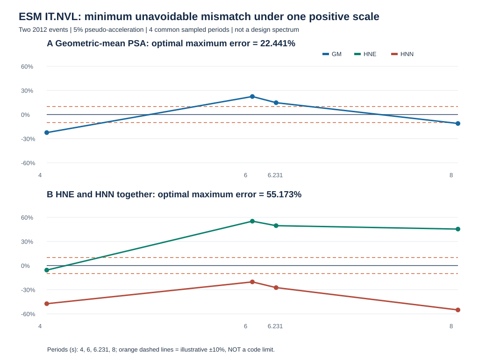
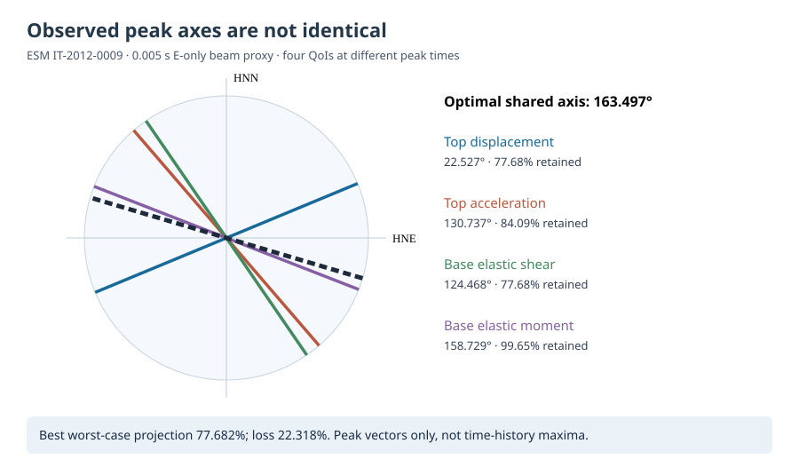

# 附章A 地震输入与双水平线性梁代理的可复现方法及结果（独立阅读附章）

> 本附章独立汇集真实ESM记录及非生产线性梁代理的可复现方法与来源级结果，**不替换现行六章第5章疲劳优化**，亦不作为已获导师批准的最终七章目录。DTU 10 MW + 158 m（混凝土112 m、钢塔46 m）为研究性组合对象；现行S08/S09结构物理验收、W/E/WE与材料Miner仍HOLD。

## A.1 科学问题及先行工作的定位

风机塔架同时承受风致运行载荷与可能的地震激励，其动力响应受运行状态、基础运动、塔—机组耦合、分段连接及预应力状态共同影响。对于预应力混凝土—钢混合塔架，地震响应研究必须区分整体动力响应的可计算性与局部接缝、钢筋、预应力筋的抗震承载安全。现有160 m级混塔研究已经讨论了风震同时作用（DOI:10.1080/13632469.2026.2671807）和地震下PT水平的影响（DOI:10.1016/j.rcns.2026.03.002），因此本研究不将“首次考虑风震叠加”或“首次增加PT”作为创新。前者现有证据阅读至出版社摘要/元数据，后者已有出版社网页工程参数与PT响应节阅读记录；未据此宣称已逐页复现两文的建模细节。

本节提出更有限、可证伪的问题：在**同一真实地震事件、同一线性算子和同步时间轴**下，正交双水平响应的峰值是否可以由两轴各自最大值合成？输出采样从0.005 s稀疏为0.1 s会怎样影响峰值及控制时刻？进一步，在四个不同物理量各自的同步峰时，两个水平分量的平方幅值占比和独立峰时偏移是否相同？这些问题可以通过已有原始输出直接回答，但并不等价于混塔抗震安全验收。

## A.2 地震输入、来源身份与线性代理假设

地震输入来自历史归档的ESM IT2012_0009 / IT.NVL记录HNE、HNN正交水平分量，属于外部实测事件的处理数据，不应称作“嘉鱼地震记录”。既有源收据分别锁定塔数据SHA256 `f738d35fc9c8b8d8745f2ed9490c92578b056cfe37201bbfa0bfdb24906d2983`、ESM处理源SHA256 `a353c1216b80cf2739b9cedfbd09b68bab3d3ffe49f1d6f3b537366c3559db34`。历史完整输出在[Actions artifact #13515201520](https://github.com/g2066203208-beep/voxel-frontier/actions/runs/42240081368/artifacts/13515201520)（ZIP SHA256 `9d63e41e3e6872d7721b8b0f932d7e3abc325d7fdafc40f9e4765e5c1472d673`，记录到期2027-02-04）；其中双方向CSV SHA256 `bab269897640e91d11da3ad02f8a0f3cf537c5e5aaf0f173bba6b1244a3591e0`，共64080行，每轴32040个0.005 s采样点，时段0—160.195 s。

该代理从历史158 m OpenFAST塔数据构建35个Euler–Bernoulli梁段，假定固定底座、连续线弹性、两水平轴同构、零初始状态和5%模态阻尼；RNA简化为塔顶集中质量，未保留真实叶片/机舱惯量与气动反馈，也没有预应力、分段接缝开闭、混凝土开裂、地基土—结构相互作用或竖向地震分量。塔底剪力与弯矩是**弹性恢复项**，不是包含所有惯性和基础运动贡献的总动态支座反力。双轴可正交合成是这些代理假设下的条件性方法，不能自动推广到非线性混塔。

场址地震目标谱尚未由适用的风机专项规范、场地地勘与危险性分析共同闭合。GB 18306—2015嘉鱼城镇区划参数只能作为参考；建筑抗震设计标准常规谱超过6 s的适用问题已另行核查，不能以建筑谱未经论证外推来代替本风机长周期设计目标谱。故本节不进行设计水准的“达标”判断，也不将此条记录视为代表性选波组。

### A.2.1 官方长周期最小地震剪力下限的条件性参数研究（S05；不作为风机设计谱）

为了避免将一般建筑的地震影响系数曲线直接套用于158 m风机混塔，本研究进一步区分**地震反应谱纵坐标**、**最小地震剪力系数**与**实际结构底部剪力**三个不同量。住建部公开的《建筑与市政工程抗震通用规范》GB 55002—2021原文，印刷第12页第4.2.2条及表4.2.2-1、4.2.2-2规定建筑市政结构的水平地震影响系数最大值与场地类别/设计地震分组相关的特征周期；印刷第13页第4.2.3条及表4.2.3则规定最小地震剪力系数的分段下限。上述条款针对**建筑与市政工程**，其能否直接约束风电机组支撑结构，尚须通过IEC 61400-1/6、风电塔架专用标准与工程分类的适用性审查，不能把下列数值写成风机设计验算结果。

在第4.2.3条所规定的普通（非扭转不规则）结构条件下，令表4.2.3所列基准下限为λ₀，基本周期为T₁（s），将该条文写成可审计的分段**下限倍率**k(T₁)：T₁≤3.5 s时k=1；3.5<T₁<5 s时k=(9.5−T₁)/6；T₁≥5 s时k=0.75。对于该条文所指扭转不规则结构，仍按k=1的基准下限处理。这个k仅修正**最低剪力系数下限**λ_min=kλ₀，不是反应谱放大系数、地震记录缩放系数或动力响应衰减规律。尤其不允许把“5 s后k=0.75”理解为长周期谱加速度或实际塔底剪力自动下降25%。

以表4.2.3中**7度、0.10g**这一纯参数情景（λ₀=0.016）为例，T₁=3.5/4.0/4.5/5.0/6.0 s时，非扭转不规则的λ_min分别为**0.016000、0.014667、0.013333、0.012000、0.012000**；扭转不规则条件下上述周期均为**0.016000**。因而在T₁≥5 s的分支，非扭转不规则结构的下限相对λ₀减少25%，而不是实际地震作用减少25%。六种表列烈度/加速度情景的比例变化完全一致，数值见[六周期×六烈度源级数表](../../../experiments/T079/real-records/S05_GB55002_LONG_PERIOD_MIN_SHEAR_20261109.csv)及[分段曲线图](../figures/FIG_S05_GB55002_LONG_PERIOD_MIN_SHEAR_20261109.svg)，由[可运行Node程序](../../../experiments/T079/s05_gb55002_long_period_floor.cjs)复算。

第4.2.2条表4.2.2-2给出的15组场地类别—设计分组特征周期Tg范围为**0.20—0.90 s**。在仅用于敏感性扫描、并非已验证风机一阶周期的T₁=3.5—6.0 s窗口，T₁/Tg可跨越**3.889—30.000**。因此，研究长周期地震输入时必须核查实际结构周期、地基条件及目标谱的长周期定义与有效频带，不能仅以短周期平台值或城镇级0.05g/0.35s区划数值生成未经论证的设计目标谱。此处15组Tg只是规范表列参数组合，**不是15个实测场地，也不是15条地震记录**。

已于2026-11-08核实的GB 18306—2015附录C.17嘉鱼八镇0.05g/0.35s及2026年第1号修改单（仅针对西藏林芝、山南部分地区）属于**既有来源成果**，本次不重复计为新发现；修改单没有为本研究提供风机工址、地勘或长周期目标谱。本节新增证据限于住建部**官方规范原页第4.2.2—4.2.3条**的分段数值、可复现算式及适用边界。官方原页入口：[住建部2021年第61号公告及附件](https://www.mohurd.gov.cn/gongkai/zc/wjk/art/2021/art_17339_761174.html)；修改单政府附件：[宝鸡市地震局2026-04-07公告](https://dzj.baoji.gov.cn/col3813/col3811/202604/t20260407_1261239.html)。规范PDF已逐页目视核读但**未能取得其原始字节SHA256**，不以网页链接冒充已入Git的授权PDF。源级数值/算法PASS；风机规范适用性、场址危险水准、地勘、真实T₁、设计谱及抗震物理验收均HOLD。

### A.2.2 两次实测事件谱形的最优单尺度匹配及不可消除残差（S05；经验参照而非设计谱）

为了检验“同台站两次实测记录仅需调整一个幅值系数即可互相代表”的假设，选取ESM v3的IT-2012-0008与IT-2012-0009事件、同一IT.NVL台站HNE/HNN处理后5%阻尼伪加速度反应谱（PSA，m/s²）。二者为2012年同一Emilia地震序列中的不同事件，**不构成两个独立场址危险性样本**。本节仅以0009事件作为**经验参照谱**，绝不将其称为嘉鱼或本研究混塔的规范设计目标谱。仅在两份原始派生表实际共有的T=4、6、6.230957763、8 s四个离散周期进行比较，不插值、不伪造连续谱。

记0008与0009事件在周期T处的同周期双水平几何均值分别为G₈(T)=√[PSA₈,E(T)PSA₈,N(T)]和G₉(T)，定义无量纲比r(T)=G₈(T)/G₉(T)。若用同一正尺度c将0008匹配至0009，且采用最大绝对相对偏差准则，则有限周期集合上的问题为

$$
\min_{c>0}\max_{T\in\mathcal{T}}|c\,r(T)-1|.
$$

设r_min和r_max为四个实测比值的最小与最大值，目标函数的最大值由端点控制，故在两端残差等幅异号时达到全局最小：

$$
c^*=\frac{2}{r_{\min}+r_{\max}},\qquad
\varepsilon^*=\frac{r_{\max}-r_{\min}}{r_{\max}+r_{\min}}.
$$

这是有限样本的解析极小极大解，并非规范规定的缩放方法。原始谱给出r_min=11.219431908（4 s）、r_max=17.711977969（6 s），因此**c*=0.069129020，最小可能最大相对误差仍为22.441167%**。四个周期的最优缩放残差依次为−22.441167%、+22.441167%、+14.744194%、−11.112638%。若采用常见的“仅使4 s谱值相等”的锚点缩放，其最大残差反而达到**57.868759%**。因此对这两份已处理实测谱，在给定四周期和该误差定义下，不存在使四点全部进入人为±10%带内的单一幅值系数。

进一步要求**同一尺度同时匹配HNE与HNN两方向**（共8个真实谱值比），最优尺度变为c*=0.062780283，最大相对误差至少为**55.173117%**；控制极值分别来自6 s的HNE（正残差）与8 s的HNN（负残差）。这证明仅检验两水平几何均值可能掩盖方向分量的不相容性，但不说明结构响应一定存在同幅度误差。该结果是关于**有限四周期、两个已处理事件、一个统一正尺度的可证伪不相容性**，并非地震波选配总体结论或风震结构效应。

表A-x的四周期、两个分量及几何均值的原始比值与最优残差见[实测派生CSV](../../../experiments/T079/real-records/S05_ESM_MINIMAX_SCALE_4PERIOD_20261110.csv)，可由[独立Node程序](../../../experiments/T079/s05_esm_empirical_minimax_scale.cjs)重新生成。输入为已归档46周期0008谱（SHA256 `31fea6aa2064abbd042e4a1b1a15b9aee90a598a7d1991bc0869bcd63177dd8c`）和5周期0009谱（SHA256 `0c790ae1ae5cd4e4bc94a08561e7cdfc39354baa4aa1d7e5fc76800c887192ce`），并核对ESM官方事件、台站与水平分量元数据。0008处理高通为0.04 Hz，0009两水平为0.08 Hz；8 s对应0.125 Hz，仅为0009处理高通的1.5625倍，**该比值不是可靠长周期的合格判据**。仪器低频、滤波、震源与场地差异、未验证的真实结构周期、目标谱适用性及输入不确定性尚无可信误差上界。图中±10%仅是明确标注的**演示性拒绝阈值**，不是IEC/GB规定。2026年已有160 m混塔风震和PT地震研究（DOI 10.1080/13632469.2026.2671807；10.1016/j.rcns.2026.03.002），本节不将实测选波或地震作用本身声称为首创。

## A.3 同步二维峰值、非同步RSS与抽样误差的定义

对某一响应量q，令同一离散时刻t_i的两轴输出为q_E(t_i)、q_N(t_i)，定义R_q(t_i)=√[q_E(t_i)²+q_N(t_i)²]，同步二维离散峰值为P_q(Δt)=max_i R_q(t_i)。单轴筛查值M_q=max(max_i|q_E|,max_i|q_N|)，非同步峰值RSS为S_q=√[(max_i|q_E|)²+(max_i|q_N|)²]。同一时间网格下恒有M_q≤P_q≤S_q；S_q一般不对应任何真实时刻，不能把它写成同位峰值。0.1 s显示序列由0.005 s历史序列严格每20点抽取，因而P_q(0.1 s)≤P_q(0.005 s)；该不等式只适用于相同历史离散输出的子集，不是时间积分收敛误差的上界。

本节使用三项明确分母的指标：抽样漏失e_s=[P_q(0.005)/P_q(0.1)−1]×100%；最大单轴漏选e_a=[P_q(0.005)/M_q−1]×100%；异时RSS偏差e_r=[S_q/P_q(0.005)−1]×100%。所有百分比都是**本次历史时程的确定性比值**，并非统计置信区间、材料应力裕度或结构安全系数。

| 响应量 | 0.005 s同步二维峰值 | 峰时/s | 0.1 s抽样漏失/% | 单轴漏选/% | 异时RSS高估/% |
|---|---:|---:|---:|---:|---:|
| 塔顶相对位移 | 37.929954 mm | 50.150 | 0.139519 | 8.256767 | 20.421579 |
| 塔顶绝对加速度 | 0.182811 m/s² | 38.795 | 0.125075 | 18.759147 | 15.695381 |
| 塔底弹性恢复剪力 | 367.150090 kN | 38.595 | 0.167614 | 12.633693 | 21.159006 |
| 塔底弹性恢复弯矩 | 11952.345959 kN·m | 35.435 | 1.727466 | 6.397966 | 18.432811 |

数据来源：[四项全采样同位峰值表](../../../experiments/T079/real-records/S08_ESM_FULLRATE_PAIRED_VECTOR_4QOI_20261109.csv)，其SHA256 `0566ccfa604e2a4e7538fd9a20fe8d2f36f8e661d024baaf305b3d0d1cbd0af9`；[原图](../figures/FIG_S08_ESM_FULLRATE_PAIRED_VECTOR_20261109.svg)。本次仅复用历史已经完成的响应积分结果，不开展新结构动力求解。

## A.4 新增结果：各响应峰时的方向平方占比与峰时错位

仅报告同步范数峰值还不足以说明**峰值由哪个水平分量主导，以及峰时是否与任一单轴最大时刻重合**。为此在每个响应量自己的同步峰时t*_q计算平方分量占比w_E=q_E(t*_q)²/P_q²、w_N=q_N(t*_q)²/P_q²，以及峰时差Δt_E=t*_q−argmax|q_E|、Δt_N=t*_q−argmax|q_N|。w_E+w_N=1是恒等式；这里的“平方占比”仅表示矢量几何分解，**不是模态能量、地震输入能量或材料耗能分配**。符号与时间偏移保留各方向真实输出的正负和先后关系。

| 响应量 | 同步峰时/s | HNE平方占比/% | HNN平方占比/% | Δt_E/s | Δt_N/s |
|---|---:|---:|---:|---:|---:|
| 塔顶相对位移 | 50.150 | 85.322 | 14.678 | -0.010 | -13.820 |
| 塔顶绝对加速度 | 38.795 | 42.588 | 57.412 | 4.270 | 4.545 |
| 塔底弹性恢复剪力 | 38.595 | 32.030 | 67.970 | 4.255 | 0.000 |
| 塔底弹性恢复弯矩 | 35.435 | 86.839 | 13.161 | 0.010 | -1.150 |

图A-x：[各响应同步峰时的方向平方占比](../figures/FIG_S08_FULLRATE_VECTOR_DIRECTIONAL_PEAK_20261109.svg)；新数表：[4 QoI方向峰时分解](../../../experiments/T079/real-records/S08_ESM_FULLRATE_VECTOR_DIRECTIONAL_PEAK_4QOI_20261109.csv)。

**可检验的现象是不同响应量的方向组成并不相同。** 塔顶相对位移和塔底弹性恢复弯矩的同步峰值分别由HNE平方分量贡献85.322%和86.839%；而塔顶绝对加速度与塔底弹性恢复剪力则以HNN为主，分别占57.412%和67.970%。特别是塔顶绝对加速度的同步峰发生于38.795 s，较HNE、HNN各自的独立峰时分别晚4.270 s、4.545 s；这意味着两方向**均未达到各自独立最大值时，合成矢量仍可达到全程最大值**。与之对照，剪力同步峰时恰好等于HNN独立峰时38.595 s，而HNE独立峰早4.255 s。由此可证，使用某一个“全塔统一控制时刻”或把两个不同时间的分量峰值相加，均可能错配响应量与物理时刻。

这种错位**不证明**地震双轴耦合的材料非线性，也不能推断混塔接缝哪个方向先张开；它仅说明即使在本次线性梁代理中，时域矢量合成也需要同步时序。将来若研究非线性接缝或PT峰值，必须直接从同一物理状态的原始局部响应时程提取，不得用此代理的w_E、w_N替代。

### A.4.1 四类响应峰值方向不共线：共同轴的严格极小极大界（新增）

**问题与数据。** 对§A.4中四个响应量，在各自的同步二维范数峰时 \(t_q^*\) 取真实已归档派生表中的有符号水平分量 \(\boldsymbol v_q=[q_{\mathrm{HNE}}(t_q^*),q_{\mathrm{HNN}}(t_q^*)]^\mathsf T\)。四类量的单位分别为mm、m/s²、kN及kN·m，故先对每一类独立归一化为 \(\widehat{\boldsymbol v}_q=\boldsymbol v_q/\|\boldsymbol v_q\|_2\)，**绝不跨量纲相加**。本研究的“轴”仅是历史代理输出中HNE/HNN两列的数学投影轴；特别是塔底弯矩/剪力的通道定义不能未经坐标校核直接解释为同一个真实塔身空间方位或设计地震入射角。

若为四个响应量都选用同一无向轴 \(\boldsymbol n(\theta)=[\cos\theta,\sin\theta]^\mathsf T\)，定义在**四个已观测峰值向量**处的最差投影保留率：

\[
R(\theta)=\min_{q\in\{u,a,V,M\}}
\left|\widehat{\boldsymbol v}_q^\mathsf T\boldsymbol n(\theta)\right|,
\qquad
R^*=\max_{\theta\in[0,\pi)}R(\theta).
\]

这是一个明确限定的有限点极小极大问题，不是完整时程的最优方向问题。将四个峰值方向角按 \(\pi\) 取模并排序，记其在长度为 \(\pi\) 的圆上的最大相邻空隙为 \(g_{\max}\)。其余方向均落入长度 \(L=\pi-g_{\max}\) 的最短覆盖弧；弧中点为共同轴的一个最优解，最大角偏差为 \(L/2\)，故

\[
\boxed{R^*=\cos\left[\frac{\pi-g_{\max}}{2}\right]}.
\]

对已归档四行真实E-only代理峰值分量，方向角依次为**22.526703°（塔顶位移）、130.737451°（塔顶加速度）、124.468225°（塔底弹性恢复剪力）、158.728552°（塔底弹性恢复弯矩）**。最大方向空隙为**101.941523°**，最短覆盖弧为**78.058477°**，共同轴最优角为**163.497464°（模180°）**。此时四类已观测峰值的绝对投影保留率分别为**77.682471%、84.094446%、77.682471%、99.653811%**，最差保留率为**77.682471%**，对应不可消除的**22.317529%峰时投影损失**。控制最差投影的是塔顶位移和塔底弹性恢复剪力的两个已观测峰值向量。

[四行数值结果](../../../experiments/T079/real-records/S08_ESM_PEAK_AXIS_MINIMAX_4QOI_20261110.csv)由[可运行无依赖Node程序](../../../experiments/T079/s08_esm_peak_axis_minimax.cjs)生成。输入为此前已核[四行峰值方向表](../../../experiments/T079/real-records/S08_ESM_FULLRATE_VECTOR_DIRECTIONAL_PEAK_4QOI_20261109.csv)，其原字节SHA256为 \`2ac8983c28e7e1d3bcbeae2be2584b120204f3634ce31aaf54a567efc3a3bcd1\`；历史全采样时程CSV的SHA256为 \`bab269897640e91d11da3ad02f8a0f3cf537c5e5aaf0f173bba6b1244a3591e0\`，本次**没有重取或重新积分原始时程**。程序验证解析60°两方向、四方向共线、输入乱序不变，并拒绝空源、错表头、重复/非法响应量、非有限值、单位、时间恒等式、平方占比及来源身份污染。

**解释与反例。** 四类响应峰值向量并不共线，因而不能从某一响应量的峰时主导方向直接推出其余响应量的峰时主导方向。上述22.317529%是**各响应自己峰时的几何投影损失下界**，不是使用该轴后**完整时程峰值**必然低估22.317529%；因为固定轴投影可能在另一个时刻取得更大的峰值。也不能将其解释为抗震设计风向损失、接缝应力误差或材料损伤变化。不同QoI的物理坐标基准、地震记录滤波、代理假设、原始时间离散及实际塔架方向性均未获得独立误差界。现阶段它提供的是“不能用单一峰时方向代表所有响应量”的可复算有限样本反例，而不是风震或结构抗震安全结论。

## A.5 误差预算、反例与结果的适用范围

数据字节与时间网格可追溯：历史0.005 s与0.1 s每20点精确抽取在全部五个数值列上最大绝对差为0；独立NumPy已复核四项同步峰值。新方向分解采用同一四行原始表中的峰时分量值，逐行验证√(q_E²+q_N²)=P_q，w_E+w_N=100%，双精度恒等残差最大约4×10⁻¹⁵；程序以3–4–5已知解与非有限数、时刻偏离0.005 s网格、分量超出独立峰值及矢量不一致等污染输入做拒绝测试。表内占比显示到0.001个百分点，末位舍入误差不超过0.0005个百分点。

必须分别看待四类尚未闭合的不确定性。**离散采样误差**可在本次0.005 s与0.1 s输出之间定量比较，却不界定0.005 s与连续时间真实极值的差。**代理模型误差**涉及固定基础、5%阻尼、RNA集中质量、线弹性连续塔身、没有接缝/PT/地基/竖向输入，其物理影响尚无可信区间。**输入适用性误差**涉及记录滤波有效频带、长周期谱、目标危险水准、场址类别及记录代表性，目前不能声称本波满足设计谱。**跨工况配对误差**涉及未取得同一初态SHA与相同运行状态的B/W/WE，故不能从E-only结果构造风震增量或交互效应。图表中的有限数值均不构成抗震安全或材料疲劳寿命结论。

## A.6 阶段性结论与后续正式章节的使用条件

在历史真实ESM记录驱动的非生产线性梁代理中，四项响应的同步双水平峰值、控制时刻和方向平方占比具有可复现的差异。对本事件，塔底弹性恢复弯矩由0.1 s抽取改用0.005 s输出时，识别出的离散峰值由11749.379416 kN·m增至11952.345959 kN·m，控制时刻由36.600 s变为35.435 s；将不同时间的两轴峰值直接RSS合成会比0.005 s同步峰值高18.432811%。塔顶加速度峰时与两轴独立峰时均相差超过4 s，说明“同位”要求不能被单轴峰值合成替代。该结论是**源级时程后处理的方法性发现**，不是风机抗震承载力证明。

本附章作为独立可阅读材料保留现行六章正文不变。只有在地震目标谱/选波适用性、真实结构状态与双向动力响应、W/E/WE同态配对、局部材料与PT响应及标准适用条款全部得到相应证据后，才可以把这里的方法性章节扩展为实际混塔的地震响应与抗震约束结论；在此之前，S08/S09物理HOLD、正式DLC1.2=0/126、12阶段=0/12，期刊独立送审HOLD。
