# 10 MW级陆上风机预应力混凝土—钢混合塔架：六章连续阅读母稿（2026-11-11）

> **导师内部阅读用研究母稿，不是送审版Word/PDF，也不代表12阶段验收通过。** 从PR #42六章最新原文按SHA锁定装配，剔除章末内部门禁；第五章仅在装配层以真实留出验证综合表替代无实证的优化占位表，修复数学式和零基准疲劳比值定义，嵌入4幅既有S11图。第三章、第四章§4.3.5b、§4.7.22—4.7.24及§4.8.4和第五章均按最新源文件SHA锁定；附录A.12—A.13以真实处理波谱复算和附加滤波敏感性来源锁单独附后，不改变六章主线。

> **证据边界：** 158m组合研究模型、ERA5 184080h、历史36组风/18NTM/4ETM已有来源级成果；正式DLC1.2 **0/126**、分材料局部Miner/真实DOE与结构Pareto/同态W-E-WE未闭合，**12阶段0/12**。原Word媒体恢复、中英摘要、30条现行非禁区参考文献已初步著录（另1条禁区保留）、最终排版尚未完成；不能直接提交盲审。

## 六章源文件身份（Git Blob SHA1与UTF-8 SHA256）

| 章 | 源文件 | Git Blob SHA1 | SHA256 |
|---|---|---|---|
| 1 | `01_绪论.md` | `713325657815f1c65c7b99c50a186ed3270d34b0` | `2c0355a022bad10af61cebc3d1d9b5bd5b218400647d4d3cac5ac23de79114fe` |
| 2 | `02_研究对象_精细有限元模型与分层验证.md` | `cffacbbb75e9bcd0673d6b6dc16124ef63bea691` | `3dbcc0d547c9215b11180999ff8655bdd0e2a92ef621e21bc2b90150c8ab028a` |
| 3 | `03_场址风环境与整机随机风控制载荷.md` | `dde01ada65b056362fac570efb214cae6ba220bc` | `5655d80d1e96f947b7cbdac3c761ff1b2449af4086d99aeff8fcc74519c0ba16` |
| 4 | `04_10MW混合塔架风致疲劳性能分析.md` | `758e267d58cc2a013521c43426a7355c57e509ef` | `77ff2757ea2a980c1aa0510ebad841d26fbaabbf75bb7f80f8bdfe086f9bccc3` |
| 5 | `05_疲劳控制参数敏感性与结构优化.md` | `125ba4f9a548a0510568bbc98f71621bdad6053e` | `b20d79d9599808cb823f240ae7c3bcf52341eb6fe376d50d09dde7e34b4719d8` |
| 6 | `06_结论与展望.md` | `627d4c6fb37a8016d83b52613311c43c1756fae4` | `7a482aadad1717c528bb0dc3fcf72312915e0162eea271af92f0735ccf2cfd3e` |

---

# 第一章 绪论

## 1.1 研究背景与意义

风电机组大型化使叶轮直径、轮毂高度和支撑结构尺度持续增加。对陆上大型机组而言，塔架既要满足静力强度、稳定和运输制造要求，又要避开1P/3P等运行激励频带并承受长期随机风引起的循环载荷。传统大直径薄壁钢塔在继续增高时容易受到运输直径、板厚、焊接细节、局部稳定和成本等因素约束；由下部预应力混凝土塔段、钢—混转换区和上部钢塔组成的混合塔架，可在下部利用混凝土较高的截面刚度和预制/现场施工适应性，在上部保留钢塔较轻的质量和成熟的机舱连接体系，因此成为高塔化的一类重要结构形式。

本文选取公开可追溯的DTU 10 MW参考风机[1]与158 m预应力混凝土—钢混合塔架原型[2]构成研究对象。这里必须区分“结构原型”和“场址背景”：158 m混塔及其几何/配筋参数来自公开研究谱系，DTU 10 MW的风轮、机舱及运行参数来自官方参考风机资料；嘉鱼ERA5长期风数据仅用于提供陆上场址风气候背景，并不表示该处存在一台与本文模型完全相同的实际10 MW机组。本文因此研究的是“**真实场址风气候背景下的可复现10 MW混塔研究模型**”，而不是对某台现场实机进行反演。

大型混塔的关键问题也不宜只表述为“风压作用下是否满足静力强度”。在正常运行状态下，湍流风、叶片气动力、转子转速、变桨/转矩控制、结构柔性和RNA惯性共同形成时变整机载荷；这些载荷通过塔顶接口传入上部钢塔、钢—混转换区、预应力混凝土塔段及水平接缝。长期疲劳则进一步取决于局部材料点的应力范围、平均应力、循环次数以及各风速状态的长期出现概率。因此，只有把“**结构模型可信性—场址与整机随机载荷—局部材料疲劳**”连续闭合，才能形成具有工程解释力的研究链。

## 1.2 预应力混凝土—钢混合塔架结构体系及研究对象

### 1.2.1 混塔的材料与构造分区

典型预应力混凝土—钢混合塔架由下部预应力混凝土塔、钢—混转换区和上部钢塔组成。下部混凝土塔可采用预制节段，通过纵向预应力形成整体工作；节段之间存在水平接缝；上部钢塔通常采用薄壁圆锥壳。与全钢塔相比，该体系具有三个需要单独建模的物理特征：

1. 材料刚度和截面尺寸沿高度突变；
2. 预应力使混凝土在自重和运行荷载作用前已经处于非零基准应力状态；
3. 水平接缝和钢—混转换区的局部传力不能只由整体梁模型完全表征。

Li等[3]通过缩尺试验以及实体、纤维梁和两尺度模型对比表明：实体模型可以描述关键位置的局部应力和开裂，但计算成本高；纯纤维梁模型适于整体响应，却难以充分反映连接附近应力集中和裂缝；两尺度模型可在全局效率和局部精度之间取得折中。李泽宇博士论文[4]进一步将该思路用于PCSH塔架的静力、模态、非线性与风致疲劳研究，并在其风致疲劳章节先由时程响应确定关键位置，再进入rainflow和Miner寿命计算。这一“**先识别局部控制区，再进入材料疲劳**”的逻辑与本文第四章一致，但其塔型、容量、材料和寿命数值均为其自身研究对象，不能直接移植。

### 1.2.2 158 m原型与DTU 10 MW风机

何泽瑜[2]以大型混塔和DTU 10 MW风机为对象，给出了本文158 m研究原型的重要几何和配筋来源。其原始资料明确给出31段混凝土塔的分段几何和内外纵向钢筋数量，并说明采用钢筋网以及15.2 mm预应力钢绞线。本文第二章将这些“原文直接参数”与后续同谱系论文、现行/历史规范补全参数严格区分，避免把模型重构值反写成原论文参数。

DTU 10 MW参考风机的额定功率、转子、运行和结构参数以Bak等官方报告[1]为第一来源。其关键参数页和运行参数页已经归档为证据图。本文OpenFAST整机模型的风轮/叶片/机舱身份必须以该官方参考模型为基准；任何为了适配158 m混塔而发生的塔架或接口修改均应独立记录，不能修改后仍称为“原始DTU 10 MW模型”。

### 1.2.3 RNA空间动力等效

大型风机顶部RNA并不是无尺寸点质量。Cheng等[5]在钢—混混塔自然频率研究中显式考虑RNA质量偏心、转动惯量和预应力，并比较点质量、偏心点质量以及包含转动惯量的RNA简化模型，表明不同简化方式会改变高阶动力特性。相关解析/有限元研究[6]同样把RNA质量、惯量和偏心纳入混塔频率方程。

因此，本文Abaqus模型不采用“单一塔顶点质量”作为最终RNA表示，而使用质量、质心偏置、完整转动惯量与塔顶6DOF耦合构成空间等效。该等效并不试图在Abaqus内重复建立柔性叶片和控制系统；这些整机自由度由OpenFAST承担。第二章需要通过总质量、质心、惯量及模态响应共同验证该分工。

> 原图证据：[2] p33–35；[1] p13、p33；[5] p3、p7、p9；[6] p23、p29。

## 1.3 混塔精细建模与动力验证研究现状

### 1.3.1 从整体梁模型到局部精细有限元

混塔结构研究存在明显的模型层级差异。整体梁/纤维模型计算效率高，适合参数分析、整体动力和大量工况；实体/壳/接触模型能够描述应力集中、局部接缝及材料非线性，但计算成本更高。Li等[3]的试验和两尺度研究证明，不同层级模型应通过共同的力—位移、应力、模态和局部响应进行交叉验证，而不能只凭“模型能够收敛”判断其可信性。

这对本文有两个直接启示。第一，第二章的Abaqus精细模型必须先在材料、整体质量、静力、模态、网格等层级进行验证，再进入随机风局部应力生产。第二，第四章为了完成长期疲劳，不应把所有风速bin和所有seed都机械送入高成本全塔非线性模型；应先用精细模型识别控制区域，再根据实际线性/非线性程度选择局部响应重构或直接时域计算。

### 1.3.2 模态、P–Δ与局部非线性

李守振博士论文[7]系统讨论了钢—混凝土混塔自由振动和考虑重力二阶效应的动力响应，并用有限元进行交叉验证。其研究表明，高阶模态对加速度的影响比对位移更敏感，重力二阶效应会改变动力响应，因此仅以一个塔顶位移量无法覆盖所有动力需求。

Xu等同谱系研究[8]进一步比较线性与非线性混塔模型，并使用Abaqus进行精细模型/推覆验证，说明在大型混塔研究中，几何和材料非线性需要依据荷载水平和目标QoI有条件地启用，而不能把“非线性”本身作为结果。

本文据此采用“**线性基线—P–Δ—材料/接触非线性按结果触发**”的分层策略：第二章首先证明线性/初始平衡模型的动力身份，第四章再根据实际疲劳控制区域决定是否需要直接非线性时域分析。

### 1.3.3 验证不能只停留在一个频率

[3]、[5]、[6]以及Brown等OpenFAST实机验证研究[9]共同说明，可靠模型通常经过多个层级的可观测量验证。Brown等的OpenFAST一对一验证依次比较结构/模态、来流、运行状态、载荷与DEL；这说明“首阶频率相近”只能证明部分全局刚度/质量关系，不能自动证明局部应力、接触、疲劳或控制器状态正确。

因此本文第二章冻结以下V&V思想：
- 参数来源可追溯；
- 总质量、CG、惯量闭合；
- 静力/柔度闭合；
- 模态频率与振型闭合；
- 网格敏感性闭合；
- 只有通过上述门禁后，局部应力才进入第四章fatigue production。

> 原图证据：[3] p7、p9、p10；[6] p25、p29；[9] p5、p7。

## 1.4 场址长期风与整机随机载荷研究现状

### 1.4.1 ERA5的用途与边界

ERA5为长期风资源和风电背景研究提供统一再分析资料。Olauson[10]将ERA5与其他再分析数据用于风电建模，显示ERA5具有较好的时间相关性和风电建模表现；再分析数据综述[11]同时指出，再分析风场的误差会随地点类型、高度和复杂地形条件改变，不能把再分析网格点等同于现场测风塔。

本文据此给ERA5限定两个职责：
- 建立2005—2025年嘉鱼研究点的长期风速、风向、风切变和出现概率；
- 为第三/四章的代表风速及长期fatigue probability提供场址统计背景。

ERA5不承担10 min高频湍流生成，也不作为该研究点“实测风”使用。该边界在最终结论中必须保留。

### 1.4.2 轮毂高度风速与时变风切变

本文已有ERA5 10 m和100 m逐时风矢量。Yang等[12]使用ERA5并结合8座测风塔讨论幂律指数的时空变化，并将基于再分析的动态幂律指数与固定1/7方法进行比较，表明风切变指数并不是应在所有时刻固定为0.14的常数。

因此本文第三章采用两高度逐时风速计算：

\[
\alpha(t)
=
\frac{\ln[U_{100}(t)/U_{10}(t)]}
{\ln(100/10)},
\]

并由：

\[
U_{\text{hub}}(t)
=
U_{100}(t)
\left(
\frac{z_{\text{hub}}}{100}
\right)^{\alpha(t)}
\]

外推至本文统一轮毂高度。固定1/7或长期平均\(\alpha\)只用于量级对照，不作为正式主结果。低风速小时可能导致\(\alpha\)数值不稳定，因此低风阈值只应用于\(\alpha\)分布诊断；正式长期\(U_{\text{hub}}\)概率统计不得随意删除低风小时。

### 1.4.3 TurbSim随机风与IEC工况身份

ERA5逐小时数据缺乏风机载荷所需的高频随机湍流结构，因此第三章使用TurbSim[13]生成三维随机风场。NTM和ETM的身份由IEC 61400-1基线审计[14]确定：NTM用于正常湍流运行，ETM用于更高湍流强度的极端湍流工况；二者不能在第四章长期正常运行材料疲劳概率中混为一种风况。

本文已经完成的36组风场是“研究筛选矩阵”：
- 3个代表URef；
- NTM/ETM；
- 每类6个seed；
- 共36组。

它适于比较风速、湍流模型和seed对整机QoI的影响，但不等价于完整DLC认证矩阵，也不等价于第四章覆盖切入—切出区间的正式长期fatigue bins。

### 1.4.4 OpenFAST/ROSCO与运行状态验证

ROSCO参考论文[15]明确给出控制器工具链、运行区和控制逻辑；近额定风速附近转矩/变桨控制状态变化会直接改变转速、推力和塔架载荷。Brown等[9]的OpenFAST实机验证进一步说明，结构模态正确之后仍需检查rotor speed、blade pitch、power和关键载荷QoI。

因此本文第三章不以“OpenFAST成功运行”作为模型验证，而依次检查：
- 风机/塔架/控制器身份；
- 模态/结构一致性；
- RotorSpeed、BldPitch、GenPwr等运行点；
- 塔底/塔顶载荷；
- 多seed统计稳定性；
- PSD以及1P/3P关系；
- load-rainflow/DEL。

> 原图证据：[10] p3、p7；[12] p4–6；[11] p8、p10–11；[15] p4、p6、p13、p17；[9] p10、p13、p15、p17。

## 1.5 风致疲劳研究现状

### 1.5.1 从整机循环载荷到局部材料疲劳

风机疲劳研究包含两个不同层级。整机载荷层可通过rainflow和damage equivalent load比较不同风况的循环需求；材料层则必须基于实际局部应力循环和对应材料疲劳关系评价累计损伤。二者不能混用。

李泽宇博士论文[4]的第6章提供了与本文非常直接的混塔疲劳先例：先进行脉动风动力响应，利用两尺度模型获取钢塔、混凝土、钢筋和预应力筋关键部位应力时程，再结合风速概率、rainflow和Miner计算各部位疲劳。其结果还显示不同材料的控制位置不同。这一工作直接支持本文“**先由响应识别控制部位，再分材料疲劳**”的组织逻辑；但其具体钢塔24.66年、混凝土顶部20.42年等寿命属于其自身塔型，本文禁止移植。

Huang等[16]针对SPPT混凝土塔进一步把mean stress correction、initial prestress、azimuth和sample size纳入运行风疲劳研究，并按wind bin解释damage contribution。因此，与早期只选若干代表风速相比，本文第四章需要增加sample-size收敛和长期wind-bin probability的显式处理。

### 1.5.2 预应力基准应力与接缝局部性

对于预应力混凝土，随机风产生的动态应力是在自重和预应力形成的长期基准应力上叠加。Wang等[17]的水平接缝研究使用Reference Stress并比较单点极值和厚度平均；Qu等[18]进一步将PT与混凝土作为不同材料分支评价，并研究预应力损失及风速概率对寿命的影响。

这些研究说明，本文不能：
- 只对风载增量应力做rainflow；
- 把Abaqus CDP DAMAGEC/DAMAGET直接当作fatigue damage；
- 用统一 \(m=4\) 的load-DEL评价混凝土、PT和钢塔寿命；
- 只取一个奇异单元最大值外推20年寿命。

### 1.5.3 钢塔与钢—混连接疲劳

Kenna[19]将混塔的钢段和混凝土段采用不同疲劳设计体系；Zhao等[20]对钢塔法兰/焊缝采用局部FE应力集中、hot-spot/structural stress、S–N、rainflow、Miner与长期风况概率相结合的流程；Kim等[21]则通过明确连接构造的循环试验和循环后残余承载评价钢—混连接。

因此本文只有在钢塔或转换连接真实被识别为控制区域时，才进入对应疲劳分支；不会为了“内容丰富”把所有构件都机械计算寿命。

> 原图证据：\`references/evidence-screenshots/fatigue-ch4/\`；详细对应见\`04_FATIGUE_SOURCE_EVIDENCE_ATLAS_20261006.md\`。

## 1.6 现有研究不足与本文科学问题

现有文献已经分别建立了混塔精细有限元、RNA动力简化、OpenFAST整机分析、ERA5长期风、局部接缝研究以及分材料疲劳评价方法。因此，本文不能把“用了Abaqus”“用了OpenFAST”“做了rainflow”本身写成创新。真正需要进一步闭合的是这些层级之间的证据连续性。

### 1.6.1 研究不足1：研究对象和参数来源容易跨文献混用

公开混塔研究的容量、塔高、材料、PT配置、连接和RNA简化并不完全相同。如果只以“某篇论文也使用了类似参数”为理由拼装模型，会造成对象身份漂移。本文需要将“原型直接参数、同谱系依据、规范补全、工程重构和敏感性假定”逐项分级，并以质量、惯量、模态和静力结果验证最终baseline。

### 1.6.2 研究不足2：整体动力吻合不能自动证明局部疲劳可信

首阶频率、塔顶位移等全局量可验证整体刚度/质量，但水平接缝、钢—混转换区、局部应力集中和PT循环仍需要更高层级验证。本文需要建立由材料/构造到整塔的分层V&V，并明确局部网格和应力提取边界。

### 1.6.3 研究不足3：长期风气候与高频随机载荷职责需要分离

ERA5适合长期统计，但不能直接作为10 min高频湍流；TurbSim可以生成随机湍流，但本身不提供某场址20年的出现概率；OpenFAST负责整机气动—伺服—弹性响应，但仍需验证控制器运行状态和通道身份。本文需要将三者连接为可追溯数据链。

### 1.6.4 研究不足4：load-DEL与material fatigue容易被混为一谈

整机塔底DEL只能用于循环载荷筛选。真正的混塔材料疲劳还需要局部stress range、mean stress、预应力基准状态、周向方位、不同材料疲劳关系和长期概率。本文需要证明load-DEL控制case与材料damage控制case是否一致，而不是预设两者相同。

### 1.6.5 2026年160 m级混塔风震与预应力研究的实证边界

2026年已有直接面向160 m级混合塔架的风震研究，不能再将“混塔首次考虑风震同施”或“首次通过增加预应力改善抗震”作为本文创新。Wang等在 *Journal of Earthquake Engineering* 发表的[风震多灾种研究](https://doi.org/10.1080/13632469.2026.2671807)（2026年5月16日在线发表）采用160 m级混塔，依据Davenport谱构造三个风速的风荷载时程，选择三条PEER地震记录，并在结构动力分析中同时施加风、震作用。**本轮直接核读层级仅为出版社摘要、发表元数据与数据可用性声明，未获得可核页码的全文**；出版社称研究数据在Zenodo DOI 10.5281/zenodo.19346369开放，但本文尚未取得该数据的文件清单及字节哈希，不能推断其控制器状态、配对初态或气动反馈处理细节，更不能声称其未考虑某种机制。

另一篇Wang等发表于 *Resilient Cities and Structures* 的[混塔抗震与预应力增强研究](https://doi.org/10.1016/j.rcns.2026.03.002)（2026年，第5卷第2期，47–64页）可直接核读出版社开放全文。其原型为**163.24 m、42段混凝土塔、C80混凝土**，采用37.5 m/s强风（正文报告风时程100 s、步长0.1 s）及三条PEER地震波（截取18 s、步长0.02 s）分别讨论作用下的响应；通过将钢绞线名义张拉应力从1000 MPa提高到1219 MPa，比较了罕遇地震与强风响应。这一原型与本文**158 m、31段、C50、DTU 10 MW组合模型**在几何、材料、加载状态及分析时长上均不同，不存在直接移植位移、应力或预应力增量的依据。

对该论文**已经发表的塔顶位移**作不引入任何结构模拟的独立算术复核，可得如下表。变化率定义为 `100×(增强后/增强前−1)%`；为防止将两位小数误当高精度测量，表中另以**文中显示的十进制位数按四舍五入**构造区间（原文强风增强后1.1 m按0.1 m分辨率，其余位移按0.01 m分辨率）。该区间只约束**报告值舍入误差**，不是原论文数值离散误差、参数不确定性或置信区间。

| 该论文工况（非本文158 m结果） | 增强前→后塔顶位移 / m | 由原文值计算的变化 | 仅由末位舍入得到的变化范围 |
|---|---:|---:|---:|
| 37.5 m/s强风 | 0.57→1.10 | **+92.98%** | **+82.61%～+103.54%** |
| 罕遇地震 Humboldt Bay | 0.58→0.57 | −1.72% | −3.42%～0.00% |
| 罕遇地震 Helena-01 | 0.52→0.52 | 0.00% | −1.90%～+1.94% |
| 罕遇地震 Helena-02 | 0.77→0.58 | **−24.68%** | **−25.81%～−23.53%** |

[图1-6 2026年已发表混塔预应力增强前后风/震位移变化与舍入区间](../figures/FIG1_2026_PUBLISHED_PT_DISPLACEMENT_TRADEOFF_20261108.svg)由[可复算源程序](../../../experiments/T079/s05_2026_published_pt_displacement_tradeoff.cjs)及[四行数值表](../../../experiments/T079/real-records/S05_2026_PUBLISHED_PT_DISPLACEMENT_TRADEOFF_20261108.csv)生成；**图中全部结构位移属于上述外部文献，绝非本文计算结果**。在舍入假设下，强风位移增大和Helena-02罕遇地震位移减小的符号均稳健，而另两条地震记录的微小变化不足以超越显示精度。作者将强风位移增大与轴压二阶效应联系起来；本研究仅复核其**报告值的比较结果**，没有复核该因果解释或两方案的全部状态一致性。

这两项2026研究共同表明：**风震同施和提高预应力均已有明确先例，且一个设计参数对不同灾害响应的作用不宜预设为单调改善**。本文若研究风震/预应力约束，应以同一158 m模型、相同初态、明确运行状态和一致响应量的配对试验，检验“抗震改善是否伴随风致位移、载荷循环或材料疲劳代价”；若没有真实同态响应，则仅将其列为可证伪研究命题。当前已保全的E-only梁代理及36组历史风筛查不满足这一物理配对条件，不能凭本表形成本文风震结果或抗震设计合格结论。

据此，本文最终科学问题收敛为四个；第四个问题不是恢复旧七章的大而全优化路线，而是由前述疲劳控制机理直接触发的结构优化问题：

**问题1：如何建立10 MW—158 m预应力混凝土—钢混合塔架的可追溯精细模型，并通过质量、惯量、静力、模态、网格和连接等分层证据证明其可用于局部应力研究？**

**问题2：在嘉鱼长期风气候背景下，不同平均风速、湍流模型和随机种子如何影响DTU 10 MW整机运行状态、塔架载荷、频域响应和load-DEL，并如何形成可进入精细结构分析的控制工况集合？**

**问题3：长期正常运行风况下，混塔的疲劳控制材料、控制高度和控制方位在哪里；预应力/mean stress、wind-bin probability和随机样本离散如何共同决定材料累计damage？**

**问题4：在不破坏频率、位移、强度、预应力和接缝服务性能的前提下，哪些结构参数最有效地降低控制疲劳damage并兼顾结构质量；优化方案经高保真独立复核后能获得多大真实改善？**

### 1.6.6 2026年地震动参数区划图修改单的空间适用性与设计谱边界

地震记录可获得不等于场址目标谱已经确定。本文嘉鱼ERA5风气候点尚未确认为具有地勘资料、设防类别和场地类别的工程建设地址，不能把该地县城的区划参数直接当成158 m混塔设计谱，也不能以意大利ESM处理记录的实测反应谱替代中国工程规范目标谱。研究应分别确定参考场址及设防参数、目标谱定义和阻尼比、双水平分量组合方式，以及长周期延拓依据；在这些证据不足时只能开展注明条件的输入方法研究。

2026年标准版本需要精确辨认。宝鸡市地震局2026年4月7日公布的官方原件确认：GB 18306—2015《 中国地震动参数区划图》第1号修改单自2026年2月27日起实施。直接阅读该**四页原件**的第1、3、4页发现：修改单在附录A新增西藏林芝部分地区的图A.2，并修订附录C表C.26中巴宜区、米林市和墨脱县部分乡镇的参数。逐行转录官方表，涉及25个乡镇/街道（9、8、8）；0.10g、0.15g、0.20g、0.30g的峰值加速度分别有1、1、16、7项，全部反应谱特征周期均为0.45s。**这一修订的明确地域对象是西藏林芝，不是湖北嘉鱼**；不能把上述峰值加速度或0.45s直接移植至嘉鱼，更不能由本修改单推导出本研究塔架的设计地震作用。修改单不涉及湖北同样不能证明嘉鱼参数已被独立核定，仍须按现行标准附录C.17及实际参考场址条件确认。

因此，本文把“现行标准版本及地域适用域”和“工程参考场址目标谱”作为两个独立的证据条件。前者已经由2026年政府公开的原始修改单支持，后者尚缺具体坐标、场地类别、完整目标谱及长周期适用性证据；既有ESM实测记录不能作为合规设计谱。官方原件（PDF第1、3–4页）：https://dzj.baoji.gov.cn/col3813/col3811/202604/P020260407327530829269.pdf；官方公告日期2026-04-07。T079保存25行原表转录与拒绝测试，但这些数据不是本文158m混塔的新结构响应。

### 1.6.7 嘉鱼县八镇Ⅱ类场地基本地震动参数与长周期研究适用域

直接核读GB 18306—2015《中国地震动参数区划图》附录C表C.17（印刷页126）“嘉鱼县（8镇）”的连续八行：陆溪镇、高铁岭镇、官桥镇、鱼岳镇、新街镇、渡普镇、潘家湾镇、簰洲湾镇。八镇的**Ⅱ类场地基本地震动峰值加速度均为0.05g，基本地震动加速度反应谱特征周期均为0.35s**（8/8同值）。2026年2月27日实施的第1号修改单修订西藏林芝相关区域，并未修改湖北C.17。八镇在标准的两个区划指标上一致，不等于各镇工程地质、局部放大、长周期危险性或完整设计谱相同。

为区分区划特征周期与长周期研究比较点，将既有ESM记录研究采用的4、6、6.230958和8s四个**比较周期**除以0.35s，得到T/Tg分别为11.428571、17.142857、17.802737、22.857143。6.230958s是既有谱研究比较点，**不是本轮核定的158m混塔实际模态周期**。0.05g按标准重力加速度9.80665m/s²换算为0.4903325m/s²，仅是量纲换算而非时程缩放指令。T/Tg较大只说明所研究周期远长于区划特征周期，不是谱加速度放大系数，也不能据此推出位移、应力或结构风险。仅凭PGA与Tg两个数值无法唯一给出6.230958s的目标谱值，实测意大利ESM反应谱也不能替代国内工程设计谱。

本轮将**参考地区Ⅱ类场地基本区划参数**推进至可追踪的标准表源级证据；具体参考安装坐标、场地类别/修正、设防类别、目标谱定义、阻尼、长周期延拓和实测波匹配仍HOLD。标准复现PDF附录C.17印刷页126：https://www.eia543.com/documents/中国地震动参数区划图（GB%2018306-2015）.pdf；公开原扫描件索引：https://commons.wikimedia.org/wiki/File:GB_18306-2015_中国地震动参数区划图.pdf；2026修改单政府原件：https://dzj.baoji.gov.cn/col3813/col3811/202604/P020260407327530829269.pdf。**未取得原扫描件字节SHA或完成官方原件逐像素校验**，因此仅为标准复现文本的可追溯转录，不宣称结构抗震验收。T079归档八镇表、四周期无量纲比值及1正8负拒绝测试。

### 1.6.8 实测双水平地震动的固定轴选取偏差与长周期方向包络（来源级研究）

对高塔结构，地震记录的水平分量选取不能仅以“两个正交分量中谱值较大者”代替全部水平转角下的最不利谱响应。为量化这种差异，本文继承欧洲强震数据库ESM v3（DOI:10.13127/esm.3）IT-2012-0008事件IT.NVL台站处理后HNE/HNN记录所计算的5%阻尼双水平RotD谱。该谱是**线性单自由度振子的伪位移谱（PSD）**，而不是本文混塔的塔顶位移。对于每个离散周期，定义固定轴包络 \(S_{d,\mathrm{axis}}(T)=\max[S_{d,\mathrm{HNE}}(T),S_{d,\mathrm{HNN}}(T)]\)，以及方向增量 \(\delta_\theta(T)=100\{S_{d,\mathrm{RotD100}}(T)/S_{d,\mathrm{axis}}(T)-1\}\%\)。RotD100是在已归档角度离散条件下对旋转水平输入所求的最大单自由度伪位移；不同周期的最不利转角可以不同，故不能将其拼成同一固定方向的真实结构时程。

直接对已核来源的46个周期谱点筛取4～10 s范围内21个离散点，得到\(\delta_\theta\)均为正，离散中位数为**4.016%**，最大为**8.539%**（\(T=7.738\,\mathrm{s}\)）。在此前简化线弹性梁的**条件性**周期\(T_1=6.230958\,\mathrm{s}\)处，HNE与HNN的伪位移分别为28.203和23.418 mm，RotD100为30.106 mm；即便采用两固定轴中的较大值，仍比离散旋转最大值低**6.748%**。在采样周期5.648～6.000 s和8.241～8.776 s之间，较大固定轴由HNN→HNE和HNE→HNN两次切换。该结果表明，水平分量主导方向随周期变化；不能依据一个周期的最大分量选定所有周期的最不利输入方向。这里的21个周期来自**同一条双水平记录**，不代表21个独立地震事件。

上述偏差是记录处理后、5%阻尼和既定RotD角度网格下的**离散谱方向选取差**，不是地震动强度修正系数或结构抗震误差上界。该处理记录在条件性\(T_1\)处的频率为0.16049 Hz，仅为归档报告0.09 Hz低频信噪界限的1.783倍；仪器响应、滤波与更长周期可信度、场址目标谱、真实塔架模态周期以及非线性结构响应均未闭合。因而本文后续若比较E与WE，只能先用真实目标谱、来源与运行状态一致的记录对完成独立准入；本节不产生抗震安全或风震耦合结论。

**图1-X（候选）** [ESM双水平固定轴与RotD100长周期伪位移比较](../figures/FIG_S08_ESM_AXIS_VS_ROTD100_LONGPERIOD_20261108.svg)；**表1-X（候选）** [21周期逐点数表](../../../experiments/T079/real-records/S08_ESM_NVL_21PERIOD_AXIS_VS_ROTD100_20261108.csv)。图表最终编号待全论文排版时统一。复算程序：`experiments/T079/s08_esm_longperiod_axis_vs_rotd100.cjs`；原波身份及滤波信息沿用T079官方来源收据，原始波本轮未重新下载。

### 1.6.9 参考地区第一组地震输入的场地类别敏感性与长周期验收边界

前节从GB 18306—2015附录C.17取得嘉鱼县八镇**Ⅱ类场地基本区划值0.05g、0.35s**，但这两个数并不直接给出本文158 m混塔的完整设计谱。本节进一步直接核读GB 55002—2021《建筑与市政工程抗震通用规范》印刷第3、12、13页：第2.2.2条将Ⅱ类场地0.35s对应于设计地震**第一组**；第4.2.2条表4.2.2-2规定第一组在I₀、I₁、Ⅱ、Ⅲ、Ⅳ类场地的特征周期分别为**0.20、0.25、0.35、0.45、0.65s**，罕遇地震计算时各增加**0.05s**。因此，在尚无实际工程场地剪切波速和覆盖层厚度的情况下，不能把“Ⅱ类”从区划表的**基准条件**提升为已由地勘证明的安装场地类别；规范第4.2.2条还要求对位于类别分界线±15%范围内且具有可靠地勘数据的情况进行插值。

为显示这种不确定性对长周期研究的影响，固定此前**仅作历史线性梁代理谱比较点**的\(T_\mathrm{probe}=6.230957762865\,\mathrm{s}\)，定义\(r=T_\mathrm{probe}/T_g\)，不把它当作本文真实结构的一阶模态周期。表中第一组的五种**条件性场地情景**给出：

| 场地类别（均为待定情景） | 第一组常规\(T_g\)/s | 罕遇地震\(T_g\)/s | 常规\(T_\mathrm{probe}/T_g\) | 罕遇\(T_\mathrm{probe}/T_g\) |
|---|---:|---:|---:|---:|
| I₀ | 0.20 | 0.25 | 31.154789 | 24.923831 |
| I₁ | 0.25 | 0.30 | 24.923831 | 20.769859 |
| Ⅱ | 0.35 | 0.40 | 17.802736 | 15.577394 |
| Ⅲ | 0.45 | 0.50 | 13.846573 | 12.461916 |
| Ⅳ | 0.65 | 0.70 | 9.586089 | 8.901368 |

同一第一组的\(T_g\)在五类条件场地间相差**3.25倍**（0.65/0.20），而不是只存在单一0.35s。第4.2.2条表4.2.2-1对于6度、0.05g参考情景分别给出多遇、设防、罕遇地震的**水平地震影响系数最大值下限**0.04、0.12、0.28；这些值不是\(T=6.23\,\mathrm{s}\)处的谱加速度，更不是地面峰值加速度。第4.2.1条还要求采用时程分析时，输入激励的**平均地震影响系数曲线**与振型分解反应谱法的曲线在统计意义上相符；因此，不能以单点PGA缩放、三个\(\alpha_\max\)值或一条ESM记录的RotD100替代完整目标谱和选波匹配。

作为**规范适用性待判的条件推论**，第4.2.3条对其适用的建筑与市政工程多遇地震规定6度最小地震剪力系数基准\(\lambda_0=0.008\)；当真实基本周期\(T_1>5\,\mathrm{s}\)时，规定系数不小于\(0.75\lambda_0=0.006\)。这仅是“若本结构被认定适用该条且真实周期满足条件”的代数结果，**不是本风机塔架已经通过的抗震验算**，也不能替代适用的风电塔架专项标准、结构类别认定和实际重力荷载代表值。

[图1-X：第一组条件性场地\(T/T_g\)及三级地震影响系数峰值下限](../figures/FIG_S05_GB55002_SITE_LONGPERIOD_CONDITIONAL_20261108.svg)与[15行源级表](../../../experiments/T079/real-records/S05_GB55002_GROUP1_SITE_HAZARD_15ROW_20261108.csv)由[可复算程序](../../../experiments/T079/s05_gb55002_group1_site_period_gate_20261108.cjs)生成；程序显式拒绝从PGA、\(T_g\)、\(\alpha_\max\)三项反推长周期谱的请求。来源为住建部[2021年第61号公告](https://www.mohurd.gov.cn/gongkai/zc/wjk/art/2021/art_17339_761174.html)及[GB 55002—2021公开原页](https://www.cnass.cn/upload/gjgfenhui/file/20230116/1673863716317210.pdf)印刷第3、12、13页（逐页视觉核读）；**原PDF字节SHA尚未取得**，故未声称原始PDF已经入Git。图表为**标准条件参数与无量纲计算**，不是本文新结构响应。具体安装位置、地勘场地类别、风机塔架条款适用性、阻尼、完整长周期谱、危险性水准与记录匹配仍HOLD；本轮不形成S05整阶段PASS。

### 1.6.10 两条真实实测记录的单一幅值缩放不可消除谱形差异：精确下界与选波拒绝方法

为避免在尚未取得具体场址完整设计目标谱时以PGA匹配替代谱匹配，本文在已核ESM v3（DOI:10.13127/esm.3）同一IT.NVL台站、2012年Emilia序列的IT-2012-0008和IT-2012-0009两条**不同事件**处理后水平记录上，研究一个独立、可证伪的数学问题：两条记录在给定周期集内能否仅通过**同一个正幅值因子**使其5%阻尼水平双分量几何均值伪加速度谱逐点接近？这里的比较对象是两条实测记录**相互之间**，不是嘉鱼设计目标谱，也不代表风机结构响应。

令四个共同周期为\(T_i=4,6,6.230957762865,8\,\mathrm{s}\)，\(A_i\)、\(B_i\)分别为0008、0009的双水平几何均值伪加速度（\(\mathrm{m/s^2}\)），\(r_i=A_i/B_i>0\)。只对0009施加单一缩放\(c>0\)，以0008为分母的逐点相对误差为\(e_i(c)=cB_i/A_i-1=c/r_i-1\)。在所有周期使用同一个\(c\)时，\(\min_{c>0}\max_i|e_i(c)|\)具有解析解

\[
c^*=\frac{2r_{\min}r_{\max}}{r_{\min}+r_{\max}},\qquad
\epsilon_{\min}=\frac{r_{\max}-r_{\min}}{r_{\max}+r_{\min}}.
\]

证明可直接由容差\(\epsilon\)下各周期允许的缩放区间\([r_i(1-\epsilon),r_i(1+\epsilon)]\)求交集：当最大下界不大于最小上界时才存在单一合格\(c\)。这给出了**任何单一常数幅值缩放都不能突破**的离散周期最大相对误差下界，而不是某个数值优化器的局部最优值。

实际四周期\(r_i\)依次为11.219431908、17.711977969、16.598556539、12.858183463，故\(c^*=13.737203380\)，\(\epsilon_{\min}=22.441167\%\)。按4、6、6.231、8s排序，最优缩放后的残差依次为+22.441167%、−22.441167%、−17.238566%、+6.836268%。若**仅为方法演示**设置逐点±10%或±20%的相对误差容差，四周期缩放区间交集均为空；±25%时交集非空。上述10%/20%/25%均不是本文已取得的IEC/GB选波验收阈值，不能据此宣布任何一条记录不符合设计规范。它严格证明的是：**在这四个已知采样周期、这一特定比较指标与两条真实记录之间，仅调整一个幅值因子无法把最大逐点相对误差降至20%以内**。

数据使用的是已归档两事件的5%阻尼处理后谱，而不是重新积分的原始加速度；0008处理低切频率0.04Hz、0009为0.08Hz，0008归档报告信噪低频界限0.09Hz。8s对应0.125Hz，距0009处理低切仅1.5625倍、距0008报告信噪界限仅1.3889倍，**低频处理与信噪不确定性未定量封闭**。两条记录来自同一地震序列，也不能当作两个独立场址危险性样本。后续只有获得经适用性判定的目标谱\(S_\mathrm{target}(T)\)、阻尼、有效频带和容差定义后，才能将同一交集/最小最大误差算法应用于真正的“记录—目标谱”匹配；未取得这些输入时明确输出NOT_EVALUABLE，绝不把本次事件间比较冒充场址选波通过。

**图1-X（待统一编号）** [两条实测记录最优常数缩放与不可消除残差](../figures/FIG_S12_ESM_TWO_EVENT_MINIMAX_SCALE_20261108.svg)；**表1-X（待统一编号）** [四周期逐点数值与20%示例拒绝结果](../../../experiments/T079/real-records/S12_ESM_TWO_EVENT_MINIMAX_SCALE_20261108.csv)；[可运行程序](../../../experiments/T079/s12_esm_two_event_minimax_scale.cjs)。上游两事件处理谱来源与原始文件SHA见T079历史收据；本节仅为真实来源的谱形匹配方法与定量反例，不构成地震危险性、抗震安全或风震同施结论。

### 1.6.11 六秒标准谱适用边界与混塔长周期输入的专门研究要求

长周期地震记录选择首先需要确定目标反应谱在研究周期处的定义域，而不能仅依靠地震动峰值加速度或短周期谱参数。直接核读GB 55002—2021第4.2.1、4.2.2条及表4.2.2-1、4.2.2-2（印刷第11—12页），该强制性通用规范规定水平地震影响系数最大值的下限和设计分组、场地类别对应的特征周期，并要求时程分析的平均地震影响系数曲线与反应谱法采用的曲线在统计意义上相符。**仅有最大值和特征周期并不等于已取得任意长周期处的完整目标谱。**

进一步直接核读中国建筑科学研究院建筑防火研究所公开的GB/T 50011—2010《建筑抗震设计标准》（2024年版）第5.1.4条注与第5.1.5条。前者明确要求对**周期大于6.0 s的建筑结构地震影响系数专门研究**；后者在阻尼比5%条件下给出特征周期至5倍特征周期的0.9幂指数下降段，以及5倍特征周期至6.0 s的斜率调整系数0.02。这里核读的是**建筑结构标准**，是否可作为158 m风机混塔的专项设计依据，仍须进一步确认，不能自动移植。

为量化已知规范形状和超界幅度，继承前节GB 55002—2021第一组五类条件场地的特征周期Tg=0.20、0.25、0.35、0.45、0.65 s，取5%阻尼、阻尼调整系数1、衰减指数0.9，计算仅限于0.1—6.0 s的条件性归一化参考曲线：
\[
\alpha(T)/\alpha_{\max}=
\begin{cases}
1,&0.1\leq T\leq T_g,\\
(T_g/T)^{0.9},&T_g<T\leq5T_g,\\
5^{-0.9}-0.02(T-5T_g),&5T_g<T\leq6.0\ {\rm s}.
\end{cases}
\]
在T=6.0 s处，五类场地的归一化系数依次为**0.134923789、0.139923789、0.149923789、0.159923789、0.179923789**。若仅为说明量级而令6度多遇地震的最大影响系数恰好等于GB 55002表列下限0.04，则条件性6 s系数为0.005396952—0.007196952；这既不是核定场址目标谱，也不是实际风机结构响应。罕遇地震按规范增加0.05 s特征周期后，五类场地在6 s的归一化系数为0.139923789—0.184923789，仍属于条件计算。

历史ESM梁代理比较周期为**6.230957762865 s**，超出6.0 s边界**0.230957762865 s（3.849296%）**，此前实测记录谱中8 s采样点亦超界。本节程序对超过6 s的标准谱计算直接拒绝，不做外推或插补。该事实不否定此前§1.6.10的实测事件间谱形差异，但**不能把6.231 s和8 s的实测谱值与一个尚未定义的设计谱相比较并宣称选波合格**。实际场址类别、阻尼、风机专项适用规范及超6 s专门目标谱均须先闭合；目前状态为**规范来源与拒绝算法PASS / 设计目标谱HOLD**。

**图1-X（待编号）**：[0.1—6 s条件性参考谱与6.231 s拒绝边界](../figures/FIG_S05_2024_SIX_SECOND_SPECIAL_STUDY_GATE_20261109.svg)；**表1-X**：[15行规范条件数值表](../../../experiments/T079/real-records/S05_GBT50011_2024_SIX_SECOND_BOUNDARY_15ROW_20261109.csv)；[可运行Node程序](../../../experiments/T079/s05_gbt50011_2024_six_second_admission.cjs)。来源：GB 55002—2021印刷第11—12页（https://www.cnass.cn/upload/gjgfenhui/file/20230116/1673863716317210.pdf），GB/T 50011—2010（2024年版）第5.1.4—5.1.5条（https://gf.cabr-fire.com/article-15665.htm）。原PDF字节SHA尚未取得，公开网页仅核读相关条文，未宣称全本审查。

## 1.7 本文主要研究内容

围绕上述四个科学问题，本文开展五项连续工作。

### 1.7.1 10 MW混塔精细模型与分层V&V

以[2]原型、[1] DTU 10 MW官方模型及同谱系/规范资料建立158 m混塔baseline。详细构造普通钢筋、PT、水平接缝、钢—混转换和RNA空间等效，并完成：
- 参数证据分级；
- Gravity+PT平衡；
- 质量/CG/惯量；
- 静力/Flex；
- 模态频率与振型；
- 网格和连接敏感性。

### 1.7.2 场址风环境与整机随机载荷

处理2005—2025年ERA5 10 m/100 m风数据，建立逐时HubHt风速、风向、风切变和长期概率；使用TurbSim生成NTM/ETM随机风场；利用OpenFAST/ROSCO完成多seed整机分析，并用运行点、时域统计、PSD、1P/3P和load-DEL识别控制工况。

### 1.7.3 精细结构控制区域识别

把经过身份和守恒验证的整机载荷传递到Abaqus，比较混凝土、PT、钢塔及接缝候选区域的局部应力循环，识别真正的fatigue control region。载荷映射只是本研究链的方法环节，不独立作为一个研究章节。

### 1.7.4 长期风致材料疲劳

以DLC1.2/NTM长期正常运行风况为主线，在控制区域形成local stress history，进行rainflow并保留range、mean和count，按混凝土、PT及钢塔分别采用适用材料疲劳关系，结合场址wind-bin probability和Miner累积得到annual/design-life damage，并分析seed、预应力和局部应力提取等关键因素。

### 1.7.5 疲劳控制参数敏感性与结构优化

以第四章识别出的真实控制材料、控制区域和控制循环族为依据，从混合塔架几何、局部壁厚、钢—混转换高度、PT面积及条件性连接参数中建立候选变量池。先通过DOE/LHS和参数敏感性筛选最主要的约3个结构变量，再根据计算成本建立经独立样本验证的Kriging/Response Surface代理模型，以结构质量和控制疲劳damage为主要目标，在频率、位移、强度、预应力和接缝服务性能约束下进行NSGA-II多目标优化。最终从Pareto前沿选择轻量、平衡和疲劳优先方案，重新进入高保真模型独立复核，避免代理模型自证。

## 1.8 技术路线与论文结构

本文最终采用六章制，研究逻辑为：

\[
\text{可信结构模型}
\rightarrow
\text{场址长期风与可信整机随机载荷}
\rightarrow
\text{局部控制区域与材料应力}
\rightarrow
\text{长期材料疲劳}
\rightarrow
\text{疲劳驱动参数敏感性与结构优化}
\rightarrow
\text{结论与边界}.
\]

各章职责如下：

- **第1章**：说明研究背景、真实文献进展、研究不足和三个科学问题；
- **第2章**：建立并验证10 MW—158 m混塔精细有限元baseline；
- **第3章**：建立ERA5→TurbSim→OpenFAST/ROSCO整机随机载荷链，并完成多QoI筛选；
- **第4章**：识别局部疲劳控制区域，完成分材料长期风致疲劳；
- **第5章**：依据第四章真实疲劳控制机理开展参数敏感性、质量—疲劳多目标优化和高保真独立复核；
- **第6章**：只回收已由RUN/FIG/TAB证明的结论、创新边界、局限和展望。

本文仍**不使用Simpack作为生产主线**。第五章只保留由第四章真实疲劳控制机理触发的优化闭环，不恢复旧七章中与主线分离的“大而全”机制/优化体系；若第四章未证明某变量与控制damage有关，则该变量不得为了增加工作量而进入优化。

## 1.9 本章预期图表与证据

最终第一章建议保留以下图表：
- 图1-1 大型陆上风机塔架高塔化与混塔结构概念图；
- 图1-2 预应力混凝土—钢混塔关键构造与研究尺度；
- 图1-3 国内外研究脉络：整体动力—精细结构—随机载荷—疲劳；
- 图1-4 本文四个科学问题之间的逻辑关系；
- 图1-5 本文六章技术路线；
- 表1-1 主要混塔文献研究对象、方法和本文用途对比；
- 表1-2 本文研究不足—科学问题—章节—验证指标对应关系。

文献原图只用于研究脉络和证据核查。终稿中优先重绘综述图并引用来源，不把参考文献原图冒充本文结果。

## 1.10 本章小结

本章基于混塔试验与两尺度模型、RNA动力简化、整机OpenFAST验证、ERA5风资源研究和混塔风致疲劳文献，明确了本文研究边界。现有研究已经为各单项工具和方法提供充分基础，本文的重点不是重复某一个软件或算法，而是形成从研究对象身份、结构V&V、长期风与随机整机载荷到局部材料疲劳的连续证据链。由此将全文收敛为四个科学问题，并确定六章制最终研究路线，其中第五章承担由疲劳控制机理驱动的结构优化与高保真复核。

---

---

# 第二章 10 MW预应力混凝土—钢混合塔架精细有限元模型建立与分层验证

## 2.1 研究对象、来源层级与统一基准

### 2.1.1 研究对象的组成

本文研究对象由DTU 10 MW公开参考风机[1]与158 m预应力混凝土—钢混合塔架原型[2]组合形成。前者定义风轮、叶片、机舱及运行参数，后者定义混塔总体构型。该组合是可追溯研究模型，并非DTU官方发布的原始塔架，也不代表嘉鱼现场某台实机。

158 m塔架由：
- 112 m预应力混凝土塔段；
- 46 m上部钢塔；
组成。何泽瑜[2]给出31个混凝土节段与4个钢塔节段，是本文几何分区的一级来源。

### 2.1.2 参数证据等级

为了防止“不同论文参数拼成一个看似完整的模型”，本文对每个参数采用五级身份：

**Level A — 原型直接来源**  
[2]或DTU官方[1]明确给出。

**Level B — 同一10 MW/158 m对象后续同行评议来源**  
例如Xu、He、Wang等[8]给出的HRB335、Q345、PT材料及1280 MPa初始预应力。

**Level C — 规范补全**  
原型没有公开具体值，但本文根据可定位规范条文完成重建，例如纵筋截面独立验算、环筋/拉筋构造。

**Level D — 独立工程/物理重构**  
原型没有直接披露，但存在高度相似独立工程与物理量级交叉验证，例如36个PT束位置×8股/束。

**Level E — 模型实现事实/待敏感性**  
仅由历史CAE/INP继承，尚未找到原型直接来源，例如当前PT半径1.75 m。

论文正文必须保留这种证据等级，不能因为T057已经生成就把Level D/E参数反写成“何泽瑜原型就是如此”。

### 2.1.3 钢塔表头歧义

[2]表3-2给出112 m处混凝土塔顶外径4.97 m；表3-3中钢塔对应尺寸列标注“半径”，数值4.66、4.58、4.50、4.42 m。若按半径解释，钢塔直径将达到约9 m并与4.97 m混凝土顶部产生明显几何跳变。结合原文示意图、上下段连续收分关系及同团队后续160 m级混塔尺寸，本文把这4个数解释为**直径**。

该项身份固定为：

**PASS-INDEPENDENT-CONSISTENCY / ORIGINAL HEADER CONFLICT DISCLOSED**

不能写成“[2]明确给出这些是直径”；应写成“原表头存在内部冲突，本文按结构连续性和同谱系资料解释为直径”。

### 2.1.4 OpenFAST与Abaqus公共动力基准

OpenFAST承担整机气动—伺服—弹性载荷，Abaqus承担精细结构局部响应。进入第三/四章之前必须冻结共同基准：

- tower total height；
- tower-top reference point；
- HubHt；
- RNA mass；
- RNA CG；
- full rotary inertia tensor；
- tower-top → hub geometric offset；
- coordinate system；
- gravity/inertia ownership；
- low-order frequencies；
- model/input hashes。

轮毂高度按OpenFAST官方几何定义[22]由实际输入字段计算：

\[
H_{\mathrm{hub}}
=
H_{\mathrm{tower}}
+
H_{\mathrm{shaft}}
+
L_{\mathrm{overhang}}\sin\theta_{\mathrm{shaft}}.
\]

当前研究模型对应约161.368806 m，但终稿中的最终值必须由冻结OpenFAST输入重新读取并记录字段来源。

## 2.2 分层Verification与Validation框架

本文不采用“第一阶频率误差小，所以整个模型正确”的验证逻辑。[3]的缩尺试验/两尺度模型、[5]/[6]的混塔动力简化以及[9]的OpenFAST验证共同表明，不同QoI对应不同验证层级。

本文冻结六层V&V：

1. **source/implementation verification**：几何、材料、钢筋、PT、接触、RNA是否真正写入输入文件；
2. **material verification**：混凝土CDP及钢材本构输入是否合法、能否重现目标单轴曲线；
3. **mass-property verification**：总质量、分材料质量、CG、RNA inertia；
4. **global stiffness/modal validation**：Flex、低阶频率、振型、有效质量；
5. **initial-state/numerical verification**：Gravity+PT平衡、接触初始化、能量、时间步/阻尼；
6. **local response validation**：只有当接触/转换/局部模型显式存在并通过前述门禁，才解释CPRESS、COPEN、局部stress和fatigue。

第二章的目标不是证明模型“完美真实”，而是明确每个结论允许依赖哪一级模型能力。

## 2.3 混凝土材料与CDP实现

### 2.3.1 强度等级与弹性参数

当前158 m对象采用C70/C65混凝土分区，同对象后续研究[8]和原型谱系提供材料身份依据。弹性参数与正式Abaqus section assignment必须一一核对；规范表值只能作为独立检查，不能替代实际INP读取。

### 2.3.2 CDP变量定义

混凝土非线性采用Abaqus Concrete Damaged Plasticity。必须区分物理总应变与Abaqus要求的inelastic/cracking strain。例如压缩非弹性应变：

\[
\varepsilon_c^{\mathrm{in}}
=
\varepsilon_c
-
\frac{\sigma_c}{E_0}.
\]

受拉分支同样采用总应变减去初始弹性应变构造cracking strain。damage变量必须由明确定义的物理包络和转换关系得到，并检查：
- 第一数据点；
- 应变顺序；
- damage范围；
- equivalent plastic strain非负/单调；
- 单轴输出能否回到目标包络。

CDP的DAMAGEC/DAMAGET属于本构刚度退化变量，第四章Miner fatigue damage与其物理含义不同，严禁混用。

### 2.3.3 CDP塑性参数边界

Abaqus官方定义可支撑e、\(f_{b0}/f_{c0}\)、\(K_c\)等参数的数值语义，但膨胀角并不存在一个可以对所有混凝土直接采用的唯一“软件物理默认值”。若本文保留 \(\psi=30^\circ\)，必须按同类风机塔/混凝土研究先例与敏感性说明，而不能写成“Abaqus规定”。

viscosity parameter若取0，只能称为率无关数值基线。如果为了非线性收敛引入非零黏塑性，则必须单独报告其对局部峰值/损伤的影响。

### 2.3.4 材料试件与网格客观性

C65/C70分别建立单轴拉压材料试件，验证：
- 实际输入曲线；
- 峰值强度；
- 卸载/损伤变量；
- 后峰段；
- 数值稳定性。

对于软化和局部化，必须明确“输入曲线正确”不等于“局部损伤网格无关”。若第四章使用CDP后峰局部stress/damage解释疲劳控制区，必须增加局部网格/断裂能客观性检查；否则只在弹性/轻微非线性区使用该模型。

> 原图证据：[3] p5、p7、p10已归档。

## 2.4 普通钢筋体系

### 2.4.1 纵筋数量：[2]直接来源

何泽瑜[2]表3-2逐段给出31节混凝土塔内、外排纵筋数量。原CAE/T058审计显示31/31节T3D2数量与表3-2逐段一致，总离散数为5440。

因此：
- 31节内/外排纵筋根数：**PASS-DIRECT**；
- 5440个T3D2：**PASS-IMPLEMENTATION**。

5440是按节段离散的钢筋单元表示数量，不能自动解释为5440根贯穿全部水平缝的连续钢筋。

### 2.4.2 纵筋截面490.874 mm²：规范验证的重建值

[2]没有公开纵筋直径。当前单筋面积：

\[
A_s=490.874\ \mathrm{mm^2},
\]

等效圆直径：

\[
d_\mathrm{eq}
=
\sqrt{\frac{4A_s}{\pi}}
=
25.0\ \mathrm{mm}.
\]

因此论文不能写“何泽瑜采用φ25纵筋”。

T053 closure使用[2]真实31段几何/根数与GB 50135—2019相关构造要求逐段独立验算：
- 外排最小配筋率0.25%；
- 内排最小配筋率0.20%；
- 最小直径12 mm；
- 外排最大间距250 mm；
- 内排最大间距300 mm。

结果31/31节均通过，最小单排配筋率0.5313%，最大外排中心距242.66 mm、最大内排中心距232.02 mm。

因此该截面的正式身份为：

**PASS-CODE-VALIDATED-RECONSTRUCTION / NOT-HE-DIRECT**

### 2.4.3 环筋、拉筋与保护层

[2]说明钢筋网和箍筋作用，但没有公开：
- 环筋直径；
- 轴向间距；
- 拉筋尺寸/间距；
- 保护层。

本文采用的候选补全为：
- 双层环向筋φ14@80 mm；
- 拉筋φ6；
- 拉筋竖向约480 mm、周向不大于500 mm；
- 净保护层30 mm。

其身份固定为：

**CODE-DERIVED DETAILING COMPLETION / NOT HE-2024 DIRECT**

这些数值用于形成完整有限元钢筋笼，但终稿必须把适用规范、构件分类和逐段几何检查附在表中。不能因为模型已经有201456个环筋T3D2和12312个拉筋T3D2，就倒推规范符合性。

### 2.4.4 普通钢筋牌号：何2024与同对象后续论文冲突

这里存在真实版本差异：

- [2]历史Abaqus描述将reinforcement mesh写为S345；
- 同一DTU 10 MW / 158 m对象的Xu、He、Wang等2025[8]明确普通钢筋为HRB335，\(E=200\) GPa、\(f_y=335\) MPa、\(f_u=455\) MPa。

T057作为“evidence-reconciled candidate”采用HRB335，而T053保留S345作为何2024历史复现对照。正文必须说明这是**研究谱系版本协调**，而不能假装两篇文献完全一致。

另外，GB/T 50010的2024局部修订已删除HRB335相关现行设计内容，因此必须区分：
- 本文采用HRB335是为了复现/协调同一对象同行评议模型；
- 这并不自动等于“按2024现行规范重新设计一座采用HRB335的新工程”。

## 2.5 钢塔与普通钢材本构

### 2.5.1 Q345材料身份

[8]同一10 MW/158 m对象明确给出上部钢塔Q345：
- \(E=206000\) MPa；
- \(f_y=345\) MPa；
- \(f_u=470\) MPa。

T057因此采用Q345，而不是T053历史S345统一材料。身份：

**PASS-SAME-OBJECT-DIRECT**

### 2.5.2 HRB335/Q345塑性强化

[8]给出材料牌号与\(E/f_y/f_u\)，但没有给完整Abaqus Plastic曲线。因此T057的双线性强化率：

\[
b=\frac{E_t}{E}=0.01
\]

不能写成“Xu2025直接给出”。

当前依据为独立钢材本构文献：HRB335研究直接采用0.01E硬化斜率，345 MPa级结构钢研究亦有0.01强化比先例。T057把工程应力—应变转换为Abaqus要求的true stress / true plastic strain，采用：

\[
\varepsilon_y=\frac{f_y}{E},
\qquad
E_t=bE,
\]

\[
\varepsilon_{\mathrm{eng}}
=
\varepsilon_y
+
\frac{\sigma_{\mathrm{eng}}-f_y}{E_t},
\]

\[
\sigma_{\mathrm{true}}
=
\sigma_{\mathrm{eng}}(1+\varepsilon_{\mathrm{eng}}),
\]

\[
\varepsilon_{\mathrm{pl}}
=
\ln(1+\varepsilon_{\mathrm{eng}})
-
\frac{\sigma_{\mathrm{true}}}{E}.
\]

正式身份：
- 材料牌号与强度：**PASS-SAME-OBJECT-DIRECT**；
- \(b=0.01\)：**PASS-CONSTITUTIVE-LITERATURE-BASELINE / PENDING-SENSITIVITY**；
- true stress/plastic strain转换：**PASS-ABAQUS-METHOD**。

该单调双线性模型不能自动代表低周循环塑性或Bauschinger效应。如果第四章发现钢材反复屈服，必须升级为有循环数据支撑的kinematic/combined hardening。

### 2.5.3 钢塔网格门禁

T055对历史同几何模型的native Abaqus Data Check已发现1512个钢塔高长宽比>100单元：
- SSEG_01：216；
- SSEG_02：432；
- SSEG_03：432；
- SSEG_04：432。

因此T057即使静态输入生成无错误，也不能直接用当前钢塔局部单元峰值做fatigue。若第四章钢塔成为控制材料，必须先完成目标区域重划网格与hotspot/nominal stress收敛。

## 2.6 预应力体系

### 2.6.1 原型直接与同对象材料依据

[2]直接支持：
- 15.2 mm预应力钢绞线；
- 桁架单元表示；
- PT底端固定；
- 顶端锚于钢—混转换法兰。

[8]同一对象后续同行评议资料给出：
- externally unbonded high-strength low-relaxation PT；
- \(E=195\) GPa；
- \(f_y=1320\) MPa；
- \(f_u=1860\) MPa；
- nominal initial prestress = 1280 MPa。

这些属于对象级强证据。

### 2.6.2 36束位置×8股：独立工程+物理交叉验证

[2]没有直接公开：
- 36是根、束还是孔道；
- 每位置股数；
- 总PT面积。

因此旧T053的36位置×1×140 mm²（BF1）不能靠源模型自己证明。

后续同团队160 m级模型给出36个PT位置和140 mm²单股面积；更关键的是独立实际混塔工程文献给出：
- 112.28 m混凝土塔；
- 31节；
- 36个周向均布预应力束；
- 每束8根1×7、15.2 mm钢绞线；
- 单股140 mm²。

另一混塔研究同样给出36 ducts与总面积40320 mm²，即：

\[
36\times8\times140
=
40320\ \mathrm{mm^2}.
\]

T057据此采用：
- 36个FE束位置；
- 每位置等效面积1120 mm²；
- 总PT面积40320 mm²；
- nominal stress 1280 MPa。

名义总初始预应力：

\[
F_{\mathrm{PT},0}
=
40320\times1280
=
51.6096\ \mathrm{MN}.
\]

利用各节混凝土截面与同对象C65/C70强度进行预压比交叉检查，BF8对应约0.1671–0.2799；旧BF1仅约0.0209–0.0350。BF8落入已有风机混凝土塔接缝试验常见预压比研究范围，而BF1明显偏低。

因此T057 BF8身份固定为：

**PASS-INDEPENDENT-ENGINEERING + PHYSICS-CROSSCHECK / NOT HE-DIRECT / PENDING-SOLVER**

这不是“证明原型施工图就是8股/束”，而是当前证据最完整的工程基线。BF1保留为低预压敏感性/历史对照。

### 2.6.3 PT半径1.75 m仍是重构参数

当前36个PT束位置位于固定半径1.75 m圆周。公开[2]/[8]尚未找到该数值的同对象直接来源，因此：

**r = 1.75 m = RECONSTRUCTION CANDIDATE**

终稿不能写成“原型设计半径1.75 m”。需要通过：
- 原始CAE/JNL/施工图追溯；或
- PT radius敏感性；
才能确定其对模态、接缝预压及局部stress的影响。

### 2.6.4 nominal prestress与effective prestress

1280 MPa只代表初始输入。Gravity/contact平衡后必须读取：
- 36束S11；
- 轴力；
- concrete baseline compression；
- joint CPRESS/COPEN；
- base reaction；
- effective precompression ratio。

第四章fatigue使用的是**平衡后运行基准状态**，不是名义1280 MPa直接代入。

## 2.7 30个水平接缝

### 2.7.1 历史SPRING2退役为对照

T053历史模型用30个接口×6DOF SPRING2表示水平接缝。其刚度虽可形成全局等效，但无法自然形成：
- contact opening；
- contact pressure；
- friction slip；
- contact area evolution。

且其某些转动刚度系数缺乏独立物理标定，因此不再作为最终非线性joint模型，只保留为global-equivalent historical comparison。

### 2.7.2 T057显式接触

Tan等经过试验验证的预应力混凝土风机塔水平接缝FE研究采用：
- surface-to-surface contact；
- normal hard contact；
- tangential penalty friction；
- friction coefficient \(\mu=0.5\)。

后续水平接缝承载研究也使用同类hard-contact/0.5 friction设置。T057据此将30个旧SPRING2接口替换为30对显式接触界面：

**hard normal contact + penalty friction \(\mu=0.5\)**

身份：

**PASS-INDEPENDENT-METHOD+PARAMETER / PENDING-SOLVER**

### 2.7.3 接触求解门禁

有了contact定义并不等于joint physics已经验证。Native solver必须确认：
- contact initialization；
- CPRESS；
- COPEN；
- CSHEAR；
- slip；
- penetration；
- Gravity+PT平衡；
- 收敛；
- 对Modal/Flex的影响。

第四章只有在这些量通过后才解释接缝开闭/滑移和joint fatigue。

## 2.8 钢—混转换区

转换区承担材料和截面刚度突变处的轴力、剪力、弯矩和扭矩传递。[3]两尺度研究与[21]钢—混连接试验均说明局部应力高度依赖真实构造。

当前T057只能依据其实际有限元几何/耦合能力解释相应响应。第四章先把转换区作为候选控制区域，与塔底、水平缝、钢塔底部等共同比较；只有当真实响应证明其控制，并且连接构造有足够细节，才建立专门局部模型。不得预先宣布“转换区一定最危险”。

## 2.9 RNA空间等效与动力身份

### 2.9.1 为什么不用单一point mass

[5]显式比较RNA质量、偏心和转动惯量简化；[6]的混塔基频模型同样考虑RNA质量/rotary inertia。二者共同说明“总质量相同”不足以保证高阶动力身份一致。

本文RNA等效要求同时闭合：

\[
m,\quad \mathbf r_G,\quad \mathbf J_G,\quad P_{\mathrm{ref}}.
\]

若已知某参考点 \(O\) 的惯量，则由平行轴定理换算至CG：

\[
\mathbf J_G
=
\mathbf J_O
-
m
\left[
(\mathbf r_G^\mathrm T\mathbf r_G)\mathbf I
-
\mathbf r_G\mathbf r_G^\mathrm T
\right].
\]

### 2.9.2 T057 RNA-R2

T057保留已经升级的RNA-R2：
- total mass；
- eccentric CG；
- full ROTARYI；
- 6DOF coupling；
- 公共tower-top reference。

旧39.80022 t non-structural mass已继续移除，避免与显式完整钢筋笼潜在重复计重。

RNA-R2用于Abaqus结构动力等效；它不包含柔性叶片局部模态、气动和控制反馈，这些由OpenFAST承担。终稿必须给出Abaqus与OpenFAST RNA质量/CG/J的三方账本和误差，而不仅是“模型里有一个质量点”。

> RNA来源质量工作图（暂不编号，非动态验证）：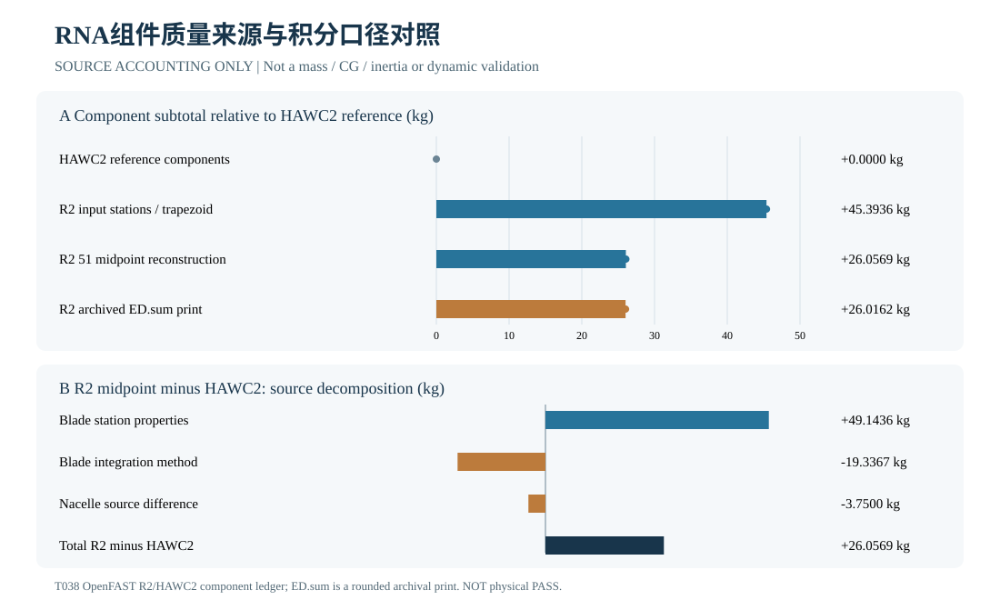
>
> 图A以HAWC2组件小计为零点，区分R2输入站梯形积分、51中点重建及归档ED.sum打印；图B仅分解来源/积分口径差。此图不包含CG、转动惯量或结构响应，不能代替预留的正式图2-10（质量/CG/J）。[四行原始数据表](../assemble/S12_RNA_MASS_CHAIN_TABLE.csv)。

在冻结构形（零偏航、叶片内部相对运动锁定）的OpenFAST R2输入口径下，可进一步从155个已归档质量点重建总质量、质心和二阶矩；其点质量惯量须加上T038源账本明示的本征惯量项，不能将点质量二阶矩直接称为完整物理惯量。以塔顶为原点、采用IEC xyz坐标，质量为676753.290723 kg，质心为(−0.872962，约0，2.783588) m；质心惯量对角为(1.559015×10⁸，9.492700×10⁷，9.948102×10⁷) kg·m²，非零交叉项Jxz=−5.231496×10⁶ kg·m²。换算到塔顶，Jxx=1.611452×10⁸、Jyy=1.006865×10⁸、Jzz=9.999674×10⁷、Jxz=−3.587007×10⁶ kg·m²。全部数值与原T038归档值逐项对照，详见[16行来源表](../assemble/S12_RNA_CG_INERTIA_SOURCE_TABLE.csv)及[155点复算程序](../assemble/s12_rna_cg_inertia_source_qc.py)。

上述对照仅验证**同一输入版本的来源算术闭合**，不等于RNA在运行、柔性或地震频带内的动力学适用性。部分本征惯量是OpenFAST模型约定而非真实部件测量，现阶段不得以此表替代正式图2-10的独立模型V&V验收。

> 原图证据：[5] p3、p7、p9；[6] p23、p29。

## 2.10 初始状态、边界与分析步骤

### 2.10.1 塔底边界

主模型固定基础截断面，研究重点为塔架本体。该模型不显式模拟：
- foundation concrete；
- soil；
- anchor local bearing；
- soil–structure interaction。

因此终稿不能输出这些不存在自由度的局部结论。基础柔度作为研究边界写入第五章。

### 2.10.2 Gravity + PT + contact平衡

正式顺序首先是初始平衡，而不是直接Modal或Dynamic。至少检查：

\[
\sum R_y \approx W_{\mathrm{total}},
\]

并输出：
- base reactions；
- tower-top displacement；
- PT S11/axial force；
- concrete baseline stress；
- 30 joint CPRESS/COPEN/CSHEAR；
- ALLIE/ALLAE/ALLSE等数值健康量。

只有平衡状态稳定，第四章的“mean/reference stress”才有物理基准。

### 2.10.3 Modal from equilibrated state

模态应基于正确的初始应力状态。最终至少提取前30阶并报告：
- frequency；
- mode type；
- FA/SS pairing；
- cumulative effective mass；
- 与来源/独立模型对比。

历史模型前30阶水平累计有效质量约94.83%只作为benchmark；T057必须native solver重新生成。

### 2.10.4 Flex-X / Flex-Z

对塔顶施加独立小载荷，比较两个水平向的：
- tower-top displacement；
- global stiffness；
- base reaction；
- key-section response。

Flex用于避免“频率看起来正确但静力刚度错误”的情况。

## 2.11 网格、阻尼与动力数值设置

### 2.11.1 网格

网格收敛按最终QoI分层：
- global：frequency、tower-top flexibility、base N/V/M/T；
- local concrete/joint：principal/directional stress、CPRESS/COPEN；
- steel fatigue branch：nominal/hot-spot structural stress。

T055的1512个钢塔高长宽比警告构成钢塔局部疲劳的明确门禁。

### 2.11.2 阻尼

Rayleigh damping只是一种数值实现：

\[
\xi(\omega)
=
\frac{1}{2}
\left(
\frac{\alpha_R}{\omega}
+
\beta_R\omega
\right).
\]

目标阻尼必须来自对象级文献/试验背景或明确敏感性，不能把\(\alpha_R,\beta_R\)本身称为材料固有常数。自由衰减用于验证实际实现：

\[
\delta
=
\ln\frac{x_k}{x_{k+1}},
\qquad
\xi
=
\frac{\delta}{\sqrt{4\pi^2+\delta^2}}.
\]

### 2.11.3 时间步与输出

Abaqus/Standard动态步的时间积分按官方 *DYNAMIC语义[REF131]设置。时间步收敛必须同时检查：
- displacement；
- acceleration；
- base loads；
- local stress。

第四章fatigue production的高密度history输出合同已经在T064冻结，当前T057尚没有正式随机风动态生产步，因此不能把静力/模态ODB写成fatigue result。

## 2.12 本章最终图表与验证交付

建议最终第二章至少形成：

- 图2-1 DTU10MW + 158 m混塔研究对象与来源分层；
- 图2-2 31段混凝土+4段钢塔几何；
- 图2-3 普通钢筋笼与PT空间布置；
- 图2-4 钢—混转换与RNA空间等效；
- 图2-5 T057 30水平接缝contact定义；
- 图2-6 Gravity+PT平衡后的PT/混凝土基准应力；
- 图2-7 前若干阶振型；
- 图2-8 mesh convergence；
- 图2-9 Flex-X/Z；
- 图2-10 RNA mass/CG/J comparison。

建议表格：
- 表2-1 参数证据等级；
- 表2-2 31段几何/纵筋；
- 表2-3 C65/C70材料；
- 表2-4 HRB335/Q345/PT材料与来源；
- 表2-5 环筋/拉筋规范补全；
- 表2-6 PT BF1/BF8证据与预压比；
- 表2-7 30 joints contact parameters；
- 表2-8 RNA mass-property ledger；
- 表2-9 T057 Data Check warnings；
- 表2-10 mass/CG/frequency/Flex V&V matrix。

## 2.13 本章小结

本章把10 MW—158 m混塔从“历史模型”重新定义为一个有明确证据等级的精细有限元研究对象。当前正式候选T057相对历史T053的关键更新是：普通钢筋采用同对象后续论文明确的HRB335、钢塔采用Q345；PT由旧BF1升级为具有独立工程与预压比交叉验证的36束位置×8股基线；30个线性SPRING2接缝替换为试验FE支持的hard contact + \(\mu=0.5\) penalty friction；RNA-R2空间质量—惯量表示保持。

这些变化只完成了**evidence reconciliation + static input generation**，尚不等于Abaqus求解验证完成。T057必须依次通过native Data Check、Gravity/PT/contact平衡、mass/CG/J、Modal、Flex和相关网格门禁，才可升级为第三章/第四章的唯一精细结构生产baseline。

---

---

# 第三章 场址长期风环境、整机随机载荷与疲劳控制响应筛选

## 3.1 场址数据、研究对象与证据边界

### 3.1.1 场址数据来源

本文使用ERA5长期再分析资料建立嘉鱼研究点的风气候背景。当前归档数据覆盖2005Q1—2025Q4，共84个季度数据包、184080个逐小时样本，时间轴检查结果为缺失0 h、重复0 h。下载区域覆盖30.5°N—29.7°N、113.5°E—114.4°E，研究点为113.925°E、30.200°N。

使用变量包括10 m与100 m高度风矢量分量、2 m温度、地面气压及10 m阵风。正式风速由

\[
U_z(t)=\sqrt{u_z^2(t)+v_z^2(t)}
\]

计算，风向按气象风向约定由对应 \(u,v\) 分量转换。

### 3.1.2 ERA5证据等级

Olauson[10]使用ERA5 100 m风场并与其他再分析资料比较，展示其在风电时序和统计建模中的适用性；再分析资料综述[11]同时指出，误差会随地点类型、高度和复杂地形条件改变，不能把再分析网格点等同于现场测风塔。

因此本文将ERA5证据等级限定为“长期场址背景/reanalysis-based site climatology”，而不是“现场测风塔实测/bankable wind-resource assessment”。全文统一使用“ERA5研究点”“再分析风速”“场址背景”等表述，不使用“嘉鱼实测风速”。

### 3.1.3 三种时间尺度严格分离

本文存在三个不同时间尺度：ERA5逐小时长期序列负责20余年风速概率、风向、季节和风切变背景；TurbSim 700 s随机风场负责给定平均风速下的高频三维湍流；OpenFAST 100–700 s有效响应窗口负责整机随机响应统计。

ERA5某个小时的最大风速不能称为“真实10 min极端湍流”；TurbSim随机风也不能称为“ERA5该历史小时的瞬态复现”。

## 3.2 轮毂高度风速重建与长期风气候统计

### 3.2.1 ERA5时空预处理与质量控制

正式处理顺序为：逐季度读取ERA5文件；检查时间轴连续性、缺失和重复；对研究点进行规则网格插值；计算10 m和100 m风速模；计算风向；逐时计算风切变；外推HubHt风速；最终统计年/月/季节/风向/分位数和概率分布。

每一步必须保留源文件清单、时间范围、变量名、单位、插值方法和输出hash，使第四章wind-bin probability能够追溯到原始长期数据。

### 3.2.2 动态幂律指数

本文不采用固定1/7指数作为正式轮毂高度外推。Yang等[12]使用ERA5并结合8座测风塔研究幂律指数的时空变化，并比较动态 \(\alpha\) 与固定1/7方法，为本文逐时两高度反演提供直接方法依据。

本文利用逐时10 m和100 m风速：

\[
\alpha(t)=
\frac{\ln[U_{100}(t)/U_{10}(t)]}{\ln(100/10)}.
\]

统一轮毂高度采用当前模型身份 \(z_{\mathrm{hub}}=161.368806\ \mathrm{m}\)：

\[
U_{\mathrm{hub}}(t)
=
U_{100}(t)
\left(
\frac{z_{\mathrm{hub}}}{100}
\right)^{\alpha(t)}.
\]

低风速会使两高度比值及 \(\alpha\) 对小误差敏感，因此当前工作流只在 \(U_{10}\ge0.5\ \mathrm{m/s}\) 且 \(U_{100}\ge0.5\ \mathrm{m/s}\) 时统计\(\alpha\)诊断分布；该阈值不用于删除正式HubHt长期风速概率中的低风小时。

当前历史统计中，满足诊断条件的样本为180768 h，\(\alpha\) 的P05/P25/P50/P75/P95约为0.078/0.118/0.199/0.297/0.384。终稿中这些数字仍需与当前ERA5产物hash绑定。

### 3.2.3 HubHt风速统计与代表风速身份

当前可复现工作流记录的HubHt历史统计为：mean约4.796029 m/s，P50约4.543001 m/s，P90约8.205893 m/s，P95约9.343881 m/s，P99约11.448289 m/s，max约19.202140 m/s。

第三章历史36case由三个代表风速构成：

- **U_SITE = 9.343881 m/s**：HubHt P95，用于高风上尾的场址代表性screening。P95是本文研究设计，不是IEC规定。
- **U_RATED = 11.4 m/s**：DTU 10 MW额定/控制转换附近，用于研究控制器状态转换和载荷敏感性。
- **U_HIST = 19.202140 m/s**：ERA5序列历史小时最大HubHt风速锚点，只能称为历史高小时平均风速背景，不能称为IEC极端设计风、50年重现风速或10 min阵风事件。

### 3.2.4 风向、季节性与长期概率

长期统计至少包括annual/monthly mean、P50/P90/P95/P99、风速直方图/CDF、风玫瑰图、风速—风向联合分布、\(\alpha\)月/季节分布以及正常运行区wind-bin probability。第三章的经验概率将在第四章DLC1.2长期疲劳中作为 \(P_j\) 输入。

若后续使用Weibull拟合，必须与经验概率并列比较拟合误差，不得用拟合分布无条件替换长期样本。

**原Word风向结果的来源恢复与条件分布比较。** 早期R5学位论文原稿的表3-3及图3-3(a)、(b)保存了同一2005—2025年ERA5研究点在100 m高度的16方位频率，其中高风条件明确取 \(V_{100}\ge P_{95}=8.385\ \mathrm{m/s}\)。本研究直接恢复该表的16行原始印刷数值并重绘为图3-5，使全年风向分布与高风条件风向分布在同一坐标上比较。这里的100 m统计不得与§3.2.3的161.368806 m轮毂高度分位数混用。

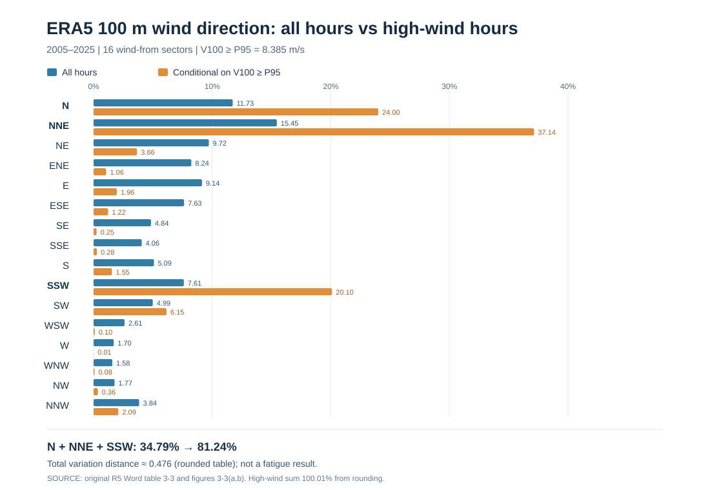

**图3-5** 2005—2025年ERA5研究点100 m气象来向的16方位分布。蓝色为全部逐小时样本的方向频率，橙色为给定 \(V_{100}\ge8.385\ \mathrm{m/s}\) 条件下的方向频率；每组分别归一化，**不是**各方位发生高风的条件概率。由原Word表3-3重绘，不是本轮重新下载或处理ERA5原始逐小时数据。

原稿表中N、NNE与SSW三个方向合计占全年风向频率的**34.79%**，而在高风条件样本中合计占**81.24%**，增加**46.45个百分点**。这三个方向是根据已有表格事后选出的集中方向，不能当作预先设定的显著性检验。若对两组16方位频率分别归一化，则总变差距离为

\[
\mathrm{TV}(P_{\mathrm{all}},P_{\mathrm{high}})
=\frac12\sum_{d=1}^{16}\left|P(d)-P(d\mid V_{100}\ge P_{95})\right|
\approx \mathbf{0.4760}.
\]

全年16项印刷百分数之和为100.00%，高风组为100.01%，后者由逐项保留两位小数造成。仅由表内四舍五入引起的TV数值误差保守不超过约**0.0008**（概率单位），而ERA5网格代表性、风向计算、100 m至轮毂高度外推以及方向相关结构响应误差均**不包含**在这一舍入界内。该结果表明，**全年风玫瑰不能在未经核验时直接替代高风条件方向权重**；但缺少同方向、同风速、同运行状态的风机载荷和材料局部应力，不能由此推断风致疲劳的控制方向、寿命或设计风向。机器可读[16行恢复表](../../../experiments/T062/S12_R5_ERA5_100M_DIRECTION_16SECTOR_20261109.csv)及[源锁重绘程序](../../../experiments/T062/s12_era5_directional_shift.cjs)保留逐行拒绝测试；原R5图3-3(a)(b)是源图而非新生成的物理结果。

#### 2026-10-31 21时｜2005—2025年全小时风速概率实证回填（S10独立输入，非DLC1.2验收）

本次直接从Git LFS原件[嘉鱼ERA5派生工作簿](../../../references/baselines-and-site-20261004/era5-derived-workbook/Jiayu_Paizhouwan_ERA5_2005_2025.xlsx)物化31,793,340字节（SHA256=`bbc290075fb4d7ff6435988acf1ea83c2c31453d207bfa821609b8e9a86953d0`），流式读取`Hourly_ERA5`中**2005-01-01 00:00—2025-12-31 23:00 UTC、184,080小时**的10m/100m U/V分量；时间缺失、重复、非1h间隔均为0。采用上式逐时动态风切变外推至**161.368806m**，再以`[j,j+1)`、1m/s间隔统计，保留≥30m/s溢出箱。[31行真实bin表](../../../experiments/T062/S10_ERA5_2005_2025_HUB_1MS_BINS_20261031.csv)、[全原件SHA与源读取/误差收据](../../../experiments/T062/S10_ERA5_2005_2025_HUB_BIN_RECEIPT_20261031.json)、[可复算流式程序](../../../experiments/T062/s10_era5_hourly_wind_bins.py)及[真实CI #41205311164](https://github.com/g2066203208-beep/voxel-frontier/actions/runs/41205311164)均已保存。

计算得到`Uhub`均值**4.796029203m/s**，P50/P90/P95/P99=**4.542998620/8.205842787/9.343860463/11.448269192m/s**，最大**19.202116603m/s**。若**仅为后续疲劳概率接口的诊断性运行范围**暂取`4≤U<25m/s`，对应**106,900/184,080=58.07257714%**小时；`U<4m/s`有77,180小时。不能把这个诊断范围当成已核读的DTU控制器/IEC认证运行边界。三个历史代表风速分别落在9、11、19m/s箱，箱内总**7,164小时**，只占全时段**3.89178618%**、该诊断运行小时的**6.70159027%**；这说明原18组NTM三风速是screening而不是覆盖全部运行bins的长期疲劳载荷矩阵，不可直接把三点DEL当完整年度材料寿命。

CSV同时保存`p_all_hours=n_j/184080`、`p_conditional_4_to_25=n_j/106900`及`8760p_j`等效标准年小时数，禁止在第四章混用无条件概率与运行时间造成二次乘以运行比例。数值核验：31箱小时数精确合计184,080，12位小数概率和舍入残差约`1e-12`；相对既有摘要均值/P95/最大值差分别约`+2.03e-7/-2.05e-5/-2.34e-5m/s`，属于来源数字精度的再现差异，**不是现场测风误差**。原工作簿U/V分量仅保留约四位小数，风切变低速敏感性及临近1m/s箱边界的归类误差尚未定量封闭；无同高度测风塔、原始84季度CDS GRIB/NetCDF的逐文件SHA及已核读授权IEC条文，**SOURCE_NUMERIC_PASS ≠ 场址/规范/材料疲劳PASS**。本次没有产生新的风载、地震或Abaqus原生响应。

### 3.2.4a 原R5风切变分位数与160 m外推的来源级交叉核查

早期R5论文原稿表3-2、表3-4和图3-4(a)(b)保留了2005—2025年ERA5研究点的风切变与160 m外推结果。本研究从原DOCX直接恢复表内数值：10 m与100 m多年平均风速分别为**2.617 m/s**和**4.299 m/s**，由两高度长期均值之比计算
\[
\alpha_{\mathrm{ratio}}=\frac{\ln(\overline V_{100}/\overline V_{10})}{\ln(100/10)}=0.215564\approx0.2156.
\]
原稿逐时风切变指数在\(V_{10},V_{100}\ge0.5\ \mathrm{m/s}\)的**180768/184080 h**内有定义，P05/P25/P50/P75/P95分别为**0.078/0.118/0.199/0.297/0.384**；其余**3312 h（1.7992%）**未进入这一有效样本。这里恢复的是原稿印刷汇总，而不是由分位数重建原图的概率密度直方图。

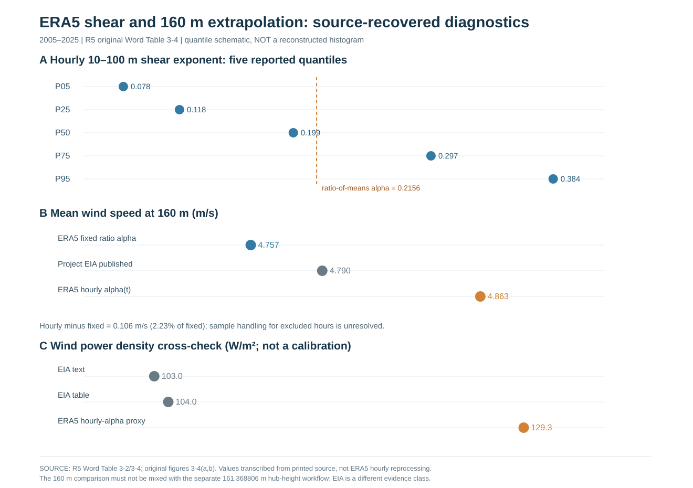

**图3-6** 原R5表3-2/3-4的来源恢复与再表达：A为五个风切变分位数的**离散点示意**，不是原图3-4(a)的直方图重建；B为两种160 m平均风速与公开环评均值的对照；C为ERA5风功率密度代理与环评正文/表格的对照。原图3-4(a)(b)的原件SHA256分别为`19cbb41a754fce0eb3a98a6ea3c2b216737ec2317dae2c08288f369e71e072ae`、`4c931c7ec41663fbbab6ef26a57ff3e0d9047ca231a1e516adfead243c56553f`。

按\(\overline V_{100}(160/100)^{\alpha_{\mathrm{ratio}}}\)复算得**4.757466 m/s**，与原稿四舍五入的**4.757 m/s**一致。原稿采用逐时\(\alpha(t)\)外推再求平均为**4.863 m/s**，二者相差**0.106 m/s**，相对前者为**2.2283%**。环评公开160 m年平均风速为**4.790 m/s**，两种ERA5结果分别相差**−0.6889%**与**+1.5240%**。但原稿没有在表3-4中说明3312个低速无效小时在逐时外推均值中的排除/替代规则，因此**不能把0.106 m/s全部归因于幂律非线性或风切变的时变性**；这一差值还可能含样本口径效应，只有同一小时集合重算才能拆分。

更重要的是，ERA5逐时外推的160 m风功率密度代理为**129.3 W/m²**，环评正文/表格分别为**103.0/104.0 W/m²**，ERA5代理分别高**25.5340%/24.3269%**。平均风速接近并不保证\(\overline{\rho V^3}/2\)接近；同时两类资料的空间、年份、密度和处理方法不完全一致，不能将此差异解释为ERA5已验证的系统偏差或据此校准场址。上述160 m来源恢复与§3.2.4所用**161.368806 m**轮毂高度工作流属于不同高度与处理口径，不能将后者的**4.796029 m/s**当作第三个同口径160 m结果。

仅考虑原稿印刷数字舍入，\(V_{10},V_{100}\)各保留0.001 m/s时反算\(\alpha_{\mathrm{ratio}}\)的范围约为**[0.215430, 0.215697]**，与原稿0.2156一致；两种160 m均值各保留0.001 m/s时，0.106 m/s差值的显示舍入误差不超过约**0.001 m/s**。这不包括再分析、空间插值、无效小时处理、环评来源差异和风机载荷响应误差。[原表16项机器可读恢复](../../../experiments/T062/S12_R5_ERA5_SHEAR_160M_SOURCE_20261109.csv)、[10项诊断结果](../../../experiments/T062/S12_R5_ERA5_SHEAR_160M_DIAGNOSTICS_20261109.csv)及[源锁Node程序](../../../experiments/T062/s12_r5_shear_160m_crosscheck.cjs)用于复核，不能代替ERA5逐小时原始文件的重新计算或工程测风验证。

### 3.2.4b 原R5年度极值GEV图恢复及21年样本的返回水平证据边界

**研究问题与原始来源。** 早期R5学位论文原稿图3-5保存了2005—2025年ERA5研究点**100 m逐小时风速年度最大值**的GEV返回水平：20年**16.91 m/s**、50年**17.49 m/s**、100年**17.86 m/s**。本研究直接读取原DOCX图段及其后说明、目视核对原图image47.png（原DOCX SHA256：da86e1fadafc977fc66d14a97a46760e73ec3b5150ddbae65fd62c7105764ee9；原图SHA256：8bd5628432b31132edf30a9480a0968766125d6b83cbf9b84f64025595eb1e75），恢复三项**已报告**数值。原稿同时给出该100 m小时序列最大观测值**17.626 m/s**；其**21个逐年最大值的完整列表、拟合参数估计、协方差及拟合诊断本轮未获得**。因此，本节不声称重新完成GEV最大似然拟合，更不把返回水平视为已认证的IEC设计风速。

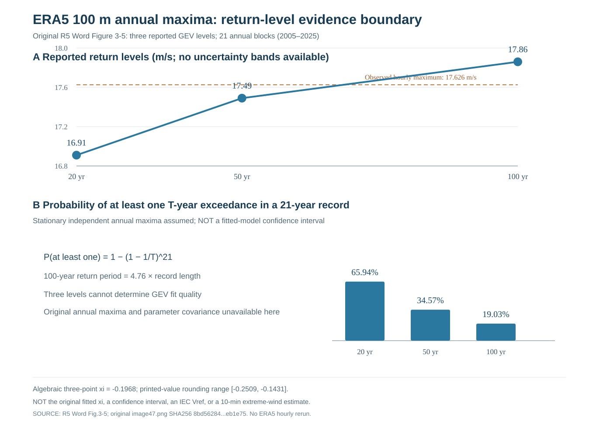

**图3-附2** A为原R5图3-5三个报告点的重绘，虚线是同一100 m逐小时样本的最大观测值17.626 m/s，点间连线仅连接已报告值，不代表原拟合函数或其置信带；B为**假定各年度最大值平稳、相互独立，且返回水平定义正确**时，21年内至少一次超过相应真实\(T\)年阈值的概率恒等式，不是由本样本估计的置信区间。原图及来源不包含可直接重建的原始21点年极值序列。

定义每年超越\(T\)年返回水平的概率为\(1/T\)，则\(n=21\)年中至少一次超越的概率为

\[
P\{\max_{1\leq i\leq21}M_i>z_T\}=1-(1-1/T)^{21}.
\]

| 原R5报告返回期\(T\) / 年 | \(z_T\) / (m/s) | 21年内至少一次超越的条件概率 | \(T/21\) | \(z_T-17.626\) / (m/s) |
|---:|---:|---:|---:|---:|
| 20 | 16.91 | **65.9438%** | 0.9524 | −0.716 |
| 50 | 17.49 | **34.5744%** | 2.3810 | −0.136 |
| 100 | 17.86 | **19.0272%** | **4.7619** | +0.234 |

这里的\(T/21\)只是返回期与观测记录长度的比值，并非置信度或“样本有效倍数”。特别是100年返回水平已经超出21年观测窗口约4.76倍；即使GEV分布完全正确，也只有约19.03%的概率在21年独立年度样本中观测到至少一次超过真实100年返回水平的事件。**因此，三条返回水平曲线点的平滑性和与样本最大值接近，不能证明100年返回水平已经被21年ERA5记录独立验证。**

进一步作**不依赖年度原始序列的代数一致性诊断**。采用Coles（2001，*An Introduction to Statistical Modeling of Extreme Values*，DOI 10.1007/978-1-4471-3675-0）的GEV最大值参数约定，令\(y_T=-\ln[-\ln(1-1/T)]\)，在\(\xi\ne0\)时\(z_T=\mu+\sigma[\exp(\xi y_T)-1]/\xi\)。仅将上述三个**保留两位小数**的报告点强制视作同一GEV函数的精确三点，反解得**代数形状参数\(\xi_{\mathrm{3pt}}=-0.196784\)**。若每个报告值仅存在末位四舍五入误差\(\pm0.005\ \mathrm{m/s}\)，对三点的八个端点组合求解，得到\(\xi_{\mathrm{3pt}}\in[-0.250908,-0.143076]\)。这是**报告点的代数舍入敏感性**，**不是**原论文拟合所得形状参数、GEV估计的置信区间或对负形状参数的统计显著性证明；原始21个年度最大值缺失时无法据此计算参数标准误、返回水平置信带或检验非平稳性。Coles书籍的出版社书目信息已核对，原书具体推导页码本轮未获取，不冒称全文逐页阅读。

本节给出的科学结论仅是**原始图数据恢复及返回水平的可识别性边界**：已报告100 m年度GEV点可作为场址极值背景敏感性示例，但不等于10 min极端风、IEC \(V_{\mathrm{ref}}\)、161.368806 m轮毂高度返回水平或正式DLC极端风工况；原始年极值、时间独立性、非平稳性、参数区间与场址测风对照尚未闭合。可复核的[三行来源表](../../../experiments/T062/S12_R5_ERA5_GEV_3LEVEL_SOURCE_20261109.csv)、[三行诊断表](../../../experiments/T062/S12_R5_ERA5_GEV_RETURN_DIAGNOSTICS_20261109.csv)和[无依赖Node源程序](../../../experiments/T062/s12_r5_gev_return_level_identifiability.cjs)分别锁定印刷输入、条件概率/形状诊断和负例测试。该结果不作为第四章材料疲劳概率的替代来源。

### 3.2.4c 高风方向筛查目标的非等价性：高风小时覆盖与相对风险排序

在§3.2.4恢复的2005—2025年ERA5研究点100 m高度16方位数据基础上，本节检验一个可证伪问题：如果只能筛查k个等成本风向，按“该方向发生高风的相对风险”排序，是否必然使历史高风小时覆盖最大？令H表示V100≥8.385 m/s的高风事件，方向集合A的覆盖目标定义为C(A)=Σ[d∈A]P(d|H)，且|A|=k。在方向互斥、筛查成本相同、目标仅为高风小时覆盖时，按P(d|H)降序选择前k个方向可获得全局最优解。另一种排序是贝叶斯相对暴露R(d)=P(H|d)/P(H)=P(d|H)/P(d)，它衡量某方向发生高风的相对倾向，而不是该方向贡献的高风小时总份额。两者不能混用。

| 等成本方向数k | 最大高风小时覆盖的方向 | 最优覆盖率/% | 相对风险优先的方向 | 其覆盖率/% | 损失/百分点 |
|---:|---|---:|---|---:|---:|
| 1 | NNE | 37.1363 | SSW | 20.0980 | **17.0383** |
| 3 | NNE、N、SSW | 81.2319 | SSW、NNE、N | 81.2319 | 0 |
| 5 | NNE、N、SSW、SW、NE | 91.0409 | SSW、NNE、N、SW、NNW | 89.4711 | **1.5698** |
| 7 | NNE、N、SSW、SW、NE、NNW、E | 95.0905 | SSW、NNE、N、SW、NNW、NE、S | 94.6805 | **0.4100** |

**表3-x**由原R5表3-3两组16方位印刷频率分别归一化得到，不是新风场或结构仿真。一个方向预算时，按相对风险选SSW会比按高风小时覆盖选NNE少覆盖17.0383个百分点；五方向预算时，两种方案仅将NE与NNW互换，仍损失1.5698个百分点。对16方向全部65535个非空子集进行独立穷举，确认每个k的最大覆盖与降序选择一致，其中k=5有4368个候选组合。逐项印刷舍入最大±0.005个百分点，不足以改变k=1、5、7的主要差值；ERA5网格、风向定义、时间依赖性、机组运行状态及载荷传递误差未包含在此界内。

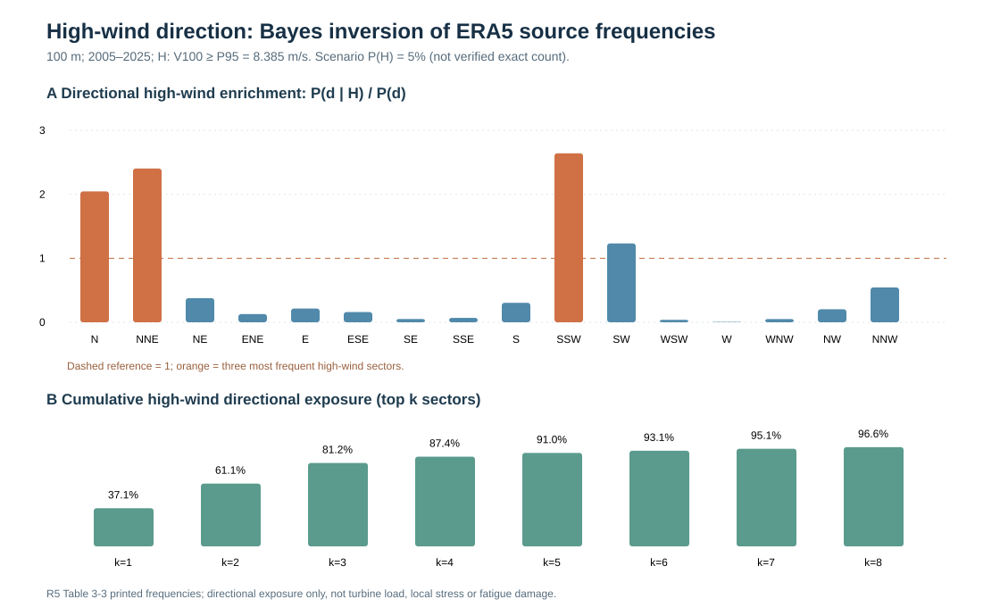

完整k=1—16方向预算见[16行机器可读结果](../../../experiments/T062/S12_DIRECTION_PRIORITY_OBJECTIVE_CONTRAST_16K_20261110.csv)。输入为[原R5派生16方位数据](../../../experiments/T062/S06_ERA5_100M_HIGHWIND_DIRECTION_BAYES_16ROW_20261110.csv)，SHA256为501a8f408c4fe496c5e49f4fc0cf79b095c48f6a67ef95d1a0ae4ca549ca4bd9；既有[贝叶斯源级程序](../../../experiments/T062/s06_era5_highwind_direction_bayes.cjs)提供P(d|H)和R(d)。本节只是100 m历史高风小时方向筛查的确定性目标比较，不能替代161.368806 m轮毂高度正式DLC1.2风速箱，更不能确定结构控制风向、材料Miner损伤或风震响应。

### 3.2.5 诊断运行风速箱与历史NTM来源覆盖（源级定量图）

为防止将代表性随机风筛查误认为全设计寿命的材料疲劳载荷输入，本文直接交叉读取2026-10-31锁定的[ERA5逐小时31个1 m/s箱源表](../../../experiments/T062/S10_ERA5_2005_2025_HUB_1MS_BINS_20261031.csv)与[21风速箱×6随机种子来源矩阵](../../../experiments/T062/S10_ERA5_21BIN_6SEED_NTM_SOURCE_COVERAGE_20261031.csv)，将风气候的**小时概率权重**与历史OpenFAST NTM**原始来源可用性**置于同一图中，而不把二者相乘推导疲劳损伤。

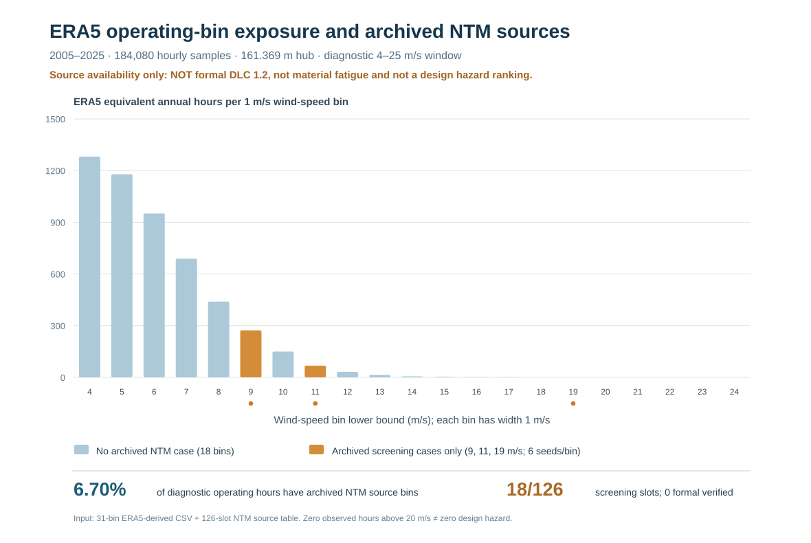

**图3-附1** 2005—2025年ERA5派生风速箱的等效年小时数和历史NTM来源身份。横轴为1 m/s分箱下界，纵轴为各箱的 \(8760n_j/184080\)（h/年），蓝色表示该箱无历史NTM原始输出来源，橙色表示该箱有6个**历史screening**随机种子（9、11、19 m/s）。颜色不表示风致损伤大小、材料寿命、IEC合格性或危险性排序；20—24 m/s在本次21年资料中观测小时数为零，不能视作设计风险为零。

按此项目**非规范性的诊断运行范围** \([4,25)\) m/s，184080个总小时中有106900个诊断运行小时；21个风速箱有16个正小时数、5个零观测小时数。历史18条NTM分别位于9、11和19 m/s三个箱，因此历史来源存在的风速箱对应7164小时，占诊断运行时段的 **6.70159027%**，其余99736小时（**93.29840973%**）所在风速箱没有相应历史NTM输入/输出。21×6=126个规划槽中，**18个仅有历史screening来源，108个无该类归档来源，正式DLC1.2验证为0/126**。尤其4—8 m/s五个分箱的95402个小时占诊断运行小时的89.24415%，尚无对应历史来源，说明本研究的三档代表风速无法直接代表长期风速概率谱。

**这张图只揭示源数据覆盖结构，不能由小时数推出疲劳贡献或最危险风速。** 高风速极少出现的记录仍可能贡献显著应力循环损伤；机组运行边界、2025/2026授权标准条款、历史控制器/BTS可重算性、正式DLC1.2全风速bin与材料局部应力均尚未验收。因此本节将本图归类为**真实再分析派生数据的来源覆盖图**，而不是材料疲劳或工程安全结论。可复算的无外部依赖[Node绘图程序](../figures/plot_s10_era5_ntm_source_coverage.mjs)以两份源CSV的SHA256为前置条件，执行1项真实正例和6项输入污染拒绝；代码/图本轮由JavaScript V8实际运行得到，尚无独立GitHub Actions原生Node执行回执。源哈希及计算约束见[T062既有来源收据](../../../experiments/T062/S10_ERA5_21BIN_6SEED_COVERAGE_RECEIPT_20261031.json)。

### 3.2.6 长期风不确定性

[11]表明再分析资料的bias、RMSE和correlation随地点类型/高度变化。本文没有嘉鱼同高度测风塔长期实测，因此不能对ERA5在该研究点给出“已验证误差为X%”之类的结论。最终第三章必须明确：ERA5适合支撑长期统计和概率；HubHt外推引入风切变模型不确定性；复杂地形/地表粗糙度可能造成局部风场偏差；第四章absolute lifetime的证据等级受场址风资料等级限制。

> 原图证据：[10] p3、p7、p8；[12] p4–6；[11] p8、p10–11。

## 3.3 随机湍流工况与TurbSim风场

### 3.3.1 NTM与ETM研究身份

本文按IEC 61400-1基线审计[14]区分NTM与ETM。NTM用于正常湍流运行，也是第四章DLC1.2疲劳主线；ETM用于更高湍流强度下的响应放大和screening，不与正常运行长期概率直接混合。

### 3.3.2 36case历史screening矩阵

当前正式归档的历史矩阵为：

\[
3\ U_\mathrm{Ref}
\times
2\ \mathrm{turbulence\ models}
\times
6\ \mathrm{seeds}
=
36\ \mathrm{cases}.
\]

六个随机种子固定为104729、130363、155921、181081、206369、231701。三个URef分别为9.343881、11.4、19.202140 m/s。

该矩阵已经有36/36风场和OpenFAST结果资产。用途冻结为代表风速screening、NTM/ETM比较、seed离散、极值/RMS、PSD、load-rainflow/DEL以及第四章初步控制区域识别。它不是4–26 m/s全覆盖的认证DLC矩阵，也不是第四章20年材料疲劳bin矩阵。

### 3.3.3 TurbSim空间与时间离散

当前历史风场采用：
- total time = 700 s；
- 前100 s作为过渡/舍弃段；
- 100–700 s为600 s正式统计窗；
- 空间域 = 200 m × 200 m；
- 网格 = 51 × 51；
- spacing = 4.0 m。

这些是当前归档输入的实际设置，不写成IEC唯一规定。

正式第三章还必须补两个V&V：其一，200 m×200 m是否覆盖整个DTU 10 MW旋转平面并保留合理余量；其二，51×51离散是否足以保证HubHt时程、目标谱和主要载荷统计稳定。若网格敏感性尚未闭合，终稿只能写“采用51×51历史生产网格”，不能写“已证明网格无关”。

### 3.3.4 风场质量检查

每个风场至少检查mean wind speed、standard deviation/TI、三分量时程、HubHt PSD、目标谱/实现谱、空间相干性、grid dimensions、duration/\(\Delta t\)和seed identity。只有风场本身通过质量检查，OpenFAST响应差异才可解释为真实风况/seed差异，而非输入文件错误。

## 3.4 OpenFAST—ROSCO整机模型身份与运行验证

### 3.4.1 整机身份

OpenFAST模型以DTU 10 MW参考风机[1]为风轮—叶片—机舱基准，并统一到本文158 m混塔对应的塔架动力属性。正式输入身份至少记录OpenFAST版本、ElastoDyn/BeamDyn/AeroDyn模块、tower geometry/properties、blade properties、RNA mass/inertia、ROSCO版本与配置、坐标约定及output channel list。

第二章Abaqus与第三章OpenFAST共享的塔顶接口坐标、总质量、RNA惯量和低阶模态必须闭合到预先设定容差，否则不能进入跨模型载荷传递。

### 3.4.2 ROSCO控制器角色

ROSCO[15]提供公开可复现的变速变桨控制框架，并明确below-rated与above-rated运行区域。本文必须特别检查11.4 m/s附近RotorSpeed、GenSpeed、BldPitch、GenPwr及推力相关响应是否连续合理。

控制器在本文中是整机运行边界，不作为创新；[15]中NREL 5 MW或IEA 15 MW的具体调参值不得直接移植为DTU 10 MW参数。

#### 2026-10-31 23时｜历史18组NTM真实TurbSim/FST/ServoDyn/DISCON输入身份（SOURCE-QC，非正式DLC1.2）

直接从13个已归档ZIP读取并逐件校验**127份原始成员**（18×TurbSim `.inp/.sum/.dat`、18×OpenFAST FST/ElastoDyn/ServoDyn/InflowWind及1份`DISCON.IN`），与既有18工况源身份SHA表交叉核对。18组实际TurbSim输入为`IECKAI`、`IEC_WindType=NTM`、`IECstandard=1-ED3`、`IECturbc=A`、**51×51网格**、`TimeStep=0.025 s`、`AnalysisTime=700 s`、轮毂高度`161.368806 m`。三个原始`URef`分别是9.343881、11.400000、19.202140 m/s，各6个`RandSeed1`为104729、130363、155921、181081、206369、231701；三风速复用同一组种子编号，但每组的TurbSim `.inp/.sum/.dat`内容SHA不同。不能把同编号跨风速误说成18个独立seed。

18组FST相同、ServoDyn相同，`TMax=700 s`、`DT=0.0125 s`、`DT_Out=0.05 s`、`CompAero=2`、`CompServo=1`。ServoDyn原文`PCMode=5`、`VSContrl=5`，引用`libdiscon.dll`及`DTU_10MW_RWT_DISCON.IN`；`DISCON.IN`源文本包含ROSCO配置；后续对18份原生OpenFAST日志的核验进一步确认均报告`Running ROSCO-v2.6.0`及legacy Bladed DLL接口。**这证明运行时报告的控制器版本标识，但不能证明18个历史DLL的二进制SHA、精确构建及DTU 10 MW控制器V&V已经验收**。InflowWind原文`WindType=3`并引用每组绝对Windows路径的`.bts`，但**18个原始BTS均未在当前归档中保存字节或SHA**（归档台账状态`prior-size-deferral-cancelled-see-transfer-ledger`）。因此历史18组可作NTM来源筛查，不能宣称可原样复现风场，更不能认定已通过2025版IEC正式DLC1.2。原始[18行逐工况输入表](../../../experiments/T062/S07_18NTM_ORIGINAL_TURBSIM_CONTROLLER_INPUTS_20261031.csv)、[SHA/阅读层级/控制器及BTS收据](../../../experiments/T062/S07_18NTM_ORIGINAL_TURBSIM_CONTROLLER_RECEIPT_20261031.json)和[可复算Python](../../../experiments/T062/s07_ntm18_original_control_input_gate.py)由[Actions #41213530566](https://github.com/g2066203208-beep/voxel-frontier/actions/runs/41213530566)原生执行通过。原始输入配置复核不等于IEC条文、控制器或载荷物理PASS；正式DLC1.2仍0/126，风致材料疲劳仍待原生局部应力。

#### 2026-11-01｜18组历史NTM真实OUTB运行状态源级核验（S07独立准备）

在不新增700 s求解的前提下，直接从18份SHA256锁定的原始158 m OpenFAST OUTB读取100–700 s、0.05 s间隔的12,001个同步时刻，逐案统计`RotSpeed`、`BldPitch1–3`、`GenPwr`、`GenSpeed`和`GenTq`。对应[18行真实运行状态表](../../../experiments/T062/S07_18NTM_ORIGINAL_OPERATING_STATE_QC_20261101.csv)、[来源与误差收据](../../../experiments/T062/S07_18NTM_ORIGINAL_OPERATING_STATE_RECEIPT_20261101.json)及[可复算程序](../../../experiments/T062/s07_ntm18_operating_state_gate.py)，由[原生Actions #41218563210](https://github.com/g2066203208-beep/voxel-frontier/actions/runs/41218563210)成功核验。18/18组在该600 s窗口均满足**诊断性**`GenPwr>1 kW且RotSpeed>0.1 rpm`的全部12,001个时刻，按此阈值未发现运行状态切换；18组最低发电功率1048.436 kW，转速范围6.403–11.954 rpm，三桨距通道在各时刻一致，正转速时`GenSpeed/RotSpeed`中位数范围49.99948–50.00035。上述阈值并非IEC停机判据，且虽然原生OpenFAST日志已经确认ROSCO-v2.6.0标识，仍没有历史控制器DLL二进制和原始BTS的逐件SHA；它们**只能说明历史输出在该窗口表现为连续发电**，不能证明没有控制器内部事件、正式DLC1.2合规、全年可运行性或疲劳寿命。18/18仍仅作历史筛查，正式复用批准0/18。

#### 2026-11-01｜原始ROSCO控制参数与历史运行状态的同源对照（S07源级数值）

在不重新运行OpenFAST的条件下，从原始归档ZIP中读取17,600字节的`DTU_10MW_RWT_DISCON.IN`（SHA256=`8f5d7546420ee34838e66b63e4b26d64460be5d5492f99c60b6d1ef977ffc61a`），提取17项变速、变桨和滤波控制参数，并按工况SHA与前述18份OUTB派生运行状态及ROSCO-v2.6.0原生日志对应。原配置`VS_ControlMode=2`、`PC_ControlMode=1`、`VS_RtPwr=10000000`、`VS_RtTq=198943.67886`、`PC_RefSpd=50.26548`，变桨调度包含30点角度及比例/积分增益。若按ROSCO相应参数采用W、N·m和rad/s解释，则`VS_RtTq×PC_RefSpd=9,999,999.510864 W`，与配置额定功率10 MW的相对差为`4.89136×10⁻⁸`。这只是**控制配置内部单位假设下的算术一致性**，不是原生控制器二进制同一性、动态控制律或IEC合规性证明。

原始OUTB在9.343881、11.4、19.202140 m/s三组风速下，六seed的平均功率分别为6230.9544、9122.9711、9986.4653 kW，平均变桨角分别为0.39524°、3.74244°、16.60208°，以六seed逐案均值的条件单位比值再核验：9.343881 m/s组的平均发电功率/额定功率、平均发电机转矩/额定转矩、平均发电机角速度/参考角速度分别为0.62310、0.76172、0.80334；19.202140 m/s组分别为0.99865、0.99933、0.99921，表明高风速组**历史输出的时均运行点接近配置额定点**。注意三个均值的乘积不等于逐时刻机械功率均值，且没有独立控制器动态误差预算。上述对照；但风速、功率和变桨的相关变化不等于控制器稳定性或因果验证。逐工况配置及带条件单位比值见[18行源级数表](../../../experiments/T062/S07_18NTM_DISCON_VS_OPERATING_QC_20261101.csv)，原始DISCON参数行号、来源SHA、误差和HOLD见[收据](../../../experiments/T062/S07_18NTM_DISCON_VS_OPERATING_RECEIPT_20261101.json)，[可复算程序](../../../experiments/T062/s07_ntm18_discon_operating_contract.py)已保存。原始18个NTM BTS和各case实际加载DLL仍缺逐件SHA，正式DLC1.2复用0/18；源级数值验证不能代替S07物理验收。

#### ROSCO v2.6.0 原始控制律与参数单位核对（2026-11-01）

为避免用新版ROSCO文档解释历史控制器，直接核读ROSCO官方`v2.6.0`标签（commit `51629665d22f92770f861daeebcebd47ab32abb1`）的`rosco_types.yaml`、`Controllers.f90`、`ControllerBlocks.f90`和`ReadSetParameters.f90`。该版本明确规定：`VS_ControlMode=2`为最优叶尖速比跟踪，在额定以上对应恒转矩支路；`VS_ControlMode=3`才包含该跟踪方式下的恒功率转矩上限；`PC_ControlMode=1`表示启用集体变桨PI控制。`PC_RefSpd`是高速轴（发电机侧）参考角速度，单位rad/s，不是转子角速度。源文件中的具体分支分别见`Controllers.f90`第187–190、211–213行及`ControllerBlocks.f90`第52–56、110–142行。因而**不能仅凭历史高风速组发电功率接近10 MW，就将控制模式2称为恒功率控制**。

对既有18组真实NTM来源表复核后，18组均为`VS_ControlMode=2`、`PC_ControlMode=1`，三组各6个随机种子；19.202140 m/s组的六seed时均功率、转矩、发电机转速相对配置额定值分别为0.99865、0.99933和0.99921。该现象与额定附近运行一致，但不是对控制状态机逐时刻分区的直接观测。先前17项参数提取器未收录官方`VS_RefSpd`、`VS_TSRopt`、`VS_GenEff`等关键字段，历史表中的`VS_RtGnSp`、`VS_ConstPower`空值也**不能解释为零**。因此当前结论仅为版本锁定的参数语义与源级统计对应，正式控制器动态验证、历史DLL/BTS原件身份及DLC1.2仍待闭合。

四份官方源文件的逐件SHA256、准确源行号、输入CSV哈希和误差边界见[源级收据](../../../experiments/T062/S07_ROSCO_V260_OFFICIAL_SEMANTICS_RECEIPT_20261101.json)，[可复算Node脚本](../../../experiments/T062/s07_rosco_v260_official_semantics_gate.cjs)通过[原生Actions #41232842992](https://github.com/g2066203208-beep/voxel-frontier/actions/runs/41232842992)核验四份源码哈希、18组源表和5项异常输入拒绝测试。该CI为源级程序验收，不是OpenFAST或Abaqus物理PASS。

#### 历史控制器九项参数的原件补核与版本差异

为核实历史运行状态与控制器设定值的关系，从归档`DISCON.IN`原件（17,600字节，SHA256：`8f5d7546420ee34838e66b63e4b26d64460be5d5492f99c60b6d1ef977ffc61a`）补提九项参数，原值及源行号见[参数表](../../../experiments/T062/S07_ROSCO_V260_ORIGINAL_EXTENDED_KEYS_20261101.csv)。其中，变速参考角速度`VS_RefSpd=47.92601 rad/s`，不同于变桨参考角速度`PC_RefSpd=50.26548 rad/s`；最优叶尖速比`VS_TSRopt=7.50`，最小最优模式角速度`VS_MinOMSpd=36.6 rad/s`，变桨速率上限`PC_MaxRat=0.17453 rad/s`，发电机转矩变化率上限`VS_MaxRat=1.5×10⁶ N·m/s`，风速估计器设定`WE_Mode=2`，设定值平滑`SS_Mode=1`，估计器齿轮箱传动比为50。三个历史风速组的六seed平均发电机角速度相对`VS_RefSpd`分别为0.84255、0.99154和1.04799，说明平均转速与变速参考点的相对位置；**这不是逐时刻控制状态机的直接识别**。

版本核对发现，同一ROSCO v2.6.0标签的参数注册表与可执行源码在两处描述不一致：注册表将`VS_GenEff`描述为无量纲比例，而`Controllers.f90`第190、213行实际按`VS_GenEff/100`使用，故历史原值`100`按源码应解释为100%效率参数；注册表只列`WE_Mode=0/1`，但`ReadSetParameters.f90`第628–631行允许0、1、2，`ControllerBlocks.f90`第238行起明确实现模式2的扩展卡尔曼滤波（EKF）。因此本文以**版本锁定的可执行源代码**解释原始配置，不将这两个原值误判为非法，也不将配置正确等同于历史DLL二进制身份已证实。源文件SHA256、行号、九键原始数值、历史运行区间及异常测试详见[复核收据](../../../experiments/T062/S07_ROSCO_V260_ORIGINAL_EXTENDED_KEYS_RECEIPT_20261101.json)；[GitHub Actions #41242545218](https://github.com/g2066203208-beep/voxel-frontier/actions/runs/41242545218)完成源级原生测试。原始18组BTS和各案DLL的SHA仍缺，2025版IEC正式DLC1.2适用性未验收，故上述结果仅用于历史控制输入解释，不用于直接给出疲劳寿命。

### 3.4.3 分层验证顺序

Brown等[9]的一对一OpenFAST验证先检查结构/模态，再检查来流和运行状态，最后比较载荷/DEL。本文继承该顺序：

**Gate OF-1 结构身份**：tower/RNA mass、tower frequencies、key mode identity。  
**Gate OF-2 风场身份**：mean/TI/spectrum、grid、time window。  
**Gate OF-3 运行状态**：RotorSpeed、blade pitch、generator power、control region。  
**Gate OF-4 载荷统计**：tower-top/tower-base loads、RMS/STD/max/min、PSD、DEL。

Brown等的实机误差数值属于其2.8 MW测试机，不作为本文容差标准；本文只继承验证组织方式。

### 3.4.4 数值稳定性和过渡段

每个case至少检查OpenFAST正常结束、NaN/Inf、rotor overspeed、pitch/power异常、100 s之后统计稳定性及塔架响应非物理漂移。700 s总时长并舍弃前100 s是本文当前生产设计，最终需通过代表case确认100 s足以消除启动过渡，而非自动视为标准规定。

> 原图证据：[15] p4、p6、p13、p17；[9] p5、p7、p10、p13、p15、p17。

## 3.5 多随机实现整机响应统计

### 3.5.1 QoI集合

第三章不以单一塔底弯矩作为“最危险性”指标。至少统计：
- 运行状态：RotorSpeed、BldPitch、GenPwr；
- 整体响应：tower-top FA/SS displacement、resultant displacement、必要的acceleration；
- 塔底/接口：\(F_x,F_y,F_z,M_x,M_y,M_z\)及resultant bending moment；
- 疲劳载荷：TwrBsMxt和TwrBsMyt load-DEL。

第四章材料控制工况从多个QoI的控制case并集中选取。

### 3.5.2 每个case的时域统计

对100–700 s有效窗统一计算：

\[
\mu_x=\frac{1}{N}\sum_{i=1}^{N}x_i,
\]

\[
\sigma_x=
\sqrt{
\frac{1}{N-1}
\sum_{i=1}^{N}(x_i-\mu_x)^2
},
\]

以及min、max、peak-to-peak、RMS和必要分位数。

所有统计表必须绑定case_id、source .outb hash、channel exact name/unit、effective window和parser version。当前项目曾出现.outb Time/channel indexing偏移，因此通道身份本身就是结果可追溯性的一部分。

### 3.5.3 六seed统计与离散

每个 \(U_\mathrm{Ref}\) × turbulence model有6个seed。对每个QoI计算six-seed mean、standard deviation、coefficient of variation、min/max和controlling seed。

第三章的任务是展示seed影响，而不是把某一个seed的峰值写成该平均风速的唯一确定结果。

#### 3.5.3.1 已归档18组NTM载荷DEL的种子数量敏感性（来源级数值结果）

对历史归档的3个平均风速（9.343881、11.4、19.202140 m/s），各取6个不同seed标签的NTM记录，复用已完成源SHA核验的OpenFAST `.outb`派生载荷表。每条时程均取100–700 s、Δt=0.05 s、12001点，源表包括塔底六分量及九个原始塔架测站各六分量，共18×60=1080行。本节只比较塔底`TwrBsMyt`与九站`TwHt1–9MLyt`的载荷DEL，不将原始九站冒充后续31段完整时程。源表、输出及可复算脚本分别为[18工况原始载荷DEL](../../../experiments/T062/S06_18NTM_ORIGINAL_9GAGE_LOAD_DEL_20261031.csv)、[30组统计表](../../../experiments/T062/S10_18NTM_6SEED_LOAD_DEL_CONVERGENCE_SUMMARY_20261031.csv)、[180行全部子集枚举](../../../experiments/T062/S10_18NTM_6SEED_EXHAUSTIVE_SUBSET_CONVERGENCE_20261031.csv)和[原程序扩展](../../../experiments/T062/s06_ntm_seed_dispersion_and_bts_gate.js)。输入源SHA256=`95de6578cf379d1b2e1d99a68c26954a68e93cc8bfc4bdcd63dd324ae2999a0f`。

为了避免将六个DEL的算术平均误当作循环四次矩的合并值，对任一包含`n`个**等时长且使用同一等效循环数**的子集`A`，定义载荷级四次矩合并指标

\[
D_{4,A}=\left[\frac{1}{n}\sum_{s\in A}(D_{4,s})^4\right]^{1/4}.
\]

这里`D_{4,s}`是每条600 s记录以`m=4,N_{ref}=600`得到的`DEL_{m4}`，`D_{4,A}`对应**各独立雨流账本的四次矩加权合并**，并非拼接原始时程重新雨流（拼接边界会改变循环），也不是第四章任何材料的S–N指数或寿命。它与第3.7节历史`N_{eq}=100000`筛选口径**数值不能直接比较**。将六个标签按S01至S06排序，逐一枚举`n=1,2,3,4,5,6`时全部`\binom{6}{n}=6,15,20,15,6,1`种子集，并记录最小、最大及相对完整六样本值的最大偏离。全部子集来自**同一六条记录**，不等于新增加的独立湍流实现。

| NTM风速 / m·s⁻¹ | 六seed算术均值 / kN·m | 六seed四次矩合并 / kN·m | seed样本CV | 任取3个seed相对六seed最大偏离 | 留5个seed最大偏离 |
|---|---:|---:|---:|---:|---:|
| 9.343881 | 43,701.157 | 44,641.262 | 13.329% | 10.859% | 3.776% |
| 11.4 | 56,611.754 | 57,613.197 | 11.901% | 10.172% | 3.372% |
| 19.202140 | 61,333.196 | 61,647.420 | 6.429% | 4.531% | 2.121% |

上述数值全部为**塔底`TwrBsMyt`、源版本锁定的历史NTM筛查结果**。六seed四次矩合并值比算术均值分别高2.151%、1.769%和0.512%；因此不能用简单平均代替给定`m=4`的四次矩聚合。三seed子集相对六seed基准仍可偏离约4.5%–10.9%，显示**在这六条既有记录内部**对seed选择敏感，但六seed本身不是已证明收敛的总体真值；缺少新增独立seed，不能由子集范围推断置信区间、总体误差上界或规定足够样本数。源OUTB的int16打包量化误差逐通道已在1080行原表给出，数表输出保留9位小数；这一数值舍入预算不覆盖真实风场、控制器、结构、测点位置和材料模型误差。

原始18个OUTB先前已按SHA逐字节恢复，本轮仅从**已归档的1080行派生表**复算，GitHub Actions [`#41175810307`](https://github.com/g2066203208-beep/voxel-frontier/actions/runs/41175810307)独立检查输入SHA、30组完整性、组合数、解析四次矩及全部输出逐字节一致。原始36个TurbSim `.bts`仍处于来源清单中的延后保存状态，不能称本轮重新产生或复现了18个NTM原始风场。上述结果为`SOURCE_LOAD_DEL_NUMERIC_QC`，不是正式DLC1.2年疲劳损伤，也不构成材料局部应力、PT或接缝的原生验收。下一步须在相同输入身份下建立局部材料应力时程并验证截面/坐标与重力、惯性所有权，再按风速概率及材料独立疲劳规律进行第四章计算。

### 3.5.3.2 运行状态与载荷DEL相关性的风速档混杂效应（18组真实NTM）

为判断整机运行状态均值能否替代随机风载荷疲劳筛选，本研究将三个历史NTM风速档、每档六seed的运行状态统计与塔底`TwrBsMxt/TwrBsMyt`载荷DEL逐例配对，要求`case`及原始OUTB SHA256一致。18例均为100–700s、0.05s步长、12001点；`GenPwr_mean`由kW换算为MW，m=4的载荷DEL由kN·m换算为MN·m。历史运行状态启发式记录18例均处于功率/转子活跃状态，但不代表正式DLC1.2认证。

三个风速档直接合并时，平均发电机功率与塔底My载荷DEL的Pearson相关系数为**r=0.827168**（R²=0.684207）；将两变量分别减去所属风速档的六seed均值后，档内相关系数降至**r=0.148564**（R²=0.022071）。未归一化协变交叉乘积精确分解显示，**98.9421%**来自档间均值差异。三个档内相关系数分别为0.500028、-0.003276、0.162506，18次逐例删除并重新中心化得到档内r范围0.007570～0.377205。第二组交叉检查中，平均桨距角与Mx载荷DEL的合并r=0.968215，档内r=0.315669。

因此，混合样本的强相关性主要反映**不同风速档之间的共同变化**，不能推断固定风速下运行状态均值可稳定预测seed载荷DEL。该分析属于历史18例的描述性统计，不是控制器因果机制、总体显著性检验、局部材料应力或Miner损伤。源级程序、18例配对表、4行统计表与正式双面板图均已保存；输入SHA256为`0f577f3197870a1350c740c2e0c118073fb9b6f796b4c471765c6f616d5a1b04`及`95de6578cf379d1b2e1d99a68c26954a68e93cc8bfc4bdcd63dd324ae2999a0f`，程序SHA256为`90f9357349ec881ee377fdada2a116b3d5166f41e90680d5788c27a33bf795ee`。

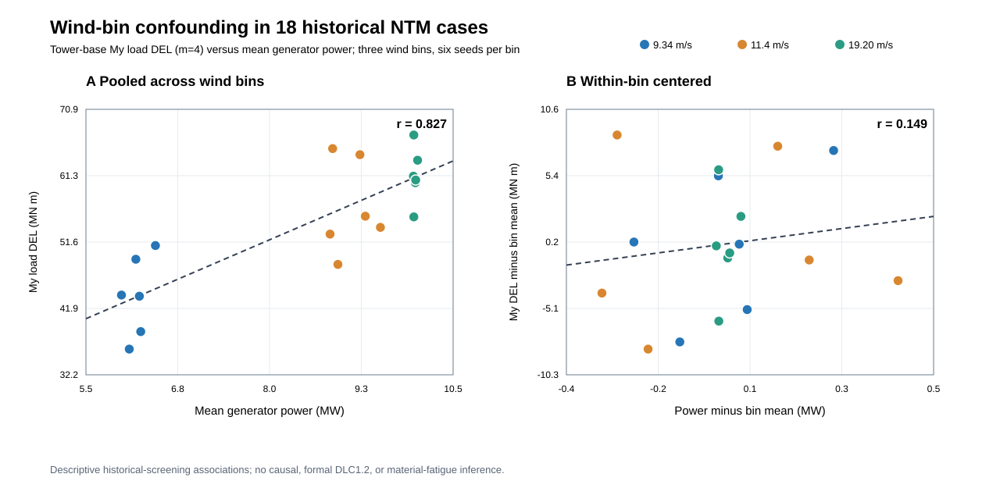

*图3-新增：同一18组真实来源NTM的My载荷DEL与平均发电机功率；左为混合样本，右为按风速档中心化，虚线仅表示描述性线性拟合。*

### 3.5.3.3 运行状态均值代理的留出检验：档内斜率未提高历史载荷预测精度

在§3.5.3.2已确认混合风速档相关性受到档间均值影响的基础上，本节进一步提出可证伪问题：**控制风速档以后，平均功率或平均桨距角能否在留出样本上提高塔底载荷DEL的预测精度？** 复用相同的18组NTM真实来源派生记录（3个风速档×6个seed），分别预先指定“平均功率MW→塔底My载荷DEL”和“平均桨距角°→塔底Mx载荷DEL”。比较三种估计器：仅使用训练集的目标风速档DEL均值、训练集各风速档中心化后估计统一斜率并加回目标档均值、以及不区分风速档的混合样本线性回归。每次预测均重新计算训练均值与斜率，**不使用留出样本的DEL或所属档样本均值**。

采用两种分割：逐例留一（LOCO，18次，每次训练17例）和按共同seed标签跨三个风速档同时留出（LOSO，6折，每折训练15例、测试3例）。每个观测在每种分割下仅计入一次误差。这里S01–S06只是历史标签，不代表不同风速档间存在可验证的相同湍流实现；18个误差也不作为独立总体样本推导显著性。

| 载荷通道与运行量 | 留出方式 | 风速档均值RMSE（MN·m） | 档内斜率RMSE（MN·m） | 混合回归RMSE（MN·m） |
|---|---|---:|---:|---:|
| My—平均功率 | LOCO | 6.1602 | 6.7473 | 5.6788 |
| My—平均功率 | LOSO | 6.1602 | **7.0176** | 5.8935 |
| Mx—平均桨距角 | LOCO | 2.2124 | 2.2676 | 2.1994 |
| Mx—平均桨距角 | LOSO | 2.2124 | **2.3201** | 2.2057 |

My通道中，加入档内斜率使LOCO和LOSO的RMSE分别比仅用风速档均值**增加9.53%和13.92%**；Mx分别增加2.49%和4.87%。因此，在当前18组历史数据中，**两种预先指定的运行状态均值均未显示出控制风速档后的留出预测增益**。混合回归在本样本中可能取得较小RMSE，但仍可利用风速档之间的共同变化，不能据此否定档间混杂，更不能外推至未覆盖风速箱或未来随机种子。运行状态均值与DEL来自同一600s统计窗，属于事后代理检验，不是提前预测新风载的物理模型。

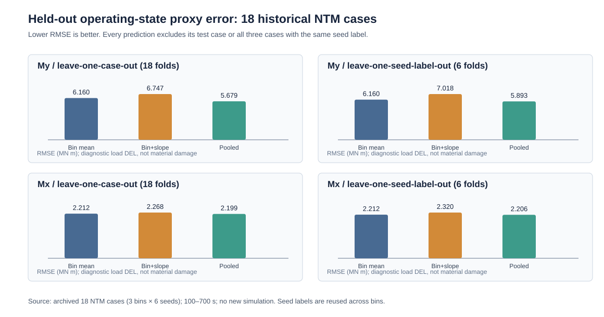

*图3-新增：18组NTM历史载荷DEL的留出误差；My和Mx分别对应功率与桨距角，四面板区分LOCO/LOSO；单位MN·m。*

输入为[T062既有18例配对源](../../../experiments/T062/S06_NTM18_OPERATING_DEL_BIN_CENTERED_20261107.csv)，SHA256 `4abf76252fa34b2c12635d409e5abc23c4a7d6f759b66dbec12b1932379f4bea`；[可复算程序](../../../experiments/T062/s06_ntm_proxy_holdout_gate.cjs) SHA256 `3c29dd33f3eeb339b22a2d6d89567d23a1f8b8a5b6de7f5855beefaa42dbcc3b`；[12行误差表](../../../experiments/T062/S06_NTM18_PROXY_HOLDOUT_12ROW_20261107.csv) SHA256 `6c154ded694eac40c12bb43e0bb8aa6361386b9d476ccaf4bb8a5618b782a0f7`。本轮仅重读18行派生表，未重读原OUTB、未增加生产风场；V8执行源程序数值及污染拒绝测试，尚未运行原生Node CLI/CI。该负结果不能代替正式DLC1.2、多seed总体置信区间或分材料疲劳寿命。

### 3.5.4 NTM/ETM成对比较

对相同 \(U_\mathrm{Ref}\) 和相同seed成对比较NTM与ETM的peaks、RMS/STD、PSD和load-DEL。最终必须由当前36case结果判断哪些QoI对湍流模型最敏感以及敏感性是否随平均风速改变，不能预设ETM必然在所有指标上更大。

### 3.5.5 原始NTM六分量同步峰值与分通道独立峰值的差异（真实OUTB源级结果）

针对“逐通道最大弯矩是否能够组成同一时刻的双轴弯矩合量”这一可证伪问题，本文直接恢复了**158 m研究模型的18组历史NTM原始OpenFAST OUTB**，而非由独立通道极值拼接合成时程。每组采用原始100–700 s、时间步长0.05 s的12,001个采样点，恢复塔底\`TwrBsFxt/Fyt/Fzt/Mxt/Myt/Mzt\`六个原生通道；18组共216,018行，原始OUTB逐件校验SHA256与ZIP CRC。对应三风速箱分别有六个seed。六分量单位依OpenFAST原生输出为力kN、力矩kN·m，未执行坐标变换或将塔底内力误称外加节点荷载。

对每个真实采样时刻定义同步双轴弯矩模值
\[
R_{xy}(t)=\sqrt{M_x(t)^2+M_y(t)^2},\qquad
R_{xy}^{\max}=\max_{t\in[100,700]}R_{xy}(t).
\]
与之对照的**分通道独立峰值拼接上界**为
\[
R_{xy}^{\mathrm{ind}}=
\sqrt{[\max_t|M_x(t)|]^2+[\max_t|M_y(t)|]^2},\qquad
\eta_{xy}=R_{xy}^{\max}/R_{xy}^{\mathrm{ind}}\leq1.
\]
不等式严格成立，但仅当两个分通道极值恰好同刻且幅值同时达到各自峰值时才取等号。三维合力对\`F_x/F_y/F_z\`采用相同的同步范数与独立峰值范数比较，**不将不同时间的六个极值误称为同一荷载状态**。

真实18组中，\(\eta_{xy}\)最小为**0.969949**，出现在**U19p202140_NTM_S01**：同步双轴弯矩峰值为**219900.297994 kN·m**，分通道峰值拼接上界为**226713.173650 kN·m**；两者相差**6812.875656 kN·m**，占拼接上界的**3.005064%**。该组原始int16解码的双轴合量单时刻量化误差上界为**1.623310 kN·m**，远小于上述同步性差异。18组同步双轴弯矩峰值的最大值为**297879.734339 kN·m**，对应**U11p4_NTM_S06**，并非三个历史风速箱中风速最大的档。三维力合量的最小同步/独立峰值比为**0.998219**；其余统计见18行来源表。

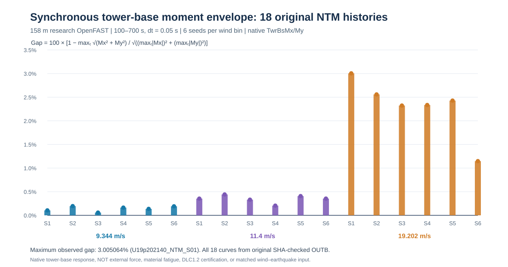

这组结果说明**峰值组合必须保留时刻配对**；独立分量包络只能作为保守数学上界，不能直接解释为真实瞬时荷载组合。它也说明塔底绝对峰值与前述雨流DEL是不同统计量，不能用本节最大模值替代循环范围、材料局部应力或疲劳损伤。原生六分量时程、18行指标、程序与源级收据分别见[T062历史W侧全时程恢复程序](../../../experiments/T062/s06_ntm_w_base6_fullrate.py)、[18行实测派生表](../../../experiments/T062/S06_18NTM_W_BASE6_COINCIDENT_ENVELOPES_18ROW_20261110.csv)及[来源收据](../../../experiments/T062/S06_18NTM_W_BASE6_FULLRATE_SOURCE_RECEIPT_20261110.json)。432个既有源统计字段（18工况×6通道×均值、最小、最大、标准差）与恢复时程复算最大绝对残差为**4.990143e-7**（原生单位），是来源/解码一致性而非结构物理精度。

**适用边界：**此处18份原始NTM OUTB属于历史九测高版本，并非四个ETM工况的31段分布载荷，更不是已经匹配地震侧模型、初态和触发时刻的W/E/WE联合响应。塔底原生通道的坐标、惯性归属及外部载荷分解尚未独立闭合，故本节仅可作为第三章**真实整机时域响应统计**，不得用作第四章材料Miner损伤或第九阶段风震物理PASS。原始大文件只以[GitHub Actions可追索Artifact](https://github.com/g2066203208-beep/voxel-frontier/actions/runs/42842305092/artifacts/13775054290)保存，过期日为2026-12-10（UTC）。

### 3.5.6 原生塔底六分量的坐标归属与参考点偏移误差界（S07，真实历史NTM）

**原生代码证据与适用域。** 为避免把整机响应误作为外部风荷载，直接核读与历史计算版本相同的[OpenFAST v3.5.3 \`modules/elastodyn/src/ElastoDyn.f90\` 第1154—1161行](https://github.com/OpenFAST/openfast/blob/v3.5.3/modules/elastodyn/src/ElastoDyn.f90#L1154-L1161)（源码Git blob \`2bcfb11fc40712febb5a8b5c2947c87e2aabb7b1\`）：\`TwrBsFxt/Fyt/Fzt\`是塔底合力\`FrcT0Trb\`分别在\`a1/-a3/a2\`基向量的投影；\`TwrBsMxt/Myt/Mzt\`是\`MomX0Trb\`在同一组基向量上的投影。因此，六个\`t\`后缀量属于**塔底局部坐标中的原生内力/反力响应**，不是未经转换的全局惯性坐标分量，也不是可直接重复施加于另一个结构模型的纯空气动力外载。同一源码第1172—1190行的塔架测点截面合力递推明确含有重力和线加速度项；**本轮并未完成塔底全部分项的逐项数值拆解**，不能据此把\`F_z\`完全认定为重力或把六分量分解成外载。该源码语义是SOURCE-CODE/FRAME PASS，不是耦合加载物理PASS。

**不依赖未知姿态的严格条件性误差界。** 在已把两参考点的力、矩表示到**同一个正交坐标系**、不改变物理载荷且只移动力矩参考点的前提下，令\(\boldsymbol d=\boldsymbol r_A-\boldsymbol r_B\)，刚体力系满足
\[
\boldsymbol F_B(t)=\boldsymbol F_A(t),\qquad
\boldsymbol M_B(t)=\boldsymbol M_A(t)+\boldsymbol d\times\boldsymbol F_A(t).
\]
由叉积范数及最大值的Lipschitz性质，对水平双轴弯矩峰值\(R_{xy}^{\max}=\max_t\sqrt{M_x(t)^2+M_y(t)^2}\)有
\[
\left|R_{xy,B}^{\max}-R_{xy,A}^{\max}\right|
\le \|\boldsymbol d\|\,\max_t\|\boldsymbol F_A(t)\|.
\]
这里**没有**将不同时刻的力、矩峰值组合成物理载荷；使用力峰值只是建立任意时刻都成立的保守上界。继承§3.5.5已逐OUTB校验的18组真实NTM统计，令\(M_p\)为已解码同步双轴弯矩峰值、\(F_p\)为已解码同步三维合力峰值，\(q_M,q_F\)分别为原始int16半步量化的范数上界。要使仅由**未知参考点偏移**造成的峰值误差不超过真实原峰值的\(\varepsilon\)，一个充分条件是
\[
\boxed{\ \|\boldsymbol d\|\le d_\varepsilon
=\frac{\varepsilon(M_p-q_M)}{F_p+q_F}\ }\quad
(\varepsilon=0.01\ \text{或}\ 0.05).
\]
该不等式将原始量化误差纳入最不利分子/分母，**是充分保证而非必要条件，更不是已测量的坐标错误**；当\(\boldsymbol d\parallel\boldsymbol F\)时叉积为零，实际误差可能远小于上界。

| 真实NTM历史风速箱 | 六seed的\(d_{1\%}\)最小—最大（m） | 含义 |
|---|---:|---|
| 9.343881 m/s | 0.099547—0.111817 | 仅同坐标系参考点偏移的充分保证 |
| 11.4 m/s | 0.109280—0.115493 | 同上 |
| 19.202140 m/s | **0.080499—0.089462** | 该历史箱对未知参考点偏移更敏感 |

全18组\(M_p/F_p\)这一**归一化特征长度**范围为8.049944—11.549362 m，不能将它解释为实际气动力作用臂。全18组1%充分保证阈值\(d_{1\%}\)为**0.080499—0.115493 m**；若仅作0.1 m未知偏移的假设，最不利上界为原双轴峰值的**0.865856%—1.242256%**。最敏感的实际历史工况是\`U19p202140_NTM_S02\`（\(M_p=207330.159457\ \mathrm{kN\,m}\)、\(F_p=25755.4798013\ \mathrm{kN}\)、\(d_{1\%}=0.080499\ \mathrm m\)）。这些百分比不是结构预测误差，实际参考点是否偏移0.1 m也没有证据。

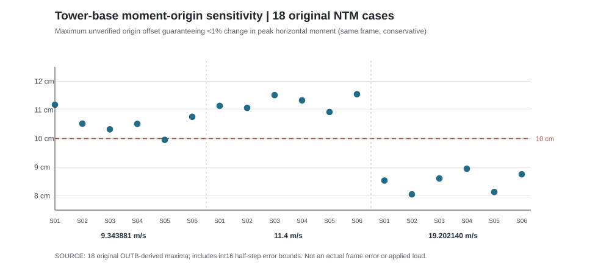

原18组中同步双轴弯矩峰值时刻与同步三维力峰值时刻**18/18不相同**，二者时间差为0.05—545.40 s，中位数144.45 s；但力合量可能受到近似恒定的轴向分量主导，这种时间差**不能解释为风载与弯矩之间的物理相位滞后**。在尚未获得同刻惯性/姿态分解及风震侧一致初态前，不允许将原生反力与地震响应叠加或把该上界作为设计容许偏差。

本节数值来自[18行原始OUTB派生表](../../../experiments/T062/S06_18NTM_W_BASE6_COINCIDENT_ENVELOPES_18ROW_20261110.csv)，SOURCE SHA256 \`ec1d5153635547c0ea24dba6ac62f65325dc50716b61e4c5c767ba489ec7444c\`；[独立可运行程序](../../../experiments/T062/s07_ntm18_base_wrench_origin_gate.cjs) SHA256 \`6f47f91533e6dd1b834aeacc6859ba2f8aa329c37cbb58fde7cd0b717a9bdfd3\`、[18行新结果表](../../../experiments/T062/S07_NTM18_BASE_WRENCH_ORIGIN_GATE_18ROW_20261111.csv) SHA256 \`60247f42ae1b0e4b967b23d8d1af88b6392d51c99ec1963f72e3cc5b20d8275f\`及[科研图](../figures/FIG3_S07_W_BASE_ORIGIN_TOLERANCE_20261111.svg) SHA256 \`8dcbb9bd7bb122e1e204e2f6908cc8cdc563889944e63d6899ef3826bc212840\`。算法完成2项解析对照、12项坏输入拒绝、18/18真实历史数据源级计算；没有新增OpenFAST求解、原始OUTB重新解码或材料局部应力。**S07坐标输出语义SOURCE-CODE PASS；实际坐标映射/惯性归属/外载分解/同态W-E-WE仍HOLD。**

### 3.5.7 原始NTM九测点姿态分量的全时程恢复及非单调风速响应（S07，真实OUTB）

**研究问题与来源。** 前述塔底六分量虽已恢复完整同步时程，但仅凭反力输出无法判断同刻塔架姿态。本文在**不新增OpenFAST生产求解**的条件下，直接从相同18份原始158 m模型NTM OUTB（原始SHA256与ZIP CRC逐件核对）恢复每个原生塔架测点的`TPxi/TPyi/TPzi`（m）及`RPxi/RPyi/RPzi`（deg）。时间窗仍为100–700 s、步长0.05 s、每工况12,001点；18工况共**216,018行×54个姿态分量**，另形成18×9=**162行**同刻峰值表。原始九个`TwrGagNd`节点为1、3、5、7、9、13、15、17、20，名义高度仅**0.070536–2.750893 m**；**不能将九个近塔底测点误写为112 m混凝土段或158 m塔顶的完整姿态覆盖**。与已恢复塔底双轴弯矩峰值的18/18交叉核验最大差为`4.56×10⁻⁷ kN·m`。

为避免把OpenFAST原生`RP`通道直接冒充方向余弦矩阵（DCM），本文仅定义可从输出直接观测的水平角位置**分量模值**
\[
R_{RP,xy,g}(t)=\sqrt{RPxi_g(t)^2+RPyi_g(t)^2}\quad(\mathrm{deg}),
\qquad R_{RP,xy,g}^{\max}=\max_{t\in[100,700]}R_{RP,xy,g}(t).
\]
该诊断量**不是**严格的三维刚体总转角、局部坐标到全局坐标的变换矩阵，也不等于塔顶位移或抗震变形指标。保留原生三个`RP`分量和三个`TP`分量的逐时刻数据，供后续在获得精确坐标基定义时重建DCM；目前不以小角度近似冒称精确变换。

| 历史NTM风速箱 | 九测点中最高原生测点（2.750893 m）的六seed峰值范围（deg） | 六seed中位数（deg） |
|---|---:|---:|
| 9.343881 m/s | 0.009549–0.011112 | **0.010341** |
| 11.4 m/s | 0.010964–0.011745 | **0.011186** |
| 19.202140 m/s | 0.008104–0.009568 | **0.008386** |

在**全部九个原生近底测点**，11.4 m/s箱的六seed最小峰值均严格高于19.202140 m/s箱的六seed最大峰值（9/9个测点的描述性完全分离）；三个风速箱的九测点中位数均呈**11.4 m/s > 9.343881 m/s > 19.202140 m/s**。这说明**本批历史工况的近底角位置峰值不随名义平均风速单调增加**，但九测点位于同一结构且强相关，不能把9/9当作九项独立统计试验，也不能据此证明控制器变桨的因果作用、正式DLC1.2覆盖或结构设计安全。该排序仅对本批18份已核原件、此时间窗及此原生测点集合成立。

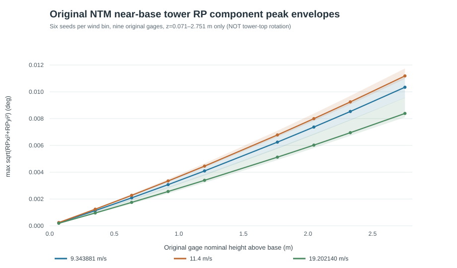

**误差与复现。** 原始OUTB int16半步量化传播得到水平`RP`分量模值的最大单点范数上界`9.2054×10⁻⁸ deg`；但DCM语义、惯性归属及不同运行状态的物理误差**尚无法定量**。恢复源码[Python](../../../experiments/T062/s07_ntm18_pose9_fullrate.py) SHA256 `6c1d9829eb12296da9b441409d41c595d4e83a569eae0cb83db55f0cfb07b5ad`，162行原始数值[CSV](../../../experiments/T062/S07_18NTM_W_POSE9_COINCIDENT_162ROW.csv) SHA256 `0526477678390fce5f5d8b6097fd97de22fa75a5141ee5545c312eeebfbcc9de`，27行六seed包络[CSV](../../../experiments/T062/S07_NTM18_POSE9_SEED_ENVELOPES_27ROW_20261111.csv) SHA256 `1a2d97922c8d204afd2ed6b82ed990dce98c8a6a295d5518a97f037f21efc9cf`；包络[复算程序](../../../experiments/T062/s07_ntm18_pose9_envelope.py) SHA256 `742dfa0d033ff71f8b8582f45016b26642890dababedadb16d76248927da6ad6`。全速姿态gzip SHA256 `2e113c83990d81b064636dca05308fc72676cb329033b9d603c8807d5cf0ecea`（31,908,896字节）保存在[GitHub Actions原件Artifact #13785456956](https://github.com/g2066203208-beep/voxel-frontier/actions/runs/42861971665/artifacts/13785456956)，截至2026-12-10 17:09 UTC有效；另存于CAE论文工作室Library，不冒称已入Git。恢复程序的2项解析/4项异常拒绝及包络程序1项解析/5项异常拒绝均PASS；原始OUTB逐件SHA、时间网格、54通道单位及18/18塔底峰值oracle PASS。**来源级姿态分量恢复PASS；精确DCM、外载所有权、同态W/E/WE及材料疲劳HOLD。**

### 3.5.8 塔底弯矩、剪力、扭矩与轴向力的同步多分量包络（S07，真实216,018行）

**研究问题。** 当塔底双轴弯矩达到峰值时，是否也同时达到扭矩、剪力及轴向力的各自峰值？在§3.5.5已恢复的**同一18份原始OUTB六分量**上，定义
\[
M(t)=\sqrt{M_x(t)^2+M_y(t)^2},\quad
V(t)=\sqrt{F_x(t)^2+F_y(t)^2},\quad
T(t)=|M_z(t)|,\quad N(t)=|F_z(t)|.
\]
其中`Fzt`的符号及其重力/惯性成分保留原生定义，\(N=|F_z|\)只是**绝对值诊断符号**，不能未经坐标与所有权核实就将其全部称为混凝土截面压应力。对各量先在同一工况有效窗内以自身峰值归一化（例如\(\widehat M=M/\max_t M\)），定义**最大共同达到比例**
\[
q_{MT}=\max_t\min\{\widehat M(t),\widehat T(t)\},\qquad
q_{MVT}=\max_t\min\{\widehat M(t),\widehat V(t),\widehat T(t)\}.
\]
这是不依赖任意材料权重的时序**同时性诊断**：存在某时刻使两种（或三种）归一化需求均不低于\(q\)，且不存在更高共同阈值；\(0\le q_{MVT}\le q_{MT}\le1\)严格成立。**它不是N–M–V–T截面承载力方程，也不能用于替代规范荷载组合或抗力验算。**

直接读取已SHA锁定的216,018行原生塔底六分量（100–700 s、0.05 s），得到18组真实工况的\(q_{MT}=\)**0.719863–0.877074**，\(q_{MVT}=\)**0.693409–0.874951**；**18/18工况均不存在同一采样时刻\(M\ge0.95M_{\max}\)且\(T\ge0.95T_{\max}\)**。在各工况双轴弯矩峰值时刻，扭矩绝对值仅为本工况自身扭矩峰值的**2.2100%–49.7249%**，而\(|F_z|\)同时性比值为**99.0633%–99.9349%**。该差异反映本批原生响应中扭矩与弯矩极值的非同时性，而近恒定轴向分量可能掩盖不同分量的动力变化；不得据此推断“扭矩可以忽略”或“结构强度具有等比例裕度”。

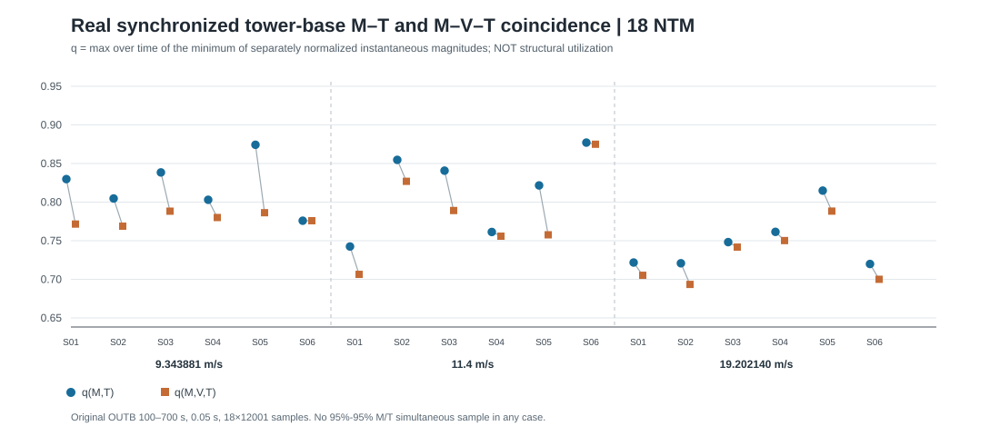

结果表为[18行同步多分量包络](../../../experiments/T062/S07_NTM18_BASE_M_V_T_COINCIDENCE_18ROW_20261111.csv) SHA256 `80782fc25d2326a7c38db82a2e21c6fb36e246776f4fce54ec7bc5b48bf73478`；独立[Python复算程序](../../../experiments/T062/s07_ntm18_multiaxial_coincidence.py) SHA256 `2d3bf45cfb91a1585044be1b294f074bcb926885087b2212ab9900c30da6be7f`完成2项解析与5项坏源拒绝，原始18行双轴弯矩峰值交叉验证最大绝对残差**4.56×10⁻⁷ kN·m**。计算与原始int16量化/CSV舍入误差远小于未知的载荷坐标、运行状态及材料映射误差；12,001个连续采样点存在自相关，不能当作12,001个独立风场试验。**本节是实测算例来源的数值后处理PASS，不是新增结构物理求解、疲劳寿命或风震组合PASS。**

### 3.5.9 原生近底TP/RP的位移—角位置运动学闭合（S07，18组真实风响应）

**科学问题与可观测量。** §3.5.7恢复的九个塔架测点仅分布在塔底以上0.070536—2.750893 m；TPxi/TPyi/TPzi为惯性系位置（m），RPxi/RPyi/RPzi为惯性系角位置分量（deg）。直接核读[OpenFAST v3.5.3 ElastoDyn.f90第937—944行](https://github.com/OpenFAST/openfast/blob/v3.5.3/modules/elastodyn/src/ElastoDyn.f90#L937-L944)，TP直接取rT，RP由AngPosEF乘R2D得到，**没有输出精确方向余弦矩阵（DCM）**。因此，本节不虚构三维精确坐标变换，而检验一个可证伪的低转角梁运动学关系：同一时刻的九点角位置能否重建首末测点的相对水平位置差？

在截面小转角、沿高连续且以TPzi为积分坐标的近似下，定义观测量与角位置积分预测量：
\[
\Delta x_{\rm obs}(t)=TPx_9(t)-TPx_1(t),\quad
\Delta x_{\rm rot}(t)=\sum_{i=1}^{8}\frac{\theta_{y,i}(t)+\theta_{y,i+1}(t)}2\,[z_{i+1}(t)-z_i(t)],
\]
\[
\Delta y_{\rm obs}(t)=TPy_9(t)-TPy_1(t),\quad
\Delta y_{\rm rot}(t)=-\sum_{i=1}^{8}\frac{\theta_{x,i}(t)+\theta_{x,i+1}(t)}2\,[z_{i+1}(t)-z_i(t)],
\qquad \theta_{x/y}=RPx/y\,\pi/180.
\]
正负号来自同一右手惯性坐标中的小转角关系；取首末点位置差消去共同刚体平移，使用每一时刻的TPzi差而非将九点误当等间距。按工况在12,001个时刻上计算残差e_x/e_y，报告RMS(e)/RMS(观测相对位移)，避免在接近零的单时刻使用不稳定的百分比。

**真实数值。** 对相同18份已核SHA的158 m NTM OUTB恢复时程，合计216,018个时间记录、每记录8个相邻高度区间，近底积分跨度为**2.680357 m**。18工况的X向相对RMS残差为**0.129514%—0.137707%**（中位**0.132787%**）；Y向为**0.159419%—0.229269%**（中位**0.164088%**）。X向最大单点绝对闭合差为**0.310518 μm**，Y向为**0.073928 μm**。各工况观测—预测时间序列Pearson相关系数均大于**0.9999987**。去除每工况时均值后，动态残差比X为**0.092501%—0.136347%**、Y为**0.113055%—0.162016%**。若将角位置积分符号反转，残差比接近**200%**，形成可拒绝的方向反例；两项解析正例与非单调高度、非有限通道拒绝测试通过。

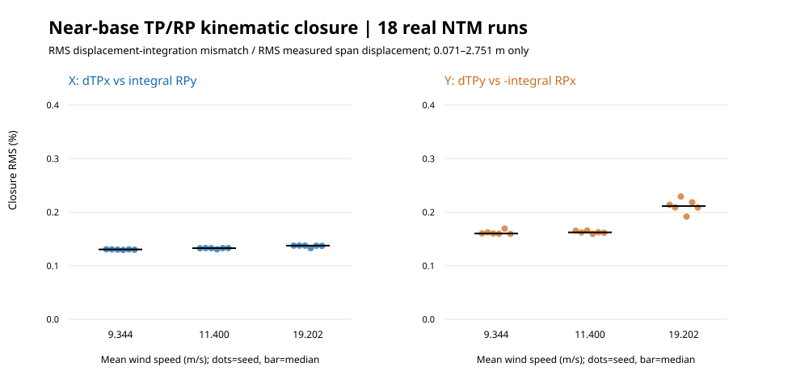

**边界与误差。** 以上是对原生仿真输出**内部运动学相容性**的独立后处理检查，不是与外部测量的验证。残差包含梯形积分离散误差、梁运动学假设与有限转角效应、OUTB量化和CSV舍入，不能直接解释为物理模型误差；尤其不能将RP分量当作严格DCM、将近底2.68 m外推至112/158 m塔高，或据此分离空气动力与惯性内力。12,001个连续时刻存在自相关，18组历史NTM不等于正式DLC1.2。原始gzip SHA256为2e113c83990d81b064636dca05308fc72676cb329033b9d603c8807d5cf0ecea（[Actions Artifact #13785456956](https://github.com/g2066203208-beep/voxel-frontier/actions/runs/42861971665/artifacts/13785456956)，2026-12-10 17:09 UTC到期）；[18行结果表](../../../experiments/T062/S07_NTM18_TP_RP_KINEMATIC_CLOSURE_18ROW_20261111.csv) SHA256 aa9635c307358bdc83509ac36feed0578e21b7ca3d201d654a5fadee46cbe5c9，[只读Python程序](../../../experiments/T062/s07_tp_rp_closure_compact.py) SHA256 d60d342b52e66e478fc651544df3c64ae131d8a3a06712478a7330779db60a07。**来源级运动学闭合PASS；精确DCM、惯性/气动载荷归属、同态W/E/WE及材料疲劳HOLD。**

## 3.6 频域响应、1P/3P与模态关系

### 3.6.1 PSD

对关键位移、加速度和载荷通道计算PSD，用于识别一阶塔架频率、1P、3P、控制/转子相关低频成分以及NTM/ETM下频带能量变化。并非所有通道都需要频谱，图表应围绕“是否影响塔架控制响应和疲劳”选择代表QoI。

### 3.6.2 1P/3P随转速变化

\[
f_{1P}(t)=\frac{\mathrm{RotorSpeed}(t)}{60},
\qquad
f_{3P}(t)=3f_{1P}(t).
\]

应将运行区1P/3P频带与第二章Abaqus/OpenFAST塔架固有频率叠加。若没有频带接近，不宣称共振；若接近，则进一步由PSD实际能量和响应幅值判断。

## 3.7 Rainflow与load-DEL筛选

### 3.7.1 通道身份

当前load-level fatigue统一对TwrBsMxt、TwrBsMyt进行比较。正式处理直接按OpenFAST官方通道名读取，不使用可能发生偏移的手工列索引。

### 3.7.2 Rainflow

对有效窗载荷时程执行rainflow，原始cycle ledger保留range \(R_i\)、mean和count \(n_i\)。虽然第三章load-DEL只使用range与count，但mean不从原始账本删除。

### 3.7.3 Load-DEL定义

历史screening统一采用：

\[
m=4,\qquad N_\mathrm{eq}=100000,
\]

\[
DEL=
\left[
\frac{\sum_i n_iR_i^m}{N_\mathrm{eq}}
\right]^{1/m}.
\]

这里的 \(m=4\) 与 \(N_\mathrm{eq}=100000\) 只作为工况间载荷比较口径，不是钢塔、混凝土或PT的统一材料疲劳参数。

### 3.7.4 T062历史CORRECTED雨流差异的根因闭合（2026-11-02）

旧版学位论文报告 U11p4_ETM_S03 的塔底 My 等效载荷DEL为28.177010 MN·m，并保存57,286条雨流循环和72条DEL。这些旧结果**确实存在，不是凭空编造**。本研究现已从[2026-10-04主归档](../../../archive/local-assets-20261004/openfast-36-r2/part-001.zip)真正恢复原始03/05/07 CSV、修正SHA清单和2026年9月源程序，逐文件CRC/SHA校验成功。旧循环账本5,585,315字节、57,286行，SHA256为7b03a4a99a2e3fe18975cabe0f8b0d9435f7dccdbaa42fae0985a3a3e48027b7。完整来源清单见[原始恢复收据](../../../experiments/T062/legacy-primary-recovered-20261102/LEGACY_PRIMARY_RECOVERY_RECEIPT_20261102.json)。

旧版SHA256_MANIFEST_CORRECTED.csv直接记录的36份原始OUTB哈希，已与当前supplement归档36份实际OUTB逐一比较，**36/36完全相同**。因此先前将S03/S04差异解释为可能的原始OUTB版本不一致，在本轮有了反证，必须撤销。问题发生在相同原始时程的雨流计数处理。

从原始[雨流源码](../../../experiments/T062/legacy-primary-recovered-20261102/rainflow_del_r1.py)直接复原：旧实现令 \(X=|s_{-2}-s_{-3}|\) 为前一个范围、\(Y=|s_{-1}-s_{-2}|\) 为新形成范围，却使用错误的终止条件 if X < Y: break；符合独立rainflow 3.2.0实现的条件应该是 **if Y < X: break**。这仅是两个已定义范围的大小比较方向错误，不涉及改变OpenFAST原数据、风速工况、DEL指数或参考循环数。原历史脚本仍保留原样，单行修正只在隔离内存AST中进行。

[真实GitHub Actions #41391433429](https://github.com/g2066203208-beep/voxel-frontier/actions/runs/41391433429) 在36份各12,001点的原始OUTB上逐个校验源SHA与ZIP CRC，对My、Mx共72条时程分别运行**原历史函数、只改比较方向的函数、独立rainflow 3.2.0**。验收结果为：72/72旧程序的DEL精确复现旧05 CSV；72/72单行修正的DEL复现现归档T062重算表；72/72修正后的(range,mean,count)循环多重集合与独立程序一致（范围/均值比较保留8位小数）；72/72加权循环总数守恒。完整逐工况结果见[72行因果对照表](../../../experiments/T062/legacy-primary-recovered-20261102/T062_ALL36_RAINFLOW_CAUSAL_DEL_COMPARE_20261102.csv)，机器可读[验收收据](../../../experiments/T062/legacy-primary-recovered-20261102/T062_ALL36_RAINFLOW_CAUSAL_RECEIPT_20261102.json)。DEL数值回归阈值1e-5 kN·m；这是算法核验，非授权标准条款验收。

**由此T062历史S03与当前S04的载荷级DEL争议正式归因为历史雨流源码错误并闭合。** 原论文旧数值保留作可追溯历史对照，但不能再作为采用正确雨流计数的正式控制值。正式DLC1.2长期工况覆盖、材料疲劳寿命与结构优化仍是独立未完成的科学任务。

### 3.7.5 36工况修正后DEL排序与可复核图表

按相同 \(m=4\)、\(N_\mathrm{eq}=100000\) 和100–700 s统计窗，恢复后可复核的关键结论为：

| 塔底通道与工况 | 旧雨流程序DEL / MN·m | 修正后/独立雨流DEL / MN·m | 控制身份 |
|---|---:|---:|---|
| My：U11p4_ETM_S03 | 28.177010 | 23.005398 | 旧算法的My第一名，修正后不再控制 |
| My：U11p4_ETM_S04 | 24.688995 | **26.802479** | 修正后36工况My第一名 |
| Mx：U19p202140_ETM_S02 | 9.715431 | **9.468855** | 修正后36工况Mx第一名 |

本研究原先探讨的等效循环数差异也得到排除：即使保持当前循环四次矩、尝试单独改变 \(N_\mathrm{eq}\)，旧My S03和旧Mx S02分别需要约44,436与90,228两个互不相容的参考循环数，而且任何统一参考循环数都不会改变S03/S04排序。因此此次差异不能靠重标定 \(N_\mathrm{eq}\) 解决，**根因为旧程序的雨流闭合判据**。

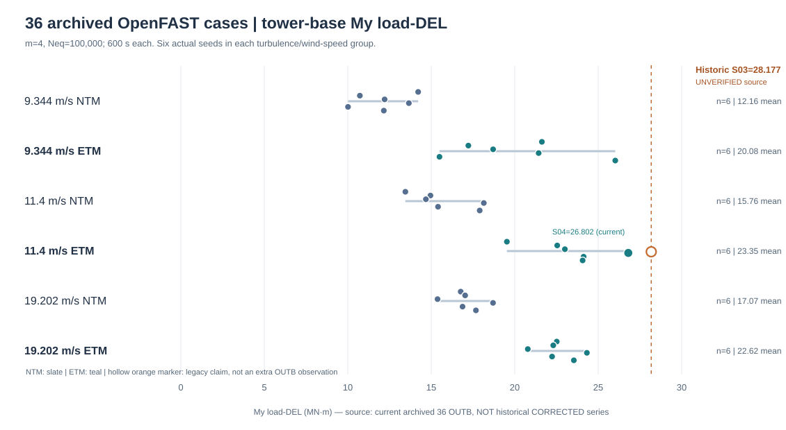

完整[36工况双通道控制排序](../../../experiments/T062/T062_36CASE_MY_MX_ARCHIVED_RANK_20261102.csv)与[固定源图形生成器](../../../experiments/T062/t062_del_36case_provenance_figure.py)保留六seed逐工况离散。图中的空心橙色标记是**同一OUTB经旧错误算法所得旧值**，不是不同数据源或第37个物理工况。72条源数据、程序版本SHA和故障判据及修复回归全部保留，满足本章载荷级筛选的来源可追溯性；该图与load-DEL仍不等于混凝土、钢绞线或钢塔材料疲劳损伤。

### 3.7.6 21年ERA5风速权重与18组原始NTM六seed覆盖（2026-11-02）

使用2005—2025年**184,080条ERA5逐小时、动态风切变外推至161.368806m**的已保存风速分箱，以及历史18组真实NTM原始OUTB（9.343881、11.4与19.202140m/s，每档S01–S06），建立21个1m/s诊断风速bin×6seed规划槽、共126个位置。当前只有**18/126个历史筛选来源**，且正式按IEC 61400-1:2019+AMD1:2025/2026-10勘误核实的DLC1.2合规来源为**0/126**；这并非宣布标准强制1m/s或强制每bin六seed，而是独立研究方案的可溯源覆盖分析。

在明确标记为**非规范切入/切出假设的[4,25)m/s运行区间**中，21年历史有106,900h，仅9、11、19m/s三个有源bin共7,164h，即**6.7016%**；无来源99,736h（**93.2984%**），4–9m/s五个连续缺口就占全部诊断运行小时**89.2442%**。因此不能把三档NTM、旧18个ETM或峰值seed外推成设计寿命DLC1.2完整风速概率，未观测到高风速也不代表设计风险可取零。

本轮仅对三个有源bin的塔底My/Mx载荷，用保存的12001点实际OUTB派生雨流`DEL_m4_Nref600`在六seed之间取四次幂平均，再以ERA5所有小时频率加权得到**已知bin部分载荷四次矩**。该值对缺失bin不作插值/补零，材料意义与正式20年寿命均不成立。结果与第三章控制工况筛选互补：本处**NTM概率背景**用于未来疲劳，旧T062 NTM/ETM联合排名只用于load-level screening。

[6行原始分箱×通道数值](../../../experiments/T062/partial-annual-load-diagnostic-20261102/S10_REAL_18NTM_3BIN_PARTIAL_M4_BY_CHANNEL_20261102.csv)、[数据SHA及八条参考来源审核](../../../experiments/T062/S10_ERA5_NTM_PARTIAL_LOAD_M4_PRIMARY_REFERENCE_CHECK_20261102.md)、[独立CI #41397641326](https://github.com/g2066203208-beep/voxel-frontier/actions/runs/41397641326)均保留。引用依据为[23]（[Wiley DOI 10.1002/er.6382](https://doi.org/10.1002/er.6382)，逐小时10/100m动态指数方法本轮核读）、[24]（[WES DOI 10.5194/wes-4-479-2019](https://doi.org/10.5194/wes-4-479-2019)，原刊全文确认多seed必须按QoI收敛）和[14]/[25]（2019授权版原记录、2025版与2026-10勘误仅官方产品元信息已核，**未核许可2025/26条款，不能称规范PASS**）。

### 3.7.7 雨流实现误差对36工况载荷控制排序的影响（新增源级统计）

在§3.7.4已独立定位历史雨流闭合判据错误的基础上，本节进一步研究**错误是否改变控制工况的身份，而不仅改变DEL绝对值**。直接读取同一36份原始OpenFAST OUTB派生的[72行旧算法—修正算法—第三方算法对照表](../../../experiments/T062/legacy-primary-recovered-20261102/T062_ALL36_RAINFLOW_CAUSAL_DEL_COMPARE_20261102.csv)，对塔底Mx、My各36个工况分别降序排名。相对偏差定义为100×(旧DEL/修正DEL−1)%，每通道枚举36×35/2=630对工况，统计旧/新排序方向相反的工况对、Spearman秩相关和Top-5交集。630对比较彼此相关，**不是630个独立统计样本，也不提供总体置信区间**。

| 通道 | 旧算法相对偏差中位数 | 偏差范围 | 旧值高于正确值 | 排名倒序/630 | Spearman ρ | Top-5重合 |
|---|---:|---:|---:|---:|---:|---:|
| TwrBsMxt（Mx） | −20.8797% | −29.0675%～+2.6041% | 2/36 | **12/630（1.90%）** | 0.99537 | 5/5 |
| TwrBsMyt（My） | −25.5452% | −54.5115%～+22.4800% | 4/36 | **102/630（16.19%）** | 0.85946 | 4/5 |

旧雨流判据在Mx的34/36及My的32/36工况中低估正确DEL，但其余工况反而高估，故不能使用统一比例系数修复旧排序。My历史控制工况U11p4_ETM_S03的旧值28.177010 MN·m，修正后为23.005398 MN·m；新的My控制工况为U11p4_ETM_S04（26.802479 MN·m）。Mx的正确第一名仍为U19p202140_ETM_S02（9.468855 MN·m）。这些变化是**同一物理载荷时程的后处理算法误差**，不是湍流物理差异。

本节[无依赖Node复算脚本](../../../experiments/T062/t062_rainflow_rank_robustness.js)锁定源CSV SHA256=12dabbb1273ce03d3920aedda3f72f9fa1d75b671e01a1db145c0a972ffe15e2；脚本SHA256=54a6103a6926cdaf731df70034ef7f6e8885829060658dc0c5d8c8dc20ca93c2。直接以V8执行相同分析函数，3项真实数值oracle及8项异常输入拒绝通过；本轮未运行原生Node CI，36份原始OUTB与第三方rainflow 3.2.0的逐循环核验沿用[既有Actions #41391433429](https://github.com/g2066203208-beep/voxel-frontier/actions/runs/41391433429)，本轮没有重新下载OUTB。源级DEL比较绝对容限1e−5 kN·m；统计表四舍五入不影响工况排序。此结果只支持载荷筛选算法可信性，不证明正式DLC1.2、材料Miner寿命或风震抗震验算。

### 3.7.8 六随机种子有限样本下的控制风速筛选稳健性（2026-11-07）

本节检验一个可证伪的载荷筛选问题：**若每个代表风速只保留部分随机种子，能否仍选中现有六seed样本定义的控制风速？** 直接读取T062已独立核对的72行旧/修正DEL对照源表（SHA256：`12dabbb1273ce03d3920aedda3f72f9fa1d75b671e01a1db145c0a972ffe15e2`），仅提取其中三档NTM（9.343881、11.4、19.202140 m/s）×六seed×塔底Mx/My共36条**修正后**600 s载荷DEL，单位kN·m。旧错误雨流结果不进入本节统计。所有计算仅为历史158m OpenFAST载荷级诊断，不是DLC1.2长期疲劳、局部材料应力或寿命验收。

为与同一等效循环数下的四次幂载荷循环累积相容，给定风速档j和所选种子集合S，定义
\[
L_{j,S}^{(4)}=\left(\frac{1}{|S|}\sum_{s\in S} DEL_{j,s}^{4}\right)^{1/4}.
\]
此处m=4**仅用于载荷级排序敏感性**，不能作为混凝土、钢筋、钢绞线和结构钢统一的材料S–N指数。以每档六seed全集作为**有限样本内部参照**，而不是未知随机总体的真实控制风速。对k=1–5枚举两种抽样方案：（a）每个风速档独立从六个既有seed中取k个，组合数为C(6,k)^3；（b）三个风速档使用相同的seed标签集合，组合数为C(6,k)。统计筛出的最高L^(4)风速与全集参照不一致的组合比例。后一方案的相同标签**不自动证明三个风速的风场具有共同随机数配对属性**，只作为设计敏感性对照。

六seed全集下，Mx在三个风速档的L^(4)依次为1922.467、2509.922、6596.211 kN·m；My为12424.367、16034.661、17157.449 kN·m。两个通道的内部参照控制风速均为19.202140 m/s，但相对次高风速的差距分别为162.805%和**7.002%**。Mx在全部枚举子集中均未发生风速身份错选，然而k=1时参照胜出风速的估计L^(4)最大绝对相对偏差仍达26.706%，因此**控制风速未变不等于载荷幅值收敛**。

| 每档seed数k | 独立子集数C(6,k)^3 | My独立错选数/比例 | My共标签错选数/比例 | Mx两方案错选数 | My参照控制档L^(4)最大绝对偏差 |
|---:|---:|---:|---:|---:|---:|
| 1 | 216 | 66 / 30.556% | 1/6 / 16.667% | 0 | 10.376% |
| 2 | 3375 | 630 / 18.667% | 0/15 / 0% | 0 | 6.131% |
| 3 | 8000 | 760 / 9.500% | 0/20 / 0% | 0 | 4.531% |
| 4 | 3375 | 105 / 3.111% | 0/15 / 0% | 0 | 3.543% |
| 5 | 216 | 0 / 0% | 0/6 / 0% | 0 | 2.121% |

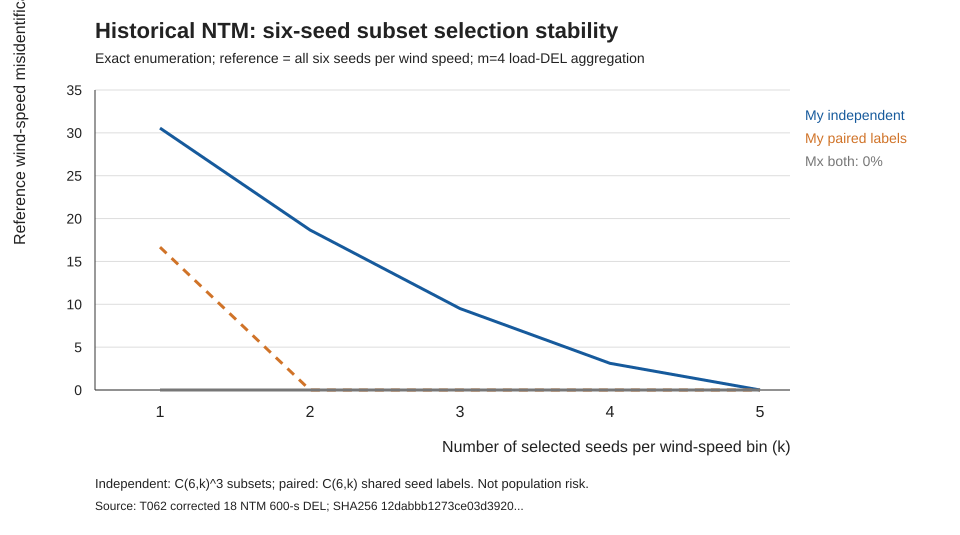

**图3-X** 三个历史NTM风速档的控制风速错选组合比例。实线为各风速独立选k个seed的穷举结果，虚线为共用seed标签集合的穷举结果。图中比例是**给定现有六seed全集且对子集等权枚举的组合频率**，绝不是新seed的失效概率、统计置信区间、IEC允许的最少seed数或对未知风速档的外推。

结果表明，My在k=3时仍有760/8000（9.5%）独立子集错误选中11.4 m/s；同样k下的共标签子集为0/20。二者差异直接表明**抽样设计本身影响有限样本筛选结论**，但六seed之间是否独立、跨风速是否相关及控制器状态差异均未得到新的统计验证。k=5错选为零只在当前有限全集成立，不意味着五seed对新湍流实现足够。单个600 s时程的DEL后处理和双通道来源一致性沿用T062已有独立雨流核验；本轮未重新读取36份原始OUTB，也未新增2025/26授权IEC条款核读。数值误差由双精度四次幂与精确穷举控制，实际工程/seed总体不确定性**NEED_ESTIMATE**。因此下一步应以新增的、来源可核的独立seed检验控制风速稳定性，并结合ERA5全运行风速档与正式DLC1.2后再判断长期疲劳控制工况。

**复算入口**：[无依赖Node程序](../../../experiments/T062/t062_ntm_seed_subset_robustness.js)（SHA256 `bbf923bb509679edf76ae60dc5dda00648fb181ca4aa7d13ac06d0ef0712f333`）、[10行结果CSV](../../../experiments/T062/T062_18NTM_SEED_SUBSET_ROBUSTNESS_20261107.csv)（SHA256 `f7d9427d15b378661aaebf2fdf0feb1e5eea07cefb3721088a98439265320cf1`）、[SVG图](../figures/FIG3_T062_NTM_SEED_SELECTION_ROBUSTNESS_20261107.svg)（SHA256 `5e3df353b8631bf3eb9bc03ede3551a3e91aaf93f41d4b61dd70f88524eb2cb4`）。V8源级8项数值oracle、11项异常拒绝、CSV/SVG输出测试通过；**原生Node CI未执行**，不代表物理验收。

### 3.7.9 六seed精确随机化假设敏感性（S10 EXACT SEED RANDOMIZATION 2026-11-08）

**研究问题。** 18组历史NTM（3风速档×6seed）塔底My/Mx 600s载荷DEL（m=4、Nref600，MN·m）在不同随机化假设下是否支持相同推断？六项预先固定比较：A穷举12选6共924种不配对标签置换，双侧均值差；B将同名S01–S06形成六对，穷举64种符号翻转。各自进行Holm六重校正，并统计36个跨seed优势次数。A要求零假设下跨组可交换性，B要求真实配对及差值符号对称；**相同seed名称不证明物理配对，风速档也非随机分组**，两者均是条件性方法诊断而非物理显著性认证。

**真实数值。** My U09→U11差12.910597MN·m，A极端6/924、Holm p=0.012987，B极端4/64、Holm p=0.1875。My U11→U19差4.721442MN·m，A极端158/924、Holm p=0.170996，B极端4/64、Holm p=0.1875，高风速跨seed优势25/36。Mx三个风速对A校正p均0.012987、B均0.1875。**A六项中5项低于0.05，B为0项。** B双侧最小p=2/64，六重Holm首位最小校正p=0.1875，因此本六对设计不可能在0.05下取得六项校正通过。不同p值反映不同未证实的随机化结构，不说明风速物理效应消失。

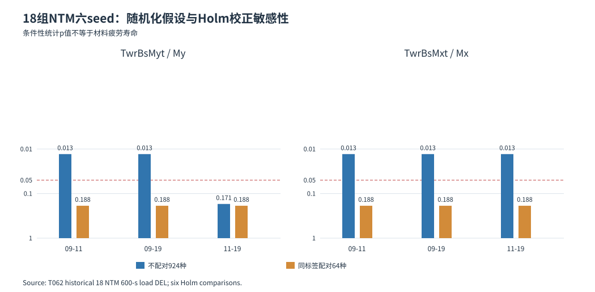

**图3-X** 不配对924种与同标签配对64种条件性检验；不代表材料寿命或正式DLC1.2。SOURCE=直接读取T062历史18行派生CSV SHA256 `4abf76252fa34b2c12635d409e5abc23c4a7d6f759b66dbec12b1932379f4bea`，每行含原OUTB SHA，未重读原OUTB；[可运行Node程序](../../../experiments/T062/s10_ntm_exact_seed_inference.cjs) SHA256 `71a61e6b44e102ebded0989debe8c9f0ddaa1a4d4ac5fc35dc048f1bdf4eddd0`、[六行数表](../../../experiments/T062/S10_NTM18_EXACT_SEED_INFERENCE_6PAIR_20261108.csv) SHA256 `293c45563b2bd78d77e8145d5011e501e7ed7cced3b21812f1210ad14a8ab0f9`、图SHA256 `4b1ef211a8e0907730ecb6e82240dc502777bf65f70a8650efda056215d5d2f5`。V8 18项oracle、8项坏源拒绝、乱序不变性通过；原生Node CLI/CI未运行。随机化前提、未来seed总体和物理误差无可信上界；SOURCE-LEVEL METHOD PASS、12阶段0/12。

### 3.7.10 无源低风速箱对历史载荷四次矩的等贡献阈值（S12，2026-11-08）

为把“历史18组NTM仅覆盖诊断运行小时的6.70%”转化为**可证伪的后续数据准入判据**，本节不猜测缺失风速箱的DEL，而计算其对既有三有源箱的**等贡献阈值**。对塔底弯矩通道\(c\in\{M_x,M_y\}\)，以2005—2025年ERA5全部184080小时为统一概率分母，定义\(p_j=n_j/184080\)。已归档9、11、19 m/s三个箱的六seed四次矩为\(\overline{L_{c,j}^{4}}\)，其**已知部分**为
\[
K_c=\sum_{j\in\{9,11,19\}}p_j\overline{L_{c,j}^{4}},\qquad
L_{c,j}^{\mathrm{eq}}=(K_c/p_j)^{1/4}.
\]
这里\(L_{c,j}^{\mathrm{eq}}\)的含义仅是：**如果**某个尚无历史NTM来源的箱在相同\(m=4\)、\(N_{\rm ref}=600\)和六seed定义下恰有该DEL，则这个单箱对加权四次矩的贡献与全部三个有源箱的贡献相等。它既不是未知箱的估计载荷，也不是材料S–N指数或Miner损伤阈值。多个缺失箱若假设具有同一个DEL，组阈值为\(L_{c,G}^{\mathrm{eq}}=(K_c/\sum_{j\in G}p_j)^{1/4}\)。

直接读取既有[31行ERA5真实来源分箱](../../../experiments/T062/S10_ERA5_2005_2025_HUB_1MS_BINS_20261031.csv)（SHA256 `e4058620a36b23bb218103875d4dc5b0711fc45d418b23a2208c2fc9c16c9102`）和[六行三箱×双通道四次矩](../../../experiments/T062/partial-annual-load-diagnostic-20261102/S10_REAL_18NTM_3BIN_PARTIAL_M4_BY_CHANNEL_20261102.csv)（SHA256 `d43f963fb30e16a33e87acdf6e9571710826974eee89d1f3527ab6504d85f695`），得到\(K_{Mx}=125.606637744\,({\rm MN\,m})^4\)、\(K_{My}=209257.299447601\,({\rm MN\,m})^4\)。低风速4–5 m/s单箱等贡献DEL分别为**5.413247**和**34.583967 MN·m**；8–9 m/s单箱分别为**7.071769**和**45.179880 MN·m**。对4–9 m/s五个缺失箱合计95402小时（占诊断运行小时89.2442%），若**人为假设五箱具有相同DEL**，等贡献阈值为\(M_x\) **3.945622 MN·m**、\(M_y\) **25.207654 MN·m**。该统一假设仅用于标定后续真实载荷需要检验的数值量级，不是风速—载荷物理关系。

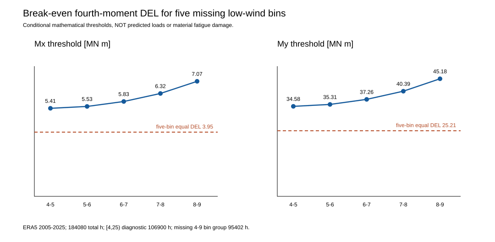

**图3-X** 2005—2025年ERA5分箱与三有源NTM载荷四次矩导出的条件性阈值。实线为各单箱恰等于全部已知箱贡献时的DEL，虚线为五个缺失箱假定DEL相同的组阈值；图中任何线都不是缺失箱真实载荷预测。12行数值表与[可复算Node程序](../../../experiments/T062/s12_era5_missing_bin_break_even.cjs)分别存于[T062 CSV](../../../experiments/T062/S12_ERA5_NTM_M4_MISSING_BIN_BREAK_EVEN_20261108.csv)及源文件。程序SHA256 `6ccf56928b2674884692d398b729d030909a7b67c17ca5951bf7c7e217d0dbae`，数表SHA256 `e4160f9419c76eec459491dc704c3150339e77183dc1cf827d6ebd2fc28cd40f`，图SHA256 `2ced2991132a5ac9453bce64b71b2fa19540b2645782be09d4554b8d5cf1850c`。V8执行12项代数等式、两个通道历史真值与4类异常输入拒绝；原生Node CLI/CI未运行，历史OUTB与ERA5原工作簿本轮未重新读取。阈值的双精度/CSV舍入误差不构成ERA5代表性、风速箱边界、控制状态、未来seed或真实材料局部应力的物理误差界。

**适用边界与反例。** 该阈值允许明确拒绝“仅凭小时数就可断言低风速箱主导疲劳”的论证：令全部缺失箱DEL为零，则其四次矩贡献为零；令其足够大，则贡献可超过已知部分，两种构造均与当前无源状态相容。缺失部分仅有非负下界、没有数据支持的有限上界。正式DLC1.2仍为0/126，真实材料Miner、结构风震与设计寿命均不可由此推出。此分析对2026年160m混塔风震及PT抗震先行研究也不构成重复的风震结构结果，而是本研究158m历史风载证据的可辨识性诊断。

### 3.7.11 六seed删除对已知风速箱加权四次矩及缺失箱阈值的影响（2026-11-08）

针对§3.7.10的等贡献阈值，本节进一步检验其对**已知三个风速箱中有限随机种子选择**的敏感性。沿用18组真实历史NTM（9.343881、11.4、19.20214 m/s，每档6个600 s随机种子）塔底My/Mx载荷DEL，令各档ERA5全小时概率为\(p_j=n_j/184080\)，其中\(n_j=5736,1426,2\) h。以\(m=4\)定义\(K_c=\sum_j p_j(1/6)\sum_{s=1}^6 DEL_{cjs}^4\)，并分别删除各风速档**同名**的S01至S06后用五个剩余seed重新计算\(K_c^{(-s)}\)。跨风速同名seed**没有经验证的物理配对关系**；共同标签删除只是一种确定性敏感性诊断，不是随机抽样置信区间。

已知三箱基准\(K_{My}=209257.299446\,(MN\cdot m)^4\)，\(K_{Mx}=125.606638\,(MN\cdot m)^4\)。六种删除下My的\(K\)相对变化为**-10.6845%至+8.0452%**，Mx为**-10.6997%至+11.4025%**。把这一变化代入上一节仅作为数学门槛的\(L_{c,G}^{eq}=(K_c/(95402/184080))^{1/4}\)，得到My阈值**24.505532–25.700039 MN·m**、Mx阈值**3.835559–4.053584 MN·m**。六个删一估计的算术平均严格等于原始\(K_c\)，这是四次矩平均的代数恒等式；但阈值为非线性四次根，不能把删一范围解释为总体置信界。

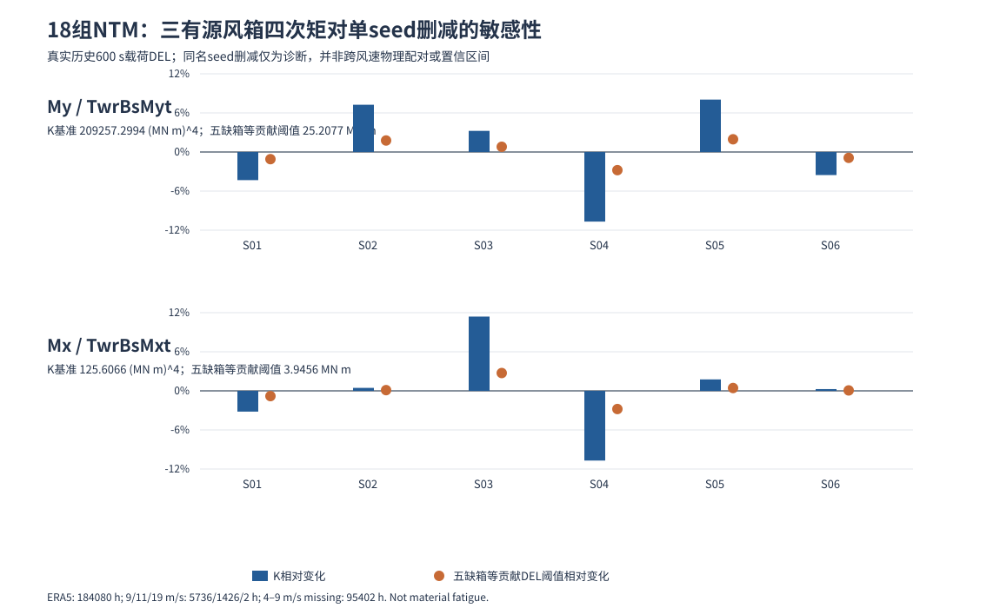

**图3-X** 蓝色为相对六seed基准的已知部分\(K_c\)变化，橙色为五个缺失箱假设相同DEL时的等贡献阈值变化。SOURCE=历史18行带OUTB SHA的T062派生数据（SHA256 `4abf76252fa34b2c12635d409e5abc23c4a7d6f759b66dbec12b1932379f4bea`），原始OUTB本轮未重读；RUN=[Node复算程序](../../../experiments/T062/s10_ntm18_weighted_m4_seed_deletion.cjs) SHA256 `7f1d7794696af77549f8ecfb9b3b0c8e47abd845161bb01ed037ef2049d2ba56`；TAB=[14行CSV](../../../experiments/T062/S10_NTM18_WEIGHTED_M4_SEED_DELETION_20261108.csv) SHA256 `91b78929363f828bc7eae87ddb9539d0b5c5fd4d94ae8ec937c41c515cfd8036`；FIG=本图 SHA256 `308bb1a205ef2f943acf8845c5ea3dd93de8ea6ce13866ee766f2f6e250db284`。V8真实输入下4项独立基准真值、16项代数检验、8类污染拒绝和乱序不变性通过；原生Node CLI/CI未运行。结果只反映六个已观察seed和三有源风速箱，不能推断缺失箱真实DEL、材料Miner或正式DLC1.2，亦不证明跨风速seed配对。

### 3.7.12 缺失风速箱对载荷四次根诊断精度的逆向约束（2026-11-08）

§3.7.10给出的等贡献阈值回答了“缺失风速箱贡献何时与已有三个风速箱相等”，但并不能直接回答“为把已有风速箱四次根载荷诊断的遗漏影响限制在某一数值范围内，缺失箱的载荷需要有多小”。为使后续真实风载数据能够反证这一精度要求，本文进一步定义**条件性逆向阈值**，不对缺失箱进行风速—载荷外推。令已有9、11、19 m/s三个风速箱的全小时加权四次矩为\(K_c=\sum_j(n_j/184080)\overline{DEL_{cj}^{4}}\)，相应已知部分的四次根为\(E_{c0}=K_c^{1/4}\)。对于具有\(n_G\)个ERA5小时的缺失箱组，**仅在该组所有箱具有相同四次矩等效DEL \(L_{cG}\)、且其他缺失箱的贡献在这一数学情景中被设为零**的条件下，总诊断与已知部分的比值为
\[
\frac{E_{cG}}{E_{c0}}=\left[1+\frac{n_G L_{cG}^4}{184080K_c}\right]^{1/4}.
\]
给定研究者事先指定的相对增加量\(\delta>0\)，反解得到
\[
L_{cG}^{\mathrm{limit}}(\delta)=\left\{\frac{184080K_c}{n_G}\left[(1+\delta)^4-1\right]\right\}^{1/4}.
\]
这里的\(\delta=5\%、10\%、20\%\)仅用于**载荷级数学敏感性示例**，不是IEC/GB规定的误差容许值，也不是混凝土、普通钢筋、预应力钢绞线或钢塔材料疲劳的验收限值。

直接读取既有31行ERA5分箱与6行历史NTM双通道四次矩，得到\(K_{Mx}=125.6066377435\)、\(K_{My}=209257.2994476005\;(\mathrm{MN\,m})^4\)。对于诊断[4,25) m/s内**全部13个正小时但无NTM载荷来源的箱**（共99736 h），如果假设它们具有同一个未知DEL，那么当\(\delta=5\%\)时，条件阈值为**Mx 2.658623 MN·m、My 16.985322 MN·m**；当\(\delta=10\%\)时分别为**3.220659、20.576036 MN·m**。若仅对4–9 m/s五个缺失箱（95402 h）作共同DEL假设、同时在该情景中将其余缺失箱设为零，5%阈值则为**2.688316、17.175026 MN·m**。两组阈值接近仅反映ERA5小时权重差异，**不证明低风速载荷相近**。

一个容易忽略的量纲与非线性问题是：四次根载荷诊断相对增加5%，对应的缺失四次矩占已知四次矩比例为\((1.05)^4-1=21.550625\%\)，占该情景总四次矩的比例已达**17.729753%**。因此，等效载荷数值的小幅变化不代表高阶载荷贡献同样微小。相反，在缺失风速箱的真实载荷完全未知时，既可令其DEL为零，也可令其足够大使诊断任意增加；**本文没有数据支持的完整诊断上界**。此外，ERA5低于4 m/s的77180 h没有进入上述[4,25)诊断区间，其停机/待机/运行状态未由该分析确定，不能据此推断全年零载荷或材料疲劳精度。

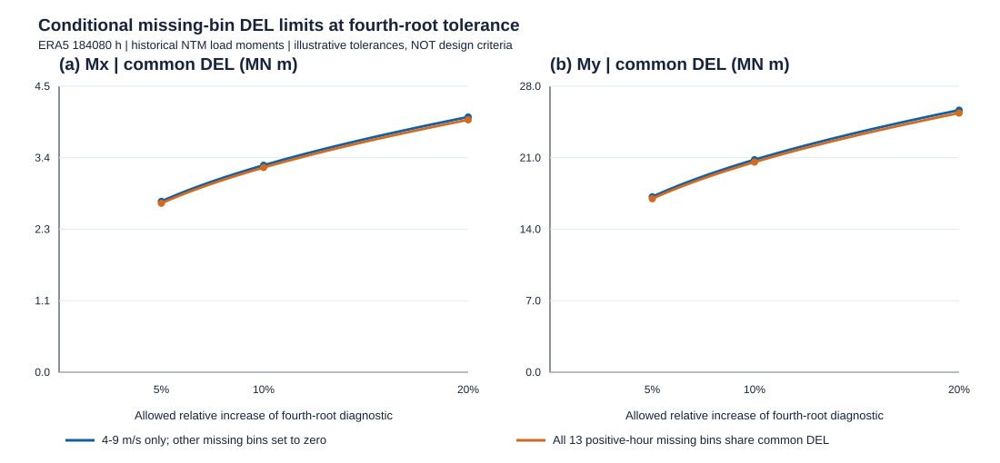

**图3-X** 以5%、10%、20%预设四次根载荷诊断增加量反求Mx、My两通道的缺失箱共同DEL条件阈值。蓝线为4–9 m/s五箱且其余缺失箱在情景中设零，橙线为诊断区间全部13个正小时缺箱共同DEL；图线不是预测载荷或规范限值。SOURCE=[31行ERA5分箱](../../../experiments/T062/S10_ERA5_2005_2025_HUB_1MS_BINS_20261031.csv) SHA256 `e4058620a36b23bb218103875d4dc5b0711fc45d418b23a2208c2fc9c16c9102`与[六行历史NTM四次矩](../../../experiments/T062/partial-annual-load-diagnostic-20261102/S10_REAL_18NTM_3BIN_PARTIAL_M4_BY_CHANNEL_20261102.csv) SHA256 `d43f963fb30e16a33e87acdf6e9571710826974eee89d1f3527ab6504d85f695`；RUN=[可运行Node源](../../../experiments/T062/s12_missing_bin_tolerance_envelope.cjs) SHA256 `b2df138b4555b524408daf10179f5e0062f53b593d61af783158b0697425fd85`；TAB=[12行CSV](../../../experiments/T062/S12_MISSING_BIN_TOLERANCE_ENVELOPE_20261108.csv) SHA256 `fc1629c8408f689cf1611dbc9d9763cc63a5a740037d24e26cd00b73b3f6fbd3`；FIG=本图SHA256 `5dc5fd706d9dc7a3748e810843b5a60d707a3e11a07378c886f1ce99ac4d7f84`。源级V8执行12项反代恒等式、2项独立数值对照、6项单调性检验和2项污染拒绝；原生Node独立等价实现已核源SHA及数值，但**仓库远端程序本身尚未取得原生CLI/CI日志**。无新增OpenFAST原始OUTB、材料局部应力、规范授权条文或物理RUN；正式DLC1.2仍0/126，材料Miner及同态风震HOLD，12阶段0/12。

### 3.7.13 同一原始风场下塔底平均弯矩与循环DEL控制seed错位（2026-11-09）

为排除跨归档同名工况的模型身份混杂，本节直接采用18组历史NTM原始OUTB的两份独立派生表：塔底六分量时间均值和同一塔底弯矩通道`TwrBsMyt`的雨流等效载荷。逐case核对原始OUTB SHA256、part ZIP、100—700s统计窗、12001点/0.05s采样以及N·m↔kN·m单位换算；两份表的平均My逐值一致。OpenFAST原生输出坐标基尚未独立验证，因此仅在**同一原生输出通道**内比较，不将其误写成已确认全局坐标或材料局部应力。

每个风速箱6个seed-case，共有15对内部排序比较。若两case的时间平均My与\(DEL_{m=4,N_{ref}=600}\)大小顺序相反，记为不一致对数\(D\)；描述性Kendall系数为\(\tau=(15-2D)/15\)。若错误地仅选择平均My最大seed，定义筛查漏选幅度\(L=(DEL_{max}-DEL_{mean\ winner})/DEL_{max}\)。\(L\)仅表示**本批历史六seed载荷指标的漏选比例**，不是材料疲劳寿命损失。

| 历史NTM风速箱(m/s) | 不一致对/15 | Kendall τ | 平均My最大seed | DEL4最大seed | 漏选DEL4 |
|---|---:|---:|---|---|---:|
| 9.343881 | 11 | −0.466667 | S02 | S01 | 24.561180% |
| 11.400000 | 7 | +0.066667 | S02 | S04 | 17.614085% |
| 19.202140 | 12 | −0.600000 | S03 | S04 | 17.766489% |

三箱最大平均My与最大DEL4控制seed均不同。在9.343881m/s箱，平均My最大seed S02的DEL4为38.530043MN·m，实际六seed最大DEL4来自S01（51.074557MN·m），漏选24.561180%。三箱合计30/45对排序不一致，但**45对共享18个独立风场实现，不能视为45次独立试验或直接进行显著性推断**；11.4m/s箱7/15也不支持“所有风速箱均负相关”。因此，同一原始风场的反例直接否定了“平均塔底弯矩最大seed可以代替循环DEL最大seed”的历史筛查捷径，但不能据此推断总体失效率、控制器因果或材料损伤。

[18case明细](../../../experiments/T062/S06_NTM18_MEAN_VS_DEL_18CASE_20261109.csv)、[三箱汇总](../../../experiments/T062/S06_NTM18_MEAN_VS_DEL_3BIN_20261109.csv)、[科研图](../figures/FIG3_S06_NTM_MEAN_VS_DEL_20261109.svg)和[可运行Node程序](../../../experiments/T062/s06_ntm18_mean_vs_del_rank.cjs)提供可复算依据。原OUTB本轮未重新解码，正式DLC1.2风速箱、完整同态风震时程、材料点循环应力和Miner损伤仍未闭合。

### 3.7.14 三指标控制工况的最小历史seed集合：精确穷举与漏选代价（2026-11-09）

上一节证明，按塔底平均弯矩选单一seed不能代表循环DEL控制。本节进一步回答：**在已观测六个seed内，保留多少历史工况才能同时覆盖塔底My的时均值、正向峰值和m=4雨流DEL三个指标的最大值？** 直接对18组原始OUTB的两份独立派生表逐case核对SHA、100—700s窗口、12001点/0.05s及kN·m→MN·m单位。三指标均属于同一OpenFAST原生TwrBsMyt通道，不跨不同风场拼接时程；正峰不是绝对极值。

设每箱六个历史seed为集合 S_b，三项指标为 q∈{mean(My),max(My),DEL4(My)}，六seed已观测最大值为 q*_b。对任意保留子集 A⊆S_b，定义最坏相对漏选代价

\[
R_b(A)=100\max_q\left(1-\frac{\max_{s\in A}q_{bs}}{q_b^\star}\right)\%,\qquad R_b^\star(k)=\min_{A:|A|=k}R_b(A).
\]

每个风速箱精确枚举2⁶−1=63个非空子集，对k=1,…,6计算最优代价，并与分别按时均、正峰、DEL降序选前k个case比较。这是**已经知道六seed结果之后的事后oracle**，不是在运行新seed之前可以执行的策略，不能作为正式DLC1.2减少样本量的依据。

| 历史NTM风速(m/s) | 时均最大seed | 正峰最大seed | DEL4最大seed | k=1最优漏选 | k=2最优漏选 | 零漏选最小k与集合 |
|---:|---|---|---|---:|---:|---|
| 9.343881 | S02 | S01 | S01 | 1.115066% | **0%** | **2：S01+S02** |
| 11.400000 | S02 | S06 | S04 | 2.594271% | **1.357063%** | **3：S02+S04+S06** |
| 19.202140 | S03 | S04 | S04 | 2.120187% | **0%** | **2：S03+S04** |

11.4m/s箱的三个最大值分别来自三个不同风场，因此两个case不可能同时精确保留全部已观测最大值；k=2的最优最坏漏选仍为1.357063%，k=3才为零。19.202140m/s箱若仅按时均My选前三个seed，仍遗漏正峰和DEL最大seed S04，三指标最坏漏选达**9.763438%**，而S03+S04两case可保留全部已观测最大值。9.343881m/s箱按时均选前两case的最坏漏选为24.561180%，按三指标并集选两case则为零。**零仅表示保留六个历史样本的最大值，不代表未来seed、完整风速箱或结构材料响应零误差。**

该反例支持第三章的多QoI控制case并集原则。每箱只有六个独立风场实现，63个重叠子集不是63次独立验证；历史控制器状态、完整同态W侧时程、坐标与惯性归属、正式DLC1.2及材料点循环应力仍未闭合。结果不能推出混凝土、钢筋、预应力筋或钢塔的疲劳寿命。

[源级Node程序](../../../experiments/T062/s06_ntm18_three_qoi_budget.cjs)、[18case三指标表](../../../experiments/T062/S06_NTM18_THREE_QOI_18CASE_20261109.csv)、[18行预算与策略对照表](../../../experiments/T062/S06_NTM18_THREE_QOI_BUDGET_18ROW_20261109.csv)、[正式科研图](../figures/FIG3_S06_NTM_THREE_QOI_SEED_BUDGET_20261109.svg)可复算上述结果。同一源码V8执行4项正向数值测试、8类污染拒绝与行序不变性检验；原生Node CLI与OUTB重新解码未运行。

### 3.7.15 同源NTM跨风速箱的时均弯矩—正峰弯矩—循环DEL响应解耦（2026-11-09）

前两节讨论同一风速箱内不同随机种子的控制身份，本节改从**风速箱之间**检验不同载荷指标是否具有相同变化方向。输入为[18个历史NTM原始OUTB派生case](../../../experiments/T062/S06_NTM18_THREE_QOI_18CASE_20261109.csv)，三个历史风速分别为9.343881、11.400000和19.202140 m/s，每箱6个seed；同一case的时均、正向峰值和\(m=4\)雨流\(DEL_{N_{ref}=600}\)均取自TwrBsMyt通道，100—700 s、0.05 s采样的历史窗口。**正向峰值不是绝对值峰值；本节的DEL是弯矩载荷等效量，不是材料疲劳损伤。**

对风速箱\(b\)和指标\(q\)，先计算六seed的算术平均\(\bar q_b=\sum_{s=1}^{6}q_{bs}/6\)，再用样本标准差\(s_{q,b}=\sqrt{\sum_s(q_{bs}-\bar q_b)^2/5}\)定义描述性变异系数\(CV_{q,b}=100s_{q,b}/\bar q_b\)。这里的六seed是条件于历史固定模型和风速的六个随机实现，**不是六个独立年份或六个ERA5风速观测**。

| 历史NTM风速（m/s） | 六seed时均My的平均（MN·m） | 六seed正峰My的平均（MN·m） | 六seed DEL4的平均（MN·m） | 时均My的CV | DEL4的CV |
|---:|---:|---:|---:|---:|---:|
| 9.343881 | 177.175982 | 271.200912 | 43.701157 | 1.560157% | 13.329354% |
| 11.400000 | 193.078679 | 290.197883 | 56.611754 | 3.207918% | 11.900626% |
| 19.202140 | 106.924047 | 217.362062 | 61.333196 | 1.285860% | 6.428970% |

从11.4 m/s到19.202140 m/s，**六seed平均时均My下降44.621515%，平均正峰My下降25.098674%，而平均DEL4反而增加8.340039%**。因此，在这三个已有历史风速箱中，时均与正峰的跨箱变化方向不能替代循环等效弯矩的变化方向。各箱DEL4的CV为6.428970%—13.329354%，时均My的CV仅为1.285860%—3.207918%；按箱逐一配对，DEL4的相对seed离散是时均My的3.709767—8.543595倍。此处比较的是相对离散，不是材料应力或疲劳寿命的不确定性区间。

这一现象与载荷循环对幅值分布而非仅对时间平均值敏感的定义一致，但**尚不能把差异归因于变桨、转速、推力变化或控制器状态**：相应全时程控制器身份及跨风速运行状态未独立闭合。三箱六seed的结果也不能证明真实风速响应函数单调或非单调，不能用19 m/s历史筛查代表全部高风速箱，更不能断言19 m/s为混凝土、预应力筋或钢塔的材料疲劳控制风速。若要检验跨箱变化的稳健性，应使用正式DLC1.2覆盖、独立seed收敛及同模型运行状态证据，而不是对本表做线性外推。

[三箱机器可读表](../../../experiments/T062/S06_NTM18_CROSS_BIN_MEAN_PEAK_DEL_3BIN_20261109.csv)由18行原始派生表直接按上述公式计算；V8源级计算通过18行/3箱×6seed、两项数值oracle、逆序输入\(10^{-11}\)容差不变性和负值/重复case拒绝测试。首次测试曾错误地要求浮点求和逆序**逐位一致**，已修正为有界数值容差；CSV按9位小数舍入，显示误差不超过\(5\times10^{-10}\)个表内单位。原始OUTB未在本轮重新解码，正式DLC1.2仍0/126。

### 3.7.16 同源18组NTM三指标的风速箱间与随机种子箱内方差分解（2026-11-09）

为进一步判断§3.7.15中三种塔底弯矩指标的历史离散来源，对相同18个NTM工况（3个风速箱、每箱6个随机实现）的600 s时均My、正向峰值My和$m=4$载荷DEL分别进行固定样本平方和分解。记$Y_{js}$为第$j$箱第$s$个seed的指标（MN·m），$\bar Y_j$和$\bar Y$分别为箱均值和18case总均值，则

$
SS_{\mathrm{total}}=\sum_{j=1}^{3}\sum_{s=1}^{6}(Y_{js}-\bar Y)^2
=\underbrace{6\sum_{j=1}^{3}(\bar Y_j-\bar Y)^2}_{SS_{\mathrm{between}}}
+\underbrace{\sum_{j=1}^{3}\sum_{s=1}^{6}(Y_{js}-\bar Y_j)^2}_{SS_{\mathrm{within}}},
\qquad \eta^2_{\mathrm{bin}}=\frac{SS_{\mathrm{between}}}{SS_{\mathrm{total}}}.
$

平方和单位为(MN·m)²。$\eta^2_{\mathrm{bin}}$仅表示**当前18个已观测工况**的风速箱标签所对应的描述性平方和份额，不是控制器因果解释率、连续风速总体的统计$R^2$，也没有按ERA5风速发生概率加权。

| 历史塔底My指标 | 箱间份额$\eta^2_{\mathrm{bin}}$ | 箱内份额 | 合并箱内标准差（MN·m） | 每箱删除1个seed后$\eta^2$范围 |
|---|---:|---:|---:|---:|
| 600 s时均My | 99.059460% | 0.940540% | 3.995601 | 98.882471%—99.323866% |
| 正向峰值My | 93.322562% | 6.677438% | 9.039275 | 92.107734%—96.220339% |
| $m=4$载荷DEL | **67.820857%** | **32.179143%** | 5.623427 | **61.949045%—80.260537%** |

对每个指标精确穷举三箱各删除1个历史seed的$6^3=216$种组合，每次保留15个case并重算全部平方和。表中区间为216个子集的**确定性最小—最大值，非置信区间**。原始[18行同OUTB派生数据](../../../experiments/T062/S06_NTM18_THREE_QOI_18CASE_20261109.csv)、[完整三指标平方和与删一结果表](../../../experiments/T062/S06_NTM18_THREE_QOI_VARIANCE_DECOMP_20261109.csv)和[图3-X：三指标方差结构](../figures/FIG3_S06_NTM18_VARIANCE_DECOMP_20261109.svg)提供可复算来源。

历史样本中，时均My的箱间份额为99.06%，正峰My为93.32%，但DEL仅为67.82%；**DEL仍有32.18%的平方和位于同一风速箱的六个随机实现之间**。这与§3.7.13—15所见控制seed错位、时均/峰值/DEL随风速变化方向不同的事实一致，提示不能以时均弯矩的箱间稳定性替代循环指标的随机性检验。必须指出：三箱并非完整运行风速总体的随机抽样，跨箱seed身份、控制器运行状态、未覆盖风箱和源仿真误差均未完成正式验证；该分解不支持未来seed预测、正式DLC1.2覆盖、材料局部应力或Miner寿命结论。本节没有新增物理仿真。

### 3.7.17 雨流修正前后ETM与NTM的跨随机种子全包络判别（2026-11-10）

为避免将ETM与NTM中相同的S01—S06编号误认为同一湍流随机过程，本节不预设跨类别seed的物理配对，而是对每个风速和塔底弯矩分量定义最不利的**全交叉比较裕度**：

\[
G_{c,v}=100\left(\frac{\min_{s=1}^{6}DEL_{ETM,c,v,s}}{\max_{s=1}^{6}DEL_{NTM,c,v,s}}-1\right)\%.
\]

若\(G>0\)，则在这六个历史ETM和六个历史NTM实现组成的有限样本内，任意ETM的载荷DEL都大于任意NTM的载荷DEL；若\(G\le0\)，则**不能证明全部交叉组合均如此**，但不代表相同编号seed必然出现逆转。该定义只针对塔底载荷DEL，单位为kN·m，不能外推为材料局部应力、Miner损伤或未来随机实现的概率结论。

沿用T062已逐源核验的36组OpenFAST历史风载、72行原算法/修正算法成对雨流DEL（原派生CSV SHA256：`12dabbb1273ce03d3920aedda3f72f9fa1d75b671e01a1db145c0a972ffe15e2`），按三个风速×两个弯矩分量统计六seed全包络，得到如下结果：

| 塔底弯矩 | 风速（m/s） | 原算法裕度（%） | 修正后裕度（%） | 修正后是否六seed全分离 |
|---|---:|---:|---:|---|
| Mx | 9.343881 | +14.857 | +13.660 | 是 |
| Mx | 11.400000 | +22.005 | +23.331 | 是 |
| Mx | 19.202140 | −25.351 | −12.375 | 否 |
| My | 9.343881 | −5.200 | +8.984 | 是 |
| My | 11.400000 | −42.400 | +7.613 | 是 |
| My | 19.202140 | +18.644 | +11.142 | 是 |

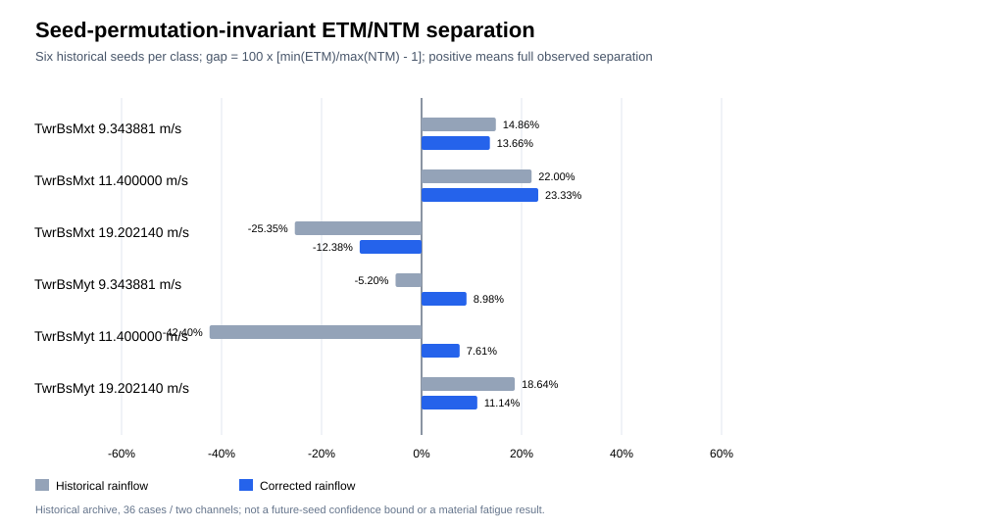

**结果表明，My在原雨流算法下只有1/3个风速箱达到历史全包络分离，而修正后为3/3；Mx则始终为2/3。** 同时，两种算法下按相同seed编号比较的18组ETM/NTM在两个弯矩分量上均保持ETM较大，说明“同编号seed比较全部同号”并不能保证“所有跨seed组合均同号”。这种差别是雨流算法修正影响控制工况筛选证据强度的具体反例，不能据此宣称ETM总体随机占优或把ETM极端湍流结果当作DLC1.2长期NTM疲劳载荷。

图表与程序可追溯至[六行计算结果](../../../experiments/T062/S06_ETM_NTM_PAIRING_FREE_RAINFLOW_GAP_20261110.csv)及[独立可运行Node程序](../../../experiments/T062/s06_etm_ntm_pairing_free_rainflow_gap.cjs)。本节只复用已核验历史来源，未新增物理求解；来源级算式和输入拒绝测试PASS，原始OUTB本轮未重新解码。

### 3.7.18 同一随机种子预算的双弯矩—跨风速箱留出检验（2026-11-10）

前述各节分别讨论单风速箱的seed漏选和不同载荷指标的控制身份。本节检验一个直接的试验设计问题：**如果三个风速箱必须共用相同的seed编号，选择方案在两个已知风速箱上表现良好，能否迁移到未参与选择的第三个风速箱？** 本节基于已有18组NTM、每组塔底Mx/My两个弯矩通道，属于**回顾性有限样本试验**，不是新增随机风仿真。三个历史风速箱分别为9.343881、11.400000和19.202140 m/s，每箱六个seed；全部采用同源修正后雨流载荷DEL（参考循环数100000、指数m=4，单位kN·m）。原始72行成对雨流对照表SHA256为12dabbb1273ce03d3920aedda3f72f9fa1d75b671e01a1db145c0a972ffe15e2，本节只使用其中36行NTM通道结果。

记风速箱为$b$、弯矩通道为$c$、seed为$s$，其修正后载荷等效幅值为$D_{bcs}$。对选中的共同seed集合$S\subset\{1,\ldots,6\}$，定义

\[
D_{bc}(S)=\left(\frac{1}{|S|}\sum_{s\in S}D_{bcs}^{4}\right)^{1/4},\qquad
E_T(S)=100\max_{\substack{b\in T\\c\in\{Mx,My\}}}
\left|\frac{D_{bc}(S)}{D_{bc}(\{1,\ldots,6\})}-1\right|\%.
\]

这里的四次矩平均是对**相同600 s有效窗口、相同参考循环数**的历史seed载荷DEL做描述性汇总；它不是对不同风速箱进行ERA5概率加权，也不是材料损伤叠加。共同编号只是一项**计算预算约束**，不表示不同风速箱的S02风场是同一个物理湍流实现。给定预算$k$，对全部$\binom{6}{k}$个组合进行穷举，先以三个风速箱全部参与时的最小$E_T$作为“事后最优/乐观基准”；再依次留出一个风速箱，仅使用另两个箱的六seed参考值选择$S$，最后在留出箱评价误差。相同最优值按seed编号字典序确定，不允许利用留出箱误差反向调参。

| 共同seed预算 | 组合数 | 三箱事后最优最大误差 | 三箱所有组合平均最大误差 | 留出9.343881 m/s时的误差 |
|---:|---:|---:|---:|---:|
| 1 | 6 | 11.646167% | 16.873974% | 19.403170% |
| 2 | 15 | 4.579323% | 10.468714% | 7.093878% |
| 3 | 20 | **2.241689%** | 7.056039% | **10.858592%** |
| 4 | 15 | 2.547498% | 4.956084% | 4.199770% |
| 5 | 6 | 2.154620% | 3.084800% | 2.772730% |

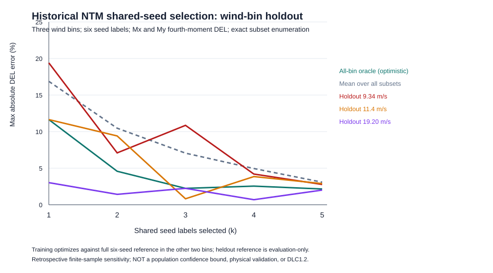

三seed预算下，三个风速箱全部参与选择时，事后最优共同集合为**S02、S03、S04**，双通道、三箱最大相对误差为2.241689%。然而，若把9.343881 m/s箱完全留出，只在另外两个风速箱上选择，得到**S02、S05、S06**；训练两箱的最大误差仅1.321257%，但留出箱的最大误差升至**10.858592%**。同一预算下，留出11.4 m/s与19.202140 m/s的误差分别为0.817344%和2.241689%。因此，**对已有风速箱的事后最优拟合不等于对未参与选择风速箱的可靠迁移**。本研究还观察到$k=4$的事后最优误差2.547498%略高于$k=3$的2.241689%；这不是计算失败，而是固定预算下以所选seed的四次矩平均作为估计量时，最小最大相对误差**不保证随$k$逐步单调下降**。只有使用全部六seed时，对自身参考值的误差才按定义为零。

本节的186次留出组合评价（$\sum_{k=1}^5 3\binom{6}{k}=186$）是同一18个历史风场的确定性重用，**不是186个独立随机试验，也不能形成总体置信区间**。尤其是选种训练阶段已用到训练箱的全部六seed参考值，这是一种**回顾性oracle实验**，不能作为在未知全样本真值时直接部署的seed推荐规则。三个风速箱既少且非随机同分布，缺少正式DLC1.2风速覆盖、跨风速控制状态核验及材料局部循环应力，故不能推导材料疲劳寿命或规范所需seed数。该反例支持后续正式设计采用独立seed留出与跨风速箱检验，而不是将少数风速箱的最优seed编号固定推广至全部工况。

[独立可运行Node算法](../../../experiments/T062/s06_ntm_joint_seed_holdout.cjs)、[15行完整留出结果](../../../experiments/T062/S06_NTM_SHARED_SEED_WIND_BIN_HOLDOUT_15ROW_20261110.csv)和上述SVG图共同构成本节可复现结果。程序对36行真实NTM通道数据、72行原始对照的第三方DEL一致性、六seed参考值、组合数、四项真实数值oracle和八类错误输入拒绝进行检查；原始OUTB本轮未重新解码，也没有运行OpenFAST/TurbSim生产求解。

### 3.7.19 六随机种子四次矩聚合的精确自助分布及跨风速配对假设敏感性（2026-11-11）

**科学问题。** §3.7.8的删减种子穷举只回答“从已观测六条记录中删去若干条，估计值如何变化”，不能直接量化“在六条记录代表的经验分布下，重新抽取六次时控制风速排序会有多大变化”。本节不新增OpenFAST计算，直接复用原始OUTB经T062独立雨流闭合后的72行历史载荷派生表，抽取NTM三风速箱×六seed×两个塔底弯矩通道共36个DEL值。单位为kN·m，雨流筛查口径统一为$m=4$、$N_{\mathrm{eq}}=100000$；不是材料S–N曲线的指数或材料应力。

对风速箱$j$的六条历史载荷DEL $L_{js}$，定义四次矩合并量

$
B_j=\left(\frac{1}{6}\sum_{s=1}^{6}L_{js}^{4}\right)^{1/4}.
$

在“同一风速箱内六seed可作为可交换经验样本”的**附加统计假设**下，每箱有放回抽样六次。六次有序抽样共有$6^6=46656$种，可由$462$个非负整数计数向量$(c_1,\ldots,c_6)$（$\sum c_s=6$）压缩，以精确多项式权重$w(c)=6!/(6^6\prod_s c_s!)$计算**完整经验自助分布**，没有Monte Carlo抽样误差。报告2.5%与97.5%分位数作为**条件性百分位区间**，不能未经覆盖率验证称为总体95%置信区间。

进一步分别采用两种互不等价的跨风速假设：（I）三个风速箱各自独立有放回抽样；（P）三个风速箱共用相同seed标签的重抽样计数向量。以重抽样后$B_j$为三箱最大值的经验比例定义$P^*_{\mathrm{I/P}}(j=\arg\max B^*)$。方案P只有在跨风速随机流确实存在物理配对时才可能具有对应抽样解释；**相同S01–S06编号并不证明相同湍流随机实现**，故P仅作为配对假设敏感性对照，不是优先的总体概率估计。

| 塔底通道 | 风速 / m·s⁻¹ | 历史$B_j$ / MN·m | 精确bootstrap百分位区间 / MN·m | $P^*_{\mathrm I}$(最大) | $P^*_{\mathrm P}$(最大) |
|---|---:|---:|---:|---:|---:|
| Mx | 9.343881 | 1.922467 | [1.764983, 2.061850] | 0 | 0 |
| Mx | 11.4 | 2.509922 | [2.350086, 2.618960] | 0 | 0 |
| Mx | 19.202140 | 6.596211 | [5.928163, 7.086852] | 1.000000 | 1.000000 |
| My | 9.343881 | 12.424367 | [11.110167, 13.438224] | 0 | 0 |
| My | 11.4 | 16.034661 | [14.525886, 17.275819] | 0.079750 | 0.000729 |
| My | 19.202140 | 17.157449 | [16.346863, 17.940002] | 0.920250 | 0.999271 |

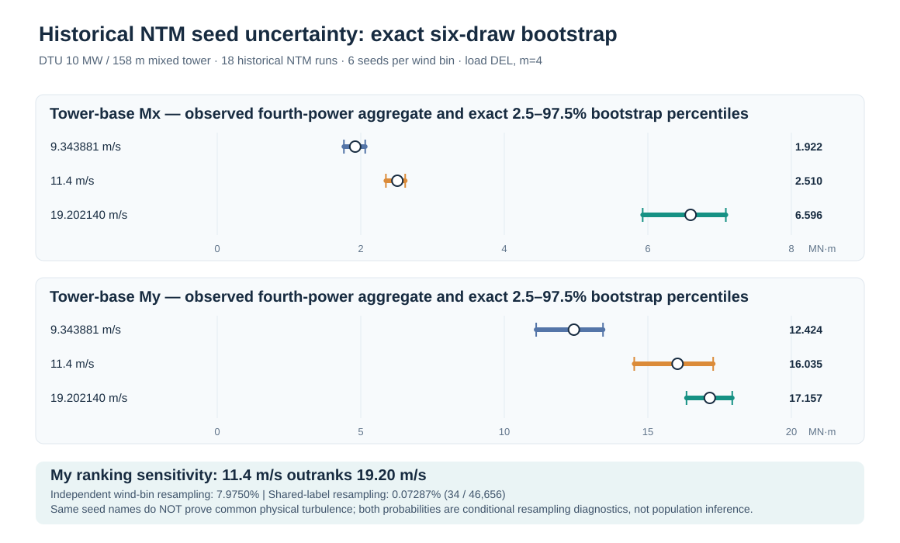

**图3-19** 每个风速箱六条历史NTM seed的$m=4$载荷DEL四次矩合并量（圆点）与经验自助分布2.5%—97.5%分位区间（横线）；下方标示My通道在两种跨箱重抽样假设下的排序翻转比例。图示为有限样本条件性不确定性，**不是新的风机动力学模拟、规范置信带或材料疲劳寿命**。

**可证伪发现。** Mx在两种抽样假设下均由19.202140 m/s箱控制；My则不同：历史六seed四次矩为17.157449与16.034661 MN·m，19.202140 m/s箱高于11.4 m/s箱，但在独立箱抽样方案I中，11.4 m/s箱反超的条件性比例为**7.975024%**；在共用seed标签方案P中仅为**0.072874%（34/46656）**。这种超过百倍的假设敏感性并非“哪种方案更准确”的证据，而是说明**跨风速配对是否有源级物理依据会实质改变对载荷控制风速稳定性的解释**。已有六条同名seed无法自动确立这一依据。

**证据、误差与边界。** SOURCE=T062/S10_RAINFLOW_MEAN_HETEROGENEITY_72ROW_20261110.csv（SHA256 cbe5f3c13290641789a11fc7551169a4b16fd9b347b03de74f8bde1209e76a49），直接读取72行并仅使用36个NTM通道值；RUN=462项多项权重与独立经验CDF排序，权重和为1，V8真实源复算与独立计算对照；Node原生自测合成常数/排序/异常拒绝通过，GitHub提交版对SHA锁真实CSV的原生CLI尚未独立执行。[6行结果表](../../../experiments/T062/S06_NTM_EXACT_SEED_BOOTSTRAP_PAIRING_6ROW_20261111.csv)与[可运行程序](../../../experiments/T062/s06_ntm_exact_seed_bootstrap_pairing.cjs)可追溯。组合穷举无随机抽样误差，表中六位小数舍入不超过$5\times10^{-7}$ MN·m；浮点与原始OUTB打包量化、TurbSim/控制器模型误差、六seed经验分布偏差、跨风速相关性、ERA5场址代表性**不能由本表消除**。REF=本章既有雨流/风场文献，未新增两篇2026先行风震/PT研究的全文页码；STANDARD=无新授权IEC条款；OFFICIAL=沿用历史158m OpenFAST v3.5.3来源。正式DLC1.2仍0/126、缺失运行风速箱及材料局部应力/Miner仍HOLD。本节不对未观测风速箱、未来随机总体或地震同态配对作推断。

### 3.7.20 跨风速seed标签不可辨识性的全排列反例（2026-11-11）

**研究目的与来源。** §3.7.19中共用S01—S06标签的重抽样使11.4 m/s的塔底My载荷DEL反超19.202140 m/s的条件性比例仅为0.072874%，而独立风速箱重抽样为7.975024%。然而，S01—S06是各工况的**文件标签**，并非已经核实的跨风速湍流随机流一一对应关系。为判定这一数值差异是否依赖标签的任意排列，本节直接继承同一份历史T062 72行雨流派生数据（SOURCE SHA256 cbe5f3c13290641789a11fc7551169a4b16fd9b347b03de74f8bde1209e76a49），仅使用三个NTM风速箱各六条My载荷DEL，逐一枚举19.202140 m/s箱相对于11.4 m/s箱的全部$6!=720$种双射标签排列。未增加或改动任何OpenFAST/TurbSim生产计算。

对固定排列$\pi$和六抽计数向量$c=(c_1,\ldots,c_6)$，$\sum c_s=6$，在相同标签计数向量下比较两箱四次矩和，定义

\[
P_\pi^*=\frac{1}{6^6}\sum_{\substack{c_s\geq0\\\sum c_s=6}}\frac{6!}{\prod_{s=1}^{6}c_s!}
\,\mathbf{1}\!\left\{\sum_s c_s L_{11.4,s}^{4}>
\sum_s c_s L_{19.202140,\pi(s)}^{4}\right\}.
\]

四次方根与$1/6$因子在排序中相互抵消。每种排列恰有462个非负计数向量、46656个带权有序重抽样；共评价720×462个加权判别。由于9.343881 m/s箱的六个My DEL最大值14.214855 MN·m严格小于19.202140 m/s箱六个值的最小值15.377264 MN·m，任意重抽样下低风速箱均不可能控制，故三箱最大排序可化为上述两箱比较。

| 标签配对情景（仅历史My载荷） | 11.4 m/s反超19.202140 m/s的条件比例 |
|---|---:|
| 现存同名S01—S06标签 | 0.072874%（34/46656） |
| 720种重排中的最小值 | 0.027864%（13/46656） |
| 720种重排的2.5%与97.5%经验次序统计量 | 0.137174%—14.278978% |
| 720种重排的中位数 | 7.662466% |
| 720种重排的等权平均值 | 7.620313% |
| 720种重排中的最大值 | **14.868398%（6937/46656）** |
| §3.7.19独立风速箱重抽样（对照，不属于720种配对） | 7.975024% |

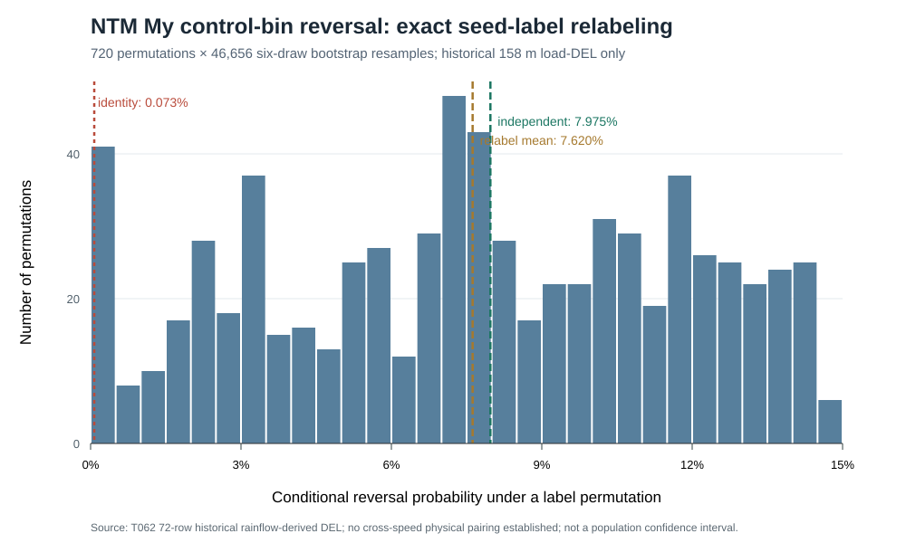

**图3-20** 历史NTM塔底My载荷DEL的720种全排列重标记所产生的经验重抽样排序翻转比例分布。红色虚线为原同名标签，绿色线为独立风速箱重抽样对照，棕色线为720种重排的等权均值。横轴为**条件性组合比例**，不是实际风气候发生概率；720种排列并非720次独立风机试验，2.5%—97.5%也不是总体置信区间。

**可证伪结论。** 同一批真实历史DEL、同一组六抽计数权重，仅改变跨风速文件标签对应关系，My排序翻转比例便从0.027864%变至14.868398%；原同名标签的0.072874%接近可达最小端，而517/720种重排的比例大于5%。因此，**不能以共用seed编号的bootstrap结果证明控制风速排序具有99.927%的物理稳定性**。若后续恢复原始BTS、TurbSim随机种子及空间风场，并独立证明跨风速流实现的可配对性，则应预先固定配对规则重新检验；反之，应使用与真实生成机制一致的独立风速箱设计并报告样本覆盖不足。720种重排的等权均值7.620313%与独立箱7.975024%接近，**不构成两种抽样方案等价的证明**。

**复算、误差与限制。** [720行逐排列结果](../../../experiments/T062/S06_NTM_MY_SEED_RELABEL_720ROW_20261111.csv)与[源级Node程序](../../../experiments/T062/s06_ntm_seed_label_permutation_exact.cjs)均已保存；SOURCE同§3.7.19，程序对720个唯一排列、462个计数向量及总权重46656检查，并以独立$6^6$有序枚举复核原标签、极小和极大三个排列，另有常量排序和坏输入拒绝测试。V8对GitHub提交同字节程序执行selftest与真实72行来源复算PASS；原生Node CLI对真实CSV尚未独立执行。程序/数表/图SHA256见T080过程日志。所有比例均为整数计数除46656，无Monte Carlo误差；显示到六位小数的百分数舍入误差不超过$5\times10^{-7}$个百分点。未重新读取原始BTS字节，也未取得跨风速随机流物理配对证据；原始OUTB量化、风场/控制器模型误差、seed可交换性、ERA5代表性及缺失DLC1.2风速箱不在该离散误差界内。REF沿用本章原雨流文献，STANDARD未新取得授权IEC条款，OFFICIAL沿用已核158m OpenFAST历史来源；**不产生材料局部应力、Miner寿命、风震同态或结构物理PASS**。

### 3.7.21 真实NTM有限风速箱的双方向四次矩抽样预算：整数最小最大方差设计（2026-11-12）

在完成载荷DEL的雨流实现修正之后，仍需回答一个与“哪个工况峰值最大”不同的问题：**如果只有固定数量的独立风场实现，怎样分配到不同风速箱才能尽量降低已观测箱的长期载荷四次矩估计误差？** 本节不新增风机生产计算，而以原18组NTM、每箱六seed的修正后塔底弯矩DEL4和ERA5真实风速箱小时数，构造可复算的**事后实验设计诊断**。研究对象仅为[9,10)、[11,12)、[19,20) m/s三个已观测箱；它们合计7164/184080 h（3.8918%全部小时，或7164/106900=6.7016%诊断运行小时）。其余箱的载荷未知，不能由此估计完整长期四次矩或材料寿命。

对方向c∈{Mx,My}、箱b，令q_{bc,s}=(DEL_{bc,s}/1000)^4，DEL以kN·m记录，q单位为(MN·m)^4；p_b=ERA5箱小时数/184080。目标量K_c,obs=Σ_b p_b E_s[q_{bc,s}]，在**箱间随机实现独立、每次运行等成本、同箱seed独立同分布**的工作假设下，使用六个历史seed的无偏样本方差s²_{bc}作为插值设计参数，则总预算N=18、各箱至少2个seed时的条件性方差估计为

\[
\widehat{\operatorname{Var}}(\widehat K_{c,\mathrm{obs}};\mathbf n)
=\sum_{b=1}^{3}\frac{p_b^2s_{bc}^{2}}{n_b},\qquad
n_b\ge2,\quad\sum_bn_b=18.
\]

这不是材料S–N的m=4假设；四次幂只是已有载荷DEL4的同一参考循环数下的诊断量。共91种整数分配被逐一穷举。为避免只优化一个弯矩方向而损害另一方向，以均匀分配(6,6,6)为参照，最小化两方向**方差比的最大值**。实际源级结果如下（比值1代表原六seed均匀方案）：

| 分配目标 | n(9 m/s) | n(11 m/s) | n(19 m/s) | Mx方差比 | My方差比 | 最大方差比 |
|---|---:|---:|---:|---:|---:|---:|
| 历史均匀6/6/6 | 6 | 6 | 6 | 1.000000 | 1.000000 | 1.000000 |
| 仅最小化Mx | 11 | 5 | 2 | 0.680416 | 0.742164 | 0.742164 |
| 仅最小化My | 10 | 6 | 2 | 0.684595 | 0.720212 | 0.720212 |
| 双方向最小最大 | **10** | **6** | **2** | **0.684595** | **0.720212** | **0.720212** |

因此，在上述已观测三箱、经验方差不变的条件下，10/6/2方案相对6/6/6的Mx和My估计**标准误**分别下降约17.26%和15.13%；这只是规划方差的平方根比，不是新运行后的真实收敛精度。为检验六seed方差估计的敏感性，逐箱删除一个历史seed，完整枚举6³=216个删除组合并重新搜索91种分配：最优方案为9/7/2的114次、10/6/2的96次、11/5/2的6次，最优最大方差比介于0.674614和0.752007。即便在这组删除检验中，精确的9/11 m/s预算分配仍不稳定；19 m/s固定为2只反映其ERA5箱权重极小，**不能解释为高风速控制载荷不需要更多极值/失效风险采样**。

[四行方案结果表](../../../experiments/T062/S10_NTM18_STRATIFIED_ALLOC_4ROW_20261112.csv)、[216行逐删除结果](../../../experiments/T062/S10_NTM18_STRATIFIED_ALLOC_LOO_216ROW_20261112.csv)、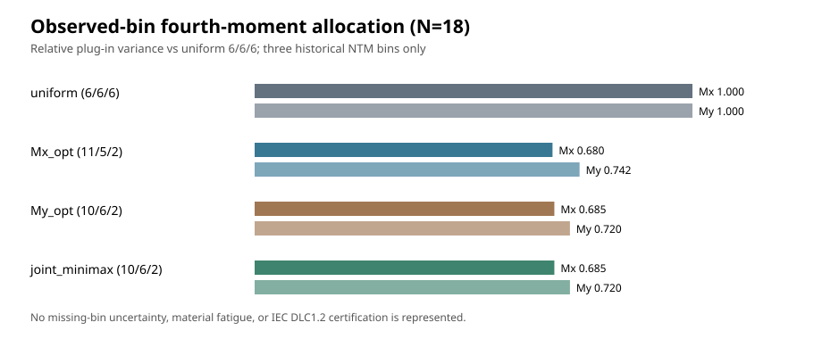与[原生Node复算程序](../../../experiments/T062/s10_ntm_stratified_seed_allocation.cjs)可逐项复核。SOURCE为T062原72行修正后雨流表（SHA256 \`12dabbb1273ce03d3920aedda3f72f9a1db145c0a972ffe15e2\`）及ERA5 31行分箱（SHA256 \`e4058620a36b23bb218103875d4dc5b0711fc45d418b23a2208c2fc9c16c9102\`）。REF沿用Huang等2025年运行风疲劳与既有2026风震/PT先行研究，不据此声称已有研究未提出过最优抽样；STANDARD无新增授权IEC条款。

**适用性和拒绝边界：**样本方差的统计稳定性未被证明，跨箱同名seed不能视为物理配对；仅三个有源风速箱，且[19,20) m/s在21年ERA5中只有2 h，出现概率估计本身存在显著抽样不确定性。若把目标改为“控制工况漏选概率”、高风速极端载荷、分材料局部应力或完整DLC1.2，则目标函数与最优分配均须重建；不能将10/6/2直接作为正式生产工况数量或规范符合性证据。当前正式DLC1.2仍0/126、材料Miner和同态风震HOLD，12阶段验收0/12。

### 3.7.22 真实ERA5与18NTM历史来源的分箱非不变性反例（2026-11-12）

历史18组NTM原始OUTB身份分别对应9.343881、11.4、19.202140 m/s三个实际风速，每风速6个seed。已有31个1 m/s整数风速箱的ERA5派生数据总计184080 h，其中诊断[4,25) m/s区间106900 h。既有§3.7.21按1 m/s划箱时，历史来源占据的[9,10)、[11,12)、[19,20) m/s合计7164 h，即全部小时的3.891786%或诊断区间的6.701590%。本节检验一个更基本的科学问题：**如果不增加任何物理风场或载荷时程，仅更改划箱规则，“有历史来源的概率质量”是否仍保持不变？**

在诊断区间[4,25) m/s内，构造宽度w=1、2、3、4 m/s的整数边界分箱。每种宽度允许首截断箱宽φ=0、…、w−1 m/s：φ=0时从4 m/s直接按w划分，φ>0时先设[4,4+φ) m/s，再按w递增并在25 m/s截断。对每个划分，仅将至少包含一个上述实际风速的箱记作“历史来源占据箱”，并把原1 m/s ERA5小时数按唯一箱合并，不重复计算同箱多seed。定义

\[
C(w,\phi)=\frac{1}{184080}\sum_{b\in\mathcal B(w,\phi)}
n_b\,\mathbf 1\{\exists u\in\{9.343881,11.4,19.202140\}:u\in b\}.
\]

全部10种宽度/相位组合均由31个真实ERA5小时数直接精确合并。w=1、φ=0为7164 h（3.891786%）；w=2、φ=0为19559 h（10.625272%）；w=4、φ=1仅11002 h（5.976749%），但**w=4、φ=2可达54977 h（29.865819%全部小时、51.428438%诊断区间）**。后者为1 m/s基准的**7.674065倍**，而18组原始风载来源、实际风速、随机seed及ERA5观测全部未变。部分划分把9.343881与11.4 m/s两个不同风速放入同一箱，不能因此将它们的12个seed视为同一风速下的12个独立同分布实现。

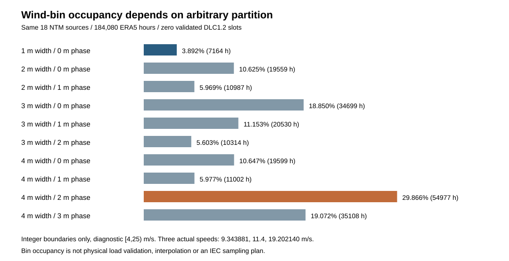

本研究使用整数边界是因为现有来源仅有1 m/s整数分箱小时数，不能在缺少原始逐小时风速时虚构0.5 m/s边界内的精确分配。结果表的小时数是整数计数，百分比仅存在显示舍入误差；ERA5再分析、轮毂高度换算及箱内载荷代表性的不确定性没有因此得到估计。可复算程序对每种划分采用“按占据箱求和”与“逐1 m/s原子箱枚举”两个独立算法核对，见[Node源程序](../../../experiments/T062/s06_windbin_partition_sensitivity.cjs)和[10行结果表](../../../experiments/T062/S06_NTM18_BIN_PARTITION_SENSITIVITY_10ROW_20261112.csv)。

**该反例只说明历史来源占据概率是划箱依赖的账面量，不能当作已验证载荷概率、正式DLC1.2风场覆盖、缺失风速箱的外推依据或材料Miner损伤。** 正式DLC1.2仍为0/126；现有18组NTM继续保留为历史筛查。要获得可用于长期疲劳的有效风速箱，必须另行闭合工况规则、实际风速代表性、控制器状态、载荷响应与独立验收，而非通过放宽箱宽“提高覆盖率”。

### 3.7.23 真实18组NTM塔底反力的频域方差重分配（2026-11-12）

§3.7.15已证明塔底平均弯矩与循环DEL并非同一个排序指标，但尚未说明随机波动集中在哪些时间尺度。本节直接下载历史GitHub Actions Artifact ID 13775054290所保留的18组158 m OpenFAST原始OUTB**派生**塔底六分量完整时程gzip（SHA256：45cc308625ead8411d1565adc66c99e7ee8d0a979e5c3c6c18f23e744ba74dd1），逐案核对18×12001点、100–700 s、采样间隔0.05 s。每案只取100.00–699.95 s共12000点构成恰好600 s的DFT窗，舍去700.00 s端点；没有重新运行OpenFAST或生成风场。**TwrBsMxt/TwrBsMyt是塔底反力矩（kN·m），不是可直接施加的外部气动力矩。**

设去均值反力时程为 \(x_n=M_n-\overline M\)，\(N=12000\)，\(\Delta t=0.05\mathrm{s}\)，\(f_s=20\mathrm{Hz}\)，频率间隔 \(\Delta f=1/600\mathrm{Hz}\)。对实数DFT单侧方差贡献 \(P_k\)，非DC、非Nyquist频点按 \(2|X_k|^2/N^2\) 计，DC和Nyquist按 \(|X_k|^2/N^2\) 计。预先固定诊断频带 \(B=[0.05,0.25)\mathrm{Hz}\)，定义：

\[
R_B=\frac{\sum_{k:f_k\in B}P_k}{\sum_{k\geq0}P_k},\qquad
\sigma_B=\left(\sum_{k:f_k\in B}P_k\right)^{1/2}.
\]

每条原始时程均按Parseval恒等式 \(\sum_kP_k=N^{-1}\sum_nx_n^2\) 检验，数值相对容差 \(10^{-10}\)。\(R_B\)仅表示该时窗去均值反力方差在指定频带的比例，不等于模态参与系数、耗散能量、气动力或1P/3P；未取得同步转速谱，不能将频谱峰归因为转子谐波。

| 塔底反力 | 实际风速/m·s⁻¹ | 六seed \(R_B\)均值/% | 最小—最大/% | 六seed \(\sigma_B\)均值/kN·m | 六seed平均反力/kN·m |
|---|---:|---:|---:|---:|---:|
| Mx | 9.343881 | 22.570 | 14.262—30.627 | 1,976.38 | 9,578.61 |
| Mx | 11.400000 | 35.564 | 21.812—46.356 | 2,855.64 | 12,132.44 |
| Mx | 19.202140 | **64.700** | 53.164—75.212 | 9,561.12 | 17,257.90 |
| My | 9.343881 | 3.896 | 1.281—6.119 | 6,912.61 | 177,177.01 |
| My | 11.400000 | 24.154 | 13.049—29.811 | 16,513.77 | 193,080.52 |
| My | 19.202140 | **50.735** | 46.155—55.784 | 22,139.81 | 106,926.60 |

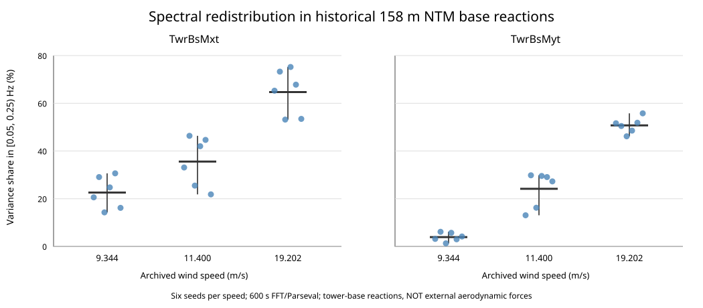

**可复核发现：均值与动态频带响应解耦。** 从11.4到19.202140 m/s，My六seed平均反力由193,080.52降至106,926.60 kN·m（−44.62%），但同一频带反力波动RMS均值由16,513.77升至22,139.81 kN·m（+34.07%），频带份额由24.154%升至50.735%（+26.581个百分点）。Mx频带份额由35.564%升至64.700%。两方向的19.202140 m/s六个seed份额均严格大于11.4 m/s全部六个seed；最小跨组间隔分别为Mx **6.808个百分点**、My **16.344个百分点**。这仅对历史18条时程和指定频带成立，不是未来随机风样本的统计置信结论。

独立采用4096点Hann窗、50%重叠Welch谱，完整600 s线性去趋势，以及将频带下限改为0.04、0.06、0.08、0.10 Hz时，上述两个弯矩方向的六seed跨组严格分离仍成立，最小间隔分别为Mx **2.330个百分点**、My **8.337个百分点**。**真实反例**：将600 s拆成两个300 s窗后，Mx两组范围发生重叠（前半窗高风速最小值比中风速最大值低9.439个百分点，后半窗低4.924个百分点）；My在两个半窗仍分离。因此不得将全窗Mx排序写成任意时间窗都稳定。

[可运行Python](../../../experiments/T062/s06_ntm18_spectral_fft.py)、[36行逐案结果](../../../experiments/T062/S06_NTM18_BASE_REACTION_SPECTRAL_36ROW_20261112.csv)、[六行汇总](../../../experiments/T062/S06_NTM18_BASE_REACTION_SPECTRAL_6ROW_20261112.csv)均已入活动分支。源码包含原始gzip SHA、18×12001时钟与通道门禁、Parseval已知正弦解及坏输入拒绝；本轮同字节原生Python/NumPy真实执行，另用SciPy Welch独立交叉核验。SOURCE为原18份OUTB的历史派生gzip，RUN为本轮离线频域后处理，FIG/TAB为本节新增；STANDARD无新增授权IEC/GB条文，REF继承前述混塔疲劳及2026风震/PT研究且不声称优先性。原OUTB逐通道量化半步误差未重新提取，矩形窗泄漏、有限时窗、真实控制器DLL身份和场址代表性仍未闭合；**不能从频谱份额推导材料疲劳寿命、真实外载或风震同态响应**。正式DLC1.2仍0/126，材料Miner与W/E/WE仍HOLD。

### 3.7.24 真实NTM频带响应的有限seed推断与反例（2026-11-12）

§3.7.23报告了同一158 m历史OpenFAST模型在11.4和19.202 m/s两组NTM工况中塔底弯矩的频带响应。本节进一步检验一个可证伪命题：**在已有六个seed的有限历史样本中，My的平均反力降低是否与0.05–0.25 Hz动态带通RMS增大同时成立；该方向性差异对seed选择有多敏感？** 数据仍为T062原36行谱表（18个历史工况×Mx/My，源SHA256 `c3de99d45c70675f6a95a767e73dcfc50d57d07b4f33438ee705690b694ae622`），本节不重跑OpenFAST或频谱估计，也不以额外分箱制造独立样本。

对每个风速箱六个seed，定义观测均值比 `R=mean(Y_19.202)/mean(Y_11.4)`。首先在固定六对相同seed标签的条件下，完整枚举6^6=46656次有放回的**成对**重抽样，取2.5%和97.5%分位数形成条件性百分位区间；该区间仅描述历史seed经验分布，不能自动作为总体95%覆盖保证。另在不承认跨风速seed配对的假设下，枚举从12个观测中选6个的全部924种等量标签分配，使用均值差绝对值的双侧精确置换尾概率；仅当两风速样本在零假设下可交换时，该概率才具有随机化检验解释。作为不同依赖假设的敏感性对照，还完整枚举六个同标签差值的2^6=64种符号翻转。**相同S01–S06字符串并不能证明两风速使用了可交换或可配对的独立随机流。**

| 塔底分量与指标 | 19.202/11.4均值比 | 六对seed条件性重抽样2.5%–97.5% | 924置换双侧p | 64符号翻转双侧p |
|---|---:|---:|---:|---:|
| Mx平均反力 | 1.422459 | 1.407420–1.438190 | 0.002165 | 0.031250 |
| Mx频带RMS | 3.348157 | 3.227165–3.450494 | 0.002165 | 0.031250 |
| Mx频带方差份额 | 1.819273 | 1.634799–2.084743 | 0.002165 | 0.031250 |
| My平均反力 | **0.553793** | 0.537511–0.569174 | 0.002165 | 0.031250 |
| My频带RMS | **1.340687** | 1.232990–1.517280 | 0.006494 | 0.031250 |
| My频带方差份额 | **2.100446** | 1.746447–2.732982 | 0.002165 | 0.031250 |

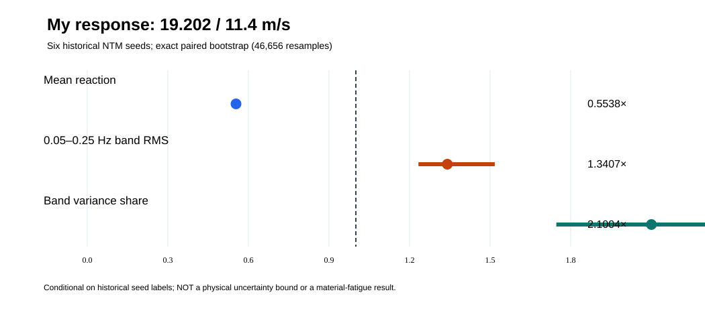

My频带RMS虽然六个同标签差值均为正，但两组全部36种跨seed配对**并非严格分离**：11.4 m/s的最大值19466.050 kN·m高于19.202 m/s的最小值19093.680 kN·m。这一反例否定了“高风速每个随机样本的动态波动都更大”的强断言。My平均反力则在六seed全包络上严格下降。以六个指标为同一家族进行Holm校正，未配对置换的最小可达校正p约0.012987，但成对符号翻转的校正p=0.1875；两种口径差异说明**独立性与配对机制假设比小数位更重要**，不能宣称正式风速总体显著性。

误差边界：原36行表按小数输出，当前重新统计仅有舍入误差；FFT窗泄漏、600 s有限长度、跨seed相关性、真实运行状态、风速箱总体代表性、原始packed OUTB精度及0.05–0.25 Hz频带物理解释均未获得完整误差上界。历史300 s半窗的Mx严格分离失败仍有效；本节统计不能消除该反例。该频带是塔底**反力响应**而非外部气动力，也不等于材料局部应力或Miner寿命。SOURCE=上述真实36行派生表；RUN=[精确枚举Node程序](../../../experiments/T062/s06_ntm18_exact_seed_inference.cjs)，[6行结果](../../../experiments/T062/S06_NTM18_SPECTRAL_SEED_INFERENCE_6ROW_20261112.csv)；FIG=本节SVG；REF=继承既有风致响应文献，不新增全文核读；STANDARD=未取得新增授权IEC/GB条文；S06/S07物理验收HOLD。

## 3.8 多指标控制工况集合与第四章输入

### 3.8.1 不设一个“万能最危险case”

第三章最终控制工况按不同物理目的取并集：最大tower-top resultant displacement、最大tower-base resultant moment、最大tower-base moment RMS、最大FA load-DEL、最大SS load-DEL、必要的near-rated control-state代表case及必要的PSD/1P/3P特殊case。

每个case必须写明进入第四章的原因：极值筛选、循环筛选、near-rated control-state或nonlinearity check。

### 3.8.2 历史benchmark只作对照

旧稿历史集合曾包含U09p343881_ETM_S06、U11p4_NTM_S02、U11p4_ETM_S03和U19p202140_ETM_S02。经T062相同36份OUTB、72条载荷DEL的雨流算法根因闭合，当前正式载荷级My循环控制候选为U11p4_ETM_S04，Mx循环控制候选为U19p202140_ETM_S02。旧S03仅保留作旧算法错误来源对照，其他极值、RMS、控制状态和谱特征仍按各自QoI独立筛选，不能以一个case替代所有机制。

### 3.8.3 向第四章交付的数据

第三章给第四章的正式输入包括：
1. long-term normal-operation wind-bin probability；
2. 36case screening统计与控制case并集；
3. 对应.bts与.outb hash；
4. tower-top/interface six-component loads；
5. load-rainflow ledger；
6. load-DEL ranking；
7. RotorSpeed/BldPitch/GenPwr运行状态；
8. PSD/1P/3P信息；
9. seed统计；
10. DLC1.2正式fatigue bins工况矩阵。

## 3.9 本章最终图表清单

建议最终形成图3-1 ERA5区域/研究点/处理流程；图3-2 2005—2025年100 m与HubHt风速时序；图3-3动态\(\alpha\)概率与季节分布；图3-4 HubHt wind-speed histogram/CDF；图3-5风玫瑰；图3-6三个screening URef在长期分布中的位置；图3-7 NTM/ETM代表风速时程；图3-8 TurbSim谱/相干性检查；图3-9 OpenFAST/ROSCO验证流程；图3-10 RotorSpeed–BldPitch–GenPwr运行状态；图3-11六seed QoI离散；图3-12 NTM/ETM统计比较；图3-13 PSD与1P/3P/塔频；图3-14 load-DEL分组；图3-15多QoI控制工况并集。

对应表格至少包括ERA5变量完整性、HubHt长期统计、36case矩阵、TurbSim/OpenFAST输入、运行验证门禁、six-seed统计、历史雨流算法错误的36工况因果闭合与第四章输入case清单。

## 3.10 本章小结

本章的实证结论应区分**已经完成的整机随机风载筛查**与**尚未取得的完整正常运行疲劳载荷总体**。在158 m组合研究模型上，既有36组OpenFAST历史工况和T062针对同一批原始OUTB的独立雨流复算，使塔底载荷控制身份可追溯：修正后My载荷DEL控制候选为U11p4_ETM_S04，Mx为U19p202140_ETM_S02。二者对应不同响应分量，ETM极端湍流筛查不能代替DLC1.2正常运行疲劳工况。控制工况应保留风速、湍流类别、随机种子、响应分量和参考循环数，不应笼统概括为一个“最危险工况”。

长期风速权重来自2005—2025年ERA5的**184080 h**。在[4,25) m/s诊断运行区间内共**106900 h**，有历史NTM载荷来源的9、11、19 m/s三个风速箱合计**7164 h**，占诊断区间**6.7016%**，占全部ERA5小时**3.8918%**；其余**99736 h**诊断区间小时缺少同口径NTM载荷。两个百分比的分母不同，不能混写为“全年覆盖率”。设同一通道、同一参考循环数下已知箱的加权四次矩为\(K_{\mathrm{obs}}\)，完整目标应满足
\[
K_{\mathrm{all}}=K_{\mathrm{obs}}+\sum_{j\in\mathcal M}p_j\,\overline{DEL_{j}^{4}},\qquad p_j=n_j/184080.
\]
缺失项非负，但在缺少真实载荷或独立验证上界时无法得到有限上界。§3.7.10—§3.7.12的等贡献阈值和逆向容差曲线仅说明**假定缺失箱载荷达到何值会改变已知部分**，不是缺失箱预测，也不是材料寿命估计。[ERA5原始分箱表](../../../experiments/T062/S10_ERA5_2005_2025_HUB_1MS_BINS_20261031.csv)提供分母和风速箱来源。

第三章向第四章传递的是**载荷层控制工况候选集合**，而非材料疲劳控制结论。塔底load-DEL基于载荷循环，材料损伤还需要局部应力范围、循环均值、次数及相应材料关系；不能凭一个弯矩DEL最大工况锁定混凝土、预应力钢绞线或钢塔的疲劳控制位置。尤其不能用少量历史NTM的线性风速外推填补正式风速箱：第五章§5.4.5的整箱留出实测拒绝试验对此提供了独立反例。

---

---

# 第四章 10 MW预应力混凝土—钢混合塔架风致疲劳性能分析

## 4.1 研究目的、研究对象与总体疲劳框架

大型风电混合塔架在正常运行状态下长期承受随机风引起的周期性推力、倾覆弯矩、扭矩以及重力和预应力共同作用。与极限承载分析不同，疲劳评价不仅取决于某一时刻的最大荷载，还取决于局部材料点在长期运行过程中的应力范围、平均应力、循环次数以及不同运行风速的出现概率。因此，本章不以“最大塔底弯矩”或“最大load-DEL”直接代替材料疲劳，而建立由场址长期风环境、整机随机载荷、精细结构局部应力、循环计数、材料疲劳关系和长期概率累积组成的完整分析链。

本章集中回答以下问题：

1. 在正常运行随机风作用下，158 m预应力混凝土—钢混合塔架的疲劳控制位置位于何处；
2. 控制疲劳的主要材料是下部预应力混凝土、预应力钢绞线还是上部钢塔；
3. 额定风速附近、高于额定风速的变桨运行区以及低风速区对长期damage的贡献有何差别；
4. 预应力形成的长期压应力、随机湍流样本和局部应力提取方法会如何改变疲劳评价；
5. 整机载荷层的load-DEL控制工况与材料层damage控制工况是否一致。

Huang等[16]针对segmental precast post-tensioned concrete风机塔开展运行随机风疲劳分析，其研究对象同时涉及分段预制混凝土塔、水平接缝、后张预应力、长期运行风速概率、局部应力循环、平均应力、初始预应力、周向方位和随机样本数，和本文下部混凝土塔段的核心问题最接近。因此，本章以[16]作为总体研究逻辑的第一主参考。

但本文研究对象为钢—预应力混凝土混合塔架，不能只沿用混凝土疲劳路线。Kenna[19]用于建立钢塔段和混凝土塔段必须分材料评价的总体框架；Qu等[18]用于预应力钢绞线疲劳和预应力损失影响；Wang等[17]用于水平接缝Reference Stress和局部应力提取；Zhao等[20]用于钢塔法兰/焊接细节的nominal/hot-spot stress疲劳流程；Kim等[21]仅在钢—混转换连接被实际识别为控制部位时提供循环连接验证依据。

本文采用两层疲劳评价：

### 4.1.1 载荷层疲劳筛选

以OpenFAST整机输出的塔底或接口载荷时程进行rainflow和load-DEL计算，其目的仅为：

- 比较不同风速、湍流模型和随机种子的循环载荷强弱；
- 筛选需要进入精细结构分析的代表风况；
- 判断极值控制与循环载荷控制是否一致。

该层的load-DEL是统一指数和统一等效循环数下的载荷比较量，不代表混凝土、钢绞线或钢材的真实材料寿命。

### 4.1.2 材料层疲劳评价

材料层以Abaqus精细模型或经过独立验证的局部应力响应关系得到材料点应力时程，然后按不同材料分别执行：

\[
\text{local stress history}
\rightarrow
\text{rainflow}
\rightarrow
(\Delta \sigma,\sigma_m,n)
\rightarrow
\text{material fatigue relation}
\rightarrow
D
\rightarrow
\text{annual / design-life damage}.
\]

混凝土、PT钢绞线和钢塔不得采用同一条S–N曲线或同一个Wöhler指数统一处理。

> 工作区原图证据：[16] p10 Fig.17–18显示SPPT混凝土接缝与钢塔分别评价fatigue damage；[19] p205–206明确钢、混凝土分材料疲劳并采用rainflow + Palmgren–Miner。

## 4.2 正常运行疲劳工况与场址长期风速概率

### 4.2.1 正式疲劳工况的边界

设计寿命疲劳主线采用IEC 61400-1框架下的正常运行疲劳工况，即DLC 1.2 / NTM逻辑。ETM属于极端湍流模型，其主要作用是极端/高湍流响应研究，不应与长期正常运行疲劳概率直接混合。

第三章已有三代表风速×NTM/ETM×6 seeds共36组OpenFAST结果继续保留，用于：

- NTM/ETM响应差异；
- 多seed离散性；
- 极值、RMS和PSD筛选；
- load-level rainflow/DEL；
- 初步选择精细Abaqus代表工况。

但这36组只覆盖有限代表风速，不能直接外推为20年材料疲劳寿命。

### 4.2.2 风速bin设计

正式长期疲劳应覆盖风机从切入到切出之间的正常运行风速区。风速bin不机械照搬其他论文的数量，而根据以下条件确定：

1. ERA5长期场址风速概率分布；
2. 风机功率/转速/变桨状态的变化区间；
3. damage随风速变化的梯度；
4. 计算量。

额定风速附近通常同时存在推力变化、转速控制和变桨控制切换，因此若初步计算显示damage随风速变化较陡，应在额定附近适当加密bin。

Huang等[16]的具体实现采用11个wind bins，并对其进行110次simulation，即每个bin约10个独立随机实现。该设置证明“多bin + 多随机种子”是其长期疲劳统计的重要组成，但本文不直接复制11个bin和10 seeds/bin，而将其作为样本收敛设计的直接先例。

> 工作区原图证据：[16] p04 Fig.6–7为annual wind probability与wind-speed time series；[16] p06 Fig.10及正文记录11个wind bins、110 simulations和unique turbulence seeds。

**2026-10-31原始18组NTM配置核验（DLC1.2输入资格HOLD）：** 第三章已从13个源ZIP直接校验127个原始TurbSim/OpenFAST/控制器输入成员，实际是51×51的`IECKAI/NTM/1-ED3/A`、三个`URef`各六种子，原始FST/ServoDyn统一且`TMax=700s`。虽然18份`.inp/.sum/.dat`和原始OUTB均有可追溯身份，但**18份完整`.bts`风场字节及SHA未归档**，控制器`libdiscon.dll`的二进制版本/ROSCO实现未独立核对，2025版IEC授权DLC1.2条款未核验。因此本章21×6=126格中正式DLC1.2验收仍为**0格**；既有18格仅历史NTM筛查，不能据此输出年度Miner或用三风速DEL填补108格。来源与逐工况配置见[18行原始配置表](../../../experiments/T062/S07_18NTM_ORIGINAL_TURBSIM_CONTROLLER_INPUTS_20261031.csv)和[原件SHA收据](../../../experiments/T062/S07_18NTM_ORIGINAL_TURBSIM_CONTROLLER_RECEIPT_20261031.json)。该核验的下一环节是从**现有OUTB运行状态通道与原始控制器日志**确定历史工况可否作为正式补算的控制器参考，而非立即跑108个700s工况。

### 4.2.3 随机种子与sample-size收敛

对第 \(j\) 个风速bin采用 \(N_s\) 个独立随机种子。对每个seed分别计算目标局部区域的短时疲劳damage \(D_{j,s}^{\text{short}}\)，再统计：

\[
\bar D_j^{\text{short}}
=
\frac{1}{N_s}
\sum_{s=1}^{N_s}D_{j,s}^{\text{short}},
\]

\[
s_{D,j}
=
\sqrt{
\frac{1}{N_s-1}
\sum_{s=1}^{N_s}
\left(
D_{j,s}^{\text{short}}
-
\bar D_j^{\text{short}}
\right)^2
},
\]

并定义变异系数：

\[
CV_j
=
\frac{s_{D,j}}{\bar D_j^{\text{short}}}.
\]

正式结果除给出均值外，还应给出seed离散性，并检查随seed数量由2、3、4、5、6逐步增加时 \(\bar D_j\) 和 \(CV_j\) 是否稳定。若6 seeds已满足预先设定的收敛要求，则无需机械增加；若额定附近控制bin仍明显不稳定，则只对这些控制bin补充随机实现。

这种处理直接继承[16]把sample size作为疲劳影响因素单独讨论的思想，而不是把“IEC最少6个实现”误写成“6个实现必然足以保证材料疲劳收敛”。

### 4.2.4 场址长期概率与年损伤

记第 \(j\) 个风速bin的长期正常运行概率为 \(P_j\)，满足：

\[
\sum_j P_j = 1
\]

或在仅统计正常运行区间时按相同概率口径归一化。本文优先采用ERA5长期数据形成经验概率；若使用Weibull拟合，则必须同时报告经验分布与拟合误差，不能强制用Weibull替代真实场址统计。

Qu等[18]展示了利用Weibull风速频率分布对不同风速下的PT和混凝土疲劳进行长期加权的路径。本文继承“短时damage × 长期风速概率”的思想，但概率来源以本文嘉鱼场址长期数据为主。

若每个短时样本有效时长为 \(T_{\text{sim},j}\)，与概率口径一致的年正常运行时间为 \(T_{\text{op,annual}}\)，则年损伤写为：

\[
D_{\text{annual}}
=
\sum_j
P_j
\frac{T_{\text{op,annual}}}{T_{\text{sim},j}}
\bar D_j^{\text{short}}.
\]

对于设计寿命 \(Y\)：

\[
D_Y
=
Y D_{\text{annual}}.
\]

在线性Miner假设下，若以年损伤外推等效寿命：

\[
L_{\text{eq}}
=
\frac{1}{D_{\text{annual}}}.
\]

只有当风速概率、运行时间、材料疲劳关系、局部应力模型和seed收敛均闭合后，才允许给出绝对的 \(D_{20}\) 或寿命；否则只报告relative damage和敏感性。

> 工作区原图证据：[18] p13 Fig.4为wind-speed frequency distribution；p17 Table 7和p21 Table 8直接按wind speed列出annual damage；[20] p11 Fig.16展示短时应力与长期统计结合的fatigue life assessment process。

## 4.3 精细结构疲劳控制区域识别与局部应力获得

### 4.3.1 先识别控制区域，再决定材料分支

本文不预设塔底、某一水平接缝、钢—混转换段或上部钢塔一定控制疲劳。首先从第三章选取代表正常运行工况进入精细Abaqus模型，沿塔高和周向同步比较：

- 混凝土最大/最小主应力和关键方向正应力；
- PT轴向应力 \(S_{11}\)；
- 钢塔名义膜应力和弯曲应力；
- 水平接缝CPRESS、COPEN和切向接触量；
- 钢—混转换区域的内力和局部应力；
- 关键截面 \(N,V_x,V_y,M_x,M_y,T\)。

“疲劳控制区域”必须由以下证据共同确认：

1. stress range较大；
2. mean stress不利；
3. 高damage循环数量足够；
4. 多seed下具有重复性；
5. 局部传力机制物理上可解释；
6. 网格和应力提取方法稳定。

因此，单个时刻的最大von Mises应力不能直接定义为疲劳控制点。

### 4.3.2 OpenFAST到Abaqus的载荷传递只作为方法环节

整机载荷向精细结构传递不再独占一章，但进入疲劳前必须通过以下门禁：

- 自由体分账；
- 坐标系转换；
- 载荷参考点换算；
- 单位核对；
- \(\sum \mathbf F\) 守恒；
- \(\sum \mathbf M\) 守恒；
- 单位六分量静态测试；
- 塔底反力和低频QoI交叉检查。

若OpenFAST接口反力已经包含RNA重力/惯性，而Abaqus模型又保留相同RNA质量/惯量，则必须更改自由体定义或消除重复贡献。未完成load ownership核对的时程不得进入fatigue production。

### 4.3.3 局部应力的两种生产路径

为避免把所有wind bin × seed × 600 s都投入巨型全塔非线性FE，本文根据局部机理采用两条路径。

#### A. 近似线性区域：局部响应重构

若代表工况证明目标区域在运行载荷范围内：

- 不发生明显接缝反复开闭；
- 没有显著材料非线性；
- P–Δ影响有限；
- 载荷—应力关系保持近似线性；

则可建立：

\[
\sigma_k(t)
=
\mathbf a_k^{\mathrm T}\mathbf L(t)
+
\sigma_{0,k},
\]

其中：

- \(\mathbf L(t)\) 为塔顶六分量或关键截面载荷；
- \(\mathbf a_k\) 为位置 \(k\) 的应力影响系数；
- \(\sigma_{0,k}\) 为Gravity+PT平衡后基准应力。

该关系必须通过独立载荷组合和至少一个未参与标定的随机时程进行验证，比较峰值、RMS、range分布和rainflow damage误差。

#### B. 非线性区域：直接时域Abaqus

若出现：

- 水平接缝反复开闭；
- 接触滑移；
- 显著材料非线性；
- 二阶效应明显改变循环；
- 载荷—应力关系出现明显路径依赖；

则对控制风速和控制seed采用直接非线性时域Abaqus，局部响应重构仅保留为screening。

### 4.3.4 周向方位

Huang等[16]的Fig.9显示azimuth会改变不同wind bins的damage contribution。因此，对于圆环形混凝土塔和周向布置的PT，不应只取一个固定方位。

本文至少进行：

- 混凝土候选截面周向应力扫描；
- 36个PT FE位置逐一提取 \(S_{11}(t)\)；
- 比较迎风、背风及侧向区域；
- 确定控制azimuth后再进入精细damage分析。

> 工作区原图证据：[16] p03 Fig.4为sectional stress fatigue evaluation概念；p05 Fig.9为azimuth damage；p11 Fig.20为SPPT local stress time series。

### 4.3.5 已恢复真实ETM同步名义应力的逐循环筛查（阶段性数值结果）

从T077历史OpenFAST派生的同步六分量时程中，已对三个控制截面位置提取共1,574条雨流循环（600 s，0.05 s采样）。此处仅用于核实**载荷—毛截面名义应力—雨流**这一前置链；这些ETM样本不能替代DLC 1.2/NTM的长期疲劳工况，也不能作为材料积分点的应力或疲劳寿命。来源原始ZIP、GZIP及CSV的哈希核验和原雨流DEL交叉复算见[T077恢复记录](../../../experiments/T077/recovery/S06_FOUR_CASE_31SEG_HISTORY_RESTORED_AND_CONTROL_RECONCILED_20261024.md)；逐循环源表SHA256为 `646065838456b6465e321c4c6fd24966f180f275df99c615000577557219ff83`。

定义按雨流计数权重的应力范围超越概率：

\[
\widehat{P}(\Delta\sigma\ge s)=
\frac{\sum_i n_i\,\mathbf{1}(\Delta\sigma_i\ge s)}{\sum_i n_i},
\qquad n_i\in\{0.5,1\}.
\]

其中半循环计0.5，整循环计1。图4-前置1使用上述真实循环绘制超越概率曲线；5 MPa与10 MPa仅为便于横向比较的**非规范诊断阈值**。逐循环平均应力在源CSV中独立保存，本图仅比较应力范围，不进行均值修正。

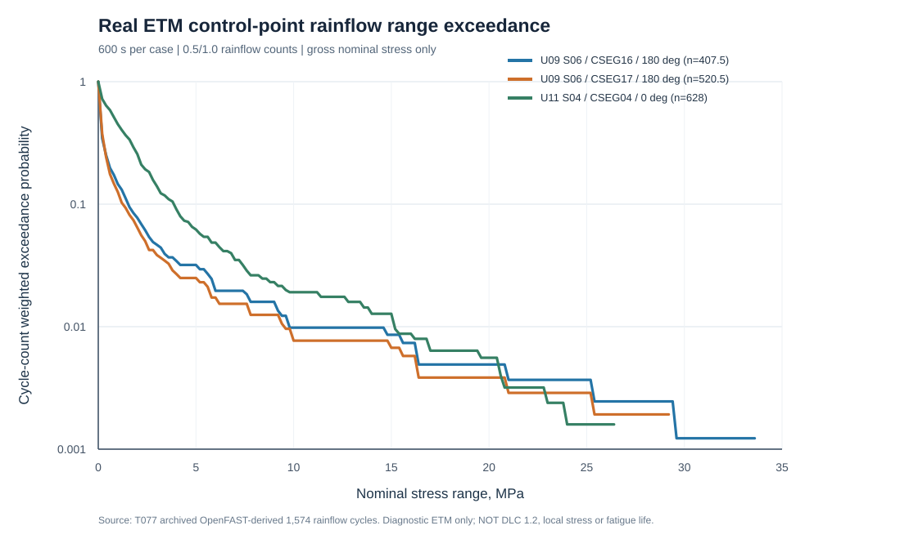

**图4-前置1** 三个控制位置的雨流应力范围超越概率（毛截面名义应力；非局部材料疲劳）。

| 真实工况与截面方位 | 等效循环数 | 范围P90 / MPa | 范围P99 / MPa | 最大范围 / MPa | 范围≥5 MPa比例 | 范围≥10 MPa比例 |
|---|---:|---:|---:|---:|---:|---:|
| U09p343881_ETM_S06 / CSEG_16 / 180° | 407.5 | 1.586 | 9.786 | 33.799 | 3.19% | 0.98% |
| U09p343881_ETM_S06 / CSEG_17 / 180° | 520.5 | 1.319 | 9.600 | 33.674 | 2.50% | 0.77% |
| U11p4_ETM_S04 / CSEG_04 / 0° | 628 | 3.865 | 15.061 | 26.554 | 6.21% | 1.91% |

CSEG16（U09 S06）的单次最大范围约33.799 MPa，高于CSEG04（U11 S04）的26.554 MPa；但后者范围≥5 MPa的循环比例为6.21%，高于前者的3.19%。因此，**最大单次范围与循环谱整体强弱并不等价**，不能只用最大值筛选疲劳控制位置。该结果仅是三个ETM毛截面测点之间的可复算对照，尚不能推断混凝土、HRB335/HRB400纵筋、PT钢绞线或钢塔的材料损伤排序。真正的S10仍需在同一验证过的重力/有效PT初态下取得材料局部应力时程，并按各材料疲劳关系和正常运行风速概率累积。

可复算脚本为[`plot_s10_real_cycle_exceedance.js`](../../../experiments/T077/recovery/plot_s10_real_cycle_exceedance.js)，3行数值汇总为[`S10_3CONTROL_REAL_CYCLE_EXCEEDANCE_SUMMARY_20261030.csv`](../../../experiments/T077/recovery/S10_3CONTROL_REAL_CYCLE_EXCEEDANCE_SUMMARY_20261030.csv)。脚本锁定原CSV SHA256、1574行、3控制点循环数及原m4/m10 DEL，提供3项损坏输入拒绝测试；本轮在JS执行环境中用真实CSV数值执行，尚无Node/GitHub Actions远端运行日志，不将静态文件提交冒充原生求解。

### 4.3.5a 逐循环均值与四次矩集中度的可辨识性（历史ETM名义应力）

仅有雨流DEL或时程均值时，无法恢复每个循环的均值与幅值联合分布。本节直接使用已归档的三处**毛截面名义应力**逐循环表（两个ETM工况、三个控制测点，合计1574条，半循环按0.5计），原始CSV SHA256为 `646065838456b6465e321c4c6fd24966f180f275df99c615000577557219ff83`。其字段包含循环范围 `r_i`（MPa）、循环均值 `m_i`（MPa）与计数 `n_i∈{0.5,1}`；这里的 `m_i` **不是**时程整体平均值，也未包含真实有效预应力平衡。为避免将载荷诊断当作材料疲劳，以下只计算无量纲的四次矩集中度与上限正值比例，不使用任何材料S–N关系。

设 `M_4=Σ_i n_i r_i^4`、`N=Σ_i n_i`。按 `r_i` 从大到小排序，以循环计数权重累计至 `0.01N`（边界处采用计数的线性分数插值），定义前1%计数的四次矩份额 `C_{1%}=M_{4,top1%}/M_4`。循环上限定义为 `u_i=m_i+r_i/2`；进一步分别计算 `u_i>0` 的计数份额 `P_+=Σn_i 1(u_i>0)/N` 与四次矩份额 `Q_+=Σn_i r_i^4 1(u_i>0)/M_4`。为明确显示**仅改变均值而不改变范围**时的代数敏感性，另计算 `u_i>20 MPa`；这等价于对全部循环均值施加假想 `−20 MPa` 常数偏置后判断上限是否大于零，**不是**本文实际PT有效应力，也不代表真实接缝或材料响应。

| 历史ETM工况/测点/方位 | 等效循环数 | DEL4 / MPa | 前1%计数的M4份额 | 上限>0计数份额 | 上限>0的M4份额 | 上限>20 MPa计数份额 | 上限>20 MPa的M4份额 |
|---|---:|---:|---:|---:|---:|---:|---:|
| U09 S06 / CSEG16 / 180° | 407.5 | 7.052732 | **97.919%** | 100.000% | 100.000% | 0.982% | 93.217% |
| U09 S06 / CSEG17 / 180° | 520.5 | 7.037162 | **98.476%** | 99.808% | ≈100.000% | 0.768% | 92.848% |
| U11 S04 / CSEG04 / 0° | 628.0 | 7.169089 | **81.924%** | 0.000% | 0.000% | 0.000% | 0.000% |

三处测点的诊断DEL4均约为7 MPa，然而两个U09测点几乎所有循环上限为正，U11测点全部循环上限仍为负（其最大逐循环上限为**−1.730101 MPa**）。这构成**同量级循环范围强度不能确定循环均值和正向应力暴露**的真实来源级反例。另一方面，U09两个测点仅约1%的计数权重就贡献97.9%—98.5%的四次矩，说明在这些历史ETM样本中四次矩极度集中于少数大范围循环；不能把该诊断指数直接等同于材料损伤控制程度。三个测点并非三个独立场址风速样本，且ETM不能代替正常运行DLC1.2。

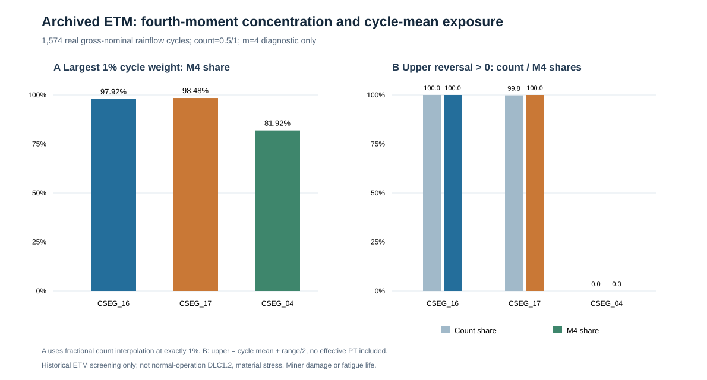

**图4-新增** 历史ETM毛截面名义应力逐循环集中度与正向上限比例；横向仅比较来源级统计，不评价材料疲劳安全性。源锁定[Node程序](../../../experiments/T077/recovery/s10_real_etm_cycle_mean_m4_concentration.cjs)与[三行完整数表](../../../experiments/T077/recovery/S10_ETM3_CYCLE_MEAN_M4_CONCENTRATION_20261109.csv)分别保留逐循环解析、DEL4/DEL10历史oracle、5种污染拒绝与生成图表的确定性逻辑。V8执行同一源码真实1574行、2项独立数值oracle及5项负例拒绝通过；原生Node CLI、原始OUTB和新结构物理RUN本轮未运行。循环数、范围与均值来自同一历史雨流表，但截面轴力/弯矩所有权、PT真实初态、局部材料点、材料疲劳曲线、全年风速覆盖和物理误差均未闭合，**不得由本节推算Miner损伤、寿命或PT设计安全性**。

### 4.3.5b 真实逐循环拉压符号域与范围四次矩的非等价性（S10，2026-11-12）

**科学问题。** 相近的毛截面名义应力DEL4能否代表相近的受拉、全压与拉压交替循环暴露？恒定压应力均值偏置虽不改变雨流范围，是否仍会改变贡献四次矩的循环类别？本节直接读取T077已归档的**1574行真实历史ETM逐循环名义应力表**，覆盖U09 S06的CSEG16（413行）、CSEG17（526行）及U11 S04的CSEG04（635行）。原表SHA256=`646065838456b6465e321c4c6fd24966f180f275df99c615000577557219ff83`，逐行保留同一次雨流的范围r、均值m和计数n（0.5或1），没有拼接异时峰值。

**可复算定义。** 以受拉为正，循环下限l=m−r/2、上限u=m+r/2；全压C为u≤0，全拉T为l≥0，其余为拉压交替R。每个循环恰属于一类。分别以n和w=nr⁴加权，得到三类计数份额Σn/N及四次矩份额Σw/W，W=Σnr⁴，DEL4=(W/600)^(1/4)。`gross`取原毛截面循环均值；`Pe`和`P0`仅取历史表中已有的**假设恒定压应力均值偏置**，不改变r、n、结构刚度或动力载荷。这两个标签不是实际有效PT平衡状态。

| 工况/控制点 | 偏置 | 全压计数/% | 交替计数/% | 全拉计数/% | 交替四次矩/% | DEL4/MPa |
|---|---|---:|---:|---:|---:|---:|
| U09 S06 / CSEG_16 / 180° | gross | 0.000 | 0.491 | 99.509 | **89.670** | 7.053 |
| U09 S06 / CSEG_16 / 180° | Pe | 10.920 | 2.577 | 86.503 | **98.876** | 7.053 |
| U09 S06 / CSEG_16 / 180° | P0 | 19.509 | 3.804 | 76.687 | **99.765** | 7.053 |
| U09 S06 / CSEG_17 / 180° | gross | 0.192 | 0.576 | 99.232 | **89.195** | 7.037 |
| U09 S06 / CSEG_17 / 180° | Pe | 12.392 | 2.594 | 85.014 | **98.779** | 7.037 |
| U09 S06 / CSEG_17 / 180° | P0 | 21.422 | 3.170 | 75.408 | **99.738** | 7.037 |
| U11 S04 / CSEG_04 / 0° | gross | 100.000 | 0.000 | 0.000 | **0.000** | 7.169 |
| U11 S04 / CSEG_04 / 0° | Pe | 100.000 | 0.000 | 0.000 | **0.000** | 7.169 |
| U11 S04 / CSEG_04 / 0° | P0 | 100.000 | 0.000 | 0.000 | **0.000** | 7.169 |

**结果及可证伪反例。** U09/CSEG16在gross情景下，仅**0.491%**循环计数属于交替循环，却贡献**89.670%**范围四次矩；Pe情景为**2.577%**计数贡献**98.876%**四次矩，P0为**3.804%**与**99.765%**。U09/CSEG17在Pe情景为**2.594%**与**98.779%**，P0为**3.170%**与**99.738%**。相反，U11/CSEG04的三种情景全部循环均为全压，但其DEL4仍为**7.169089 MPa**，与U09两个控制点的7.052732、7.037162 MPa同量级。因此“相近DEL4→相近循环符号暴露”的推断被本批历史数据直接否证。全压混凝土循环仍可能发生压疲劳，交替循环并不自动等于材料损伤；四次矩仅是本研究的范围加权诊断。

**数值验收与不确定性。** 九组计数及四次矩三类份额均闭合为100%，每点gross/Pe/P0的DEL4不变，三处历史DEL oracle的绝对误差均小于2×10⁻⁹ MPa。最小循环端点距零裕度为**0.001796 MPa**（CSEG16/P0）；仅当额外假定所有循环均值扰动≤0.001 MPa时，可保证本次符号分类不翻转，不能据此界定真实局部应力或PT传力误差。提交版Node同字节核心已在V8直接执行真实1574行、解析正例、三类污染拒绝、历史DEL与偏置单调性检查；**原生Node CLI/Actions尚未执行**。

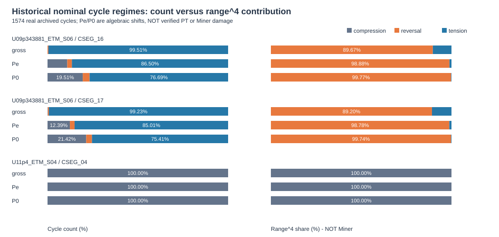

[源级程序](../../../experiments/T077/recovery/s10_real_cycle_sign_regime.cjs)、[9行完整表](../../../experiments/T077/recovery/S10_3CONTROL_CYCLE_SIGN_M4_PT_SHIFT_9ROW_20261112.csv)和本图同源。研究结论只适用于历史ETM毛截面**名义应力**及假设均值偏置，不等于真实材料点range–mean–count、接缝开闭、钢筋/PT局部应力、材料S–N、Miner寿命或正式DLC1.2。结果说明未来材料疲劳必须保留完整逐循环联合账本，而不能只凭单一DEL4判定材料损伤。

### 4.3.6 原始18组NTM同步名义应力与六随机种子离散（阶段性真实数值结果）

为了避免将不同截面内力分量的单独DEL直接组合为材料应力，进一步从已归档的**18个原始NTM OpenFAST OUTB**恢复同一时刻的`Fz(t)、Mx(t)、My(t)`。3个风速（9.343881、11.4、19.202140 m/s）各有6个随机种子；每个600 s统计窗含12,001个同步时刻，采样间隔0.05 s。原始模型为158 m塔，但**原始9个塔架测点仅位于0.0705–2.7509 m**，另有塔底0 m，因此本节只讨论塔底至2.75 m范围，不将其误称31段全高度NTM结果。

依据CSEG01实际内外半径随高度线性变化，毛截面圆环面积`A(z)`、惯性矩`I(z)`及外半径`R(z)`由同一几何表求得。沿各测点候选局部截面方位`θ`（0°、22.5°、…、337.5°）逐时刻计算：

\[
\sigma_z(\theta,t)=10^{-3}\left[\frac{F_z(t)}{A(z)}+\frac{R(z)}{I(z)}\left(M_x(t)\sin\theta-M_y(t)\cos\theta\right)\right]\quad(\mathrm{MPa}),
\]

式中`Fz`单位kN，`Mx、My`单位kN·m，采用同一原始测点同时刻的三个分量，绝不拼接不同时间的极值。每个角度分别执行完整雨流计数，并以600个参考循环和`m=4/10`分别计算**诊断性名义应力DEL**。原始18个OUTB字节SHA校验、540项原生载荷通道DEL独立回归与新数值结果由[真实Actions #41179994253](https://github.com/g2066203208-beep/voxel-frontier/actions/runs/41179994253)复算通过。首轮因源manifest SHA十六进制大小写比较错误而失败的[Actions #41179905532](https://github.com/g2066203208-beep/voxel-frontier/actions/runs/41179905532)保留；纠错不改变原始输入。

对每个风速及固定测点，在**六seed使用同一截面方位**的约束下，选择六seed四次矩平均DEL最大的角度，并对全部20种三seed子集进行精确枚举。塔底的结果如下（均为条件性毛截面名义应力，非材料损伤）：

| 原始NTM风速 / m·s⁻¹ | 固定方位 | 六seed `m=4`名义应力DEL / MPa | 六seed样本CV | 三seed子集最大相对偏离 |
|---:|---:|---:|---:|---:|
| 9.343881 | 0° | 3.241072 | 13.335% | 10.868% |
| 11.4 | 0° | 4.181816 | 11.891% | 10.167% |
| 19.202140 | 0° | 4.472304 | 6.443% | 4.545% |

原始18工况×10测点×16方位形成**2,880行**完整统计，3风速×10测点形成**30行**固定角度六seed对照；[2,880行源表](../../../experiments/T062/S10_18NTM_10NEARBASE_16AZ_GROSS_RAINFLOW_20261031.csv)、[30行控制表](../../../experiments/T062/S10_18NTM_6SEED_GROSS_STRESS_CONTROL_20261031.csv)、[完整SHA/数值误差收据](../../../experiments/T062/S10_18NTM_GROSS_STRESS_SOURCE_RECEIPT_20261031.json)及[Python3标准库复算程序](../../../experiments/T062/s10_ntm_18case_nearbase_gross_rainflow.py)均已提交。三seed偏离是**在既有六seed内的子集敏感性**，不是总体置信区间或六seed充分收敛的证明。载荷通道独立DEL核对540项最大绝对误差`4.9122×10⁻⁷`（载荷原单位），而每个名义应力样本的packed量化半步传播上界已逐行记录；此界不等同于非线性雨流DEL的严格误差上界。

这组真实NTM结果使“同一时刻的轴力—双向弯矩→截面名义应力→雨流→多seed离散”前置数值链得到复核，但**不能推导20年混凝土/普通钢筋/PT/钢塔材料寿命**。尚缺同一有效预应力和重力接触平衡态的原生Abaqus局部材料应力、塔架测点姿态及截面内力所有权独立核验、全高度正式DLC1.2风速bin、场址概率和材料疲劳关系。对同一角度的原始局部测点应力不应直接视作全局固定周向物理点；也不能将`m=4`当作所有材料的疲劳指数。

### 4.3.7 四ETM×31段控制名义应力与真实中层混凝土单元空间对应（源级方法核验）

针对4组已归档ETM工况（各31段），分别保留`m=4`名义应力DEL、最大拉应力和最小压应力三个**不同步**的控制指标，直接关联到D400/Pe/G1诊断模型的真实C3D8R中部轴向层。该层单元来自原始INP的节点与单元连接解析，并在每个控制方位同时保留**内、外两个径向层**，不再采用此前最低/最高轴向层的错误候选。所得[372行完整控制绑定表](../../../experiments/T077/recovery/S10_4ETM_31SEG_MIDPLANE_2RAD_CONTROL_BINDING_20261031.csv)包含**744个内外层绑定**，同时记录实际标签、实例、材料、坐标、方位差、旧候选偏差和新候选偏差；[可复算程序](../../../experiments/T077/recovery/s10_etm31_midplane_control_binding.cjs)及[来源与误差收据](../../../experiments/T077/recovery/S10_4ETM_31SEG_MIDPLANE_2RAD_CONTROL_BINDING_RECEIPT_20261031.json)供审查。

旧候选的372个轴向偏差全部大于0.1m；采用各ETM工况自身的`gage_z_m`重新计算后，新744个绑定的轴向偏差为**0.000897982–0.070410648m**（平均0.035656095m），最大方位角差**2.500000107°**，内外层最小径向质心差**0.129876309m**。四工况的动态测点高度与静态名义中点高度并非逐字节相等，最大差**0.000363548m**，因此不得直接沿用先前248行源表中基于静态名义高度计算的0.070048m最大轴向差。0.08m与5°仅是数据接口排错阈值，不是局部应力或规范容许误差。旧表作为失败证据保留，不覆盖。

**这一步只完成源级几何采样点对应，绝不是材料疲劳计算。** D400普通钢筋为HRB400诊断支路，不能代表冻结T057的HRB335；当前744个候选均没有ODB积分点、局部应力时程或PT+重力+接触平衡结果。截面局部轴系与Abaqus方位的物理一致性、网格/局部应力外推误差及疲劳损伤仍须独立验证；现阶段不能形成局部/名义应力放大系数或Miner损伤。源数据三文件SHA256与六项拒绝测试见收据，本轮无新Abaqus/OpenFAST生产RUN。

### 4.3.8 真实NTM名义应力的诊断指数变化与控制风速反转

为检查以单一等效载荷指数筛选控制工况的稳健性，本节**不增加新风场或结构求解**，而是直接复用已核原始OUTB身份的18组158 m OpenFAST正常湍流历史所形成的[2880行毛截面名义应力雨流数据](../../../experiments/T062/S10_18NTM_10NEARBASE_16AZ_GROSS_RAINFLOW_20261031.csv)。三个风速9.343881、11.4、19.202140 m/s各6个seed；10个原始测点仅覆盖塔底至2.750893 m，16个局部候选方位以22.5°离散。原OUTB字节由历史T062来源收据核对，**本轮直接重读的是派生CSV，而非18个OUTB原件**。同步轴力和双向弯矩已在历史程序中形成毛截面应力，本节不将其视为局部混凝土、钢筋或PT应力。

对同一风速箱\(b\)、测点\(s\)、方位\(\theta\)及指数\(m\)，定义六seed的诊断性等效应力：

\[
\overline{D}_{m}(b,s,\theta)
=\left[\frac{1}{6}\sum_{r=1}^{6}
D_{m}(b,s,\theta,r)^{m}\right]^{1/m},
\quad m\in\{4,10\}.
\]

各指数分别在16个方位中寻找最大值，再在三个有源风速箱中选择控制箱；两种指数**不对应本文任何已冻结的材料S–N参数**。对全部30组“风速箱×测点”，本轮从2880行重新聚合的数值与既有30行独立控制表最大绝对差分别为\(6.83\times10^{-12}\) MPa（\(m=4\)）和\(2.46\times10^{-11}\) MPa（\(m=10\)）。这一误差仅为派生数值复算差，不是物理模型误差。

| 塔底风速箱 / m·s⁻¹ | 六seed \(m=4\) 名义应力DEL / MPa | 六seed \(m=10\) 名义应力DEL / MPa |
|---:|---:|---:|
| 9.343881 | 3.241072 | 7.850583 |
| 11.4 | 4.181816 | **9.489058** |
| 19.202140 | **4.472304** | 8.232228 |

**结果是控制风速反转，而不是材料疲劳寿命反转。** \(m=4\)时19.202140 m/s超过次大11.4 m/s约6.9465%；\(m=10\)时11.4 m/s超过次大19.202140 m/s约15.2672%。在其余9个近塔底测点，控制箱同样从19.202140 m/s变为11.4 m/s，\(m=4\)的第一、第二名差距为6.5853%–6.9465%，\(m=10\)为15.2672%–15.7166%。两指数的最优候选方位在本样本中均为局部0°，但**10个相邻测点不是10次独立物理验证**。

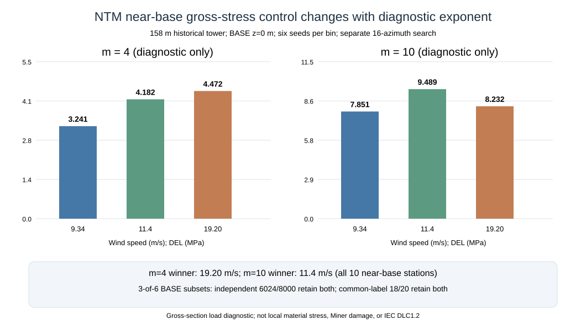

**图4-前置2** 塔底三个真实NTM风速箱的六seed诊断性等效名义应力；指数独立优化16个局部方位。柱状高度不是年度损伤或材料寿命。

为避免仅依赖完整六seed排序，对塔底固定0°方位进一步精确枚举每箱\(\binom63=20\)种三seed子集。各箱独立选子集的\(20^3=8000\)种**有限历史组合**中，6024种（75.30%）同时保持上述两个控制箱，6258种（78.225%）在两个指数下选出不同控制箱；三个风速箱采用相同seed标签的20种组合中，18种（90.0%）同时保持完整六seed的两个控制箱，20种（100%）仍出现指数间控制箱差异。这里的8000不是8000个独立仿真实验，也不能外推为新seed的总体概率。三seed子集与六seed参考存在样本重用，结果只衡量历史样本内部稳健性。

[10行逐测点数值表](../../../experiments/T062/S10_NTM18_NEARBASE_EXPONENT_CONTROL_20261107.csv)、[两种子集设计表](../../../experiments/T062/S10_NTM18_BASE_SEED_EXPONENT_REVERSAL_20261107.csv)和[可复算Node程序](../../../experiments/T062/s10_ntm_exponent_control_reversal.cjs)保留全部输入和判据。**SOURCE**：2880行派生CSV SHA256 `d45f047f5d622fb834d63728c13cead49b614b6cf42e598918e55242ed45f94b`、既有30行控制表 SHA256 `619e28d6ae2b76292224df999efc04e0650dcf4e001353647e75b9536d7cecd6`；**RUN**：真实派生数据源级复算与有限组合穷举，非生产求解；**REF/STANDARD/OFFICIAL**：沿用本章已列雨流方法与OpenFAST来源，未新增授权IEC/GB条款核读；**FIG/TAB**：上图、10行和2行表。CSV小数舍入和历史packed量化不能界定雨流DEL的严格误差上界；方位坐标、载荷所有权、材料局部应力及全风速档DLC1.2仍未闭合。由此只能提出一个可证伪的后续检验：在独立正常运行风速箱及真实局部材料应力中，控制箱是否对材料疲劳模型选择同样敏感；目前不能填报Miner损伤或20年寿命。

### 4.3.9 六seed等效应力的聚合次序与固定材料方位（真实来源级对照）

同一风速箱内，**将六个随机种子的DEL直接取算术平均**与**先按同一方位聚合第 \(m\) 次矩再开 \(m\) 次方**，并非相同运算。另一个容易混淆的操作，是每个seed分别寻找最不利方位后再聚合；这样改变了每次随机实现所对应的材料位置，不能直接代表同一材料点的长期疲劳。为检验这两类聚合差异，本节复用18个原始NTM OpenFAST OUTB已核身份所形成的**2,880行同步毛截面名义应力雨流派生表**，共3个风速箱×6seed×10个近底测点×16个候选局部方位。统计窗均为600 s，DEL参考循环数均为600；没有新增风场或结构求解。

令 \(d_{r,\theta}^{(m)}\) 为固定风速箱、测点、seed \(r\)、候选方位 \(\theta\) 的名义应力DEL（MPa），并令 \(\theta^*\) 为六seed第 \(m\) 次矩聚合值最大的**固定**方位，则

\[
D_{\mathrm{fix}}^{(m)}=\max_{\theta}\left[\frac{1}{6}\sum_{r=1}^{6}(d_{r,\theta}^{(m)})^m\right]^{1/m},\quad
D_{\mathrm{arith}}^{(m)}=\frac{1}{6}\sum_{r=1}^{6}d_{r,\theta^*}^{(m)},
\]
\[
D_{\mathrm{adapt}}^{(m)}=\left[\frac{1}{6}\sum_{r=1}^{6}\left(\max_{\theta}d_{r,\theta}^{(m)}\right)^m\right]^{1/m},\quad
D_{\mathrm{max}}^{(m)}=\max_{r,\theta}d_{r,\theta}^{(m)}.
\]

对 \(m\ge1\)，数学上必有 \(D_{\mathrm{arith}}\le D_{\mathrm{fix}}\le D_{\mathrm{adapt}}\le D_{\mathrm{max}}\)。这只是**同一历史样本的聚合算子序关系**，不构成材料损伤上下界。表中DEL低估率采用 \(100(1-D_{\mathrm{arith}}/D_{\mathrm{fix}})\%\)，第 \(m\) 次矩代理低估率采用 \(100[1-(D_{\mathrm{arith}}/D_{\mathrm{fix}})^m]\%\)；单seed最大值高估率以 \(D_{\mathrm{fix}}\) 为分母。

| 塔底风速 / m·s⁻¹ | 指数 \(m\) | 固定方位幂均DEL / MPa | 算术DEL低估 | 第m次矩代理低估 | 最大单seed DEL高估 | 自适应方位DEL高估 |
|---:|---:|---:|---:|---:|---:|---:|
| 9.343881 | 4 | 3.241072 | 2.1075% | 8.1674% | 14.4240% | 0 |
| 9.343881 | 10 | 7.850583 | 6.7452% | 50.2591% | 13.8272% | 0 |
| 11.400000 | 4 | 4.181816 | 1.7358% | 6.7647% | 13.1953% | 0 |
| 11.400000 | 10 | 9.489058 | **8.5570%** | **59.1204%** | **15.0961%** | 0 |
| 19.202140 | 4 | 4.472304 | 0.5120% | 2.0322% | 9.0182% | 0.004075% |
| 19.202140 | 10 | 8.232228 | 1.6161% | 15.0348% | 8.2613% | 0.006512% |

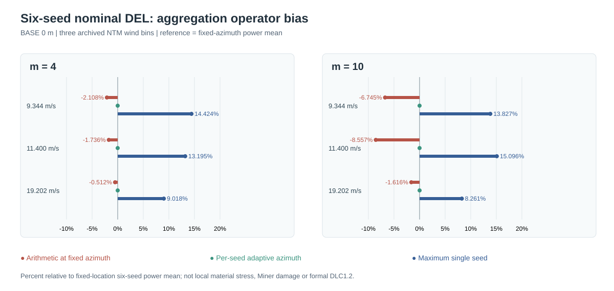

**图4-新增** 三个历史风速箱塔底名义应力DEL相对固定方位六seed幂均值的差异。负值为算术平均的低估，正值分别为每seed自适应方位及单seed最大包络的高估；两种指数仅用于诊断，不是材料S–N参数。

结果显示，**最大的聚合误差来自错误的seed算术平均或单seed极值替代，而非本样本内的逐seed方位切换**。11.4 m/s、\(m=10\)时，正确固定方位幂均DEL为9.489058 MPa，算术平均仅8.677084 MPa，低8.5570%；在相同指数下，若以算术平均值的第十次方替代平均第十次矩，代理量低估**59.1204%**。同一工况最大单seed DEL为10.921535 MPa，高于幂均值15.0961%，其第十次矩比值高307.9488%。这些百分数**不等于实际Miner损伤误差**。对全部30个风速箱×近底测点，前两个风速箱的逐seed自适应方位增量为0；19.202140 m/s箱仅为0.003478%–0.004075%（\(m=4\)）和0.006512%–0.006652%（\(m=10\)）。这一近零结果属于有限历史样本的否定性发现，不证明其他风况或真实局部材料点的控制方位恒定。

本节使用的[2,880行来源CSV](../../../experiments/T062/S10_18NTM_10NEARBASE_16AZ_GROSS_RAINFLOW_20261031.csv) SHA256为 \`d45f047f5d622fb834d63728c13cead49b614b6cf42e598918e55242ed45f94b\`；新增[可运行Node程序](../../../experiments/T062/s10_ntm18_seed_aggregation_operator_bias.cjs)、[60行完整对照](../../../experiments/T062/S10_NTM18_FIXED_VS_ADAPTIVE_SEED_AGG_60ROW_20261110.csv)和[6行塔底表](../../../experiments/T062/S10_NTM18_SEED_AGGREGATION_BASE_6ROW_20261110.csv)均已源锁。对原独立30行六seed控制表的60个幂均值，最大绝对复算差为 \(2.462\times10^{-11}\) MPa；解析幂均已知解、10项错误输入拒绝及输入行序不变性检验通过。10个相邻测点并非独立随机样本，来源小数打印和双精度误差不能代表原始packed载荷量化经过雨流算法后的严格误差界。完整正式DLC1.2、截面局部轴系和力矩所有权、局部材料应力、各材料疲劳曲线与长期概率尚未闭合；因此本节**仅证明聚合方法的来源级数值差异**，不能填写分材料Miner损伤、20年寿命或结构优化收益。已有2026年混塔风震及预应力地震研究的物理贡献不因这一统计对照而被重新宣称为本文首创。

## 4.4 预应力混凝土塔段疲劳

### 4.4.1 Gravity+PT平衡态是疲劳零基准

预应力混凝土的动态应力循环发生在长期预压状态上。Wang等[17]明确采用Reference Stress处理局部疲劳，并把预应力和上部结构自重形成的基准作用纳入评价。因此，本章定义：

\[
\sigma(t)
=
\sigma_{\text{ref}}
+
\Delta \sigma_{\text{wind}}(t),
\]

其中：

- \(\sigma_{\text{ref}}\) 来自Gravity+PT平衡；
- \(\Delta \sigma_{\text{wind}}(t)\) 来自随机风运行响应。

禁止仅对 \(\Delta \sigma_{\text{wind}}\) 做rainflow后直接计算混凝土寿命，因为这样会丢失预应力改变mean stress和stress ratio的核心作用。

### 4.4.2 混凝土疲劳应力变量

混凝土不采用von Mises作为疲劳控制量。根据最终材料疲劳准则，对每个候选位置保存：

\[
\sigma_{\max},\quad
\sigma_{\min},\quad
\Delta \sigma=\sigma_{\max}-\sigma_{\min},
\]

\[
\sigma_m
=
\frac{\sigma_{\max}+\sigma_{\min}}{2},
\]

以及与所采用疲劳关系一致的stress ratio \(R\)。

rainflow循环账本至少记录：

- case_id；
- wind_bin；
- seed；
- material；
- location_id；
- azimuth；
- stress_component；
- range；
- mean；
- count；
- R_ratio；
- mesh_id；
- extraction_method。

原始cycle ledger与damage表严格分离，这样在更换材料疲劳模型后不需要重新计数。

### 4.4.3 mean stress correction与预应力影响

Huang等[16]专门比较了考虑与不考虑mean-stress correction时各wind bin的damage contribution，并分析initial prestress对damage的影响。这一结果说明：

- 相同stress range在不同mean stress下不能自动视为相同疲劳循环；
- PT水平改变的不只是静态安全储备，也会改变疲劳cycle的应力比和damage权重；
- 预应力敏感性应直接进入本章，而不是只停留在第二章建模参数说明。

本文首先采用真实Gravity+PT运行基准应力，不人为把循环平移到零均值。最终是否采用Model Code、R-ratio曲线或其他mean-stress treatment，由正式混凝土fatigue standard闭合后确定。

> 工作区原图证据：[16] p07 Fig.11为mean-stress correction；p08 Fig.13–14为cycle damage与initial prestress影响。

### 4.4.4 局部单元峰值与物理平均

局部FE尤其在接缝、几何突变和接触边缘附近可能出现高度网格敏感的peak stress。Wang等[17]比较single-point extremum与through-thickness average，为本文提供直接方法依据。

因此每个控制区域至少并行提取：

1. raw element peak；
2. path/thickness/area average；
3. mesh-refined相同量。

其中：

- raw peak作为保守上界和热点定位；
- path/thickness average作为具有明确传力范围的主结果候选；
- 最终采用何者必须由网格收敛和物理意义共同决定。

不得以一个网格奇异点直接外推20年寿命。

> 工作区原图证据：[17] p20 Fig.19为fatigue verification area；p21 Table 4记录Reference Stress与damage verification。

### 4.4.5 混凝土疲劳关系的版本问题

这里必须严格区分不同文献：

- Huang 2025 [16]的SPPT混凝土疲劳采用其文中引用的Model Code 2020路径；
- Wang 2025 [17]的局部接缝疲劳采用fib Model Code 2010路径；
- Kenna 2019 [19]采用其当时选定的fib Model Code混凝土疲劳方法。

这三者不能被论文写成“都用了同一个fib公式”。

本文最终混凝土疲劳关系在正式规范/原典闭合后冻结。若第 \(i\) 类循环的允许循环数为 \(N_i\)，实际循环数为 \(n_i\)，则Miner累计损伤为：

\[
D
=
\sum_i\frac{n_i}{N_i}.
\]

必须区分：

- Miner fatigue damage \(D\)；
- Abaqus CDP的DAMAGEC/DAMAGET。

前者是长期疲劳累计指标，后者是混凝土本构损伤变量，两者物理含义不同。

## 4.5 预应力钢绞线疲劳

### 4.5.1 启动条件

PT疲劳分支不因为模型中存在PT就自动成为主结果。只有4.3筛选证明PT \(S_{11}\) 循环达到控制或重要次控制水平时，才进入绝对寿命评价；否则只用于证明PT不是控制疲劳材料。

### 4.5.2 PT时程与循环谱

当前模型有36个周向PT FE位置。正式生产输出对每个位置保存：

\[
S_{11}^{(p)}(t),\quad p=1,\ldots,36.
\]

然后分别执行rainflow，形成：

\[
\left\{
\Delta\sigma_i,
\sigma_{m,i},
n_i
\right\}_p.
\]

Qu等[18]的tendon load spectrum和各wind speed annual damage表直接证明PT应作为独立材料通道统计，而不能用塔底弯矩DEL替代。

> 工作区原图证据：[18] p16 Fig.6为Tendon No.1 load spectrum；p17 Table 7列出不同wind speed的annual damage；p18 Fig.7–8给出PT空间寿命和relaxation影响。

### 4.5.3 有效预应力与松弛

PT疲劳必须以Gravity+PT平衡后从模型读取的有效运行均值应力为基准，不能把名义1280 MPa直接当成所有PT在整个运行期的真实mean stress。

若增加预应力损失敏感性：

- 损失幅度需由规范、原型资料或明确参数研究边界确定；
- 不复制Qu文中20%、40%、60%、80%等source-specific relaxation levels；
- 必须保持其他模型参数不变。

Qu等[18]还说明wind-speed probability model会改变PT寿命预测，因此PT damage同样应按本文场址概率加权。

> 工作区原图证据：[18] p20 Fig.9–10为Weibull参数与relaxation对PT fatigue life的影响。

## 4.6 上部钢塔与钢—混连接疲劳

### 4.6.1 钢塔母材/名义应力

Kenna[19]明确把steel portion和concrete portion的fatigue life分开评价，并对steel plated part使用钢结构疲劳设计体系。因此，如果本文钢塔控制位置仅能可靠定义为塔筒母材或截面名义应力，则采用：

- nominal membrane stress；
- nominal bending stress；
- 与真实结构detail category对应的S–N关系；
- rainflow；
- Miner；
- 长期概率加权。

当前钢塔SSEG仍存在系统性高长宽比网格告警。若钢塔被识别为控制疲劳材料，必须在正式寿命计算前完成目标区域网格整改和应力收敛。

### 4.6.2 法兰/焊缝hot-spot fatigue

如果控制区域位于法兰或明确焊接细节，则采用Zhao等[20]提供的工程流程：

\[
\text{nominal stress}
\rightarrow
\text{local FE / SCF}
\rightarrow
\text{structural or hot-spot stress}
\rightarrow
\text{detail S-N}
\rightarrow
\text{rainflow}
\rightarrow
\text{Miner}.
\]

Zhao文通过局部FE得到SCF，并结合短期监测应力、SCADA运行状态和长期风速/风向概率形成annual damage matrix。这一流程可以迁移到本文，但其1.5 MW塔的SCF、应力和寿命数值不能转移。

若T057没有显式建立可以归类的焊缝几何，则本文不得声称完成“焊趾热点寿命”；最多完成名义/结构应力层的钢塔疲劳，或另建有文献依据的局部子模型。

> 工作区原图证据：[20] p08 Fig.9为flange principal stress；p09 Table 2为SCF；p11 Fig.16为fatigue assessment process；p13 Tables 5–7为annual damage与flange weld fatigue results。

### 4.6.3 钢—混转换连接

Kim等[21]研究明确连接构造，采用full-scale specimens，先进行2 million cycles循环加载，再进行单调静载以检查post-fatigue residual capacity。该文支持的是“若连接控制，则必须按真实连接构造做循环验证”的思想。

因此只有满足以下条件，本文才启动钢—混转换连接疲劳：

1. 4.3证明转换连接为疲劳控制区域；
2. 当前模型具有可追溯的锚固/连接几何；
3. 可以为该连接定义合理的疲劳detail或局部材料疲劳准则。

否则，转换段仅作为载荷传递和应力重分配区域讨论，不为增加篇幅强行计算连接寿命。

> 工作区原图证据：[21] p04 Fig.4为joint cross-section；p06 Fig.7为specimens；p07记录2 million cyclic + monotonic residual test；p08 Fig.10为cyclic load-displacement。

## 4.7 长期累积damage、风速贡献与控制机制

### 4.7.1 wind-bin damage contribution

对每个**经验证的材料控制位置**与风速箱 \(j\)，先对第 \(s\) 个随机种子窗口的局部材料应力雨流循环计数，并由该材料经确认的疲劳关系求得短期无量纲Miner损伤 \(D_{j,s}^{(T)}=\sum_i n_i/N_i\)。令有效时长 \(T_{j,s}\) **统一以秒(s)记录**，其损伤率为 \(r_{j,s}=D_{j,s}^{(T)}/T_{j,s}\)，单位 \(\mathrm{s}^{-1}\)。对于同风速箱的 \(n_j\) 条合格可比较的随机种子，定义 \(\bar r_j=n_j^{-1}\sum_{s=1}^{n_j}r_{j,s}\)。按时间占比加权的年度估计是

\[
\boxed{
D_{j}^{\mathrm{annual}}
= T_{\mathrm{year},s}\,p_j\,\bar r_j
= T_{\mathrm{year},s}\,p_{\mathrm{op}}\,P(j\mid\mathrm{op})\,\bar r_j,\qquad
T_{\mathrm{year},s}=8760\ \mathrm{h}\times3600\ \mathrm{s/h}=31\,536\,000\ \mathrm{s}.
}
\]

其中 \(p_j=n_j^{\mathrm{ERA5}}/N^{\mathrm{ERA5}}\) 为**全小时无条件概率**（这里的 \(n_j^{\mathrm{ERA5}}\) 是风气候小时数，**不是**随机种子数），\(p_{\mathrm{op}}\) 为指定运行区间小时比例，\(P(j\mid\mathrm{op})=p_j/p_{\mathrm{op}}\) 为运行条件概率。两种口径必须得到相同结果；不能使用“8760小时÷600秒”的无量纲比例，漏掉3600秒/小时会使损伤缩放错误**3600倍**。若各seed的有效时长都为600s，则 \(\bar r_j=\bar D_j^{(600)}/600\mathrm{s}\)；短时损伤和时长须来自同一个时窗，不能把此前的load-DEL、名义截面应力或ETM筛查循环代入本式冒充材料疲劳。

年度总损伤为 \(D_{\mathrm{annual}}=\sum_j D_j^{\mathrm{annual}}\)。若假定各设计年的风气候、机组运行状态及材料参数平稳，20年累计估计为 \(D_{20}=20D_{\mathrm{annual}}\)，这只是**固定年度估计的乘法传播**，并非已证实的服役寿命，也不意味着可以把20年的不确定性简单除以 \(\sqrt{20}\)。

对种子抽样误差，令 \(s_{r,j}^{2}=\sum_s(r_{j,s}-\bar r_j)^2/(n_j-1)\)。仅当各seed可视为独立、跨风速箱的种子估计也独立、所有正概率箱均有 \(n_j\geq2\)，且暂将风气候权重和材料参数固定时，才有

\[
\mathrm{SE}_{\mathrm{seed}}(D_{\mathrm{annual}})
=T_{\mathrm{year},s}\sqrt{\sum_j p_j^2\,s_{r,j}^2/n_j},\qquad
\mathrm{SE}_{\mathrm{seed}}(D_{20})=20\,\mathrm{SE}_{\mathrm{seed}}(D_{\mathrm{annual}}).
\]

任何有贡献的箱仅1个seed或没有**经验证的局部材料应力**时，该年损伤标准误应记录为 NOT_ESTIMABLE，而不是0；seed SE也不包含ERA5气候偏差、测站外推、控制器/结构模型、疲劳S–N及均值应力修正的不确定性。上述算法与来源验证入口为[T077材料Miner程序](../../../experiments/T077/recovery/s10_miner_damage_gate.py)，其原生Actions合成真值测试已由先前记录核实，不能当作本文真实损伤结果。

**量纲解析自检（纯合成，不是本塔结果）**：若单一全概率箱的600s有效窗口产生 \(D^{(600)}=10^{-6}\)，则 \(D_{\mathrm{annual}}=31\,536\,000\times10^{-6}/600=0.05256\)；错误地直接用8760与600比值只得0.0000146，相差3600倍。此解析自检只保护单位一致性，不证明任何实际材料疲劳寿命。

然后定义该bin对总年损伤的贡献率：

\[
\eta_j
=
\frac{D_j^{\text{annual}}}
{\sum_k D_k^{\text{annual}}}.
\]

最终绘制：

- wind speed–damage曲线；
- wind-bin contribution bar chart；
- cumulative contribution curve。

目标不是寻找“最高风速”，而是识别真正主导长期疲劳的运行区间。

Huang等[16]的Fig.10、Fig.17–18以及Qu等[18]的Table 7/8都采用类似“按wind bin解释damage来源”的思路。

**2026-10-31实测概率接口与条件概率防重计：** 第三章已从完整21年ERA5派生工作簿原件计算[31行1m/s bin表](../../../experiments/T062/S10_ERA5_2005_2025_HUB_1MS_BINS_20261031.csv)，全时段`N=184080`、诊断运行`N_op=106900`。令`p_j=n_j/N`为**无条件全小时概率**，`p_op=N_op/N=0.5807257714`，`P_j=p_j/p_op`为**运行小时内条件概率**，`T_op,annual=8760p_op`。上式使用条件`P_j`与运行小时；等价地，在有效窗口时长以秒计时，必须写为 **D_j^annual = 31,536,000 × p_j × mean_s(D_short,j,s / T_sim,j,s)**，不能漏掉3600 s/h。**不能把无条件`p_j`与`T_op,annual`相乘**，否则重复计入运行比例。该运行边界目前是4≤U<25m/s的诊断假设，正式DLC1.2仍需核对控制器/标准及全风速bin。历史三风速只覆盖9/11/19三个1m/s箱（7,164小时，诊断运行时段的6.70159%）；尚无其余bins的有效同态载荷和材料局部应力，故本节仅**概率输入SOURCE_NUMERIC_PASS**，年度`D_j`和`D_annual`均不得填数。ERA5为再分析派生数据，非测风塔实测；完整原始CDS文件hash、四位小数分量的箱边界敏感性及场址bias尚未验收。

**2026-11-01 11时｜长期Miner概率口径的程序性纠错（真实ERA5源表QC，非材料寿命）：** 对照[31行ERA5风速bin原件](../../../experiments/T062/S10_ERA5_2005_2025_HUB_1MS_BINS_20261031.csv)（SHA256=`e4058620a36b23bb218103875d4dc5b0711fc45d418b23a2208c2fc9c16c9102`），核实184080总小时中4≤U<25m/s的诊断运行小时为106900，`p_op=0.5807257714037375`。此前[条件Miner程序](../../../experiments/T077/recovery/s10_miner_damage_gate.py)要求各bin概率和为1，却按全年8760小时直接乘条件概率；**若未来错误地将该旧算法用于真实运行条件概率，会比正确年度权重高1/p_op=1.7219831618倍（高72.1983%）**。这只是识别出一个潜在算法偏差，不表示已经产生过被高估的材料寿命结果。现已修改为必须显式输入`operating_fraction`和`probability_basis`：条件概率用`8760×p_op×P(bin|op)`，无条件概率用`8760×P(bin)`，两者应一致；缺失运行比例、概率和不闭合、seed缺失均拒绝。原生[Actions #41268106162/job #124735051729](https://github.com/g2066203208-beep/voxel-frontier/actions/runs/41268106162/job/124735051729) Python自测成功，实源31-bin身份、合成条件/无条件等价、11项既有拒绝及5项概率口径拒绝通过；先前[失败作业 #41267975516](https://github.com/g2066203208-beep/voxel-frontier/actions/runs/41267975516)与[失败作业 #41268081294](https://github.com/g2066203208-beep/voxel-frontier/actions/runs/41268081294)保留。**该程序仍没有任何已验证局部材料应力、授权材料S–N曲线或正式DLC1.2全bin；所有年度/20年材料Miner仍为HOLD，绝不把合成测试的532.17当成本文损伤。**

**2026-10-31 22时｜21个运行风速计划bin×6seed来源覆盖核验：** 从上述31-bin概率表与18组原始OUTB身份收据直接交叉核验，建立[126行逐bin×seed覆盖矩阵](../../../experiments/T062/S10_ERA5_21BIN_6SEED_NTM_SOURCE_COVERAGE_20261031.csv)及[可复算程序/来源收据](../../../experiments/T062/S10_ERA5_21BIN_6SEED_COVERAGE_RECEIPT_20261031.json)。在**非规范性的**[4,25)m/s、1m/s宽、每bin六seed规划网格中，只有9、11、19m/s三个箱有历史NTM六seed，共18/126个**历史筛查来源格**；其余108格无已归档对应NTM。三个箱共7164/106900运行小时=6.70159%，另外99736小时（93.29841%）所在风速箱缺来源；4–9m/s五个低风速箱共95402小时（89.24415%运行小时）完全没有历史NTM。已有风速9.343881/11.4/19.202140m/s仅按`floor(U)`归箱，**均不是拟定4.5...24.5m/s中心的正式DLC1.2计算**；21个箱的126格**正式DLC1.2验收为0**。20–25m/s五箱在21年ERA5派生小时数据中观察为0，不代表设计风险为0。上述缺口是**来源覆盖**而非疲劳损伤权重排名：高风速虽概率低但应力循环幅值可能高，不能只按小时数决定生产优先级。没有材料积分点应力、规范/控制器核对与全部运行工况前，不能绘制正式年Miner贡献图。

### 4.7.2 少量高range循环的贡献

由于疲劳关系通常对stress range高度非线性，少量高幅循环可能对damage产生远高于其cycle count占比的贡献。本章因此不只给最终 \(D\)，还输出二维range–mean rainflow matrix，并标出对total damage贡献最大的cycle families。

这可以解释：

- 为什么load-DEL最大case未必是材料damage最大case；
- 为什么相同RMS的两个时程可能具有不同fatigue damage；
- 为什么mean stress correction会改变排名。

### 4.7.3 load-DEL控制与material-damage控制的比较

分别建立：

- OpenFAST load-DEL control case；
- concrete damage control case；
- PT damage control case；
- steel damage control case。

若它们不同，应如实保留这种差异，并从：

- mean stress；
- local stress concentration；
- material fatigue curve；
- control region；
- wind-bin probability；

解释差异。

**T062历史载荷DEL纠偏的实证闭合（2026-11-02）。** 先前论文称U11p4_ETM_S03/TwrBsMyt为My load-DEL最大值28.177010 MN·m，这一结果确实来源于2026年9月原始57,286行雨流账本与72条DEL表。现已从[主归档恢复原始账本、排名和雨流源码](../../../experiments/T062/legacy-primary-recovered-20261102/LEGACY_PRIMARY_RECOVERY_RECEIPT_20261102.json)，并证明历史与新归档的36份原始OpenFAST OUTB **36/36份SHA256相同**，所以以前的“不同OUTB版本导致矛盾”假说已被排除。

旧源码[雨流函数](../../../experiments/T062/legacy-primary-recovered-20261102/rainflow_del_r1.py)在栈中定义\(X\)为旧范围、\(Y\)为新范围，却使用`if X<Y: break`，将新旧范围的闭合比较方向写反。仅在独立内存AST中将其改为`if Y<X: break`，保留原始程序不变。对全部36份实际原始OUTB、My/Mx共**72条时程**，原函数72/72复现旧DEL表，单行修正72/72复现新的独立DEL表，修正后全部循环(range, mean, count)多重集合72/72与独立开源`rainflow 3.2.0`一致，加权循环总数72/72守恒。[真实CI #41391433429](https://github.com/g2066203208-beep/voxel-frontier/actions/runs/41391433429) `completed/success`；[完整72行比较](../../../experiments/T062/legacy-primary-recovered-20261102/T062_ALL36_RAINFLOW_CAUSAL_DEL_COMPARE_20261102.csv)和[SHA来源与数值收据](../../../experiments/T062/legacy-primary-recovered-20261102/T062_ALL36_RAINFLOW_CAUSAL_RECEIPT_20261102.json)已保存在GitHub。

| 载荷级筛选指标 | 历史旧雨流程序（MN·m） | 独立验证的修正雨流（MN·m） |
|---|---:|---:|
| My / U11p4_ETM_S03 | 28.177010 | 23.005398 |
| My / U11p4_ETM_S04 | 24.688995 | **26.802479（My全36第一）** |
| Mx / U19p202140_ETM_S02 | 9.715431 | **9.468855（Mx全36第一）** |

**此后不再把历史S03与当前S04的差异写成未决的OUTB来源冲突；T062载荷级历史雨流算法根因已闭合。** 第三章按[修正后36工况控制排序](../../../experiments/T062/T062_36CASE_MY_MX_ARCHIVED_RANK_20261102.csv)筛选载荷响应，历史S03数据只作为可复现的错误算法案例，不能用作材料损伤的基准输入。当前真实数据只证明有限36组screening工况下的塔底载荷DEL，仍未得出正式DLC1.2 20年风致材料寿命，也不能用同一载荷DEL指数代替不同材料的S–N/Miner规律。

### 4.7.4 原始NTM三风速bin×六seed：已知部分载荷四次矩与无源风险（2026-11-02）

为在不产生新OpenFAST/结构生产计算的前提下深化长期风致疲劳**输入数据充分性**，本研究重新读取旧18份原始NTM OUTB已经原件SHA核验的1080行六分量、9测高load-DEL，并与2005—2025年ERA5派生184080h轮毂高度1m/s分箱及126条21bin×6seed来源身份逐一关联。三档历史风速为9.343881、11.400000和19.202140m/s；这不是正式DLC1.2工况矩阵。4–25m/s仅为本次诊断研究设定的非规范运行区间，历史106900h中只有7164h在有源bin内（6.70159%），其他99736h无同风速源载荷（93.29841%）。

本次定义**仅知来源风速bin的部分四次矩强度**，与年度损伤明确分离。若第b个有源bin的塔底弯矩load-DEL为`L_bs`（MN·m，原载荷CSV的`DEL_m4_Nref600`按1000换算），六个相同600s窗口按`M4_b=(1/6)sum_s (L_bs)^4`合成；采用各bin占**全部ERA5小时**的频率`p_b=H_b/184080`，得到`C_known=sum_(b∈{9,11,19}) p_b*M4_b`，单位`(MN·m)^4`。这仅是每个600s记录采用相同`Nref600`时的**有源分箱加权载荷量纲指标**；无源bin不能置零，不能取四次方根称全年DEL，更不可成为钢、混凝土或PT的Miner损伤。

| 塔底载荷通道 | 3个有源bin的部分加权四次矩 / (MN·m)⁴ | 各有源bin独立取3/6seed时8000种组合的极值范围 / (MN·m)⁴ |
|---|---:|---:|
| TwrBsMyt (My) | 209257.299448 | 133839.310402–284675.288494 |
| TwrBsMxt (Mx) | 125.606638 | 94.624326–156.588949 |

子集全穷举只是当前六seed样本的**有限样本敏感性包络，不是总体95%置信区间**。其中My的已知部分贡献按有源bin分配为9m/s **59.1382%**、11m/s **40.7869%**、19m/s **0.0750%**；19m/s档尽管瞬时载荷较高，但在21年ERA5派生记录中仅2h，不能凭该数据拟合可靠高风速尾部概率，也不能推断实际项目的20年设计疲劳。这个排序只在**已知3bin**的数学分量内有效，不代表无源bin的危险性小。

本轮真实证据：[来源与规范阅读层级逐条核对](../../../experiments/T062/S10_ERA5_NTM_PARTIAL_LOAD_M4_PRIMARY_REFERENCE_CHECK_20261102.md)（[24]原刊全文核读多个seed与收敛；[16]出版社摘要并继承项目旧PDF全文审查；[23] Wiley原刊开放方法核读；[10]/090出版社摘要；[14]仅继承2019版授权审查；[25]/049本轮IEC官网元数据）；[6行原始数值表](../../../experiments/T062/partial-annual-load-diagnostic-20261102/S10_REAL_18NTM_3BIN_PARTIAL_M4_BY_CHANNEL_20261102.csv)、[含完整SHA和误差预算的原始收据](../../../experiments/T062/partial-annual-load-diagnostic-20261102/S10_REAL_18NTM_3BIN_PARTIAL_M4_RECEIPT_20261102.json)和[Actions #41397641326](https://github.com/g2066203208-beep/voxel-frontier/actions/runs/41397641326)均已成功。**IEC 61400-1:2019+AMD1:2025官网当前为2026年10月勘误版，未读授权2025/26合并版条款，因此不能将本研究的1m/s bin×6seed设定称为2025/26标准核验通过。**

本节只把实证不足和可利用的真实部分载荷值变成可审查的第四章输入证据。材料级真实应力、材料疲劳曲线与年度全风速响应、独立优化验收继续HOLD，绝不由load-DEL替代。

### 4.7.5 历史四ETM工况的截面单分量名义应力幅筛查（2026-11-02，非材料寿命）

为避免将塔底载荷DEL直接等同于材料损伤，先对已归档的四个ETM工况、31个塔筒测站建立**单分量名义应力幅的条件性筛查**。使用OpenFAST塔筒gross截面面积`A`、截面惯性矩`I`，按同心圆环假设反求外半径`R_o`及截面模量`W=I/R_o`；仅对各自独立的`F_z`、`M_x`、`M_y`雨流DEL进行常系数线性换算：

\[
\Delta\sigma_{F_z,\mathrm{DEL}}=\frac{10^{-3}\mathrm{DEL}_{F_z}}{A},\quad
\Delta\sigma_{M_x,\mathrm{DEL}}=\frac{10^{-3}\mathrm{DEL}_{M_x}}{W},\quad
\Delta\sigma_{M_y,\mathrm{DEL}}=\frac{10^{-3}\mathrm{DEL}_{M_y}}{W},
\]
其中原DEL单位分别为kN、kN·m，输出MPa，`m=4`和`N_ref=600`仅沿用**载荷级筛查**定义，不是混凝土、钢筋或PT材料疲劳参数。

完整124行结果见[真实源级数据表](../../../experiments/T077/recovery/S10_4ETM_31SEG_NOMINAL_COMPONENT_STRESS_DEL_M4_20261102.csv)及[可复算程序](../../../experiments/T077/recovery/s10_nominal_component_stress_del_screen.js)。`F_z`、`M_x`、`M_y`各自最大单分量应力DEL依次为**0.047481608 MPa**（U19.202140_ETM_S04/CSEG27）、**2.374676068 MPa**（U19.202140_ETM_S04/CSEG04）、**7.163945804 MPa**（U11.4_ETM_S04/CSEG04）。这些数值属于不同分量与工况，**不是同一时刻的截面总应力**，更不是可用于Miner寿命的材料局部应力雨流谱。

此项筛查可与此前已完成的4×31×16方位同步名义应力雨流源级结果交叉核对，不能将单分量DEL相加代替同步雨流。真实分材料疲劳还需要有效PT、钢筋/混凝土真实截面、截面局部轴系、合成应力时程重新雨流、材料S–N关系及DLC1.2风速概率。四个ETM案例不能作为全年正常运行损伤代表；源级计算通过也不构成物理或规范验收。来源、SHA256、误差预算及HOLD见[既有S06/S10源级记录](../../../experiments/T077/recovery/S06_FOUR_CASE_31SEG_HISTORY_RESTORED_AND_CONTROL_RECONCILED_20261024.md)。

### 4.7.6 连续周向解析瞬时峰值与16方位离散误差（2026-11-02，源级验算）

此前已从四个ETM工况的同站同步六分量时程得到4×31×16=1984条固定周向位置的名义毛截面应力雨流结果，并非本节首次建立同步应力。本节专门核验16方位离散能否覆盖**瞬时空间极值**。在同心圆环、固定截面轴系的条件下，对每个时刻有

\[\sigma_z(\theta,t)=10^{-3}\left[\frac{F_z(t)}{A}+\frac{R_o}{I}\bigl(M_x(t)\sin\theta-M_y(t)\cos\theta\bigr)\right]\]
因此连续周向瞬时最大/最小值可直接写成

\[\sigma_{\pm}(t)=10^{-3}\frac{F_z(t)}{A}\pm10^{-3}\frac{R_o}{I}\sqrt{M_x^2(t)+M_y^2(t)}.\]
16等间隔方位的最大角距为11.25°，故每站600秒内的瞬时峰值漏采具有严格的数值上界 \(\Delta\sigma_{\mathrm{peak}}\leq\max_t[10^{-3}(R_o/I)\sqrt{M_x^2+M_y^2}](1-\cos(\pi/16))\)。这只约束**瞬时空间极值**，不约束任一固定材料点的雨流DEL。

已在[真实124行源级结果](../../../experiments/T077/recovery/S10_4ETM_31SEG_CONTINUOUS_AZIMUTH_ENVELOPE_20261102.csv)和[完整来源收据](../../../experiments/T077/recovery/S10_4ETM_31SEG_CONTINUOUS_AZIMUTH_RECEIPT_20261102.json)中记录四工况31站、12001时刻的连续极值、时刻、方位、16角对照及上界。全124组通过解析极值与离散峰值的不等式检查。最大连续名义拉应力25.013489806MPa（U09p343881_ETM_S06/CSEG17，652.75s），相应16角扫描值24.963984288MPa；最小连续名义压应力−30.273028787MPa（同工况CSEG16，652.75s）。最大单站离散漏采拉/压峰分别0.196304638/0.196304391MPa（U19p202140_ETM_S06/CSEG28），没有超过严格上界。原生Python 3.12.15运行日志见[Actions #41451778222](https://github.com/g2066203208-beep/voxel-frontier/actions/runs/41451778222)。

**该解析峰值在每个时刻可以来自不同周向角度，因此不能将连续峰值包络当作某根钢筋、混凝土积分点或PT钢绞线的单点应力时程做雨流计数。** 其用途仅为毛截面空间极值与16角离散误差诊断；有效PT、局部轴系、接缝非线性、材料应力、DLC1.2及寿命均未验收。

### 4.7.7 未覆盖风速箱的四次矩不可识别性与数据补齐阈值（2026-11-07）

在§4.7.4已核实的历史18组NTM（9.343881、11.4、19.202140 m/s，各六seed）的**同参考循环数load-DEL四次矩**上，进一步量化未覆盖风速箱造成的不可识别性，而不补零或假设插值。设\(p_b=H_b/184080\)为ERA5全部小时概率，\(K=\sum_{b\in\{9,11,19\}}p_b\overline{L_{b,s}^4}\)，单位\((\mathrm{MN\cdot m})^4\)。在诊断运行区间\(4\le U<25\) m/s内，其余有小时数但无历史NTM的13个bin合计99736h，令\(p_M=99736/184080=0.541807910\)，未知加权平均四次矩\(X=p_M^{-1}\sum_{b\in B_M}p_b\overline{L_{b,s}^4}\ge0\)。则诊断运行部分的无条件四次矩\(C=K+p_M X\)，运行条件口径为\(C_{op}=C/(106900/184080)\)。**在仅有非负约束时，\(C\in[K,+\infty)\)，没有有限上界**；此处\(K\)不是完整年度DEL、材料局部应力或Miner损伤的下界。

定义三档有源bin占该诊断指标的份额\(r=K/(K+p_M X)\)，缺失箱的四次幂平均等效载荷\(L_M=X^{1/4}\)达到\((K/p_M)^{1/4}\)时恰有\(r=50\%\)；达到\((9K/p_M)^{1/4}\)时\(r=10\%\)，达到\((K/(9p_M))^{1/4}\)时\(r=90\%\)。这些是**逆向等贡献阈值，不是缺失bin载荷的预测**。

| 塔底历史载荷通道 | 三箱已知\(K\) / (MN·m)⁴ | 缺失箱等效\(L_M\)使已知份额90% / MN·m | 50% / MN·m | 10% / MN·m | 仅4–8m/s五箱贡献等于\(K\)的等效阈值 / MN·m |
|---|---:|---:|---:|---:|---:|
| Mx（TwrBsMxt） | 125.606638 | 2.253 | 3.902 | 6.759 | 3.946 |
| My（TwrBsMyt） | 209257.299448 | 14.393 | 24.929 | 43.179 | 25.208 |

**可证伪检验与研究意义：** 如果未来真正获得缺失bin同状态load-DEL，则对My，只要其缺失小时加权等效\(L_M>24.929\) MN·m，三档历史已知bin在该指标中所占份额就小于50%；反之大于50%。单独4–5m/s bin的六seed等效load-DEL若达到34.584 MN·m，就可贡献与全部已知三箱相同的四次矩；这只是9.343881m/s历史已知值44.641 MN·m的77.47%，**不代表实际4–5m/s载荷已达到该阈值**。4–8m/s五箱有95402h（诊断运行小时89.24415%）而无对应NTM，数据补齐应优先检验它们是否改变已知份额，不能凭小时权重直接断言疲劳控制风速。

[26行逐缺失bin等贡献阈值CSV](../../../experiments/T062/S10_MISSING_BIN_M4_IDENTIFIABILITY_20261107.csv)及[无外部依赖Node复算程序](../../../experiments/T062/s10_missing_bin_m4_identifiability.js)从已有31行ERA5派生表和6行真实三bin六seedM4表计算，包含源SHA256与9项篡改拒绝。此轮直接阅读层级仅为两份已归档派生表；原ERA5季度原件、18份OUTB和2025版IEC/GB授权条款未重新核读。统计假设是历史相同600s与参考循环数的载荷级四次矩可比、诊断运行区间为非规范设定；ERA5场址偏差、seed总体不确定性、缺失载荷上界和物理/材料误差均未知。**正式DLC1.2仍0/126，年度材料Miner仍不可计算。**

### 4.7.8 缺失风速箱补采优先级的不可唯一性与情景交叉（2026-11-07）

在§4.7.7的三档历史NTM部分载荷四次矩基础上，本节研究：**能否只按ERA5出现小时数决定下一档优先补采风速？** 对任意无源风速箱\(b\)，其未知四次矩\(M_{4,b}\ge0\)在现有证据下无有限上界；令该箱足够大而其他无源箱为零，即可使任意指定箱主导缺失贡献。因此**没有由现有数据唯一确定且对所有可能载荷响应都最优的补采顺序**。这不是各风速工程风险相同的断言。

为量化采样决策对**显式假设**的敏感性，仅构造反事实族\(L_b(q)=L_{9,\mathrm{hist}}[(b+0.5)/9.343881]^q\)，其中\(q\in[0,2]\)为人为设定的指数，\(b+0.5\)是1 m/s风速箱中心，\(L_{9,\mathrm{hist}}\)是历史9.343881 m/s六seed载荷DEL。优先级得分中的共同幅值可消去，故定义\(S_b(q)=H_b[(b+0.5)/9.343881]^{4q}\)。**该公式只用于情景排序，不产生任何缺源箱的预测DEL，不是材料损伤、IEC工况权重或设计安全判据。**

从已归档31行ERA5小时表、26行逐箱等贡献阈值及6行NTM四次矩归并表直接读取，13个有正小时数但无历史NTM的风速箱共99736h。由于\(\log S_b(q)\)关于\(q\)为仿射函数，逐对计算全部交点并在区间中点判定最大者，可得到\(q\in[0,2]\)内**得分第一**的完整解析分段（端点并列）：

| 人为指数q区间 | 得分第一的缺源风速箱（m/s） |
|---|---|
| 0.000000–0.104072 | 4–5 |
| 0.104072–0.320496 | 5–6 |
| 0.320496–0.565269 | 6–7 |
| 0.565269–0.894407 | 7–8 |
| 0.894407–1.274197 | 8–9 |
| 1.274197–2.000000 | 10–11 |

在\(q=0,1,2\)三个独立校核点，第一名依次为4–5、8–9、10–11 m/s，其在**缺源箱假设得分总和**中的份额分别为27.00%、20.11%、19.43%。所以出现小时最多的4–5 m/s箱并非对所有假设都最优。若**仅在此人为指数区间**选择一个“曾排名第一”的候选集合，则包括4–5、5–6、6–7、7–8、8–9和10–11 m/s六箱；它**不是正式DLC1.2最小工况集**，也不排除12–19 m/s稀有事件或20–25 m/s零观测小时的设计尾部风险。改变指数范围，包络将随之变化。

[13行真实小时数与反事实排名表](../../../experiments/T062/S10_MISSING_BIN_SAMPLING_PRIORITY_20261107.csv)及[可复算程序](../../../experiments/T062/s10_missing_bin_sampling_priority.js)保留每箱小时数、上一节My等贡献阈值、\(q=0/1/2\)排名与假设份额。SOURCE为三份已归档派生CSV（本轮逐行读取；原ERA5季度原件与OUTB未重新读取）；REF为T062历史雨流/M4；STANDARD为2025/26 IEC/GB授权条文未新读；OFFICIAL为ERA5再分析派生，非实测；RUN为源级程序解析与异常拒绝，非生产求解；FIG=0，TAB=13行表与上表。小时计数为整数，解析交点使用双精度并显示六位小数；ERA5代表性、控制器、seed、真实载荷随风速规律和物理误差均未定量。正式DLC1.2仍0/126，材料Miner和寿命仍不可计算。

### 4.7.9 四组ETM沿31段控制工况转换及排名稳定性（历史名义应力筛查）

在此前四组158 m历史ETM工况、31个混凝土塔段测点的同步六分量毛截面弹性应力雨流结果基础上，进一步回答两个可证伪问题：**(i) 控制工况是否沿高度保持不变；(ii) 同一组工况的控制身份是否依赖诊断DEL指数？** 直接采用已归档的124行截面控制表，每个工况×塔段的指标为16个固定方位上的名义应力DEL最大值；不把逐时刻应力包络再做雨流，也不将ETM筛查等同正常运行DLC1.2。

对每一塔段分别将四工况按\(m=4\)和\(m=10\)的名义应力DEL降序排列，取第一名与第二名\(D_{(1)},D_{(2)}\)。为避免仅以绝对差值判定“稳健”，定义**条件性对称相对扰动翻转阈值**

\[
\delta_*=\frac{D_{(1)}-D_{(2)}}{D_{(1)}+D_{(2)}}\times100\%.
\]

若第一名允许向下变化\(\delta\)、第二名允许向上变化\(\delta\)，则\(\delta<\delta_*\)时这两名的顺序不会颠倒；\(\delta\ge\delta_*\)时仅凭原始排序不能排除翻转。此式是**假设性数值扰动门槛**，不是实测的误差区间、置信区间或材料性能不确定性。

**结果。** \(m=4\)时，U11.4_ETM_S04控制CSEG01–05和CSEG24–31（13/31段），U9.343881_ETM_S06控制CSEG06–23（18/31段），工况身份在CSEG05/06（测点高16.435–19.962 m）和CSEG23/24（81.892–85.560 m）之间发生两次转换；另外两组U19.202140_ETM_S04/S06未控制任何一段。\(m=10\)时，U9.343881_ETM_S06控制全部31段。四工况×全塔的最大\(m=4\)名义应力DEL为**7.169089 MPa**（U11.4_ETM_S04，CSEG04，约12.767 m），最大\(m=10\)为**17.126072 MPa**（U9.343881_ETM_S06，CSEG06，约19.962 m）。这两种诊断指数不可被解释为混凝土、PT或钢材已确认的材料疲劳参数。

\(m=4\)的最小\(\delta_*\)仅**0.017930%**（CSEG06），CSEG23为**0.037136%**。在明确设定的**每工况每段DEL均可独立对称扰动±0.5%**的反事实条件下，CSEG05、06、07、22、23、24共6段的控制身份不能被该门槛保证；其余25段在该特定扰动幅度内满足两名排序的代数稳定条件。\(m=10\)全部31段满足，最小\(\delta_*\)约**5.598454%**。这不等于真实数值误差被证实小于0.5%；已有16→64方位网格差异只反映离散角度敏感性，不能代替真实误差预算。

[图4-S10：四组ETM的31段\(m=4/10\)控制曲线与转换位置](../figures/FIG4_S10_ETM31_HEIGHT_CONTROL_SWITCH_20261107.svg)；[31行控制身份及翻转阈值表](../../../experiments/T077/recovery/S10_4ETM_31SEG_M4_M10_HEIGHT_CONTROL_SWITCH_20261107.csv)；[可复算程序](../../../experiments/T077/recovery/s10_etm31_height_control_switch_gate.cjs)。输入为[历史124行真实来源派生表](../../../experiments/T077/recovery/S10_4CASE_31SEG_SYNC_GROSS_CONTROL_20261030.csv)，SHA256 `36c0a8a97db36885159fff79cc61daced9c939ab688f98ce1c6b860a89ac91d3`。本轮V8执行同一分析核心18项正向/异常拒绝检查；**未运行原生Node CLI、未重新读取16件原始ZIP、未进行生产结构计算**。测点间未插值确定真实转换高度，未核准原始截面轴向力绝对符号、载荷惯性归属、PT有效态和材料局部应力；不能用该图宣称全塔疲劳控制材料、寿命或风震安全。结果仅表明**历史ETM名义应力筛选必须同时考虑塔段位置、诊断指数和控制身份的数值稳定性**。

### 4.7.10 四ETM控制身份的方位网格独立复核

上一节由16个固定周向方位得到31段控制工况的两次转换，但控制工况间的微小差值是否仅由方位离散造成，仍需以同一批时程、同一名义应力定义进行复核。本节直接继承历史16件压缩源归档所派生的**四ETM×31段、每段16/32/64方位雨流DEL表**，并将其与上一节独立的31行16方位控制表逐段交叉核对。对工况\(c\)、塔段\(j\)和诊断指数\(m\)，定义固定方位网格最大值\(D_{c,j,m}^{(N)}\)；对每个\(N\in\{16,32,64\}\)，重新在四个工况之间选取最大值。以64方位的前两名\(D_1\geq D_2\)定义\(\delta_{*,64}=100(D_1-D_2)/(D_1+D_2)\)，同时计算各工况的观测网格增幅\(g_c=100[D_c^{(64)}-D_c^{(16)}]/D_c^{(64)}\)。\(g_c\)是**已观察到的离散方位差**，不是连续方位极值或物理误差的上界。

**独立复核结果为负结果：** 四工况在16、32、64方位下，\(m=4\)与\(m=10\)的31个塔段**均未发生控制工况身份反转（0/31）**。\(m=4\)仍由U11p4_ETM_S04控制CSEG01–05和CSEG24–31（13段），由U09p343881_ETM_S06控制CSEG06–23（18段），转换位于CSEG05/06和CSEG23/24之间；\(m=10\)仍由U09p343881_ETM_S06控制31/31段。16→64方位的**四工况最大**观测DEL增幅为\(m=4\) **0.545289819%**、\(m=10\) **0.772254330%**；但**64方位前两名工况自身**的最大增幅仅分别为**0.059546100%**和**0.000154310%**。不能把非控制工况的较大网格增幅当作控制工况已发生反转的证据。

在两个控制转换附近，\(m=4\)的64方位前两名相对分离门槛在CSEG06为**0.017929608%**、在CSEG23为**0.037136089%**。这两个塔段的四工况最大观测网格增幅分别为**0.184055804%**和**0.229984607%**，但该增幅来自非前两名工况；两个塔段前两名工况在16→64方位的实际增幅均为零。因而本数据支持的结论是**有限方位加密后控制身份未变**，而不是“网格误差已经导致排名错误”，更不是64方位以后的严格收敛证明。上一节的假设±0.5%对称扰动仍使六段排名缺乏代数保证，这一条件性结果与本节观察到的0次网格排名反转并不矛盾。

[图4-S10：31段控制工况前两名分离门槛与四工况方位网格观测增幅](../figures/FIG4_S10_ETM31_AZIMUTH_CONTROL_ROBUSTNESS_20261107.svg)；[31行配对数值表](../../../experiments/T077/recovery/S10_4ETM_31SEG_AZIMUTH_CONTROL_ROBUSTNESS_20261107.csv)；[可复算Node程序](../../../experiments/T077/recovery/s10_etm31_azimuth_control_robustness_gate.cjs)。原124行gzip SHA256 `ce0ff94a60b945931ae75a707114efdbcc2955250a703b5a018ed9effaa5c2cb`，解压CSV SHA256 `1eacf29f513aea0bad86313680fb9ed32a6a1b0a0c68334839ce4e635dffc278`，独立31行控制表SHA256 `4e69453996d36b56ddbc723fd29edc2ea7dac9f5b71ad06eeafa1550e7a72b36`。本轮对124行历史**派生**结果重新读取和计算，未重新读取16件原始ZIP或执行生产仿真；坐标惯性、材料局部应力、完整正常运行风速概率和连续方位收敛误差均未闭合。**本节只属于历史ETM名义应力筛查，不是分材料疲劳寿命或结构物理验收。**

### 4.7.11 两组真实ETM同步轴力—弯矩对名义应力DEL排序的影响（历史源级结果）

**研究问题。** 前节已用解析反例说明弯矩DEL排序并不必然传递至截面应力。这里不再构造合成载荷，而从T071/T072已归档的158 m OpenFAST历史派生六分量时程中，实际取出U09p343881_ETM_S06与U11p4_ETM_S04各自batch A的CSEG01–09；每工况每截面均为100–700 s、0.05 s步长的12,001个同步采样点。两件原ZIP分别为9,061,519 B和9,089,952 B，ZIP/GZIP/CSV三层SHA256与原16件manifest完全一致。这里的“同步”仅指**同一工况同一截面内Fz与My的逐时刻同步**；不同风速工况不是同一个随机风seed的配对因果试验，不能推导跨工况联合响应。

**计算方法。** 以OpenFAST历史截面输出为前置来源，沿用毛截面圆环线弹性假设，定义\(\sigma_{NM}(\theta,t)=10^{-3}[F_z(t)/A-R\cos\theta\,M_y(t)/I]\) MPa，\(\sigma_M(\theta,t)=-10^{-3}R\cos\theta\,M_y(t)/I\) MPa；Fz单位kN、My单位kN·m、A单位m²、I单位m⁴、R单位m。圆环外半径由同源\(A,I\)反推\(R=[2I/A+A/(2\pi)]^{1/2}\)，以避免引入另一套不一致的几何。只比较0°和180°两个固定方位，采用原T077开放端点雨流规则、\(N_{eq}=600\)、诊断指数\(m=4\)逐信号重新计数；不使用时变周向最大值拼接，也不把m=4作为混凝土或钢绞线材料S–N指数。轴力均值不影响该线性应力范围雨流，但同步轴力**波动**可能改变范围、转折点和控制排序。

**真实结果。** 在9段×2方位的18组比较中，弯矩项单独计算与同步加入Fz后的两工况控制身份**18/18一致，未发生反转**；CSEG01–05均由U11p4_ETM_S04控制，CSEG06–09由U09p343881_ETM_S06控制。同步轴力引起的DEL4相对变化在全部36条工况—截面—方位曲线中最大绝对值为**0.0815593%**，但小变化不能一概视为对控制差值不重要。以CSEG06、0°为例，U09−U11弯矩单项DEL4差为**0.002918570 MPa**，加入同步Fz后为**0.002542489 MPa**，差值缩小**12.8858%**，控制工况仍为U09。相邻CSEG05、0°的差值从−0.037154657 MPa变为−0.037635753 MPa，仍由U11控制。CSEG04/U11与CSEG06/U09的联合DEL4分别为**7.169089135**与**7.091468058 MPa**，对照既有独立名义应力筛查表7.16908904914与7.09146818687 MPa，最大差约**1.29×10⁻⁷ MPa**，可归于当前6位小数截面A/I重建与结果舍入，非独立物理验证。

**解释与适用边界。** 这一真实历史负结果既不支持“本次已出现局部材料控制反转”，也不能将解析反例的可能性误写为该塔必然发生的现象。它表明**两组已观测ETM的塔架下部毛截面、两个固定方位**中，轴力波动对DEL4绝对量的影响较小，却能改变近并列工况的**相对控制裕度**。其适用域不包括CSEG10–31、其余ETM/NTM、全部周向角、非线性接缝、有效PT与真实材料局部应力；Fz/My输出的坐标及惯性所有权尚有历史HOLD。原ZIP/CSV源哈希严格匹配，开放端点雨流有解析自测及4项坏输入拒绝，另对损坏ZIP、配对时间错位、缺行执行3项拒绝；这只构成源级后处理PASS，**不是材料Miner、结构验算或DLC1.2的PASS**。

**图表与复算：** [图4-S06：同步轴力影响及控制差值](../figures/FIG3_S06_REAL_SYNC_AXIAL_BENDING_DEL_RANK_20261107.svg)；[18行数值表](../../../experiments/T077/recovery/S06_TWO_ETM_BATCH_A_AXIAL_BENDING_RANK_20261107.csv)；[标准库Python复算程序](../../../experiments/T077/recovery/s06_sync_axial_bending_rank.py)。输入ZIP/GZIP/CSV逐层SHA、几何源SHA、独立数值对照及测试详见T080原过程。图内编号为研究图编号，正式Word排版时按第四章图序统一。

### 4.7.12 四组真实ETM截面极值时刻的沿高非同时性（2026-11-08，历史毛截面名义应力）

仅以每个截面的最大名义应力构造沿高包络，容易在后续解释中把**不同时间出现的截面极值**误读为某一瞬时的完整结构应力分布。为检验这一风险，本节复用四组历史ETM工况在31个混凝土塔段测站的连续周向解析名义应力极值记录，每组100–700 s、采样间隔0.05 s、每测站12001点。来源为[124行连续周向极值表](../../../experiments/T077/recovery/S10_4ETM_31SEG_CONTINUOUS_AZIMUTH_ENVELOPE_20261102.csv)，原件SHA256为`6002f69286eb9941265697732ec7acd961ac6b5757d7472423d91e0374288f21`。这一数据表的极值来自**历史整机载荷与毛截面弹性名义应力的后处理**，不代表某个材料点的真实应力，也不是正式DLC1.2疲劳工况。

设第\(i\)个测站的连续周向最大名义应力出现于\(t_i^+\)，定义同一风工况的极值时刻跨度\(\Delta t_{\mathrm{span}}=\max_i t_i^+-\min_i t_i^+\)，以及相邻高度测站最大时间跳变\(\Delta t_{\mathrm{adj}}=\max_{i=2}^{31}|t_i^+-t_{i-1}^+|\)。二者只描述**各测站极值发生时刻的分散性**，不应解释为波传播时间、响应相位差或模态阻尼。按照原始高度顺序直接计算、不插值、不合成任一未观测时刻的截面响应，得到：

| 历史ETM工况 | 31段\(t_i^+\)跨度/s | 最大相邻时间跳变/s | 极值时刻不同值数 | 正负周向极值同一采样时刻段数 |
|---|---:|---:|---:|---:|
| U09p343881_ETM_S06 | 0.65 | 0.60 | 7 | 25/31 |
| U11p4_ETM_S04 | **86.85** | **86.10** | 8 | **31/31** |
| U19p202140_ETM_S04 | 0.55 | 0.15 | 9 | 30/31 |
| U19p202140_ETM_S06 | 1.60 | 1.25 | 5 | 26/31 |

其中U11p4_ETM_S04的CSEG01–11（\(z=1.7634\)–\(38.1598\) m）在541.45–541.50 s取得各自正应力极值，而CSEG12–31（\(z=41.8276\)–\(110.5296\) m）在627.60–628.30 s取得各自极值。CSEG11与CSEG12相邻两测站的峰值时刻相差86.10 s，即**1722个0.05 s采样间隔**。因此，该工况的31段极值沿高曲线**不可能整体对应同一采样时刻**；若把它画作单时刻的塔架受力形态，会混合至少两个时间上分离的峰值片段。该工况正负周向极值的时刻在31/31段相同，但极值方位不同，不能据此推断两者是同一材料点的循环范围。

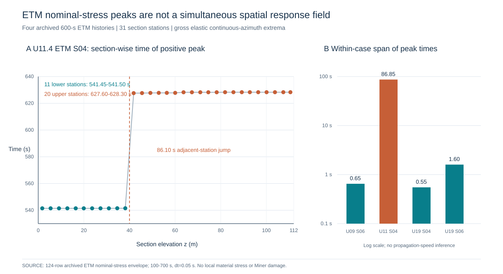

这一**源级负结果**并不否定逐段极值包络作为局部筛查上界的价值；它否定的是把逐段独立取极值的曲线当作同时刻空间应力场，或据此推断塔身传播速度、同一循环的全塔应力状态。需要真实同步31站完整时程才能重建任意同一时刻的空间分布；需要局部材料应力时程才能进一步计算雨流及Miner损伤。此处的时刻数值受0.05 s采样网格与原记录极值算法限制，最大单点时间定位离散化误差在理想采样峰值解释下约为半个步长0.025 s，**不是**真实连续峰值时刻或物理误差的严格上界；原始载荷状态、截面映射与结构模型误差未在本节重新评定。源级[无依赖Node复算程序](../../../experiments/T077/recovery/s06_etm31_peak_time_noncoincidence.cjs)、[四工况统计表](../../../experiments/T077/recovery/S06_4ETM31_PEAK_TIME_NONCOINCIDENCE_SUMMARY_20261108.csv)及[U11逐段明细](../../../experiments/T077/recovery/S06_U11_ETM31_PEAK_TIME_CLUSTER_20261108.csv)提供复核路径。该结论仅对所读四组历史ETM成立，未新增物理RUN，不能作为分材料寿命或抗震验算的PASS。

### 4.7.13 四ETM历史来源中塔底My载荷DEL与截面名义正应力极值的控制工况不一致（SOURCE-LEVEL）

为检验单一塔底My载荷DEL控制工况是否也能筛出混凝土塔段的最大**正向毛截面名义应力**，本节对四组已有31段完整历史ETM工况作跨归档**同名工况**对照。输入分别为T062已纠正雨流的72行塔底弯矩DEL表（SHA256 `1bf750ba3ea33153dbe4b23e87a1b973ca73ab41e446b2d9d5f3fac2881238a9`）与T077四ETM×31段连续周向毛截面名义应力极值表（SHA256 `6002f69286eb9941265697732ec7acd961ac6b5757d7472423d91e0374288f21`）。以四组工况内的严格排序为判据，不引入未经证明的材料S–N指数，也不将ETM作为正常运行DLC1.2长期概率样本。

| ETM工况 | 塔底My载荷DEL（MN·m） | 31段最大正向毛截面名义应力（MPa） | 最大值所在塔段 | My排序 | 应力排序 |
|---|---:|---:|---|---:|---:|
| U09p343881_ETM_S06 | 26.023387 | **25.013490** | CSEG_17 | 2 | **1** |
| U11p4_ETM_S04 | **26.802479** | 22.237064 | CSEG_17 | **1** | 2 |
| U19p202140_ETM_S04 | 24.323115 | 16.390908 | CSEG_17 | 3 | 4 |
| U19p202140_ETM_S06 | 23.542402 | 18.338015 | CSEG_17 | 4 | 3 |

四工况的最大正向名义应力均出现在CSEG_17（测点高度约60.026m），但两种指标的6个工况两两比较中有**2对排序相反**，对应描述性Kendall系数 \(\tau=1/3\)。例如U11p4_ETM_S04的My载荷DEL比U09p343881_ETM_S06高**2.9938%**，而后者的最大正向名义应力反而高**12.4856%**。这表明**控制截面高度相同，不意味着控制工况或控制指标相同**。进一步结合§4.7.12中U11工况各截面极值时刻跨度86.85s的结果，可见沿高逐段极值包络既不能代表同一时刻全塔应力场，也不能直接推导材料疲劳循环。

必须说明：两份历史表虽采用相同工况标签，但来自不同历史归档支路，尚未逐字节核对其原始风场、控制器状态和完整初态，因此上述排序差异属于**跨归档同名工况的条件性SOURCE-LEVEL筛查发现**，不能直接宣称同一物理RUN内已验证的响应排序反转。名义正应力极值不是固定材料点应力、应力幅或Miner损伤；只有取得严格同源的完整时程、明确坐标与材料疲劳关系后，才能检验真实材料疲劳控制工况是否改变。该结论亦不能用于年度疲劳寿命或正式DLC1.2验收。

[源级可复算Node程序](../../../experiments/T062/s12_cross_qoi_etm_source_gate.cjs) SHA256 `66c9b20712ecd83485c57c8eb9e460061daa2dc8ca03923091a635032c768f61`；[四行数值表](../../../experiments/T062/S12_4ETM_CROSS_QOI_RANK_20261108.csv) SHA256 `0ab09a0067745c9bdb0ee155da8f1aef7d78931511a0afd9a0a1225e1d33982d`；[正式双指标科研图](../figures/FIG_JOURNAL_S12_CROSS_QOI_ETM_RANK_20261108.svg) SHA256 `2b88d3e427c5166f329b53e1b5542640d4acde829208986ee9f3826b513d8f4d`。V8对原程序纯函数直接计算，4/4工况与2/6反转独立真值检查、5类污染输入拒绝PASS；原生Node CLI/CI NOT_RUN，原始OUTB本轮未重读。

### 4.7.14 跨归档同类My载荷DEL的参考循环数统一与残差（S06）

前节比较了塔底My载荷DEL与不同响应指标的名义正应力极值。为排除一个更基础的口径混杂，本节改为比较**同类My弯矩载荷DEL**：T062归档的塔底`TwrBsMyt`采用`m=4`、`Nref=100000`（MN·m）；T077四ETM×31站六分量归档的`CSEG_01/My_kNm`采用600s×1Hz即`Nref=600`（kN·m），测站高1.763393m。统一量纲和参考循环数后，
\[
D_{\mathrm{CSEG01},100000}=10^{-3}D_{\mathrm{CSEG01},600}(600/100000)^{1/4},\quad
\delta=100(D_{\mathrm{CSEG01},100000}/D_{\mathrm{base},100000}-1)\%.
\]
此处`m=4`仅是载荷四次矩诊断，不是混凝土、普通钢筋或预应力钢材的统一疲劳指数。直接读取72行纠正雨流源（SHA256 `1bf750ba3ea33153dbe4b23e87a1b973ca73ab41e446b2d9d5f3fac2881238a9`）及744行四ETM×31站六分量源（SHA256 `9e22e98ac44c2cbd6bf011c4bac76b5e7c4a1eddd8e6de611134b`），得到：

| ETM标签 | 塔底My DEL，Nref100000（MN·m） | CSEG01原DEL，Nref600（MN·m） | CSEG01统一后DEL，Nref100000（MN·m） | 相对残差 |
|---|---:|---:|---:|---:|
| U09p343881_ETM_S06 | 26.023387 | 92.306914 | 25.690470 | −1.2793% |
| U11p4_ETM_S04 | 26.802479 | 94.836550 | 26.394507 | −1.5221% |
| U19p202140_ETM_S04 | 24.323115 | 85.921775 | 23.913385 | −1.6845% |
| U19p202140_ETM_S06 | 23.542402 | 83.242012 | 23.167565 | −1.5922% |

参考循环数换算因子为**0.2783157684**。若直接比较未经归一化的原始DEL，四组CSEG01/塔底表观比值为**3.5325–3.5471**；统一后相对残差仅**−1.6845%至−1.2793%**，四组同类My DEL排序完全一致（六对比较**0/6反转**）。因此，未经统一Nref时出现的约3.5倍差异主要是**参考循环数造成的假尺度差**，不能解释为真实载荷放大。

这仍**不是同态物理一致性验收**：塔底与CSEG01不是同一位置，T062的36工况OUTB与T077分批Actions归档尚未证明原始BTS、控制器、初始状态和完整时程逐字节相同，且两条雨流程序的全部实现细节未做本轮原件对照；剩余1.3–1.7%残差不能唯一归因于位置、坐标或数值误差。§4.7.13的不同QoI排序反转仍只是跨归档条件性发现，不与本节同类QoI排序一致相矛盾。T077的31站分A/B/C/D四个历史运行批次，不得仅凭相同时间戳拼成同步全塔场；§4.7.12的31站86.85s峰时跨度仅是归档描述量，**CSEG11与12同属B批次**，二者86.10s峰时差才是同批内可比较的非同时性反例。

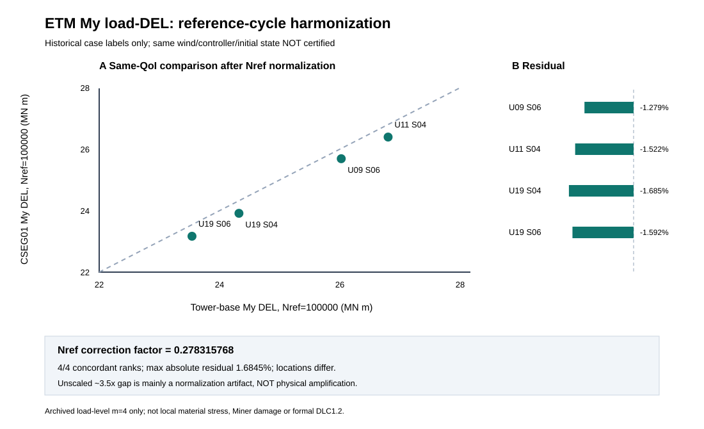

[源级Node程序](../../../experiments/T062/s06_etm_base_cseg01_nref_harmonization.cjs) SHA256 `c10c4a95dc81fa6210856375c1d64129596ff7406a68fada0d23828c8a686a95`；[四行结果表](../../../experiments/T062/S06_ETM_BASE_CSEG01_NREF_HARMONIZED_20261108.csv) SHA256 `b538a3f44030bcdf09e9d620f67326b40aea0475c5c10893467721cadf82466b`；SVG SHA256 `e69436a2482aea2206ce35e569984f43b8d243ccf67b65403d8132b044a446ae`。程序在真实派生源上完成5项数值oracle和8类异常输入拒绝测试；原生Node CLI/CI未运行，原始OUTB本轮未重新读取。该研究不构成材料局部应力、Miner寿命或正式DLC1.2验收。

### 4.7.15 既有ETM毛截面应力极值的条件性压应力偏置筛查（S10）

**科学问题。** 对于已经归档的四组ETM×31段同步截面（每段内16个固定周向方位）毛截面弹性应力，假定在**不改变动力响应**的数学情景下施加一个对所有时刻、方位和截面均相同的压应力偏置 q≥0，多少个塔段的历史正向（受拉为正）应力峰仍大于零？这一计算只检验历史极值包络对加性偏置的敏感性，**不等于真实预应力施加、混凝土局部应力、开裂验算或材料疲劳寿命**。

设 `p(c,j)=max[t,θ] σgross(c,j,t,θ)`，其中c为历史ETM工况、j=1,…,31为混凝土塔段，θ为16个离散方位；条件性转换为 `σ*(c,j,t,θ;q)=σgross(c,j,t,θ)−q`。为避免Word公式转换器对上标和指示函数的错误排版，本稿采用等价的可读记号：`Npos(c,q)=Σ[j=1,…,31] I[p(c,j)>q]`，`qcrit(c)=max[j=1,…,31] p(c,j)`，其中I[条件]为条件成立取1、否则取0的指示函数。qcrit(c)仅是使本批**离散方位/时窗的毛截面正峰**全部不大于零所需的均匀偏置阈值。其单位为MPa，绝不是可直接采用的PT设计应力。对于严格加性且不改变响应的偏置，任一固定材料点的雨流应力范围不变、循环均值减去 q；但真实预应力可改变接触、刚度、几何非线性和应力传递，不能从这一代数性质推出真实疲劳损伤不变或降低。

直接读取[T077已归档四ETM×31段毛截面控制表](../../../experiments/T077/recovery/S10_4CASE_31SEG_SYNC_GROSS_CONTROL_20261030.csv)，其源SHA256为`36c0a8a97db36885159fff79cc61daced9c939ab688f98ce1c6b860a89ac91d3`。表内每行是16方位、600s历史时窗的毛截面峰值和载荷层以外的名义应力DEL诊断；极大拉应力与极大压应力一般**不在同一时刻/方位**，两者差值不能视为一次雨流循环幅值。四组阈值与条件性正峰段数为：

| 历史ETM工况 | qcrit(c) / MPa | 控制段 | Npos(c,0) | Npos(c,20 MPa) | Npos(c,22.5 MPa) | Npos(c,25 MPa) |
|---|---:|---|---:|---:|---:|---:|
| U09p343881_ETM_S06 | **24.963984** | CSEG17，约60.026m | 31 | **27** | **19** | 0 |
| U11p4_ETM_S04 | **22.128598** | CSEG17，约60.026m | 31 | **22** | 0 | 0 |
| U19p202140_ETM_S04 | **16.281708** | CSEG17，约60.026m | 31 | 0 | 0 | 0 |
| U19p202140_ETM_S06 | **18.261383** | CSEG17，约60.026m | 31 | 0 | 0 | 0 |

在统一假定 q=20 MPa时，124个“工况×塔段”筛查单元中有**49个**仍出现正向毛截面峰（27+22+0+0）；q=22.5 MPa时为**19个**，q=25 MPa时为0。这里的124不是124个独立统计样本，也不代表全年运行概率。所有四组的阈值控制段均为CSEG17；这只是历史毛截面极值的控制位置，不是已经证明的混凝土/PT/钢塔材料疲劳控制位置。

**新增有界峰值误差敏感性（非实际误差估计）。** 设归档峰值为 `p_hat(c,j)`，未知真值与归档值的绝对差满足假设界 `|p_true(c,j)−p_hat(c,j)|≤δ`（单位MPa）。由严格大于号定义可得确定性的夹逼关系：`Σ I[p_hat>q+δ] ≤ Npos_true(c,q) ≤ Σ I[p_hat>q−δ]`；对四工况合并124个单元也逐项成立。这是对**假定绝对误差界**的数学包络，不是从仿真获得的可信误差预算。直接读取同一124行来源，以δ=0、0.1、0.5、1.0 MPa作条件性压力测试，得到：

| 假设偏置q / MPa | δ=0 | δ=0.1 MPa | δ=0.5 MPa | δ=1.0 MPa |
|---|---:|---:|---:|---:|
| 20 | 49–49 | 49–50 | 47–52 | 40–55 |
| 22.5 | 19–19 | 19–20 | 17–23 | 9–28 |
| 25 | 0–0 | 0–2 | 0–3 | 0–6 |

每个区间为“保证仍为正峰的单元数下界—可能为正峰的单元数上界”。特别是历史归档的`q=25 MPa`计数0/124，**即使仅假设0.1 MPa的逐单元误差界，也只能推出0—2，而不能无条件证明0**。该反例使本节“全部无正峰”的结论显式依赖峰值精度；δ的取值均为分析情景，并非已有物理模型或网格的实测误差。区间只对归档毛截面正峰成立，不能转为材料开裂、Miner或PT安全裕度。[12行来源派生表](../../../experiments/T077/recovery/S10_ETM31_OFFSET_INTERVAL_BOUNDS_12ROW_20261111.csv) SHA256 `9cc2c6eb91df0b5e71ed8bdcdc1bcae6f846c1168d81591c79061ed772b6cad4`；[独立可运行Python/拒绝测试](../../../experiments/T077/recovery/s10_etm31_offset_interval_bounds.py) SHA256 `b25ca3e5e8240b82691794a9c76674e4f347ce17a303236ff5058f24ba6e3626`。本轮直接读取真实124行CSV、V8按定义逐行计数及独立Python 5位小数截取复核12/12一致；原始SHA锁CSV的提交版Python CLI尚未独立执行，不能宣称完整源级程序PASS。

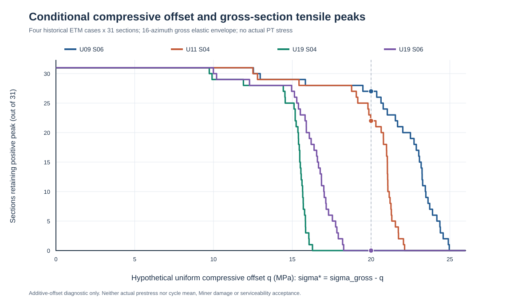

[源级可运行程序](../../../experiments/T077/recovery/s10_etm31_gross_offset_envelope.cjs)（SHA256 `7fdd2987f9641fe88719b255c910f56a2c06980d514752475a76075a22e471c3`）与[24行结果表](../../../experiments/T077/recovery/S10_ETM31_GROSS_COMPRESSION_OFFSET_SCREEN_20261108.csv)（SHA256 `e709fff7ad4103a37c87f00fa67c2c377f58bf7d783e07cf327741d34badc2e1`）保留所有预设偏置的逐工况结果；正式SVG SHA256 `4d6a8c8fc6741339e06fef3a06b322c3acbd87d2a892b611c780c6e437e22f85`。已在V8实际执行仓库同一源码的124行解析、4项真实阈值oracle、4项段数oracle、9项污染输入拒绝、单调性及加性偏置解析恒等式；**原生Node CLI/CI和原始OUTB本轮未执行/重读**。

**适用范围与失败边界。** 本结果来自既有分批归档的31段数据，不能将不同批次截面当作同一时刻全塔应力场。偏置 q 是假设量而非真实有效PT局部应力，且未提供每个材料点的完整循环均值、局部钢筋/PT应力、材料S–N参数或DLC1.2全年覆盖。故本节可作为“名义峰值对压应力偏置的条件性敏感性”图表，**不得生成Miner损伤、材料寿命、预应力设计通过或风震安全结论**。下一步真正需要的是与同一模型状态配对的局部材料点全时程及其雨流范围—均值—次数分布，而不是再由毛截面极值外推寿命。

### 4.7.16 历史18组NTM毛截面循环强度与时均应力控制方位的分离（S10）

**研究问题与真实数据。** 当仅以等效应力范围选择周向疲劳候选测点时，是否会遗漏时均拉应力更不利的方位？本文从已归档的同一158 m OpenFAST历史18组NTM（3个代表风速×6个随机种子）原始OUTB后处理表中，直接读取近塔底BASE及G01—G09共10测站、16个固定周向方位的**2880行毛截面弹性名义应力统计**。每个工况—测站的16方位来自同一原始OUTB及同步Fz/Mx/My，测站范围为0—2.750893 m；数据并非材料点应力，也未加入有效预应力或接缝局部传力。来源为[T062历史实算表](../../../experiments/T062/S10_18NTM_10NEARBASE_16AZ_GROSS_RAINFLOW_20261031.csv)，原CSV SHA256 `d45f047f5d622fb834d63728c13cead49b614b6cf42e598918e55242ed45f94b`，其原始OUTB身份和600 s分析窗口见T062来源收据。

在每个工况—测站内，定义 `θ_D=argmax_θ DEL4(θ)`，`θ_μ=argmax_θ mean_t[σ_gross(t,θ)]`，并以最小周向夹角 `Δθ=min(|θ_D−θ_μ|,360°−|θ_D−θ_μ|)` 衡量两个筛选指标的分离。这里的`mean_MPa`是**时间平均毛截面名义应力**，绝不是雨流循环的逐循环均值；`DEL4`采用原历史程序的`m=4,Nref=600`，单位MPa，只作为统一口径的名义应力循环筛查量，不对应混凝土、PT或钢材的材料S–N寿命模型。

**表4-X 历史NTM不同风速下的周向指标控制方位（真实历史源级后处理）**

| 历史NTM风速 | 工况—测站组合数 | DEL4控制方位与时均应力最大方位相差180° | 说明 |
|---|---:|---:|---|
| U9.343881 | 60 | **60/60** | 6 seeds×10近底部测站 |
| U11.4 | 60 | **60/60** | 6 seeds×10近底部测站 |
| U19.202140 | 60 | **50/60** | 其余10组两方位一致 |
| **合计** | **180** | **170/180（94.44%）** | 180组高度相关，不能当作180个独立统计样本 |

在这180组中，时均应力最大方位与单点正向应力峰值最大方位**180/180一致**；而DEL4与时均应力最大方位在170组中相差180°。如果改选时均应力最大的方位，原始DEL4相对其最大值的损失中位数仅**0.159605%**、最大**0.261058%**，但相应时间平均名义应力的增量中位数为**25.943882 MPa**、最大**29.431306 MPa**。例如U09p343881_NTM_S01的BASE测站，DEL4控制方位为0°（3.708564 MPa，时均应力−16.571550 MPa），时均应力最大方位为180°（DEL4为3.699759 MPa，时均应力+9.337149 MPa）；两者DEL4差约0.237404%，时均应力差约25.908699 MPa。对`m=10`的同源诊断，160/180组出现180°分离；m4与m10控制方位在10/180组不同，提示近并列的方位选择依赖循环指数。

**科学解释与边界。** 在此近底部毛截面数据中，纯循环幅值筛选容易把周向0°/180°中**时均受压较大**的一侧选为控制点，而另一侧的时间平均拉应力和正峰显著更大。该现象与轴力—弯矩同步叠加及圆环截面两侧弯曲符号相反相容，但**不能仅凭此表确定因果机制**。尤其DEL4差异很小，历史表提供的单样本量化界并不是DEL4方位排序的严格置信区间，不能把170/180解释为稳健总体概率。10个近底部测站高度相关，真正的风场独立实现仅有18个历史seed-case，且仅覆盖三个代表风速；没有完整DLC1.2风速箱和材料点的雨流`(range,cycle-mean,count)`、有效预应力及非线性局部响应，因此**不能据此给出材料Miner损伤、寿命或控制材料**。本结果对第四章的直接方法贡献是：进入真实局部材料疲劳评价前，应同时保留`θ_D`和`θ_μ`（及正峰方位）作为**候选观察方位**，不得用一个近并列的DEL最大方位排除另一侧。该选择规则是本文历史数据支持的筛查建议，并非声称首次研究均值应力效应；[16]、[18]已有相关疲劳研究。

**可复现证据。** [180行逐工况—测站表](../../../experiments/T062/S10_NTM18_180PAIR_DEL_MEAN_AZIMUTH_20261108.csv) SHA256 `652929e6e1d03aced08f7af9204e389d503ec3d7835df76bd384114ea410bccd`；[源锁定Node程序](../../../experiments/T062/s10_ntm18_mean_del_azimuth_decoupling.cjs) SHA256 `701ddfd282404d6c0a02aa03af5ac9cac4d7dffee2700fa51b990a649c8590bf`；[双面板科研图](../figures/FIG4_S10_NTM18_DEL_MEAN_AZIMUTH_20261108.svg) SHA256 `c30fe3011b3106f4d947a8be331ac983f4437fad711ad84084ad48f8d431975a`。程序以完整CSV SHA256校验、2880行/180组/16方位身份约束及污染输入拒绝为前提；V8执行5项真实数据断言、7项坏输入拒绝和逆序不变性PASS。**本轮未运行原生Node CLI/CI、未重新解码原始OUTB**，属于已归档原始OUTB派生表的SOURCE-LEVEL新研究，不能代替正式材料物理验收。

### 4.7.17 循环指数改变时周向控制方位的独立风场级稳定性（S10）

**科学问题。** 上节发现周向0°与180°的毛截面名义应力循环DEL接近，但时间平均应力相差较大。不同Wöhler指数会不会改变“控制方位”，这种改变究竟发生在多少个**独立风场实现**中？直接对[同一历史18组NTM×10测站×16方位的2880行来源表](../../../experiments/T062/S10_18NTM_10NEARBASE_16AZ_GROSS_RAINFLOW_20261031.csv)逐组重新取`argmax_θ DEL_m4`与`argmax_θ DEL_m10`，原数据SHA256为`d45f047f5d622fb834d63728c13cead49b614b6cf42e598918e55242ed45f94b`。两个指数仅用于**同一来源的名义应力循环筛查**；不将其等同于已确定的混凝土、PT或钢塔材料疲劳曲线，也不直接比较不同指数DEL的绝对大小。

在同一case、同一测站，令`θ₄=argmax DEL₄`、`θ₁₀=argmax DEL₁₀`，并分别计算选择另一指数控制方位时在本指数下的相对损失
\[
r_4=100\frac{DEL_4(\theta_4)-DEL_4(\theta_{10})}{DEL_4(\theta_4)},\quad
r_{10}=100\frac{DEL_{10}(\theta_{10})-DEL_{10}(\theta_4)}{DEL_{10}(\theta_{10})}.
\]
该“损失”只量化离散方位筛选代价，**不是**材料Miner损伤差、寿命差或模型误差上界。

**表4-X 以独立风场实现为单位的指数依赖性（真实历史来源）**

| 历史风速箱 | seed-case数 | 发生m4/m10控制方位变化的case | 对应发生变化的测站数 |
|---|---:|---:|---:|
| U9.343881 NTM | 6 | 0 | 0/60 |
| U11.4 NTM | 6 | 0 | 0/60 |
| U19.202140 NTM | 6 | **1（S03）** | **10/60** |
| **合计** | **18** | **1/18** | **10/180** |

唯一变化的`U19p202140_NTM_S03`在BASE至G09全部10个近底测站出现180°方位切换：m4选0°，m10选180°。然而同一指数下的选择代价很小：10站中`r₄`为**0.030791%—0.031234%**，`r₁₀`为**0.003129%—0.004492%**。BASE处m4控制方位的时间平均名义应力为−11.526115 MPa，m10控制方位为+4.309740 MPa，差**15.835855 MPa**。这不是十个独立反例，而是**一个风场实现中十个相关高度测站的同向变化**。其余17个case的两个指数控制方位一致。

**解释及可证伪边界。** 在该有限历史样本内，改变循环指数几乎不改变离散最大DEL的数值，却可能在一个seed中把筛查方位切换到均值应力显著不同的另一侧。因此，后续若材料点研究仅保留一个“最大名义DEL方位”，就可能遗漏不同材料指数和均值效应下的候选点；建议至少保留0°与180°的成对候选，待真实材料点`(range,cycle-mean,count)`及有效预应力确定后再作物理裁决。该建议是**筛查设计**，不是已证材料控制机理。原表的`quantization_sample_bound_MPa`仅为单时程样本量化界，不能未经误差传播当作DEL排序显著性界；10个测站高度相关，18个历史case又仅有三个风速箱、每箱六个seed，故**不能**把10/180当作总体切换概率或显著性检验样本量。原OUTB本轮未重新解码，正式DLC1.2仍未闭合。

**图4-X（候选）** [18个独立case的指数依赖控制方位与十测站选择代价](../figures/FIG4_S10_NTM_EXPONENT_AZIMUTH_SWITCH_20261108.svg)；**表4-X（来源级）** [18个case结果](../../../experiments/T062/S10_NTM18_EXPONENT_AZIMUTH_18CASE_20261108.csv)、[十个切换测站明细](../../../experiments/T062/S10_NTM18_EXPONENT_AZIMUTH_10SWITCH_20261108.csv)；[可复算程序](../../../experiments/T062/s10_ntm18_exponent_azimuth_switch.cjs)（输入SHA锁定，9类异常输入拒绝）。这一结果与2026年已发表风震及PT地震研究的对象/结论不同，但仅构成历史数据筛查增量，不主张新材料疲劳定律或风震首创。

### 4.7.18 真实ERA5有源风速支持域的概率集中、载荷四次矩放大与单小时扰动（S10，2026-11-09）

**研究问题。** 仅有三个历史NTM风速箱时，六个seed等数量采样能否代表场址长期风速概率？高风速稀有小时对不同塔底弯矩分量的部分四次矩有多敏感？本节不重复§4.7.4的三箱加权四次矩或§4.7.7的无源箱不可识别性证明，而进一步量化**已知支持域内部的概率集中程度及有限小时影响**。来源为[2005—2025 ERA5派生31行1 m/s分箱](../../../experiments/T062/S10_ERA5_2005_2025_HUB_1MS_BINS_20261031.csv)（SHA256 `e4058620a36b23bb218103875d4dc5b0711fc45d418b23a2208c2fc9c16c9102`）和[18组历史NTM六seed归并的双通道6行M4表](../../../experiments/T062/partial-annual-load-diagnostic-20261102/S10_REAL_18NTM_3BIN_PARTIAL_M4_BY_CHANNEL_20261102.csv)（SHA256 `d43f963fb30e16a33e87acdf6e9571710826974eee89d1f3527ab6504d85f695`）。这两份为已核历史原始资料的**派生表**，本轮未重下载ERA5原件或重新解码18份OUTB。

令全部小时数`N=184080`、非规范诊断运行区间`4≤U<25m/s`内小时数`N_op=106900`、三个有历史NTM载荷的bin `B_K={9,11,19}`小时数`H_K=5736+1426+2=7164`。全小时概率为`p_b=H_b/N`；在**仅三个有源bin内**的归一化概率为`q_b=H_b/H_K`，不得误称为运行区间条件概率。三箱各六seed时，赋予第`b`箱每条历史case权重`w_{bs}=q_b/6`，其代数Kish集中指标为
\[
N_{\mathrm{eff},K}=\frac{(\sum_{b,s}w_{bs})^2}{\sum_{b,s}w_{bs}^2}
=\frac{6H_K^2}{\sum_{b\in B_K}H_b^2}=8.814536.
\]
它说明18条历史case按已知支持域风速频率加权后权重显著不均衡，**不是**18个独立随机试验的统计等效样本量、不是有效seed数估计或总体置信区间；跨风速同标签seed的独立性及不同bin方差均未证明。三个有源bin仅占全部小时**3.891786%**、诊断运行小时**6.701590%**；其余诊断运行小时不能赋零载荷。

对载荷通道`c`，继承历史同一`N_ref=600`、`m=4`的六seed均值`M_{4,bc}=\frac16\sum_s L_{bsc}^4`（单位`(MN·m)^4`），定义**有源部分**`K_c=\sum_{b\in B_K}(H_b/N)M_{4,bc}`，以及其内部贡献份额`r_{bc}=[(H_b/N)M_{4,bc}]/K_c`。由原始整数小时重新计算，`K_{Mx}=125.606638`、`K_{My}=209257.299448\ (MN·m)^4`，与§4.7.4独立归档的数值一致。

| 历史有源风速bin | 已知支持域小时份额 | Mx有源部分四次矩贡献份额 | My有源部分四次矩贡献份额 |
|---|---:|---:|---:|
| 9—10 m/s（5736h） | 80.067002% | 56.477350% | 59.138157% |
| 11—12 m/s（1426h） | 19.905081% | 40.793436% | 40.786853% |
| 19—20 m/s（2h） | 0.027917% | **2.729214%** | **0.074990%** |

虽然19—20m/s仅占有源小时0.027917%，其Mx部分四次矩份额达到2.729214%，相对小时份额的放大倍数为**97.760458**；My对应仅**2.686136**倍。该差异来自两通道的历史载荷四次矩，**不能推导出高风速对完整材料疲劳风险的大小**。为量化极少小时的离散敏感性，设置一个**明确不代表传感器误差或真实风速变化**的反事实：保持总小时`N`不变，把19—20m/s中的1小时改归9—10m/s，固定各箱历史`M_4`不变，则`\Delta K_c=(M_{4,9,c}-M_{4,19,c})/N`。Mx的`\Delta K=-1.701670\ (MN·m)^4`，相对有源`K`为**−1.354761%**；My为`−56.886425\ (MN·m)^4`，相对**−0.027185%**。一个小时占原19—20m/s两小时的50%，但该假想重分配**不是**概率置信区间或气象误差上界；若重分配至无源风速箱，则其载荷四次矩未知，不能计算同样的总变化。

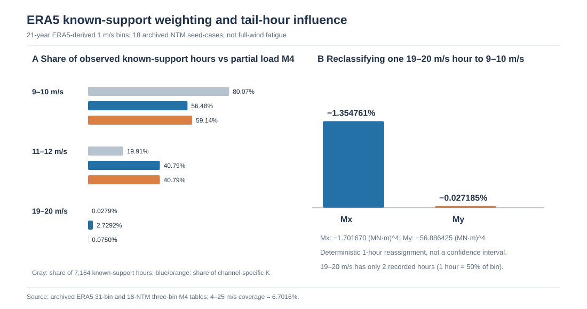

[六行可复算数表](../../../experiments/T062/S10_ERA5_KNOWN_SUPPORT_TAIL_INFLUENCE_20261109.csv)和[无外部依赖Node源锁定程序](../../../experiments/T062/s10_era5_known_support_tail_influence.cjs)分别记录逐bin`q_b/r_{bc}`、集中指标和两通道有限扰动。源级5项正向、9项污染拒绝及行序不变测试通过；原生Node CLI、原ERA5工作簿及OUTB本轮未重新运行。**结论边界**：这些结果揭示“等seed采样≠等气候权重”以及高风速尾部贡献对通道和极少小时的敏感性，但没有获得缺失风速的载荷、局部材料应力、正式DLC1.2、材料Miner或寿命，不构成任何物理验收。

### 4.7.19 四组历史ETM的名义应力循环强度与最大受拉峰值控制方位（S10，2026-11-09）

**研究问题。** 第4.7.16节已对18组NTM近塔底测站比较时均应力和DEL方位；本节采用另一组已归档的**四ETM×31段×16方位**数据，检验按最大循环DEL选取周向测点是否会漏掉最大正向名义应力峰值，以及同时保留最大正峰方位会损失多少循环DEL。直接读取[四ETM原有1984行同步毛截面雨流统计](../../../experiments/T077/recovery/S10_4CASE_31SEG_16AZ_SYNC_GROSS_RAINFLOW_20261030.csv)（SHA256 `16c9864ef7a344e5b97338c31ce26de6adb86c0f0f64942ef894fe9983926b2b`），每个工况—塔段16个22.5°间隔方位均由600s、12001个0.05s采样的名义弹性应力时程归并。未计入真实有效预应力、局部材料应力、接缝或钢筋应力集中；历史批次之间的全局同态尚未独立证明。

对于同一工况\(c\)、塔段\(j\)，分别定义\(\theta_D=\arg\max_\theta\mathrm{DEL}_{4,cj}(\theta)\)和\(\theta_T=\arg\max_\theta\max_t\sigma^{\mathrm{gross}}_{cj}(t,\theta)\)。以最大受拉峰值方位替代最大DEL方位的循环指标损失及正峰增益定义为
\[
L_D=100\left[1-\frac{\mathrm{DEL}_4(\theta_T)}{\mathrm{DEL}_4(\theta_D)}\right]\%,\qquad
G_T=\max_t\sigma^{\mathrm{gross}}(t,\theta_T)-\max_t\sigma^{\mathrm{gross}}(t,\theta_D).
\]
两个指标只在同一工况、同一塔段内部计算，避免跨工况或异时极值混用。

**结果。** 四工况共124个工况—塔段组合的\(\theta_D\)和\(\theta_T\)全部相差**180°（124/124）**。改选\(\theta_T\)的DEL4损失为**0.016753%—0.266934%**，中位数**0.133549%**；相对于只保留\(\theta_D\)，正向名义应力峰值增益为**8.780294—24.277101 MPa**，中位数**18.104230 MPa**。其中83/124组的DEL最大方位**整个时程的最大名义应力仍为负值**，而124/124组的最大受拉峰值方位正峰为正。31个高度来自同一条风场时程，彼此相关，不能将124组视为124个独立随机风场或计算总体置信区间。

**排序可辨识性反例。** 在仅作算法拒绝试验的“两个候选方位DEL4各自可能存在独立±0.5%相对扰动”假设下，严格优势条件\(D_{\max}(1-0.005)>D_T(1+0.005)\)在**0/124**组成立。这是人为设置的容差敏感性，不是已测得的模型误差、seed统计误差或材料参数不确定性；也不能证明两侧材料疲劳损伤相等。该真实来源级结果支持在后续材料局部应力取点时**保留两侧相反方位**，而非只按名义DEL选择一个方位。ETM并非正式DLC1.2长期正常运行风，正峰也不等于混凝土开裂或Miner损伤。

[124行可复核数表](../../../experiments/T077/recovery/S10_ETM4_31SEG_TENSION_DEL4_AZIMUTH_TRADEOFF_20261109.csv)、[图4-X两面板](../figures/FIG4_S10_ETM4_TENSION_DEL4_AZIMUTH_TRADEOFF_20261109.svg)和[输入SHA锁定的Node程序](../../../experiments/T077/recovery/s10_etm4_tension_del4_azimuth_tradeoff.cjs)给出沿高结果。源码在V8通过解析已知解、行序不变性、8种坏输入拒绝和真实来源断言；原生Node CLI、原始OUTB重新解码与物理RUN未执行。两篇2026年160m混塔风震和PT地震先行研究（DOI 10.1080/13632469.2026.2671807；10.1016/j.rcns.2026.03.002）本轮未全文新核，不宣称本节首次发现相关物理规律。

### 4.7.20 原始雨流循环均值与时间均值的非等价性（S10，2026-11-10）

为检验“以时程平均弯矩代替雨流循环平均弯矩”的简化是否有数据支持，本节直接读取T062从原始158 m OpenFAST历史载荷重新计数的**48,070行rainflow循环账本**，覆盖36个风工况、塔底Mx/My两通道共72组。每一行保留循环范围 \(\Delta M_i\)、循环均值 \(\mu_i\) 和循环计数 \(n_i\)（0.5或1）。在载荷筛查指数 \(m=4\) 下，定义

\[
w_i=n_i(\Delta M_i)^4,\qquad
\bar M_{\mathrm{RF},4}=\frac{\sum_iw_i\mu_i}{\sum_iw_i},\qquad
N_{\mathrm{conc},4}=\frac{(\sum_iw_i)^2}{\sum_iw_i^2}.
\]

其中 \(\bar M_{\mathrm{RF},4}\) 为**载荷范围四次矩加权的循环均值**，并非时间均值 \(\bar M_t\)；\(N_{\mathrm{conc},4}\) 只衡量四次矩贡献集中程度，不是独立统计样本数，也不提供置信区间。以相同账本计算 \(\mathrm{DEL}_4=[\sum_iw_i/100000]^{1/4}\)，与历史72行独立DEL表**72/72逐项一致**（当前双精度复算最大绝对差0 kN·m）。

在36组Mx中，\(|\bar M_{\mathrm{RF},4}-\bar M_t|/|\bar M_t|>5\%\) 的有**24组**，超过10%的有**12组**；My对应为**17组**和**3组**。Mx最大差出现在U09p343881_ETM_S01：时间均值**9,911.824154 kN·m**，四次矩加权循环均值**12,687.528181 kN·m**，差异**+28.003968%**。My最大差出现在U09p343881_ETM_S06：时间均值**166,685.655217 kN·m**，加权循环均值**133,366.174852 kN·m**，差异**−19.989411%**；另一个独立NTM风场U11p4_NTM_S06的My差异为**−17.122604%**。两通道 \(N_{\mathrm{conc},4}\) 中位数分别为**20.434672**和**10.676096**；My最小仅**3.179510**，单循环贡献最高可占该工况四次矩的**43.223661%**。因此，少量大范围循环可对载荷四次矩产生显著影响，不能用时程均值描述其对应的循环均值。

[72行逐工况结果](../../../experiments/T062/S10_T062_RAINFLOW_CYCLE_MEAN_WEIGHTED_72ROW_20261110.csv)、[图4-X 双通道对照](../figures/FIG4_S10_RAINFLOW_CYCLE_MEAN_VS_TIME_20261110.svg)与[可运行Node复算程序](../../../experiments/T062/s10_rainflow_cycle_mean_weighted_diagnostic.cjs)提供完整复算入口。**本结果仅为历史载荷弯矩层的确定性筛查**：OpenFAST弯矩正负号不能直接当作材料点拉压应力符号；四次矩加权循环均值也不是Goodman修正。本节没有材料点 \((\Delta\sigma,\sigma_m,n)\) 账本、PT有效应力、材料S–N或Miner损伤，不能计算材料寿命。真实均值效应须在同一材料点、同一结构状态下分别针对混凝土、钢绞线与钢材进行评价。

### 4.7.21 循环均值替代的可识别边界：仿射敏感性恒等式与非线性反例（S12）

上一节表明时间均值与四次矩加权循环均值不相同，但其差异究竟能支持何种疲劳推断，必须区分**数学上可识别的载荷敏感性**和**尚未取得的材料损伤**。对同一工况与弯矩通道，令 \(W=\sum_i n_i(\Delta M_i)^4>0\)，\(p_i=n_i(\Delta M_i)^4/W\)，则 \(\sum_i p_i=1\)、\(\mu_w=\sum_i p_i\mu_i=\bar M_{\mathrm{RF},4}\)。仅定义**无材料参数意义的仿射均值敏感性诊断算子**：

\[
G_\lambda(\mu)=1+\lambda\frac{\mu-\bar M_t}{M_*},\qquad
Q_\lambda=\sum_i n_i(\Delta M_i)^4G_\lambda(\mu_i),\qquad M_*>0 .
\]

这里 \(\lambda\) 是无量纲符号参数，**不是**Goodman、混凝土或预应力钢绞线材料常数。若将每个循环均值错误地替换为时均 \(\bar M_t\)，则 \(Q_\lambda^{(t)}=W\)。由加权求和线性性，严格得到

\[
\frac{Q_\lambda-Q_\lambda^{(t)}}{W}
=\lambda\frac{\bar M_{\mathrm{RF},4}-\bar M_t}{M_*}.
\tag{4-21}
\]

当 \(M_*=|\bar M_t|>0\) 时，式（4-21）右侧对 \(\lambda\) 的系数 \(B=(\bar M_{\mathrm{RF},4}-\bar M_t)/|\bar M_t|\) 可由72行历史统计**精确识别**。72组中 \(B>0\) 为**47组**，\(B<0\) 为**25组**；Mx为28正、8负，My为19正、17负。三个真实工况呈现相反方向：

| 历史工况与塔底通道 | \(\bar M_t\)（kN·m） | \(\bar M_{\mathrm{RF},4}\)（kN·m） | \(100B\)（%） |
|---|---:|---:|---:|
| U09p343881_ETM_S01，Mx | 9,911.824154 | 12,687.528181 | **+28.003968** |
| U09p343881_ETM_S06，My | 166,685.655217 | 133,366.174852 | **−19.989411** |
| U11p4_NTM_S06，My | 194,802.895952 | 161,447.567384 | **−17.122604** |

因此，即使在**同一个预先给定的仿射诊断模型**内，时均替代误差也不是固定正偏或固定负偏；不能把其绝对值当作统一“保守系数”。式（4-21）是代数恒等式，不能被重新命名为材料损伤率或疲劳寿命修正。

更重要的是，**72行汇总表不足以识别一般非线性均值效应**。若仅用于数学讨论的二次可微函数 \(g(\mu)\) 在全部循环均值区间内满足 \(|g''(\mu)|\le K\)，泰勒定理给出

\[
\left|\sum_i p_i g(\mu_i)-g(\mu_w)\right|
\le \frac{K}{2}\sum_i p_i(\mu_i-\mu_w)^2.
\tag{4-22}
\]

右侧需要**逐循环加权方差**，不能从 \(\mu_w\) 或载荷DEL单独恢复。严格反例为两组等权循环：A组均值 \(\mu_0-a,\mu_0+a\)，B组均值 \(\mu_0,\mu_0\)；两组循环范围和计数相同，因而具有相同 \(W\)、DEL及 \(\mu_w=\mu_0\)，但对 \(g(\mu)=(\mu-\mu_0)^2\)，A组加权平均为 \(a^2\)，B组为零。可见即使载荷DEL与加权循环均值相同，**非线性均值效应仍可能不同**。

上述可识别结论仅涉及历史塔底弯矩与定义的仿射算子。保存的48,070行**载荷**循环 \((\Delta M,\mu,n)\) 不能直接替代任何材料点 \((\Delta\sigma,\sigma_m,n)\)；结构轴系、有效预应力、局部应力与材料关系未闭合时，不得据此填造Goodman修正、Miner损伤或20年寿命。材料层须在同一物理位置、同一初态下重新计数，保留逐循环范围、均值、次数和经证据支持的材料关系。三行实例可从[72行源级统计](../../../experiments/T062/S10_T062_RAINFLOW_CYCLE_MEAN_WEIGHTED_72ROW_20261110.csv)核对；[原雨流复算程序](../../../experiments/T062/s10_rainflow_cycle_mean_weighted_diagnostic.cjs)保持不变。

### 4.7.22 四组真实ETM毛截面双指标控制点的精确极小极大筛选（S12）

**科学问题与来源。** 已有§4.7.9—4.7.19指出31段沿高控制工况转换，以及最大名义循环强度与最大正向应力峰值可能对应相反方位。本节直接使用T077已归档的[1984行同步毛截面名义应力统计](../../../experiments/T077/recovery/S10_4CASE_31SEG_16AZ_SYNC_GROSS_RAINFLOW_20261030.csv)（历史SHA256 `16c9864ef7a344e5b97338c31ce26de6adb86c0f0f64942ef894fe9983926b2b`），包括4组ETM×31段×16个22.5°固定方位。每行给出600 s、12001点历史名义弹性应力时程的DEL4（MPa）与最大正向名义应力峰值（MPa）。DEL4只是截面名义应力范围四次矩的诊断，**不是已确认材料S–N曲线的疲劳指标**。

**可证伪的精确离散优化。** 令共同候选点集合 \(\mathcal P\) 包含496个名义位置 \((\mathrm{CSEG}_j,\theta_k)\)，四工况集合为 \(\mathcal C\)，两指标为 \(\mathcal Q=\{\mathrm{DEL}_4,\sigma_{\max}^{+}\}\)。对选择的共同点集 \(S\)，定义每一工况—指标的极值保留率及最差保留率：

\[
r_{cq}(S)=\frac{\max_{p\in S}Q_{cq}(p)}{\max_{p\in\mathcal P}Q_{cq}(p)},\qquad
R_k^*=\max_{\substack{S\subset\mathcal P\\|S|=k}}\min_{\substack{c\in\mathcal C\\q\in\mathcal Q}}r_{cq}(S).
\tag{4-23}
\]

正峰以非负部分参与比值，四工况全域最大正峰均大于零。对 \(k=1,2\) 分别穷举496个单点及 \(\binom{496}{2}=122760\) 个双点集合，未使用随机启发式。**位置配对按同一CSEG编号与方位进行**：原始四批次同名测点的实际 `gage_z_m` 并非字节完全相同，跨工况最大高度差为**0.000726193 m（0.726193 mm）**，所以本结果属于1 mm容差内的**名义共同位置**筛查，不是严格同一物理坐标/初态的跨批同态证明。

**真实数值结果。** 单点最优为CSEG09/180°（名义 \(z\approx30.965141\) m），最差保留率\(R_1^*=\mathbf{92.302769\%}\)；双点最优为**CSEG04/0°（\(z\approx12.766956\) m）和CSEG17/180°（\(z\approx60.025722\) m）**，最差保留率\(R_2^*=\mathbf{99.879547\%}\)，最坏遗漏仅**0.120453个百分点**。四个历史工况的全域最大正峰均由CSEG17/180°取得（4/4保留率100%）；两点对四工况的DEL4保留率为**99.905518%、100%、99.879547%、100%**。在95%保留率门槛下，496个单点中**0个**同时覆盖8指标，而122760个双点中有**68个**可行组合；本节双点解进一步最大化最差保留率，不意味着95%可行组合唯一。

| ETM工况 | 双点DEL4保留率/% | 双点最大正峰保留率/% |
|---|---:|---:|
| U09p343881_ETM_S06 | 99.905518 | 100.000000 |
| U11p4_ETM_S04 | 100.000000 | 100.000000 |
| U19p202140_ETM_S04 | 99.879547 | 100.000000 |
| U19p202140_ETM_S06 | 100.000000 | 100.000000 |

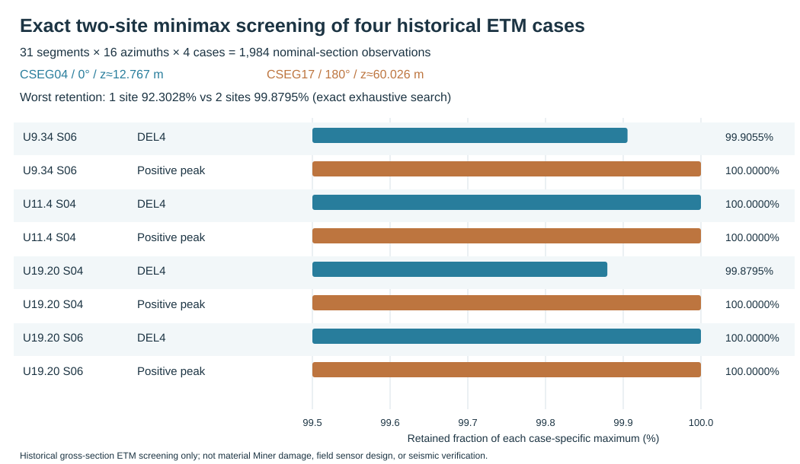

**留一工况检验。** 每次将一组ETM完全留出，仅用另三组的6项指标重新精确选择两点，再计算留出工况的两项保留率。四次训练均选择相同的CSEG04/0°与CSEG17/180°；留出DEL4最小**99.879547%**、正峰均为**100%**。这只是四个既有ETM工况之间的**回顾性有限样本迁移检查**，不是独立新风场、总体置信区间或DLC1.2验证；四工况共享同一几何和处理规则，不能当作独立物理验证。

**解释边界。** 该结论仅适用于这批四ETM、31个混凝土测站、16方位、毛截面线弹性应力映射及既有雨流口径。两个点**不是**材料疲劳控制点或推荐安装的真实传感器；钢塔、PT、钢筋、接缝局部应力、有效预应力、其他NTM风速箱/seed、严格同态风震均未纳入。不同材料位置或新增工况可以使保留率下降，**99.879547%绝非未来工况的误差保证**。这一结果提供了后续材料候选点筛选的条件性优先顺序，不能以两点替代31段局部疲劳评价。

[8行真实指标保留表](../../../experiments/T077/recovery/S12_ETM4_DUAL_QOI_TWO_SITE_RETENTION_8ROW_20261111.csv)、[4行留出表](../../../experiments/T077/recovery/S12_ETM4_DUAL_QOI_TWO_SITE_HOLDOUT_4ROW_20261111.csv)及[精确穷举与独立集合覆盖检验程序](../../../experiments/T077/recovery/s12_etm4_dual_qoi_two_site_exact.cjs)构成可复现结果。RUN为1984行历史来源解析、496单点/122760双点精确比较、四次留出和独立8任务集合覆盖动态规划；SOURCE-LEVEL NUMERIC PASS，非新增OpenFAST或结构生产RUN。CSV印刷精度对本节报告的6位百分数影响极小，但来源坐标、初态、毛截面近似、风场代表性和真实局部应力的误差**没有可信上界**。[16] Huang等2025截面应力方法为已核先行工作；2026两篇混塔风震/PT地震先行研究（DOI 10.1080/13632469.2026.2671807；10.1016/j.rcns.2026.03.002）本轮未新增全文阅读，不宣称普遍首创。未新增IEC/GB授权条文，材料Miner/寿命与结构物理验收继续HOLD。

### 4.7.23 四组ETM同步名义应力与独立分量DEL4组合的控制工况反例（2026-11-12）

**研究问题。** 对同一四组历史ETM×31个混凝土塔段，先分别对Fz、Mx、My作雨流并换算名义应力DEL4，再作最大分量、平方和开方（RSS）或算术和，能否代替先按同一时刻组合截面应力、再作雨流？本节直接读取[124行分量源](../../../experiments/T077/recovery/S10_4ETM_31SEG_NOMINAL_COMPONENT_STRESS_DEL_M4_20261102.csv)与[1984行同步16方位源](../../../experiments/T077/recovery/S10_4CASE_31SEG_16AZ_SYNC_GROSS_RAINFLOW_20261030.csv)，源SHA256分别为`7ca2dd4fa683b6f3c4534528bd0bcad7b2039c94ea37398e42941987f9580df4`与`16c9864ef7a344e5b97338c31ce26de6adb86c0f0f64942ef894fe9983926b2b`。两者均为600s、12001点、0.05s、m=4、Nref=600的历史毛截面弹性筛查，按工况/段号严格配对；同工况两来源测点高度差小于 5e-10 m（仅代表数值配对精度）。

令`D_sync=max_θ DEL4[σ(t,θ)]`（16个22.5°固定方位），独立分量名义应力DEL4为`d_Fz,d_Mx,d_My`，三个**事后启发式**代理为`D_dom=max(d_Fz,d_Mx,d_My)`、`D_RSS=sqrt(d_Fz²+d_Mx²+d_My²)`和`D_sum=d_Fz+d_Mx+d_My`。计算相对偏差`100(D_proxy/D_sync−1)%`；RSS或简单相加并无普适上下界性质。

**实际结果。** 124组全部完成源级配对。RSS相对同步基准偏差为**+0.471954%—+7.574874%**，最大位于U19p202140_ETM_S04/CSEG_14，同步DEL4=5.642067MPa，RSS=6.069446MPa；四工况沿31段RSS平均偏差依次为0.664718%、1.066873%、6.730360%、6.416429%。算术和偏差为+10.349871%—+40.412173%；最大单分量代理则比同步基准低0.008854%—0.135963%。按每个塔段四工况独立选取最大DEL4，RSS改变**2/31段**的控制身份（CSEG06、CSEG23），算术和改变**31/31段**，最大分量改变0/31段。同步基准的31段控制工况仅来自9.343881 m/s 和 11.4 m/s 两组ETM，而算术和全部选择19.202140 m/s 两组ETM。这一结果构成同一批历史风载派生数据下的控制排序反例，但不代表未来风况的概率。

**独立测试、误差与限制。** 本轮直接执行拟提交的Node同字节计算核心，并用独立逐组最大值和RSS平方恒等式交叉核对124/124；源级门禁拒绝错SHA、缺行、重复工况/方位、非有限值、时间/方位不一致。打印舍入约10⁻⁹MPa级，远小于所观测百分比差异；但结构坐标、材料局部应力、有效PT、接缝非线性、风速/seed覆盖和材料疲劳模型的不确定性无可信上界。**在这四组ETM中RSS均高估只是样本事实，不是一般定理。** 本节不是正式DLC1.2、不是混凝土/PT/钢材料Miner损伤，更不支持寿命或风震安全结论；说明不能由三个边际DEL推回同步材料点雨流。

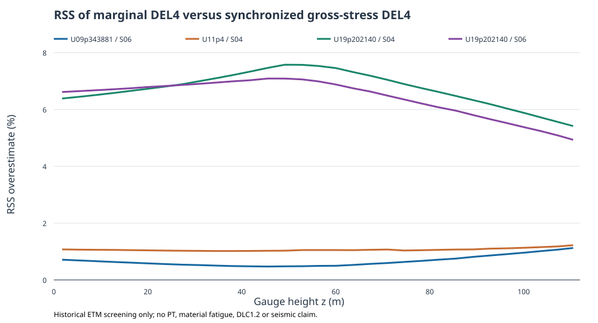

[124行结果表](../../../experiments/T077/recovery/S10_4ETM_31SEG_COMPONENT_RSS_VS_SYNC_124ROW_20261112.csv)；[可复算Node程序](../../../experiments/T077/recovery/s10_component_rss_vs_sync_20261112.cjs)。[16]与2026先行两篇混塔研究沿用既有阅读深度，未新读授权IEC/GB原条文；无新增OpenFAST或结构物理RUN，S10材料疲劳HOLD。

### 4.7.24 同步目标选控后悔度：控制工况翻转的实际筛查代价（2026-11-12）

**研究问题。** §4.7.23已发现，对四组真实历史ETM×31个混凝土塔段，先对轴力和双轴弯矩的名义应力分量分别雨流，再组合DEL4，可能改变筛查控制工况。然而，**工况标签改变不等于同步目标损失很大**。本节继承已核124行同身份配对和31行后悔度源表，不新增动力学仿真，而用同步16方位名义应力雨流DEL4评价代理选控的实际损失。

设塔段s的历史四工况集合为C，c*(s)=argmax_{c∈C}D_sync(s,c)，代理选择c_p(s)=argmax_{c∈C}D_p(s,c)。D_sync是16个固定方位同步名义应力时程各自雨流后DEL4的最大值；D_p分别为最大单分量、RSS或算术和。定义同步目标后悔度及绝对差：

\[
R_p(s)=100\frac{D_{\mathrm{sync}}(s,c^*)-D_{\mathrm{sync}}(s,c_p)}{D_{\mathrm{sync}}(s,c^*)}\%,\qquad
\Delta_p(s)=D_{\mathrm{sync}}(s,c^*)-D_{\mathrm{sync}}(s,c_p)\quad(\mathrm{MPa}).
\]

本数据D_sync>0，故R_p≥0。此指标是**有限四工况历史集合上的选控损失**，不是未来风况的失效概率、材料Miner损伤或经济代价。

| 代理选控方法 | 改变控制工况的塔段 | 同步目标后悔度范围 | 31段平均后悔度 |
|---|---:|---:|---:|
| 最大单分量 | 0/31 | 0% | 0% |
| 分量DEL4的RSS | 2/31 | 0—0.074245% | 0.003552% |
| 分量DEL4算术和 | 31/31 | 5.824936%—18.613504% | 12.440373% |

**结果与机制。** RSS选错的CSEG06、CSEG23分别只损失同步目标的**0.035852787%**和**0.074244607%**，属于近并列的筛查排序翻转，不宜夸大为大幅响应误判。相反，算术和代理将31段全部改判，CSEG15同步目标绝对差达到**1.304020390 MPa**，最大相对后悔度为**18.613504366%**。这表明代理指标的“控制工况改变率”必须同时报告以同步目标衡量的决策代价；在该历史样本中，直接按同步应力时程雨流选控比先合成边际DEL更有证据支持。RSS在这四工况表现较好不构成普遍上界或其他风场的保证。

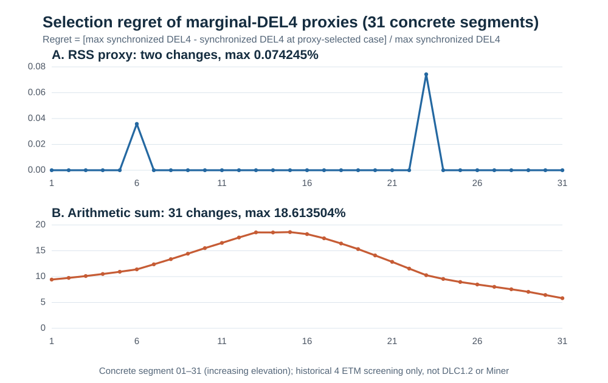

**可复核性与限制。** [31行结果](../../../experiments/T077/recovery/S10_4ETM_31SEG_PROXY_SELECTION_REGRET_31ROW_20261112.csv) SHA256 `83fe5adb816271ef721d46d13d794cb17c4dd57126f18296bfad850f1e18f219`；[Node程序](../../../experiments/T077/recovery/s10_proxy_selection_regret_20261112.cjs) SHA256 `7759bbf34d31a009c921c616bbfebe3630ed8efc8567467ace00df863b181f37`；原124行源SHA256 `c9dcca1a582fd5343f181a7adb146d44f9ebeac164b4f5b2ea2d3f8f3ca19dbd`。历史原生Node22 Actions #43085211081已通过真实源复算、逐字节结果和坏SHA拒绝；本节独立复核31×3个非负后悔度恒等式。**同段跨四工况gage高度最大差0.000726193m**，其物理影响没有独立误差上界；数值打印精度不等于模型精度。四组ETM仅用于历史screening，非正式DLC1.2；毛截面名义应力DEL4不能替代混凝土、钢筋、PT或钢塔局部应力、材料寿命或同态风震结果。

## 4.8 关键影响因素与不确定性

本节只研究能够改变疲劳判断或解释机理的参数，不独立扩成“优化章”。

### 4.8.1 必做敏感性

1. seed/sample size；
2. wind-bin discretization；
3. mean-stress treatment；
4. PT effective prestress；
5. local stress extraction；
6. local mesh density。

### 4.8.2 条件敏感性

只有主结果证明相关时再研究：

- foundation stiffness；
- concrete elastic modulus；
- joint friction；
- PT radius / bundle configuration；
- steel local detail；
- controller strategy。

[16] p13 Fig.24–26说明基础刚度、混凝土弹模和控制策略都可能改变damage，但这些是其工程对象的project-specific factors。本文不为模仿文献而全部复制，而是根据自己模型最主要的不确定性选取。

### 4.8.3 单因素控制原则

每个敏感性分支只改变一个目标因素，其余模型身份保持一致。对每个参数报告：

- baseline value；
- variation range；
- source/evidence；
- control damage；
- relative change；
- control location是否改变。

若某因素影响很小，应如实报告non-sensitive，而不是人为扩大差异。

### 4.8.4 截面合力矩对材料局部应力的非唯一性：31段真实几何上的零空间反例（S10，2026-11-12）

**科学问题。** §4.7.23已证明分别雨流后组合DEL4不能普遍恢复同步名义应力DEL4；期刊§4.7.3还证明边际弯矩谱缺少相位信息。本节研究更强的命题：**即使截面轴力、双向弯矩及其完整同步时程全部已知，能否仅由这些合力矩唯一确定混凝土、普通筋、预应力筋或接缝材料点的局部应力？** 以下构造一个截面合力矩映射零空间的严格反例；它不是新增物理场、真实局部应力或Miner损伤。

取圆环截面外半径 \(R\)、内半径 \(r_i\)，面积 \(A=\pi(R^2-r_i^2)\)，惯性矩 \(I=\pi(R^4-r_i^4)/4\)。在与合弯矩方向对齐的周向坐标 \(\theta\) 下，历史固定内力毛截面弹性代理为
\[
\sigma_0(r,\theta)=\sigma_N+\frac{M}{I}r\cos\theta,\qquad
\sigma_N=-N/A,\quad \sigma_M=MR/I.
\]
沿用T071符号约定：压轴力 \(N<0\) 对应正的 \(\sigma_N\)；kN和kN·m先换算为MN和MN·m。构造两个不同的轴向应力场：
\[
\sigma_\pm(r,\theta)=\sigma_0(r,\theta)\pm K\cos(2\theta),\qquad
K=\eta\sigma_M,\quad\eta=0.10.
\]
因为 \(\int_0^{2\pi}\cos2\theta\,d\theta=\int_0^{2\pi}\cos2\theta\cos\theta\,d\theta=\int_0^{2\pi}\cos2\theta\sin\theta\,d\theta=0\)，附加项对轴力及两个弯矩的积分增量**严格为零**；不增加剪切牵引时两个横向剪力及扭矩也不变。对 \(0<\eta<1/4\)，外缘 \(\theta=0\) 的正号场最大值及 \(\theta=\pi\) 的负号场最小值分别为 \(\sigma_N+(1+\eta)\sigma_M\) 和 \(\sigma_N-(1+\eta)\sigma_M\)，不同于原毛截面的 \(\sigma_N\pm\sigma_M\)。若附加项乘任意时间函数 \(g(t)\)，上述正交性在**每个时刻**仍成立。因此仅有同步六分量合力时程仍不能排除这一零空间。

**真实来源驱动的数值反例。** 读取T071既有31段几何、固定 \(N/M\) 及 \(A/I\) 表，源SHA256为 fff6dfcc6bc094353ebee042392033e8df47e7fb792ccc1812c0962c9c43f800；没有改变内力或假装新风机运行。假设谐波幅度 \(K=0.1\sigma_M\) 在31段为**2.544439—5.884493 MPa**。CSEG_01的名义最大有符号应力由29.102481变为31.646920 MPa；CSEG_27由**64.548868变为70.433361 MPa**，其原名义最小值−53.140996在另一数学场中变为**−59.025489 MPa**。这些场仅满足截面合力矩约束，**未证明满足实际材料本构、位移相容、接触、开裂、局部平衡或施工残余应力条件**，故不得解释为实测应力集中或结构安全裕度。

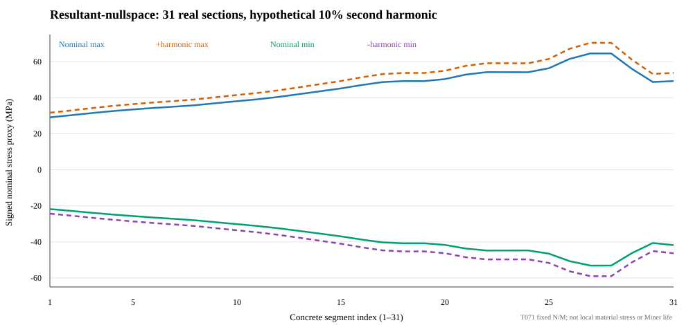

**循环效应的解析反例。** 对人为构造的同频零均值正弦应力，若局部谐波与指定外缘应力同相，局部范围从 \(\Delta\sigma\) 变为 \(1.1\Delta\sigma\)，且循环数相同、均值效应忽略、位于同一幂律S–N分支，则范围幂比 \(1.1^m\) 在 \(m=3,4,5\) 时分别为**1.331、1.4641、1.61051**。这些是条件性数学数值，不是实际材料指数选择、真实循环、Miner比或寿命。没有经物理验证的局部零空间幅值上界时，截面合力矩本身不提供局部峰值/范围的有限通用上界；但在经验证的均匀线弹性Euler–Bernoulli假设下，相容及本构可排除附加自由度，故**数学非唯一性不等于实际物理场必然出现该谐波**。

**程序、独立检验与误差。** [可复算Node程序](../../../experiments/T062/s10_section_resultant_nullspace.cjs)、[31行真实来源派生表](../../../experiments/T062/S10_T071_31SEG_SECTION_NULLSPACE_20261112.csv)与上图可由T071原件SHA门禁再生。程序核对31段唯一性、面积/惯性矩、N/M与名义应力恒等式；720个周向中点的数值积分对31段均满足 \(|\Delta N|,|\Delta M_x|,|\Delta M_y|<1.2\times10^{-14}\)，各自单位为MN、MN·m、MN·m；常数谐波和一阶谐波作为故意失败反例。源表重算A/I/应力的最大绝对偏差约为 \(1.2\times10^{-14}\,\mathrm{m^2}\)、\(6.4\times10^{-14}\,\mathrm{m^4}\)、\(5.0\times10^{-14}\,\mathrm{MPa}\)；CSV保留9位小数，单值舍入≤\(5\times10^{-10}\,\mathrm{MPa}\)。**浮点误差不等于物理模型误差**，后者没有可信上界。本轮V8执行提交版纯计算核心及坏输入拒绝PASS，原生Node CLI尚未单独运行。

本节对S10的实际意义是建立**拒绝条件**：T071静力毛截面值、T077同步名义应力DEL4、T062载荷DEL即使完全可复算，仍不能识别混凝土、钢筋、PT或钢塔局部range–mean–count与材料Miner；需要独立的局部传递关系、均值处理及材料S–N适用域。2026年160m混塔风震研究（DOI 10.1080/13632469.2026.2671807）和PT抗震研究（DOI 10.1016/j.rcns.2026.03.002）已有各自研究贡献；本节不声称首创风震或PT，也不将数学反例冒充结构性能创新的物理验证。

## 4.9 第四章最终结果与图表清单

正式结果至少包括：

1. 场址正常运行wind-bin概率表；
2. seed/sample-size convergence；
3. representative fatigue cases；
4. concrete/PT/steel candidate regions；
5. local stress time histories；
6. range–mean rainflow matrices；
7. short-term damage by wind bin；
8. annual damage contribution；
9. concrete/PT/steel control comparison；
10. azimuth/PT-position comparison；
11. mean-stress and effective-prestress sensitivity；
12. peak vs thickness/path-average sensitivity；
13. load-DEL control vs material-damage control；
14. 若证据链完整，则给出 \(D_{\text{annual}}\)、\(D_{20}\) 和等效寿命；
15. 若材料标准、概率或局部网格未闭合，则只给relative damage，不虚构寿命。

建议最终图表编号：

- 图4-1 疲劳研究技术路线；
- 图4-2 正常运行wind bins及场址概率；
- 图4-3 seed收敛；
- 图4-4 疲劳候选区域及观测点；
- 图4-5 控制混凝土应力时程；
- 图4-6 混凝土range–mean rainflow matrix；
- 图4-7 wind-bin concrete damage contribution；
- 图4-8 36个PT位置stress/damage周向分布；
- 图4-9 PT load spectrum及damage contribution；
- 图4-10 钢塔控制截面nominal/hot-spot stress；
- 图4-11 三类材料annual damage比较；
- 图4-12 mean stress / effective prestress敏感性；
- 图4-13 load-DEL与material-damage控制工况比较。

## 4.10 本章小结

本章已在**载荷级—毛截面名义应力级**形成可复算的筛查结果，但尚未取得材料点疲劳损伤。依据Huang等[16]的截面应力与风速概率加权研究思路，本文以真实历史NTM/ETM派生数据研究控制指标差异，并严格区分截面名义量、材料点循环量及长期Miner损伤。已有数据说明，最大载荷循环强度、最大正向名义应力、时均名义应力和某一时刻的沿高应力场**不能互相替代**。

| 可核实的历史来源 | 定量观察 | 对控制点选择的含义 | 解释边界 |
|---|---|---|---|
| 四组ETM、31段毛截面极值（§4.7.12） | U11p4_ETM_S04各段正峰时刻跨度**86.85 s** | 逐段极值包络可筛查高度，不是同步全塔应力快照 | 测站分批归档，跨批完全同态未证 |
| 四组ETM塔底My DEL与截面正峰（§4.7.13） | 六个两两排序中**2对反转**；正峰最大在U09 S06，My DEL最大在U11 S04 | 不同QoI须分别保留候选工况 | 两归档初态/控制状态未独立配对，属跨来源描述 |
| 18组NTM、10近底测站周向筛查（§4.7.16） | **170/180**组最大DEL4与最大时均应力方位相差180°；改选时均最大方位时DEL4损失至多**0.261058%**，时均应力增量至多**29.431306 MPa** | 仅保留最大DEL方位可能漏掉另一侧高平均拉应力 | 测站高度相关、DEL方位近并列；时间均值不是雨流循环均值 |
| 18组NTM的m4/m10周向控制方位（§4.7.17） | **10/180**测站切换，但全部来自**1/18**个seed-case；最大相对选择代价m4 **0.031234%**、m10 **0.004492%** | 保留相反周向方位的候选，避免仅凭一个循环指数删去高均值应力一侧 | 10测站非独立；名义DEL指数不等于材料疲劳模型，未得局部循环均值 |\n| 36组历史风况×Mx/My雨流（§4.7.20—4.7.21） | **48,070**条载荷循环；**47/72**组加权均值高于时均、**25/72**组低于；有符号偏差 **+28.003968% 至 −19.989411%** | 仿射均值敏感性可识别且误差方向随风况改变 | 不等于材料局部平均应力；非线性均值效应还需逐循环分布及材料关系 |
| 四组ETM、31段条件性压应力偏置（§4.7.15） | 假设20 MPa统一偏置后仍有**49/124**个工况—塔段单元出现正峰 | 表明正峰筛查对基准应力假设敏感 | 20 MPa不是实测有效预应力，不证明开裂或疲劳安全 |

这些结果共同否定“单一塔底DEL最大工况—单一方位—逐段峰值连线”足以确定材料疲劳控制机制的简化推断。第三章缺失的风速箱决定长期循环**权重能否识别**；本章的周向和非同时性结果决定**哪些物理量可以用于控制点筛查**；两者都不能代替材料点range–mean–count循环矩阵。混凝土、普通钢筋、PT及钢塔具有不同的均值效应和S–N适用域，不能统一套用\(m=4\)载荷DEL。

§4.7.20—4.7.21进一步证明：**时间均值不能代替循环范围加权均值，仅凭DEL与加权均值仍不能识别非线性材料均值效应**。式（4-21）是载荷层可审计的仿射敏感性恒等式，而不是材料寿命结果。

目前可成立的结论限于**历史来源级载荷与毛截面筛查**：存在指标排序差异、方位筛选差异和沿高峰值非同时性；不能给出材料年Miner损伤、20年寿命或实际预应力调整后的疲劳安全性。后续只有在相同结构状态、风速箱、seed、截面位置和时钟下取得材料点应力，逐循环记录\(\Delta\sigma\)、\(\sigma_m\)、\(n\)，并按材料关系与有证据的风速概率累积，才能为第五章提供真实疲劳损伤目标。

---

---

# 第五章 疲劳控制参数敏感性与结构优化

## 5.1 疲劳控制机制与优化问题定义

第四章完成长期材料疲劳后，应首先提取以下结果作为本章输入：

- 控制材料：混凝土、PT、钢塔/焊缝或条件性连接；
- 控制高度、节段、方位和局部细节；
- 控制wind bin及其annual damage contribution；
- 对total damage贡献最大的range–mean循环族；
- baseline的总质量、首阶频率、塔顶位移、PT应力、接缝开闭/滑移状态；
- 各材料annual/design-life damage。

本章只针对已经由第四章证明的控制机理进行设计改进。若第四章最终表明某一材料/构造不是控制项，则不把对应参数强行纳入优化。

优化问题至少同时满足：

1. 降低结构材料量/质量或成本代理指标；
2. 降低控制材料的长期疲劳损伤；
3. 不牺牲频率、位移、强度、预应力和接缝服务性能；
4. 优化后方案必须重新进入高保真模型独立复核。

## 5.2 设计变量池与物理筛选

### 5.2.1 候选设计变量

结合[19]、[26]、[27]、[28]、[29]、[30]等混塔优化研究，候选变量池包括：

1. **钢—混转换高度或混凝土段比例** (H_c/H)；
2. **控制区PC壁厚尺度** (k_{pc})；
3. **钢塔控制段壁厚尺度** (k_s)；
4. **预应力钢绞线总面积/束面积尺度** (k_{pt})；
5. **转换法兰或局部连接厚度** (t_f)，仅当第四章证明该区域控制；
6. **局部直径/锥度参数**，仅在前述变量不能解释控制机理时启用。

文献中常见的“塔径、壁厚、混凝土段高度、PT面积”均已有直接优化先例，但其数值上下界不得照搬到本文10 MW / 158 m对象。

### 5.2.2 不确定性参数与设计变量分离

下列参数原则上作为鲁棒性/敏感性因素，而不是直接结构设计变量：

- concrete elastic modulus；
- structural damping；
- turbulence seed；
- foundation stiffness；
- prestress-loss ratio；
- controller setting；
- local stress extraction method；
- mesh density。

设计变量回答“结构怎么改”，不确定性参数回答“结论有多稳健”，二者必须分开。

### 5.2.3 变量筛选原则

正式优化前先做低成本敏感性，最终只保留约3个主要变量进入多目标优化。变量保留必须满足：

- 对控制疲劳damage具有显著影响；
- 物理作用机制可解释；
- 不只是数值噪声；
- 具有工程可调整性；
- 参数范围有REF/STANDARD/构造约束依据。

## 5.3 参数敏感性与试验设计

### 5.3.1 DOE

优先采用Latin Hypercube Sampling或等价空间填充设计。

初始建议样本量为20–40组，仅作为工作量规划值；最终数量由：

- 单次模型成本；
- 变量数量；
- QoI非线性程度；
- 代理模型交叉验证；

共同确定，不能把“30组”预先写成固定科学结论。

### 5.3.2 每组参数的输出

每个设计点至少输出：

\[
\boldsymbol{y}(\boldsymbol{x})=\bigl(M(\boldsymbol{x}),\,f_1(\boldsymbol{x}),\,u_{\mathrm{top}}(\boldsymbol{x}),\,D_c(\boldsymbol{x}),\,D_{\mathrm{PT}}(\boldsymbol{x}),\,D_s(\boldsymbol{x})\bigr).
\]
前三项分别记录质量、频率、位移的相应SI单位；后三项仅在真实材料点循环损伤可用时定义，缺失值不能用零填补。

以及按控制机理需要追加：

- maximum COPEN；
- maximum CSLIP；
- PT maximum (S_{11})；
- steel/concrete strength utilisation；
- 控制位置是否迁移。

### 5.3.3 敏感性结果

最终应形成：

- 单参数主效应曲线；
- 参数—疲劳damage曲线；
- 参数—质量/频率/位移权衡图；
- 变量重要度排序；
- 必要时的二因素交互响应面。

这一节的核心不是“谁的相关系数最大”，而是解释：

> 哪个参数最能降低控制疲劳、代价是什么、是否会把控制失效模式转移到另一材料或位置。

### 5.3.4 31段固定内力下等体积壁厚重分配的极小极大解析证书（非结构优化结果）

本节研究一个有明确可证伪边界的非生产解析问题：在历史T071已给出的31段弹性截面及固定轴力/弯矩下，允许各段壁厚变化±5%，保持中点截面体积总和不变，能否严格降低最大拉侧弹性应力代理？历史来源为T071_input_geometry_31_segments.csv，SHA256 **fff6dfcc6bc094353ebee042392033e8df47e7fb792ccc1812c0962c9c43f800**。原表明确标注“elastic screening; no factors or prestress”，不是正式设计组合、PT有效态或新的动力响应。每段中点壁厚定义为 \(t_i=(D_i-d_i)/2\)，不直接将源表另列的 wall_mm 作为中点厚度；段高取相邻顶标高差，合计112 m。

在固定外径 \(D_i\)、固定轴压力幅值 \(|N_i|\) 与弯矩幅值 \(|M_i|\) 下，定义环截面面积、惯性矩、拉侧应力代理和中点体积代理：

\[
 A_i(t)=\pi(D_it-t^2),\quad
 I_i(t)=\frac{\pi}{64}\left[D_i^4-(D_i-2t)^4\right],\quad
 \sigma_{t,i}(t)=10^{-6}\left(\frac{|M_i|D_i}{2I_i(t)}-\frac{|N_i|}{A_i(t)}\right),\quad
 V(\mathbf t)=\sum_{i=1}^{31}h_i A_i(t_i).
\]

单位为 \(N\,[\mathrm N]\)、\(M\,[\mathrm{N\,m}]\)、\(D,t,h\,[\mathrm m]\)、\(\sigma_t\,[\mathrm{MPa}]\)。数学问题是 \(\min_{\mathbf t}\max_i\sigma_{t,i}(t_i)\)，约束 \(0.95t_{i0}\le t_i\le1.05t_{i0}\)、\(V(\mathbf t)=V(\mathbf t_0)\)。±5%只是用于验证方法的情景假设，不是规范允许壁厚公差或推荐设计变量范围。

**严格最优性证明。** 令 \(R=D/2,\ r=R-t\)。在 \(0<r<R\) 时，若 \(|N|/|M|<8Rr^2/(R^2+r^2)^2\)，则 \(\mathrm d\sigma_t/\mathrm dt<0\)。右侧在给定厚度区间内随 \(t\) 增大而下降，故只需在各段厚度上界检查；31段最小“右侧/左侧”比值为**6.464123**（CSEG_01），全部满足。于是CSEG_27即使增厚至允许上限，其拉侧代理量仍为**50.987302 MPa**，构成全局极小极大目标的严格下界。一个达到下界的可行构造是：CSEG_27增厚**5.000000%**，CSEG_28增厚**4.949541%**，CSEG_01—05各减薄**1.289207%**，其余24段不变。该构造使中点体积代理保持**675.090938 m³**（数值残差小于 \(10^{-9}\,\mathrm{m^3}\)），31段厚度均在约束区间内，且所有段的应力代理不超过50.987302 MPa。因可行构造达到全局下界，它是**本节固定内力/环截面/等中点体积/±5%问题的全局最优解**，而非真实风机的结构最优解。

| 指标（仅T071历史固定内力） | 基准截面 | 等体积解析构造 |
|---|---:|---:|
| 31段中点体积代理 / m³ | 675.090938 | 675.090938 |
| 最大拉侧弹性应力代理 / MPa | 53.140996（CSEG_27） | 50.987302（CSEG_27、28） |
| 最大值相对变化 | — | **−4.052792%** |
| 最大局部增厚 | — | +5.000000% |
| 补偿减薄 | — | CSEG_01—05各−1.289207% |

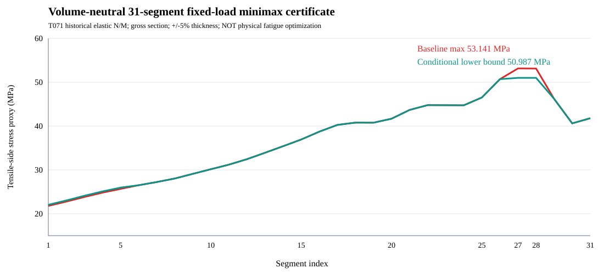与[31行逐段数表](../../../experiments/T071/S11_T071_31SEG_VOLUME_NEUTRAL_MINIMAX_20261112.csv)均由[可复算Node程序](../../../experiments/T071/s11_volume_neutral_minimax_gross_section.cjs)生成。程序核对源表31段A/I和轴压/弯曲应力（绝对容差 \(10^{-8}\)），检验解析单调性、厚度界、体积守恒及目标下界，并包含4项污染拒绝和2项解析测试。本轮已在V8直接执行提交同字节程序的纯计算核心，且以独立Python复核CSEG_27在原厚度与+5%厚度下的53.140996/50.987302 MPa；原生Node CLI及远端Actions仍未独立执行，不能声称完整程序生产验收。

**适用性与反例边界。** 任何厚度变化都可能改变自重、刚度、模态、整机运行响应、轴力/弯矩、PT状态、接缝和局部应力，故固定历史内力下的4.052792%代理改善不能转述为风致疲劳Miner损伤、寿命、抗震安全或真实优化效果。中点面积乘段高也不是锥壳真实积分体积。本文已有单一几何设计向量，不存在可用于验证结构DOE或NSGA-II的多设计真实响应。2026年160m级混塔风震同施和PT抗震改善研究（DOI 10.1080/13632469.2026.2671807、10.1016/j.rcns.2026.03.002）已公开发表；本节既不主张这些研究的首创性，也不迁移其21.9% PT增量。只有不同设计向量的独立真实响应、材料局部疲劳和地震约束闭合，才能进一步形成工程Pareto结论。

## 5.4 代理模型与误差验证

### 5.4.1 代理模型选择

若高保真模型单次计算成本较高，可参考[28]“DOE数据库 → surrogate → multi-objective optimization → FE复核”的组织方式。

优先选择：

- Kriging / Gaussian Process；
- 二阶Response Surface；

只有样本量和非线性确实需要时才使用更复杂机器学习模型。算法复杂度本身不是论文创新。

对每个QoI分别建立：

\[
\boldsymbol{x}\longmapsto\{M,\ f_1,\ u_{\mathrm{top}},\ D_c,\ D_{\mathrm{PT}},\ D_s\}.
\]
这是待验证的响应映射；现有历史数据只有一个结构设计向量，不能据此拟合设计灵敏度。

### 5.4.2 精度要求

必须使用独立验证样本，至少报告：

- (R^2)；
- RMSE；
- maximum relative error；
- 对控制damage排序是否保持一致。

代理模型不能用自己的训练点证明自己正确。

### 5.4.3 分组隔离留出集、排序反转与校准区间的验证方法（方法级算例）

为避免将同一设计族或完全相同设计向量的样本同时放入训练集和测试集，设每条样本携带设计编号、设计族编号、结构响应量及其单位、原始运行来源SHA256。数据按设计族而不是逐行随机分为训练集 \(\mathcal T\)、校准集 \(\mathcal C\) 与独立留出集 \(\mathcal H\)，要求三集合的设计族及相同设计向量均不交叉。特征的中心化与标准化参数只由 \(\mathcal T\) 计算，不得从 \(\mathcal H\) 估计均值、标准差、特征筛选阈值或超参数。对于本文预备的二变量方法示例，采用 \(\phi(\mathbf x)=[1,z_1,z_2,z_1^2,z_1z_2,z_2^2]\) 的二次响应面，解带非截距岭惩罚的最小二乘问题；其用途是验证数据流程，**不代表已经为158 m混塔选定两个正式设计变量**。

对独立留出集计算 \(\mathrm{RMSE}_{\mathcal H}=\sqrt{\sum_{i\in\mathcal H}(y_i-\hat y_i)^2/n_H}\)、\(\mathrm{MAE}_{\mathcal H}\) 和 \(R_H^2=1-\sum(y_i-\hat y_i)^2/\sum(y_i-\bar y_H)^2\)。当留出集真实响应为常数时，\(R_H^2\) 记为不可定义而非1；当真实值包含0时，最大相对误差记为不可估计，并同时报告有单位的绝对误差。针对疲劳控制方案的选优，除RMSE外统计留出集中可比较设计对的**排序反转数**：\((y_i-y_j)(\hat y_i-\hat y_j)<0\)。若误差较小但控制方案次序发生反转，代理仍不足以直接决定Pareto候选优先级。

对与训练集隔离的校准集，记绝对残差排序为 \(r_{(1)}\le\cdots\le r_{(n_C)}\)。给定名义失覆盖率 \(\alpha\)，取 \(k=\lceil(n_C+1)(1-\alpha)\rceil\)；仅在 \(k\le n_C\) 时使用 \(q=r_{(k)}\) 构造 \([\hat y-q,\hat y+q]\)，并在**完全独立**的 \(\mathcal H\) 上报告实测覆盖率。若 \(k>n_C\)，返回NOT_ESTIMABLE，不能将 \(q\) 强行设为最大已观测残差。此区间的有限样本概率解释依赖校准与预测样本的交换性；按设计族切分、极端载荷分布迁移、材料应力非平稳性及共同基准相关性都可能破坏该假设。因此当前程序输出的校准半宽与覆盖率仅用于**诊断**，不能直接充当§5.5.4工程设计的可靠误差边界。

为检验上述程序是否真正识别外推失败，使用54条**完全合成**的二变量二次函数样本（训练30、校准12、留出12；各设计族互不重叠）进行两组可证伪测试。第一组数据恰为二次多项式，留出RMSE=\(1.6714\times10^{-12}\)（无量纲）、\(R_H^2=1\)、排序反转0对；第二组只将留出响应替换为 \(10-y\)，训练与校准完全不变，留出RMSE升至4.499148、66/66对排序反转、校准区间实测覆盖率0。这一反例说明：**训练集或校准集表现优良不能证明独立设计域上的排序可靠**。程序另通过13项拒绝测试，覆盖跨组泄漏、重复特征、重复编号、单位不一致、无效数值、样本不足及将合成数据伪装成真实来源等情况；当校准样本不足以支持所选分位数时也返回不可估计。以上结果仅是算法解析与反例测试，非本塔DOE、真实疲劳损伤、抗震可行性或结构优化性能。

可复算源码：[S11分组留出集验证程序](../../../experiments/T077/recovery/s11_surrogate_group_holdout_gate.cjs)，源码SHA256：`20dcf86d6fe3cc62ddb230270fb4af00755d4d53b5443d1f203d322fafa6a718`。命令 `node s11_surrogate_group_holdout_gate.cjs --self-test` 运行无依赖合成测试；真实输入接口逐条要求来源SHA256和单位，程序仅检查哈希字符串格式，不验证原件真实性或运行证据；因此返回METHOD_ONLY，真实来源仍须外部独立核验。目前**没有**满足这一条件的真实逐设计点局部材料损伤及同态地震约束表。该方法继承本章[28]的DOE—代理—优化—独立复核研究框架，本轮未新增核读[28]原页，不据此提出新颖性优先权主张。

### 5.4.4 历史ETM沿高代理的空间留出误差与设计可识别性（真实来源诊断，非DOE优化）

在正式几何DOE与局部材料疲劳损伤尚未建立前，不能把31段不同高度的截面响应当成31个不同的结构设计。为检验既有历史结果在代理模型开发中可能产生的**相邻高度信息泄漏**，本节仅将**同一固定158 m混塔设计**的四组ETM、31个混凝土塔段名义应力DEL作为空间插值诊断集，而不将其当作几何变量—疲劳目标函数样本。原始124行历史同步毛截面数据源SHA256为`36c0a8a97db36885159fff79cc61daced9c939ab688f98ce1c6b860a89ac91d3`；独立31行控制工况对照表SHA256为`4e69453996d36b56ddbc723fd29edc2ea7dac9f5b71ad06eeafa1550e7a72b36`。四工况均为历史ETM筛查，600 s窗口、16个固定方位、诊断指数m=4，DEL单位MPa；非正式DLC1.2，也不是材料Miner损伤。所有31段的前两名均为U09p343881_ETM_S06（A）与U11p4_ETM_S04（B），因此定义带符号的控制间距
\[
g(z_i)=D_{A,4}(z_i)-D_{B,4}(z_i)\quad(\mathrm{MPa}).
\]
`g>0`表示A在该测点超过B，`g<0`表示B超过A。其余两个历史ETM工况仍参与原始四工况控制身份独立核对，但不构造新的设计变量。

为避免把空间相关的相邻测点误作独立验证，设置两种**训练时完全排除被检测点**的简单分段线性插值：①逐段留一（LOO），31折；②连续五段滑动留出（BLOCK5），27折，每折使用其余26段进行线性插值，边界采用相邻两个保留点的线性外推。对每折仅在留出段计算\(\mathrm{RMSE}=\sqrt{\sum_{i\in H}(\hat g_i-g_i)^2/|H|}\)与控制符号错误数；整体BLOCK5 RMSE按27折共135个**重复参与的预测项**汇总，**不能当135个独立观测或用于独立置信区间**。另以保留段相邻符号变化处的线性零交叉估计两处沿高转换位置，检验删除连续邻域后的变化。所有模型、插值和标准化（此处无拟合超参数）均不得读取被留出段的响应。

真实历史数据计算得到：LOO RMSE为**0.007060512 MPa**（31个预测），BLOCK5汇总RMSE为**0.040216051 MPa**（135个重复预测项），后者为前者的**5.69591倍**。两种划分的控制工况符号错误分别为**0/31**和**0/135**，故本次不能声称控制身份发生错误；但留一验证显著低估了在较大连续未观测高度区间的插值误差。最差BLOCK5为CSEG27–31，RMSE **0.125688697 MPa**，主要包含上端外推，不能把该数值直接解释为结构离散误差。使用全部31段的两处线性零交叉约为**19.738416 m**和**82.317884 m**；留出CSEG04–08后第一处变为**19.157192 m**（偏移−0.581224 m），留出CSEG21–25后第二处变为**82.702174 m**（偏移+0.384290 m）。这些位置只是**离散测点控制间距的插值零点**，不是已验证的连续塔筒物理控制边界。

该负向诊断给出本章正式代理模型的可执行拒绝条件：任何几何参数敏感性/优化代理必须包含**至少两个实际不同的设计向量**及其可核原始响应，并按设计族、风seed与必要的连续高度区间隔离留出；只用本节31个高度点，几何设计向量实际上只有一个，因而无法识别\(\partial D/\partial k_{pc}\)、\(\partial D/\partial k_{pt}\)等结构设计灵敏度，也不能进行NSGA-II的真实Pareto验证。对于真实DOE，不能用LOO RMSE代替跨设计族留出误差，不能用“符号0错”证明连续高度外推、材料寿命或抗震约束可靠。本节只证明**在这组真实历史数据和所定义的空间插值方法下**，验证划分方式会明显影响误差估计；并不提出新的优化算法或首创性声明。

[图5-S11-01：历史ETM沿高空间留出误差](../figures/FIG5_S11_ETM_HEIGHT_HOLDOUT_LEAKAGE_20261107.svg)；[58折结果表](../../../experiments/T077/recovery/S11_4ETM31_HEIGHT_HOLDOUT_58FOLD_20261107.csv)；[可复算Node程序](../../../experiments/T077/recovery/s11_etm31_height_holdout_gate.cjs)，程序SHA256 `66e5b3d4e9e1a346bf645aa4bc9340f52c131c8b3cbeb2a7560caf217e53e2d7`。已执行V8同源核心数值/乱序不变性及8类污染拒绝检查，程序远端语法编译通过，**原生Node CLI/CI尚未运行**；输入与派生表数值精度有限，未给出风场随机性、连续高度、真实材料局部应力或场址目标谱的物理误差上界。**S11 METHOD-LEVEL PARTIAL / PHYSICAL BLOCKED；12阶段0/12。**

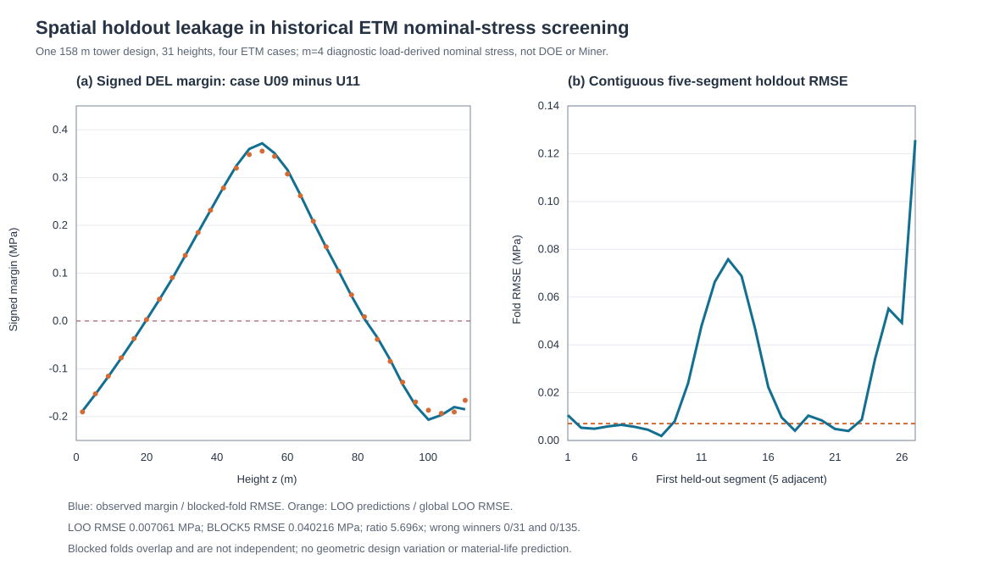

### 5.4.5 风速箱整体留出的载荷代理外推拒绝试验（历史真实NTM来源，非结构DOE）

为检验在有限风速箱上拟合的代理模型能否可靠预测未观测风速，本节将既有**同一158 m固定结构设计**的18组历史NTM（3个风速箱×各6个seed）作为非Abaqus来源级诊断，而不把不同风速或近塔底不同高度当成不同几何设计。直接读取2880行毛截面名义应力雨流表：18个真实历史工况、BASE及G01—G09共10个近塔底测站、16个22.5°周向方位。对每个工况—测站取16方位中最大的四次方名义应力DEL（MPa），形成180个工况—测站指标；独立与此前归档180行方位控制表逐值对照（容差5×10⁻¹⁰ MPa）。这一指标是**固定结构、毛截面、最大方位、诊断指数m=4的循环强度代理量**，不是某一材料点的循环均值、混凝土/钢材Miner损伤或材料寿命。

定义完整风速箱留出（leave-one-bin-out, LOBO）：每次将某一风速箱的**全部6个seed**排除训练；对每个测站，仅用剩余两个风速箱的6-seed均值拟合风速的一次函数 \(\widehat D_4(U)\)，预测被留出风速的6个真实seed。以距离最近的已观测风速箱6-seed均值作为不依赖线性外推的基线；禁止在拟合、模型选择或标准化时使用留出箱任何标签。9.343881、11.4、19.202140 m/s三个箱中，留出中间11.4 m/s属于插值，留出两端属于外推。分别对每个测站的6个留出seed计算误差，再对同一风速箱的10测站×6 seed共60个预测误差汇总描述性RMSE、MAPE和偏差。**这60个误差不是60个独立风场实现**：只有6个留出seed工况，10个相邻测站共享风载和结构状态；3个风速箱也不足以估计可靠的总体外推概率或置信区间。

| 完整留出风速箱 | 留出性质 | 真实均值 DEL4 (MPa) | 线性预测均值 (MPa) | 最近箱预测均值 (MPa) | 线性RMSE (MPa) | 最近箱RMSE (MPa) | 线性MAPE |
|---|---|---:|---:|---:|---:|---:|---:|
| 9.343881 m/s | 低端外推 | 3.184499 | 4.035577 | 4.123939 | 0.935453 | 1.016504 | 28.669986% |
| 11.4 m/s | 内插 | 4.123939 | 3.450369 | 3.184499 | 0.809239 | 1.041018 | 15.359378% |
| 19.202140 m/s | 高端外推 | **4.459238** | **7.688735** | **4.123939** | **3.240152** | **0.425697** | **73.025977%** |

最重要的拒绝结果发生在**19.202140 m/s整箱留出**：仅由9.343881与11.4 m/s两箱拟合的一次函数，对真实历史高风速箱的平均DEL4高估3.229497 MPa；其RMSE为3.240152 MPa，而最近箱常数基线仅为0.425697 MPa，线性外推RMSE约为基线的**7.61倍**。因此，即使模型在两个已观测箱上恰好穿过训练均值，也**不能**宣称它能可靠预测未参与训练的风速箱。中间箱内插RMSE仍为0.809239 MPa，说明此处有限seed差异与风速响应曲率不可忽略。10测站结果具有高度相关性，不能据此给出统计显著性或推断全年风速概率贡献；所用的历史三箱也不是完整正式DLC1.2。

该试验的工程含义是**拒绝未经独立风速箱验证的风速外推来填补长期疲劳缺失箱**，而不是证明最近箱常数外推具有一般优势。三箱上两种简单模型都可能失败；任何未来风速响应代理都须新增独立风速箱、独立seed和控制器状态一致的原始载荷，再在完整正常运行风速范围内进行留出验证。它也不能用于识别壁厚、预应力或混凝土段比例的设计灵敏度，因为本试验**几何设计向量只有一个**。不得将此处的最大方位名义DEL与局部材料疲劳损伤混同，更不能填入Miner或20年寿命。

可复算来源：[2880行历史NTM源](../../../experiments/T062/S10_18NTM_10NEARBASE_16AZ_GROSS_RAINFLOW_20261031.csv)，SHA256 `d45f047f5d622fb834d63728c13cead49b614b6cf42e598918e55242ed45f94b`；[180行独立交叉核对表](../../../experiments/T062/S10_NTM18_180PAIR_DEL_MEAN_AZIMUTH_20261108.csv)，SHA256 `652929e6e1d03aced08f7af9204e389d503ec3d7835df76bd384114ea410bccd`。[Node程序](../../../experiments/T062/s11_ntm18_windbin_group_holdout.cjs) SHA256 `a146dd86c89415b31f5767c0e451686757430e9283f5d5485b79dd81ba65a521`；[30行测站表](../../../experiments/T062/S11_NTM18_WIND_BIN_LOBO_30STATION_20261108.csv)；[3行风速箱汇总表](../../../experiments/T062/S11_NTM18_WIND_BIN_LOBO_3GROUP_20261108.csv)；[图5-S11-02](../figures/FIG5_S11_NTM18_WINDBIN_LOBO_20261108.svg)。在V8实际执行同一程序的2880行解析、180组最大值交叉核对、3项数值正向断言、7类污染拒绝及原行序逆序不变性检查，均通过；原生Node CLI/CI尚未运行，原始OUTB本轮未重新解码。表内DEL均值显示六位小数，RMSE六位，MAPE六位百分点；浮点舍入量级远小于所报告的MPa级差异，但**来源物理、seed总体分布、风速箱缺口及模型非线性误差无可信上界**。此为S11真实历史来源的**代理外推拒绝测试PASS**，不是S11结构优化、材料疲劳或任何物理阶段PASS；12阶段保持0/12。

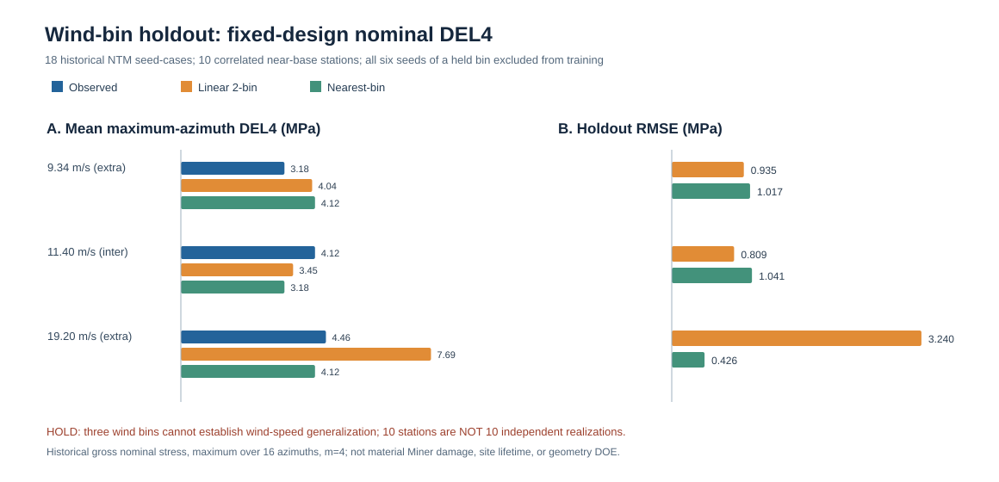

### 5.4.6 按独立风场seed-case分簇的风速箱外推拒绝稳健性（真实历史NTM）

前节30个测站—风速箱误差来自三个风速箱、每箱6个seed-case，每个case内10个相关近塔底测站。为避免伪重复，本节**固定前节训练/留出划分及预测器**，以留出风速箱中的6个seed-case作为误差比较的统计簇。对风速箱b、seed k、测站s和方法j，定义每簇平均平方误差 \(L_{bk}^{(j)}=(1/10)\sum_{s=1}^{10}(\widehat D_{bs}^{(j)}-D_{bks})^2\)（MPa²），箱级 \(\mathrm{RMSE}_b^{(j)}=\sqrt{(1/6)\sum_{k=1}^6L_{bk}^{(j)}}\)（MPa）。十个测站不构成十次独立风场实现。

| 整箱留出风速 | 线性/最近箱RMSE比 | 线性更差的seed-case | 条件性case重抽样比值2.5%–97.5%分位 | 单侧符号翻转p（线性更差） |
|---|---:|---:|---:|---:|
| 9.343881 m/s（低端外推） | 0.920265 | 0/6 | 0.877042–0.933994 | 1.000000 |
| 11.400000 m/s（插值） | 0.777354 | 0/6 | 0.608953–0.815592 | 1.000000 |
| **19.202140 m/s（高端外推）** | **7.611405** | **6/6** | **5.092034–14.372340** | **0.015625** |

在每箱的6个配对case上，定义损失差 \(d_{bk}=L_{bk}^{(lin)}-L_{bk}^{(near)}\)。穷举 \(2^6=64\) 种符号翻转，以翻转后平均损失差不小于观测值的比例给出**条件性单侧p**；高端箱6个差值均为正，p=1/64=0.015625。该检验依赖留出seed独立、配对差符号可交换、预测器固定等假设；本次事后查看三个箱，且不同风速箱随机种子的独立性尚未证明，因此**不将p称为正式总体显著性或可靠度概率**。对每箱6个留出case有放回穷举 \(6^6=46656\) 次，所得比值分位区间固定训练箱预测器，**不是经过校准的95%置信区间**，也不包括训练随机性、气候分布、材料或模型误差。

为检验训练数据中单个seed对高端外推拒绝的影响，对两个训练箱共12个seed-case逐一删除并重新拟合。12次删除后的线性/最近箱RMSE比值为**4.985518–11.257295**，全部大于1。因此，“在这三箱历史数据中，简单线性高端外推劣于最近箱基线”的结论不依赖某一个训练seed；但**最近箱外推不因此获得一般有效性**。低端与中间箱的比值均小于1，也直接反驳“线性预测在全部风速均劣于常数基线”的泛化表述。

原始证据为[180行真实历史OUTB派生最大方位DEL4](../../../experiments/T062/S10_NTM18_180PAIR_DEL_MEAN_AZIMUTH_20261108.csv)，SHA256 \`652929e6e1d03aced08f7af9204e389d503ec3d7835df76bd384114ea410bccd\`，与[30行既有LOBO测站结果](../../../experiments/T062/S11_NTM18_WIND_BIN_LOBO_30STATION_20261108.csv)，SHA256 \`0da0eaea42716525c1cf1cce115b5e7cf30ff67c389b71dab07c9c6b341eb491\`。本轮新增[可运行Node](../../../experiments/T062/s11_ntm18_seed_cluster_uncertainty.cjs)、[18case表](../../../experiments/T062/S11_NTM18_SEED_CLUSTER_18CASE_20261108.csv)、[3bin表](../../../experiments/T062/S11_NTM18_SEED_CLUSTER_3BIN_20261108.csv)、[12trainLOO表](../../../experiments/T062/S11_NTM18_SEED_CLUSTER_12TRAINLOO_20261108.csv)及[图5-S11-03](../figures/FIG5_S11_NTM_SEED_CLUSTER_UNCERTAINTY_20261108.svg)。V8实际执行源程序4项正向、8项畸形输入拒绝及输入行逆序不变性检验；原生Node CLI、原始OUTB重新解码与物理RUN未执行。**仅固定设计毛截面名义DEL4的来源级方法拒绝PASS，非材料Miner、结构DOE、DLC1.2或风震优化验收；12阶段0/12。**

### 5.4.7 同箱随机种子留出与整箱留出的验证目标错配（真实历史NTM，非结构优化）

上述§5.4.5–5.4.6已表明，在19.202140 m/s高端风速箱整体留出时，线性风速代理明显劣于最近箱常数基线。但若仅在**已有风速箱内部**做随机种子交叉验证，是否会得到看似较小的预测误差，并被错误用于论证**未观测风速箱**的外推能力？为检验这一验证目标错配，本节复用§5.4.6同一份180行历史数据（18个NTM seed-case×10个近底测站，毛截面最大方位名义应力DEL4，单位MPa），不新增风场、结构设计或生产计算。原始派生表SHA256为 `652929e6e1d03aced08f7af9204e389d503ec3d7835df76bd384114ea410bccd`；独立整箱留出结果表SHA256为 `bcd986ee4550ddfe894af6ce21337c5232de417e6c3dad98ef0229e851cbb65d`。

对每个已有风速箱\(b\)、seed \(k\)及测站\(s\)，定义同箱留一seed预测\(\widehat D_{bks}^{\mathrm{seed}}=\frac15\sum_{h\ne k}D_{bhs}\)，其训练数据只含该风速箱另外五个seed，**不含被预测seed**。逐箱汇总六个seed-case、每case十个相关测站的60个误差，计算描述性\(\mathrm{RMSE}_{\mathrm{seed},b}=\sqrt{\sum_{k,s}(\widehat D_{bks}^{\mathrm{seed}}-D_{bks})^2/60}\)。整箱留出则完全不使用被留风速箱的六个seed，复用§5.4.5在其余两箱均值上训练的线性模型及最近箱常数基线。二者使用相同真实观测和相同响应单位，却回答**不同的预测问题**：同箱新seed插值与跨风速箱迁移。

| 历史风速箱 (m/s) | 同箱seed留一RMSE (MPa) | 整箱留出线性RMSE (MPa) | 整箱最近箱RMSE (MPa) | 线性整箱/同箱误差比 |
|---:|---:|---:|---:|---:|
| 9.343881 | **0.465883** | 0.935453 | 1.016504 | **2.007912** |
| 11.400000 | **0.538217** | 0.809239 | 1.041018 | **1.503557** |
| 19.202140 | **0.314704** | **3.240152** | 0.425697 | **10.295865** |

在19.202140 m/s箱，**同箱留一seed的RMSE仅0.314704 MPa，但整箱留出线性外推RMSE达到3.240152 MPa，相差约10.30倍**。因此，**在本历史三箱和这两种明确定义的预测任务下**，即使同箱随机种子交叉验证误差较小，也不足以证明模型能够填补缺失风速箱。该差异不是同一目标上的模型优劣检验，不能据此称同箱验证“错误”或把10.30倍当作通用偏差校正系数；最近箱常数基线在高端箱虽为0.425697 MPa，但在低端和中间箱分别为1.016504、1.041018 MPa，同样不能作为未观测箱的可靠上界。

[图5-S11-04：同箱seed留出与整箱留出误差的验证目标对照](../figures/FIG5_S11_SEED_VS_BIN_VALIDATION_20261109.svg)采用对数纵轴显示三种误差；[三箱机器可读表](../../../experiments/T062/S11_NTM18_SEED_LOO_VS_BIN_LOBO_3BIN_20261109.csv)与[可运行无依赖Node程序](../../../experiments/T062/s11_ntm18_seed_vs_bin_holdout.cjs)提供逐行复算。程序对180行原源与独立LOBO表实施SHA256、18个case身份、3箱×6seed×10测站唯一性、观测均值及非负有限值校验；V8执行同源码的六seed解析oracle（\(\mathrm{RMSE}=\sqrt{4.2}\)）、乱序不变性、五类坏源拒绝、CSV/SVG输出自测PASS；原生Node CLI与原始OUTB重新解码均未运行。程序SHA256 `f93a1369cb900a929102e0388a98089268e5ec3d16b27cf7c1be4a146b86605b`；CSV SHA256 `b817c40e0dde0a46a262349efe069d1c7d303c4f17e587e54cfa505632a9f95e`；SVG SHA256 `e5f68e7f7904f34f1e927cf6af00b0d43a18f7aa9779db076280869f9c853fb0`。CSV按9位小数输出，数值舍入不超过\(5\times10^{-10}\)个表内单位；历史数据时序离散、载荷来源状态、seed总体和物理模型误差无法从本实验估计。

该实验的独立观测层级至多是每箱六个历史seed-case，十个近底测站共享同一风场，不能把60个测站误差当作60次独立风场，也不能把不同风速箱的随机种子标签视为天然配对。固定结构几何不提供任何真实设计变量敏感度。故本节**仅验证“交叉验证划分必须匹配论文声称的预测目标”这一来源级方法结论**，不推断材料Miner损伤、年度疲劳寿命、真实结构优化或正式DLC1.2完整性。

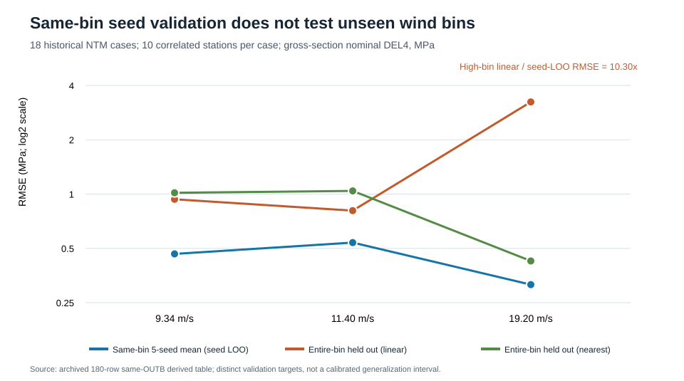

### 5.4.8 六seed机会约束的精确二项分布准入门槛（真实历史载荷诊断，非结构设计合规）

**研究问题。** 第5.4.5—5.4.7节已证明风速箱和随机种子验证划分会改变载荷代理的外推误差。然而，优化器即使获得一个看似可行的候选，也不能将“六个历史seed未出现超限”直接解释为“真实超限概率低于5%”。本节针对**有限随机风场样本能否支持概率约束**建立可证伪的样本量与置信门槛；并复用同一158 m固定设计的18组历史NTM、三个风速箱×六seed、塔底Mx/My两通道，形成真实载荷数据的算术演示。源为已修正雨流72行表（SHA256 `12dabbb1273ce03d3920aedda3f72f9fa1d75b671e01a1db145c0a972ffe15e2`）；只用其中36个NTM通道行，load-DEL取m=4、参考循环数100000，单位kN·m。**DEL超过阈值不是原始时程峰值超过阈值，更不是材料Miner损伤超限。**

**严格概率定义。** 假设将来对某一预先固定的设计、风速箱、运行状态和明确QoI阈值T，独立同分布抽取n个随机风场seed，定义单次超限指示量I=1{DEL>T}、未知条件超限概率p=P(I=1)。观测k次超限时，单侧置信水平1−α的Clopper–Pearson精确上界p_U由
\[
\sum_{j=0}^{k}\binom{n}{j}p_U^j(1-p_U)^{n-j}=\alpha\quad(0\le k<n)
\]
定义，k=n时p_U=1；k=0时退化为
\[
p_U=1-\alpha^{1/n}.
\]
这里“精确”指二项模型的有限样本覆盖，不意味着风场seed独立性、载荷模型真实性或阈值预先确定已获验证。若同时要求三个风速箱×两个通道共六项约束，以Bonferroni分配每项\(\alpha/6\)，无需假设两个通道相互独立，但仍需各项二项抽样条件成立。

**真实来源演示。** 为让程序覆盖k=0、0<k<n、k=n三种边界，选择两个**回顾性诊断阈值**：Mx为3000 kN·m，My为16000 kN·m。它们不是规范限值、材料容许值或正式预先注册的设计约束；由于本节是在检查历史数据后设置阈值，下面的“95%上界”只能视为**假定未来预先固定同一阈值且seed独立时的计算示范**，不能对本历史样本作严格频率学覆盖宣称。

| 风速箱（m/s） | Mx超限/6 | My超限/6 | Mx单项上界 | My单项上界 | Mx六项同时上界 | My六项同时上界 |
|---:|---:|---:|---:|---:|---:|---:|
| 9.343881 | 0 | 0 | 39.3038% | 39.3038% | 54.9733% | 54.9733% |
| 11.400000 | 0 | 2 | 39.3038% | 72.8662% | 54.9733% | 83.5274% |
| 19.202140 | 6 | 5 | 100% | 99.1488% | 100% | 99.8606% |

更关键的是**不依赖历史阈值的严格样本量结论**：若希望在真正预先固定的阈值下，即使观测到零次超限也能在单项95%单侧置信水平认证p≤5%，至少需要\(n=\lceil\log(0.05)/\log(0.95)\rceil=59\)次独立seed；六项Bonferroni同时认证至少需要**94次/项**。若目标p≤1%，对应为**299次/项**和**477次/项**。这些是“零超限”条件下的**理论最低样本量**，出现任何超限时通常需要更多样本；不是IEC规定的风场seed数量，也不要求本研究立即启动这些昂贵RUN。六个seed即使零超限，其单项上界仍高达39.3038%，因此不足以认证5%概率约束。

**对S11的直接约束。** 结构DOE必须首先拥有不同设计向量及经独立验证的局部材料疲劳/地震QoI；只有在事前定义阈值、风速箱、置信族、seed生成机制、运行状态与验证预算后，才能把超限统计作为优化约束。禁止把本节载荷DEL阈值代替局部应力、材料Miner或抗震安全；也不能将不同风速箱的36个通道值合并为36次同分布试验。对未完成的正式DLC1.2和同态风震约束，本节只给出**拒绝过度置信的数学门禁**，不是优化成功。

[图5-S11-05：六seed经验超限率与二项上界](../figures/FIG5_S11_SEED_CHANCE_GATE_20261110.svg)；[六行真实数表](../../../experiments/T062/S11_NTM18_SEED_CHANCE_GATE_6ROW_20261110.csv)；[独立Node程序](../../../experiments/T062/s11_seed_chance_constraint_gate.cjs)。程序读取原72行源并执行SHA256、case/双通道OUTB身份、3箱×6seed完整性、第三方DEL对照与二项求根；本轮远端V8执行程序同源码5个解析锚点/8个坏输入拒绝和36个NTM通道值PASS，原生Node CLI的历史原CSV读取及OUTB重新解码未执行。二项求根双精度误差远小于表中0.0001个百分点的显示精度；iid、控制器状态、真实结构、材料映射和阈值选择误差**无可报告的物理上界**。**S11统计方法PARTIAL；结构优化与概率合规HOLD，12阶段0/12。**

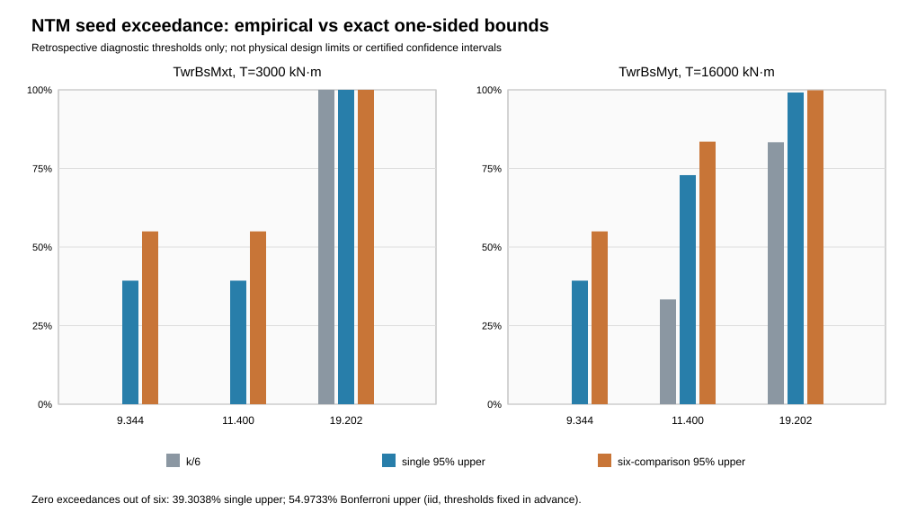

## 5.5 疲劳驱动多目标优化

### 5.5.1 目标函数

推荐主目标1为结构质量/材料量：

质量目标与条件性疲劳目标为
\[
F_1(\boldsymbol{x})=\frac{M(\boldsymbol{x})}{M_0},\qquad
F_2(\boldsymbol{x})=\max_{k\in\mathcal K_+}\frac{D_k(\boldsymbol{x})}{D_{k,0}},
\]
其中 \(\mathcal K_+=\{k:D_{k,0}>0\text{，且基准与候选的同材料损伤均有真实证据}\}\)。若集合为空，或基准损伤为零而候选非零，不能强行计算该比值，应采用有依据的绝对损伤限值重新定义目标。当前无真实材料损伤，故不报告实际 \(F_2\) 或Pareto前沿。

当某一材料未进入正式疲劳分支时，不强行放入该max函数。

不建议直接以“疲劳寿命最大”为唯一目标，因为当damage极小时，寿命 (1/D) 会被数值放大，不利于稳定的多目标比较。

### 5.5.2 约束

至少包含：

- 一阶频率和1P/3P安全区约束；
- 塔顶位移约束；
- concrete / steel / PT强度；
- PT最大应力不超出当前材料本构适用域；
- 关键接缝开闭/滑移服务性能；
- 各材料fatigue damage限值；
- 几何、构造和施工可行性；
- 需要时加入局部稳定约束。

约束值必须回到正式规范、REF和本文真实baseline，禁止照搬其他2 MW/5 MW案例的数值。

### 5.5.3 优化算法

采用成熟多目标算法即可，优先NSGA-II。

本文创新不在“发明新优化算法”，而在：

> 用第四章真实疲劳控制机理定义变量和目标，并把优化方案重新送回高保真整机—结构链验证。

最终输出Pareto front，不预设只有一个“数学最优”。

### 5.5.3a 等评估预算下约束多目标算法的独立基准验证（方法级，非混塔优化结果）

为避免仅凭NSGA-II程序可运行就认定结构优化有效，本节建立独立的解析Pareto前沿与不可能可行负对照。使用二维ZDT1解析基准，设计向量x=(x1,x2)∈[0,1]²，f1=x1，g=1+9x2，f2=g(1−√(x1/g))，附加演示约束x2≤0.25。真实Pareto前沿仍为x2=0、f2=1−√f1。该约束是算法可行性单测，**不是风机频率、地震或材料限值**。NSGA-II采用Deb可行性优先支配、非支配排序、拥挤距离、二元锦标赛、SBX交叉和多项式变异；对照为每一维均严格分层的Latin hypercube sampling（LHS）。两种算法均用240次目标评估：NSGA-II初始40个设计、5代各40个后代；LHS直接取240点。以101个解析前沿参考点到可行非支配集的平均最近欧氏距离IGD评价，使用**未归一化的原始目标坐标**，IGD越小越好。

采用8个预先固定的算法随机种子1001、1038、1075、1112、1149、1186、1223、1260（**不是TurbSim风场seed**），NSGA-II的IGD依次为0.042457、0.107571、0.081771、0.099277、0.035455、0.038445、0.041694、0.044335；相同预算LHS依次为0.106601、0.112369、0.091294、0.102486、0.108373、0.099000、0.114096、0.114551。8/8个算法种子NSGA-II的IGD较低；描述性均值为**0.061375647与0.106096270**，相对降低**42.150985%**。NSGA-II各次最终40点均可行，LHS每次240点中恰有60点满足x2≤0.25。此差异只描述该二维解析基准及固定预算，不是混塔质量、疲劳损伤、抗震约束或真实结构可行率的改善；8个算法种子不提供物理统计显著性。

**独立拒绝试验**：将约束改为x2≤−0.01时，设计域内不存在可行解，程序返回0个可行非支配方案，拒绝伪造“最优设计”。对解析点(0.25,0)检查f2=0.5、可行优先支配、两维40层LHS分层唯一性、无效设计向量5类、非法种子4类、240次预算、同种子确定性重放和SVG有限坐标均通过。V8直接执行同一源程序通过；原生Node CLI尚未运行。该方法不能替代已有§5.4分组留出验证或§5.5.4区间Pareto稳健性门禁。正式优化必须先有多个**实际不同的结构设计向量**、真实分材料局部Miner目标、同状态地震约束及独立高保真复核，才能讨论S11阶段验收。

[图5-S11-02：算法基准IGD对照](../figures/FIG5_S11_NSGA2_ZDT1_20261109.svg)；[8种子结果CSV](../../../experiments/T062/S11_NSGA2_ZDT1_8SEED_BENCHMARK_20261109.csv)；[可运行无依赖Node程序](../../../experiments/T062/s11_constrained_nsga2_lhs_benchmark.cjs)。程序SHA256：3e7b97700da5d4d09cbcefd849f5855e2db4af7b87438e6683f0e6e77b639b89；CSV SHA256：ddb67c5282eaa4e3526b100fc1624b4d0249f9e122e1d4132f2db2debd59d5ef；SVG SHA256：8185b0725b0fd7ec7fc6411e28b38e3556ba42960faa8a72e3ec6c62350aa189。程序提供 --emit-csv、--emit-svg 及默认统计输出接口。**S11 ALGORITHM-ONLY PASS / STRUCTURAL DOE、LOCAL MINER、SAME-STATE SEISMIC CONSTRAINT & PHYSICAL PARETO HOLD；12阶段0/12。**

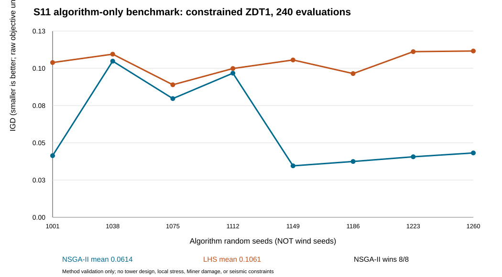

### 5.5.4 Pareto关系对目标误差的区间稳健性判别（算法验证，非工程结果）

仅以代理模型的点预测画Pareto前沿，会把小于模型误差的目标差异误判为设计优劣。对每个经相同运行状态、相同基准设计比较的候选方案 (i)，令质量比 (f_{1i}=M_i/M_0)，疲劳目标 (f_{2i}=\max_{k\in\mathcal K}D_{ki}/D_{k0})，其中 \(\mathcal K\) 只包含已完成真实局部应力与分材料损伤验证的材料。对两个目标分别建立**由独立验证数据支持**的闭区间 (I_{qi}=[L_{qi},U_{qi}])；区间必须包住对应点估计，且误差来源、相关性和覆盖含义需单独说明。本文现阶段没有这些物理误差区间，不能用任意5%作为工程容差。

对最小化的两个目标，若对任意 (q\in\{1,2\}) 均有 (U_{qa}\le L_{qb})，且至少一项严格小于，则方案 (a) **在所给区间内必然支配** (b)（充分条件）。若 (L_{qa}\le U_{qb}) 两目标均成立且至少一项严格小于，则仅表示存在某种区间取值使 (a) **可能支配** (b)，不代表真实物理支配。由此得到两层集合：没有任何其他方案可能支配的**保守确定非支配内核**，以及没有被其他方案必然支配的**非支配外包集合**。在独立盒式区间假设下，对任何区间内的实际目标值，其Pareto前沿均位于这两层集合之间；由于质量、材料损伤和共同基准可能相关，盒式区间通常偏保守，不能据此声明概率覆盖率或鲁棒优化已完成。

风致疲劳单约束与新增抗震约束的对照**复用同一组候选、同一目标函数、同一基准与运行状态**，只改变地震可行性筛选。若某一候选的地震可行性为UNKNOWN，则不能默认PASS。比较名义前沿、内核、外包集合和约束导致的入选/剔除，同时标注相对于不确定性是否可辨识。现有可复算程序[配对Pareto区间门禁](../../../experiments/T077/recovery/s11_paired_wind_seismic_pareto_gate.py)将误差区间作为可选外部JSON输入，拒绝缺候选、跨状态、区间不包点估计等错误；没有经独立验证的预算时仅输出点估计及NOT_EVALUATED，不生成假区间。

**算法解析反例（完全合成，不是本塔优化结果）**：七个方案的名义风前沿为A、B、D、E；加入合成地震门禁后为B、D、G。若为所有目标人为设置绝对半宽0.05（仅用于测试算法），风前沿的确定内核仅B，外包集合为A、B、BASE、D、E、G；抗震约束后确定内核仅B，外包集合为B、BASE、D、G。G虽被A名义支配，但两者误差区间重叠，不能再断言G在所有允许取值下被支配。零宽区间必须严格退化为原点值Pareto前沿，这是独立解析单元测试。此数例不用于确定实际误差阈值、抗震改善或结构参数范围。

## 5.6 现阶段验证结果对优化结论的约束

本章实证属于**同一固定几何的历史载荷/名义应力预测验证**，不是结构设计变量优化试验。为防止验证对象错配，按真实预测任务并列留出策略；各行因变量或预测任务不同，不能跨行把误差比解释为同一模型的优劣。

| 历史数据与预测对象 | 弱隔离验证 | 强隔离验证 | 结果与解释 |
|---|---|---|---|
| 4 ETM×31段，控制工况名义应力DEL4间距 \(g(z)\)（MPa） | 逐段LOO：RMSE **0.007060512** | 连续5段BLOCK5：RMSE **0.040216051** | **5.69591倍**；控制符号错误均为0，连续高度区间插值误差更大 |
| 18 NTM×10近底测站，19.202140 m/s名义应力DEL4（MPa） | 同箱seed-LOO：RMSE **0.314704** | 整箱LOBO线性外推：RMSE **3.240152** | **10.295865倍**；同箱新seed与未见风速箱是不同预测任务，非通用校准系数 |
| 同一高端整箱LOBO的两种预测器 | 最近箱常数基线：RMSE **0.425697** | 线性风速外推：RMSE **3.240152** | **7.611405倍**；只在本历史高端箱拒绝未经验证的线性外推，不证明常数基线普适 |

各数值继承§5.4.4–5.4.7的真实来源和程序。10个相邻测站共享同一seed-case，BLOCK5的135项含重复预测，不能当独立风场样本。历史数据只有一个设计向量 \(\boldsymbol{x}_0\)，不能识别 \(\partial D/\partial\boldsymbol{x}\)。缺少真实材料损伤和多个设计点，不能填造优化前后质量、Miner寿命、抗震约束Pareto或改善百分比。未来验证必须按设计族、完整风速箱和连续高度区间隔离。

## 5.7 本章小结

本章阶段性实证不是已经完成结构优化，而是以**两个不同的真实历史数据留出试验**检验代理模型泛化假设。第一项使用四组ETM的31段控制间距：逐段留一（LOO）RMSE为**0.007060512 MPa**，连续五段留出（BLOCK5）汇总RMSE为**0.040216051 MPa**，相差**5.69591倍**。虽然两种试验的控制符号错误均为零，相邻测站的空间相关性仍使逐点留出低估连续未观测高度区间的插值误差。第二项使用18组NTM、三个风速箱各六seed的整箱留出（LOBO）：19.202140 m/s高端外推时，线性预测平均DEL4为**7.688735 MPa**，真实历史均值为**4.459238 MPa**，线性RMSE **3.240152 MPa**；最近箱常数基线RMSE仅**0.425697 MPa**，前者约为后者的**7.61倍**。[历史风速箱留出图](../figures/FIG5_S11_NTM18_WINDBIN_LOBO_20261108.svg)展示的是固定几何下的预测失败，不是最优设计性能。

两项试验的拒绝机制不同：LOO与BLOCK5检验**空间邻近信息泄漏**，LOBO检验**未观测风速区域的外推**。两者均没有提供结构设计变量扰动数据。记响应为\(y(\mathbf x,U,s)\)，\(\mathbf x\)为壁厚、混凝土段比例、预应力配置等设计向量；当前历史NTM只观测一个固定\(\mathbf x_0\)。无论风速、seed或测站有多少个，单一\(\mathbf x_0\)的响应都不足以识别\(\partial y/\partial\mathbf x\)，也不足以验证NSGA-II输出的不同设计向量的Pareto优劣。因此，不能把三箱留出、31段高度插值或合成Pareto算法测试称为结构DOE、抗震约束优化或高保真独立验证。

这些**真实拒绝结果**给后续正式优化提出明确约束：设计空间验证须隔离未见过的完整设计向量或设计族；风速响应验证须隔离完整风速箱及seed；空间场验证应采用连续高度区间留出；目标误差和约束可行性必须由独立物理结果支持，不能任意指定区间。只有第四章材料点循环、长期概率和控制材料闭合后，才能把真实疲劳损伤纳入质量—疲劳目标；只有不同设计的独立响应可得时，才能报告设计敏感性、Pareto前沿及性能改善。当前可证实的贡献是**在已观测数据上拒绝两种不充分的验证方式**，而不是已经找到更优的158 m混塔结构。

---

---

# 第六章 结论与展望

## 6.1 主要研究结论

本文以DTU 10 MW参考风机及158 m预应力混凝土—钢混合塔架的组合研究对象为背景，围绕长期风环境、随机风载与疲劳控制指标开展研究。塔架总高158 m，其中混凝土段112 m、钢塔段46 m，混凝土塔身划分31个研究节段。现有资料能够支持风气候、载荷和毛截面名义应力层的定量分析，但尚不足以确定材料点长期疲劳损伤及结构优化收益。以下仅归纳已有来源可以核对的结果。

### 6.1.1 长期风气候覆盖与疲劳统计量的可识别性

2005—2025年嘉鱼区域ERA5轮毂高度换算风速资料包含184080个逐小时样本。[4,25) m/s研究诊断窗口共有106900 h；与现有NTM载荷对应的9—10、11—12及19—20 m/s三个风速箱分别为5736、1426和2 h，合计7164 h。其占诊断窗口6.701590%，占全部ERA5小时3.891786%；窗口内另有99736 h缺少相应随机载荷来源（第三章§3.10）。

在同一载荷通道、循环指数及参考循环数下，完整长期四次矩应为各风速箱概率与箱内四次矩的加权和：
\[
K_{\mathrm{all}}=\sum_{j\in\mathcal J}p_j\overline{DEL_j^4}
=K_{\mathrm{obs}}+\sum_{j\in\mathcal M}p_j\overline{DEL_j^4}.
\]
缺失项非负；在没有缺失箱载荷可信上界的条件下，现有三箱结果不能确定完整四次矩的有限上界，也不能据已知支持域份额报告全年材料疲劳损伤。ERA5是区域再分析资料，不等同于塔址实测风；[4,25) m/s是诊断窗口而非已经确认的机组运行边界。

### 6.1.2 时均、正峰与循环等效弯矩不能相互替代

历史18组NTM同源塔底My数据覆盖三个风速箱，每箱六个随机实现。9.343881、11.4和19.202140 m/s三箱的六seed平均载荷DEL4依次为43.701157、56.611754和61.333196 MN·m。由11.4 m/s至19.202140 m/s，时均My下降44.621515%，平均正峰My下降25.098674%，而DEL4上升8.340039%。因此，已有三个风速箱中，时均、正峰与循环等效量的跨箱变化方向并不相同（第三章§3.7.15）。

对相同18组数据进行固定样本组间—组内平方和分解，时均My、正峰My和DEL4的箱间份额分别为99.059460%、93.322562%和67.820857%，DEL4箱内份额为32.179143%。三个箱各删除一个已观测seed的216种组合中，DEL4箱间份额为61.949045%—80.260537%（第三章§3.7.16）。这说明时均载荷的历史箱间区分度不能代替循环载荷的随机实现收敛检验。该平方和分解是有限样本描述，不是总体置信区间，也不能单独识别控制器的因果作用。

### 6.1.3 循环计数与周向取点改变控制候选的识别

历史36组风载经修正雨流算法后，My和Mx载荷DEL的工况两两排序分别发生102/630和12/630对变化，说明算法实现影响历史控制工况的相对排序。对三箱各六seed的NTM有限全集，每箱选取三个seed的8000种组合中，760种组合的My控制风速箱与六seed参照不同。该9.50%只属于已观测有限全集，不能解释为未来独立风场的误选概率（第三章§3.7）。

在四个历史ETM工况、31个混凝土研究节段及每段16个周向方位的毛截面名义应力筛查中，124个工况—节段组合的最大DEL4方位与最大正向应力峰值方位均相差180°。改选正峰方位的DEL4相对损失为0.016753%—0.266934%；只保留DEL4最大方位则会遗漏8.780294—24.277101 MPa的正峰差，且83/124组在该DEL4方位的全时程最大名义应力小于零（第四章§4.7.19）。31个高度来自相关的同一风场，124组不是124次独立试验。毛截面名义应力未包含材料点的真实局部循环状态，故这一发现仅支持保留不同控制指标与相反方位作为后续候选，不能推断开裂、材料寿命或实际预应力作用后的安全性。

### 6.1.4 历史样本内稳定不等于样本外可推广

11.4与19.202140 m/s两NTM箱的六seed平均My-DEL4相差4.721442 MN·m；对两箱各删除一个已观测seed的36种组合，差值均为正。然而，在两箱标签可交换这一附加假设下，924种等分精确置换中有158种达到至少同等绝对均值差，双侧p=0.170996（第三章相关统计结果）。样本内符号稳定不能直接推出风速箱总体差异显著；在运行状态未核实前，该置换结果也只能解释为条件性统计检验。

第五章的整箱留出反例进一步表明，少量风速箱的拟合不足以支持高端外推：对19.202140 m/s箱，线性预测的名义应力DEL4均值为7.688735 MPa，历史均值为4.459238 MPa；线性留出RMSE为3.240152 MPa，最近已知风速箱常数基线仅0.425697 MPa（第五章§5.4.5）。这里的MPa是名义应力指标，与前述MN·m塔底载荷DEL不是同一物理量。该负对照支持独立风速箱留出验证的必要性，不构成真实混塔结构优化结果。

## 6.2 已有贡献与创新边界

现阶段能够独立核查的工作贡献包括：对历史随机风载雨流算法进行纠错并量化其排序影响；利用同一批18组NTM数据区分时均、正峰和循环等效量的风速箱差异及随机种子离散；将ERA5全风速概率支持域与现有NTM载荷的有限支持域明确区分，指出长期四次矩在缺失箱无可信上界时不可完整识别；以及通过四ETM周向名义应力反例说明单一DEL最大方位不足以覆盖正峰暴露。

这些成果属于历史载荷、统计方法及名义应力控制指标层面的可复核认识，不等同于新的材料疲劳机理。2026年已有160 m级混塔风震与预应力抗震相关研究（DOI：10.1080/13632469.2026.2671807；10.1016/j.rcns.2026.03.002），本文不主张首次研究混塔风震作用或预应力抗震。本文目前可与既有研究区别的重点是雨流纠错、有限seed证据及风气候覆盖边界；这些工作是否达到独立期刊创新要求，仍须接受原文对照及外部数据验证。

## 6.3 研究局限

研究风气候主要来自区域ERA5再分析与轮毂高度换算，尚无具体塔址长期测风的独立验证。现有18组NTM与四组ETM是历史有限工况，不是覆盖目标运行风速箱和随机实现的正式DLC1.2总体。有限样本的箱间方差份额、子集枚举及置换检验均不能直接解释为未来风场的总体概率或物理误差预算。

当前疲劳相关结果主要为塔底载荷和毛截面名义应力筛查。载荷DEL的循环指数与参考循环数不能直接移用于混凝土、普通钢筋、预应力筋或钢塔的材料疲劳关系。缺少可追溯的材料点循环范围—均值—次数、适用材料疲劳参数及完整风速权重，不能报告年度Miner损伤、20年寿命、材料疲劳控制位置或实际结构优化改善百分比。

现有ESM双水平地震结果属于已归档的非生产线性梁代理E-only研究，尚不具备同一结构与运行状态下的真实W/E/WE配对资料；具体场址目标谱及其适用条件亦未闭合。因此，现有代理峰值不能用于证明实际风震交互、抗震安全裕度或抗震约束下的优化收益。

## 6.4 展望

后续应首先在同一158 m研究对象、同一运行状态与可追溯原始时程条件下，补齐长期正常运行风速箱和独立seed覆盖，分别报告全年无条件权重及研究运行区间条件概率，并以独立留出数据检验多指标控制工况的稳定性。

获得材料点真实循环应力和适用疲劳参数后，方可逐材料比较不同高度与周向位置的年损伤贡献，检验“最大载荷DEL工况是否也是最大材料损伤工况”这一可证伪命题。若两者一致，应如实报告一致，不预设差异。结构优化应以经验证的材料控制响应为目标，通过独立留出与同条件对照评估代表方案；解析优化算法基准不能代替实际结构改进结果。

地震方向需先闭合真实场址目标谱和同状态风、地震记录，才能讨论其对响应控制与优化可行域的影响。现阶段可成立的结论限于历史风气候、随机风载和名义应力筛查的上述定量认识，材料级长期疲劳、真实结构优化与风震联合物理结论仍需独立来源支撑。

---

# 10 MW混塔六章现行参考文献（2026-11-10）

> **可供导师阅读的初步著录，非GB/T 7714终审。** 原R5 Word 106条参考文献直接提取（DOCX SHA256 `da86e1fadafc977fc66d14a97a46760e73ec3b5150ddbae65fd62c7105764ee9`），与现行registry和出版社/机构元数据对照，仅保留六章真正引用的30个非禁区REF。另一个`REF131`按用户明确禁令原样保留，不处理、不审核、不重编号。

> **纠错：** 原R5[8]把Yang等2024年Applied Energy 356卷文章编号写为`122381`；与题名和DOI `10.1016/j.apenergy.2023.122441`一致的文章编号是**122441**。2019版`REF132`与2019+AMD1:2025合并版`REF048`为不同版本，不合并。

## 参考文献

1. [REF001] BAK C, ZAHLE F, BITSCHE R, et al. Description of the DTU 10 MW Reference Wind Turbine[R]. DTU Wind Energy Report-I-0092, 2013.

2. [REF008] 何泽瑜. 大型混塔式风力机的建模与可靠度分析[D]. 长沙: 湖南大学, 2024.

3. [REF005] LI Z, XU B, WANG J, et al. Experimental and two-scale numerical studies on the behavior of prestressed concrete-steel hybrid wind turbine tower models[J]. Engineering Structures, 2023, 279:115622. DOI:10.1016/j.engstruct.2023.115622.

4. [REF007] 李泽宇. 预应力混凝土-钢混合风电塔架结构优化及性能分析[D]. 长沙: 湖南大学, 2024.

5. [REF010] CHENG Y, CAO L, LIU J, et al. Intelligent analysis of dynamic characteristics of steel-concrete hybrid wind turbine tower based on adaptive vibration mode[J]. Structures, 2024, 68:107235. DOI:10.1016/j.istruc.2024.107235.

6. [REF039] LI S Z, ZHOU X H, WANG Y H, et al. Closed-Form Solution of Fundamental Frequency of Steel-Concrete Hybrid Wind Turbine Tower[J]. International Journal of Structural Stability and Dynamics, 2023, 23(3). DOI:10.1142/S0219455423500311.

7. [REF006] 李守振. 风电机组钢—混凝土混合塔筒动力性能及损伤识别研究[D]. 重庆: 重庆大学, 2023.

8. [REF061] XU J, HE Z, WANG D, et al. Nonlinear dynamic response analyses of Onshore Wind Turbines with Steel–Concrete Hybrid Tower using a co-simulation approach[J]. Renewable Energy, 2025, 243:122475. DOI:10.1016/j.renene.2025.122475.

9. [REF009] BROWN K, BORTOLOTTI P, BRANLARD E, et al. One-to-one aeroservoelastic validation of operational loads and performance of a 2.8 MW wind turbine model in OpenFAST[J]. Wind Energy Science, 2024, 9:1791-1810. DOI:10.5194/wes-9-1791-2024.

10. [REF080] OLAUSON J. ERA5: The new champion of wind power modelling?[J]. Renewable Energy, 2018, 126:322-331. DOI:10.1016/j.renene.2018.03.056.

11. [REF090] GUALTIERI G. Analysing the uncertainties of reanalysis data used for wind resource assessment: A critical review[J]. Renewable and Sustainable Energy Reviews, 2022, 167:112741. DOI:10.1016/j.rser.2022.112741.

12. [REF093] YANG X, JIANG X, LIANG S, et al. Spatiotemporal variation of power law exponent on the use of wind energy[J]. Applied Energy, 2024, 356:122441. DOI:10.1016/j.apenergy.2023.122441.

13. [REF064] JONKMAN B J. TurbSim User's Guide Version 1.50 / v2 guide[R]. NREL/TP-500-46198, 2009, Version 1.50 (R5 v2 unresolved).

14. [REF132] INTERNATIONAL ELECTROTECHNICAL COMMISSION. IEC 61400-1:2019 Edition 4.0 — Wind energy generation systems — Part 1: Design requirements[S]. Geneva: IEC, 2019 (base edition).

15. [REF046] ABBAS N J, ZALKIND D S, PAO L Y, WRIGHT A D. A reference open-source controller for fixed and floating offshore wind turbines[J]. Wind Energy Science, 2022, 7:53-73. DOI:10.5194/wes-7-53-2022.

16. [REF018] HUANG X, CUI J, ZHOU X, et al. Fatigue analysis of segmental precast post-tensioned concrete towers under operational wind turbine loads[J]. Engineering Structures, 2025, 334:120295. DOI:10.1016/j.engstruct.2025.120295.

17. [REF041] WANG Z, HUANG D, HE M, LI Z. Numerical Simulation and Fatigue Analysis of the Grout Layer Replacement for Horizontal Joint of Wind Turbine Prestressed Concrete Tower[J]. International Journal of Concrete Structures and Materials, 2025, 19:68. DOI:10.1186/s40069-025-00800-5.

18. [REF023] QU C, MIAO P, LI C, et al. Fatigue Life Evaluation of a Steel–Prestressed Concrete Hybrid Tower Under Prestress Relaxation Using a Bidirectionally Coupled Damage Model and Neural Network Surrogate[J]. Buildings, 2026, 16(19):3854. DOI:10.3390/buildings16193854.

19. [REF002] KENNA A. The Response and Optimisation of Hybrid Wind Turbine Towers[D]. Dublin: Trinity College Dublin, 2019.

20. [REF143] ZHAO Y, LI X, WANG X, et al. Fatigue Life Evaluation of Wind Turbine Tower Based on Measured Data[J]. Advances in Civil Engineering, 2023:1100725. DOI:10.1155/2023/1100725.

21. [REF036] KIM M O, KIM T M, LEE D Y, KIM M K. Experimental Investigation of the Steel-Concrete Joint in a Hybrid Tower for a Wind Turbine under Fatigue Loading[J]. KSCE Journal of Civil Engineering, 2019, 23(7):2971-2982. DOI:10.1007/s12205-019-1171-2.

22. [REF047] OPENFAST DEVELOPERS. ElastoDyn theory / coordinate systems and output conventions[EB/OL]. OpenFAST Documentation, online theory (v3.5.3 version not closed). https://openfast.readthedocs.io/en/main/source/user/elastodyn/theory.html

23. [REF083] JUNG C, SCHINDLER D. The role of the power law exponent in wind energy assessment: A global analysis[J]. International Journal of Energy Research, 2021, 45(6):8484-8496. DOI:10.1002/er.6382.

24. [REF011] ROBERTSON A N, SHALER K, SETHURAMAN L, JONKMAN J. Sensitivity analysis of the effect of wind characteristics and turbine properties on wind turbine loads[J]. Wind Energy Science, 2019, 4:479-513. DOI:10.5194/wes-4-479-2019.

25. [REF048] INTERNATIONAL ELECTROTECHNICAL COMMISSION. IEC 61400-1:2019+AMD1:2025 CSV Wind energy generation systems Part 1 Design requirements[S]. Geneva: IEC, 2025 (2019+AMD1:2025 CSV).

26. [REF004] HUANG X, LI B, ZHOU X, et al. Geometric optimisation analysis of Steel–Concrete hybrid wind turbine towers[J]. Structures, 2022, 35:1125-1137. DOI:10.1016/j.istruc.2021.08.036.

27. [REF020] CHENG Y, ZHAO Y, QI H, ZHOU X. Intelligent optimal design of steel-concrete hybrid wind turbine tower based on evolutionary algorithm[J]. Journal of Constructional Steel Research, 2024, 218:108729. DOI:10.1016/j.jcsr.2024.108729.

28. [REF021] CHENG Y, LIU J, QI H, et al. Generative design of steel-prestressed concrete hybrid wind turbine tower based on machine learning and multi-objective optimization[J]. Engineering Structures, 2025, 341:120835. DOI:10.1016/j.engstruct.2025.120835.

29. [REF022] XU W, ZHOU J, WANG J. Optimization Model of Steel-Prestressed Concrete Hybrid Wind Turbine Tower: Using a Combined Differential Whale Optimization Algorithm[J]. The Structural Design of Tall and Special Buildings, 2025, 34(5):e70014. DOI:10.1002/tal.70014.

30. [REF033] CHEN J, LI J, HE X. Design optimization of steel–concrete hybrid wind turbine tower based on improved genetic algorithm[J]. The Structural Design of Tall and Special Buildings, 2020, 29(10):e1741. DOI:10.1002/tal.1741.

## 两篇2026年直接竞争研究（第一章已直接以DOI引用，暂不重复占用REF编号）

WANG W, DIAO H, MA H, GAO X, JI B, ZHANG Z. Research on the Dynamic Response of Hybrid Tower Wind Turbines Under Combined Earthquake–Wind Multi-Hazard Conditions[J]. Journal of Earthquake Engineering, 2026 (online 16 May). DOI:10.1080/13632469.2026.2671807. 出版社摘要/作者元数据已核，未取得全文可定位页码。

WANG W, JI B, MA H, DIAO H, ZHANG Z. Research on the dynamic response and disaster-resistance performance enhancement of hybrid tower under strong wind and earthquake[J]. Resilient Cities and Structures, 2026, 5(2):47-64. DOI:10.1016/j.rcns.2026.03.002. 仓库已有原PDF选页核读；其163.24m/42段研究对象与本文不同。

## 边界与未闭合

- R5原编号与现行首引编号不能互换；未在现行正文引用的R5其他条目不机械搬入。
- REF064的TurbSim版本、REF047的OpenFAST文档版本仍需与实际研究软件版本核对；授权IEC条文、正式DOCX/PDF版式及全篇DOI/页码终审尚未完成。
- 此成果只闭合当前30个非禁区引用的可读著录，不代表材料疲劳寿命、真实结构优化或风震物理结果验收。

---

# 附录A（导师阅读补充）官方ESM真实双水平处理波的46周期谱复算

> 本附录为S05真实处理波的独立来源级数值核对，不是场址设计地震、结构抗震验算或同态风震结果；不改变六章研究主线。

## A.12 官方ESM处理波46周期原时程独立RotD复算与角网格可辨识误差（2026-11-11，真实数值）

**科学问题与原件身份。** A.9–A.11原有程序和解析收敛测试没有重新读取真实地震加速度。本次直接从历史[GitHub Actions #40847442979 / artifact #12884814391](https://github.com/g2066203208-beep/voxel-frontier/actions/runs/40847442979/artifacts/12884814391)下载外层ZIP（811049字节，SHA256 40dcb0d8ad6aa3ce1be4cd96e633d1aa266f3764c85be556e1a029c682c908d6），解包读取ESM v3 **IT-2012-0008 / IT.NVL / MP处理后**HNE/HNN/HNZ加速度CSV（32040时刻、Δt=0.005s、0–160.195s、1311873字节，SHA256 a353c1216b80cf2739b9cedfbd09b68bab3d3ffe49f1d6f3b537366c3559db34）。内层官方ZIP本归档字节SHA256 ad370abe14e308856754456e5bf172bb327ca59cb002344e2937726c14fec2b7，与另一历史HTTP获取版本的ZIP哈希不同；**本次按实际SI时程CSV哈希锁定数值身份，不把不同ZIP误称相同字节**。ESM事件/台站与上游处理波身份已经通过原归档收据核对；这里并非未经处理的仪器原始记录，亦非中国场址设计地震波。修正本附章A.2、A.7原误写为IT-2012-0009的事件编号；该SHA及46周期源表对应的是**IT-2012-0008**，IT-2012-0009是另一独立事件，绝不可混用。

**独立复算与数值发现。** 使用5%阻尼、零初始相对位移/速度的Newmark平均加速度法，分别积分同一32040点HNE、HNN，并在46个历史周期（1.246191552573–9.346436644298s）上计算方向峰值伪加速度。为查明原历史[46周期谱表](../../../experiments/T079/real-records/S05_ESM_NVL_PSA_PSD_46PERIOD_20261107.csv)的角网格身份，同时使用0.5°（360方向）和1°（180方向）扫描；RotD50定义为单投影峰值的方向中位数（非GMRotD），RotD100另以同步二维相对位移模长求连续方向精确值。**0.5°网格下46/46历史RotD50与RotD100逐点闭合**，与旧表最大绝对差分别约6.0×10⁻¹³与5.0×10⁻¹³ m/s²（均受12位输出舍入限制）。因此历史46周期表采用0.5°网格定义，而A.11新增1° RotD50并非同一个离散统计量；不能把两者的差误诊为原波或积分错误。

46周期上，1° RotD50相对0.5°结果的**最大绝对相对变化为0.1388786304%**（T=1.246191552573s），且变化既有正也有负，**RotD50不存在可直接套用RotD100角网格低估上界的单调关系**。连续方向RotD100相对0.5°网格的最大低估为**0.0009288448%**（T=3.870853756445s；以连续精确值为分母），低于理论界 100[1−cos(0.25°)]=0.0009519279%。条件性代理周期T=6.230957762865s的历史0.5° RotD50/100为0.02641699587561/0.03061297835346 m/s²；独立1° RotD50=0.0264132932596、连续方向RotD100=0.0306131011980 m/s²。以上差值属于**数值定义/角度离散差**，不是新增地震物理效应。

**独立程序与误差预算。** 以已有[T079 Newmark积分器](../../../experiments/T079/s05_rotd_independent_newmark.py)为基础，新增[46周期双网格对照程序](../../../experiments/T079/s05_rotd46_source_reconcile.py)、[46行真实数值表](../../../experiments/T079/real-records/S05_ESM_ROTD46_RECONCILED_20261111.csv)和图A-12。本地原生Python已完成32040×46双轴积分、0.5°/1°两套方向统计、90°旋转不变性、3项非法角度拒绝；另以Numba独立实现交叉验证，46周期四项数值最大差≤1.1×10⁻¹² m/s²。将真实输入每隔一点抽取为Δt=0.01s（**不是对连续真实地震的严格收敛界**），T=4/6.2309578/9s的RotD50相对0.005s差分别为0.0199453%/0.00458845%/0.00420647%，连续RotD100为0.00923747%/0.00222517%/0.00574404%。历史谱的0.5°回归通过；**提交版源码在远端原生CLI尚未执行**，该回归不构成结构物理PASS。

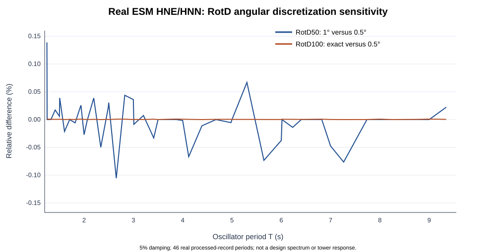

**限制与可证伪性。** 本轮只验证官方MP处理波的双水平线性SDOF伪谱，未验证仪器低频响应、0.04Hz高通滤波对长周期位移谱的影响、场址地震危险度与GB/IEC目标谱、实际混塔模态与阻尼，也没有同态B/W/E/WE或材料局部疲劳响应。任意替换CSV、事件、台站、阻尼或角度定义均须重算并报告SHA；程序拒绝错误源SHA。该谱不可被表述为158m混塔抗震承载能力或嘉鱼实址合规结果。S05仍为PARTIAL/HOLD，12阶段整阶段PASS仍0/12。

## A.13 已处理ESM双水平记录的长周期反应谱对额外高通滤波的敏感性（真实数值，2026-11-11）

**研究问题。** 已恢复的ESM v3 IT-2012-0008 / IT.NVL / MP处理后HNE/HNN记录原有低截止频率为0.04 Hz。对其**再增加**0.06 Hz或0.08 Hz高通滤波，5%阻尼长周期RotD100伪加速度谱会改变多少？这不是恢复0.04 Hz滤波前的原始波，也不能用来证明仪器低频可靠性。

**SOURCE/OFFICIAL。** 原始本轮输入为历史Actions [#40847442979 / artifact #12884814391](https://github.com/g2066203208-beep/voxel-frontier/actions/runs/40847442979/artifacts/12884814391) 中已恢复的官方MP处理波CSV，32040时刻、0.005 s、HNE/HNN单位m/s²、SHA256 `a353c1216b80cf2739b9cedfbd09b68bab3d3ffe49f1d6f3b537366c3559db34`；归档预计到期**2027-01-27T09:09:37Z**。ESM v3 DOI 10.13127/esm.3；原处理头低/高截止频率0.040/30.000 Hz。历史46周期RotD核对表SHA256 `ea642b37ca39bde6c1e5b48168e50650adadb00311ca9f24a11102fea82d407c`。

**方法与可证伪定义。** 两轴同一线性SDOF，阻尼比5%，Newmark平均加速度β=1/4、γ=1/2、dt=0.005 s、零初态。同步二维相对位移`u_E(t),u_N(t)`给出连续方向`RotD100(T)=(2π/T)² max_t sqrt(u_E(t)²+u_N(t)²)`。在MP处理波上分别追加4阶Butterworth高通，`scipy.signal.butter(..., output='sos')`与`sosfiltfilt`双向零相位滤波，截止频率为0.06/0.08 Hz；其余条件完全相同。变化率`δ(T)=100[PSA_extra(T)/PSA_MP(T)-1]%`。**这是额外处理条件的敏感性，不是任何原始地震记录、场址设计谱或混塔响应的不确定性置信区间。**

**表A-13的四个代表周期数值（完整46周期见源CSV；谱单位m/s²，变化率单位%）：**
- T=4.000000 s：MP谱0.046772606692；额外0.06 Hz变化−0.23405540%；额外0.08 Hz变化−0.62374574%。
- T=6.230957762865 s：MP谱0.030613101198；额外0.06 Hz变化−0.08404561%；额外0.08 Hz变化−0.21317852%。
- T=8.000000 s：MP谱0.017146320011；额外0.06 Hz变化−0.05935347%；额外0.08 Hz变化−2.63510218%。
- T=9.346436644298 s：MP谱0.011049392089；额外0.06 Hz变化−1.25940955%；额外0.08 Hz变化−6.87751501%。

**真实数值结论。** 46周期的原MP波谱对历史连续RotD100回归最大绝对误差`9.50×10⁻¹³ m/s²`。额外0.06Hz滤波的46周期相对变化为**−1.259410%至+0.051813%**；额外0.08Hz为**−6.877515%至+0.101639%**。两种额外滤波的最大绝对变化均发生于T=9.346436644298 s；谱峰算子对滤波并非逐周期单调（某些周期反而略有增加）。因此不能仅以`f=1/T>0.04Hz`便宣称9 s附近谱对滤波不敏感，也不能把上述变化直接作为真实未滤波响应误差界。

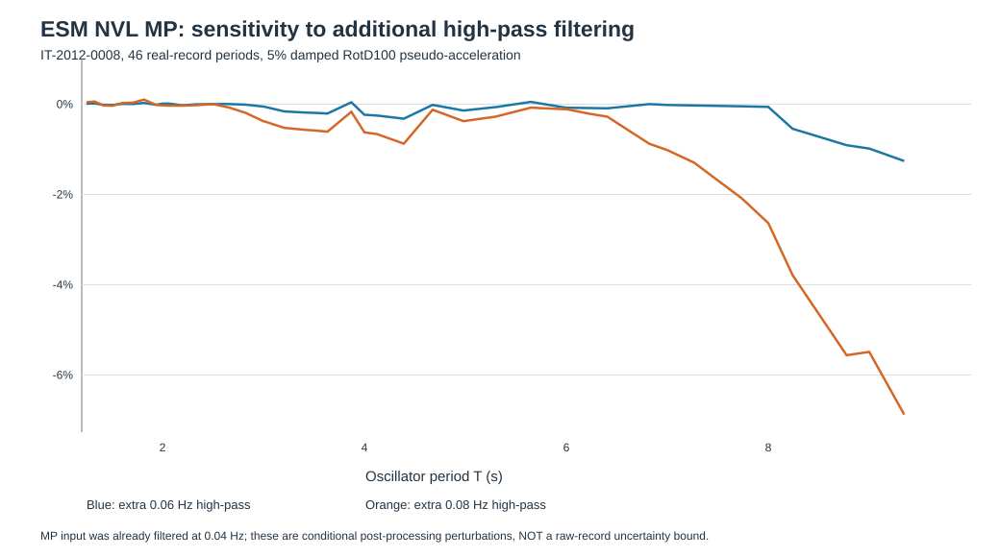

**RUN/独立测试与误差预算。** 本地原生Python+NumPy/SciPy实际读取32040×2个真实加速度值并计算46×3个RotD100值；历史46/46回归PASS。对追加滤波后两轴同时旋转37°，RotD100最大相对差<`7.1×10⁻¹¹`；独立传递函数直接形式`filtfilt(b,a)`对SOS结果的RotD100最大相对差0.000603%（0.06Hz）/0.000461%（0.08Hz），仅为不同数值实现对照而非独立物理实验；篡改原CSV触发SHA拒绝PASS。CSV输出SHA256 `2aa3f6797f075be4d7bcfed182687153e7af79f1d8ef3c2dc58692d3947893fa`；程序SHA256 `4a4449bde258fe549f90042d36ef10f0cad77e4f1e14395aa964b86d86f1d862`。程序[源代码](../../../experiments/T079/s05_esm_mp_extra_highpass_rotd100.py)、[46行数表](../../../experiments/T079/real-records/S05_ESM_MP_ADDITIONAL_HIGHPASS_ROTD100_46ROW_20261111.csv)、[图A-13](../figures/FIG_A13_ESM_ADDITIONAL_HP_ROTD100_20261111.svg)。本地计算PASS，GitHub提交版原生CLI/CI尚未单独执行。

**REF/STANDARD/HOLD。** 2026两篇160m混塔风震/PT地震研究 DOI 10.1080/13632469.2026.2671807 与 10.1016/j.rcns.2026.03.002沿用既有摘要/选页阅读层级，本轮未重新核全文或主张首次发现。未新增IEC/GB授权条款。该敏感性只对已处理波及所选额外滤波器成立；仪器原始频带、原MP处理算法/相位、记录两端边界处理、场址目标谱、结构频率/阻尼、同态W/E/WE、材料Miner均未闭合。**S05 SOURCE-LEVEL FILTER-SENSITIVITY PASS / DESIGN AND PHYSICAL HOLD；12阶段0/12，本轮晋级0/12；正式DLC1.2 0/126。**
