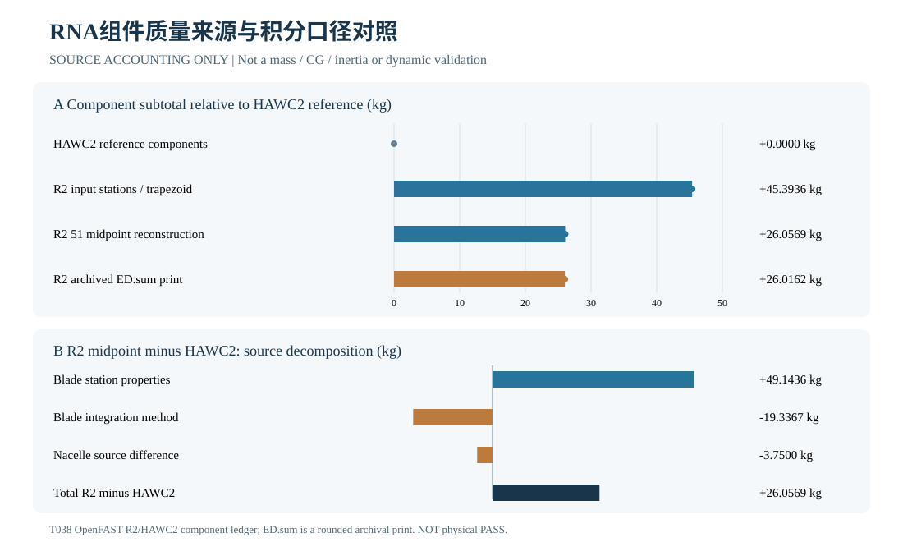

# 第二章 10 MW预应力混凝土—钢混合塔架精细有限元模型建立与分层验证

> 状态：**CANONICAL DETAILED MODEL DRAFT / T057 HISTORICAL RESEARCH CANDIDATE / 2026-11-14 CODEX-CONFIRMED CURRENT ENGINEERING IDENTITY SEPARATE**  
> T057历史研究候选输入（非2026-11-14本机双模型当前工程）：research/wind-tower/experiments/T057/inputs/BASE001_T057_EVIDENCE_RECONCILED_HRB335_Q345_PTBF8_CONTACT_RNA_R2.inp  
> SHA-256：c5652eae36ad8b60ef2caed1ab12e147b149f5199d40b83a3cb2af4dfaf672db。  
> 本章所有参数均区分“原型直接来源、同对象/同谱系依据、规范补全、独立工程重构、模型实现事实”五个证据等级。

## 2.1 研究对象、来源层级与统一基准

### 2.1.1 研究对象的组成

本文研究对象由DTU 10 MW公开参考风机[REF001]与158 m预应力混凝土—钢混合塔架原型[REF008]组合形成。前者定义风轮、叶片、机舱及运行参数，后者定义混塔总体构型。该组合是可追溯研究模型，并非DTU官方发布的原始塔架，也不代表嘉鱼现场某台实机。

158 m塔架由：
- 112 m预应力混凝土塔段；
- 46 m上部钢塔；
组成。何泽瑜[REF008]给出31个混凝土节段与4个钢塔节段，是本文几何分区的一级来源。

### 2.1.2 参数证据等级

为了防止“不同论文参数拼成一个看似完整的模型”，本文对每个参数采用五级身份：

**Level A — 原型直接来源**  
REF008或DTU官方REF001明确给出。

**Level B — 同一10 MW/158 m对象后续同行评议来源**  
例如Xu、He、Wang等[REF061]给出的HRB335、Q345、PT材料及1280 MPa初始预应力。

**Level C — 规范补全**  
原型没有公开具体值，但本文根据可定位规范条文完成重建，例如纵筋截面独立验算、环筋/拉筋构造。

**Level D — 独立工程/物理重构**  
原型没有直接披露，但存在高度相似独立工程与物理量级交叉验证，例如36个PT束位置×8股/束。

**Level E — 模型实现事实/待敏感性**  
仅由历史CAE/INP继承，尚未找到原型直接来源，例如当前PT半径1.75 m。

论文正文必须保留这种证据等级，不能因为T057已经生成就把Level D/E参数反写成“何泽瑜原型就是如此”。

### 2.1.3 钢塔表头歧义

REF008表3-2给出112 m处混凝土塔顶外径4.97 m；表3-3中钢塔对应尺寸列标注“半径”，数值4.66、4.58、4.50、4.42 m。若按半径解释，钢塔直径将达到约9 m并与4.97 m混凝土顶部产生明显几何跳变。结合原文示意图、上下段连续收分关系及同团队后续160 m级混塔尺寸，本文把这4个数解释为**直径**。

该项身份固定为：

**PASS-INDEPENDENT-CONSISTENCY / ORIGINAL HEADER CONFLICT DISCLOSED**

不能写成“REF008明确给出这些是直径”；应写成“原表头存在内部冲突，本文按结构连续性和同谱系资料解释为直径”。

### 2.1.4 OpenFAST与Abaqus公共动力基准

OpenFAST承担整机气动—伺服—弹性载荷，Abaqus承担精细结构局部响应。进入第三/四章之前必须冻结共同基准：

- tower total height；
- tower-top reference point；
- HubHt；
- RNA mass；
- RNA CG；
- full rotary inertia tensor；
- tower-top → hub geometric offset；
- coordinate system；
- gravity/inertia ownership；
- low-order frequencies；
- model/input hashes。

轮毂高度按OpenFAST官方几何定义[REF047]由实际输入字段计算：

\[
H_{\mathrm{hub}}
=
H_{\mathrm{tower}}
+
H_{\mathrm{shaft}}
+
L_{\mathrm{overhang}}\sin\theta_{\mathrm{shaft}}.
\]

当前研究模型对应约161.368806 m，但终稿中的最终值必须由冻结OpenFAST输入重新读取并记录字段来源。

### 2.1.5 最新本机工程身份与历史研究候选的分界（2026年11月14日）

本机Codex于2026年11月14日16:36通过Abaqus MCP读取并确认双模型工程`TOWER_AND_FOUNDATION_SEPARATE.cae`中的塔架模型`DTU158_HybridTower_Global_RNA_OFFICIAL_RP`。该**当前工程**不同于本章原先用于研究方法准备的T057候选，也不同于历史T070网页三维基准；前文T057参数表不得未经版本映射直接解释为当前工程已经生效的设置。本次已将Codex原生读取报告的92项配置归档，另有`FOUNDATION_COLLEAGUE`独立模型，双方尚未建立模型连接或载荷交换。

| 身份 | 已有证据 | 可以使用的结论 | 不允许混同的内容 |
|---|---|---|---|
| **Codex确认的当前双模型工程** | 158 m、31混凝土段+4钢塔段，31组纵筋与31组恢复参与的环筋，BF1为36×140 mm²、初始1280 MPa（名义6.4512 MN）；30个水平接缝以180个线性SPRING2表示；Gravity、30阶Modal与E-only地震步骤存在，当前工程Jobs=0 | 可作为**当前工程设置身份**记录 | 不能据步骤存在声称160.195 s地震已求解、风震联合已完成或接缝开合/摩擦模型已形成 |
| **独立历史修复工程** | 原修复工程Gravity与Modal验证已由Codex报告：前四阶频率0.13525、0.13580、0.70348、0.73802 Hz；PT平衡后6.359523 MN；塔底与PT底锚合竖向反力25.806843 MN | 只作为对应历史Job/ODB的**有版本验证结果** | 不代表上述结果已经嵌入当前Jobs=0的双模型工程 |
| **T057研究候选及历史原稿** | 本章前述BF8/36×8×140 mm²、名义51.6096 MN、接触/钢筋牌号等作为独立候选或原稿研究谱系 | 保留方法来源、对照与等待验证的候选身份 | 不得把BF8名义力、接触或旧模态直接替换当前BF1/S345/线性弹簧设置 |

当前报告中的31组环筋已经由Codex原生MCP确认恢复参与，**不应继续写成“当前工程未恢复环筋”**。仍需在论文表达中保留：Embedded宿主体积与钢筋质量口径、对象化阻尼身份及基础耦合尚未闭合；已配置的E-only采用ESM `IT-2012-0008` NVL台站HNE与−HNN水平加速度，当前风载步骤被抑制，尚无完整地震响应。全部设置与非同源限制见[2026-11-14当前模型原始读取转录表](../../../models/CURRENT_TOWER_SETTINGS_20261114.md)。该配置报告不代表本助手再次访问原始CAE/ODB，本次没有新增结构物理结果。

### 2.1.6 第二事件处理谱的方向聚合偏差及地震输入适用域

为了检验双水平地震动以几何均值表示时可能掩盖的方向差异，采用ESM v3（DOI:10.13127/esm.3）IT-2012-0009事件NVL台站的MP处理记录。两个水平分量HNE、HNN的采样间隔均为0.005 s，记录各15970个采样值；源头报告的高通截止频率均为0.08 Hz。下表直接依据T079归档的五个5%阻尼伪谱加速度点（单位m/s²）计算，原始CSV身份为Git blob `6f6ac18eda164d55ba225cecbd461ead27027c82`，而非按研究场址目标谱拟合的人工地震动。

对于每个周期，令两方向谱的几何均值为 \(G=\sqrt{S_{a,E}S_{a,N}}\)，强方向相对于几何均值的放大倍数为 \(A=\max(S_{a,E},S_{a,N})/G\)。若用几何均值代替强方向输入，则该周期强方向谱的相对低估量为 \(100(1-1/A)\%\)。这里的“低估”仅指两种谱汇总定义之间的数值差异，**不是**已经求得的结构响应低估量。

| 周期T / s | HNE PSA / (m/s²) | HNN PSA / (m/s²) | 几何均值G / (m/s²) | 强方向/G | 几何均值相对强方向差异 |
|---:|---:|---:|---:|---:|---:|
| 4.000 | 0.002024055 | 0.005576310 | 0.003359577 | 1.659825 | 39.753% |
| 6.000 | 0.001195812 | 0.002181213 | 0.001615030 | 1.350571 | 25.957% |
| 6.230958 | 0.001203423 | 0.002059592 | 0.001574344 | 1.308222 | 23.560% |
| 8.000 | 0.000689677 | 0.001540020 | 0.001030591 | 1.494309 | 33.079% |
| 10.000 | 0.000303894 | 0.001043665 | 0.000563173 | 1.853187 | 46.039% |

这五个已归档周期中HNN均为强方向，几何均值相对于强方向的谱值差异为23.560%—46.039%。因此，用几何均值概括该记录的方向谱水平可以作为描述性统计，但不能据此认为任一水平分量均达到同一输入强度，更不能据此声称两向地震响应已经包络。两原轴包络也未必等于连续旋转方向的RotD100，二者应作为不同指标分别报告。

该结果还受到记录处理频带的约束：10 s对应0.10 Hz，仅为0.08 Hz报告高通截止频率的1.25倍。两分量采用相同截止频率，并不意味着低频基线与滤波误差已经消失；缺乏未处理原波、完整滤波实现和场址目标谱时，不能将表中的长周期比值解释为真实场址方向放大系数。该台站与研究混塔没有已核定的场地等同性，表中数值不构成抗震设计选波、规范符合性或风震耦合响应的验收结论。

上述数表仅使用已有MP处理谱进行源级算术计算，没有新的结构动力求解。原始HNE/HNN ASC SHA256分别为 `3703b42d757f8b745eb3ed1cc01cd2873ec55d873ecc314f7b0297d9de1e7cb3` 和 `1f6461a08375cd97af1091169fb67681ae8daba2b03d7943282794d5cc1df9bd`；原件与处理条件详见T079/METHOD_PLAN。强方向/G及百分比按CSV原始精度计算、展示至六位和三位小数，舍入误差小于显示精度；滤波与场地迁移不确定性尚无可核定上界，故保持HOLD。

## 2.2 分层Verification与Validation框架

本文不采用“第一阶频率误差小，所以整个模型正确”的验证逻辑。REF005的缩尺试验/两尺度模型、REF010/REF039的混塔动力简化以及REF009的OpenFAST验证共同表明，不同QoI对应不同验证层级。

本文冻结六层V&V：

1. **source/implementation verification**：几何、材料、钢筋、PT、接触、RNA是否真正写入输入文件；
2. **material verification**：混凝土CDP及钢材本构输入是否合法、能否重现目标单轴曲线；
3. **mass-property verification**：总质量、分材料质量、CG、RNA inertia；
4. **global stiffness/modal validation**：Flex、低阶频率、振型、有效质量；
5. **initial-state/numerical verification**：Gravity+PT平衡、接触初始化、能量、时间步/阻尼；
6. **local response validation**：只有当接触/转换/局部模型显式存在并通过前述门禁，才解释CPRESS、COPEN、局部stress和fatigue。

第二章的目标不是证明模型“完美真实”，而是明确每个结论允许依赖哪一级模型能力。

## 2.3 混凝土材料与CDP实现

### 2.3.1 强度等级与弹性参数

当前158 m对象采用C70/C65混凝土分区，同对象后续研究[REF061]和原型谱系提供材料身份依据。弹性参数与正式Abaqus section assignment必须一一核对；规范表值只能作为独立检查，不能替代实际INP读取。

### 2.3.2 CDP变量定义

混凝土非线性采用Abaqus Concrete Damaged Plasticity。必须区分物理总应变与Abaqus要求的inelastic/cracking strain。例如压缩非弹性应变：

\[
\varepsilon_c^{\mathrm{in}}
=
\varepsilon_c
-
\frac{\sigma_c}{E_0}.
\]

受拉分支同样采用总应变减去初始弹性应变构造cracking strain。damage变量必须由明确定义的物理包络和转换关系得到，并检查：
- 第一数据点；
- 应变顺序；
- damage范围；
- equivalent plastic strain非负/单调；
- 单轴输出能否回到目标包络。

CDP的DAMAGEC/DAMAGET属于本构刚度退化变量，第四章Miner fatigue damage与其物理含义不同，严禁混用。

### 2.3.3 CDP塑性参数边界

Abaqus官方定义可支撑e、\(f_{b0}/f_{c0}\)、\(K_c\)等参数的数值语义，但膨胀角并不存在一个可以对所有混凝土直接采用的唯一“软件物理默认值”。若本文保留 \(\psi=30^\circ\)，必须按同类风机塔/混凝土研究先例与敏感性说明，而不能写成“Abaqus规定”。

viscosity parameter若取0，只能称为率无关数值基线。如果为了非线性收敛引入非零黏塑性，则必须单独报告其对局部峰值/损伤的影响。

### 2.3.4 材料试件与网格客观性

C65/C70分别建立单轴拉压材料试件，验证：
- 实际输入曲线；
- 峰值强度；
- 卸载/损伤变量；
- 后峰段；
- 数值稳定性。

对于软化和局部化，必须明确“输入曲线正确”不等于“局部损伤网格无关”。若第四章使用CDP后峰局部stress/damage解释疲劳控制区，必须增加局部网格/断裂能客观性检查；否则只在弹性/轻微非线性区使用该模型。

> 原图证据：REF005 p5、p7、p10已归档。

## 2.4 普通钢筋体系

### 2.4.1 纵筋数量：REF008直接来源

何泽瑜[REF008]表3-2逐段给出31节混凝土塔内、外排纵筋数量。原CAE/T058审计显示31/31节T3D2数量与表3-2逐段一致，总离散数为5440。

因此：
- 31节内/外排纵筋根数：**PASS-DIRECT**；
- 5440个T3D2：**PASS-IMPLEMENTATION**。

5440是按节段离散的钢筋单元表示数量，不能自动解释为5440根贯穿全部水平缝的连续钢筋。

### 2.4.2 纵筋截面490.874 mm²：规范验证的重建值

REF008没有公开纵筋直径。当前单筋面积：

\[
A_s=490.874\ \mathrm{mm^2},
\]

等效圆直径：

\[
d_\mathrm{eq}
=
\sqrt{\frac{4A_s}{\pi}}
=
25.0\ \mathrm{mm}.
\]

因此论文不能写“何泽瑜采用φ25纵筋”。

T053 closure使用REF008真实31段几何/根数与GB 50135—2019相关构造要求逐段独立验算：
- 外排最小配筋率0.25%；
- 内排最小配筋率0.20%；
- 最小直径12 mm；
- 外排最大间距250 mm；
- 内排最大间距300 mm。

结果31/31节均通过，最小单排配筋率0.5313%，最大外排中心距242.66 mm、最大内排中心距232.02 mm。

因此该截面的正式身份为：

**PASS-CODE-VALIDATED-RECONSTRUCTION / NOT-HE-DIRECT**

### 2.4.3 环筋、拉筋与保护层

何泽瑜（REF008）给出了混凝土塔段纵向钢筋根数及钢筋网建模方式，但未给出环向钢筋直径、间距和拉结筋的具体构造参数。本文将普通钢筋构造补全与截面承载力验算分开。依据NB/T 10907—2021《风电机组混凝土—钢混合塔筒设计规范》第6.3.1、6.3.2条进行抗剪和剪扭验算，并以GB 50135—2019《高耸结构设计标准》第6.5.3、6.5.5～6.5.8条作为构造核查的补充依据。双层钢筋网、拉筋直径和间距、保护层及连接构造应分别核查；高耸结构标准的适用性不能替代风机混塔专项规范验算。

REV25继承原始构造候选：内外双层HRB400环向钢筋直径16 mm，名义轴向间距不大于120 mm，原始离散最大实测间距118.000003 mm；径向拉筋采用HPB300、直径6 mm，原始周向最大间距499.740519 mm，竖向最大间距约472 mm。原始环筋中心线及半径扣除后的几何净保护层最小值为32 mm。上述参数源于既有构造研究候选，不是原型施工图参数，也不表示所有钢筋搭接、锚固、环境耐久性和抗震构造均已验收。

单根环向钢筋面积 A_h=πd_h²/4，单层单位高度配筋面积 q_h=A_h/s_h。原Φ14@80方案 A_h=153.938 mm²、q_h=1.92423 mm²/mm；当前Φ16@120上限方案 A_h=201.062 mm²、q_h=1.67552 mm²/mm，较前者减少12.925%。按原始最大实测间距118.000003 mm计算，q_h=1.70391 mm²/mm。双层面积指标为2q_h；以单层所对应壁厚口径计算配筋率时应另核规范定义，不能把面积指标直接作为剪扭利用率。

以历史OpenFAST工况U09p343881_ETM_S06的100～700 s分段六分量同步内力为输入，沿该历史输出坐标轴定义 V(t)=√(F_x²+F_y²)、M(t)=√(M_x²+M_y²)、T(t)=|M_z|、N(t)=max(0,−F_z)。各截面在同一时刻组合内力，避免独立峰值拼接；该坐标定义不等同于Abaqus全局Y轴竖直坐标。历史T072修正结果采用b=2t_w、沿直径方向的有效高度h₀、完整圆环抗扭抵抗矩 W_t=2π(R_o³−R_i³)/3，并按环筋中心线定义核心面积与周长。该圆环截面映射仍属工程假设，未取得直接条文支持。定义剪扭利用率 η=max(V/V_Rd,631，V/V_Rd,632，T/T_Rd)，其中抗力应按对应规范条文及正式作用组合计算。

历史Φ14@80双层方案的31段候选结果中，最大抗剪利用率约0.456，最大抗扭利用率约0.7931，控制塔节CSEG31，时刻622.55 s，对应V=1762.14 kN、T=36096.34 kN·m。下表列出历史逐段结果与REV25实际单元数量，二者不是同一配筋方案下的计算结果。历史程序与修正报告的b、h₀口径尚有冲突，应以规范原页、原始同步时程及独立复算重新确认；不得将历史候选结果作为REV25承载力验收。

表：历史剪扭验算与REV25环筋离散数量对照

| 塔节 | 历史Φ14@80：V/VRd | 历史Φ14@80：T/TRd | REV25环筋单元 | REV25拉筋单元 |
|---|---:|---:|---:|---:|
| CSEG_01 | 0.3089 | 0.3705 | 1936 | 864 |
| CSEG_02 | 0.3161 | 0.3822 | 1936 | 864 |
| CSEG_03 | 0.3245 | 0.3949 | 1936 | 864 |
| CSEG_04 | 0.3325 | 0.4066 | 1936 | 864 |
| CSEG_05 | 0.3406 | 0.4413 | 1392 | 576 |
| CSEG_06 | 0.3496 | 0.4559 | 1112 | 432 |
| CSEG_07 | 0.3585 | 0.4705 | 1112 | 432 |
| CSEG_08 | 0.3671 | 0.4850 | 1112 | 432 |
| CSEG_09 | 0.3765 | 0.5015 | 1112 | 432 |
| CSEG_10 | 0.3859 | 0.5186 | 1112 | 432 |
| CSEG_11 | 0.3953 | 0.5370 | 1112 | 432 |
| CSEG_12 | 0.4052 | 0.5725 | 1112 | 432 |
| CSEG_13 | 0.4152 | 0.5941 | 1112 | 432 |
| CSEG_14 | 0.4252 | 0.6168 | 1112 | 432 |
| CSEG_15 | 0.4354 | 0.6412 | 1112 | 432 |
| CSEG_16 | 0.4462 | 0.6875 | 1112 | 432 |
| CSEG_17 | 0.4540 | 0.7089 | 1112 | 432 |
| CSEG_18 | 0.4551 | 0.7147 | 1112 | 432 |
| CSEG_19 | 0.4524 | 0.7120 | 1112 | 432 |
| CSEG_20 | 0.4516 | 0.7125 | 1112 | 432 |
| CSEG_21 | 0.4509 | 0.7436 | 1112 | 432 |
| CSEG_22 | 0.4478 | 0.7406 | 1112 | 432 |
| CSEG_23 | 0.4445 | 0.7376 | 1112 | 432 |
| CSEG_24 | 0.4408 | 0.7346 | 1112 | 432 |
| CSEG_25 | 0.4422 | 0.7376 | 1112 | 432 |
| CSEG_26 | 0.4448 | 0.7416 | 1112 | 432 |
| CSEG_27 | 0.4433 | 0.7394 | 1112 | 432 |
| CSEG_28 | 0.4415 | 0.7365 | 1112 | 432 |
| CSEG_29 | 0.4242 | 0.7140 | 1112 | 432 |
| CSEG_30 | 0.4220 | 0.7217 | 1112 | 432 |
| CSEG_31 | 0.4416 | 0.7931 | 912 | 336 |

为降低整体动力分析的离散成本，原始1908圈环筋（每圈96个T3D2单元，共183168个）先沿高度进行体积及竖向一阶矩守恒的等效，保留678圈；REV25在保留各圈高度、材料、全部拉筋及其连接节点的前提下进行周向合并。设单圈原、新折线长度分别为L₀、L₁，则数值等效截面A₁=A₀L₀/L₁，使A₁L₁=A₀L₀。该面积修正不是施工钢筋直径变更。REV25保留37848个环筋单元及15168个拉筋单元；相对REV24整机单元由105392降至78152。实际静态检查中，各环体积相对误差最大1.33×10⁻¹⁵，截面积相对调整最大0.1967%，对角惯量相对差最大0.4437%。该离散尚未经原生求解、网格收敛和局部裂缝、钢筋应变等效性验证。

现阶段应将Φ16@120视为构造候选；尚需采用31段实际间距、截面几何、当前纵筋和预应力输入，复核NB/T 10907第5章作用组合及第6.3条承载力，并覆盖控制风、地震工况。完成上述计算及原生对照之前，不给出当前方案满足全部设计要求的结论。

计算证据：[T072修正报告](../../../experiments/T072/T072_STEP2_CORRECTED_SHEAR_TORSION_REPORT.md)、[31段原始计算表](../../../experiments/T072/T072_STEP2_CORRECTED_SHEAR_TORSION_PHI14_80.csv)、[REV25静态核验](https://github.com/g2066203208-beep/voxel-frontier/blob/main/public/thesis-studio/inp-archive/REV25_HOOP_COST/receipt.json)。规范来源：[NB/T 10907—2021官方登记](https://std.samr.gov.cn/hb/search/stdHBDetailedCNF?id=E1CE5F1D25419A1FE05397BE0A0AAD39)、[GB 50135—2019第6.5节](https://gf.cabr-fire.com/m/article-56526.htm)。

根据GB 50135—2019表6.5.5，塔筒内、外层环向钢筋的最小配筋率均为0.20%，受拉侧尚应满足(45f_t/f_y)%。表6.5.6规定环筋直径不小于8 mm，间距不大于200 mm且不大于筒壁厚度。取Φ16@120构造上限及单层全壁厚分母，ρ_h=100A_h/(s_h t_w)%，采用历史C70/C65抗拉设计强度2.14/2.09 MPa、HRB400抗拉设计强度360 MPa，31段名义配筋率筛查均满足限值，最小值为CSEG31的0.3351%。该结果不代替环境耐久、接头、锚固和抗震构造验算。

为独立识别剪扭控制部位，以T071名义截面几何、T075历史S06工况的310条同步控制点及62组组合包络进行薄壁圆环膜剪流诊断。取中面半径R=(D_o+D_i)/4，横向剪流峰值q_V=V/(πR)，扭转剪流q_T=|T|/(2πR²)，叠加q=q_V+q_T。取45°斜压场和双层环筋充分参与的假设，环向钢筋名义屈服剪流q_s=2A_h f_y/s_h=1206.37 kN/m，定义诊断指标η=q/q_s。该指标不计混凝土贡献，也未验算斜压和纵向配筋，并非NB/T 10907的设计抗力。独立峰值叠加仅用于该指标的保守上界，非同时发生的内力。

计算表明，CSEG31在622.55 s处控制点η=1.03884，q_V=236.02 kN/m，q_T=1017.20 kN/m；保守上界η=1.18439。CSEG30及CSEG31的上界超过1.0。该结果指出应优先复核顶部混凝土塔段，而不构成承载力不满足的正式判定。历史21处壁厚差异已由何文顶部与中截面取值位置解释；CSEG29、CSEG30、CSEG31反算值为307、384、457 mm，而构造表为354、414、500 mm；本次配筋率采用较大名义壁厚，剪流采用名义直径计算中面半径，须进一步统一截面位置及几何。完整同步时程未直接复算，实际REV25截面及纵筋/PT同源性、专项规范抗力和地震组合尚待核实。

| 塔节 | 单层名义配筋率/% | 同态剪流指标 | 包络上界 |
|---|---:|---:|---:|
| CSEG_01 | 0.5984 | 0.4401 | 0.4983 |
| CSEG_02 | 0.5984 | 0.4559 | 0.5156 |
| CSEG_03 | 0.5984 | 0.4728 | 0.5341 |
| CSEG_04 | 0.5931 | 0.4903 | 0.5533 |
| CSEG_05 | 0.5828 | 0.5091 | 0.5741 |
| CSEG_06 | 0.5680 | 0.5312 | 0.5984 |
| CSEG_07 | 0.5539 | 0.5537 | 0.6231 |
| CSEG_08 | 0.5449 | 0.5759 | 0.6476 |
| CSEG_09 | 0.5362 | 0.6009 | 0.6750 |
| CSEG_10 | 0.5236 | 0.6276 | 0.7043 |
| CSEG_11 | 0.5116 | 0.6564 | 0.7359 |
| CSEG_12 | 0.5039 | 0.6870 | 0.7694 |
| CSEG_13 | 0.4964 | 0.7195 | 0.8050 |
| CSEG_14 | 0.4857 | 0.7548 | 0.8435 |
| CSEG_15 | 0.4753 | 0.7930 | 0.8854 |
| CSEG_16 | 0.4687 | 0.8342 | 0.9303 |
| CSEG_17 | 0.4654 | 0.8667 | 0.9660 |
| CSEG_18 | 0.4654 | 0.8767 | 0.9779 |
| CSEG_19 | 0.4654 | 0.8747 | 0.9770 |
| CSEG_20 | 0.4928 | 0.8697 | 0.9729 |
| CSEG_21 | 0.5236 | 0.8618 | 0.9657 |
| CSEG_22 | 0.5236 | 0.8566 | 0.9616 |
| CSEG_23 | 0.5236 | 0.8541 | 0.9605 |
| CSEG_24 | 0.5236 | 0.8515 | 0.9592 |
| CSEG_25 | 0.5778 | 0.8445 | 0.9539 |
| CSEG_26 | 0.6444 | 0.8337 | 0.9453 |
| CSEG_27 | 0.6444 | 0.8272 | 0.9413 |
| CSEG_28 | 0.6444 | 0.8247 | 0.9417 |
| CSEG_29 | 0.4733 | 0.8346 | 0.9558 |
| CSEG_30 | 0.4047 | 0.8898 | 1.0193 |
| CSEG_31 | 0.3351 | 1.0388 | 1.1844 |

[独立筛查计算书及原始数据](../../../experiments/T077/T077_REV25_PHI16_HOOP_SCREEN_20261125.md)。

#### 原型截面口径与专项剪扭计算

何泽瑜[1]第22页明确表3-2、3-3几何为各塔节顶部属性；第23页表3-2给出31段顶部直径、厚度及内外层纵筋根数。保持这些数据不变。对第2～31节采用相邻顶部尺寸线性插值求中截面，首节壁厚取280 mm（底端厚度同顶部为重建假设）。原T071中截面内外径反算壁厚与插值的最大差为0.000193 mm，第2～31节外径最大差3.97×10⁻⁷ m。此前21处差异是顶部与中截面口径不同，不能当作模型错误。荷载测点实际高度与中截面对应关系仍需核实。

NB/T 10907—2021表4.1.2、4.1.3及4.2.2-1给定C65/C70的fc=29.7/31.8 MPa、ft=2.09/2.14 MPa、Ec=36.5/37.0 GPa，HRB400的fyv=360 MPa、HRB500抗拉/抗压设计值435/410 MPa、HPB300为270 MPa。以上为规范设计强度，不等同于有限元材料屈服参数。何原型钢筋网使用S345数值模型，HRB系列为本文独立规范设计支路。

普通环筋斜截面及剪扭验算采用NB/T 10907第6.3.1、6.3.2条，原文印刷第26～27页。分别比较V≤VR,1、V≤VR,2、T≤TR。式中V、M、T、N为同一时刻内力设计值；b、h0为计算截面宽度、有效高度；Asv为箍筋各肢总面积，Ast1为沿周边受扭箍筋单肢面积，Astl为受扭纵筋面积；A、A0、Acor为截面面积、换算面积、核心面积，ucor为核心周长，Wt为塑性抗扭抵抗矩；Np0为混凝土法向预应力为零时的预加力。式(6.3.2-4)扫描件分子下标易混淆，按变量说明及GB/T 50010第6.4.4条的Astl定义解释，仍待标准编制说明确认。

$V_{R,1}=\frac{1.75f_tbh_0}{\lambda+1}+f_{yv}\frac{A_{sv}}{s}h_0+0.07\min(N,0.3f_cA)$

NB/T 10907式(6.3.1-1)

$\lambda=\frac{M}{Vh_0}$

式(6.3.1-2)

$V_{R,2}=(1.5-\beta_t)\left(\frac{1.75f_tbh_0}{\lambda+1}+0.05N_{p0}\right)+f_{yv}\frac{A_{sv}}s h_0$

式(6.3.2-1)

$\beta_t=\min\left(1,\max\left(0.5,\frac{1.5}{1+0.2(\lambda+1)VW_t/(Tbh_0)}\right)\right)$

式(6.3.2-2)及上下限

$T_R=\beta_t\left(0.35f_t+0.05\frac{N_{p0}}{A_0}\right)W_t+1.2\sqrt{\zeta}f_{yv}\frac{A_{st1}A_{cor}}s$

式(6.3.2-3)

$\zeta=\frac{f_yA_{stl}s}{f_{yv}A_{st1}u_{cor}}$

式(6.3.2-4)，分子按纵向钢筋面积解释

条件算例取Φ16@120双层、32 mm名义保护层，纵筋使用T077 BF1 HRB500设计支路，根数不变。圆环几何暂取b=2t、h0=D−32−16−dl/2、Wt=2π(Ro³−Ri³)/3；核心半径按环筋中心线扣除保护层和半径，Acor=π(ro²−ri²)、ucor=2π(ro+ri)，Asv=4Ah、Ast1=Ah。上述是明确列出的工程映射假设，并非规范明文；尤其核心面积是否应包含闭合箍筋包围的空腔须核实，GB/T 50010第6.4.1条仅给箱形截面两壁厚取法且限制高宽比，不能直接套用薄壁圆环。ζ不擅自增减或沿用矩形截面上限，Np0取0以排除未核实的有利预压贡献。310条历史S06控制记录沿用T075的G/Q组合，不代表全时程或全部风震工况。

条件计算最大剪扭指标为2.80444（CSEG_28，622.55 s），控制扭矩36095.45 kN·m，条件抗扭值12870.83 kN·m；31段均有控制点指标大于1。若仅改变Ast1为2Ah，最大值为2.48297。结果对核心面积及箍筋单肢定义高度敏感，不得据此直接判定真实构件破坏或增大钢筋；也不得称Φ16方案通过规范承载力验算。完整时程、截面映射、正式组合及风震验算仍未闭合。

既有纵筋T077按GB/T 50010附录E.0.1应变协调与轴力弯矩平衡计算，固定何表3-2根数；BF1设计支路第1～24节Φ50、第25～27节Φ40、第28～31节Φ36，历史控制最大利用率0.9744，不能直接替代当前整体模型的材料与工况验证。既有T078 BF8设计支路按NB/T 10907附录A.1.2～A.1.6计算摩阻、锚具回缩与接缝压密、弹性压缩、松弛、收缩徐变，取36×8股、Ap=40320 mm²、初始1280 MPa，总损失294.049 MPa、有效985.951 MPa、39.754 MN。该设计支路不是何原值，也不是当前BF1的有效预应力。

| 塔节 | 顶部壁厚/mm | 中截面壁厚/mm | 顶部单层配筋率/% | 条件剪扭指标 |
|---|---:|---:|---:|---:|
| CSEG_01 | 280.0 | 280.000 | 0.5984 | 1.6213 |
| CSEG_02 | 280.0 | 280.000 | 0.5984 | 1.6530 |
| CSEG_03 | 280.0 | 280.000 | 0.5984 | 1.7095 |
| CSEG_04 | 282.5 | 281.250 | 0.5931 | 1.7338 |
| CSEG_05 | 287.5 | 285.000 | 0.5828 | 1.7848 |
| CSEG_06 | 295.0 | 291.250 | 0.5680 | 1.7825 |
| CSEG_07 | 302.5 | 298.750 | 0.5539 | 1.7698 |
| CSEG_08 | 307.5 | 305.000 | 0.5449 | 1.7640 |
| CSEG_09 | 312.5 | 310.000 | 0.5362 | 1.7713 |
| CSEG_10 | 320.0 | 316.250 | 0.5236 | 1.7723 |
| CSEG_11 | 327.5 | 323.750 | 0.5116 | 1.7681 |
| CSEG_12 | 332.5 | 330.000 | 0.5039 | 1.7991 |
| CSEG_13 | 337.5 | 335.000 | 0.4964 | 1.8137 |
| CSEG_14 | 345.0 | 341.250 | 0.4857 | 1.8229 |
| CSEG_15 | 352.5 | 348.750 | 0.4753 | 1.8271 |
| CSEG_16 | 357.5 | 355.000 | 0.4687 | 1.8717 |
| CSEG_17 | 360.0 | 358.750 | 0.4654 | 1.8850 |
| CSEG_18 | 360.0 | 360.000 | 0.4654 | 1.8781 |
| CSEG_19 | 360.0 | 360.000 | 0.4654 | 1.8605 |
| CSEG_20 | 340.0 | 350.000 | 0.4928 | 1.8995 |
| CSEG_21 | 320.0 | 330.000 | 0.5236 | 2.0507 |
| CSEG_22 | 320.0 | 320.000 | 0.5236 | 2.0987 |
| CSEG_23 | 320.0 | 320.000 | 0.5236 | 2.0766 |
| CSEG_24 | 320.0 | 320.000 | 0.5236 | 2.0545 |
| CSEG_25 | 290.0 | 305.000 | 0.5778 | 2.3330 |
| CSEG_26 | 260.0 | 275.000 | 0.6444 | 2.5788 |
| CSEG_27 | 260.0 | 260.000 | 0.6444 | 2.7103 |
| CSEG_28 | 260.0 | 260.000 | 0.6444 | 2.8044 |
| CSEG_29 | 354.0 | 307.000 | 0.4733 | 2.3558 |
| CSEG_30 | 414.0 | 384.000 | 0.4047 | 1.9461 |
| CSEG_31 | 500.0 | 457.000 | 0.3351 | 1.8253 |

原始输入：geometry.csv、control-rows.csv、longitudinal-bf1.csv；逐段完整结果及计算程序见r32-code-equations.csv/json/mjs。规范原页已读：NB/T10907印刷8、10、26、27页；何论文22、23页。GB/T50010(2024)第6.4节：https://gf.cabr-fire.com/m/article-12607.htm 。

#### 闭合圆环抗扭核心定义敏感性

闭合薄壁截面的剪流平衡为T=2A_mq，A_m为闭合剪流路径所围面积，包含空腔；对于圆形中面，A_m=πR_m²。ACI 445.1R-12第9.2.2节明确了含空腔面积的定义，ACI 318-19 R22.7.6.1.1亦示出空心圆截面外围横向钢筋包围面积。GB/T 50010—2010（2024年版）第6.4.4条给出矩形截面配筋强度比限制，第6.4.13条要求弯扭纵筋与剪扭箍筋需求分别确定。不同规范的有效剪流面积、核心面积及抗力公式不能直接互换；以下仅检验NB/T 10907式(6.3.2-3)对这些工程映射的敏感性。

固定何表3-2几何和纵筋根数、T077 BF1纵筋设计支路、Φ16@120及310条S06同态载荷，保持R32的b、h0、Wt、βt、材料和Np0=0，分别取环形净核心面积π(ro²−ri²)与周长2π(ro+ri)，或外围包围面积πro²与周长2πro（ro为外环筋中心线半径）。外围受扭纵筋面积分别取总面积和一半面积；另用GB/T 50010矩形条款ζ≤1.7作敏感性参照，不称其为NB/T 10907圆环规定。半数纵筋不是可直接采用的弯扭剩余配筋；实际需验算其与弯曲共同作用。各模式保持相同单肢Ast1=Ah。该比较不使用新荷载、不修改实际配筋。

R33四种参数映射的最大受扭比依次为2.80444、0.70412、0.90843、1.14935；超过1的塔节数分别为31、0、0、16。CSEG28外围包围面积与环形净核心面积之比为8.06383；控制位置可由CSEG28转移至CSEG31。结论对核心面积定义和受扭纵筋分配高度敏感；不得选择最有利的参数宣称验收通过。下一步须取得专项规范圆环截面解释或采用完整、统一的闭合薄壁桁架抗力模型，包括斜压破坏、纵筋需求及剪扭共同作用，并核对完整时程与组合。

| 计算假设 | 最大受扭比 | 控制塔节 | 比值大于1的段数 |
|---|---:|---|---:|
| 环形净核心面积（R32） | 2.80444 | CSEG_28 | 31 |
| 外围包围面积、全部纵筋 | 0.70412 | CSEG_31 | 0 |
| 外围包围面积、半数纵筋 | 0.90843 | CSEG_31 | 0 |
| 外围包围面积、半数纵筋、ζ≤1.7类比 | 1.14935 | CSEG_31 | 16 |

来源：ACI 445.1R-12，印刷第10页 §9.2.2：https://www.concrete.org/Portals/0/Files/PDF/4451R12ed.pdf ；ACI 318-19培训资料第108页：https://www.concreteros.org/uploads/2/4/0/2/24020264/aci_318-19_presentation.pdf （文本读取，截图失败）；GB/T 50010第6.4节：https://gf.cabr-fire.com/article-12607.htm 。
输入源blob：{"r32":"1ee4b3afad9717246f44ad21e2bf18e09b75cf71","controls":"2a5135f45adcb4cb08399a7bc996b716d777fdf8"}。
31段逐段结果及程序：r33-torsion-sensitivity.csv/json/mjs。

### 2.4.4 普通钢筋牌号：何2024与同对象后续论文冲突

这里存在真实版本差异：

- REF008历史Abaqus描述将reinforcement mesh写为S345；
- 同一DTU 10 MW / 158 m对象的Xu、He、Wang等2025[REF061]明确普通钢筋为HRB335，\(E=200\) GPa、\(f_y=335\) MPa、\(f_u=455\) MPa。

T057作为“evidence-reconciled candidate”采用HRB335，而T053保留S345作为何2024历史复现对照。正文必须说明这是**研究谱系版本协调**，而不能假装两篇文献完全一致。

另外，GB/T 50010的2024局部修订已删除HRB335相关现行设计内容，因此必须区分：
- 本文采用HRB335是为了复现/协调同一对象同行评议模型；
- 这并不自动等于“按2024现行规范重新设计一座采用HRB335的新工程”。

## 2.5 钢塔与普通钢材本构

### 2.5.1 Q345材料身份

REF061同一10 MW/158 m对象明确给出上部钢塔Q345：
- \(E=206000\) MPa；
- \(f_y=345\) MPa；
- \(f_u=470\) MPa。

T057因此采用Q345，而不是T053历史S345统一材料。身份：

**PASS-SAME-OBJECT-DIRECT**

### 2.5.2 HRB335/Q345塑性强化

REF061给出材料牌号与\(E/f_y/f_u\)，但没有给完整Abaqus Plastic曲线。因此T057的双线性强化率：

\[
b=\frac{E_t}{E}=0.01
\]

不能写成“Xu2025直接给出”。

当前依据为独立钢材本构文献：HRB335研究直接采用0.01E硬化斜率，345 MPa级结构钢研究亦有0.01强化比先例。T057把工程应力—应变转换为Abaqus要求的true stress / true plastic strain，采用：

\[
\varepsilon_y=\frac{f_y}{E},
\qquad
E_t=bE,
\]

\[
\varepsilon_{\mathrm{eng}}
=
\varepsilon_y
+
\frac{\sigma_{\mathrm{eng}}-f_y}{E_t},
\]

\[
\sigma_{\mathrm{true}}
=
\sigma_{\mathrm{eng}}(1+\varepsilon_{\mathrm{eng}}),
\]

\[
\varepsilon_{\mathrm{pl}}
=
\ln(1+\varepsilon_{\mathrm{eng}})
-
\frac{\sigma_{\mathrm{true}}}{E}.
\]

正式身份：
- 材料牌号与强度：**PASS-SAME-OBJECT-DIRECT**；
- \(b=0.01\)：**PASS-CONSTITUTIVE-LITERATURE-BASELINE / PENDING-SENSITIVITY**；
- true stress/plastic strain转换：**PASS-ABAQUS-METHOD**。

该单调双线性模型不能自动代表低周循环塑性或Bauschinger效应。如果第四章发现钢材反复屈服，必须升级为有循环数据支撑的kinematic/combined hardening。

### 2.5.3 钢塔网格门禁

T055对历史同几何模型的native Abaqus Data Check已发现1512个钢塔高长宽比>100单元：
- SSEG_01：216；
- SSEG_02：432；
- SSEG_03：432；
- SSEG_04：432。

因此T057即使静态输入生成无错误，也不能直接用当前钢塔局部单元峰值做fatigue。若第四章钢塔成为控制材料，必须先完成目标区域重划网格与hotspot/nominal stress收敛。

## 2.6 预应力体系

### 2.6.1 原型直接与同对象材料依据

REF008直接支持：
- 15.2 mm预应力钢绞线；
- 桁架单元表示；
- PT底端固定；
- 顶端锚于钢—混转换法兰。

REF061同一对象后续同行评议资料给出：
- externally unbonded high-strength low-relaxation PT；
- \(E=195\) GPa；
- \(f_y=1320\) MPa；
- \(f_u=1860\) MPa；
- nominal initial prestress = 1280 MPa。

这些属于对象级强证据。

### 2.6.2 36束位置×8股：独立工程+物理交叉验证

REF008没有直接公开：
- 36是根、束还是孔道；
- 每位置股数；
- 总PT面积。

因此旧T053的36位置×1×140 mm²（BF1）不能靠源模型自己证明。

后续同团队160 m级模型给出36个PT位置和140 mm²单股面积；更关键的是独立实际混塔工程文献给出：
- 112.28 m混凝土塔；
- 31节；
- 36个周向均布预应力束；
- 每束8根1×7、15.2 mm钢绞线；
- 单股140 mm²。

另一混塔研究同样给出36 ducts与总面积40320 mm²，即：

\[
36\times8\times140
=
40320\ \mathrm{mm^2}.
\]

T057据此采用：
- 36个FE束位置；
- 每位置等效面积1120 mm²；
- 总PT面积40320 mm²；
- nominal stress 1280 MPa。

名义总初始预应力：

\[
F_{\mathrm{PT},0}
=
40320\times1280
=
51.6096\ \mathrm{MN}.
\]

利用各节混凝土截面与同对象C65/C70强度进行预压比交叉检查，BF8对应约0.1671–0.2799；旧BF1仅约0.0209–0.0350。BF8落入已有风机混凝土塔接缝试验常见预压比研究范围，而BF1明显偏低。

因此T057 BF8身份固定为：

**PASS-INDEPENDENT-ENGINEERING + PHYSICS-CROSSCHECK / NOT HE-DIRECT / PENDING-SOLVER**

这不是“证明原型施工图就是8股/束”，而是当前证据最完整的工程基线。BF1保留为低预压敏感性/历史对照。

### 2.6.3 PT半径1.75 m仍是重构参数

当前36个PT束位置位于固定半径1.75 m圆周。公开REF008/REF061尚未找到该数值的同对象直接来源，因此：

**r = 1.75 m = RECONSTRUCTION CANDIDATE**

终稿不能写成“原型设计半径1.75 m”。需要通过：
- 原始CAE/JNL/施工图追溯；或
- PT radius敏感性；
才能确定其对模态、接缝预压及局部stress的影响。

### 2.6.4 nominal prestress与effective prestress

1280 MPa只代表初始输入。Gravity/contact平衡后必须读取：
- 36束S11；
- 轴力；
- concrete baseline compression；
- joint CPRESS/COPEN；
- base reaction；
- effective precompression ratio。

第四章fatigue使用的是**平衡后运行基准状态**，不是名义1280 MPa直接代入。

## 2.7 30个水平接缝

### 2.7.1 历史SPRING2退役为对照

T053历史模型用30个接口×6DOF SPRING2表示水平接缝。其刚度虽可形成全局等效，但无法自然形成：
- contact opening；
- contact pressure；
- friction slip；
- contact area evolution。

且其某些转动刚度系数缺乏独立物理标定，因此不再作为最终非线性joint模型，只保留为global-equivalent historical comparison。

### 2.7.2 T057显式接触

Tan等经过试验验证的预应力混凝土风机塔水平接缝FE研究采用：
- surface-to-surface contact；
- normal hard contact；
- tangential penalty friction；
- friction coefficient \(\mu=0.5\)。

后续水平接缝承载研究也使用同类hard-contact/0.5 friction设置。T057据此将30个旧SPRING2接口替换为30对显式接触界面：

**hard normal contact + penalty friction \(\mu=0.5\)**

身份：

**PASS-INDEPENDENT-METHOD+PARAMETER / PENDING-SOLVER**

### 2.7.3 接触求解门禁

有了contact定义并不等于joint physics已经验证。Native solver必须确认：
- contact initialization；
- CPRESS；
- COPEN；
- CSHEAR；
- slip；
- penetration；
- Gravity+PT平衡；
- 收敛；
- 对Modal/Flex的影响。

第四章只有在这些量通过后才解释接缝开闭/滑移和joint fatigue。

## 2.8 钢—混转换区

转换区承担材料和截面刚度突变处的轴力、剪力、弯矩和扭矩传递。REF005两尺度研究与REF036钢—混连接试验均说明局部应力高度依赖真实构造。

当前T057只能依据其实际有限元几何/耦合能力解释相应响应。第四章先把转换区作为候选控制区域，与塔底、水平缝、钢塔底部等共同比较；只有当真实响应证明其控制，并且连接构造有足够细节，才建立专门局部模型。不得预先宣布“转换区一定最危险”。

## 2.9 RNA空间等效与动力身份

### 2.9.1 为什么不用单一point mass

REF010显式比较RNA质量、偏心和转动惯量简化；REF039的混塔基频模型同样考虑RNA质量/rotary inertia。二者共同说明“总质量相同”不足以保证高阶动力身份一致。

本文RNA等效要求同时闭合：

\[
m,\quad \mathbf r_G,\quad \mathbf J_G,\quad P_{\mathrm{ref}}.
\]

若已知某参考点 \(O\) 的惯量，则由平行轴定理换算至CG：

\[
\mathbf J_G
=
\mathbf J_O
-
m
\left[
(\mathbf r_G^\mathrm T\mathbf r_G)\mathbf I
-
\mathbf r_G\mathbf r_G^\mathrm T
\right].
\]

### 2.9.2 T057 RNA-R2

T057保留已经升级的RNA-R2：
- total mass；
- eccentric CG；
- full ROTARYI；
- 6DOF coupling；
- 公共tower-top reference。

旧39.80022 t non-structural mass已继续移除，避免与显式完整钢筋笼潜在重复计重。

RNA-R2用于Abaqus结构动力等效；它不包含柔性叶片局部模态、气动和控制反馈，这些由OpenFAST承担。终稿必须给出Abaqus与OpenFAST RNA质量/CG/J的三方账本和误差，而不仅是“模型里有一个质量点”。

> RNA来源质量工作图（暂不编号，非动态验证）：
>
> 图A以HAWC2组件小计为零点，区分R2输入站梯形积分、51中点重建及归档ED.sum打印；图B仅分解来源/积分口径差。此图不包含CG、转动惯量或结构响应，不能代替预留的正式图2-10（质量/CG/J）。[四行原始数据表](../assemble/S12_RNA_MASS_CHAIN_TABLE.csv)。

在冻结构形（零偏航、叶片内部相对运动锁定）的OpenFAST R2输入口径下，可进一步从155个已归档质量点重建总质量、质心和二阶矩；其点质量惯量须加上T038源账本明示的本征惯量项，不能将点质量二阶矩直接称为完整物理惯量。以塔顶为原点、采用IEC xyz坐标，质量为676753.290723 kg，质心为(−0.872962，约0，2.783588) m；质心惯量对角为(1.559015×10⁸，9.492700×10⁷，9.948102×10⁷) kg·m²，非零交叉项Jxz=−5.231496×10⁶ kg·m²。换算到塔顶，Jxx=1.611452×10⁸、Jyy=1.006865×10⁸、Jzz=9.999674×10⁷、Jxz=−3.587007×10⁶ kg·m²。全部数值与原T038归档值逐项对照，详见[16行来源表](../assemble/S12_RNA_CG_INERTIA_SOURCE_TABLE.csv)及[155点复算程序](../assemble/s12_rna_cg_inertia_source_qc.py)。

上述对照仅验证**同一输入版本的来源算术闭合**，不等于RNA在运行、柔性或地震频带内的动力学适用性。部分本征惯量是OpenFAST模型约定而非真实部件测量，现阶段不得以此表替代正式图2-10的独立模型V&V验收。

> 原图证据：REF010 p3、p7、p9；REF039 p23、p29。

## 2.10 初始状态、边界与分析步骤

### 2.10.1 塔底边界

主模型固定基础截断面，研究重点为塔架本体。该模型不显式模拟：
- foundation concrete；
- soil；
- anchor local bearing；
- soil–structure interaction。

因此终稿不能输出这些不存在自由度的局部结论。基础柔度作为研究边界写入第五章。

### 2.10.2 Gravity + PT + contact平衡

正式顺序首先是初始平衡，而不是直接Modal或Dynamic。至少检查：

\[
\sum R_y \approx W_{\mathrm{total}},
\]

并输出：
- base reactions；
- tower-top displacement；
- PT S11/axial force；
- concrete baseline stress；
- 30 joint CPRESS/COPEN/CSHEAR；
- ALLIE/ALLAE/ALLSE等数值健康量。

只有平衡状态稳定，第四章的“mean/reference stress”才有物理基准。

### 2.10.3 Modal from equilibrated state

模态应基于正确的初始应力状态。最终至少提取前30阶并报告：
- frequency；
- mode type；
- FA/SS pairing；
- cumulative effective mass；
- 与来源/独立模型对比。

历史模型前30阶水平累计有效质量约94.83%只作为benchmark；T057必须native solver重新生成。

### 2.10.4 Flex-X / Flex-Z

对塔顶施加独立小载荷，比较两个水平向的：
- tower-top displacement；
- global stiffness；
- base reaction；
- key-section response。

Flex用于避免“频率看起来正确但静力刚度错误”的情况。

## 2.11 网格、阻尼与动力数值设置

### 2.11.1 网格

网格收敛按最终QoI分层：
- global：frequency、tower-top flexibility、base N/V/M/T；
- local concrete/joint：principal/directional stress、CPRESS/COPEN；
- steel fatigue branch：nominal/hot-spot structural stress。

T055的1512个钢塔高长宽比警告构成钢塔局部疲劳的明确门禁。

### 2.11.2 阻尼

Rayleigh damping只是一种数值实现：

\[
\xi(\omega)
=
\frac{1}{2}
\left(
\frac{\alpha_R}{\omega}
+
\beta_R\omega
\right).
\]

目标阻尼必须来自对象级文献/试验背景或明确敏感性，不能把\(\alpha_R,\beta_R\)本身称为材料固有常数。自由衰减用于验证实际实现：

\[
\delta
=
\ln\frac{x_k}{x_{k+1}},
\qquad
\xi
=
\frac{\delta}{\sqrt{4\pi^2+\delta^2}}.
\]

### 2.11.3 时间步与输出

Abaqus/Standard动态步的时间积分按官方 *DYNAMIC语义[REF131]设置。时间步收敛必须同时检查：
- displacement；
- acceleration；
- base loads；
- local stress。

第四章fatigue production的高密度history输出合同已经在T064冻结，当前T057尚没有正式随机风动态生产步，因此不能把静力/模态ODB写成fatigue result。

## 2.12 本章最终图表与验证交付

建议最终第二章至少形成：

- 图2-1 DTU10MW + 158 m混塔研究对象与来源分层；
- 图2-2 31段混凝土+4段钢塔几何；
- 图2-3 普通钢筋笼与PT空间布置；
- 图2-4 钢—混转换与RNA空间等效；
- 图2-5 T057 30水平接缝contact定义；
- 图2-6 Gravity+PT平衡后的PT/混凝土基准应力；
- 图2-7 前若干阶振型；
- 图2-8 mesh convergence；
- 图2-9 Flex-X/Z；
- 图2-10 RNA mass/CG/J comparison。

建议表格：
- 表2-1 参数证据等级；
- 表2-2 31段几何/纵筋；
- 表2-3 C65/C70材料；
- 表2-4 HRB335/Q345/PT材料与来源；
- 表2-5 环筋/拉筋规范补全；
- 表2-6 PT BF1/BF8证据与预压比；
- 表2-7 30 joints contact parameters；
- 表2-8 RNA mass-property ledger；
- 表2-9 T057 Data Check warnings；
- 表2-10 mass/CG/frequency/Flex V&V matrix。

## 2.13 本章小结

本章把10 MW—158 m混塔从“历史模型”重新定义为一个有明确证据等级的精细有限元研究对象。当前正式候选T057相对历史T053的关键更新是：普通钢筋采用同对象后续论文明确的HRB335、钢塔采用Q345；PT由旧BF1升级为具有独立工程与预压比交叉验证的36束位置×8股基线；30个线性SPRING2接缝替换为试验FE支持的hard contact + \(\mu=0.5\) penalty friction；RNA-R2空间质量—惯量表示保持。

这些变化只完成了**evidence reconciliation + static input generation**，尚不等于Abaqus求解验证完成。T057必须依次通过native Data Check、Gravity/PT/contact平衡、mass/CG/J、Modal、Flex和相关网格门禁，才可升级为第三章/第四章的唯一精细结构生产baseline。

---

# 工作区证据与门禁（不进入最终Word）

|项目|身份/状态|
|---|---|
|158=112+46 m；31 concrete + 4 steel|PASS-DIRECT / REF008|
|钢塔4.66–4.42解释为diameter|PASS-INDEPENDENT-CONSISTENCY / HEADER CONFLICT DISCLOSED|
|纵筋31段根数|PASS-DIRECT / REF008|
|纵筋490.874 mm²≈φ25|PASS-CODE-VALIDATED-RECONSTRUCTION / NOT HE-DIRECT|
|环筋φ16、原始间距≤120 mm，拉筋φ6；历史φ14@80仅候选验算|REV25 CONSTRUCTION CANDIDATE / NOT HE-DIRECT / CAPACITY PENDING|
|HRB335 rebar|PASS-SAME-OBJECT-DIRECT / REF061|
|Q345 steel tower|PASS-SAME-OBJECT-DIRECT / REF061|
|b=0.01|PASS-CONSTITUTIVE-LITERATURE-BASELINE / SENSITIVITY PENDING|
|PT 15.2 mm / E195 / fy1320 / fu1860 / 1280MPa|PASS DIRECT+SAME-OBJECT-LINEAGE|
|36 PT bundle positions ×8×140|PASS-INDEPENDENT-ENGINEERING+PHYSICS / NOT HE-DIRECT|
|PT nominal total 51.6096 MN|INPUT ARITHMETIC / EFFECTIVE FORCE PENDING EQUILIBRIUM|
|PT radius1.75 m|RECONSTRUCTION-CANDIDATE / SENSITIVITY PENDING|
|30 horizontal joints hard+penalty μ0.5|PASS-INDEPENDENT-METHOD+PARAMETER / SOLVER PENDING|
|RNA-R2 spatial equivalent|PASS-STATIC-IMPLEMENTATION / SOLVER V&V PENDING|
|legacy 39.80022 t NSM|REMOVED|
|T057 static generation|PASS / SHA c5652eae...|
|T057 native Abaqus Data Check|PENDING|
|Gravity+PT+contact equilibrium|PENDING|
|mass/CG/J|PENDING|
|30-mode Modal|PENDING|
|Flex-X/Z|PENDING|
|steel mesh 1512 high-aspect-ratio warnings|REMEDIATION REQUIRED IF STEEL LOCAL/FATIGUE|

