# 第三章 场址长期风环境、整机随机载荷与疲劳控制响应筛选

> 状态：**CANONICAL DETAILED METHOD DRAFT / HISTORICAL 36CASE AVAILABLE / FINAL DLC1.2 FATIGUE BINS PENDING**  
> 本章职责：建立“ERA5长期场址背景 → TurbSim随机风 → OpenFAST/ROSCO整机响应 → 多seed统计 → load-rainflow/DEL → 第四章控制工况输入”的可复现链。  
> 本章不计算材料疲劳寿命；材料寿命只在第四章处理。  
> 原图证据：references/evidence-screenshots/ch1-ch3/。

## 3.1 场址数据、研究对象与证据边界

### 3.1.1 场址数据来源

本文使用ERA5长期再分析资料建立嘉鱼研究点的风气候背景。当前归档数据覆盖2005Q1—2025Q4，共84个季度数据包、184080个逐小时样本，时间轴检查结果为缺失0 h、重复0 h。下载区域覆盖30.5°N—29.7°N、113.5°E—114.4°E，研究点为113.925°E、30.200°N。

使用变量包括10 m与100 m高度风矢量分量、2 m温度、地面气压及10 m阵风。正式风速由

\[
U_z(t)=\sqrt{u_z^2(t)+v_z^2(t)}
\]

计算，风向按气象风向约定由对应 \(u,v\) 分量转换。

### 3.1.2 ERA5证据等级

Olauson[REF080]使用ERA5 100 m风场并与其他再分析资料比较，展示其在风电时序和统计建模中的适用性；再分析资料综述[REF090]同时指出，误差会随地点类型、高度和复杂地形条件改变，不能把再分析网格点等同于现场测风塔。

因此本文将ERA5证据等级限定为“长期场址背景/reanalysis-based site climatology”，而不是“现场测风塔实测/bankable wind-resource assessment”。全文统一使用“ERA5研究点”“再分析风速”“场址背景”等表述，不使用“嘉鱼实测风速”。

### 3.1.3 三种时间尺度严格分离

本文存在三个不同时间尺度：ERA5逐小时长期序列负责20余年风速概率、风向、季节和风切变背景；TurbSim 700 s随机风场负责给定平均风速下的高频三维湍流；OpenFAST 100–700 s有效响应窗口负责整机随机响应统计。

ERA5某个小时的最大风速不能称为“真实10 min极端湍流”；TurbSim随机风也不能称为“ERA5该历史小时的瞬态复现”。

## 3.2 轮毂高度风速重建与长期风气候统计

### 3.2.1 ERA5时空预处理与质量控制

正式处理顺序为：逐季度读取ERA5文件；检查时间轴连续性、缺失和重复；对研究点进行规则网格插值；计算10 m和100 m风速模；计算风向；逐时计算风切变；外推HubHt风速；最终统计年/月/季节/风向/分位数和概率分布。

每一步必须保留源文件清单、时间范围、变量名、单位、插值方法和输出hash，使第四章wind-bin probability能够追溯到原始长期数据。

### 3.2.2 动态幂律指数

本文不采用固定1/7指数作为正式轮毂高度外推。Yang等[REF093]使用ERA5并结合8座测风塔研究幂律指数的时空变化，并比较动态 \(\alpha\) 与固定1/7方法，为本文逐时两高度反演提供直接方法依据。

本文利用逐时10 m和100 m风速：

\[
\alpha(t)=
\frac{\ln[U_{100}(t)/U_{10}(t)]}{\ln(100/10)}.
\]

统一轮毂高度采用当前模型身份 \(z_{\mathrm{hub}}=161.368806\ \mathrm{m}\)：

\[
U_{\mathrm{hub}}(t)
=
U_{100}(t)
\left(
\frac{z_{\mathrm{hub}}}{100}
\right)^{\alpha(t)}.
\]

低风速会使两高度比值及 \(\alpha\) 对小误差敏感，因此当前工作流只在 \(U_{10}\ge0.5\ \mathrm{m/s}\) 且 \(U_{100}\ge0.5\ \mathrm{m/s}\) 时统计\(\alpha\)诊断分布；该阈值不用于删除正式HubHt长期风速概率中的低风小时。

当前历史统计中，满足诊断条件的样本为180768 h，\(\alpha\) 的P05/P25/P50/P75/P95约为0.078/0.118/0.199/0.297/0.384。终稿中这些数字仍需与当前ERA5产物hash绑定。

### 3.2.3 HubHt风速统计与代表风速身份

当前可复现工作流记录的HubHt历史统计为：mean约4.796029 m/s，P50约4.543001 m/s，P90约8.205893 m/s，P95约9.343881 m/s，P99约11.448289 m/s，max约19.202140 m/s。

第三章历史36case由三个代表风速构成：

- **U_SITE = 9.343881 m/s**：HubHt P95，用于高风上尾的场址代表性screening。P95是本文研究设计，不是IEC规定。
- **U_RATED = 11.4 m/s**：DTU 10 MW额定/控制转换附近，用于研究控制器状态转换和载荷敏感性。
- **U_HIST = 19.202140 m/s**：ERA5序列历史小时最大HubHt风速锚点，只能称为历史高小时平均风速背景，不能称为IEC极端设计风、50年重现风速或10 min阵风事件。

### 3.2.4 风向、季节性与长期概率

长期统计至少包括annual/monthly mean、P50/P90/P95/P99、风速直方图/CDF、风玫瑰图、风速—风向联合分布、\(\alpha\)月/季节分布以及正常运行区wind-bin probability。第三章的经验概率将在第四章DLC1.2长期疲劳中作为 \(P_j\) 输入。

若后续使用Weibull拟合，必须与经验概率并列比较拟合误差，不得用拟合分布无条件替换长期样本。

**原Word风向结果的来源恢复与条件分布比较。** 早期R5学位论文原稿的表3-3及图3-3(a)、(b)保存了同一2005—2025年ERA5研究点在100 m高度的16方位频率，其中高风条件明确取 \(V_{100}\ge P_{95}=8.385\ \mathrm{m/s}\)。本研究直接恢复该表的16行原始印刷数值并重绘为图3-5，使全年风向分布与高风条件风向分布在同一坐标上比较。这里的100 m统计不得与§3.2.3的161.368806 m轮毂高度分位数混用。

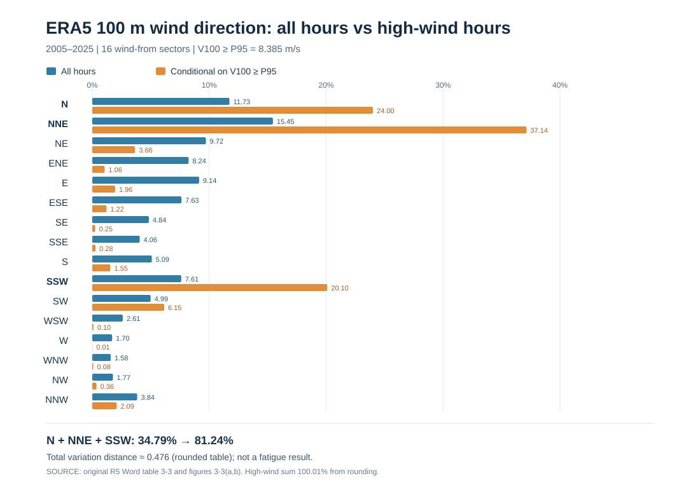

**图3-5** 2005—2025年ERA5研究点100 m气象来向的16方位分布。蓝色为全部逐小时样本的方向频率，橙色为给定 \(V_{100}\ge8.385\ \mathrm{m/s}\) 条件下的方向频率；每组分别归一化，**不是**各方位发生高风的条件概率。由原Word表3-3重绘，不是本轮重新下载或处理ERA5原始逐小时数据。

原稿表中N、NNE与SSW三个方向合计占全年风向频率的**34.79%**，而在高风条件样本中合计占**81.24%**，增加**46.45个百分点**。这三个方向是根据已有表格事后选出的集中方向，不能当作预先设定的显著性检验。若对两组16方位频率分别归一化，则总变差距离为

\[
\mathrm{TV}(P_{\mathrm{all}},P_{\mathrm{high}})
=\frac12\sum_{d=1}^{16}\left|P(d)-P(d\mid V_{100}\ge P_{95})\right|
\approx \mathbf{0.4760}.
\]

全年16项印刷百分数之和为100.00%，高风组为100.01%，后者由逐项保留两位小数造成。仅由表内四舍五入引起的TV数值误差保守不超过约**0.0008**（概率单位），而ERA5网格代表性、风向计算、100 m至轮毂高度外推以及方向相关结构响应误差均**不包含**在这一舍入界内。该结果表明，**全年风玫瑰不能在未经核验时直接替代高风条件方向权重**；但缺少同方向、同风速、同运行状态的风机载荷和材料局部应力，不能由此推断风致疲劳的控制方向、寿命或设计风向。机器可读[16行恢复表](../../../experiments/T062/S12_R5_ERA5_100M_DIRECTION_16SECTOR_20261109.csv)及[源锁重绘程序](../../../experiments/T062/s12_era5_directional_shift.cjs)保留逐行拒绝测试；原R5图3-3(a)(b)是源图而非新生成的物理结果。

#### 2026-10-31 21时｜2005—2025年全小时风速概率实证回填（S10独立输入，非DLC1.2验收）

本次直接从Git LFS原件[嘉鱼ERA5派生工作簿](../../../references/baselines-and-site-20261004/era5-derived-workbook/Jiayu_Paizhouwan_ERA5_2005_2025.xlsx)物化31,793,340字节（SHA256=`bbc290075fb4d7ff6435988acf1ea83c2c31453d207bfa821609b8e9a86953d0`），流式读取`Hourly_ERA5`中**2005-01-01 00:00—2025-12-31 23:00 UTC、184,080小时**的10m/100m U/V分量；时间缺失、重复、非1h间隔均为0。采用上式逐时动态风切变外推至**161.368806m**，再以`[j,j+1)`、1m/s间隔统计，保留≥30m/s溢出箱。[31行真实bin表](../../../experiments/T062/S10_ERA5_2005_2025_HUB_1MS_BINS_20261031.csv)、[全原件SHA与源读取/误差收据](../../../experiments/T062/S10_ERA5_2005_2025_HUB_BIN_RECEIPT_20261031.json)、[可复算流式程序](../../../experiments/T062/s10_era5_hourly_wind_bins.py)及[真实CI #41205311164](https://github.com/g2066203208-beep/voxel-frontier/actions/runs/41205311164)均已保存。

计算得到`Uhub`均值**4.796029203m/s**，P50/P90/P95/P99=**4.542998620/8.205842787/9.343860463/11.448269192m/s**，最大**19.202116603m/s**。若**仅为后续疲劳概率接口的诊断性运行范围**暂取`4≤U<25m/s`，对应**106,900/184,080=58.07257714%**小时；`U<4m/s`有77,180小时。不能把这个诊断范围当成已核读的DTU控制器/IEC认证运行边界。三个历史代表风速分别落在9、11、19m/s箱，箱内总**7,164小时**，只占全时段**3.89178618%**、该诊断运行小时的**6.70159027%**；这说明原18组NTM三风速是screening而不是覆盖全部运行bins的长期疲劳载荷矩阵，不可直接把三点DEL当完整年度材料寿命。

CSV同时保存`p_all_hours=n_j/184080`、`p_conditional_4_to_25=n_j/106900`及`8760p_j`等效标准年小时数，禁止在第四章混用无条件概率与运行时间造成二次乘以运行比例。数值核验：31箱小时数精确合计184,080，12位小数概率和舍入残差约`1e-12`；相对既有摘要均值/P95/最大值差分别约`+2.03e-7/-2.05e-5/-2.34e-5m/s`，属于来源数字精度的再现差异，**不是现场测风误差**。原工作簿U/V分量仅保留约四位小数，风切变低速敏感性及临近1m/s箱边界的归类误差尚未定量封闭；无同高度测风塔、原始84季度CDS GRIB/NetCDF的逐文件SHA及已核读授权IEC条文，**SOURCE_NUMERIC_PASS ≠ 场址/规范/材料疲劳PASS**。本次没有产生新的风载、地震或Abaqus原生响应。

### 3.2.4a 原R5风切变分位数与160 m外推的来源级交叉核查

早期R5论文原稿表3-2、表3-4和图3-4(a)(b)保留了2005—2025年ERA5研究点的风切变与160 m外推结果。本研究从原DOCX直接恢复表内数值：10 m与100 m多年平均风速分别为**2.617 m/s**和**4.299 m/s**，由两高度长期均值之比计算
\[
\alpha_{\mathrm{ratio}}=\frac{\ln(\overline V_{100}/\overline V_{10})}{\ln(100/10)}=0.215564\approx0.2156.
\]
原稿逐时风切变指数在\(V_{10},V_{100}\ge0.5\ \mathrm{m/s}\)的**180768/184080 h**内有定义，P05/P25/P50/P75/P95分别为**0.078/0.118/0.199/0.297/0.384**；其余**3312 h（1.7992%）**未进入这一有效样本。这里恢复的是原稿印刷汇总，而不是由分位数重建原图的概率密度直方图。

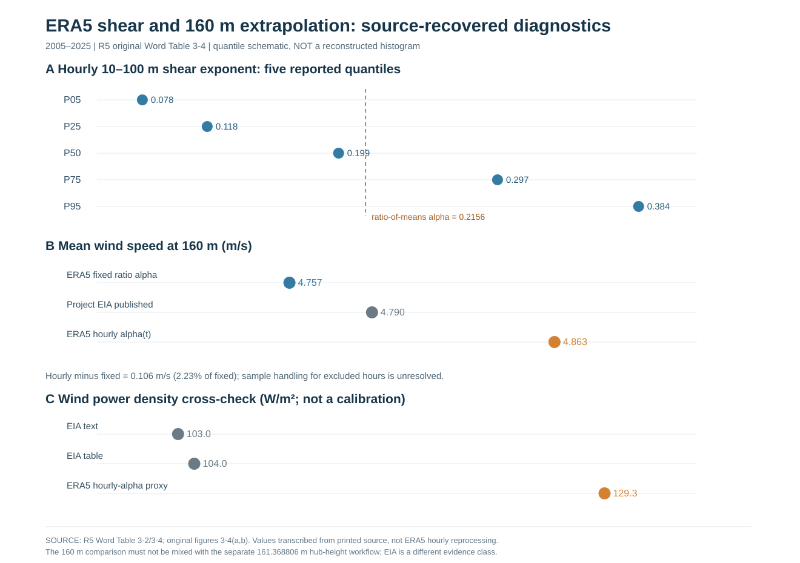

**图3-6** 原R5表3-2/3-4的来源恢复与再表达：A为五个风切变分位数的**离散点示意**，不是原图3-4(a)的直方图重建；B为两种160 m平均风速与公开环评均值的对照；C为ERA5风功率密度代理与环评正文/表格的对照。原图3-4(a)(b)的原件SHA256分别为`19cbb41a754fce0eb3a98a6ea3c2b216737ec2317dae2c08288f369e71e072ae`、`4c931c7ec41663fbbab6ef26a57ff3e0d9047ca231a1e516adfead243c56553f`。

按\(\overline V_{100}(160/100)^{\alpha_{\mathrm{ratio}}}\)复算得**4.757466 m/s**，与原稿四舍五入的**4.757 m/s**一致。原稿采用逐时\(\alpha(t)\)外推再求平均为**4.863 m/s**，二者相差**0.106 m/s**，相对前者为**2.2283%**。环评公开160 m年平均风速为**4.790 m/s**，两种ERA5结果分别相差**−0.6889%**与**+1.5240%**。但原稿没有在表3-4中说明3312个低速无效小时在逐时外推均值中的排除/替代规则，因此**不能把0.106 m/s全部归因于幂律非线性或风切变的时变性**；这一差值还可能含样本口径效应，只有同一小时集合重算才能拆分。

更重要的是，ERA5逐时外推的160 m风功率密度代理为**129.3 W/m²**，环评正文/表格分别为**103.0/104.0 W/m²**，ERA5代理分别高**25.5340%/24.3269%**。平均风速接近并不保证\(\overline{\rho V^3}/2\)接近；同时两类资料的空间、年份、密度和处理方法不完全一致，不能将此差异解释为ERA5已验证的系统偏差或据此校准场址。上述160 m来源恢复与§3.2.4所用**161.368806 m**轮毂高度工作流属于不同高度与处理口径，不能将后者的**4.796029 m/s**当作第三个同口径160 m结果。

仅考虑原稿印刷数字舍入，\(V_{10},V_{100}\)各保留0.001 m/s时反算\(\alpha_{\mathrm{ratio}}\)的范围约为**[0.215430, 0.215697]**，与原稿0.2156一致；两种160 m均值各保留0.001 m/s时，0.106 m/s差值的显示舍入误差不超过约**0.001 m/s**。这不包括再分析、空间插值、无效小时处理、环评来源差异和风机载荷响应误差。[原表16项机器可读恢复](../../../experiments/T062/S12_R5_ERA5_SHEAR_160M_SOURCE_20261109.csv)、[10项诊断结果](../../../experiments/T062/S12_R5_ERA5_SHEAR_160M_DIAGNOSTICS_20261109.csv)及[源锁Node程序](../../../experiments/T062/s12_r5_shear_160m_crosscheck.cjs)用于复核，不能代替ERA5逐小时原始文件的重新计算或工程测风验证。

### 3.2.4b 原R5年度极值GEV图恢复及21年样本的返回水平证据边界

**研究问题与原始来源。** 早期R5学位论文原稿图3-5保存了2005—2025年ERA5研究点**100 m逐小时风速年度最大值**的GEV返回水平：20年**16.91 m/s**、50年**17.49 m/s**、100年**17.86 m/s**。本研究直接读取原DOCX图段及其后说明、目视核对原图image47.png（原DOCX SHA256：da86e1fadafc977fc66d14a97a46760e73ec3b5150ddbae65fd62c7105764ee9；原图SHA256：8bd5628432b31132edf30a9480a0968766125d6b83cbf9b84f64025595eb1e75），恢复三项**已报告**数值。原稿同时给出该100 m小时序列最大观测值**17.626 m/s**；其**21个逐年最大值的完整列表、拟合参数估计、协方差及拟合诊断本轮未获得**。因此，本节不声称重新完成GEV最大似然拟合，更不把返回水平视为已认证的IEC设计风速。

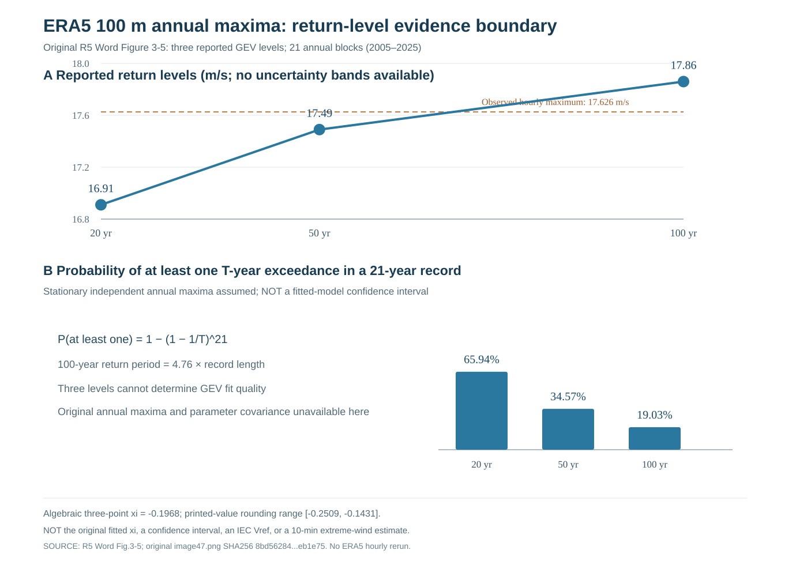

**图3-附2** A为原R5图3-5三个报告点的重绘，虚线是同一100 m逐小时样本的最大观测值17.626 m/s，点间连线仅连接已报告值，不代表原拟合函数或其置信带；B为**假定各年度最大值平稳、相互独立，且返回水平定义正确**时，21年内至少一次超过相应真实\(T\)年阈值的概率恒等式，不是由本样本估计的置信区间。原图及来源不包含可直接重建的原始21点年极值序列。

定义每年超越\(T\)年返回水平的概率为\(1/T\)，则\(n=21\)年中至少一次超越的概率为

\[
P\{\max_{1\leq i\leq21}M_i>z_T\}=1-(1-1/T)^{21}.
\]

| 原R5报告返回期\(T\) / 年 | \(z_T\) / (m/s) | 21年内至少一次超越的条件概率 | \(T/21\) | \(z_T-17.626\) / (m/s) |
|---:|---:|---:|---:|---:|
| 20 | 16.91 | **65.9438%** | 0.9524 | −0.716 |
| 50 | 17.49 | **34.5744%** | 2.3810 | −0.136 |
| 100 | 17.86 | **19.0272%** | **4.7619** | +0.234 |

这里的\(T/21\)只是返回期与观测记录长度的比值，并非置信度或“样本有效倍数”。特别是100年返回水平已经超出21年观测窗口约4.76倍；即使GEV分布完全正确，也只有约19.03%的概率在21年独立年度样本中观测到至少一次超过真实100年返回水平的事件。**因此，三条返回水平曲线点的平滑性和与样本最大值接近，不能证明100年返回水平已经被21年ERA5记录独立验证。**

进一步作**不依赖年度原始序列的代数一致性诊断**。采用Coles（2001，*An Introduction to Statistical Modeling of Extreme Values*，DOI 10.1007/978-1-4471-3675-0）的GEV最大值参数约定，令\(y_T=-\ln[-\ln(1-1/T)]\)，在\(\xi\ne0\)时\(z_T=\mu+\sigma[\exp(\xi y_T)-1]/\xi\)。仅将上述三个**保留两位小数**的报告点强制视作同一GEV函数的精确三点，反解得**代数形状参数\(\xi_{\mathrm{3pt}}=-0.196784\)**。若每个报告值仅存在末位四舍五入误差\(\pm0.005\ \mathrm{m/s}\)，对三点的八个端点组合求解，得到\(\xi_{\mathrm{3pt}}\in[-0.250908,-0.143076]\)。这是**报告点的代数舍入敏感性**，**不是**原论文拟合所得形状参数、GEV估计的置信区间或对负形状参数的统计显著性证明；原始21个年度最大值缺失时无法据此计算参数标准误、返回水平置信带或检验非平稳性。Coles书籍的出版社书目信息已核对，原书具体推导页码本轮未获取，不冒称全文逐页阅读。

本节给出的科学结论仅是**原始图数据恢复及返回水平的可识别性边界**：已报告100 m年度GEV点可作为场址极值背景敏感性示例，但不等于10 min极端风、IEC \(V_{\mathrm{ref}}\)、161.368806 m轮毂高度返回水平或正式DLC极端风工况；原始年极值、时间独立性、非平稳性、参数区间与场址测风对照尚未闭合。可复核的[三行来源表](../../../experiments/T062/S12_R5_ERA5_GEV_3LEVEL_SOURCE_20261109.csv)、[三行诊断表](../../../experiments/T062/S12_R5_ERA5_GEV_RETURN_DIAGNOSTICS_20261109.csv)和[无依赖Node源程序](../../../experiments/T062/s12_r5_gev_return_level_identifiability.cjs)分别锁定印刷输入、条件概率/形状诊断和负例测试。该结果不作为第四章材料疲劳概率的替代来源。

### 3.2.4c 高风方向筛查目标的非等价性：高风小时覆盖与相对风险排序

在§3.2.4恢复的2005—2025年ERA5研究点100 m高度16方位数据基础上，本节检验一个可证伪问题：如果只能筛查k个等成本风向，按“该方向发生高风的相对风险”排序，是否必然使历史高风小时覆盖最大？令H表示V100≥8.385 m/s的高风事件，方向集合A的覆盖目标定义为C(A)=Σ[d∈A]P(d|H)，且|A|=k。在方向互斥、筛查成本相同、目标仅为高风小时覆盖时，按P(d|H)降序选择前k个方向可获得全局最优解。另一种排序是贝叶斯相对暴露R(d)=P(H|d)/P(H)=P(d|H)/P(d)，它衡量某方向发生高风的相对倾向，而不是该方向贡献的高风小时总份额。两者不能混用。

| 等成本方向数k | 最大高风小时覆盖的方向 | 最优覆盖率/% | 相对风险优先的方向 | 其覆盖率/% | 损失/百分点 |
|---:|---|---:|---|---:|---:|
| 1 | NNE | 37.1363 | SSW | 20.0980 | **17.0383** |
| 3 | NNE、N、SSW | 81.2319 | SSW、NNE、N | 81.2319 | 0 |
| 5 | NNE、N、SSW、SW、NE | 91.0409 | SSW、NNE、N、SW、NNW | 89.4711 | **1.5698** |
| 7 | NNE、N、SSW、SW、NE、NNW、E | 95.0905 | SSW、NNE、N、SW、NNW、NE、S | 94.6805 | **0.4100** |

**表3-x**由原R5表3-3两组16方位印刷频率分别归一化得到，不是新风场或结构仿真。一个方向预算时，按相对风险选SSW会比按高风小时覆盖选NNE少覆盖17.0383个百分点；五方向预算时，两种方案仅将NE与NNW互换，仍损失1.5698个百分点。对16方向全部65535个非空子集进行独立穷举，确认每个k的最大覆盖与降序选择一致，其中k=5有4368个候选组合。逐项印刷舍入最大±0.005个百分点，不足以改变k=1、5、7的主要差值；ERA5网格、风向定义、时间依赖性、机组运行状态及载荷传递误差未包含在此界内。

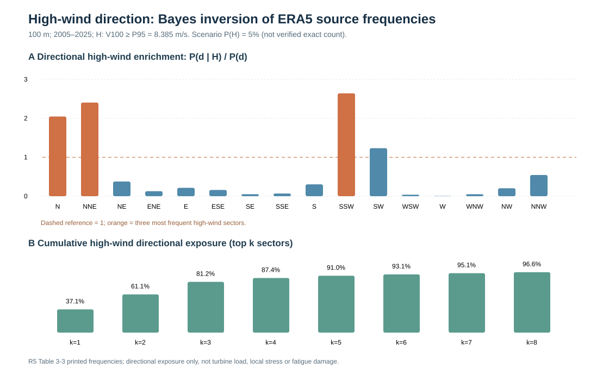

完整k=1—16方向预算见[16行机器可读结果](../../../experiments/T062/S12_DIRECTION_PRIORITY_OBJECTIVE_CONTRAST_16K_20261110.csv)。输入为[原R5派生16方位数据](../../../experiments/T062/S06_ERA5_100M_HIGHWIND_DIRECTION_BAYES_16ROW_20261110.csv)，SHA256为501a8f408c4fe496c5e49f4fc0cf79b095c48f6a67ef95d1a0ae4ca549ca4bd9；既有[贝叶斯源级程序](../../../experiments/T062/s06_era5_highwind_direction_bayes.cjs)提供P(d|H)和R(d)。本节只是100 m历史高风小时方向筛查的确定性目标比较，不能替代161.368806 m轮毂高度正式DLC1.2风速箱，更不能确定结构控制风向、材料Miner损伤或风震响应。

### 3.2.5 诊断运行风速箱与历史NTM来源覆盖（源级定量图）

为防止将代表性随机风筛查误认为全设计寿命的材料疲劳载荷输入，本文直接交叉读取2026-10-31锁定的[ERA5逐小时31个1 m/s箱源表](../../../experiments/T062/S10_ERA5_2005_2025_HUB_1MS_BINS_20261031.csv)与[21风速箱×6随机种子来源矩阵](../../../experiments/T062/S10_ERA5_21BIN_6SEED_NTM_SOURCE_COVERAGE_20261031.csv)，将风气候的**小时概率权重**与历史OpenFAST NTM**原始来源可用性**置于同一图中，而不把二者相乘推导疲劳损伤。

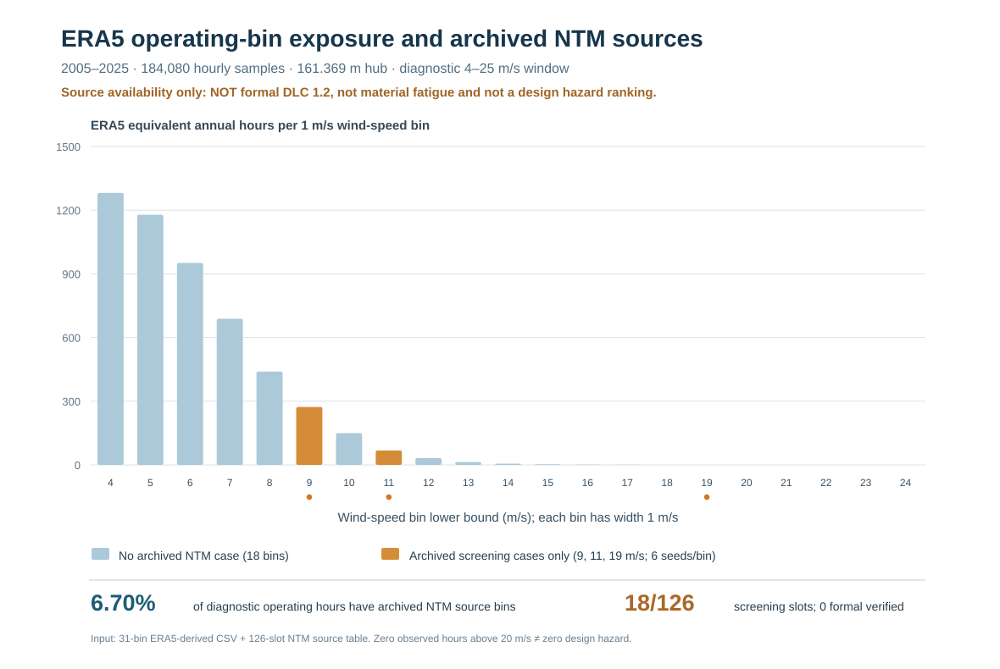

**图3-附1** 2005—2025年ERA5派生风速箱的等效年小时数和历史NTM来源身份。横轴为1 m/s分箱下界，纵轴为各箱的 \(8760n_j/184080\)（h/年），蓝色表示该箱无历史NTM原始输出来源，橙色表示该箱有6个**历史screening**随机种子（9、11、19 m/s）。颜色不表示风致损伤大小、材料寿命、IEC合格性或危险性排序；20—24 m/s在本次21年资料中观测小时数为零，不能视作设计风险为零。

按此项目**非规范性的诊断运行范围** \([4,25)\) m/s，184080个总小时中有106900个诊断运行小时；21个风速箱有16个正小时数、5个零观测小时数。历史18条NTM分别位于9、11和19 m/s三个箱，因此历史来源存在的风速箱对应7164小时，占诊断运行时段的 **6.70159027%**，其余99736小时（**93.29840973%**）所在风速箱没有相应历史NTM输入/输出。21×6=126个规划槽中，**18个仅有历史screening来源，108个无该类归档来源，正式DLC1.2验证为0/126**。尤其4—8 m/s五个分箱的95402个小时占诊断运行小时的89.24415%，尚无对应历史来源，说明本研究的三档代表风速无法直接代表长期风速概率谱。

**这张图只揭示源数据覆盖结构，不能由小时数推出疲劳贡献或最危险风速。** 高风速极少出现的记录仍可能贡献显著应力循环损伤；机组运行边界、2025/2026授权标准条款、历史控制器/BTS可重算性、正式DLC1.2全风速bin与材料局部应力均尚未验收。因此本节将本图归类为**真实再分析派生数据的来源覆盖图**，而不是材料疲劳或工程安全结论。可复算的无外部依赖[Node绘图程序](../figures/plot_s10_era5_ntm_source_coverage.mjs)以两份源CSV的SHA256为前置条件，执行1项真实正例和6项输入污染拒绝；代码/图本轮由JavaScript V8实际运行得到，尚无独立GitHub Actions原生Node执行回执。源哈希及计算约束见[T062既有来源收据](../../../experiments/T062/S10_ERA5_21BIN_6SEED_COVERAGE_RECEIPT_20261031.json)。

### 3.2.6 长期风不确定性

REF090表明再分析资料的bias、RMSE和correlation随地点类型/高度变化。本文没有嘉鱼同高度测风塔长期实测，因此不能对ERA5在该研究点给出“已验证误差为X%”之类的结论。最终第三章必须明确：ERA5适合支撑长期统计和概率；HubHt外推引入风切变模型不确定性；复杂地形/地表粗糙度可能造成局部风场偏差；第四章absolute lifetime的证据等级受场址风资料等级限制。

> 原图证据：REF080 p3、p7、p8；REF093 p4–6；REF090 p8、p10–11。

## 3.3 随机湍流工况与TurbSim风场

### 3.3.1 NTM与ETM研究身份

本文按IEC 61400-1基线审计[REF132]区分NTM与ETM。NTM用于正常湍流运行，也是第四章DLC1.2疲劳主线；ETM用于更高湍流强度下的响应放大和screening，不与正常运行长期概率直接混合。

### 3.3.2 36case历史screening矩阵

当前正式归档的历史矩阵为：

\[
3\ U_\mathrm{Ref}
\times
2\ \mathrm{turbulence\ models}
\times
6\ \mathrm{seeds}
=
36\ \mathrm{cases}.
\]

六个随机种子固定为104729、130363、155921、181081、206369、231701。三个URef分别为9.343881、11.4、19.202140 m/s。

该矩阵已经有36/36风场和OpenFAST结果资产。用途冻结为代表风速screening、NTM/ETM比较、seed离散、极值/RMS、PSD、load-rainflow/DEL以及第四章初步控制区域识别。它不是4–26 m/s全覆盖的认证DLC矩阵，也不是第四章20年材料疲劳bin矩阵。

### 3.3.3 TurbSim空间与时间离散

当前历史风场采用：
- total time = 700 s；
- 前100 s作为过渡/舍弃段；
- 100–700 s为600 s正式统计窗；
- 空间域 = 200 m × 200 m；
- 网格 = 51 × 51；
- spacing = 4.0 m。

这些是当前归档输入的实际设置，不写成IEC唯一规定。

正式第三章还必须补两个V&V：其一，200 m×200 m是否覆盖整个DTU 10 MW旋转平面并保留合理余量；其二，51×51离散是否足以保证HubHt时程、目标谱和主要载荷统计稳定。若网格敏感性尚未闭合，终稿只能写“采用51×51历史生产网格”，不能写“已证明网格无关”。

### 3.3.4 风场质量检查

每个风场至少检查mean wind speed、standard deviation/TI、三分量时程、HubHt PSD、目标谱/实现谱、空间相干性、grid dimensions、duration/\(\Delta t\)和seed identity。只有风场本身通过质量检查，OpenFAST响应差异才可解释为真实风况/seed差异，而非输入文件错误。

## 3.4 OpenFAST—ROSCO整机模型身份与运行验证

### 3.4.1 整机身份

OpenFAST模型以DTU 10 MW参考风机[REF001]为风轮—叶片—机舱基准，并统一到本文158 m混塔对应的塔架动力属性。正式输入身份至少记录OpenFAST版本、ElastoDyn/BeamDyn/AeroDyn模块、tower geometry/properties、blade properties、RNA mass/inertia、ROSCO版本与配置、坐标约定及output channel list。

第二章Abaqus与第三章OpenFAST共享的塔顶接口坐标、总质量、RNA惯量和低阶模态必须闭合到预先设定容差，否则不能进入跨模型载荷传递。

### 3.4.2 ROSCO控制器角色

ROSCO[REF046]提供公开可复现的变速变桨控制框架，并明确below-rated与above-rated运行区域。本文必须特别检查11.4 m/s附近RotorSpeed、GenSpeed、BldPitch、GenPwr及推力相关响应是否连续合理。

控制器在本文中是整机运行边界，不作为创新；REF046中NREL 5 MW或IEA 15 MW的具体调参值不得直接移植为DTU 10 MW参数。

#### 2026-10-31 23时｜历史18组NTM真实TurbSim/FST/ServoDyn/DISCON输入身份（SOURCE-QC，非正式DLC1.2）

直接从13个已归档ZIP读取并逐件校验**127份原始成员**（18×TurbSim `.inp/.sum/.dat`、18×OpenFAST FST/ElastoDyn/ServoDyn/InflowWind及1份`DISCON.IN`），与既有18工况源身份SHA表交叉核对。18组实际TurbSim输入为`IECKAI`、`IEC_WindType=NTM`、`IECstandard=1-ED3`、`IECturbc=A`、**51×51网格**、`TimeStep=0.025 s`、`AnalysisTime=700 s`、轮毂高度`161.368806 m`。三个原始`URef`分别是9.343881、11.400000、19.202140 m/s，各6个`RandSeed1`为104729、130363、155921、181081、206369、231701；三风速复用同一组种子编号，但每组的TurbSim `.inp/.sum/.dat`内容SHA不同。不能把同编号跨风速误说成18个独立seed。

18组FST相同、ServoDyn相同，`TMax=700 s`、`DT=0.0125 s`、`DT_Out=0.05 s`、`CompAero=2`、`CompServo=1`。ServoDyn原文`PCMode=5`、`VSContrl=5`，引用`libdiscon.dll`及`DTU_10MW_RWT_DISCON.IN`；`DISCON.IN`源文本包含ROSCO配置；后续对18份原生OpenFAST日志的核验进一步确认均报告`Running ROSCO-v2.6.0`及legacy Bladed DLL接口。**这证明运行时报告的控制器版本标识，但不能证明18个历史DLL的二进制SHA、精确构建及DTU 10 MW控制器V&V已经验收**。InflowWind原文`WindType=3`并引用每组绝对Windows路径的`.bts`，但**18个原始BTS均未在当前归档中保存字节或SHA**（归档台账状态`prior-size-deferral-cancelled-see-transfer-ledger`）。因此历史18组可作NTM来源筛查，不能宣称可原样复现风场，更不能认定已通过2025版IEC正式DLC1.2。原始[18行逐工况输入表](../../../experiments/T062/S07_18NTM_ORIGINAL_TURBSIM_CONTROLLER_INPUTS_20261031.csv)、[SHA/阅读层级/控制器及BTS收据](../../../experiments/T062/S07_18NTM_ORIGINAL_TURBSIM_CONTROLLER_RECEIPT_20261031.json)和[可复算Python](../../../experiments/T062/s07_ntm18_original_control_input_gate.py)由[Actions #41213530566](https://github.com/g2066203208-beep/voxel-frontier/actions/runs/41213530566)原生执行通过。原始输入配置复核不等于IEC条文、控制器或载荷物理PASS；正式DLC1.2仍0/126，风致材料疲劳仍待原生局部应力。

#### 2026-11-01｜18组历史NTM真实OUTB运行状态源级核验（S07独立准备）

在不新增700 s求解的前提下，直接从18份SHA256锁定的原始158 m OpenFAST OUTB读取100–700 s、0.05 s间隔的12,001个同步时刻，逐案统计`RotSpeed`、`BldPitch1–3`、`GenPwr`、`GenSpeed`和`GenTq`。对应[18行真实运行状态表](../../../experiments/T062/S07_18NTM_ORIGINAL_OPERATING_STATE_QC_20261101.csv)、[来源与误差收据](../../../experiments/T062/S07_18NTM_ORIGINAL_OPERATING_STATE_RECEIPT_20261101.json)及[可复算程序](../../../experiments/T062/s07_ntm18_operating_state_gate.py)，由[原生Actions #41218563210](https://github.com/g2066203208-beep/voxel-frontier/actions/runs/41218563210)成功核验。18/18组在该600 s窗口均满足**诊断性**`GenPwr>1 kW且RotSpeed>0.1 rpm`的全部12,001个时刻，按此阈值未发现运行状态切换；18组最低发电功率1048.436 kW，转速范围6.403–11.954 rpm，三桨距通道在各时刻一致，正转速时`GenSpeed/RotSpeed`中位数范围49.99948–50.00035。上述阈值并非IEC停机判据，且虽然原生OpenFAST日志已经确认ROSCO-v2.6.0标识，仍没有历史控制器DLL二进制和原始BTS的逐件SHA；它们**只能说明历史输出在该窗口表现为连续发电**，不能证明没有控制器内部事件、正式DLC1.2合规、全年可运行性或疲劳寿命。18/18仍仅作历史筛查，正式复用批准0/18。

#### 2026-11-01｜原始ROSCO控制参数与历史运行状态的同源对照（S07源级数值）

在不重新运行OpenFAST的条件下，从原始归档ZIP中读取17,600字节的`DTU_10MW_RWT_DISCON.IN`（SHA256=`8f5d7546420ee34838e66b63e4b26d64460be5d5492f99c60b6d1ef977ffc61a`），提取17项变速、变桨和滤波控制参数，并按工况SHA与前述18份OUTB派生运行状态及ROSCO-v2.6.0原生日志对应。原配置`VS_ControlMode=2`、`PC_ControlMode=1`、`VS_RtPwr=10000000`、`VS_RtTq=198943.67886`、`PC_RefSpd=50.26548`，变桨调度包含30点角度及比例/积分增益。若按ROSCO相应参数采用W、N·m和rad/s解释，则`VS_RtTq×PC_RefSpd=9,999,999.510864 W`，与配置额定功率10 MW的相对差为`4.89136×10⁻⁸`。这只是**控制配置内部单位假设下的算术一致性**，不是原生控制器二进制同一性、动态控制律或IEC合规性证明。

原始OUTB在9.343881、11.4、19.202140 m/s三组风速下，六seed的平均功率分别为6230.9544、9122.9711、9986.4653 kW，平均变桨角分别为0.39524°、3.74244°、16.60208°，以六seed逐案均值的条件单位比值再核验：9.343881 m/s组的平均发电功率/额定功率、平均发电机转矩/额定转矩、平均发电机角速度/参考角速度分别为0.62310、0.76172、0.80334；19.202140 m/s组分别为0.99865、0.99933、0.99921，表明高风速组**历史输出的时均运行点接近配置额定点**。注意三个均值的乘积不等于逐时刻机械功率均值，且没有独立控制器动态误差预算。上述对照；但风速、功率和变桨的相关变化不等于控制器稳定性或因果验证。逐工况配置及带条件单位比值见[18行源级数表](../../../experiments/T062/S07_18NTM_DISCON_VS_OPERATING_QC_20261101.csv)，原始DISCON参数行号、来源SHA、误差和HOLD见[收据](../../../experiments/T062/S07_18NTM_DISCON_VS_OPERATING_RECEIPT_20261101.json)，[可复算程序](../../../experiments/T062/s07_ntm18_discon_operating_contract.py)已保存。原始18个NTM BTS和各case实际加载DLL仍缺逐件SHA，正式DLC1.2复用0/18；源级数值验证不能代替S07物理验收。

#### ROSCO v2.6.0 原始控制律与参数单位核对（2026-11-01）

为避免用新版ROSCO文档解释历史控制器，直接核读ROSCO官方`v2.6.0`标签（commit `51629665d22f92770f861daeebcebd47ab32abb1`）的`rosco_types.yaml`、`Controllers.f90`、`ControllerBlocks.f90`和`ReadSetParameters.f90`。该版本明确规定：`VS_ControlMode=2`为最优叶尖速比跟踪，在额定以上对应恒转矩支路；`VS_ControlMode=3`才包含该跟踪方式下的恒功率转矩上限；`PC_ControlMode=1`表示启用集体变桨PI控制。`PC_RefSpd`是高速轴（发电机侧）参考角速度，单位rad/s，不是转子角速度。源文件中的具体分支分别见`Controllers.f90`第187–190、211–213行及`ControllerBlocks.f90`第52–56、110–142行。因而**不能仅凭历史高风速组发电功率接近10 MW，就将控制模式2称为恒功率控制**。

对既有18组真实NTM来源表复核后，18组均为`VS_ControlMode=2`、`PC_ControlMode=1`，三组各6个随机种子；19.202140 m/s组的六seed时均功率、转矩、发电机转速相对配置额定值分别为0.99865、0.99933和0.99921。该现象与额定附近运行一致，但不是对控制状态机逐时刻分区的直接观测。先前17项参数提取器未收录官方`VS_RefSpd`、`VS_TSRopt`、`VS_GenEff`等关键字段，历史表中的`VS_RtGnSp`、`VS_ConstPower`空值也**不能解释为零**。因此当前结论仅为版本锁定的参数语义与源级统计对应，正式控制器动态验证、历史DLL/BTS原件身份及DLC1.2仍待闭合。

四份官方源文件的逐件SHA256、准确源行号、输入CSV哈希和误差边界见[源级收据](../../../experiments/T062/S07_ROSCO_V260_OFFICIAL_SEMANTICS_RECEIPT_20261101.json)，[可复算Node脚本](../../../experiments/T062/s07_rosco_v260_official_semantics_gate.cjs)通过[原生Actions #41232842992](https://github.com/g2066203208-beep/voxel-frontier/actions/runs/41232842992)核验四份源码哈希、18组源表和5项异常输入拒绝测试。该CI为源级程序验收，不是OpenFAST或Abaqus物理PASS。

#### 历史控制器九项参数的原件补核与版本差异

为核实历史运行状态与控制器设定值的关系，从归档`DISCON.IN`原件（17,600字节，SHA256：`8f5d7546420ee34838e66b63e4b26d64460be5d5492f99c60b6d1ef977ffc61a`）补提九项参数，原值及源行号见[参数表](../../../experiments/T062/S07_ROSCO_V260_ORIGINAL_EXTENDED_KEYS_20261101.csv)。其中，变速参考角速度`VS_RefSpd=47.92601 rad/s`，不同于变桨参考角速度`PC_RefSpd=50.26548 rad/s`；最优叶尖速比`VS_TSRopt=7.50`，最小最优模式角速度`VS_MinOMSpd=36.6 rad/s`，变桨速率上限`PC_MaxRat=0.17453 rad/s`，发电机转矩变化率上限`VS_MaxRat=1.5×10⁶ N·m/s`，风速估计器设定`WE_Mode=2`，设定值平滑`SS_Mode=1`，估计器齿轮箱传动比为50。三个历史风速组的六seed平均发电机角速度相对`VS_RefSpd`分别为0.84255、0.99154和1.04799，说明平均转速与变速参考点的相对位置；**这不是逐时刻控制状态机的直接识别**。

版本核对发现，同一ROSCO v2.6.0标签的参数注册表与可执行源码在两处描述不一致：注册表将`VS_GenEff`描述为无量纲比例，而`Controllers.f90`第190、213行实际按`VS_GenEff/100`使用，故历史原值`100`按源码应解释为100%效率参数；注册表只列`WE_Mode=0/1`，但`ReadSetParameters.f90`第628–631行允许0、1、2，`ControllerBlocks.f90`第238行起明确实现模式2的扩展卡尔曼滤波（EKF）。因此本文以**版本锁定的可执行源代码**解释原始配置，不将这两个原值误判为非法，也不将配置正确等同于历史DLL二进制身份已证实。源文件SHA256、行号、九键原始数值、历史运行区间及异常测试详见[复核收据](../../../experiments/T062/S07_ROSCO_V260_ORIGINAL_EXTENDED_KEYS_RECEIPT_20261101.json)；[GitHub Actions #41242545218](https://github.com/g2066203208-beep/voxel-frontier/actions/runs/41242545218)完成源级原生测试。原始18组BTS和各案DLL的SHA仍缺，2025版IEC正式DLC1.2适用性未验收，故上述结果仅用于历史控制输入解释，不用于直接给出疲劳寿命。

### 3.4.3 分层验证顺序

Brown等[REF009]的一对一OpenFAST验证先检查结构/模态，再检查来流和运行状态，最后比较载荷/DEL。本文继承该顺序：

**Gate OF-1 结构身份**：tower/RNA mass、tower frequencies、key mode identity。  
**Gate OF-2 风场身份**：mean/TI/spectrum、grid、time window。  
**Gate OF-3 运行状态**：RotorSpeed、blade pitch、generator power、control region。  
**Gate OF-4 载荷统计**：tower-top/tower-base loads、RMS/STD/max/min、PSD、DEL。

Brown等的实机误差数值属于其2.8 MW测试机，不作为本文容差标准；本文只继承验证组织方式。

### 3.4.4 数值稳定性和过渡段

每个case至少检查OpenFAST正常结束、NaN/Inf、rotor overspeed、pitch/power异常、100 s之后统计稳定性及塔架响应非物理漂移。700 s总时长并舍弃前100 s是本文当前生产设计，最终需通过代表case确认100 s足以消除启动过渡，而非自动视为标准规定。

> 原图证据：REF046 p4、p6、p13、p17；REF009 p5、p7、p10、p13、p15、p17。

## 3.5 多随机实现整机响应统计

### 3.5.1 QoI集合

第三章不以单一塔底弯矩作为“最危险性”指标。至少统计：
- 运行状态：RotorSpeed、BldPitch、GenPwr；
- 整体响应：tower-top FA/SS displacement、resultant displacement、必要的acceleration；
- 塔底/接口：\(F_x,F_y,F_z,M_x,M_y,M_z\)及resultant bending moment；
- 疲劳载荷：TwrBsMxt和TwrBsMyt load-DEL。

第四章材料控制工况从多个QoI的控制case并集中选取。

### 3.5.2 每个case的时域统计

对100–700 s有效窗统一计算：

\[
\mu_x=\frac{1}{N}\sum_{i=1}^{N}x_i,
\]

\[
\sigma_x=
\sqrt{
\frac{1}{N-1}
\sum_{i=1}^{N}(x_i-\mu_x)^2
},
\]

以及min、max、peak-to-peak、RMS和必要分位数。

所有统计表必须绑定case_id、source .outb hash、channel exact name/unit、effective window和parser version。当前项目曾出现.outb Time/channel indexing偏移，因此通道身份本身就是结果可追溯性的一部分。

### 3.5.3 六seed统计与离散

每个 \(U_\mathrm{Ref}\) × turbulence model有6个seed。对每个QoI计算six-seed mean、standard deviation、coefficient of variation、min/max和controlling seed。

第三章的任务是展示seed影响，而不是把某一个seed的峰值写成该平均风速的唯一确定结果。

#### 3.5.3.1 已归档18组NTM载荷DEL的种子数量敏感性（来源级数值结果）

对历史归档的3个平均风速（9.343881、11.4、19.202140 m/s），各取6个不同seed标签的NTM记录，复用已完成源SHA核验的OpenFAST `.outb`派生载荷表。每条时程均取100–700 s、Δt=0.05 s、12001点，源表包括塔底六分量及九个原始塔架测站各六分量，共18×60=1080行。本节只比较塔底`TwrBsMyt`与九站`TwHt1–9MLyt`的载荷DEL，不将原始九站冒充后续31段完整时程。源表、输出及可复算脚本分别为[18工况原始载荷DEL](../../../experiments/T062/S06_18NTM_ORIGINAL_9GAGE_LOAD_DEL_20261031.csv)、[30组统计表](../../../experiments/T062/S10_18NTM_6SEED_LOAD_DEL_CONVERGENCE_SUMMARY_20261031.csv)、[180行全部子集枚举](../../../experiments/T062/S10_18NTM_6SEED_EXHAUSTIVE_SUBSET_CONVERGENCE_20261031.csv)和[原程序扩展](../../../experiments/T062/s06_ntm_seed_dispersion_and_bts_gate.js)。输入源SHA256=`95de6578cf379d1b2e1d99a68c26954a68e93cc8bfc4bdcd63dd324ae2999a0f`。

为了避免将六个DEL的算术平均误当作循环四次矩的合并值，对任一包含`n`个**等时长且使用同一等效循环数**的子集`A`，定义载荷级四次矩合并指标

\[
D_{4,A}=\left[\frac{1}{n}\sum_{s\in A}(D_{4,s})^4\right]^{1/4}.
\]

这里`D_{4,s}`是每条600 s记录以`m=4,N_{ref}=600`得到的`DEL_{m4}`，`D_{4,A}`对应**各独立雨流账本的四次矩加权合并**，并非拼接原始时程重新雨流（拼接边界会改变循环），也不是第四章任何材料的S–N指数或寿命。它与第3.7节历史`N_{eq}=100000`筛选口径**数值不能直接比较**。将六个标签按S01至S06排序，逐一枚举`n=1,2,3,4,5,6`时全部`\binom{6}{n}=6,15,20,15,6,1`种子集，并记录最小、最大及相对完整六样本值的最大偏离。全部子集来自**同一六条记录**，不等于新增加的独立湍流实现。

| NTM风速 / m·s⁻¹ | 六seed算术均值 / kN·m | 六seed四次矩合并 / kN·m | seed样本CV | 任取3个seed相对六seed最大偏离 | 留5个seed最大偏离 |
|---|---:|---:|---:|---:|---:|
| 9.343881 | 43,701.157 | 44,641.262 | 13.329% | 10.859% | 3.776% |
| 11.4 | 56,611.754 | 57,613.197 | 11.901% | 10.172% | 3.372% |
| 19.202140 | 61,333.196 | 61,647.420 | 6.429% | 4.531% | 2.121% |

上述数值全部为**塔底`TwrBsMyt`、源版本锁定的历史NTM筛查结果**。六seed四次矩合并值比算术均值分别高2.151%、1.769%和0.512%；因此不能用简单平均代替给定`m=4`的四次矩聚合。三seed子集相对六seed基准仍可偏离约4.5%–10.9%，显示**在这六条既有记录内部**对seed选择敏感，但六seed本身不是已证明收敛的总体真值；缺少新增独立seed，不能由子集范围推断置信区间、总体误差上界或规定足够样本数。源OUTB的int16打包量化误差逐通道已在1080行原表给出，数表输出保留9位小数；这一数值舍入预算不覆盖真实风场、控制器、结构、测点位置和材料模型误差。

原始18个OUTB先前已按SHA逐字节恢复，本轮仅从**已归档的1080行派生表**复算，GitHub Actions [`#41175810307`](https://github.com/g2066203208-beep/voxel-frontier/actions/runs/41175810307)独立检查输入SHA、30组完整性、组合数、解析四次矩及全部输出逐字节一致。原始36个TurbSim `.bts`仍处于来源清单中的延后保存状态，不能称本轮重新产生或复现了18个NTM原始风场。上述结果为`SOURCE_LOAD_DEL_NUMERIC_QC`，不是正式DLC1.2年疲劳损伤，也不构成材料局部应力、PT或接缝的原生验收。下一步须在相同输入身份下建立局部材料应力时程并验证截面/坐标与重力、惯性所有权，再按风速概率及材料独立疲劳规律进行第四章计算。

### 3.5.3.2 运行状态与载荷DEL相关性的风速档混杂效应（18组真实NTM）

为判断整机运行状态均值能否替代随机风载荷疲劳筛选，本研究将三个历史NTM风速档、每档六seed的运行状态统计与塔底`TwrBsMxt/TwrBsMyt`载荷DEL逐例配对，要求`case`及原始OUTB SHA256一致。18例均为100–700s、0.05s步长、12001点；`GenPwr_mean`由kW换算为MW，m=4的载荷DEL由kN·m换算为MN·m。历史运行状态启发式记录18例均处于功率/转子活跃状态，但不代表正式DLC1.2认证。

三个风速档直接合并时，平均发电机功率与塔底My载荷DEL的Pearson相关系数为**r=0.827168**（R²=0.684207）；将两变量分别减去所属风速档的六seed均值后，档内相关系数降至**r=0.148564**（R²=0.022071）。未归一化协变交叉乘积精确分解显示，**98.9421%**来自档间均值差异。三个档内相关系数分别为0.500028、-0.003276、0.162506，18次逐例删除并重新中心化得到档内r范围0.007570～0.377205。第二组交叉检查中，平均桨距角与Mx载荷DEL的合并r=0.968215，档内r=0.315669。

因此，混合样本的强相关性主要反映**不同风速档之间的共同变化**，不能推断固定风速下运行状态均值可稳定预测seed载荷DEL。该分析属于历史18例的描述性统计，不是控制器因果机制、总体显著性检验、局部材料应力或Miner损伤。源级程序、18例配对表、4行统计表与正式双面板图均已保存；输入SHA256为`0f577f3197870a1350c740c2e0c118073fb9b6f796b4c471765c6f616d5a1b04`及`95de6578cf379d1b2e1d99a68c26954a68e93cc8bfc4bdcd63dd324ae2999a0f`，程序SHA256为`90f9357349ec881ee377fdada2a116b3d5166f41e90680d5788c27a33bf795ee`。

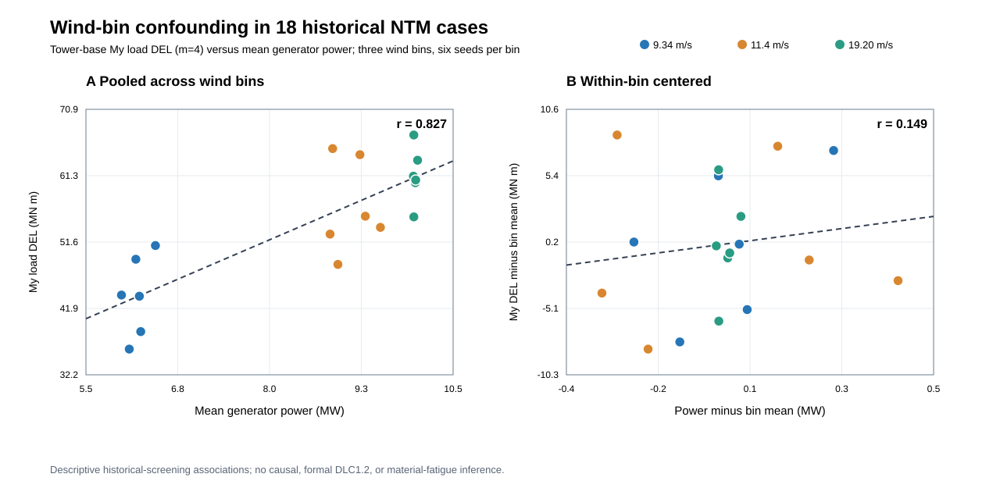

*图3-新增：同一18组真实来源NTM的My载荷DEL与平均发电机功率；左为混合样本，右为按风速档中心化，虚线仅表示描述性线性拟合。*

### 3.5.3.3 运行状态均值代理的留出检验：档内斜率未提高历史载荷预测精度

在§3.5.3.2已确认混合风速档相关性受到档间均值影响的基础上，本节进一步提出可证伪问题：**控制风速档以后，平均功率或平均桨距角能否在留出样本上提高塔底载荷DEL的预测精度？** 复用相同的18组NTM真实来源派生记录（3个风速档×6个seed），分别预先指定“平均功率MW→塔底My载荷DEL”和“平均桨距角°→塔底Mx载荷DEL”。比较三种估计器：仅使用训练集的目标风速档DEL均值、训练集各风速档中心化后估计统一斜率并加回目标档均值、以及不区分风速档的混合样本线性回归。每次预测均重新计算训练均值与斜率，**不使用留出样本的DEL或所属档样本均值**。

采用两种分割：逐例留一（LOCO，18次，每次训练17例）和按共同seed标签跨三个风速档同时留出（LOSO，6折，每折训练15例、测试3例）。每个观测在每种分割下仅计入一次误差。这里S01–S06只是历史标签，不代表不同风速档间存在可验证的相同湍流实现；18个误差也不作为独立总体样本推导显著性。

| 载荷通道与运行量 | 留出方式 | 风速档均值RMSE（MN·m） | 档内斜率RMSE（MN·m） | 混合回归RMSE（MN·m） |
|---|---|---:|---:|---:|
| My—平均功率 | LOCO | 6.1602 | 6.7473 | 5.6788 |
| My—平均功率 | LOSO | 6.1602 | **7.0176** | 5.8935 |
| Mx—平均桨距角 | LOCO | 2.2124 | 2.2676 | 2.1994 |
| Mx—平均桨距角 | LOSO | 2.2124 | **2.3201** | 2.2057 |

My通道中，加入档内斜率使LOCO和LOSO的RMSE分别比仅用风速档均值**增加9.53%和13.92%**；Mx分别增加2.49%和4.87%。因此，在当前18组历史数据中，**两种预先指定的运行状态均值均未显示出控制风速档后的留出预测增益**。混合回归在本样本中可能取得较小RMSE，但仍可利用风速档之间的共同变化，不能据此否定档间混杂，更不能外推至未覆盖风速箱或未来随机种子。运行状态均值与DEL来自同一600s统计窗，属于事后代理检验，不是提前预测新风载的物理模型。

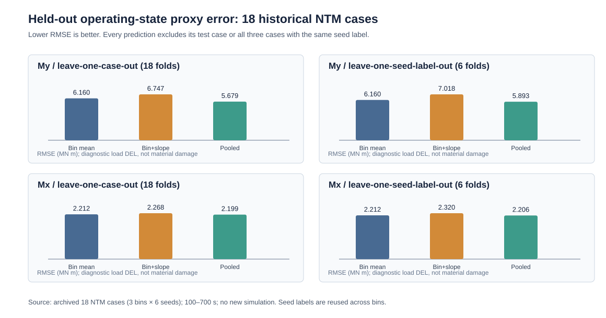

*图3-新增：18组NTM历史载荷DEL的留出误差；My和Mx分别对应功率与桨距角，四面板区分LOCO/LOSO；单位MN·m。*

输入为[T062既有18例配对源](../../../experiments/T062/S06_NTM18_OPERATING_DEL_BIN_CENTERED_20261107.csv)，SHA256 `4abf76252fa34b2c12635d409e5abc23c4a7d6f759b66dbec12b1932379f4bea`；[可复算程序](../../../experiments/T062/s06_ntm_proxy_holdout_gate.cjs) SHA256 `3c29dd33f3eeb339b22a2d6d89567d23a1f8b8a5b6de7f5855beefaa42dbcc3b`；[12行误差表](../../../experiments/T062/S06_NTM18_PROXY_HOLDOUT_12ROW_20261107.csv) SHA256 `6c154ded694eac40c12bb43e0bb8aa6361386b9d476ccaf4bb8a5618b782a0f7`。本轮仅重读18行派生表，未重读原OUTB、未增加生产风场；V8执行源程序数值及污染拒绝测试，尚未运行原生Node CLI/CI。该负结果不能代替正式DLC1.2、多seed总体置信区间或分材料疲劳寿命。

### 3.5.4 NTM/ETM成对比较

对相同 \(U_\mathrm{Ref}\) 和相同seed成对比较NTM与ETM的peaks、RMS/STD、PSD和load-DEL。最终必须由当前36case结果判断哪些QoI对湍流模型最敏感以及敏感性是否随平均风速改变，不能预设ETM必然在所有指标上更大。

### 3.5.5 原始NTM六分量同步峰值与分通道独立峰值的差异（真实OUTB源级结果）

针对“逐通道最大弯矩是否能够组成同一时刻的双轴弯矩合量”这一可证伪问题，本文直接恢复了**158 m研究模型的18组历史NTM原始OpenFAST OUTB**，而非由独立通道极值拼接合成时程。每组采用原始100–700 s、时间步长0.05 s的12,001个采样点，恢复塔底\`TwrBsFxt/Fyt/Fzt/Mxt/Myt/Mzt\`六个原生通道；18组共216,018行，原始OUTB逐件校验SHA256与ZIP CRC。对应三风速箱分别有六个seed。六分量单位依OpenFAST原生输出为力kN、力矩kN·m，未执行坐标变换或将塔底内力误称外加节点荷载。

对每个真实采样时刻定义同步双轴弯矩模值
\[
R_{xy}(t)=\sqrt{M_x(t)^2+M_y(t)^2},\qquad
R_{xy}^{\max}=\max_{t\in[100,700]}R_{xy}(t).
\]
与之对照的**分通道独立峰值拼接上界**为
\[
R_{xy}^{\mathrm{ind}}=
\sqrt{[\max_t|M_x(t)|]^2+[\max_t|M_y(t)|]^2},\qquad
\eta_{xy}=R_{xy}^{\max}/R_{xy}^{\mathrm{ind}}\leq1.
\]
不等式严格成立，但仅当两个分通道极值恰好同刻且幅值同时达到各自峰值时才取等号。三维合力对\`F_x/F_y/F_z\`采用相同的同步范数与独立峰值范数比较，**不将不同时间的六个极值误称为同一荷载状态**。

真实18组中，\(\eta_{xy}\)最小为**0.969949**，出现在**U19p202140_NTM_S01**：同步双轴弯矩峰值为**219900.297994 kN·m**，分通道峰值拼接上界为**226713.173650 kN·m**；两者相差**6812.875656 kN·m**，占拼接上界的**3.005064%**。该组原始int16解码的双轴合量单时刻量化误差上界为**1.623310 kN·m**，远小于上述同步性差异。18组同步双轴弯矩峰值的最大值为**297879.734339 kN·m**，对应**U11p4_NTM_S06**，并非三个历史风速箱中风速最大的档。三维力合量的最小同步/独立峰值比为**0.998219**；其余统计见18行来源表。

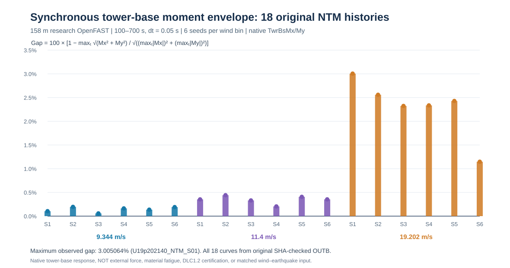

这组结果说明**峰值组合必须保留时刻配对**；独立分量包络只能作为保守数学上界，不能直接解释为真实瞬时荷载组合。它也说明塔底绝对峰值与前述雨流DEL是不同统计量，不能用本节最大模值替代循环范围、材料局部应力或疲劳损伤。原生六分量时程、18行指标、程序与源级收据分别见[T062历史W侧全时程恢复程序](../../../experiments/T062/s06_ntm_w_base6_fullrate.py)、[18行实测派生表](../../../experiments/T062/S06_18NTM_W_BASE6_COINCIDENT_ENVELOPES_18ROW_20261110.csv)及[来源收据](../../../experiments/T062/S06_18NTM_W_BASE6_FULLRATE_SOURCE_RECEIPT_20261110.json)。432个既有源统计字段（18工况×6通道×均值、最小、最大、标准差）与恢复时程复算最大绝对残差为**4.990143e-7**（原生单位），是来源/解码一致性而非结构物理精度。

**适用边界：**此处18份原始NTM OUTB属于历史九测高版本，并非四个ETM工况的31段分布载荷，更不是已经匹配地震侧模型、初态和触发时刻的W/E/WE联合响应。塔底原生通道的坐标、惯性归属及外部载荷分解尚未独立闭合，故本节仅可作为第三章**真实整机时域响应统计**，不得用作第四章材料Miner损伤或第九阶段风震物理PASS。原始大文件只以[GitHub Actions可追索Artifact](https://github.com/g2066203208-beep/voxel-frontier/actions/runs/42842305092/artifacts/13775054290)保存，过期日为2026-12-10（UTC）。

### 3.5.6 原生塔底六分量的坐标归属与参考点偏移误差界（S07，真实历史NTM）

**原生代码证据与适用域。** 为避免把整机响应误作为外部风荷载，直接核读与历史计算版本相同的[OpenFAST v3.5.3 \`modules/elastodyn/src/ElastoDyn.f90\` 第1154—1161行](https://github.com/OpenFAST/openfast/blob/v3.5.3/modules/elastodyn/src/ElastoDyn.f90#L1154-L1161)（源码Git blob \`2bcfb11fc40712febb5a8b5c2947c87e2aabb7b1\`）：\`TwrBsFxt/Fyt/Fzt\`是塔底合力\`FrcT0Trb\`分别在\`a1/-a3/a2\`基向量的投影；\`TwrBsMxt/Myt/Mzt\`是\`MomX0Trb\`在同一组基向量上的投影。因此，六个\`t\`后缀量属于**塔底局部坐标中的原生内力/反力响应**，不是未经转换的全局惯性坐标分量，也不是可直接重复施加于另一个结构模型的纯空气动力外载。同一源码第1172—1190行的塔架测点截面合力递推明确含有重力和线加速度项；**本轮并未完成塔底全部分项的逐项数值拆解**，不能据此把\`F_z\`完全认定为重力或把六分量分解成外载。该源码语义是SOURCE-CODE/FRAME PASS，不是耦合加载物理PASS。

**不依赖未知姿态的严格条件性误差界。** 在已把两参考点的力、矩表示到**同一个正交坐标系**、不改变物理载荷且只移动力矩参考点的前提下，令\(\boldsymbol d=\boldsymbol r_A-\boldsymbol r_B\)，刚体力系满足
\[
\boldsymbol F_B(t)=\boldsymbol F_A(t),\qquad
\boldsymbol M_B(t)=\boldsymbol M_A(t)+\boldsymbol d\times\boldsymbol F_A(t).
\]
由叉积范数及最大值的Lipschitz性质，对水平双轴弯矩峰值\(R_{xy}^{\max}=\max_t\sqrt{M_x(t)^2+M_y(t)^2}\)有
\[
\left|R_{xy,B}^{\max}-R_{xy,A}^{\max}\right|
\le \|\boldsymbol d\|\,\max_t\|\boldsymbol F_A(t)\|.
\]
这里**没有**将不同时刻的力、矩峰值组合成物理载荷；使用力峰值只是建立任意时刻都成立的保守上界。继承§3.5.5已逐OUTB校验的18组真实NTM统计，令\(M_p\)为已解码同步双轴弯矩峰值、\(F_p\)为已解码同步三维合力峰值，\(q_M,q_F\)分别为原始int16半步量化的范数上界。要使仅由**未知参考点偏移**造成的峰值误差不超过真实原峰值的\(\varepsilon\)，一个充分条件是
\[
\boxed{\ \|\boldsymbol d\|\le d_\varepsilon
=\frac{\varepsilon(M_p-q_M)}{F_p+q_F}\ }\quad
(\varepsilon=0.01\ \text{或}\ 0.05).
\]
该不等式将原始量化误差纳入最不利分子/分母，**是充分保证而非必要条件，更不是已测量的坐标错误**；当\(\boldsymbol d\parallel\boldsymbol F\)时叉积为零，实际误差可能远小于上界。

| 真实NTM历史风速箱 | 六seed的\(d_{1\%}\)最小—最大（m） | 含义 |
|---|---:|---|
| 9.343881 m/s | 0.099547—0.111817 | 仅同坐标系参考点偏移的充分保证 |
| 11.4 m/s | 0.109280—0.115493 | 同上 |
| 19.202140 m/s | **0.080499—0.089462** | 该历史箱对未知参考点偏移更敏感 |

全18组\(M_p/F_p\)这一**归一化特征长度**范围为8.049944—11.549362 m，不能将它解释为实际气动力作用臂。全18组1%充分保证阈值\(d_{1\%}\)为**0.080499—0.115493 m**；若仅作0.1 m未知偏移的假设，最不利上界为原双轴峰值的**0.865856%—1.242256%**。最敏感的实际历史工况是\`U19p202140_NTM_S02\`（\(M_p=207330.159457\ \mathrm{kN\,m}\)、\(F_p=25755.4798013\ \mathrm{kN}\)、\(d_{1\%}=0.080499\ \mathrm m\)）。这些百分比不是结构预测误差，实际参考点是否偏移0.1 m也没有证据。

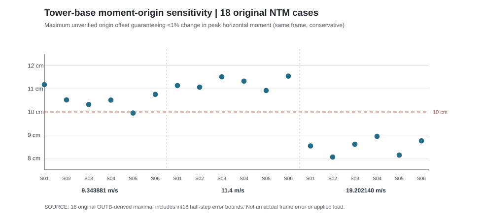

原18组中同步双轴弯矩峰值时刻与同步三维力峰值时刻**18/18不相同**，二者时间差为0.05—545.40 s，中位数144.45 s；但力合量可能受到近似恒定的轴向分量主导，这种时间差**不能解释为风载与弯矩之间的物理相位滞后**。在尚未获得同刻惯性/姿态分解及风震侧一致初态前，不允许将原生反力与地震响应叠加或把该上界作为设计容许偏差。

本节数值来自[18行原始OUTB派生表](../../../experiments/T062/S06_18NTM_W_BASE6_COINCIDENT_ENVELOPES_18ROW_20261110.csv)，SOURCE SHA256 \`ec1d5153635547c0ea24dba6ac62f65325dc50716b61e4c5c767ba489ec7444c\`；[独立可运行程序](../../../experiments/T062/s07_ntm18_base_wrench_origin_gate.cjs) SHA256 \`6f47f91533e6dd1b834aeacc6859ba2f8aa329c37cbb58fde7cd0b717a9bdfd3\`、[18行新结果表](../../../experiments/T062/S07_NTM18_BASE_WRENCH_ORIGIN_GATE_18ROW_20261111.csv) SHA256 \`60247f42ae1b0e4b967b23d8d1af88b6392d51c99ec1963f72e3cc5b20d8275f\`及[科研图](../figures/FIG3_S07_W_BASE_ORIGIN_TOLERANCE_20261111.svg) SHA256 \`8dcbb9bd7bb122e1e204e2f6908cc8cdc563889944e63d6899ef3826bc212840\`。算法完成2项解析对照、12项坏输入拒绝、18/18真实历史数据源级计算；没有新增OpenFAST求解、原始OUTB重新解码或材料局部应力。**S07坐标输出语义SOURCE-CODE PASS；实际坐标映射/惯性归属/外载分解/同态W-E-WE仍HOLD。**

### 3.5.7 原始NTM九测点姿态分量的全时程恢复及非单调风速响应（S07，真实OUTB）

**研究问题与来源。** 前述塔底六分量虽已恢复完整同步时程，但仅凭反力输出无法判断同刻塔架姿态。本文在**不新增OpenFAST生产求解**的条件下，直接从相同18份原始158 m模型NTM OUTB（原始SHA256与ZIP CRC逐件核对）恢复每个原生塔架测点的`TPxi/TPyi/TPzi`（m）及`RPxi/RPyi/RPzi`（deg）。时间窗仍为100–700 s、步长0.05 s、每工况12,001点；18工况共**216,018行×54个姿态分量**，另形成18×9=**162行**同刻峰值表。原始九个`TwrGagNd`节点为1、3、5、7、9、13、15、17、20，名义高度仅**0.070536–2.750893 m**；**不能将九个近塔底测点误写为112 m混凝土段或158 m塔顶的完整姿态覆盖**。与已恢复塔底双轴弯矩峰值的18/18交叉核验最大差为`4.56×10⁻⁷ kN·m`。

为避免把OpenFAST原生`RP`通道直接冒充方向余弦矩阵（DCM），本文仅定义可从输出直接观测的水平角位置**分量模值**
\[
R_{RP,xy,g}(t)=\sqrt{RPxi_g(t)^2+RPyi_g(t)^2}\quad(\mathrm{deg}),
\qquad R_{RP,xy,g}^{\max}=\max_{t\in[100,700]}R_{RP,xy,g}(t).
\]
该诊断量**不是**严格的三维刚体总转角、局部坐标到全局坐标的变换矩阵，也不等于塔顶位移或抗震变形指标。保留原生三个`RP`分量和三个`TP`分量的逐时刻数据，供后续在获得精确坐标基定义时重建DCM；目前不以小角度近似冒称精确变换。

| 历史NTM风速箱 | 九测点中最高原生测点（2.750893 m）的六seed峰值范围（deg） | 六seed中位数（deg） |
|---|---:|---:|
| 9.343881 m/s | 0.009549–0.011112 | **0.010341** |
| 11.4 m/s | 0.010964–0.011745 | **0.011186** |
| 19.202140 m/s | 0.008104–0.009568 | **0.008386** |

在**全部九个原生近底测点**，11.4 m/s箱的六seed最小峰值均严格高于19.202140 m/s箱的六seed最大峰值（9/9个测点的描述性完全分离）；三个风速箱的九测点中位数均呈**11.4 m/s > 9.343881 m/s > 19.202140 m/s**。这说明**本批历史工况的近底角位置峰值不随名义平均风速单调增加**，但九测点位于同一结构且强相关，不能把9/9当作九项独立统计试验，也不能据此证明控制器变桨的因果作用、正式DLC1.2覆盖或结构设计安全。该排序仅对本批18份已核原件、此时间窗及此原生测点集合成立。

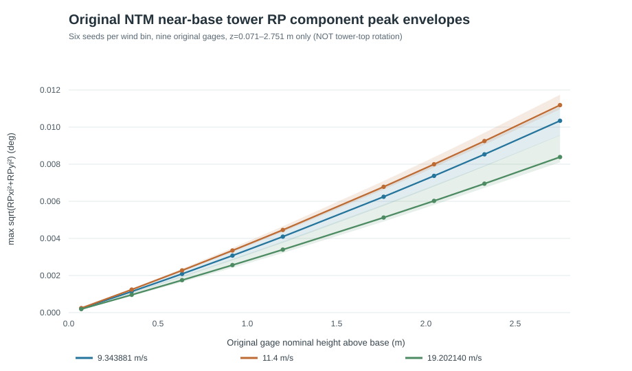

**误差与复现。** 原始OUTB int16半步量化传播得到水平`RP`分量模值的最大单点范数上界`9.2054×10⁻⁸ deg`；但DCM语义、惯性归属及不同运行状态的物理误差**尚无法定量**。恢复源码[Python](../../../experiments/T062/s07_ntm18_pose9_fullrate.py) SHA256 `6c1d9829eb12296da9b441409d41c595d4e83a569eae0cb83db55f0cfb07b5ad`，162行原始数值[CSV](../../../experiments/T062/S07_18NTM_W_POSE9_COINCIDENT_162ROW.csv) SHA256 `0526477678390fce5f5d8b6097fd97de22fa75a5141ee5545c312eeebfbcc9de`，27行六seed包络[CSV](../../../experiments/T062/S07_NTM18_POSE9_SEED_ENVELOPES_27ROW_20261111.csv) SHA256 `1a2d97922c8d204afd2ed6b82ed990dce98c8a6a295d5518a97f037f21efc9cf`；包络[复算程序](../../../experiments/T062/s07_ntm18_pose9_envelope.py) SHA256 `742dfa0d033ff71f8b8582f45016b26642890dababedadb16d76248927da6ad6`。全速姿态gzip SHA256 `2e113c83990d81b064636dca05308fc72676cb329033b9d603c8807d5cf0ecea`（31,908,896字节）保存在[GitHub Actions原件Artifact #13785456956](https://github.com/g2066203208-beep/voxel-frontier/actions/runs/42861971665/artifacts/13785456956)，截至2026-12-10 17:09 UTC有效；另存于CAE论文工作室Library，不冒称已入Git。恢复程序的2项解析/4项异常拒绝及包络程序1项解析/5项异常拒绝均PASS；原始OUTB逐件SHA、时间网格、54通道单位及18/18塔底峰值oracle PASS。**来源级姿态分量恢复PASS；精确DCM、外载所有权、同态W/E/WE及材料疲劳HOLD。**

### 3.5.8 塔底弯矩、剪力、扭矩与轴向力的同步多分量包络（S07，真实216,018行）

**研究问题。** 当塔底双轴弯矩达到峰值时，是否也同时达到扭矩、剪力及轴向力的各自峰值？在§3.5.5已恢复的**同一18份原始OUTB六分量**上，定义
\[
M(t)=\sqrt{M_x(t)^2+M_y(t)^2},\quad
V(t)=\sqrt{F_x(t)^2+F_y(t)^2},\quad
T(t)=|M_z(t)|,\quad N(t)=|F_z(t)|.
\]
其中`Fzt`的符号及其重力/惯性成分保留原生定义，\(N=|F_z|\)只是**绝对值诊断符号**，不能未经坐标与所有权核实就将其全部称为混凝土截面压应力。对各量先在同一工况有效窗内以自身峰值归一化（例如\(\widehat M=M/\max_t M\)），定义**最大共同达到比例**
\[
q_{MT}=\max_t\min\{\widehat M(t),\widehat T(t)\},\qquad
q_{MVT}=\max_t\min\{\widehat M(t),\widehat V(t),\widehat T(t)\}.
\]
这是不依赖任意材料权重的时序**同时性诊断**：存在某时刻使两种（或三种）归一化需求均不低于\(q\)，且不存在更高共同阈值；\(0\le q_{MVT}\le q_{MT}\le1\)严格成立。**它不是N–M–V–T截面承载力方程，也不能用于替代规范荷载组合或抗力验算。**

直接读取已SHA锁定的216,018行原生塔底六分量（100–700 s、0.05 s），得到18组真实工况的\(q_{MT}=\)**0.719863–0.877074**，\(q_{MVT}=\)**0.693409–0.874951**；**18/18工况均不存在同一采样时刻\(M\ge0.95M_{\max}\)且\(T\ge0.95T_{\max}\)**。在各工况双轴弯矩峰值时刻，扭矩绝对值仅为本工况自身扭矩峰值的**2.2100%–49.7249%**，而\(|F_z|\)同时性比值为**99.0633%–99.9349%**。该差异反映本批原生响应中扭矩与弯矩极值的非同时性，而近恒定轴向分量可能掩盖不同分量的动力变化；不得据此推断“扭矩可以忽略”或“结构强度具有等比例裕度”。

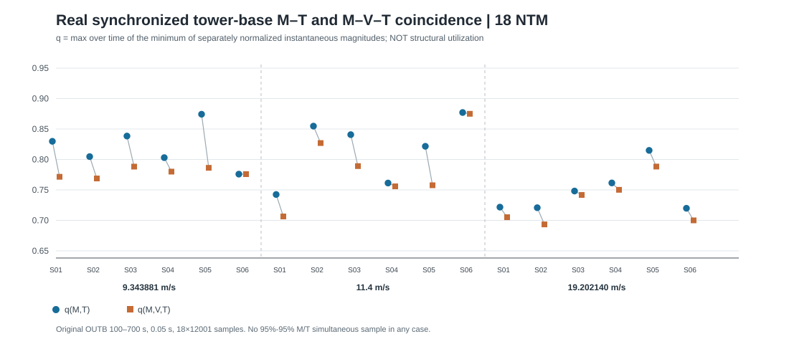

结果表为[18行同步多分量包络](../../../experiments/T062/S07_NTM18_BASE_M_V_T_COINCIDENCE_18ROW_20261111.csv) SHA256 `80782fc25d2326a7c38db82a2e21c6fb36e246776f4fce54ec7bc5b48bf73478`；独立[Python复算程序](../../../experiments/T062/s07_ntm18_multiaxial_coincidence.py) SHA256 `2d3bf45cfb91a1585044be1b294f074bcb926885087b2212ab9900c30da6be7f`完成2项解析与5项坏源拒绝，原始18行双轴弯矩峰值交叉验证最大绝对残差**4.56×10⁻⁷ kN·m**。计算与原始int16量化/CSV舍入误差远小于未知的载荷坐标、运行状态及材料映射误差；12,001个连续采样点存在自相关，不能当作12,001个独立风场试验。**本节是实测算例来源的数值后处理PASS，不是新增结构物理求解、疲劳寿命或风震组合PASS。**

### 3.5.9 原生近底TP/RP的位移—角位置运动学闭合（S07，18组真实风响应）

**科学问题与可观测量。** §3.5.7恢复的九个塔架测点仅分布在塔底以上0.070536—2.750893 m；TPxi/TPyi/TPzi为惯性系位置（m），RPxi/RPyi/RPzi为惯性系角位置分量（deg）。直接核读[OpenFAST v3.5.3 ElastoDyn.f90第937—944行](https://github.com/OpenFAST/openfast/blob/v3.5.3/modules/elastodyn/src/ElastoDyn.f90#L937-L944)，TP直接取rT，RP由AngPosEF乘R2D得到，**没有输出精确方向余弦矩阵（DCM）**。因此，本节不虚构三维精确坐标变换，而检验一个可证伪的低转角梁运动学关系：同一时刻的九点角位置能否重建首末测点的相对水平位置差？

在截面小转角、沿高连续且以TPzi为积分坐标的近似下，定义观测量与角位置积分预测量：
\[
\Delta x_{\rm obs}(t)=TPx_9(t)-TPx_1(t),\quad
\Delta x_{\rm rot}(t)=\sum_{i=1}^{8}\frac{\theta_{y,i}(t)+\theta_{y,i+1}(t)}2\,[z_{i+1}(t)-z_i(t)],
\]
\[
\Delta y_{\rm obs}(t)=TPy_9(t)-TPy_1(t),\quad
\Delta y_{\rm rot}(t)=-\sum_{i=1}^{8}\frac{\theta_{x,i}(t)+\theta_{x,i+1}(t)}2\,[z_{i+1}(t)-z_i(t)],
\qquad \theta_{x/y}=RPx/y\,\pi/180.
\]
正负号来自同一右手惯性坐标中的小转角关系；取首末点位置差消去共同刚体平移，使用每一时刻的TPzi差而非将九点误当等间距。按工况在12,001个时刻上计算残差e_x/e_y，报告RMS(e)/RMS(观测相对位移)，避免在接近零的单时刻使用不稳定的百分比。

**真实数值。** 对相同18份已核SHA的158 m NTM OUTB恢复时程，合计216,018个时间记录、每记录8个相邻高度区间，近底积分跨度为**2.680357 m**。18工况的X向相对RMS残差为**0.129514%—0.137707%**（中位**0.132787%**）；Y向为**0.159419%—0.229269%**（中位**0.164088%**）。X向最大单点绝对闭合差为**0.310518 μm**，Y向为**0.073928 μm**。各工况观测—预测时间序列Pearson相关系数均大于**0.9999987**。去除每工况时均值后，动态残差比X为**0.092501%—0.136347%**、Y为**0.113055%—0.162016%**。若将角位置积分符号反转，残差比接近**200%**，形成可拒绝的方向反例；两项解析正例与非单调高度、非有限通道拒绝测试通过。

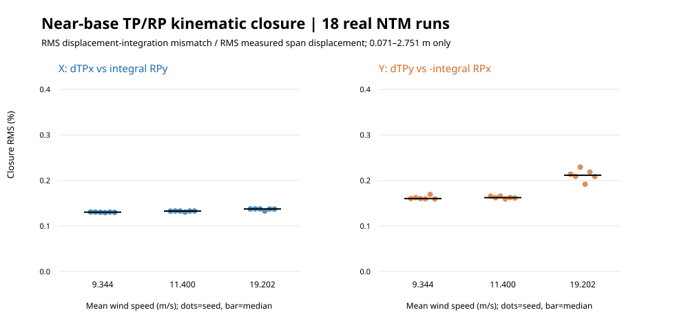

**边界与误差。** 以上是对原生仿真输出**内部运动学相容性**的独立后处理检查，不是与外部测量的验证。残差包含梯形积分离散误差、梁运动学假设与有限转角效应、OUTB量化和CSV舍入，不能直接解释为物理模型误差；尤其不能将RP分量当作严格DCM、将近底2.68 m外推至112/158 m塔高，或据此分离空气动力与惯性内力。12,001个连续时刻存在自相关，18组历史NTM不等于正式DLC1.2。原始gzip SHA256为2e113c83990d81b064636dca05308fc72676cb329033b9d603c8807d5cf0ecea（[Actions Artifact #13785456956](https://github.com/g2066203208-beep/voxel-frontier/actions/runs/42861971665/artifacts/13785456956)，2026-12-10 17:09 UTC到期）；[18行结果表](../../../experiments/T062/S07_NTM18_TP_RP_KINEMATIC_CLOSURE_18ROW_20261111.csv) SHA256 aa9635c307358bdc83509ac36feed0578e21b7ca3d201d654a5fadee46cbe5c9，[只读Python程序](../../../experiments/T062/s07_tp_rp_closure_compact.py) SHA256 d60d342b52e66e478fc651544df3c64ae131d8a3a06712478a7330779db60a07。**来源级运动学闭合PASS；精确DCM、惯性/气动载荷归属、同态W/E/WE及材料疲劳HOLD。**

## 3.6 频域响应、1P/3P与模态关系

### 3.6.1 PSD

对关键位移、加速度和载荷通道计算PSD，用于识别一阶塔架频率、1P、3P、控制/转子相关低频成分以及NTM/ETM下频带能量变化。并非所有通道都需要频谱，图表应围绕“是否影响塔架控制响应和疲劳”选择代表QoI。

### 3.6.2 1P/3P随转速变化

\[
f_{1P}(t)=\frac{\mathrm{RotorSpeed}(t)}{60},
\qquad
f_{3P}(t)=3f_{1P}(t).
\]

应将运行区1P/3P频带与第二章Abaqus/OpenFAST塔架固有频率叠加。若没有频带接近，不宣称共振；若接近，则进一步由PSD实际能量和响应幅值判断。

## 3.7 Rainflow与load-DEL筛选

### 3.7.1 通道身份

当前load-level fatigue统一对TwrBsMxt、TwrBsMyt进行比较。正式处理直接按OpenFAST官方通道名读取，不使用可能发生偏移的手工列索引。

### 3.7.2 Rainflow

对有效窗载荷时程执行rainflow，原始cycle ledger保留range \(R_i\)、mean和count \(n_i\)。虽然第三章load-DEL只使用range与count，但mean不从原始账本删除。

### 3.7.3 Load-DEL定义

历史screening统一采用：

\[
m=4,\qquad N_\mathrm{eq}=100000,
\]

\[
DEL=
\left[
\frac{\sum_i n_iR_i^m}{N_\mathrm{eq}}
\right]^{1/m}.
\]

这里的 \(m=4\) 与 \(N_\mathrm{eq}=100000\) 只作为工况间载荷比较口径，不是钢塔、混凝土或PT的统一材料疲劳参数。

### 3.7.4 T062历史CORRECTED雨流差异的根因闭合（2026-11-02）

旧版学位论文报告 U11p4_ETM_S03 的塔底 My 等效载荷DEL为28.177010 MN·m，并保存57,286条雨流循环和72条DEL。这些旧结果**确实存在，不是凭空编造**。本研究现已从[2026-10-04主归档](../../../archive/local-assets-20261004/openfast-36-r2/part-001.zip)真正恢复原始03/05/07 CSV、修正SHA清单和2026年9月源程序，逐文件CRC/SHA校验成功。旧循环账本5,585,315字节、57,286行，SHA256为7b03a4a99a2e3fe18975cabe0f8b0d9435f7dccdbaa42fae0985a3a3e48027b7。完整来源清单见[原始恢复收据](../../../experiments/T062/legacy-primary-recovered-20261102/LEGACY_PRIMARY_RECOVERY_RECEIPT_20261102.json)。

旧版SHA256_MANIFEST_CORRECTED.csv直接记录的36份原始OUTB哈希，已与当前supplement归档36份实际OUTB逐一比较，**36/36完全相同**。因此先前将S03/S04差异解释为可能的原始OUTB版本不一致，在本轮有了反证，必须撤销。问题发生在相同原始时程的雨流计数处理。

从原始[雨流源码](../../../experiments/T062/legacy-primary-recovered-20261102/rainflow_del_r1.py)直接复原：旧实现令 \(X=|s_{-2}-s_{-3}|\) 为前一个范围、\(Y=|s_{-1}-s_{-2}|\) 为新形成范围，却使用错误的终止条件 if X < Y: break；符合独立rainflow 3.2.0实现的条件应该是 **if Y < X: break**。这仅是两个已定义范围的大小比较方向错误，不涉及改变OpenFAST原数据、风速工况、DEL指数或参考循环数。原历史脚本仍保留原样，单行修正只在隔离内存AST中进行。

[真实GitHub Actions #41391433429](https://github.com/g2066203208-beep/voxel-frontier/actions/runs/41391433429) 在36份各12,001点的原始OUTB上逐个校验源SHA与ZIP CRC，对My、Mx共72条时程分别运行**原历史函数、只改比较方向的函数、独立rainflow 3.2.0**。验收结果为：72/72旧程序的DEL精确复现旧05 CSV；72/72单行修正的DEL复现现归档T062重算表；72/72修正后的(range,mean,count)循环多重集合与独立程序一致（范围/均值比较保留8位小数）；72/72加权循环总数守恒。完整逐工况结果见[72行因果对照表](../../../experiments/T062/legacy-primary-recovered-20261102/T062_ALL36_RAINFLOW_CAUSAL_DEL_COMPARE_20261102.csv)，机器可读[验收收据](../../../experiments/T062/legacy-primary-recovered-20261102/T062_ALL36_RAINFLOW_CAUSAL_RECEIPT_20261102.json)。DEL数值回归阈值1e-5 kN·m；这是算法核验，非授权标准条款验收。

**由此T062历史S03与当前S04的载荷级DEL争议正式归因为历史雨流源码错误并闭合。** 原论文旧数值保留作可追溯历史对照，但不能再作为采用正确雨流计数的正式控制值。正式DLC1.2长期工况覆盖、材料疲劳寿命与结构优化仍是独立未完成的科学任务。

### 3.7.5 36工况修正后DEL排序与可复核图表

按相同 \(m=4\)、\(N_\mathrm{eq}=100000\) 和100–700 s统计窗，恢复后可复核的关键结论为：

| 塔底通道与工况 | 旧雨流程序DEL / MN·m | 修正后/独立雨流DEL / MN·m | 控制身份 |
|---|---:|---:|---|
| My：U11p4_ETM_S03 | 28.177010 | 23.005398 | 旧算法的My第一名，修正后不再控制 |
| My：U11p4_ETM_S04 | 24.688995 | **26.802479** | 修正后36工况My第一名 |
| Mx：U19p202140_ETM_S02 | 9.715431 | **9.468855** | 修正后36工况Mx第一名 |

本研究原先探讨的等效循环数差异也得到排除：即使保持当前循环四次矩、尝试单独改变 \(N_\mathrm{eq}\)，旧My S03和旧Mx S02分别需要约44,436与90,228两个互不相容的参考循环数，而且任何统一参考循环数都不会改变S03/S04排序。因此此次差异不能靠重标定 \(N_\mathrm{eq}\) 解决，**根因为旧程序的雨流闭合判据**。

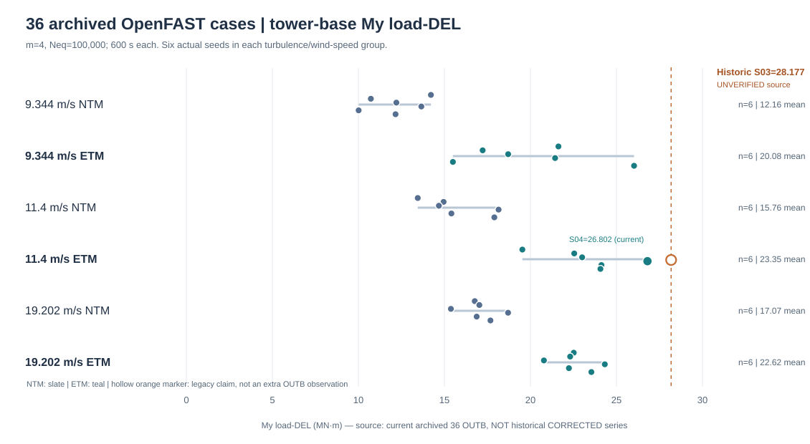

完整[36工况双通道控制排序](../../../experiments/T062/T062_36CASE_MY_MX_ARCHIVED_RANK_20261102.csv)与[固定源图形生成器](../../../experiments/T062/t062_del_36case_provenance_figure.py)保留六seed逐工况离散。图中的空心橙色标记是**同一OUTB经旧错误算法所得旧值**，不是不同数据源或第37个物理工况。72条源数据、程序版本SHA和故障判据及修复回归全部保留，满足本章载荷级筛选的来源可追溯性；该图与load-DEL仍不等于混凝土、钢绞线或钢塔材料疲劳损伤。

### 3.7.6 21年ERA5风速权重与18组原始NTM六seed覆盖（2026-11-02）

使用2005—2025年**184,080条ERA5逐小时、动态风切变外推至161.368806m**的已保存风速分箱，以及历史18组真实NTM原始OUTB（9.343881、11.4与19.202140m/s，每档S01–S06），建立21个1m/s诊断风速bin×6seed规划槽、共126个位置。当前只有**18/126个历史筛选来源**，且正式按IEC 61400-1:2019+AMD1:2025/2026-10勘误核实的DLC1.2合规来源为**0/126**；这并非宣布标准强制1m/s或强制每bin六seed，而是独立研究方案的可溯源覆盖分析。

在明确标记为**非规范切入/切出假设的[4,25)m/s运行区间**中，21年历史有106,900h，仅9、11、19m/s三个有源bin共7,164h，即**6.7016%**；无来源99,736h（**93.2984%**），4–9m/s五个连续缺口就占全部诊断运行小时**89.2442%**。因此不能把三档NTM、旧18个ETM或峰值seed外推成设计寿命DLC1.2完整风速概率，未观测到高风速也不代表设计风险可取零。

本轮仅对三个有源bin的塔底My/Mx载荷，用保存的12001点实际OUTB派生雨流`DEL_m4_Nref600`在六seed之间取四次幂平均，再以ERA5所有小时频率加权得到**已知bin部分载荷四次矩**。该值对缺失bin不作插值/补零，材料意义与正式20年寿命均不成立。结果与第三章控制工况筛选互补：本处**NTM概率背景**用于未来疲劳，旧T062 NTM/ETM联合排名只用于load-level screening。

[6行原始分箱×通道数值](../../../experiments/T062/partial-annual-load-diagnostic-20261102/S10_REAL_18NTM_3BIN_PARTIAL_M4_BY_CHANNEL_20261102.csv)、[数据SHA及八条参考来源审核](../../../experiments/T062/S10_ERA5_NTM_PARTIAL_LOAD_M4_PRIMARY_REFERENCE_CHECK_20261102.md)、[独立CI #41397641326](https://github.com/g2066203208-beep/voxel-frontier/actions/runs/41397641326)均保留。引用依据为REF083（[Wiley DOI 10.1002/er.6382](https://doi.org/10.1002/er.6382)，逐小时10/100m动态指数方法本轮核读）、REF011（[WES DOI 10.5194/wes-4-479-2019](https://doi.org/10.5194/wes-4-479-2019)，原刊全文确认多seed必须按QoI收敛）和REF132/REF048（2019授权版原记录、2025版与2026-10勘误仅官方产品元信息已核，**未核许可2025/26条款，不能称规范PASS**）。

### 3.7.7 雨流实现误差对36工况载荷控制排序的影响（新增源级统计）

在§3.7.4已独立定位历史雨流闭合判据错误的基础上，本节进一步研究**错误是否改变控制工况的身份，而不仅改变DEL绝对值**。直接读取同一36份原始OpenFAST OUTB派生的[72行旧算法—修正算法—第三方算法对照表](../../../experiments/T062/legacy-primary-recovered-20261102/T062_ALL36_RAINFLOW_CAUSAL_DEL_COMPARE_20261102.csv)，对塔底Mx、My各36个工况分别降序排名。相对偏差定义为100×(旧DEL/修正DEL−1)%，每通道枚举36×35/2=630对工况，统计旧/新排序方向相反的工况对、Spearman秩相关和Top-5交集。630对比较彼此相关，**不是630个独立统计样本，也不提供总体置信区间**。

| 通道 | 旧算法相对偏差中位数 | 偏差范围 | 旧值高于正确值 | 排名倒序/630 | Spearman ρ | Top-5重合 |
|---|---:|---:|---:|---:|---:|---:|
| TwrBsMxt（Mx） | −20.8797% | −29.0675%～+2.6041% | 2/36 | **12/630（1.90%）** | 0.99537 | 5/5 |
| TwrBsMyt（My） | −25.5452% | −54.5115%～+22.4800% | 4/36 | **102/630（16.19%）** | 0.85946 | 4/5 |

旧雨流判据在Mx的34/36及My的32/36工况中低估正确DEL，但其余工况反而高估，故不能使用统一比例系数修复旧排序。My历史控制工况U11p4_ETM_S03的旧值28.177010 MN·m，修正后为23.005398 MN·m；新的My控制工况为U11p4_ETM_S04（26.802479 MN·m）。Mx的正确第一名仍为U19p202140_ETM_S02（9.468855 MN·m）。这些变化是**同一物理载荷时程的后处理算法误差**，不是湍流物理差异。

本节[无依赖Node复算脚本](../../../experiments/T062/t062_rainflow_rank_robustness.js)锁定源CSV SHA256=12dabbb1273ce03d3920aedda3f72f9fa1d75b671e01a1db145c0a972ffe15e2；脚本SHA256=54a6103a6926cdaf731df70034ef7f6e8885829060658dc0c5d8c8dc20ca93c2。直接以V8执行相同分析函数，3项真实数值oracle及8项异常输入拒绝通过；本轮未运行原生Node CI，36份原始OUTB与第三方rainflow 3.2.0的逐循环核验沿用[既有Actions #41391433429](https://github.com/g2066203208-beep/voxel-frontier/actions/runs/41391433429)，本轮没有重新下载OUTB。源级DEL比较绝对容限1e−5 kN·m；统计表四舍五入不影响工况排序。此结果只支持载荷筛选算法可信性，不证明正式DLC1.2、材料Miner寿命或风震抗震验算。

### 3.7.8 六随机种子有限样本下的控制风速筛选稳健性（2026-11-07）

本节检验一个可证伪的载荷筛选问题：**若每个代表风速只保留部分随机种子，能否仍选中现有六seed样本定义的控制风速？** 直接读取T062已独立核对的72行旧/修正DEL对照源表（SHA256：`12dabbb1273ce03d3920aedda3f72f9fa1d75b671e01a1db145c0a972ffe15e2`），仅提取其中三档NTM（9.343881、11.4、19.202140 m/s）×六seed×塔底Mx/My共36条**修正后**600 s载荷DEL，单位kN·m。旧错误雨流结果不进入本节统计。所有计算仅为历史158m OpenFAST载荷级诊断，不是DLC1.2长期疲劳、局部材料应力或寿命验收。

为与同一等效循环数下的四次幂载荷循环累积相容，给定风速档j和所选种子集合S，定义
\[
L_{j,S}^{(4)}=\left(\frac{1}{|S|}\sum_{s\in S} DEL_{j,s}^{4}\right)^{1/4}.
\]
此处m=4**仅用于载荷级排序敏感性**，不能作为混凝土、钢筋、钢绞线和结构钢统一的材料S–N指数。以每档六seed全集作为**有限样本内部参照**，而不是未知随机总体的真实控制风速。对k=1–5枚举两种抽样方案：（a）每个风速档独立从六个既有seed中取k个，组合数为C(6,k)^3；（b）三个风速档使用相同的seed标签集合，组合数为C(6,k)。统计筛出的最高L^(4)风速与全集参照不一致的组合比例。后一方案的相同标签**不自动证明三个风速的风场具有共同随机数配对属性**，只作为设计敏感性对照。

六seed全集下，Mx在三个风速档的L^(4)依次为1922.467、2509.922、6596.211 kN·m；My为12424.367、16034.661、17157.449 kN·m。两个通道的内部参照控制风速均为19.202140 m/s，但相对次高风速的差距分别为162.805%和**7.002%**。Mx在全部枚举子集中均未发生风速身份错选，然而k=1时参照胜出风速的估计L^(4)最大绝对相对偏差仍达26.706%，因此**控制风速未变不等于载荷幅值收敛**。

| 每档seed数k | 独立子集数C(6,k)^3 | My独立错选数/比例 | My共标签错选数/比例 | Mx两方案错选数 | My参照控制档L^(4)最大绝对偏差 |
|---:|---:|---:|---:|---:|---:|
| 1 | 216 | 66 / 30.556% | 1/6 / 16.667% | 0 | 10.376% |
| 2 | 3375 | 630 / 18.667% | 0/15 / 0% | 0 | 6.131% |
| 3 | 8000 | 760 / 9.500% | 0/20 / 0% | 0 | 4.531% |
| 4 | 3375 | 105 / 3.111% | 0/15 / 0% | 0 | 3.543% |
| 5 | 216 | 0 / 0% | 0/6 / 0% | 0 | 2.121% |

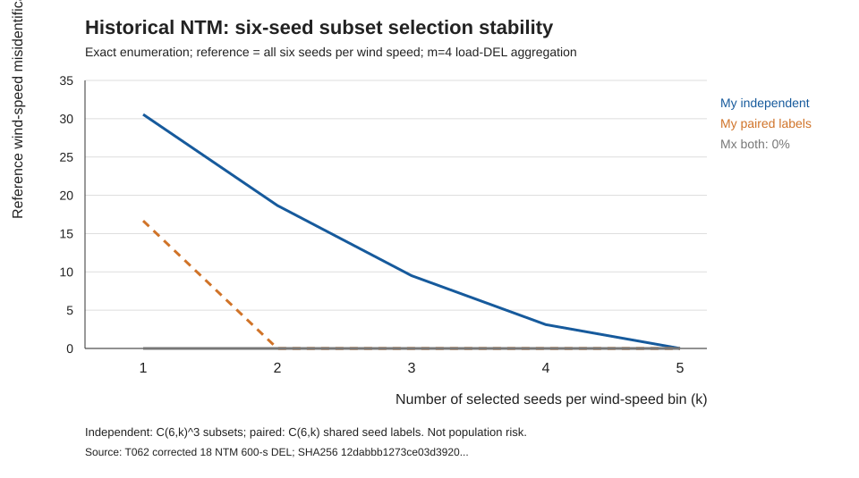

**图3-X** 三个历史NTM风速档的控制风速错选组合比例。实线为各风速独立选k个seed的穷举结果，虚线为共用seed标签集合的穷举结果。图中比例是**给定现有六seed全集且对子集等权枚举的组合频率**，绝不是新seed的失效概率、统计置信区间、IEC允许的最少seed数或对未知风速档的外推。

结果表明，My在k=3时仍有760/8000（9.5%）独立子集错误选中11.4 m/s；同样k下的共标签子集为0/20。二者差异直接表明**抽样设计本身影响有限样本筛选结论**，但六seed之间是否独立、跨风速是否相关及控制器状态差异均未得到新的统计验证。k=5错选为零只在当前有限全集成立，不意味着五seed对新湍流实现足够。单个600 s时程的DEL后处理和双通道来源一致性沿用T062已有独立雨流核验；本轮未重新读取36份原始OUTB，也未新增2025/26授权IEC条款核读。数值误差由双精度四次幂与精确穷举控制，实际工程/seed总体不确定性**NEED_ESTIMATE**。因此下一步应以新增的、来源可核的独立seed检验控制风速稳定性，并结合ERA5全运行风速档与正式DLC1.2后再判断长期疲劳控制工况。

**复算入口**：[无依赖Node程序](../../../experiments/T062/t062_ntm_seed_subset_robustness.js)（SHA256 `bbf923bb509679edf76ae60dc5dda00648fb181ca4aa7d13ac06d0ef0712f333`）、[10行结果CSV](../../../experiments/T062/T062_18NTM_SEED_SUBSET_ROBUSTNESS_20261107.csv)（SHA256 `f7d9427d15b378661aaebf2fdf0feb1e5eea07cefb3721088a98439265320cf1`）、[SVG图](../figures/FIG3_T062_NTM_SEED_SELECTION_ROBUSTNESS_20261107.svg)（SHA256 `5e3df353b8631bf3eb9bc03ede3551a3e91aaf93f41d4b61dd70f88524eb2cb4`）。V8源级8项数值oracle、11项异常拒绝、CSV/SVG输出测试通过；**原生Node CI未执行**，不代表物理验收。

### 3.7.9 六seed精确随机化假设敏感性（S10 EXACT SEED RANDOMIZATION 2026-11-08）

**研究问题。** 18组历史NTM（3风速档×6seed）塔底My/Mx 600s载荷DEL（m=4、Nref600，MN·m）在不同随机化假设下是否支持相同推断？六项预先固定比较：A穷举12选6共924种不配对标签置换，双侧均值差；B将同名S01–S06形成六对，穷举64种符号翻转。各自进行Holm六重校正，并统计36个跨seed优势次数。A要求零假设下跨组可交换性，B要求真实配对及差值符号对称；**相同seed名称不证明物理配对，风速档也非随机分组**，两者均是条件性方法诊断而非物理显著性认证。

**真实数值。** My U09→U11差12.910597MN·m，A极端6/924、Holm p=0.012987，B极端4/64、Holm p=0.1875。My U11→U19差4.721442MN·m，A极端158/924、Holm p=0.170996，B极端4/64、Holm p=0.1875，高风速跨seed优势25/36。Mx三个风速对A校正p均0.012987、B均0.1875。**A六项中5项低于0.05，B为0项。** B双侧最小p=2/64，六重Holm首位最小校正p=0.1875，因此本六对设计不可能在0.05下取得六项校正通过。不同p值反映不同未证实的随机化结构，不说明风速物理效应消失。

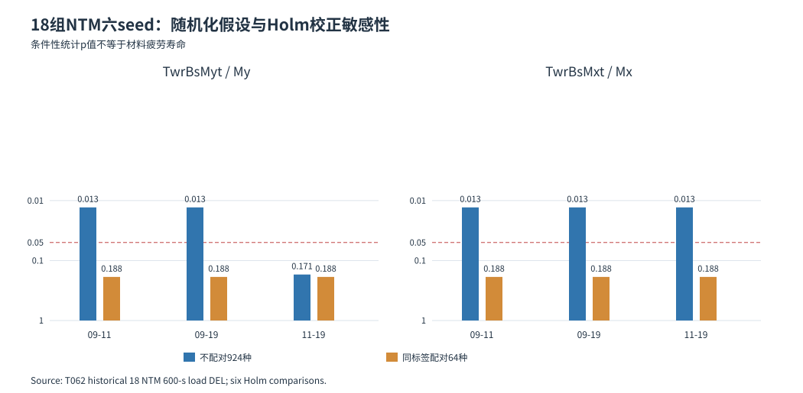

**图3-X** 不配对924种与同标签配对64种条件性检验；不代表材料寿命或正式DLC1.2。SOURCE=直接读取T062历史18行派生CSV SHA256 `4abf76252fa34b2c12635d409e5abc23c4a7d6f759b66dbec12b1932379f4bea`，每行含原OUTB SHA，未重读原OUTB；[可运行Node程序](../../../experiments/T062/s10_ntm_exact_seed_inference.cjs) SHA256 `71a61e6b44e102ebded0989debe8c9f0ddaa1a4d4ac5fc35dc048f1bdf4eddd0`、[六行数表](../../../experiments/T062/S10_NTM18_EXACT_SEED_INFERENCE_6PAIR_20261108.csv) SHA256 `293c45563b2bd78d77e8145d5011e501e7ed7cced3b21812f1210ad14a8ab0f9`、图SHA256 `4b1ef211a8e0907730ecb6e82240dc502777bf65f70a8650efda056215d5d2f5`。V8 18项oracle、8项坏源拒绝、乱序不变性通过；原生Node CLI/CI未运行。随机化前提、未来seed总体和物理误差无可信上界；SOURCE-LEVEL METHOD PASS、12阶段0/12。

### 3.7.10 无源低风速箱对历史载荷四次矩的等贡献阈值（S12，2026-11-08）

为把“历史18组NTM仅覆盖诊断运行小时的6.70%”转化为**可证伪的后续数据准入判据**，本节不猜测缺失风速箱的DEL，而计算其对既有三有源箱的**等贡献阈值**。对塔底弯矩通道\(c\in\{M_x,M_y\}\)，以2005—2025年ERA5全部184080小时为统一概率分母，定义\(p_j=n_j/184080\)。已归档9、11、19 m/s三个箱的六seed四次矩为\(\overline{L_{c,j}^{4}}\)，其**已知部分**为
\[
K_c=\sum_{j\in\{9,11,19\}}p_j\overline{L_{c,j}^{4}},\qquad
L_{c,j}^{\mathrm{eq}}=(K_c/p_j)^{1/4}.
\]
这里\(L_{c,j}^{\mathrm{eq}}\)的含义仅是：**如果**某个尚无历史NTM来源的箱在相同\(m=4\)、\(N_{\rm ref}=600\)和六seed定义下恰有该DEL，则这个单箱对加权四次矩的贡献与全部三个有源箱的贡献相等。它既不是未知箱的估计载荷，也不是材料S–N指数或Miner损伤阈值。多个缺失箱若假设具有同一个DEL，组阈值为\(L_{c,G}^{\mathrm{eq}}=(K_c/\sum_{j\in G}p_j)^{1/4}\)。

直接读取既有[31行ERA5真实来源分箱](../../../experiments/T062/S10_ERA5_2005_2025_HUB_1MS_BINS_20261031.csv)（SHA256 `e4058620a36b23bb218103875d4dc5b0711fc45d418b23a2208c2fc9c16c9102`）和[六行三箱×双通道四次矩](../../../experiments/T062/partial-annual-load-diagnostic-20261102/S10_REAL_18NTM_3BIN_PARTIAL_M4_BY_CHANNEL_20261102.csv)（SHA256 `d43f963fb30e16a33e87acdf6e9571710826974eee89d1f3527ab6504d85f695`），得到\(K_{Mx}=125.606637744\,({\rm MN\,m})^4\)、\(K_{My}=209257.299447601\,({\rm MN\,m})^4\)。低风速4–5 m/s单箱等贡献DEL分别为**5.413247**和**34.583967 MN·m**；8–9 m/s单箱分别为**7.071769**和**45.179880 MN·m**。对4–9 m/s五个缺失箱合计95402小时（占诊断运行小时89.2442%），若**人为假设五箱具有相同DEL**，等贡献阈值为\(M_x\) **3.945622 MN·m**、\(M_y\) **25.207654 MN·m**。该统一假设仅用于标定后续真实载荷需要检验的数值量级，不是风速—载荷物理关系。

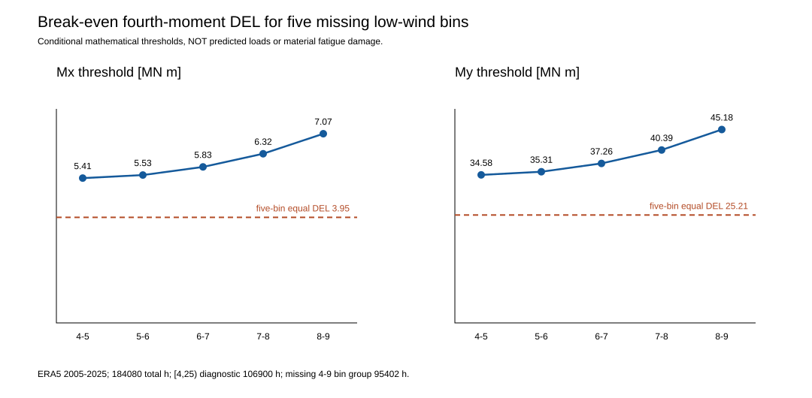

**图3-X** 2005—2025年ERA5分箱与三有源NTM载荷四次矩导出的条件性阈值。实线为各单箱恰等于全部已知箱贡献时的DEL，虚线为五个缺失箱假定DEL相同的组阈值；图中任何线都不是缺失箱真实载荷预测。12行数值表与[可复算Node程序](../../../experiments/T062/s12_era5_missing_bin_break_even.cjs)分别存于[T062 CSV](../../../experiments/T062/S12_ERA5_NTM_M4_MISSING_BIN_BREAK_EVEN_20261108.csv)及源文件。程序SHA256 `6ccf56928b2674884692d398b729d030909a7b67c17ca5951bf7c7e217d0dbae`，数表SHA256 `e4160f9419c76eec459491dc704c3150339e77183dc1cf827d6ebd2fc28cd40f`，图SHA256 `2ced2991132a5ac9453bce64b71b2fa19540b2645782be09d4554b8d5cf1850c`。V8执行12项代数等式、两个通道历史真值与4类异常输入拒绝；原生Node CLI/CI未运行，历史OUTB与ERA5原工作簿本轮未重新读取。阈值的双精度/CSV舍入误差不构成ERA5代表性、风速箱边界、控制状态、未来seed或真实材料局部应力的物理误差界。

**适用边界与反例。** 该阈值允许明确拒绝“仅凭小时数就可断言低风速箱主导疲劳”的论证：令全部缺失箱DEL为零，则其四次矩贡献为零；令其足够大，则贡献可超过已知部分，两种构造均与当前无源状态相容。缺失部分仅有非负下界、没有数据支持的有限上界。正式DLC1.2仍为0/126，真实材料Miner、结构风震与设计寿命均不可由此推出。此分析对2026年160m混塔风震及PT抗震先行研究也不构成重复的风震结构结果，而是本研究158m历史风载证据的可辨识性诊断。

### 3.7.11 六seed删除对已知风速箱加权四次矩及缺失箱阈值的影响（2026-11-08）

针对§3.7.10的等贡献阈值，本节进一步检验其对**已知三个风速箱中有限随机种子选择**的敏感性。沿用18组真实历史NTM（9.343881、11.4、19.20214 m/s，每档6个600 s随机种子）塔底My/Mx载荷DEL，令各档ERA5全小时概率为\(p_j=n_j/184080\)，其中\(n_j=5736,1426,2\) h。以\(m=4\)定义\(K_c=\sum_j p_j(1/6)\sum_{s=1}^6 DEL_{cjs}^4\)，并分别删除各风速档**同名**的S01至S06后用五个剩余seed重新计算\(K_c^{(-s)}\)。跨风速同名seed**没有经验证的物理配对关系**；共同标签删除只是一种确定性敏感性诊断，不是随机抽样置信区间。

已知三箱基准\(K_{My}=209257.299446\,(MN\cdot m)^4\)，\(K_{Mx}=125.606638\,(MN\cdot m)^4\)。六种删除下My的\(K\)相对变化为**-10.6845%至+8.0452%**，Mx为**-10.6997%至+11.4025%**。把这一变化代入上一节仅作为数学门槛的\(L_{c,G}^{eq}=(K_c/(95402/184080))^{1/4}\)，得到My阈值**24.505532–25.700039 MN·m**、Mx阈值**3.835559–4.053584 MN·m**。六个删一估计的算术平均严格等于原始\(K_c\)，这是四次矩平均的代数恒等式；但阈值为非线性四次根，不能把删一范围解释为总体置信界。

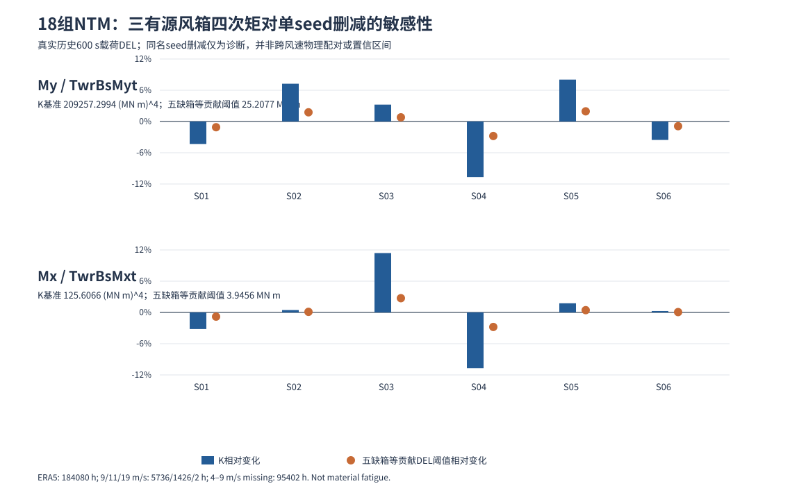

**图3-X** 蓝色为相对六seed基准的已知部分\(K_c\)变化，橙色为五个缺失箱假设相同DEL时的等贡献阈值变化。SOURCE=历史18行带OUTB SHA的T062派生数据（SHA256 `4abf76252fa34b2c12635d409e5abc23c4a7d6f759b66dbec12b1932379f4bea`），原始OUTB本轮未重读；RUN=[Node复算程序](../../../experiments/T062/s10_ntm18_weighted_m4_seed_deletion.cjs) SHA256 `7f1d7794696af77549f8ecfb9b3b0c8e47abd845161bb01ed037ef2049d2ba56`；TAB=[14行CSV](../../../experiments/T062/S10_NTM18_WEIGHTED_M4_SEED_DELETION_20261108.csv) SHA256 `91b78929363f828bc7eae87ddb9539d0b5c5fd4d94ae8ec937c41c515cfd8036`；FIG=本图 SHA256 `308bb1a205ef2f943acf8845c5ea3dd93de8ea6ce13866ee766f2f6e250db284`。V8真实输入下4项独立基准真值、16项代数检验、8类污染拒绝和乱序不变性通过；原生Node CLI/CI未运行。结果只反映六个已观察seed和三有源风速箱，不能推断缺失箱真实DEL、材料Miner或正式DLC1.2，亦不证明跨风速seed配对。

### 3.7.12 缺失风速箱对载荷四次根诊断精度的逆向约束（2026-11-08）

§3.7.10给出的等贡献阈值回答了“缺失风速箱贡献何时与已有三个风速箱相等”，但并不能直接回答“为把已有风速箱四次根载荷诊断的遗漏影响限制在某一数值范围内，缺失箱的载荷需要有多小”。为使后续真实风载数据能够反证这一精度要求，本文进一步定义**条件性逆向阈值**，不对缺失箱进行风速—载荷外推。令已有9、11、19 m/s三个风速箱的全小时加权四次矩为\(K_c=\sum_j(n_j/184080)\overline{DEL_{cj}^{4}}\)，相应已知部分的四次根为\(E_{c0}=K_c^{1/4}\)。对于具有\(n_G\)个ERA5小时的缺失箱组，**仅在该组所有箱具有相同四次矩等效DEL \(L_{cG}\)、且其他缺失箱的贡献在这一数学情景中被设为零**的条件下，总诊断与已知部分的比值为
\[
\frac{E_{cG}}{E_{c0}}=\left[1+\frac{n_G L_{cG}^4}{184080K_c}\right]^{1/4}.
\]
给定研究者事先指定的相对增加量\(\delta>0\)，反解得到
\[
L_{cG}^{\mathrm{limit}}(\delta)=\left\{\frac{184080K_c}{n_G}\left[(1+\delta)^4-1\right]\right\}^{1/4}.
\]
这里的\(\delta=5\%、10\%、20\%\)仅用于**载荷级数学敏感性示例**，不是IEC/GB规定的误差容许值，也不是混凝土、普通钢筋、预应力钢绞线或钢塔材料疲劳的验收限值。

直接读取既有31行ERA5分箱与6行历史NTM双通道四次矩，得到\(K_{Mx}=125.6066377435\)、\(K_{My}=209257.2994476005\;(\mathrm{MN\,m})^4\)。对于诊断[4,25) m/s内**全部13个正小时但无NTM载荷来源的箱**（共99736 h），如果假设它们具有同一个未知DEL，那么当\(\delta=5\%\)时，条件阈值为**Mx 2.658623 MN·m、My 16.985322 MN·m**；当\(\delta=10\%\)时分别为**3.220659、20.576036 MN·m**。若仅对4–9 m/s五个缺失箱（95402 h）作共同DEL假设、同时在该情景中将其余缺失箱设为零，5%阈值则为**2.688316、17.175026 MN·m**。两组阈值接近仅反映ERA5小时权重差异，**不证明低风速载荷相近**。

一个容易忽略的量纲与非线性问题是：四次根载荷诊断相对增加5%，对应的缺失四次矩占已知四次矩比例为\((1.05)^4-1=21.550625\%\)，占该情景总四次矩的比例已达**17.729753%**。因此，等效载荷数值的小幅变化不代表高阶载荷贡献同样微小。相反，在缺失风速箱的真实载荷完全未知时，既可令其DEL为零，也可令其足够大使诊断任意增加；**本文没有数据支持的完整诊断上界**。此外，ERA5低于4 m/s的77180 h没有进入上述[4,25)诊断区间，其停机/待机/运行状态未由该分析确定，不能据此推断全年零载荷或材料疲劳精度。

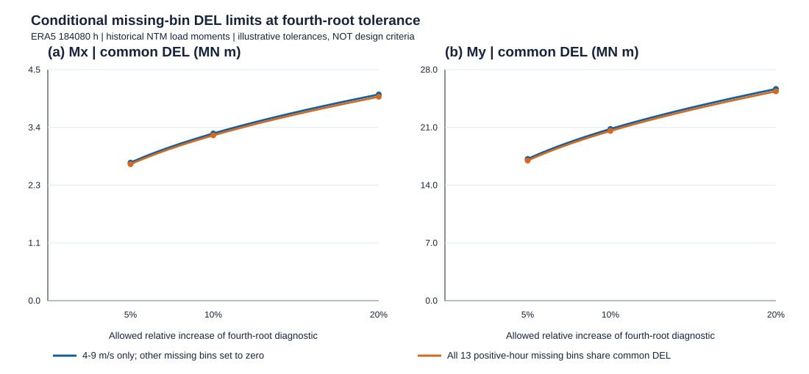

**图3-X** 以5%、10%、20%预设四次根载荷诊断增加量反求Mx、My两通道的缺失箱共同DEL条件阈值。蓝线为4–9 m/s五箱且其余缺失箱在情景中设零，橙线为诊断区间全部13个正小时缺箱共同DEL；图线不是预测载荷或规范限值。SOURCE=[31行ERA5分箱](../../../experiments/T062/S10_ERA5_2005_2025_HUB_1MS_BINS_20261031.csv) SHA256 `e4058620a36b23bb218103875d4dc5b0711fc45d418b23a2208c2fc9c16c9102`与[六行历史NTM四次矩](../../../experiments/T062/partial-annual-load-diagnostic-20261102/S10_REAL_18NTM_3BIN_PARTIAL_M4_BY_CHANNEL_20261102.csv) SHA256 `d43f963fb30e16a33e87acdf6e9571710826974eee89d1f3527ab6504d85f695`；RUN=[可运行Node源](../../../experiments/T062/s12_missing_bin_tolerance_envelope.cjs) SHA256 `b2df138b4555b524408daf10179f5e0062f53b593d61af783158b0697425fd85`；TAB=[12行CSV](../../../experiments/T062/S12_MISSING_BIN_TOLERANCE_ENVELOPE_20261108.csv) SHA256 `fc1629c8408f689cf1611dbc9d9763cc63a5a740037d24e26cd00b73b3f6fbd3`；FIG=本图SHA256 `5dc5fd706d9dc7a3748e810843b5a60d707a3e11a07378c886f1ce99ac4d7f84`。源级V8执行12项反代恒等式、2项独立数值对照、6项单调性检验和2项污染拒绝；原生Node独立等价实现已核源SHA及数值，但**仓库远端程序本身尚未取得原生CLI/CI日志**。无新增OpenFAST原始OUTB、材料局部应力、规范授权条文或物理RUN；正式DLC1.2仍0/126，材料Miner及同态风震HOLD，12阶段0/12。

### 3.7.13 同一原始风场下塔底平均弯矩与循环DEL控制seed错位（2026-11-09）

为排除跨归档同名工况的模型身份混杂，本节直接采用18组历史NTM原始OUTB的两份独立派生表：塔底六分量时间均值和同一塔底弯矩通道`TwrBsMyt`的雨流等效载荷。逐case核对原始OUTB SHA256、part ZIP、100—700s统计窗、12001点/0.05s采样以及N·m↔kN·m单位换算；两份表的平均My逐值一致。OpenFAST原生输出坐标基尚未独立验证，因此仅在**同一原生输出通道**内比较，不将其误写成已确认全局坐标或材料局部应力。

每个风速箱6个seed-case，共有15对内部排序比较。若两case的时间平均My与\(DEL_{m=4,N_{ref}=600}\)大小顺序相反，记为不一致对数\(D\)；描述性Kendall系数为\(\tau=(15-2D)/15\)。若错误地仅选择平均My最大seed，定义筛查漏选幅度\(L=(DEL_{max}-DEL_{mean\ winner})/DEL_{max}\)。\(L\)仅表示**本批历史六seed载荷指标的漏选比例**，不是材料疲劳寿命损失。

| 历史NTM风速箱(m/s) | 不一致对/15 | Kendall τ | 平均My最大seed | DEL4最大seed | 漏选DEL4 |
|---|---:|---:|---|---|---:|
| 9.343881 | 11 | −0.466667 | S02 | S01 | 24.561180% |
| 11.400000 | 7 | +0.066667 | S02 | S04 | 17.614085% |
| 19.202140 | 12 | −0.600000 | S03 | S04 | 17.766489% |

三箱最大平均My与最大DEL4控制seed均不同。在9.343881m/s箱，平均My最大seed S02的DEL4为38.530043MN·m，实际六seed最大DEL4来自S01（51.074557MN·m），漏选24.561180%。三箱合计30/45对排序不一致，但**45对共享18个独立风场实现，不能视为45次独立试验或直接进行显著性推断**；11.4m/s箱7/15也不支持“所有风速箱均负相关”。因此，同一原始风场的反例直接否定了“平均塔底弯矩最大seed可以代替循环DEL最大seed”的历史筛查捷径，但不能据此推断总体失效率、控制器因果或材料损伤。

[18case明细](../../../experiments/T062/S06_NTM18_MEAN_VS_DEL_18CASE_20261109.csv)、[三箱汇总](../../../experiments/T062/S06_NTM18_MEAN_VS_DEL_3BIN_20261109.csv)、[科研图](../figures/FIG3_S06_NTM_MEAN_VS_DEL_20261109.svg)和[可运行Node程序](../../../experiments/T062/s06_ntm18_mean_vs_del_rank.cjs)提供可复算依据。原OUTB本轮未重新解码，正式DLC1.2风速箱、完整同态风震时程、材料点循环应力和Miner损伤仍未闭合。

### 3.7.14 三指标控制工况的最小历史seed集合：精确穷举与漏选代价（2026-11-09）

上一节证明，按塔底平均弯矩选单一seed不能代表循环DEL控制。本节进一步回答：**在已观测六个seed内，保留多少历史工况才能同时覆盖塔底My的时均值、正向峰值和m=4雨流DEL三个指标的最大值？** 直接对18组原始OUTB的两份独立派生表逐case核对SHA、100—700s窗口、12001点/0.05s及kN·m→MN·m单位。三指标均属于同一OpenFAST原生TwrBsMyt通道，不跨不同风场拼接时程；正峰不是绝对极值。

设每箱六个历史seed为集合 S_b，三项指标为 q∈{mean(My),max(My),DEL4(My)}，六seed已观测最大值为 q*_b。对任意保留子集 A⊆S_b，定义最坏相对漏选代价

\[
R_b(A)=100\max_q\left(1-\frac{\max_{s\in A}q_{bs}}{q_b^\star}\right)\%,\qquad R_b^\star(k)=\min_{A:|A|=k}R_b(A).
\]

每个风速箱精确枚举2⁶−1=63个非空子集，对k=1,…,6计算最优代价，并与分别按时均、正峰、DEL降序选前k个case比较。这是**已经知道六seed结果之后的事后oracle**，不是在运行新seed之前可以执行的策略，不能作为正式DLC1.2减少样本量的依据。

| 历史NTM风速(m/s) | 时均最大seed | 正峰最大seed | DEL4最大seed | k=1最优漏选 | k=2最优漏选 | 零漏选最小k与集合 |
|---:|---|---|---|---:|---:|---|
| 9.343881 | S02 | S01 | S01 | 1.115066% | **0%** | **2：S01+S02** |
| 11.400000 | S02 | S06 | S04 | 2.594271% | **1.357063%** | **3：S02+S04+S06** |
| 19.202140 | S03 | S04 | S04 | 2.120187% | **0%** | **2：S03+S04** |

11.4m/s箱的三个最大值分别来自三个不同风场，因此两个case不可能同时精确保留全部已观测最大值；k=2的最优最坏漏选仍为1.357063%，k=3才为零。19.202140m/s箱若仅按时均My选前三个seed，仍遗漏正峰和DEL最大seed S04，三指标最坏漏选达**9.763438%**，而S03+S04两case可保留全部已观测最大值。9.343881m/s箱按时均选前两case的最坏漏选为24.561180%，按三指标并集选两case则为零。**零仅表示保留六个历史样本的最大值，不代表未来seed、完整风速箱或结构材料响应零误差。**

该反例支持第三章的多QoI控制case并集原则。每箱只有六个独立风场实现，63个重叠子集不是63次独立验证；历史控制器状态、完整同态W侧时程、坐标与惯性归属、正式DLC1.2及材料点循环应力仍未闭合。结果不能推出混凝土、钢筋、预应力筋或钢塔的疲劳寿命。

[源级Node程序](../../../experiments/T062/s06_ntm18_three_qoi_budget.cjs)、[18case三指标表](../../../experiments/T062/S06_NTM18_THREE_QOI_18CASE_20261109.csv)、[18行预算与策略对照表](../../../experiments/T062/S06_NTM18_THREE_QOI_BUDGET_18ROW_20261109.csv)、[正式科研图](../figures/FIG3_S06_NTM_THREE_QOI_SEED_BUDGET_20261109.svg)可复算上述结果。同一源码V8执行4项正向数值测试、8类污染拒绝与行序不变性检验；原生Node CLI与OUTB重新解码未运行。

### 3.7.15 同源NTM跨风速箱的时均弯矩—正峰弯矩—循环DEL响应解耦（2026-11-09）

前两节讨论同一风速箱内不同随机种子的控制身份，本节改从**风速箱之间**检验不同载荷指标是否具有相同变化方向。输入为[18个历史NTM原始OUTB派生case](../../../experiments/T062/S06_NTM18_THREE_QOI_18CASE_20261109.csv)，三个历史风速分别为9.343881、11.400000和19.202140 m/s，每箱6个seed；同一case的时均、正向峰值和\(m=4\)雨流\(DEL_{N_{ref}=600}\)均取自TwrBsMyt通道，100—700 s、0.05 s采样的历史窗口。**正向峰值不是绝对值峰值；本节的DEL是弯矩载荷等效量，不是材料疲劳损伤。**

对风速箱\(b\)和指标\(q\)，先计算六seed的算术平均\(\bar q_b=\sum_{s=1}^{6}q_{bs}/6\)，再用样本标准差\(s_{q,b}=\sqrt{\sum_s(q_{bs}-\bar q_b)^2/5}\)定义描述性变异系数\(CV_{q,b}=100s_{q,b}/\bar q_b\)。这里的六seed是条件于历史固定模型和风速的六个随机实现，**不是六个独立年份或六个ERA5风速观测**。

| 历史NTM风速（m/s） | 六seed时均My的平均（MN·m） | 六seed正峰My的平均（MN·m） | 六seed DEL4的平均（MN·m） | 时均My的CV | DEL4的CV |
|---:|---:|---:|---:|---:|---:|
| 9.343881 | 177.175982 | 271.200912 | 43.701157 | 1.560157% | 13.329354% |
| 11.400000 | 193.078679 | 290.197883 | 56.611754 | 3.207918% | 11.900626% |
| 19.202140 | 106.924047 | 217.362062 | 61.333196 | 1.285860% | 6.428970% |

从11.4 m/s到19.202140 m/s，**六seed平均时均My下降44.621515%，平均正峰My下降25.098674%，而平均DEL4反而增加8.340039%**。因此，在这三个已有历史风速箱中，时均与正峰的跨箱变化方向不能替代循环等效弯矩的变化方向。各箱DEL4的CV为6.428970%—13.329354%，时均My的CV仅为1.285860%—3.207918%；按箱逐一配对，DEL4的相对seed离散是时均My的3.709767—8.543595倍。此处比较的是相对离散，不是材料应力或疲劳寿命的不确定性区间。

这一现象与载荷循环对幅值分布而非仅对时间平均值敏感的定义一致，但**尚不能把差异归因于变桨、转速、推力变化或控制器状态**：相应全时程控制器身份及跨风速运行状态未独立闭合。三箱六seed的结果也不能证明真实风速响应函数单调或非单调，不能用19 m/s历史筛查代表全部高风速箱，更不能断言19 m/s为混凝土、预应力筋或钢塔的材料疲劳控制风速。若要检验跨箱变化的稳健性，应使用正式DLC1.2覆盖、独立seed收敛及同模型运行状态证据，而不是对本表做线性外推。

[三箱机器可读表](../../../experiments/T062/S06_NTM18_CROSS_BIN_MEAN_PEAK_DEL_3BIN_20261109.csv)由18行原始派生表直接按上述公式计算；V8源级计算通过18行/3箱×6seed、两项数值oracle、逆序输入\(10^{-11}\)容差不变性和负值/重复case拒绝测试。首次测试曾错误地要求浮点求和逆序**逐位一致**，已修正为有界数值容差；CSV按9位小数舍入，显示误差不超过\(5\times10^{-10}\)个表内单位。原始OUTB未在本轮重新解码，正式DLC1.2仍0/126。

### 3.7.16 同源18组NTM三指标的风速箱间与随机种子箱内方差分解（2026-11-09）

为进一步判断§3.7.15中三种塔底弯矩指标的历史离散来源，对相同18个NTM工况（3个风速箱、每箱6个随机实现）的600 s时均My、正向峰值My和$m=4$载荷DEL分别进行固定样本平方和分解。记$Y_{js}$为第$j$箱第$s$个seed的指标（MN·m），$\bar Y_j$和$\bar Y$分别为箱均值和18case总均值，则

$
SS_{\mathrm{total}}=\sum_{j=1}^{3}\sum_{s=1}^{6}(Y_{js}-\bar Y)^2
=\underbrace{6\sum_{j=1}^{3}(\bar Y_j-\bar Y)^2}_{SS_{\mathrm{between}}}
+\underbrace{\sum_{j=1}^{3}\sum_{s=1}^{6}(Y_{js}-\bar Y_j)^2}_{SS_{\mathrm{within}}},
\qquad \eta^2_{\mathrm{bin}}=\frac{SS_{\mathrm{between}}}{SS_{\mathrm{total}}}.
$

平方和单位为(MN·m)²。$\eta^2_{\mathrm{bin}}$仅表示**当前18个已观测工况**的风速箱标签所对应的描述性平方和份额，不是控制器因果解释率、连续风速总体的统计$R^2$，也没有按ERA5风速发生概率加权。

| 历史塔底My指标 | 箱间份额$\eta^2_{\mathrm{bin}}$ | 箱内份额 | 合并箱内标准差（MN·m） | 每箱删除1个seed后$\eta^2$范围 |
|---|---:|---:|---:|---:|
| 600 s时均My | 99.059460% | 0.940540% | 3.995601 | 98.882471%—99.323866% |
| 正向峰值My | 93.322562% | 6.677438% | 9.039275 | 92.107734%—96.220339% |
| $m=4$载荷DEL | **67.820857%** | **32.179143%** | 5.623427 | **61.949045%—80.260537%** |

对每个指标精确穷举三箱各删除1个历史seed的$6^3=216$种组合，每次保留15个case并重算全部平方和。表中区间为216个子集的**确定性最小—最大值，非置信区间**。原始[18行同OUTB派生数据](../../../experiments/T062/S06_NTM18_THREE_QOI_18CASE_20261109.csv)、[完整三指标平方和与删一结果表](../../../experiments/T062/S06_NTM18_THREE_QOI_VARIANCE_DECOMP_20261109.csv)和[图3-X：三指标方差结构](../figures/FIG3_S06_NTM18_VARIANCE_DECOMP_20261109.svg)提供可复算来源。

历史样本中，时均My的箱间份额为99.06%，正峰My为93.32%，但DEL仅为67.82%；**DEL仍有32.18%的平方和位于同一风速箱的六个随机实现之间**。这与§3.7.13—15所见控制seed错位、时均/峰值/DEL随风速变化方向不同的事实一致，提示不能以时均弯矩的箱间稳定性替代循环指标的随机性检验。必须指出：三箱并非完整运行风速总体的随机抽样，跨箱seed身份、控制器运行状态、未覆盖风箱和源仿真误差均未完成正式验证；该分解不支持未来seed预测、正式DLC1.2覆盖、材料局部应力或Miner寿命结论。本节没有新增物理仿真。

### 3.7.17 雨流修正前后ETM与NTM的跨随机种子全包络判别（2026-11-10）

为避免将ETM与NTM中相同的S01—S06编号误认为同一湍流随机过程，本节不预设跨类别seed的物理配对，而是对每个风速和塔底弯矩分量定义最不利的**全交叉比较裕度**：

\[
G_{c,v}=100\left(\frac{\min_{s=1}^{6}DEL_{ETM,c,v,s}}{\max_{s=1}^{6}DEL_{NTM,c,v,s}}-1\right)\%.
\]

若\(G>0\)，则在这六个历史ETM和六个历史NTM实现组成的有限样本内，任意ETM的载荷DEL都大于任意NTM的载荷DEL；若\(G\le0\)，则**不能证明全部交叉组合均如此**，但不代表相同编号seed必然出现逆转。该定义只针对塔底载荷DEL，单位为kN·m，不能外推为材料局部应力、Miner损伤或未来随机实现的概率结论。

沿用T062已逐源核验的36组OpenFAST历史风载、72行原算法/修正算法成对雨流DEL（原派生CSV SHA256：`12dabbb1273ce03d3920aedda3f72f9fa1d75b671e01a1db145c0a972ffe15e2`），按三个风速×两个弯矩分量统计六seed全包络，得到如下结果：

| 塔底弯矩 | 风速（m/s） | 原算法裕度（%） | 修正后裕度（%） | 修正后是否六seed全分离 |
|---|---:|---:|---:|---|
| Mx | 9.343881 | +14.857 | +13.660 | 是 |
| Mx | 11.400000 | +22.005 | +23.331 | 是 |
| Mx | 19.202140 | −25.351 | −12.375 | 否 |
| My | 9.343881 | −5.200 | +8.984 | 是 |
| My | 11.400000 | −42.400 | +7.613 | 是 |
| My | 19.202140 | +18.644 | +11.142 | 是 |

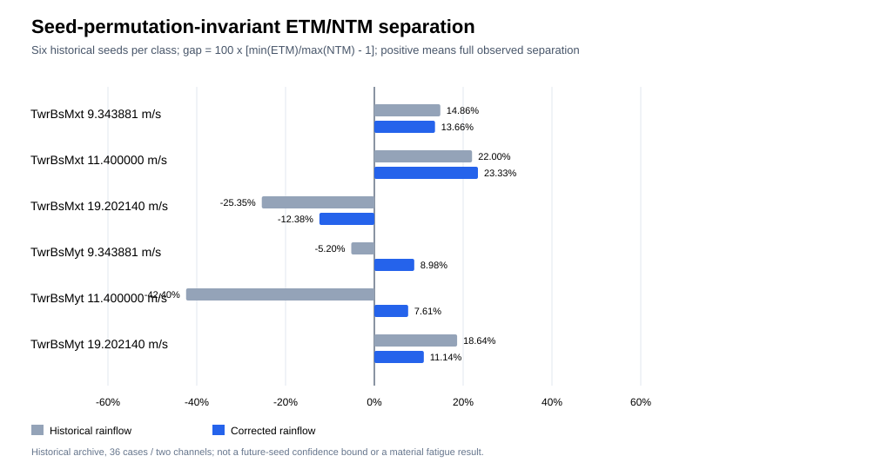

**结果表明，My在原雨流算法下只有1/3个风速箱达到历史全包络分离，而修正后为3/3；Mx则始终为2/3。** 同时，两种算法下按相同seed编号比较的18组ETM/NTM在两个弯矩分量上均保持ETM较大，说明“同编号seed比较全部同号”并不能保证“所有跨seed组合均同号”。这种差别是雨流算法修正影响控制工况筛选证据强度的具体反例，不能据此宣称ETM总体随机占优或把ETM极端湍流结果当作DLC1.2长期NTM疲劳载荷。

图表与程序可追溯至[六行计算结果](../../../experiments/T062/S06_ETM_NTM_PAIRING_FREE_RAINFLOW_GAP_20261110.csv)及[独立可运行Node程序](../../../experiments/T062/s06_etm_ntm_pairing_free_rainflow_gap.cjs)。本节只复用已核验历史来源，未新增物理求解；来源级算式和输入拒绝测试PASS，原始OUTB本轮未重新解码。

### 3.7.18 同一随机种子预算的双弯矩—跨风速箱留出检验（2026-11-10）

前述各节分别讨论单风速箱的seed漏选和不同载荷指标的控制身份。本节检验一个直接的试验设计问题：**如果三个风速箱必须共用相同的seed编号，选择方案在两个已知风速箱上表现良好，能否迁移到未参与选择的第三个风速箱？** 本节基于已有18组NTM、每组塔底Mx/My两个弯矩通道，属于**回顾性有限样本试验**，不是新增随机风仿真。三个历史风速箱分别为9.343881、11.400000和19.202140 m/s，每箱六个seed；全部采用同源修正后雨流载荷DEL（参考循环数100000、指数m=4，单位kN·m）。原始72行成对雨流对照表SHA256为12dabbb1273ce03d3920aedda3f72f9fa1d75b671e01a1db145c0a972ffe15e2，本节只使用其中36行NTM通道结果。

记风速箱为$b$、弯矩通道为$c$、seed为$s$，其修正后载荷等效幅值为$D_{bcs}$。对选中的共同seed集合$S\subset\{1,\ldots,6\}$，定义

\[
D_{bc}(S)=\left(\frac{1}{|S|}\sum_{s\in S}D_{bcs}^{4}\right)^{1/4},\qquad
E_T(S)=100\max_{\substack{b\in T\\c\in\{Mx,My\}}}
\left|\frac{D_{bc}(S)}{D_{bc}(\{1,\ldots,6\})}-1\right|\%.
\]

这里的四次矩平均是对**相同600 s有效窗口、相同参考循环数**的历史seed载荷DEL做描述性汇总；它不是对不同风速箱进行ERA5概率加权，也不是材料损伤叠加。共同编号只是一项**计算预算约束**，不表示不同风速箱的S02风场是同一个物理湍流实现。给定预算$k$，对全部$\binom{6}{k}$个组合进行穷举，先以三个风速箱全部参与时的最小$E_T$作为“事后最优/乐观基准”；再依次留出一个风速箱，仅使用另两个箱的六seed参考值选择$S$，最后在留出箱评价误差。相同最优值按seed编号字典序确定，不允许利用留出箱误差反向调参。

| 共同seed预算 | 组合数 | 三箱事后最优最大误差 | 三箱所有组合平均最大误差 | 留出9.343881 m/s时的误差 |
|---:|---:|---:|---:|---:|
| 1 | 6 | 11.646167% | 16.873974% | 19.403170% |
| 2 | 15 | 4.579323% | 10.468714% | 7.093878% |
| 3 | 20 | **2.241689%** | 7.056039% | **10.858592%** |
| 4 | 15 | 2.547498% | 4.956084% | 4.199770% |
| 5 | 6 | 2.154620% | 3.084800% | 2.772730% |

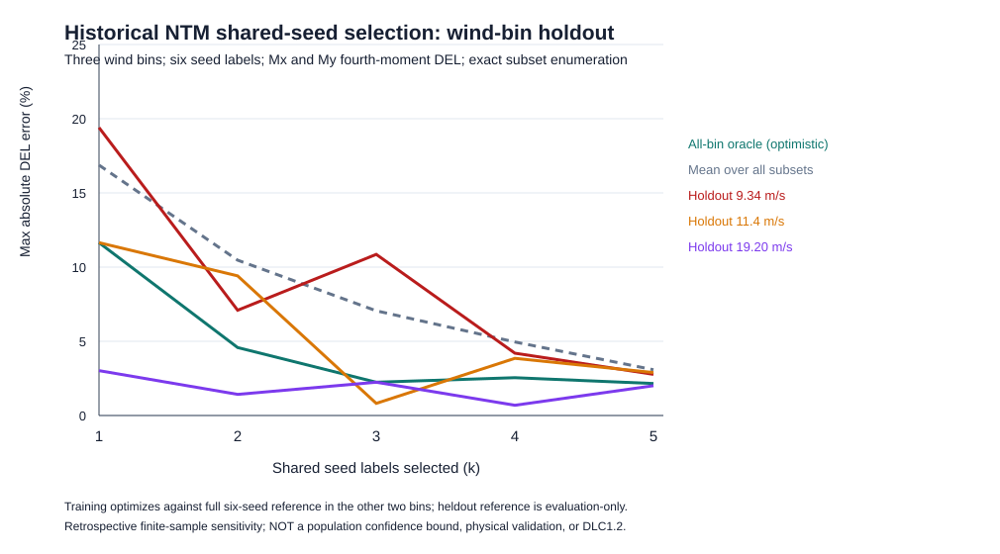

三seed预算下，三个风速箱全部参与选择时，事后最优共同集合为**S02、S03、S04**，双通道、三箱最大相对误差为2.241689%。然而，若把9.343881 m/s箱完全留出，只在另外两个风速箱上选择，得到**S02、S05、S06**；训练两箱的最大误差仅1.321257%，但留出箱的最大误差升至**10.858592%**。同一预算下，留出11.4 m/s与19.202140 m/s的误差分别为0.817344%和2.241689%。因此，**对已有风速箱的事后最优拟合不等于对未参与选择风速箱的可靠迁移**。本研究还观察到$k=4$的事后最优误差2.547498%略高于$k=3$的2.241689%；这不是计算失败，而是固定预算下以所选seed的四次矩平均作为估计量时，最小最大相对误差**不保证随$k$逐步单调下降**。只有使用全部六seed时，对自身参考值的误差才按定义为零。

本节的186次留出组合评价（$\sum_{k=1}^5 3\binom{6}{k}=186$）是同一18个历史风场的确定性重用，**不是186个独立随机试验，也不能形成总体置信区间**。尤其是选种训练阶段已用到训练箱的全部六seed参考值，这是一种**回顾性oracle实验**，不能作为在未知全样本真值时直接部署的seed推荐规则。三个风速箱既少且非随机同分布，缺少正式DLC1.2风速覆盖、跨风速控制状态核验及材料局部循环应力，故不能推导材料疲劳寿命或规范所需seed数。该反例支持后续正式设计采用独立seed留出与跨风速箱检验，而不是将少数风速箱的最优seed编号固定推广至全部工况。

[独立可运行Node算法](../../../experiments/T062/s06_ntm_joint_seed_holdout.cjs)、[15行完整留出结果](../../../experiments/T062/S06_NTM_SHARED_SEED_WIND_BIN_HOLDOUT_15ROW_20261110.csv)和上述SVG图共同构成本节可复现结果。程序对36行真实NTM通道数据、72行原始对照的第三方DEL一致性、六seed参考值、组合数、四项真实数值oracle和八类错误输入拒绝进行检查；原始OUTB本轮未重新解码，也没有运行OpenFAST/TurbSim生产求解。

### 3.7.19 六随机种子四次矩聚合的精确自助分布及跨风速配对假设敏感性（2026-11-11）

**科学问题。** §3.7.8的删减种子穷举只回答“从已观测六条记录中删去若干条，估计值如何变化”，不能直接量化“在六条记录代表的经验分布下，重新抽取六次时控制风速排序会有多大变化”。本节不新增OpenFAST计算，直接复用原始OUTB经T062独立雨流闭合后的72行历史载荷派生表，抽取NTM三风速箱×六seed×两个塔底弯矩通道共36个DEL值。单位为kN·m，雨流筛查口径统一为$m=4$、$N_{\mathrm{eq}}=100000$；不是材料S–N曲线的指数或材料应力。

对风速箱$j$的六条历史载荷DEL $L_{js}$，定义四次矩合并量

$
B_j=\left(\frac{1}{6}\sum_{s=1}^{6}L_{js}^{4}\right)^{1/4}.
$

在“同一风速箱内六seed可作为可交换经验样本”的**附加统计假设**下，每箱有放回抽样六次。六次有序抽样共有$6^6=46656$种，可由$462$个非负整数计数向量$(c_1,\ldots,c_6)$（$\sum c_s=6$）压缩，以精确多项式权重$w(c)=6!/(6^6\prod_s c_s!)$计算**完整经验自助分布**，没有Monte Carlo抽样误差。报告2.5%与97.5%分位数作为**条件性百分位区间**，不能未经覆盖率验证称为总体95%置信区间。

进一步分别采用两种互不等价的跨风速假设：（I）三个风速箱各自独立有放回抽样；（P）三个风速箱共用相同seed标签的重抽样计数向量。以重抽样后$B_j$为三箱最大值的经验比例定义$P^*_{\mathrm{I/P}}(j=\arg\max B^*)$。方案P只有在跨风速随机流确实存在物理配对时才可能具有对应抽样解释；**相同S01–S06编号并不证明相同湍流随机实现**，故P仅作为配对假设敏感性对照，不是优先的总体概率估计。

| 塔底通道 | 风速 / m·s⁻¹ | 历史$B_j$ / MN·m | 精确bootstrap百分位区间 / MN·m | $P^*_{\mathrm I}$(最大) | $P^*_{\mathrm P}$(最大) |
|---|---:|---:|---:|---:|---:|
| Mx | 9.343881 | 1.922467 | [1.764983, 2.061850] | 0 | 0 |
| Mx | 11.4 | 2.509922 | [2.350086, 2.618960] | 0 | 0 |
| Mx | 19.202140 | 6.596211 | [5.928163, 7.086852] | 1.000000 | 1.000000 |
| My | 9.343881 | 12.424367 | [11.110167, 13.438224] | 0 | 0 |
| My | 11.4 | 16.034661 | [14.525886, 17.275819] | 0.079750 | 0.000729 |
| My | 19.202140 | 17.157449 | [16.346863, 17.940002] | 0.920250 | 0.999271 |

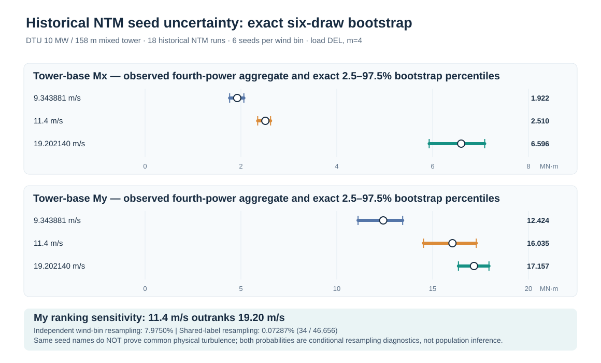

**图3-19** 每个风速箱六条历史NTM seed的$m=4$载荷DEL四次矩合并量（圆点）与经验自助分布2.5%—97.5%分位区间（横线）；下方标示My通道在两种跨箱重抽样假设下的排序翻转比例。图示为有限样本条件性不确定性，**不是新的风机动力学模拟、规范置信带或材料疲劳寿命**。

**可证伪发现。** Mx在两种抽样假设下均由19.202140 m/s箱控制；My则不同：历史六seed四次矩为17.157449与16.034661 MN·m，19.202140 m/s箱高于11.4 m/s箱，但在独立箱抽样方案I中，11.4 m/s箱反超的条件性比例为**7.975024%**；在共用seed标签方案P中仅为**0.072874%（34/46656）**。这种超过百倍的假设敏感性并非“哪种方案更准确”的证据，而是说明**跨风速配对是否有源级物理依据会实质改变对载荷控制风速稳定性的解释**。已有六条同名seed无法自动确立这一依据。

**证据、误差与边界。** SOURCE=T062/S10_RAINFLOW_MEAN_HETEROGENEITY_72ROW_20261110.csv（SHA256 cbe5f3c13290641789a11fc7551169a4b16fd9b347b03de74f8bde1209e76a49），直接读取72行并仅使用36个NTM通道值；RUN=462项多项权重与独立经验CDF排序，权重和为1，V8真实源复算与独立计算对照；Node原生自测合成常数/排序/异常拒绝通过，GitHub提交版对SHA锁真实CSV的原生CLI尚未独立执行。[6行结果表](../../../experiments/T062/S06_NTM_EXACT_SEED_BOOTSTRAP_PAIRING_6ROW_20261111.csv)与[可运行程序](../../../experiments/T062/s06_ntm_exact_seed_bootstrap_pairing.cjs)可追溯。组合穷举无随机抽样误差，表中六位小数舍入不超过$5\times10^{-7}$ MN·m；浮点与原始OUTB打包量化、TurbSim/控制器模型误差、六seed经验分布偏差、跨风速相关性、ERA5场址代表性**不能由本表消除**。REF=本章既有雨流/风场文献，未新增两篇2026先行风震/PT研究的全文页码；STANDARD=无新授权IEC条款；OFFICIAL=沿用历史158m OpenFAST v3.5.3来源。正式DLC1.2仍0/126、缺失运行风速箱及材料局部应力/Miner仍HOLD。本节不对未观测风速箱、未来随机总体或地震同态配对作推断。

### 3.7.20 跨风速seed标签不可辨识性的全排列反例（2026-11-11）

**研究目的与来源。** §3.7.19中共用S01—S06标签的重抽样使11.4 m/s的塔底My载荷DEL反超19.202140 m/s的条件性比例仅为0.072874%，而独立风速箱重抽样为7.975024%。然而，S01—S06是各工况的**文件标签**，并非已经核实的跨风速湍流随机流一一对应关系。为判定这一数值差异是否依赖标签的任意排列，本节直接继承同一份历史T062 72行雨流派生数据（SOURCE SHA256 cbe5f3c13290641789a11fc7551169a4b16fd9b347b03de74f8bde1209e76a49），仅使用三个NTM风速箱各六条My载荷DEL，逐一枚举19.202140 m/s箱相对于11.4 m/s箱的全部$6!=720$种双射标签排列。未增加或改动任何OpenFAST/TurbSim生产计算。

对固定排列$\pi$和六抽计数向量$c=(c_1,\ldots,c_6)$，$\sum c_s=6$，在相同标签计数向量下比较两箱四次矩和，定义

\[
P_\pi^*=\frac{1}{6^6}\sum_{\substack{c_s\geq0\\\sum c_s=6}}\frac{6!}{\prod_{s=1}^{6}c_s!}
\,\mathbf{1}\!\left\{\sum_s c_s L_{11.4,s}^{4}>
\sum_s c_s L_{19.202140,\pi(s)}^{4}\right\}.
\]

四次方根与$1/6$因子在排序中相互抵消。每种排列恰有462个非负计数向量、46656个带权有序重抽样；共评价720×462个加权判别。由于9.343881 m/s箱的六个My DEL最大值14.214855 MN·m严格小于19.202140 m/s箱六个值的最小值15.377264 MN·m，任意重抽样下低风速箱均不可能控制，故三箱最大排序可化为上述两箱比较。

| 标签配对情景（仅历史My载荷） | 11.4 m/s反超19.202140 m/s的条件比例 |
|---|---:|
| 现存同名S01—S06标签 | 0.072874%（34/46656） |
| 720种重排中的最小值 | 0.027864%（13/46656） |
| 720种重排的2.5%与97.5%经验次序统计量 | 0.137174%—14.278978% |
| 720种重排的中位数 | 7.662466% |
| 720种重排的等权平均值 | 7.620313% |
| 720种重排中的最大值 | **14.868398%（6937/46656）** |
| §3.7.19独立风速箱重抽样（对照，不属于720种配对） | 7.975024% |

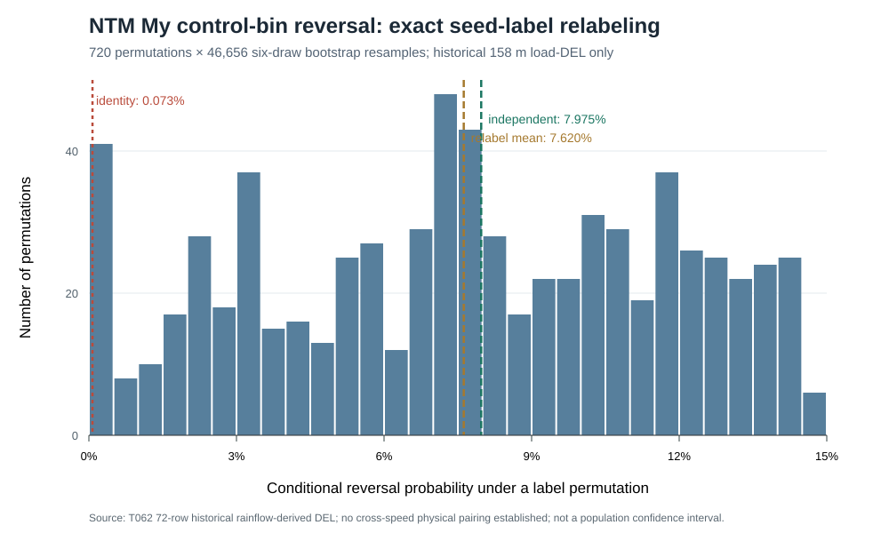

**图3-20** 历史NTM塔底My载荷DEL的720种全排列重标记所产生的经验重抽样排序翻转比例分布。红色虚线为原同名标签，绿色线为独立风速箱重抽样对照，棕色线为720种重排的等权均值。横轴为**条件性组合比例**，不是实际风气候发生概率；720种排列并非720次独立风机试验，2.5%—97.5%也不是总体置信区间。

**可证伪结论。** 同一批真实历史DEL、同一组六抽计数权重，仅改变跨风速文件标签对应关系，My排序翻转比例便从0.027864%变至14.868398%；原同名标签的0.072874%接近可达最小端，而517/720种重排的比例大于5%。因此，**不能以共用seed编号的bootstrap结果证明控制风速排序具有99.927%的物理稳定性**。若后续恢复原始BTS、TurbSim随机种子及空间风场，并独立证明跨风速流实现的可配对性，则应预先固定配对规则重新检验；反之，应使用与真实生成机制一致的独立风速箱设计并报告样本覆盖不足。720种重排的等权均值7.620313%与独立箱7.975024%接近，**不构成两种抽样方案等价的证明**。

**复算、误差与限制。** [720行逐排列结果](../../../experiments/T062/S06_NTM_MY_SEED_RELABEL_720ROW_20261111.csv)与[源级Node程序](../../../experiments/T062/s06_ntm_seed_label_permutation_exact.cjs)均已保存；SOURCE同§3.7.19，程序对720个唯一排列、462个计数向量及总权重46656检查，并以独立$6^6$有序枚举复核原标签、极小和极大三个排列，另有常量排序和坏输入拒绝测试。V8对GitHub提交同字节程序执行selftest与真实72行来源复算PASS；原生Node CLI对真实CSV尚未独立执行。程序/数表/图SHA256见T080过程日志。所有比例均为整数计数除46656，无Monte Carlo误差；显示到六位小数的百分数舍入误差不超过$5\times10^{-7}$个百分点。未重新读取原始BTS字节，也未取得跨风速随机流物理配对证据；原始OUTB量化、风场/控制器模型误差、seed可交换性、ERA5代表性及缺失DLC1.2风速箱不在该离散误差界内。REF沿用本章原雨流文献，STANDARD未新取得授权IEC条款，OFFICIAL沿用已核158m OpenFAST历史来源；**不产生材料局部应力、Miner寿命、风震同态或结构物理PASS**。

## 3.8 多指标控制工况集合与第四章输入

### 3.8.1 不设一个“万能最危险case”

第三章最终控制工况按不同物理目的取并集：最大tower-top resultant displacement、最大tower-base resultant moment、最大tower-base moment RMS、最大FA load-DEL、最大SS load-DEL、必要的near-rated control-state代表case及必要的PSD/1P/3P特殊case。

每个case必须写明进入第四章的原因：极值筛选、循环筛选、near-rated control-state或nonlinearity check。

### 3.8.2 历史benchmark只作对照

旧稿历史集合曾包含U09p343881_ETM_S06、U11p4_NTM_S02、U11p4_ETM_S03和U19p202140_ETM_S02。经T062相同36份OUTB、72条载荷DEL的雨流算法根因闭合，当前正式载荷级My循环控制候选为U11p4_ETM_S04，Mx循环控制候选为U19p202140_ETM_S02。旧S03仅保留作旧算法错误来源对照，其他极值、RMS、控制状态和谱特征仍按各自QoI独立筛选，不能以一个case替代所有机制。

### 3.8.3 向第四章交付的数据

第三章给第四章的正式输入包括：
1. long-term normal-operation wind-bin probability；
2. 36case screening统计与控制case并集；
3. 对应.bts与.outb hash；
4. tower-top/interface six-component loads；
5. load-rainflow ledger；
6. load-DEL ranking；
7. RotorSpeed/BldPitch/GenPwr运行状态；
8. PSD/1P/3P信息；
9. seed统计；
10. DLC1.2正式fatigue bins工况矩阵。

## 3.9 本章最终图表清单

建议最终形成图3-1 ERA5区域/研究点/处理流程；图3-2 2005—2025年100 m与HubHt风速时序；图3-3动态\(\alpha\)概率与季节分布；图3-4 HubHt wind-speed histogram/CDF；图3-5风玫瑰；图3-6三个screening URef在长期分布中的位置；图3-7 NTM/ETM代表风速时程；图3-8 TurbSim谱/相干性检查；图3-9 OpenFAST/ROSCO验证流程；图3-10 RotorSpeed–BldPitch–GenPwr运行状态；图3-11六seed QoI离散；图3-12 NTM/ETM统计比较；图3-13 PSD与1P/3P/塔频；图3-14 load-DEL分组；图3-15多QoI控制工况并集。

对应表格至少包括ERA5变量完整性、HubHt长期统计、36case矩阵、TurbSim/OpenFAST输入、运行验证门禁、six-seed统计、历史雨流算法错误的36工况因果闭合与第四章输入case清单。

## 3.10 本章小结

本章的实证结论应区分**已经完成的整机随机风载筛查**与**尚未取得的完整正常运行疲劳载荷总体**。在158 m组合研究模型上，既有36组OpenFAST历史工况和T062针对同一批原始OUTB的独立雨流复算，使塔底载荷控制身份可追溯：修正后My载荷DEL控制候选为U11p4_ETM_S04，Mx为U19p202140_ETM_S02。二者对应不同响应分量，ETM极端湍流筛查不能代替DLC1.2正常运行疲劳工况。控制工况应保留风速、湍流类别、随机种子、响应分量和参考循环数，不应笼统概括为一个“最危险工况”。

长期风速权重来自2005—2025年ERA5的**184080 h**。在[4,25) m/s诊断运行区间内共**106900 h**，有历史NTM载荷来源的9、11、19 m/s三个风速箱合计**7164 h**，占诊断区间**6.7016%**，占全部ERA5小时**3.8918%**；其余**99736 h**诊断区间小时缺少同口径NTM载荷。两个百分比的分母不同，不能混写为“全年覆盖率”。设同一通道、同一参考循环数下已知箱的加权四次矩为\(K_{\mathrm{obs}}\)，完整目标应满足
\[
K_{\mathrm{all}}=K_{\mathrm{obs}}+\sum_{j\in\mathcal M}p_j\,\overline{DEL_{j}^{4}},\qquad p_j=n_j/184080.
\]
缺失项非负，但在缺少真实载荷或独立验证上界时无法得到有限上界。§3.7.10—§3.7.12的等贡献阈值和逆向容差曲线仅说明**假定缺失箱载荷达到何值会改变已知部分**，不是缺失箱预测，也不是材料寿命估计。[ERA5原始分箱表](../../../experiments/T062/S10_ERA5_2005_2025_HUB_1MS_BINS_20261031.csv)提供分母和风速箱来源。

第三章向第四章传递的是**载荷层控制工况候选集合**，而非材料疲劳控制结论。塔底load-DEL基于载荷循环，材料损伤还需要局部应力范围、循环均值、次数及相应材料关系；不能凭一个弯矩DEL最大工况锁定混凝土、预应力钢绞线或钢塔的疲劳控制位置。尤其不能用少量历史NTM的线性风速外推填补正式风速箱：第五章§5.4.5的整箱留出实测拒绝试验对此提供了独立反例。

---

# 工作区证据与门禁（不进入最终Word）

|项目|状态|
|---|---|
|ERA5 2005Q1–2025Q4 / 184080 h|ARCHIVED / REPRODUCIBLE-METHOD|
|动态\(\alpha\)方法|LITERATURE-BACKED / REF093|
|ERA5不确定性边界|LITERATURE-BACKED / REF090|
|36 TurbSim case matrix|ARCHIVED 36/36|
|历史TurbSim grid 200m×200m / 51×51|IDENTIFIED / GRID V&V PENDING|
|700 s总时长 / 100–700 s统计窗|IDENTIFIED / TRANSIENT CHECK PENDING|
|OpenFAST/ROSCO validation sequence|FROZEN / REF046+REF009|
|36 outb files|ARCHIVED 36/36|
|load-rainflow independent recomputation|T062 COMPLETE|
|historical S03 vs current S04 DEL conflict|T062 CLOSED: 36/36 same-source, 72/72 original/one-line-fix/independent rainflow causal verification|
|正式DLC1.2长期fatigue bins|HOLD: 18/126历史NTM仅覆盖诊断运行小时6.70%；0/126经2025/26IEC条款验收，完整权重/材料响应未有|
|第四章输入case最终冻结|PENDING CH3 DATA CLOSURE|

### 3.5.10 九近底测点空间相关性及测点删减稳健性（历史NTM来源级诊断）

为避免将同一塔架近底的九个测点误当作九次独立随机试验，对18组NTM历史OUTB恢复的同步姿态序列（每组100–700 s，0.05 s，12001点）分别在RPxi、RPyi、TPxi、TPyi四类原生输出上构造九测点的去均值Pearson相关矩阵。设其非负特征值为λ₁,…,λ₉，定义第一主成分贡献率λmax/Σλ及参与率有效维数 (Σλ)²/Σλ²。另逐次删除一个测点，形成9种八测点子集；每个工况、通道分别报告子集的极值，以检验结论是否由单个测点造成。该有效维数仅表征九个同步输出的空间线性相关结构，不能代表风场随机seed数量、独立地震记录数或全塔模态数量。

18组×4通道=72个真实时程矩阵的九测点第一主成分贡献率分别为RPxi 99.4072%–99.8938%、RPyi 99.7245%–99.8769%、TPxi 99.7846%–99.8712%、TPyi 96.7014%–99.4400%。逐一删去任意一个测点后，八测点第一主成分贡献率全局范围分别为RPxi 99.3353%–99.9160%、RPyi 99.6905%–99.9031%、TPxi 99.7599%–99.9491%、TPyi 96.3322%–99.9555%；八测点有效维数上界依次为1.013382、1.006210、1.004816、1.076190。TPyi对测点选择相对敏感，但其最不利删点子集的第一主成分仍解释96.33%的标准化空间方差。上述稳健性检验排除了“完全依赖某一单点”的简单反例，**没有**排除共同建模误差、近底位置高度相关、时间自相关和风速/seed非独立性。

SOURCE为原18份OUTB恢复的S07 216018行姿态gzip，SHA256 `2e113c83990d81b064636dca05308fc72676cb329033b9d603c8807d5cf0ecea`；RUN为本地原生Python读取gzip、核对18×12001时间网格并计算72组九测点及648组删点矩阵；[可复算程序](../../../experiments/T062/s07_pose_spatial_loo.py)、[四行汇总表](../../../experiments/T062/S07_POSE9_SPATIAL_LOO_SUMMARY_4ROW_20261111.csv)。原始216018行压缩文件保存在历史Artifact #13785456956（到期2026-12-10 17:09 UTC）及既有Library备份；完整72行本地结果尚未写入Git。RP为原生角位置分量，不等于精确方向余弦矩阵。九测点高度仅约0.071–2.751 m，不能外推至158 m全塔，也不能据此宣布S07结构物理验收PASS。