# 第四章 10 MW预应力混凝土—钢混合塔架风致疲劳性能分析

> 状态：CANONICAL METHOD DRAFT / FINAL RESULTS PENDING  
> 第一主参考：Huang et al. 2025 [REF018]。  
> 强二级参考：李泽宇2024博士论文 [REF007]；其他辅参考：Kenna 2019 [REF002]、Qu et al. 2026 [REF023]、Wang et al. 2025 [REF041]、Zhao et al. 2023 [REF143]、Kim et al. 2019 [REF036]。  
> 原图证据目录：references/evidence-screenshots/fatigue-ch4/  
> 方法—原图完整索引：04_FATIGUE_SOURCE_EVIDENCE_ATLAS_20261006.md

## 4.1 研究目的、研究对象与总体疲劳框架

大型风电混合塔架在正常运行状态下长期承受随机风引起的周期性推力、倾覆弯矩、扭矩以及重力和预应力共同作用。与极限承载分析不同，疲劳评价不仅取决于某一时刻的最大荷载，还取决于局部材料点在长期运行过程中的应力范围、平均应力、循环次数以及不同运行风速的出现概率。因此，本章不以“最大塔底弯矩”或“最大load-DEL”直接代替材料疲劳，而建立由场址长期风环境、整机随机载荷、精细结构局部应力、循环计数、材料疲劳关系和长期概率累积组成的完整分析链。

本章集中回答以下问题：

1. 在正常运行随机风作用下，158 m预应力混凝土—钢混合塔架的疲劳控制位置位于何处；
2. 控制疲劳的主要材料是下部预应力混凝土、预应力钢绞线还是上部钢塔；
3. 额定风速附近、高于额定风速的变桨运行区以及低风速区对长期damage的贡献有何差别；
4. 预应力形成的长期压应力、随机湍流样本和局部应力提取方法会如何改变疲劳评价；
5. 整机载荷层的load-DEL控制工况与材料层damage控制工况是否一致。

Huang等[REF018]针对segmental precast post-tensioned concrete风机塔开展运行随机风疲劳分析，其研究对象同时涉及分段预制混凝土塔、水平接缝、后张预应力、长期运行风速概率、局部应力循环、平均应力、初始预应力、周向方位和随机样本数，和本文下部混凝土塔段的核心问题最接近。因此，本章以REF018作为总体研究逻辑的第一主参考。

但本文研究对象为钢—预应力混凝土混合塔架，不能只沿用混凝土疲劳路线。Kenna[REF002]用于建立钢塔段和混凝土塔段必须分材料评价的总体框架；Qu等[REF023]用于预应力钢绞线疲劳和预应力损失影响；Wang等[REF041]用于水平接缝Reference Stress和局部应力提取；Zhao等[REF143]用于钢塔法兰/焊接细节的nominal/hot-spot stress疲劳流程；Kim等[REF036]仅在钢—混转换连接被实际识别为控制部位时提供循环连接验证依据。

本文采用两层疲劳评价：

### 4.1.1 载荷层疲劳筛选

以OpenFAST整机输出的塔底或接口载荷时程进行rainflow和load-DEL计算，其目的仅为：

- 比较不同风速、湍流模型和随机种子的循环载荷强弱；
- 筛选需要进入精细结构分析的代表风况；
- 判断极值控制与循环载荷控制是否一致。

该层的load-DEL是统一指数和统一等效循环数下的载荷比较量，不代表混凝土、钢绞线或钢材的真实材料寿命。

### 4.1.2 材料层疲劳评价

材料层以Abaqus精细模型或经过独立验证的局部应力响应关系得到材料点应力时程，然后按不同材料分别执行：

\[
\text{local stress history}
\rightarrow
\text{rainflow}
\rightarrow
(\Delta \sigma,\sigma_m,n)
\rightarrow
\text{material fatigue relation}
\rightarrow
D
\rightarrow
\text{annual / design-life damage}.
\]

混凝土、PT钢绞线和钢塔不得采用同一条S–N曲线或同一个Wöhler指数统一处理。

> 工作区原图证据：REF018 p10 Fig.17–18显示SPPT混凝土接缝与钢塔分别评价fatigue damage；REF002 p205–206明确钢、混凝土分材料疲劳并采用rainflow + Palmgren–Miner。

## 4.2 正常运行疲劳工况与场址长期风速概率

### 4.2.1 正式疲劳工况的边界

设计寿命疲劳主线采用IEC 61400-1框架下的正常运行疲劳工况，即DLC 1.2 / NTM逻辑。ETM属于极端湍流模型，其主要作用是极端/高湍流响应研究，不应与长期正常运行疲劳概率直接混合。

第三章已有三代表风速×NTM/ETM×6 seeds共36组OpenFAST结果继续保留，用于：

- NTM/ETM响应差异；
- 多seed离散性；
- 极值、RMS和PSD筛选；
- load-level rainflow/DEL；
- 初步选择精细Abaqus代表工况。

但这36组只覆盖有限代表风速，不能直接外推为20年材料疲劳寿命。

### 4.2.2 风速bin设计

正式长期疲劳应覆盖风机从切入到切出之间的正常运行风速区。风速bin不机械照搬其他论文的数量，而根据以下条件确定：

1. ERA5长期场址风速概率分布；
2. 风机功率/转速/变桨状态的变化区间；
3. damage随风速变化的梯度；
4. 计算量。

额定风速附近通常同时存在推力变化、转速控制和变桨控制切换，因此若初步计算显示damage随风速变化较陡，应在额定附近适当加密bin。

Huang等[REF018]的具体实现采用11个wind bins，并对其进行110次simulation，即每个bin约10个独立随机实现。该设置证明“多bin + 多随机种子”是其长期疲劳统计的重要组成，但本文不直接复制11个bin和10 seeds/bin，而将其作为样本收敛设计的直接先例。

> 工作区原图证据：REF018 p04 Fig.6–7为annual wind probability与wind-speed time series；REF018 p06 Fig.10及正文记录11个wind bins、110 simulations和unique turbulence seeds。

**2026-10-31原始18组NTM配置核验（DLC1.2输入资格HOLD）：** 第三章已从13个源ZIP直接校验127个原始TurbSim/OpenFAST/控制器输入成员，实际是51×51的`IECKAI/NTM/1-ED3/A`、三个`URef`各六种子，原始FST/ServoDyn统一且`TMax=700s`。虽然18份`.inp/.sum/.dat`和原始OUTB均有可追溯身份，但**18份完整`.bts`风场字节及SHA未归档**，控制器`libdiscon.dll`的二进制版本/ROSCO实现未独立核对，2025版IEC授权DLC1.2条款未核验。因此本章21×6=126格中正式DLC1.2验收仍为**0格**；既有18格仅历史NTM筛查，不能据此输出年度Miner或用三风速DEL填补108格。来源与逐工况配置见[18行原始配置表](../../../experiments/T062/S07_18NTM_ORIGINAL_TURBSIM_CONTROLLER_INPUTS_20261031.csv)和[原件SHA收据](../../../experiments/T062/S07_18NTM_ORIGINAL_TURBSIM_CONTROLLER_RECEIPT_20261031.json)。该核验的下一环节是从**现有OUTB运行状态通道与原始控制器日志**确定历史工况可否作为正式补算的控制器参考，而非立即跑108个700s工况。

### 4.2.3 随机种子与sample-size收敛

对第 \(j\) 个风速bin采用 \(N_s\) 个独立随机种子。对每个seed分别计算目标局部区域的短时疲劳damage \(D_{j,s}^{\text{short}}\)，再统计：

\[
\bar D_j^{\text{short}}
=
\frac{1}{N_s}
\sum_{s=1}^{N_s}D_{j,s}^{\text{short}},
\]

\[
s_{D,j}
=
\sqrt{
\frac{1}{N_s-1}
\sum_{s=1}^{N_s}
\left(
D_{j,s}^{\text{short}}
-
\bar D_j^{\text{short}}
\right)^2
},
\]

并定义变异系数：

\[
CV_j
=
\frac{s_{D,j}}{\bar D_j^{\text{short}}}.
\]

正式结果除给出均值外，还应给出seed离散性，并检查随seed数量由2、3、4、5、6逐步增加时 \(\bar D_j\) 和 \(CV_j\) 是否稳定。若6 seeds已满足预先设定的收敛要求，则无需机械增加；若额定附近控制bin仍明显不稳定，则只对这些控制bin补充随机实现。

这种处理直接继承REF018把sample size作为疲劳影响因素单独讨论的思想，而不是把“IEC最少6个实现”误写成“6个实现必然足以保证材料疲劳收敛”。

### 4.2.4 场址长期概率与年损伤

记第 \(j\) 个风速bin的长期正常运行概率为 \(P_j\)，满足：

\[
\sum_j P_j = 1
\]

或在仅统计正常运行区间时按相同概率口径归一化。本文优先采用ERA5长期数据形成经验概率；若使用Weibull拟合，则必须同时报告经验分布与拟合误差，不能强制用Weibull替代真实场址统计。

Qu等[REF023]展示了利用Weibull风速频率分布对不同风速下的PT和混凝土疲劳进行长期加权的路径。本文继承“短时damage × 长期风速概率”的思想，但概率来源以本文嘉鱼场址长期数据为主。

若每个短时样本有效时长为 \(T_{\text{sim},j}\)，与概率口径一致的年正常运行时间为 \(T_{\text{op,annual}}\)，则年损伤写为：

\[
D_{\text{annual}}
=
\sum_j
P_j
\frac{T_{\text{op,annual}}}{T_{\text{sim},j}}
\bar D_j^{\text{short}}.
\]

对于设计寿命 \(Y\)：

\[
D_Y
=
Y D_{\text{annual}}.
\]

在线性Miner假设下，若以年损伤外推等效寿命：

\[
L_{\text{eq}}
=
\frac{1}{D_{\text{annual}}}.
\]

只有当风速概率、运行时间、材料疲劳关系、局部应力模型和seed收敛均闭合后，才允许给出绝对的 \(D_{20}\) 或寿命；否则只报告relative damage和敏感性。

> 工作区原图证据：REF023 p13 Fig.4为wind-speed frequency distribution；p17 Table 7和p21 Table 8直接按wind speed列出annual damage；REF143 p11 Fig.16展示短时应力与长期统计结合的fatigue life assessment process。

## 4.3 精细结构疲劳控制区域识别与局部应力获得

### 4.3.1 先识别控制区域，再决定材料分支

本文不预设塔底、某一水平接缝、钢—混转换段或上部钢塔一定控制疲劳。首先从第三章选取代表正常运行工况进入精细Abaqus模型，沿塔高和周向同步比较：

- 混凝土最大/最小主应力和关键方向正应力；
- PT轴向应力 \(S_{11}\)；
- 钢塔名义膜应力和弯曲应力；
- 水平接缝CPRESS、COPEN和切向接触量；
- 钢—混转换区域的内力和局部应力；
- 关键截面 \(N,V_x,V_y,M_x,M_y,T\)。

“疲劳控制区域”必须由以下证据共同确认：

1. stress range较大；
2. mean stress不利；
3. 高damage循环数量足够；
4. 多seed下具有重复性；
5. 局部传力机制物理上可解释；
6. 网格和应力提取方法稳定。

因此，单个时刻的最大von Mises应力不能直接定义为疲劳控制点。

### 4.3.2 OpenFAST到Abaqus的载荷传递只作为方法环节

整机载荷向精细结构传递不再独占一章，但进入疲劳前必须通过以下门禁：

- 自由体分账；
- 坐标系转换；
- 载荷参考点换算；
- 单位核对；
- \(\sum \mathbf F\) 守恒；
- \(\sum \mathbf M\) 守恒；
- 单位六分量静态测试；
- 塔底反力和低频QoI交叉检查。

若OpenFAST接口反力已经包含RNA重力/惯性，而Abaqus模型又保留相同RNA质量/惯量，则必须更改自由体定义或消除重复贡献。未完成load ownership核对的时程不得进入fatigue production。

### 4.3.3 局部应力的两种生产路径

为避免把所有wind bin × seed × 600 s都投入巨型全塔非线性FE，本文根据局部机理采用两条路径。

#### A. 近似线性区域：局部响应重构

若代表工况证明目标区域在运行载荷范围内：

- 不发生明显接缝反复开闭；
- 没有显著材料非线性；
- P–Δ影响有限；
- 载荷—应力关系保持近似线性；

则可建立：

\[
\sigma_k(t)
=
\mathbf a_k^{\mathrm T}\mathbf L(t)
+
\sigma_{0,k},
\]

其中：

- \(\mathbf L(t)\) 为塔顶六分量或关键截面载荷；
- \(\mathbf a_k\) 为位置 \(k\) 的应力影响系数；
- \(\sigma_{0,k}\) 为Gravity+PT平衡后基准应力。

该关系必须通过独立载荷组合和至少一个未参与标定的随机时程进行验证，比较峰值、RMS、range分布和rainflow damage误差。

#### B. 非线性区域：直接时域Abaqus

若出现：

- 水平接缝反复开闭；
- 接触滑移；
- 显著材料非线性；
- 二阶效应明显改变循环；
- 载荷—应力关系出现明显路径依赖；

则对控制风速和控制seed采用直接非线性时域Abaqus，局部响应重构仅保留为screening。

### 4.3.4 周向方位

Huang等[REF018]的Fig.9显示azimuth会改变不同wind bins的damage contribution。因此，对于圆环形混凝土塔和周向布置的PT，不应只取一个固定方位。

本文至少进行：

- 混凝土候选截面周向应力扫描；
- 36个PT FE位置逐一提取 \(S_{11}(t)\)；
- 比较迎风、背风及侧向区域；
- 确定控制azimuth后再进入精细damage分析。

> 工作区原图证据：REF018 p03 Fig.4为sectional stress fatigue evaluation概念；p05 Fig.9为azimuth damage；p11 Fig.20为SPPT local stress time series。

### 4.3.5 已恢复真实ETM同步名义应力的逐循环筛查（阶段性数值结果）

从T077历史OpenFAST派生的同步六分量时程中，已对三个控制截面位置提取共1,574条雨流循环（600 s，0.05 s采样）。此处仅用于核实**载荷—毛截面名义应力—雨流**这一前置链；这些ETM样本不能替代DLC 1.2/NTM的长期疲劳工况，也不能作为材料积分点的应力或疲劳寿命。来源原始ZIP、GZIP及CSV的哈希核验和原雨流DEL交叉复算见[T077恢复记录](../../../experiments/T077/recovery/S06_FOUR_CASE_31SEG_HISTORY_RESTORED_AND_CONTROL_RECONCILED_20261024.md)；逐循环源表SHA256为 `646065838456b6465e321c4c6fd24966f180f275df99c615000577557219ff83`。

定义按雨流计数权重的应力范围超越概率：

\[
\widehat{P}(\Delta\sigma\ge s)=
\frac{\sum_i n_i\,\mathbf{1}(\Delta\sigma_i\ge s)}{\sum_i n_i},
\qquad n_i\in\{0.5,1\}.
\]

其中半循环计0.5，整循环计1。图4-前置1使用上述真实循环绘制超越概率曲线；5 MPa与10 MPa仅为便于横向比较的**非规范诊断阈值**。逐循环平均应力在源CSV中独立保存，本图仅比较应力范围，不进行均值修正。

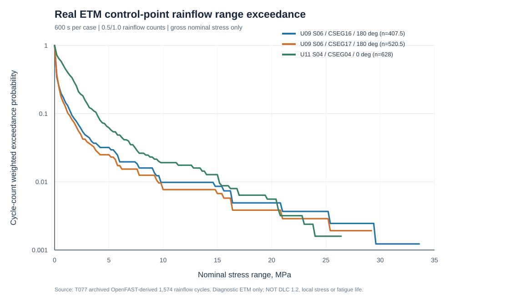

**图4-前置1** 三个控制位置的雨流应力范围超越概率（毛截面名义应力；非局部材料疲劳）。

| 真实工况与截面方位 | 等效循环数 | 范围P90 / MPa | 范围P99 / MPa | 最大范围 / MPa | 范围≥5 MPa比例 | 范围≥10 MPa比例 |
|---|---:|---:|---:|---:|---:|---:|
| U09p343881_ETM_S06 / CSEG_16 / 180° | 407.5 | 1.586 | 9.786 | 33.799 | 3.19% | 0.98% |
| U09p343881_ETM_S06 / CSEG_17 / 180° | 520.5 | 1.319 | 9.600 | 33.674 | 2.50% | 0.77% |
| U11p4_ETM_S04 / CSEG_04 / 0° | 628 | 3.865 | 15.061 | 26.554 | 6.21% | 1.91% |

CSEG16（U09 S06）的单次最大范围约33.799 MPa，高于CSEG04（U11 S04）的26.554 MPa；但后者范围≥5 MPa的循环比例为6.21%，高于前者的3.19%。因此，**最大单次范围与循环谱整体强弱并不等价**，不能只用最大值筛选疲劳控制位置。该结果仅是三个ETM毛截面测点之间的可复算对照，尚不能推断混凝土、HRB335/HRB400纵筋、PT钢绞线或钢塔的材料损伤排序。真正的S10仍需在同一验证过的重力/有效PT初态下取得材料局部应力时程，并按各材料疲劳关系和正常运行风速概率累积。

可复算脚本为[`plot_s10_real_cycle_exceedance.js`](../../../experiments/T077/recovery/plot_s10_real_cycle_exceedance.js)，3行数值汇总为[`S10_3CONTROL_REAL_CYCLE_EXCEEDANCE_SUMMARY_20261030.csv`](../../../experiments/T077/recovery/S10_3CONTROL_REAL_CYCLE_EXCEEDANCE_SUMMARY_20261030.csv)。脚本锁定原CSV SHA256、1574行、3控制点循环数及原m4/m10 DEL，提供3项损坏输入拒绝测试；本轮在JS执行环境中用真实CSV数值执行，尚无Node/GitHub Actions远端运行日志，不将静态文件提交冒充原生求解。

### 4.3.5a 逐循环均值与四次矩集中度的可辨识性（历史ETM名义应力）

仅有雨流DEL或时程均值时，无法恢复每个循环的均值与幅值联合分布。本节直接使用已归档的三处**毛截面名义应力**逐循环表（两个ETM工况、三个控制测点，合计1574条，半循环按0.5计），原始CSV SHA256为 `646065838456b6465e321c4c6fd24966f180f275df99c615000577557219ff83`。其字段包含循环范围 `r_i`（MPa）、循环均值 `m_i`（MPa）与计数 `n_i∈{0.5,1}`；这里的 `m_i` **不是**时程整体平均值，也未包含真实有效预应力平衡。为避免将载荷诊断当作材料疲劳，以下只计算无量纲的四次矩集中度与上限正值比例，不使用任何材料S–N关系。

设 `M_4=Σ_i n_i r_i^4`、`N=Σ_i n_i`。按 `r_i` 从大到小排序，以循环计数权重累计至 `0.01N`（边界处采用计数的线性分数插值），定义前1%计数的四次矩份额 `C_{1%}=M_{4,top1%}/M_4`。循环上限定义为 `u_i=m_i+r_i/2`；进一步分别计算 `u_i>0` 的计数份额 `P_+=Σn_i 1(u_i>0)/N` 与四次矩份额 `Q_+=Σn_i r_i^4 1(u_i>0)/M_4`。为明确显示**仅改变均值而不改变范围**时的代数敏感性，另计算 `u_i>20 MPa`；这等价于对全部循环均值施加假想 `−20 MPa` 常数偏置后判断上限是否大于零，**不是**本文实际PT有效应力，也不代表真实接缝或材料响应。

| 历史ETM工况/测点/方位 | 等效循环数 | DEL4 / MPa | 前1%计数的M4份额 | 上限>0计数份额 | 上限>0的M4份额 | 上限>20 MPa计数份额 | 上限>20 MPa的M4份额 |
|---|---:|---:|---:|---:|---:|---:|---:|
| U09 S06 / CSEG16 / 180° | 407.5 | 7.052732 | **97.919%** | 100.000% | 100.000% | 0.982% | 93.217% |
| U09 S06 / CSEG17 / 180° | 520.5 | 7.037162 | **98.476%** | 99.808% | ≈100.000% | 0.768% | 92.848% |
| U11 S04 / CSEG04 / 0° | 628.0 | 7.169089 | **81.924%** | 0.000% | 0.000% | 0.000% | 0.000% |

三处测点的诊断DEL4均约为7 MPa，然而两个U09测点几乎所有循环上限为正，U11测点全部循环上限仍为负（其最大逐循环上限为**−1.730101 MPa**）。这构成**同量级循环范围强度不能确定循环均值和正向应力暴露**的真实来源级反例。另一方面，U09两个测点仅约1%的计数权重就贡献97.9%—98.5%的四次矩，说明在这些历史ETM样本中四次矩极度集中于少数大范围循环；不能把该诊断指数直接等同于材料损伤控制程度。三个测点并非三个独立场址风速样本，且ETM不能代替正常运行DLC1.2。

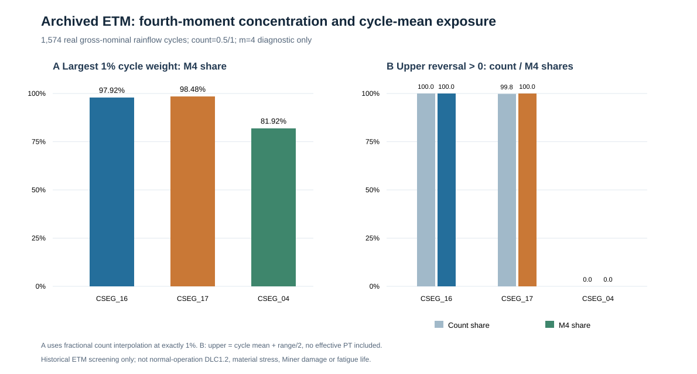

**图4-新增** 历史ETM毛截面名义应力逐循环集中度与正向上限比例；横向仅比较来源级统计，不评价材料疲劳安全性。源锁定[Node程序](../../../experiments/T077/recovery/s10_real_etm_cycle_mean_m4_concentration.cjs)与[三行完整数表](../../../experiments/T077/recovery/S10_ETM3_CYCLE_MEAN_M4_CONCENTRATION_20261109.csv)分别保留逐循环解析、DEL4/DEL10历史oracle、5种污染拒绝与生成图表的确定性逻辑。V8执行同一源码真实1574行、2项独立数值oracle及5项负例拒绝通过；原生Node CLI、原始OUTB和新结构物理RUN本轮未运行。循环数、范围与均值来自同一历史雨流表，但截面轴力/弯矩所有权、PT真实初态、局部材料点、材料疲劳曲线、全年风速覆盖和物理误差均未闭合，**不得由本节推算Miner损伤、寿命或PT设计安全性**。

### 4.3.5b 真实逐循环拉压符号域与范围四次矩的非等价性（S10，2026-11-12）

**科学问题。** 相近的毛截面名义应力DEL4能否代表相近的受拉、全压与拉压交替循环暴露？恒定压应力均值偏置虽不改变雨流范围，是否仍会改变贡献四次矩的循环类别？本节直接读取T077已归档的**1574行真实历史ETM逐循环名义应力表**，覆盖U09 S06的CSEG16（413行）、CSEG17（526行）及U11 S04的CSEG04（635行）。原表SHA256=`646065838456b6465e321c4c6fd24966f180f275df99c615000577557219ff83`，逐行保留同一次雨流的范围r、均值m和计数n（0.5或1），没有拼接异时峰值。

**可复算定义。** 以受拉为正，循环下限l=m−r/2、上限u=m+r/2；全压C为u≤0，全拉T为l≥0，其余为拉压交替R。每个循环恰属于一类。分别以n和w=nr⁴加权，得到三类计数份额Σn/N及四次矩份额Σw/W，W=Σnr⁴，DEL4=(W/600)^(1/4)。`gross`取原毛截面循环均值；`Pe`和`P0`仅取历史表中已有的**假设恒定压应力均值偏置**，不改变r、n、结构刚度或动力载荷。这两个标签不是实际有效PT平衡状态。

| 工况/控制点 | 偏置 | 全压计数/% | 交替计数/% | 全拉计数/% | 交替四次矩/% | DEL4/MPa |
|---|---|---:|---:|---:|---:|---:|
| U09 S06 / CSEG_16 / 180° | gross | 0.000 | 0.491 | 99.509 | **89.670** | 7.053 |
| U09 S06 / CSEG_16 / 180° | Pe | 10.920 | 2.577 | 86.503 | **98.876** | 7.053 |
| U09 S06 / CSEG_16 / 180° | P0 | 19.509 | 3.804 | 76.687 | **99.765** | 7.053 |
| U09 S06 / CSEG_17 / 180° | gross | 0.192 | 0.576 | 99.232 | **89.195** | 7.037 |
| U09 S06 / CSEG_17 / 180° | Pe | 12.392 | 2.594 | 85.014 | **98.779** | 7.037 |
| U09 S06 / CSEG_17 / 180° | P0 | 21.422 | 3.170 | 75.408 | **99.738** | 7.037 |
| U11 S04 / CSEG_04 / 0° | gross | 100.000 | 0.000 | 0.000 | **0.000** | 7.169 |
| U11 S04 / CSEG_04 / 0° | Pe | 100.000 | 0.000 | 0.000 | **0.000** | 7.169 |
| U11 S04 / CSEG_04 / 0° | P0 | 100.000 | 0.000 | 0.000 | **0.000** | 7.169 |

**结果及可证伪反例。** U09/CSEG16在gross情景下，仅**0.491%**循环计数属于交替循环，却贡献**89.670%**范围四次矩；Pe情景为**2.577%**计数贡献**98.876%**四次矩，P0为**3.804%**与**99.765%**。U09/CSEG17在Pe情景为**2.594%**与**98.779%**，P0为**3.170%**与**99.738%**。相反，U11/CSEG04的三种情景全部循环均为全压，但其DEL4仍为**7.169089 MPa**，与U09两个控制点的7.052732、7.037162 MPa同量级。因此“相近DEL4→相近循环符号暴露”的推断被本批历史数据直接否证。全压混凝土循环仍可能发生压疲劳，交替循环并不自动等于材料损伤；四次矩仅是本研究的范围加权诊断。

**数值验收与不确定性。** 九组计数及四次矩三类份额均闭合为100%，每点gross/Pe/P0的DEL4不变，三处历史DEL oracle的绝对误差均小于2×10⁻⁹ MPa。最小循环端点距零裕度为**0.001796 MPa**（CSEG16/P0）；仅当额外假定所有循环均值扰动≤0.001 MPa时，可保证本次符号分类不翻转，不能据此界定真实局部应力或PT传力误差。提交版Node同字节核心已在V8直接执行真实1574行、解析正例、三类污染拒绝、历史DEL与偏置单调性检查；**原生Node CLI/Actions尚未执行**。

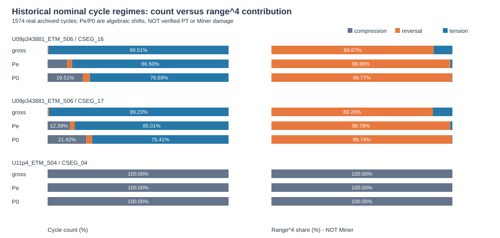

[源级程序](../../../experiments/T077/recovery/s10_real_cycle_sign_regime.cjs)、[9行完整表](../../../experiments/T077/recovery/S10_3CONTROL_CYCLE_SIGN_M4_PT_SHIFT_9ROW_20261112.csv)和本图同源。研究结论只适用于历史ETM毛截面**名义应力**及假设均值偏置，不等于真实材料点range–mean–count、接缝开闭、钢筋/PT局部应力、材料S–N、Miner寿命或正式DLC1.2。结果说明未来材料疲劳必须保留完整逐循环联合账本，而不能只凭单一DEL4判定材料损伤。

### 4.3.6 原始18组NTM同步名义应力与六随机种子离散（阶段性真实数值结果）

为了避免将不同截面内力分量的单独DEL直接组合为材料应力，进一步从已归档的**18个原始NTM OpenFAST OUTB**恢复同一时刻的`Fz(t)、Mx(t)、My(t)`。3个风速（9.343881、11.4、19.202140 m/s）各有6个随机种子；每个600 s统计窗含12,001个同步时刻，采样间隔0.05 s。原始模型为158 m塔，但**原始9个塔架测点仅位于0.0705–2.7509 m**，另有塔底0 m，因此本节只讨论塔底至2.75 m范围，不将其误称31段全高度NTM结果。

依据CSEG01实际内外半径随高度线性变化，毛截面圆环面积`A(z)`、惯性矩`I(z)`及外半径`R(z)`由同一几何表求得。沿各测点候选局部截面方位`θ`（0°、22.5°、…、337.5°）逐时刻计算：

\[
\sigma_z(\theta,t)=10^{-3}\left[\frac{F_z(t)}{A(z)}+\frac{R(z)}{I(z)}\left(M_x(t)\sin\theta-M_y(t)\cos\theta\right)\right]\quad(\mathrm{MPa}),
\]

式中`Fz`单位kN，`Mx、My`单位kN·m，采用同一原始测点同时刻的三个分量，绝不拼接不同时间的极值。每个角度分别执行完整雨流计数，并以600个参考循环和`m=4/10`分别计算**诊断性名义应力DEL**。原始18个OUTB字节SHA校验、540项原生载荷通道DEL独立回归与新数值结果由[真实Actions #41179994253](https://github.com/g2066203208-beep/voxel-frontier/actions/runs/41179994253)复算通过。首轮因源manifest SHA十六进制大小写比较错误而失败的[Actions #41179905532](https://github.com/g2066203208-beep/voxel-frontier/actions/runs/41179905532)保留；纠错不改变原始输入。

对每个风速及固定测点，在**六seed使用同一截面方位**的约束下，选择六seed四次矩平均DEL最大的角度，并对全部20种三seed子集进行精确枚举。塔底的结果如下（均为条件性毛截面名义应力，非材料损伤）：

| 原始NTM风速 / m·s⁻¹ | 固定方位 | 六seed `m=4`名义应力DEL / MPa | 六seed样本CV | 三seed子集最大相对偏离 |
|---:|---:|---:|---:|---:|
| 9.343881 | 0° | 3.241072 | 13.335% | 10.868% |
| 11.4 | 0° | 4.181816 | 11.891% | 10.167% |
| 19.202140 | 0° | 4.472304 | 6.443% | 4.545% |

原始18工况×10测点×16方位形成**2,880行**完整统计，3风速×10测点形成**30行**固定角度六seed对照；[2,880行源表](../../../experiments/T062/S10_18NTM_10NEARBASE_16AZ_GROSS_RAINFLOW_20261031.csv)、[30行控制表](../../../experiments/T062/S10_18NTM_6SEED_GROSS_STRESS_CONTROL_20261031.csv)、[完整SHA/数值误差收据](../../../experiments/T062/S10_18NTM_GROSS_STRESS_SOURCE_RECEIPT_20261031.json)及[Python3标准库复算程序](../../../experiments/T062/s10_ntm_18case_nearbase_gross_rainflow.py)均已提交。三seed偏离是**在既有六seed内的子集敏感性**，不是总体置信区间或六seed充分收敛的证明。载荷通道独立DEL核对540项最大绝对误差`4.9122×10⁻⁷`（载荷原单位），而每个名义应力样本的packed量化半步传播上界已逐行记录；此界不等同于非线性雨流DEL的严格误差上界。

这组真实NTM结果使“同一时刻的轴力—双向弯矩→截面名义应力→雨流→多seed离散”前置数值链得到复核，但**不能推导20年混凝土/普通钢筋/PT/钢塔材料寿命**。尚缺同一有效预应力和重力接触平衡态的原生Abaqus局部材料应力、塔架测点姿态及截面内力所有权独立核验、全高度正式DLC1.2风速bin、场址概率和材料疲劳关系。对同一角度的原始局部测点应力不应直接视作全局固定周向物理点；也不能将`m=4`当作所有材料的疲劳指数。

### 4.3.7 四ETM×31段控制名义应力与真实中层混凝土单元空间对应（源级方法核验）

针对4组已归档ETM工况（各31段），分别保留`m=4`名义应力DEL、最大拉应力和最小压应力三个**不同步**的控制指标，直接关联到D400/Pe/G1诊断模型的真实C3D8R中部轴向层。该层单元来自原始INP的节点与单元连接解析，并在每个控制方位同时保留**内、外两个径向层**，不再采用此前最低/最高轴向层的错误候选。所得[372行完整控制绑定表](../../../experiments/T077/recovery/S10_4ETM_31SEG_MIDPLANE_2RAD_CONTROL_BINDING_20261031.csv)包含**744个内外层绑定**，同时记录实际标签、实例、材料、坐标、方位差、旧候选偏差和新候选偏差；[可复算程序](../../../experiments/T077/recovery/s10_etm31_midplane_control_binding.cjs)及[来源与误差收据](../../../experiments/T077/recovery/S10_4ETM_31SEG_MIDPLANE_2RAD_CONTROL_BINDING_RECEIPT_20261031.json)供审查。

旧候选的372个轴向偏差全部大于0.1m；采用各ETM工况自身的`gage_z_m`重新计算后，新744个绑定的轴向偏差为**0.000897982–0.070410648m**（平均0.035656095m），最大方位角差**2.500000107°**，内外层最小径向质心差**0.129876309m**。四工况的动态测点高度与静态名义中点高度并非逐字节相等，最大差**0.000363548m**，因此不得直接沿用先前248行源表中基于静态名义高度计算的0.070048m最大轴向差。0.08m与5°仅是数据接口排错阈值，不是局部应力或规范容许误差。旧表作为失败证据保留，不覆盖。

**这一步只完成源级几何采样点对应，绝不是材料疲劳计算。** D400普通钢筋为HRB400诊断支路，不能代表冻结T057的HRB335；当前744个候选均没有ODB积分点、局部应力时程或PT+重力+接触平衡结果。截面局部轴系与Abaqus方位的物理一致性、网格/局部应力外推误差及疲劳损伤仍须独立验证；现阶段不能形成局部/名义应力放大系数或Miner损伤。源数据三文件SHA256与六项拒绝测试见收据，本轮无新Abaqus/OpenFAST生产RUN。

### 4.3.8 真实NTM名义应力的诊断指数变化与控制风速反转

为检查以单一等效载荷指数筛选控制工况的稳健性，本节**不增加新风场或结构求解**，而是直接复用已核原始OUTB身份的18组158 m OpenFAST正常湍流历史所形成的[2880行毛截面名义应力雨流数据](../../../experiments/T062/S10_18NTM_10NEARBASE_16AZ_GROSS_RAINFLOW_20261031.csv)。三个风速9.343881、11.4、19.202140 m/s各6个seed；10个原始测点仅覆盖塔底至2.750893 m，16个局部候选方位以22.5°离散。原OUTB字节由历史T062来源收据核对，**本轮直接重读的是派生CSV，而非18个OUTB原件**。同步轴力和双向弯矩已在历史程序中形成毛截面应力，本节不将其视为局部混凝土、钢筋或PT应力。

对同一风速箱\(b\)、测点\(s\)、方位\(\theta\)及指数\(m\)，定义六seed的诊断性等效应力：

\[
\overline{D}_{m}(b,s,\theta)
=\left[\frac{1}{6}\sum_{r=1}^{6}
D_{m}(b,s,\theta,r)^{m}\right]^{1/m},
\quad m\in\{4,10\}.
\]

各指数分别在16个方位中寻找最大值，再在三个有源风速箱中选择控制箱；两种指数**不对应本文任何已冻结的材料S–N参数**。对全部30组“风速箱×测点”，本轮从2880行重新聚合的数值与既有30行独立控制表最大绝对差分别为\(6.83\times10^{-12}\) MPa（\(m=4\)）和\(2.46\times10^{-11}\) MPa（\(m=10\)）。这一误差仅为派生数值复算差，不是物理模型误差。

| 塔底风速箱 / m·s⁻¹ | 六seed \(m=4\) 名义应力DEL / MPa | 六seed \(m=10\) 名义应力DEL / MPa |
|---:|---:|---:|
| 9.343881 | 3.241072 | 7.850583 |
| 11.4 | 4.181816 | **9.489058** |
| 19.202140 | **4.472304** | 8.232228 |

**结果是控制风速反转，而不是材料疲劳寿命反转。** \(m=4\)时19.202140 m/s超过次大11.4 m/s约6.9465%；\(m=10\)时11.4 m/s超过次大19.202140 m/s约15.2672%。在其余9个近塔底测点，控制箱同样从19.202140 m/s变为11.4 m/s，\(m=4\)的第一、第二名差距为6.5853%–6.9465%，\(m=10\)为15.2672%–15.7166%。两指数的最优候选方位在本样本中均为局部0°，但**10个相邻测点不是10次独立物理验证**。

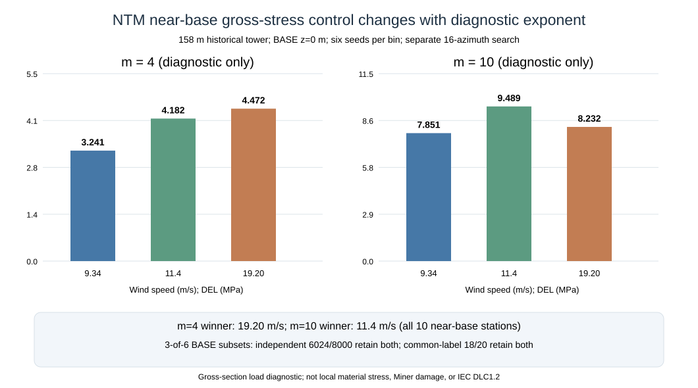

**图4-前置2** 塔底三个真实NTM风速箱的六seed诊断性等效名义应力；指数独立优化16个局部方位。柱状高度不是年度损伤或材料寿命。

为避免仅依赖完整六seed排序，对塔底固定0°方位进一步精确枚举每箱\(\binom63=20\)种三seed子集。各箱独立选子集的\(20^3=8000\)种**有限历史组合**中，6024种（75.30%）同时保持上述两个控制箱，6258种（78.225%）在两个指数下选出不同控制箱；三个风速箱采用相同seed标签的20种组合中，18种（90.0%）同时保持完整六seed的两个控制箱，20种（100%）仍出现指数间控制箱差异。这里的8000不是8000个独立仿真实验，也不能外推为新seed的总体概率。三seed子集与六seed参考存在样本重用，结果只衡量历史样本内部稳健性。

[10行逐测点数值表](../../../experiments/T062/S10_NTM18_NEARBASE_EXPONENT_CONTROL_20261107.csv)、[两种子集设计表](../../../experiments/T062/S10_NTM18_BASE_SEED_EXPONENT_REVERSAL_20261107.csv)和[可复算Node程序](../../../experiments/T062/s10_ntm_exponent_control_reversal.cjs)保留全部输入和判据。**SOURCE**：2880行派生CSV SHA256 `d45f047f5d622fb834d63728c13cead49b614b6cf42e598918e55242ed45f94b`、既有30行控制表 SHA256 `619e28d6ae2b76292224df999efc04e0650dcf4e001353647e75b9536d7cecd6`；**RUN**：真实派生数据源级复算与有限组合穷举，非生产求解；**REF/STANDARD/OFFICIAL**：沿用本章已列雨流方法与OpenFAST来源，未新增授权IEC/GB条款核读；**FIG/TAB**：上图、10行和2行表。CSV小数舍入和历史packed量化不能界定雨流DEL的严格误差上界；方位坐标、载荷所有权、材料局部应力及全风速档DLC1.2仍未闭合。由此只能提出一个可证伪的后续检验：在独立正常运行风速箱及真实局部材料应力中，控制箱是否对材料疲劳模型选择同样敏感；目前不能填报Miner损伤或20年寿命。

### 4.3.9 六seed等效应力的聚合次序与固定材料方位（真实来源级对照）

同一风速箱内，**将六个随机种子的DEL直接取算术平均**与**先按同一方位聚合第 \(m\) 次矩再开 \(m\) 次方**，并非相同运算。另一个容易混淆的操作，是每个seed分别寻找最不利方位后再聚合；这样改变了每次随机实现所对应的材料位置，不能直接代表同一材料点的长期疲劳。为检验这两类聚合差异，本节复用18个原始NTM OpenFAST OUTB已核身份所形成的**2,880行同步毛截面名义应力雨流派生表**，共3个风速箱×6seed×10个近底测点×16个候选局部方位。统计窗均为600 s，DEL参考循环数均为600；没有新增风场或结构求解。

令 \(d_{r,\theta}^{(m)}\) 为固定风速箱、测点、seed \(r\)、候选方位 \(\theta\) 的名义应力DEL（MPa），并令 \(\theta^*\) 为六seed第 \(m\) 次矩聚合值最大的**固定**方位，则

\[
D_{\mathrm{fix}}^{(m)}=\max_{\theta}\left[\frac{1}{6}\sum_{r=1}^{6}(d_{r,\theta}^{(m)})^m\right]^{1/m},\quad
D_{\mathrm{arith}}^{(m)}=\frac{1}{6}\sum_{r=1}^{6}d_{r,\theta^*}^{(m)},
\]
\[
D_{\mathrm{adapt}}^{(m)}=\left[\frac{1}{6}\sum_{r=1}^{6}\left(\max_{\theta}d_{r,\theta}^{(m)}\right)^m\right]^{1/m},\quad
D_{\mathrm{max}}^{(m)}=\max_{r,\theta}d_{r,\theta}^{(m)}.
\]

对 \(m\ge1\)，数学上必有 \(D_{\mathrm{arith}}\le D_{\mathrm{fix}}\le D_{\mathrm{adapt}}\le D_{\mathrm{max}}\)。这只是**同一历史样本的聚合算子序关系**，不构成材料损伤上下界。表中DEL低估率采用 \(100(1-D_{\mathrm{arith}}/D_{\mathrm{fix}})\%\)，第 \(m\) 次矩代理低估率采用 \(100[1-(D_{\mathrm{arith}}/D_{\mathrm{fix}})^m]\%\)；单seed最大值高估率以 \(D_{\mathrm{fix}}\) 为分母。

| 塔底风速 / m·s⁻¹ | 指数 \(m\) | 固定方位幂均DEL / MPa | 算术DEL低估 | 第m次矩代理低估 | 最大单seed DEL高估 | 自适应方位DEL高估 |
|---:|---:|---:|---:|---:|---:|---:|
| 9.343881 | 4 | 3.241072 | 2.1075% | 8.1674% | 14.4240% | 0 |
| 9.343881 | 10 | 7.850583 | 6.7452% | 50.2591% | 13.8272% | 0 |
| 11.400000 | 4 | 4.181816 | 1.7358% | 6.7647% | 13.1953% | 0 |
| 11.400000 | 10 | 9.489058 | **8.5570%** | **59.1204%** | **15.0961%** | 0 |
| 19.202140 | 4 | 4.472304 | 0.5120% | 2.0322% | 9.0182% | 0.004075% |
| 19.202140 | 10 | 8.232228 | 1.6161% | 15.0348% | 8.2613% | 0.006512% |

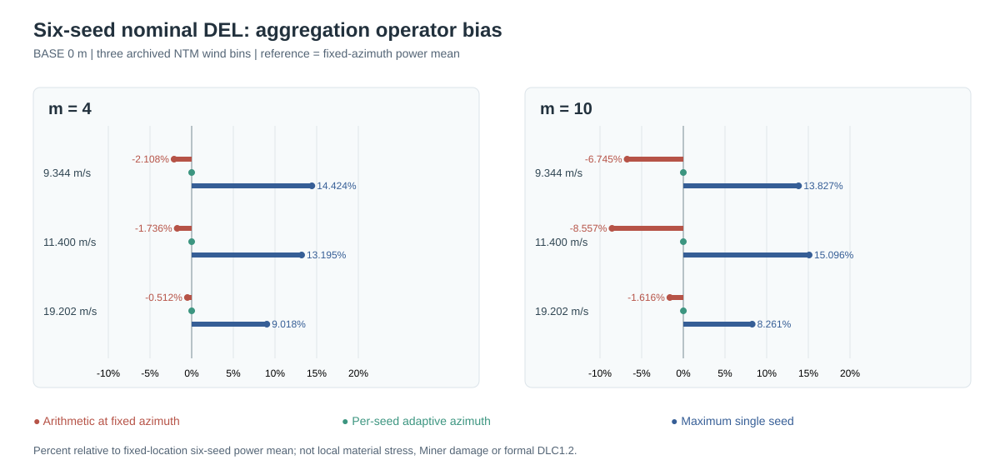

**图4-新增** 三个历史风速箱塔底名义应力DEL相对固定方位六seed幂均值的差异。负值为算术平均的低估，正值分别为每seed自适应方位及单seed最大包络的高估；两种指数仅用于诊断，不是材料S–N参数。

结果显示，**最大的聚合误差来自错误的seed算术平均或单seed极值替代，而非本样本内的逐seed方位切换**。11.4 m/s、\(m=10\)时，正确固定方位幂均DEL为9.489058 MPa，算术平均仅8.677084 MPa，低8.5570%；在相同指数下，若以算术平均值的第十次方替代平均第十次矩，代理量低估**59.1204%**。同一工况最大单seed DEL为10.921535 MPa，高于幂均值15.0961%，其第十次矩比值高307.9488%。这些百分数**不等于实际Miner损伤误差**。对全部30个风速箱×近底测点，前两个风速箱的逐seed自适应方位增量为0；19.202140 m/s箱仅为0.003478%–0.004075%（\(m=4\)）和0.006512%–0.006652%（\(m=10\)）。这一近零结果属于有限历史样本的否定性发现，不证明其他风况或真实局部材料点的控制方位恒定。

本节使用的[2,880行来源CSV](../../../experiments/T062/S10_18NTM_10NEARBASE_16AZ_GROSS_RAINFLOW_20261031.csv) SHA256为 \`d45f047f5d622fb834d63728c13cead49b614b6cf42e598918e55242ed45f94b\`；新增[可运行Node程序](../../../experiments/T062/s10_ntm18_seed_aggregation_operator_bias.cjs)、[60行完整对照](../../../experiments/T062/S10_NTM18_FIXED_VS_ADAPTIVE_SEED_AGG_60ROW_20261110.csv)和[6行塔底表](../../../experiments/T062/S10_NTM18_SEED_AGGREGATION_BASE_6ROW_20261110.csv)均已源锁。对原独立30行六seed控制表的60个幂均值，最大绝对复算差为 \(2.462\times10^{-11}\) MPa；解析幂均已知解、10项错误输入拒绝及输入行序不变性检验通过。10个相邻测点并非独立随机样本，来源小数打印和双精度误差不能代表原始packed载荷量化经过雨流算法后的严格误差界。完整正式DLC1.2、截面局部轴系和力矩所有权、局部材料应力、各材料疲劳曲线与长期概率尚未闭合；因此本节**仅证明聚合方法的来源级数值差异**，不能填写分材料Miner损伤、20年寿命或结构优化收益。已有2026年混塔风震及预应力地震研究的物理贡献不因这一统计对照而被重新宣称为本文首创。

## 4.4 预应力混凝土塔段疲劳

### 4.4.1 Gravity+PT平衡态是疲劳零基准

预应力混凝土的动态应力循环发生在长期预压状态上。Wang等[REF041]明确采用Reference Stress处理局部疲劳，并把预应力和上部结构自重形成的基准作用纳入评价。因此，本章定义：

\[
\sigma(t)
=
\sigma_{\text{ref}}
+
\Delta \sigma_{\text{wind}}(t),
\]

其中：

- \(\sigma_{\text{ref}}\) 来自Gravity+PT平衡；
- \(\Delta \sigma_{\text{wind}}(t)\) 来自随机风运行响应。

禁止仅对 \(\Delta \sigma_{\text{wind}}\) 做rainflow后直接计算混凝土寿命，因为这样会丢失预应力改变mean stress和stress ratio的核心作用。

### 4.4.2 混凝土疲劳应力变量

混凝土不采用von Mises作为疲劳控制量。根据最终材料疲劳准则，对每个候选位置保存：

\[
\sigma_{\max},\quad
\sigma_{\min},\quad
\Delta \sigma=\sigma_{\max}-\sigma_{\min},
\]

\[
\sigma_m
=
\frac{\sigma_{\max}+\sigma_{\min}}{2},
\]

以及与所采用疲劳关系一致的stress ratio \(R\)。

rainflow循环账本至少记录：

- case_id；
- wind_bin；
- seed；
- material；
- location_id；
- azimuth；
- stress_component；
- range；
- mean；
- count；
- R_ratio；
- mesh_id；
- extraction_method。

原始cycle ledger与damage表严格分离，这样在更换材料疲劳模型后不需要重新计数。

### 4.4.3 mean stress correction与预应力影响

Huang等[REF018]专门比较了考虑与不考虑mean-stress correction时各wind bin的damage contribution，并分析initial prestress对damage的影响。这一结果说明：

- 相同stress range在不同mean stress下不能自动视为相同疲劳循环；
- PT水平改变的不只是静态安全储备，也会改变疲劳cycle的应力比和damage权重；
- 预应力敏感性应直接进入本章，而不是只停留在第二章建模参数说明。

本文首先采用真实Gravity+PT运行基准应力，不人为把循环平移到零均值。最终是否采用Model Code、R-ratio曲线或其他mean-stress treatment，由正式混凝土fatigue standard闭合后确定。

> 工作区原图证据：REF018 p07 Fig.11为mean-stress correction；p08 Fig.13–14为cycle damage与initial prestress影响。

### 4.4.4 局部单元峰值与物理平均

局部FE尤其在接缝、几何突变和接触边缘附近可能出现高度网格敏感的peak stress。Wang等[REF041]比较single-point extremum与through-thickness average，为本文提供直接方法依据。

因此每个控制区域至少并行提取：

1. raw element peak；
2. path/thickness/area average；
3. mesh-refined相同量。

其中：

- raw peak作为保守上界和热点定位；
- path/thickness average作为具有明确传力范围的主结果候选；
- 最终采用何者必须由网格收敛和物理意义共同决定。

不得以一个网格奇异点直接外推20年寿命。

> 工作区原图证据：REF041 p20 Fig.19为fatigue verification area；p21 Table 4记录Reference Stress与damage verification。

### 4.4.5 混凝土疲劳关系的版本问题

这里必须严格区分不同文献：

- Huang 2025 [REF018]的SPPT混凝土疲劳采用其文中引用的Model Code 2020路径；
- Wang 2025 [REF041]的局部接缝疲劳采用fib Model Code 2010路径；
- Kenna 2019 [REF002]采用其当时选定的fib Model Code混凝土疲劳方法。

这三者不能被论文写成“都用了同一个fib公式”。

本文最终混凝土疲劳关系在正式规范/原典闭合后冻结。若第 \(i\) 类循环的允许循环数为 \(N_i\)，实际循环数为 \(n_i\)，则Miner累计损伤为：

\[
D
=
\sum_i\frac{n_i}{N_i}.
\]

必须区分：

- Miner fatigue damage \(D\)；
- Abaqus CDP的DAMAGEC/DAMAGET。

前者是长期疲劳累计指标，后者是混凝土本构损伤变量，两者物理含义不同。

## 4.5 预应力钢绞线疲劳

### 4.5.1 启动条件

PT疲劳分支不因为模型中存在PT就自动成为主结果。只有4.3筛选证明PT \(S_{11}\) 循环达到控制或重要次控制水平时，才进入绝对寿命评价；否则只用于证明PT不是控制疲劳材料。

### 4.5.2 PT时程与循环谱

当前模型有36个周向PT FE位置。正式生产输出对每个位置保存：

\[
S_{11}^{(p)}(t),\quad p=1,\ldots,36.
\]

然后分别执行rainflow，形成：

\[
\left\{
\Delta\sigma_i,
\sigma_{m,i},
n_i
\right\}_p.
\]

Qu等[REF023]的tendon load spectrum和各wind speed annual damage表直接证明PT应作为独立材料通道统计，而不能用塔底弯矩DEL替代。

> 工作区原图证据：REF023 p16 Fig.6为Tendon No.1 load spectrum；p17 Table 7列出不同wind speed的annual damage；p18 Fig.7–8给出PT空间寿命和relaxation影响。

### 4.5.3 有效预应力与松弛

PT疲劳必须以Gravity+PT平衡后从模型读取的有效运行均值应力为基准，不能把名义1280 MPa直接当成所有PT在整个运行期的真实mean stress。

若增加预应力损失敏感性：

- 损失幅度需由规范、原型资料或明确参数研究边界确定；
- 不复制Qu文中20%、40%、60%、80%等source-specific relaxation levels；
- 必须保持其他模型参数不变。

Qu等[REF023]还说明wind-speed probability model会改变PT寿命预测，因此PT damage同样应按本文场址概率加权。

> 工作区原图证据：REF023 p20 Fig.9–10为Weibull参数与relaxation对PT fatigue life的影响。

## 4.6 上部钢塔与钢—混连接疲劳

### 4.6.1 钢塔母材/名义应力

Kenna[REF002]明确把steel portion和concrete portion的fatigue life分开评价，并对steel plated part使用钢结构疲劳设计体系。因此，如果本文钢塔控制位置仅能可靠定义为塔筒母材或截面名义应力，则采用：

- nominal membrane stress；
- nominal bending stress；
- 与真实结构detail category对应的S–N关系；
- rainflow；
- Miner；
- 长期概率加权。

当前钢塔SSEG仍存在系统性高长宽比网格告警。若钢塔被识别为控制疲劳材料，必须在正式寿命计算前完成目标区域网格整改和应力收敛。

### 4.6.2 法兰/焊缝hot-spot fatigue

如果控制区域位于法兰或明确焊接细节，则采用Zhao等[REF143]提供的工程流程：

\[
\text{nominal stress}
\rightarrow
\text{local FE / SCF}
\rightarrow
\text{structural or hot-spot stress}
\rightarrow
\text{detail S-N}
\rightarrow
\text{rainflow}
\rightarrow
\text{Miner}.
\]

Zhao文通过局部FE得到SCF，并结合短期监测应力、SCADA运行状态和长期风速/风向概率形成annual damage matrix。这一流程可以迁移到本文，但其1.5 MW塔的SCF、应力和寿命数值不能转移。

若T057没有显式建立可以归类的焊缝几何，则本文不得声称完成“焊趾热点寿命”；最多完成名义/结构应力层的钢塔疲劳，或另建有文献依据的局部子模型。

> 工作区原图证据：REF143 p08 Fig.9为flange principal stress；p09 Table 2为SCF；p11 Fig.16为fatigue assessment process；p13 Tables 5–7为annual damage与flange weld fatigue results。

### 4.6.3 钢—混转换连接

Kim等[REF036]研究明确连接构造，采用full-scale specimens，先进行2 million cycles循环加载，再进行单调静载以检查post-fatigue residual capacity。该文支持的是“若连接控制，则必须按真实连接构造做循环验证”的思想。

因此只有满足以下条件，本文才启动钢—混转换连接疲劳：

1. 4.3证明转换连接为疲劳控制区域；
2. 当前模型具有可追溯的锚固/连接几何；
3. 可以为该连接定义合理的疲劳detail或局部材料疲劳准则。

否则，转换段仅作为载荷传递和应力重分配区域讨论，不为增加篇幅强行计算连接寿命。

> 工作区原图证据：REF036 p04 Fig.4为joint cross-section；p06 Fig.7为specimens；p07记录2 million cyclic + monotonic residual test；p08 Fig.10为cyclic load-displacement。

## 4.7 长期累积damage、风速贡献与控制机制

### 4.7.1 wind-bin damage contribution

对每个**经验证的材料控制位置**与风速箱 \(j\)，先对第 \(s\) 个随机种子窗口的局部材料应力雨流循环计数，并由该材料经确认的疲劳关系求得短期无量纲Miner损伤 \(D_{j,s}^{(T)}=\sum_i n_i/N_i\)。令有效时长 \(T_{j,s}\) **统一以秒(s)记录**，其损伤率为 \(r_{j,s}=D_{j,s}^{(T)}/T_{j,s}\)，单位 \(\mathrm{s}^{-1}\)。对于同风速箱的 \(n_j\) 条合格可比较的随机种子，定义 \(\bar r_j=n_j^{-1}\sum_{s=1}^{n_j}r_{j,s}\)。按时间占比加权的年度估计是

\[
\boxed{
D_{j}^{\mathrm{annual}}
= T_{\mathrm{year},s}\,p_j\,\bar r_j
= T_{\mathrm{year},s}\,p_{\mathrm{op}}\,P(j\mid\mathrm{op})\,\bar r_j,\qquad
T_{\mathrm{year},s}=8760\ \mathrm{h}\times3600\ \mathrm{s/h}=31\,536\,000\ \mathrm{s}.
}
\]

其中 \(p_j=n_j^{\mathrm{ERA5}}/N^{\mathrm{ERA5}}\) 为**全小时无条件概率**（这里的 \(n_j^{\mathrm{ERA5}}\) 是风气候小时数，**不是**随机种子数），\(p_{\mathrm{op}}\) 为指定运行区间小时比例，\(P(j\mid\mathrm{op})=p_j/p_{\mathrm{op}}\) 为运行条件概率。两种口径必须得到相同结果；不能使用“8760小时÷600秒”的无量纲比例，漏掉3600秒/小时会使损伤缩放错误**3600倍**。若各seed的有效时长都为600s，则 \(\bar r_j=\bar D_j^{(600)}/600\mathrm{s}\)；短时损伤和时长须来自同一个时窗，不能把此前的load-DEL、名义截面应力或ETM筛查循环代入本式冒充材料疲劳。

年度总损伤为 \(D_{\mathrm{annual}}=\sum_j D_j^{\mathrm{annual}}\)。若假定各设计年的风气候、机组运行状态及材料参数平稳，20年累计估计为 \(D_{20}=20D_{\mathrm{annual}}\)，这只是**固定年度估计的乘法传播**，并非已证实的服役寿命，也不意味着可以把20年的不确定性简单除以 \(\sqrt{20}\)。

对种子抽样误差，令 \(s_{r,j}^{2}=\sum_s(r_{j,s}-\bar r_j)^2/(n_j-1)\)。仅当各seed可视为独立、跨风速箱的种子估计也独立、所有正概率箱均有 \(n_j\geq2\)，且暂将风气候权重和材料参数固定时，才有

\[
\mathrm{SE}_{\mathrm{seed}}(D_{\mathrm{annual}})
=T_{\mathrm{year},s}\sqrt{\sum_j p_j^2\,s_{r,j}^2/n_j},\qquad
\mathrm{SE}_{\mathrm{seed}}(D_{20})=20\,\mathrm{SE}_{\mathrm{seed}}(D_{\mathrm{annual}}).
\]

任何有贡献的箱仅1个seed或没有**经验证的局部材料应力**时，该年损伤标准误应记录为 NOT_ESTIMABLE，而不是0；seed SE也不包含ERA5气候偏差、测站外推、控制器/结构模型、疲劳S–N及均值应力修正的不确定性。上述算法与来源验证入口为[T077材料Miner程序](../../../experiments/T077/recovery/s10_miner_damage_gate.py)，其原生Actions合成真值测试已由先前记录核实，不能当作本文真实损伤结果。

**量纲解析自检（纯合成，不是本塔结果）**：若单一全概率箱的600s有效窗口产生 \(D^{(600)}=10^{-6}\)，则 \(D_{\mathrm{annual}}=31\,536\,000\times10^{-6}/600=0.05256\)；错误地直接用8760与600比值只得0.0000146，相差3600倍。此解析自检只保护单位一致性，不证明任何实际材料疲劳寿命。

然后定义该bin对总年损伤的贡献率：

\[
\eta_j
=
\frac{D_j^{\text{annual}}}
{\sum_k D_k^{\text{annual}}}.
\]

最终绘制：

- wind speed–damage曲线；
- wind-bin contribution bar chart；
- cumulative contribution curve。

目标不是寻找“最高风速”，而是识别真正主导长期疲劳的运行区间。

Huang等[REF018]的Fig.10、Fig.17–18以及Qu等[REF023]的Table 7/8都采用类似“按wind bin解释damage来源”的思路。

**2026-10-31实测概率接口与条件概率防重计：** 第三章已从完整21年ERA5派生工作簿原件计算[31行1m/s bin表](../../../experiments/T062/S10_ERA5_2005_2025_HUB_1MS_BINS_20261031.csv)，全时段`N=184080`、诊断运行`N_op=106900`。令`p_j=n_j/N`为**无条件全小时概率**，`p_op=N_op/N=0.5807257714`，`P_j=p_j/p_op`为**运行小时内条件概率**，`T_op,annual=8760p_op`。上式使用条件`P_j`与运行小时；等价地，在有效窗口时长以秒计时，必须写为 **D_j^annual = 31,536,000 × p_j × mean_s(D_short,j,s / T_sim,j,s)**，不能漏掉3600 s/h。**不能把无条件`p_j`与`T_op,annual`相乘**，否则重复计入运行比例。该运行边界目前是4≤U<25m/s的诊断假设，正式DLC1.2仍需核对控制器/标准及全风速bin。历史三风速只覆盖9/11/19三个1m/s箱（7,164小时，诊断运行时段的6.70159%）；尚无其余bins的有效同态载荷和材料局部应力，故本节仅**概率输入SOURCE_NUMERIC_PASS**，年度`D_j`和`D_annual`均不得填数。ERA5为再分析派生数据，非测风塔实测；完整原始CDS文件hash、四位小数分量的箱边界敏感性及场址bias尚未验收。

**2026-11-01 11时｜长期Miner概率口径的程序性纠错（真实ERA5源表QC，非材料寿命）：** 对照[31行ERA5风速bin原件](../../../experiments/T062/S10_ERA5_2005_2025_HUB_1MS_BINS_20261031.csv)（SHA256=`e4058620a36b23bb218103875d4dc5b0711fc45d418b23a2208c2fc9c16c9102`），核实184080总小时中4≤U<25m/s的诊断运行小时为106900，`p_op=0.5807257714037375`。此前[条件Miner程序](../../../experiments/T077/recovery/s10_miner_damage_gate.py)要求各bin概率和为1，却按全年8760小时直接乘条件概率；**若未来错误地将该旧算法用于真实运行条件概率，会比正确年度权重高1/p_op=1.7219831618倍（高72.1983%）**。这只是识别出一个潜在算法偏差，不表示已经产生过被高估的材料寿命结果。现已修改为必须显式输入`operating_fraction`和`probability_basis`：条件概率用`8760×p_op×P(bin|op)`，无条件概率用`8760×P(bin)`，两者应一致；缺失运行比例、概率和不闭合、seed缺失均拒绝。原生[Actions #41268106162/job #124735051729](https://github.com/g2066203208-beep/voxel-frontier/actions/runs/41268106162/job/124735051729) Python自测成功，实源31-bin身份、合成条件/无条件等价、11项既有拒绝及5项概率口径拒绝通过；先前[失败作业 #41267975516](https://github.com/g2066203208-beep/voxel-frontier/actions/runs/41267975516)与[失败作业 #41268081294](https://github.com/g2066203208-beep/voxel-frontier/actions/runs/41268081294)保留。**该程序仍没有任何已验证局部材料应力、授权材料S–N曲线或正式DLC1.2全bin；所有年度/20年材料Miner仍为HOLD，绝不把合成测试的532.17当成本文损伤。**

**2026-10-31 22时｜21个运行风速计划bin×6seed来源覆盖核验：** 从上述31-bin概率表与18组原始OUTB身份收据直接交叉核验，建立[126行逐bin×seed覆盖矩阵](../../../experiments/T062/S10_ERA5_21BIN_6SEED_NTM_SOURCE_COVERAGE_20261031.csv)及[可复算程序/来源收据](../../../experiments/T062/S10_ERA5_21BIN_6SEED_COVERAGE_RECEIPT_20261031.json)。在**非规范性的**[4,25)m/s、1m/s宽、每bin六seed规划网格中，只有9、11、19m/s三个箱有历史NTM六seed，共18/126个**历史筛查来源格**；其余108格无已归档对应NTM。三个箱共7164/106900运行小时=6.70159%，另外99736小时（93.29841%）所在风速箱缺来源；4–9m/s五个低风速箱共95402小时（89.24415%运行小时）完全没有历史NTM。已有风速9.343881/11.4/19.202140m/s仅按`floor(U)`归箱，**均不是拟定4.5...24.5m/s中心的正式DLC1.2计算**；21个箱的126格**正式DLC1.2验收为0**。20–25m/s五箱在21年ERA5派生小时数据中观察为0，不代表设计风险为0。上述缺口是**来源覆盖**而非疲劳损伤权重排名：高风速虽概率低但应力循环幅值可能高，不能只按小时数决定生产优先级。没有材料积分点应力、规范/控制器核对与全部运行工况前，不能绘制正式年Miner贡献图。

### 4.7.2 少量高range循环的贡献

由于疲劳关系通常对stress range高度非线性，少量高幅循环可能对damage产生远高于其cycle count占比的贡献。本章因此不只给最终 \(D\)，还输出二维range–mean rainflow matrix，并标出对total damage贡献最大的cycle families。

这可以解释：

- 为什么load-DEL最大case未必是材料damage最大case；
- 为什么相同RMS的两个时程可能具有不同fatigue damage；
- 为什么mean stress correction会改变排名。

### 4.7.3 load-DEL控制与material-damage控制的比较

分别建立：

- OpenFAST load-DEL control case；
- concrete damage control case；
- PT damage control case；
- steel damage control case。

若它们不同，应如实保留这种差异，并从：

- mean stress；
- local stress concentration；
- material fatigue curve；
- control region；
- wind-bin probability；

解释差异。

**T062历史载荷DEL纠偏的实证闭合（2026-11-02）。** 先前论文称U11p4_ETM_S03/TwrBsMyt为My load-DEL最大值28.177010 MN·m，这一结果确实来源于2026年9月原始57,286行雨流账本与72条DEL表。现已从[主归档恢复原始账本、排名和雨流源码](../../../experiments/T062/legacy-primary-recovered-20261102/LEGACY_PRIMARY_RECOVERY_RECEIPT_20261102.json)，并证明历史与新归档的36份原始OpenFAST OUTB **36/36份SHA256相同**，所以以前的“不同OUTB版本导致矛盾”假说已被排除。

旧源码[雨流函数](../../../experiments/T062/legacy-primary-recovered-20261102/rainflow_del_r1.py)在栈中定义\(X\)为旧范围、\(Y\)为新范围，却使用`if X<Y: break`，将新旧范围的闭合比较方向写反。仅在独立内存AST中将其改为`if Y<X: break`，保留原始程序不变。对全部36份实际原始OUTB、My/Mx共**72条时程**，原函数72/72复现旧DEL表，单行修正72/72复现新的独立DEL表，修正后全部循环(range, mean, count)多重集合72/72与独立开源`rainflow 3.2.0`一致，加权循环总数72/72守恒。[真实CI #41391433429](https://github.com/g2066203208-beep/voxel-frontier/actions/runs/41391433429) `completed/success`；[完整72行比较](../../../experiments/T062/legacy-primary-recovered-20261102/T062_ALL36_RAINFLOW_CAUSAL_DEL_COMPARE_20261102.csv)和[SHA来源与数值收据](../../../experiments/T062/legacy-primary-recovered-20261102/T062_ALL36_RAINFLOW_CAUSAL_RECEIPT_20261102.json)已保存在GitHub。

| 载荷级筛选指标 | 历史旧雨流程序（MN·m） | 独立验证的修正雨流（MN·m） |
|---|---:|---:|
| My / U11p4_ETM_S03 | 28.177010 | 23.005398 |
| My / U11p4_ETM_S04 | 24.688995 | **26.802479（My全36第一）** |
| Mx / U19p202140_ETM_S02 | 9.715431 | **9.468855（Mx全36第一）** |

**此后不再把历史S03与当前S04的差异写成未决的OUTB来源冲突；T062载荷级历史雨流算法根因已闭合。** 第三章按[修正后36工况控制排序](../../../experiments/T062/T062_36CASE_MY_MX_ARCHIVED_RANK_20261102.csv)筛选载荷响应，历史S03数据只作为可复现的错误算法案例，不能用作材料损伤的基准输入。当前真实数据只证明有限36组screening工况下的塔底载荷DEL，仍未得出正式DLC1.2 20年风致材料寿命，也不能用同一载荷DEL指数代替不同材料的S–N/Miner规律。

### 4.7.4 原始NTM三风速bin×六seed：已知部分载荷四次矩与无源风险（2026-11-02）

为在不产生新OpenFAST/结构生产计算的前提下深化长期风致疲劳**输入数据充分性**，本研究重新读取旧18份原始NTM OUTB已经原件SHA核验的1080行六分量、9测高load-DEL，并与2005—2025年ERA5派生184080h轮毂高度1m/s分箱及126条21bin×6seed来源身份逐一关联。三档历史风速为9.343881、11.400000和19.202140m/s；这不是正式DLC1.2工况矩阵。4–25m/s仅为本次诊断研究设定的非规范运行区间，历史106900h中只有7164h在有源bin内（6.70159%），其他99736h无同风速源载荷（93.29841%）。

本次定义**仅知来源风速bin的部分四次矩强度**，与年度损伤明确分离。若第b个有源bin的塔底弯矩load-DEL为`L_bs`（MN·m，原载荷CSV的`DEL_m4_Nref600`按1000换算），六个相同600s窗口按`M4_b=(1/6)sum_s (L_bs)^4`合成；采用各bin占**全部ERA5小时**的频率`p_b=H_b/184080`，得到`C_known=sum_(b∈{9,11,19}) p_b*M4_b`，单位`(MN·m)^4`。这仅是每个600s记录采用相同`Nref600`时的**有源分箱加权载荷量纲指标**；无源bin不能置零，不能取四次方根称全年DEL，更不可成为钢、混凝土或PT的Miner损伤。

| 塔底载荷通道 | 3个有源bin的部分加权四次矩 / (MN·m)⁴ | 各有源bin独立取3/6seed时8000种组合的极值范围 / (MN·m)⁴ |
|---|---:|---:|
| TwrBsMyt (My) | 209257.299448 | 133839.310402–284675.288494 |
| TwrBsMxt (Mx) | 125.606638 | 94.624326–156.588949 |

子集全穷举只是当前六seed样本的**有限样本敏感性包络，不是总体95%置信区间**。其中My的已知部分贡献按有源bin分配为9m/s **59.1382%**、11m/s **40.7869%**、19m/s **0.0750%**；19m/s档尽管瞬时载荷较高，但在21年ERA5派生记录中仅2h，不能凭该数据拟合可靠高风速尾部概率，也不能推断实际项目的20年设计疲劳。这个排序只在**已知3bin**的数学分量内有效，不代表无源bin的危险性小。

本轮真实证据：[来源与规范阅读层级逐条核对](../../../experiments/T062/S10_ERA5_NTM_PARTIAL_LOAD_M4_PRIMARY_REFERENCE_CHECK_20261102.md)（REF011原刊全文核读多个seed与收敛；REF018出版社摘要并继承项目旧PDF全文审查；REF083 Wiley原刊开放方法核读；REF080/090出版社摘要；REF132仅继承2019版授权审查；REF048/049本轮IEC官网元数据）；[6行原始数值表](../../../experiments/T062/partial-annual-load-diagnostic-20261102/S10_REAL_18NTM_3BIN_PARTIAL_M4_BY_CHANNEL_20261102.csv)、[含完整SHA和误差预算的原始收据](../../../experiments/T062/partial-annual-load-diagnostic-20261102/S10_REAL_18NTM_3BIN_PARTIAL_M4_RECEIPT_20261102.json)和[Actions #41397641326](https://github.com/g2066203208-beep/voxel-frontier/actions/runs/41397641326)均已成功。**IEC 61400-1:2019+AMD1:2025官网当前为2026年10月勘误版，未读授权2025/26合并版条款，因此不能将本研究的1m/s bin×6seed设定称为2025/26标准核验通过。**

本节只把实证不足和可利用的真实部分载荷值变成可审查的第四章输入证据。材料级真实应力、材料疲劳曲线与年度全风速响应、独立优化验收继续HOLD，绝不由load-DEL替代。

### 4.7.5 历史四ETM工况的截面单分量名义应力幅筛查（2026-11-02，非材料寿命）

为避免将塔底载荷DEL直接等同于材料损伤，先对已归档的四个ETM工况、31个塔筒测站建立**单分量名义应力幅的条件性筛查**。使用OpenFAST塔筒gross截面面积`A`、截面惯性矩`I`，按同心圆环假设反求外半径`R_o`及截面模量`W=I/R_o`；仅对各自独立的`F_z`、`M_x`、`M_y`雨流DEL进行常系数线性换算：

\[
\Delta\sigma_{F_z,\mathrm{DEL}}=\frac{10^{-3}\mathrm{DEL}_{F_z}}{A},\quad
\Delta\sigma_{M_x,\mathrm{DEL}}=\frac{10^{-3}\mathrm{DEL}_{M_x}}{W},\quad
\Delta\sigma_{M_y,\mathrm{DEL}}=\frac{10^{-3}\mathrm{DEL}_{M_y}}{W},
\]
其中原DEL单位分别为kN、kN·m，输出MPa，`m=4`和`N_ref=600`仅沿用**载荷级筛查**定义，不是混凝土、钢筋或PT材料疲劳参数。

完整124行结果见[真实源级数据表](../../../experiments/T077/recovery/S10_4ETM_31SEG_NOMINAL_COMPONENT_STRESS_DEL_M4_20261102.csv)及[可复算程序](../../../experiments/T077/recovery/s10_nominal_component_stress_del_screen.js)。`F_z`、`M_x`、`M_y`各自最大单分量应力DEL依次为**0.047481608 MPa**（U19.202140_ETM_S04/CSEG27）、**2.374676068 MPa**（U19.202140_ETM_S04/CSEG04）、**7.163945804 MPa**（U11.4_ETM_S04/CSEG04）。这些数值属于不同分量与工况，**不是同一时刻的截面总应力**，更不是可用于Miner寿命的材料局部应力雨流谱。

此项筛查可与此前已完成的4×31×16方位同步名义应力雨流源级结果交叉核对，不能将单分量DEL相加代替同步雨流。真实分材料疲劳还需要有效PT、钢筋/混凝土真实截面、截面局部轴系、合成应力时程重新雨流、材料S–N关系及DLC1.2风速概率。四个ETM案例不能作为全年正常运行损伤代表；源级计算通过也不构成物理或规范验收。来源、SHA256、误差预算及HOLD见[既有S06/S10源级记录](../../../experiments/T077/recovery/S06_FOUR_CASE_31SEG_HISTORY_RESTORED_AND_CONTROL_RECONCILED_20261024.md)。

### 4.7.6 连续周向解析瞬时峰值与16方位离散误差（2026-11-02，源级验算）

此前已从四个ETM工况的同站同步六分量时程得到4×31×16=1984条固定周向位置的名义毛截面应力雨流结果，并非本节首次建立同步应力。本节专门核验16方位离散能否覆盖**瞬时空间极值**。在同心圆环、固定截面轴系的条件下，对每个时刻有

\[\sigma_z(\theta,t)=10^{-3}\left[\frac{F_z(t)}{A}+\frac{R_o}{I}\bigl(M_x(t)\sin\theta-M_y(t)\cos\theta\bigr)\right]\]
因此连续周向瞬时最大/最小值可直接写成

\[\sigma_{\pm}(t)=10^{-3}\frac{F_z(t)}{A}\pm10^{-3}\frac{R_o}{I}\sqrt{M_x^2(t)+M_y^2(t)}.\]
16等间隔方位的最大角距为11.25°，故每站600秒内的瞬时峰值漏采具有严格的数值上界 \(\Delta\sigma_{\mathrm{peak}}\leq\max_t[10^{-3}(R_o/I)\sqrt{M_x^2+M_y^2}](1-\cos(\pi/16))\)。这只约束**瞬时空间极值**，不约束任一固定材料点的雨流DEL。

已在[真实124行源级结果](../../../experiments/T077/recovery/S10_4ETM_31SEG_CONTINUOUS_AZIMUTH_ENVELOPE_20261102.csv)和[完整来源收据](../../../experiments/T077/recovery/S10_4ETM_31SEG_CONTINUOUS_AZIMUTH_RECEIPT_20261102.json)中记录四工况31站、12001时刻的连续极值、时刻、方位、16角对照及上界。全124组通过解析极值与离散峰值的不等式检查。最大连续名义拉应力25.013489806MPa（U09p343881_ETM_S06/CSEG17，652.75s），相应16角扫描值24.963984288MPa；最小连续名义压应力−30.273028787MPa（同工况CSEG16，652.75s）。最大单站离散漏采拉/压峰分别0.196304638/0.196304391MPa（U19p202140_ETM_S06/CSEG28），没有超过严格上界。原生Python 3.12.15运行日志见[Actions #41451778222](https://github.com/g2066203208-beep/voxel-frontier/actions/runs/41451778222)。

**该解析峰值在每个时刻可以来自不同周向角度，因此不能将连续峰值包络当作某根钢筋、混凝土积分点或PT钢绞线的单点应力时程做雨流计数。** 其用途仅为毛截面空间极值与16角离散误差诊断；有效PT、局部轴系、接缝非线性、材料应力、DLC1.2及寿命均未验收。

### 4.7.7 未覆盖风速箱的四次矩不可识别性与数据补齐阈值（2026-11-07）

在§4.7.4已核实的历史18组NTM（9.343881、11.4、19.202140 m/s，各六seed）的**同参考循环数load-DEL四次矩**上，进一步量化未覆盖风速箱造成的不可识别性，而不补零或假设插值。设\(p_b=H_b/184080\)为ERA5全部小时概率，\(K=\sum_{b\in\{9,11,19\}}p_b\overline{L_{b,s}^4}\)，单位\((\mathrm{MN\cdot m})^4\)。在诊断运行区间\(4\le U<25\) m/s内，其余有小时数但无历史NTM的13个bin合计99736h，令\(p_M=99736/184080=0.541807910\)，未知加权平均四次矩\(X=p_M^{-1}\sum_{b\in B_M}p_b\overline{L_{b,s}^4}\ge0\)。则诊断运行部分的无条件四次矩\(C=K+p_M X\)，运行条件口径为\(C_{op}=C/(106900/184080)\)。**在仅有非负约束时，\(C\in[K,+\infty)\)，没有有限上界**；此处\(K\)不是完整年度DEL、材料局部应力或Miner损伤的下界。

定义三档有源bin占该诊断指标的份额\(r=K/(K+p_M X)\)，缺失箱的四次幂平均等效载荷\(L_M=X^{1/4}\)达到\((K/p_M)^{1/4}\)时恰有\(r=50\%\)；达到\((9K/p_M)^{1/4}\)时\(r=10\%\)，达到\((K/(9p_M))^{1/4}\)时\(r=90\%\)。这些是**逆向等贡献阈值，不是缺失bin载荷的预测**。

| 塔底历史载荷通道 | 三箱已知\(K\) / (MN·m)⁴ | 缺失箱等效\(L_M\)使已知份额90% / MN·m | 50% / MN·m | 10% / MN·m | 仅4–8m/s五箱贡献等于\(K\)的等效阈值 / MN·m |
|---|---:|---:|---:|---:|---:|
| Mx（TwrBsMxt） | 125.606638 | 2.253 | 3.902 | 6.759 | 3.946 |
| My（TwrBsMyt） | 209257.299448 | 14.393 | 24.929 | 43.179 | 25.208 |

**可证伪检验与研究意义：** 如果未来真正获得缺失bin同状态load-DEL，则对My，只要其缺失小时加权等效\(L_M>24.929\) MN·m，三档历史已知bin在该指标中所占份额就小于50%；反之大于50%。单独4–5m/s bin的六seed等效load-DEL若达到34.584 MN·m，就可贡献与全部已知三箱相同的四次矩；这只是9.343881m/s历史已知值44.641 MN·m的77.47%，**不代表实际4–5m/s载荷已达到该阈值**。4–8m/s五箱有95402h（诊断运行小时89.24415%）而无对应NTM，数据补齐应优先检验它们是否改变已知份额，不能凭小时权重直接断言疲劳控制风速。

[26行逐缺失bin等贡献阈值CSV](../../../experiments/T062/S10_MISSING_BIN_M4_IDENTIFIABILITY_20261107.csv)及[无外部依赖Node复算程序](../../../experiments/T062/s10_missing_bin_m4_identifiability.js)从已有31行ERA5派生表和6行真实三bin六seedM4表计算，包含源SHA256与9项篡改拒绝。此轮直接阅读层级仅为两份已归档派生表；原ERA5季度原件、18份OUTB和2025版IEC/GB授权条款未重新核读。统计假设是历史相同600s与参考循环数的载荷级四次矩可比、诊断运行区间为非规范设定；ERA5场址偏差、seed总体不确定性、缺失载荷上界和物理/材料误差均未知。**正式DLC1.2仍0/126，年度材料Miner仍不可计算。**

### 4.7.8 缺失风速箱补采优先级的不可唯一性与情景交叉（2026-11-07）

在§4.7.7的三档历史NTM部分载荷四次矩基础上，本节研究：**能否只按ERA5出现小时数决定下一档优先补采风速？** 对任意无源风速箱\(b\)，其未知四次矩\(M_{4,b}\ge0\)在现有证据下无有限上界；令该箱足够大而其他无源箱为零，即可使任意指定箱主导缺失贡献。因此**没有由现有数据唯一确定且对所有可能载荷响应都最优的补采顺序**。这不是各风速工程风险相同的断言。

为量化采样决策对**显式假设**的敏感性，仅构造反事实族\(L_b(q)=L_{9,\mathrm{hist}}[(b+0.5)/9.343881]^q\)，其中\(q\in[0,2]\)为人为设定的指数，\(b+0.5\)是1 m/s风速箱中心，\(L_{9,\mathrm{hist}}\)是历史9.343881 m/s六seed载荷DEL。优先级得分中的共同幅值可消去，故定义\(S_b(q)=H_b[(b+0.5)/9.343881]^{4q}\)。**该公式只用于情景排序，不产生任何缺源箱的预测DEL，不是材料损伤、IEC工况权重或设计安全判据。**

从已归档31行ERA5小时表、26行逐箱等贡献阈值及6行NTM四次矩归并表直接读取，13个有正小时数但无历史NTM的风速箱共99736h。由于\(\log S_b(q)\)关于\(q\)为仿射函数，逐对计算全部交点并在区间中点判定最大者，可得到\(q\in[0,2]\)内**得分第一**的完整解析分段（端点并列）：

| 人为指数q区间 | 得分第一的缺源风速箱（m/s） |
|---|---|
| 0.000000–0.104072 | 4–5 |
| 0.104072–0.320496 | 5–6 |
| 0.320496–0.565269 | 6–7 |
| 0.565269–0.894407 | 7–8 |
| 0.894407–1.274197 | 8–9 |
| 1.274197–2.000000 | 10–11 |

在\(q=0,1,2\)三个独立校核点，第一名依次为4–5、8–9、10–11 m/s，其在**缺源箱假设得分总和**中的份额分别为27.00%、20.11%、19.43%。所以出现小时最多的4–5 m/s箱并非对所有假设都最优。若**仅在此人为指数区间**选择一个“曾排名第一”的候选集合，则包括4–5、5–6、6–7、7–8、8–9和10–11 m/s六箱；它**不是正式DLC1.2最小工况集**，也不排除12–19 m/s稀有事件或20–25 m/s零观测小时的设计尾部风险。改变指数范围，包络将随之变化。

[13行真实小时数与反事实排名表](../../../experiments/T062/S10_MISSING_BIN_SAMPLING_PRIORITY_20261107.csv)及[可复算程序](../../../experiments/T062/s10_missing_bin_sampling_priority.js)保留每箱小时数、上一节My等贡献阈值、\(q=0/1/2\)排名与假设份额。SOURCE为三份已归档派生CSV（本轮逐行读取；原ERA5季度原件与OUTB未重新读取）；REF为T062历史雨流/M4；STANDARD为2025/26 IEC/GB授权条文未新读；OFFICIAL为ERA5再分析派生，非实测；RUN为源级程序解析与异常拒绝，非生产求解；FIG=0，TAB=13行表与上表。小时计数为整数，解析交点使用双精度并显示六位小数；ERA5代表性、控制器、seed、真实载荷随风速规律和物理误差均未定量。正式DLC1.2仍0/126，材料Miner和寿命仍不可计算。

### 4.7.9 四组ETM沿31段控制工况转换及排名稳定性（历史名义应力筛查）

在此前四组158 m历史ETM工况、31个混凝土塔段测点的同步六分量毛截面弹性应力雨流结果基础上，进一步回答两个可证伪问题：**(i) 控制工况是否沿高度保持不变；(ii) 同一组工况的控制身份是否依赖诊断DEL指数？** 直接采用已归档的124行截面控制表，每个工况×塔段的指标为16个固定方位上的名义应力DEL最大值；不把逐时刻应力包络再做雨流，也不将ETM筛查等同正常运行DLC1.2。

对每一塔段分别将四工况按\(m=4\)和\(m=10\)的名义应力DEL降序排列，取第一名与第二名\(D_{(1)},D_{(2)}\)。为避免仅以绝对差值判定“稳健”，定义**条件性对称相对扰动翻转阈值**

\[
\delta_*=\frac{D_{(1)}-D_{(2)}}{D_{(1)}+D_{(2)}}\times100\%.
\]

若第一名允许向下变化\(\delta\)、第二名允许向上变化\(\delta\)，则\(\delta<\delta_*\)时这两名的顺序不会颠倒；\(\delta\ge\delta_*\)时仅凭原始排序不能排除翻转。此式是**假设性数值扰动门槛**，不是实测的误差区间、置信区间或材料性能不确定性。

**结果。** \(m=4\)时，U11.4_ETM_S04控制CSEG01–05和CSEG24–31（13/31段），U9.343881_ETM_S06控制CSEG06–23（18/31段），工况身份在CSEG05/06（测点高16.435–19.962 m）和CSEG23/24（81.892–85.560 m）之间发生两次转换；另外两组U19.202140_ETM_S04/S06未控制任何一段。\(m=10\)时，U9.343881_ETM_S06控制全部31段。四工况×全塔的最大\(m=4\)名义应力DEL为**7.169089 MPa**（U11.4_ETM_S04，CSEG04，约12.767 m），最大\(m=10\)为**17.126072 MPa**（U9.343881_ETM_S06，CSEG06，约19.962 m）。这两种诊断指数不可被解释为混凝土、PT或钢材已确认的材料疲劳参数。

\(m=4\)的最小\(\delta_*\)仅**0.017930%**（CSEG06），CSEG23为**0.037136%**。在明确设定的**每工况每段DEL均可独立对称扰动±0.5%**的反事实条件下，CSEG05、06、07、22、23、24共6段的控制身份不能被该门槛保证；其余25段在该特定扰动幅度内满足两名排序的代数稳定条件。\(m=10\)全部31段满足，最小\(\delta_*\)约**5.598454%**。这不等于真实数值误差被证实小于0.5%；已有16→64方位网格差异只反映离散角度敏感性，不能代替真实误差预算。

[图4-S10：四组ETM的31段\(m=4/10\)控制曲线与转换位置](../figures/FIG4_S10_ETM31_HEIGHT_CONTROL_SWITCH_20261107.svg)；[31行控制身份及翻转阈值表](../../../experiments/T077/recovery/S10_4ETM_31SEG_M4_M10_HEIGHT_CONTROL_SWITCH_20261107.csv)；[可复算程序](../../../experiments/T077/recovery/s10_etm31_height_control_switch_gate.cjs)。输入为[历史124行真实来源派生表](../../../experiments/T077/recovery/S10_4CASE_31SEG_SYNC_GROSS_CONTROL_20261030.csv)，SHA256 `36c0a8a97db36885159fff79cc61daced9c939ab688f98ce1c6b860a89ac91d3`。本轮V8执行同一分析核心18项正向/异常拒绝检查；**未运行原生Node CLI、未重新读取16件原始ZIP、未进行生产结构计算**。测点间未插值确定真实转换高度，未核准原始截面轴向力绝对符号、载荷惯性归属、PT有效态和材料局部应力；不能用该图宣称全塔疲劳控制材料、寿命或风震安全。结果仅表明**历史ETM名义应力筛选必须同时考虑塔段位置、诊断指数和控制身份的数值稳定性**。

### 4.7.10 四ETM控制身份的方位网格独立复核

上一节由16个固定周向方位得到31段控制工况的两次转换，但控制工况间的微小差值是否仅由方位离散造成，仍需以同一批时程、同一名义应力定义进行复核。本节直接继承历史16件压缩源归档所派生的**四ETM×31段、每段16/32/64方位雨流DEL表**，并将其与上一节独立的31行16方位控制表逐段交叉核对。对工况\(c\)、塔段\(j\)和诊断指数\(m\)，定义固定方位网格最大值\(D_{c,j,m}^{(N)}\)；对每个\(N\in\{16,32,64\}\)，重新在四个工况之间选取最大值。以64方位的前两名\(D_1\geq D_2\)定义\(\delta_{*,64}=100(D_1-D_2)/(D_1+D_2)\)，同时计算各工况的观测网格增幅\(g_c=100[D_c^{(64)}-D_c^{(16)}]/D_c^{(64)}\)。\(g_c\)是**已观察到的离散方位差**，不是连续方位极值或物理误差的上界。

**独立复核结果为负结果：** 四工况在16、32、64方位下，\(m=4\)与\(m=10\)的31个塔段**均未发生控制工况身份反转（0/31）**。\(m=4\)仍由U11p4_ETM_S04控制CSEG01–05和CSEG24–31（13段），由U09p343881_ETM_S06控制CSEG06–23（18段），转换位于CSEG05/06和CSEG23/24之间；\(m=10\)仍由U09p343881_ETM_S06控制31/31段。16→64方位的**四工况最大**观测DEL增幅为\(m=4\) **0.545289819%**、\(m=10\) **0.772254330%**；但**64方位前两名工况自身**的最大增幅仅分别为**0.059546100%**和**0.000154310%**。不能把非控制工况的较大网格增幅当作控制工况已发生反转的证据。

在两个控制转换附近，\(m=4\)的64方位前两名相对分离门槛在CSEG06为**0.017929608%**、在CSEG23为**0.037136089%**。这两个塔段的四工况最大观测网格增幅分别为**0.184055804%**和**0.229984607%**，但该增幅来自非前两名工况；两个塔段前两名工况在16→64方位的实际增幅均为零。因而本数据支持的结论是**有限方位加密后控制身份未变**，而不是“网格误差已经导致排名错误”，更不是64方位以后的严格收敛证明。上一节的假设±0.5%对称扰动仍使六段排名缺乏代数保证，这一条件性结果与本节观察到的0次网格排名反转并不矛盾。

[图4-S10：31段控制工况前两名分离门槛与四工况方位网格观测增幅](../figures/FIG4_S10_ETM31_AZIMUTH_CONTROL_ROBUSTNESS_20261107.svg)；[31行配对数值表](../../../experiments/T077/recovery/S10_4ETM_31SEG_AZIMUTH_CONTROL_ROBUSTNESS_20261107.csv)；[可复算Node程序](../../../experiments/T077/recovery/s10_etm31_azimuth_control_robustness_gate.cjs)。原124行gzip SHA256 `ce0ff94a60b945931ae75a707114efdbcc2955250a703b5a018ed9effaa5c2cb`，解压CSV SHA256 `1eacf29f513aea0bad86313680fb9ed32a6a1b0a0c68334839ce4e635dffc278`，独立31行控制表SHA256 `4e69453996d36b56ddbc723fd29edc2ea7dac9f5b71ad06eeafa1550e7a72b36`。本轮对124行历史**派生**结果重新读取和计算，未重新读取16件原始ZIP或执行生产仿真；坐标惯性、材料局部应力、完整正常运行风速概率和连续方位收敛误差均未闭合。**本节只属于历史ETM名义应力筛查，不是分材料疲劳寿命或结构物理验收。**

### 4.7.11 两组真实ETM同步轴力—弯矩对名义应力DEL排序的影响（历史源级结果）

**研究问题。** 前节已用解析反例说明弯矩DEL排序并不必然传递至截面应力。这里不再构造合成载荷，而从T071/T072已归档的158 m OpenFAST历史派生六分量时程中，实际取出U09p343881_ETM_S06与U11p4_ETM_S04各自batch A的CSEG01–09；每工况每截面均为100–700 s、0.05 s步长的12,001个同步采样点。两件原ZIP分别为9,061,519 B和9,089,952 B，ZIP/GZIP/CSV三层SHA256与原16件manifest完全一致。这里的“同步”仅指**同一工况同一截面内Fz与My的逐时刻同步**；不同风速工况不是同一个随机风seed的配对因果试验，不能推导跨工况联合响应。

**计算方法。** 以OpenFAST历史截面输出为前置来源，沿用毛截面圆环线弹性假设，定义\(\sigma_{NM}(\theta,t)=10^{-3}[F_z(t)/A-R\cos\theta\,M_y(t)/I]\) MPa，\(\sigma_M(\theta,t)=-10^{-3}R\cos\theta\,M_y(t)/I\) MPa；Fz单位kN、My单位kN·m、A单位m²、I单位m⁴、R单位m。圆环外半径由同源\(A,I\)反推\(R=[2I/A+A/(2\pi)]^{1/2}\)，以避免引入另一套不一致的几何。只比较0°和180°两个固定方位，采用原T077开放端点雨流规则、\(N_{eq}=600\)、诊断指数\(m=4\)逐信号重新计数；不使用时变周向最大值拼接，也不把m=4作为混凝土或钢绞线材料S–N指数。轴力均值不影响该线性应力范围雨流，但同步轴力**波动**可能改变范围、转折点和控制排序。

**真实结果。** 在9段×2方位的18组比较中，弯矩项单独计算与同步加入Fz后的两工况控制身份**18/18一致，未发生反转**；CSEG01–05均由U11p4_ETM_S04控制，CSEG06–09由U09p343881_ETM_S06控制。同步轴力引起的DEL4相对变化在全部36条工况—截面—方位曲线中最大绝对值为**0.0815593%**，但小变化不能一概视为对控制差值不重要。以CSEG06、0°为例，U09−U11弯矩单项DEL4差为**0.002918570 MPa**，加入同步Fz后为**0.002542489 MPa**，差值缩小**12.8858%**，控制工况仍为U09。相邻CSEG05、0°的差值从−0.037154657 MPa变为−0.037635753 MPa，仍由U11控制。CSEG04/U11与CSEG06/U09的联合DEL4分别为**7.169089135**与**7.091468058 MPa**，对照既有独立名义应力筛查表7.16908904914与7.09146818687 MPa，最大差约**1.29×10⁻⁷ MPa**，可归于当前6位小数截面A/I重建与结果舍入，非独立物理验证。

**解释与适用边界。** 这一真实历史负结果既不支持“本次已出现局部材料控制反转”，也不能将解析反例的可能性误写为该塔必然发生的现象。它表明**两组已观测ETM的塔架下部毛截面、两个固定方位**中，轴力波动对DEL4绝对量的影响较小，却能改变近并列工况的**相对控制裕度**。其适用域不包括CSEG10–31、其余ETM/NTM、全部周向角、非线性接缝、有效PT与真实材料局部应力；Fz/My输出的坐标及惯性所有权尚有历史HOLD。原ZIP/CSV源哈希严格匹配，开放端点雨流有解析自测及4项坏输入拒绝，另对损坏ZIP、配对时间错位、缺行执行3项拒绝；这只构成源级后处理PASS，**不是材料Miner、结构验算或DLC1.2的PASS**。

**图表与复算：** [图4-S06：同步轴力影响及控制差值](../figures/FIG3_S06_REAL_SYNC_AXIAL_BENDING_DEL_RANK_20261107.svg)；[18行数值表](../../../experiments/T077/recovery/S06_TWO_ETM_BATCH_A_AXIAL_BENDING_RANK_20261107.csv)；[标准库Python复算程序](../../../experiments/T077/recovery/s06_sync_axial_bending_rank.py)。输入ZIP/GZIP/CSV逐层SHA、几何源SHA、独立数值对照及测试详见T080原过程。图内编号为研究图编号，正式Word排版时按第四章图序统一。

### 4.7.12 四组真实ETM截面极值时刻的沿高非同时性（2026-11-08，历史毛截面名义应力）

仅以每个截面的最大名义应力构造沿高包络，容易在后续解释中把**不同时间出现的截面极值**误读为某一瞬时的完整结构应力分布。为检验这一风险，本节复用四组历史ETM工况在31个混凝土塔段测站的连续周向解析名义应力极值记录，每组100–700 s、采样间隔0.05 s、每测站12001点。来源为[124行连续周向极值表](../../../experiments/T077/recovery/S10_4ETM_31SEG_CONTINUOUS_AZIMUTH_ENVELOPE_20261102.csv)，原件SHA256为`6002f69286eb9941265697732ec7acd961ac6b5757d7472423d91e0374288f21`。这一数据表的极值来自**历史整机载荷与毛截面弹性名义应力的后处理**，不代表某个材料点的真实应力，也不是正式DLC1.2疲劳工况。

设第\(i\)个测站的连续周向最大名义应力出现于\(t_i^+\)，定义同一风工况的极值时刻跨度\(\Delta t_{\mathrm{span}}=\max_i t_i^+-\min_i t_i^+\)，以及相邻高度测站最大时间跳变\(\Delta t_{\mathrm{adj}}=\max_{i=2}^{31}|t_i^+-t_{i-1}^+|\)。二者只描述**各测站极值发生时刻的分散性**，不应解释为波传播时间、响应相位差或模态阻尼。按照原始高度顺序直接计算、不插值、不合成任一未观测时刻的截面响应，得到：

| 历史ETM工况 | 31段\(t_i^+\)跨度/s | 最大相邻时间跳变/s | 极值时刻不同值数 | 正负周向极值同一采样时刻段数 |
|---|---:|---:|---:|---:|
| U09p343881_ETM_S06 | 0.65 | 0.60 | 7 | 25/31 |
| U11p4_ETM_S04 | **86.85** | **86.10** | 8 | **31/31** |
| U19p202140_ETM_S04 | 0.55 | 0.15 | 9 | 30/31 |
| U19p202140_ETM_S06 | 1.60 | 1.25 | 5 | 26/31 |

其中U11p4_ETM_S04的CSEG01–11（\(z=1.7634\)–\(38.1598\) m）在541.45–541.50 s取得各自正应力极值，而CSEG12–31（\(z=41.8276\)–\(110.5296\) m）在627.60–628.30 s取得各自极值。CSEG11与CSEG12相邻两测站的峰值时刻相差86.10 s，即**1722个0.05 s采样间隔**。因此，该工况的31段极值沿高曲线**不可能整体对应同一采样时刻**；若把它画作单时刻的塔架受力形态，会混合至少两个时间上分离的峰值片段。该工况正负周向极值的时刻在31/31段相同，但极值方位不同，不能据此推断两者是同一材料点的循环范围。

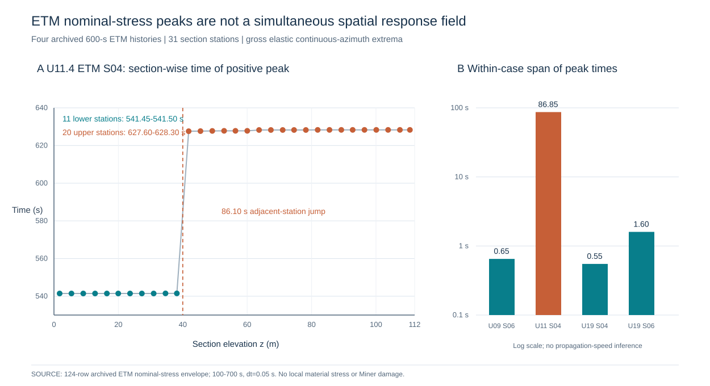

这一**源级负结果**并不否定逐段极值包络作为局部筛查上界的价值；它否定的是把逐段独立取极值的曲线当作同时刻空间应力场，或据此推断塔身传播速度、同一循环的全塔应力状态。需要真实同步31站完整时程才能重建任意同一时刻的空间分布；需要局部材料应力时程才能进一步计算雨流及Miner损伤。此处的时刻数值受0.05 s采样网格与原记录极值算法限制，最大单点时间定位离散化误差在理想采样峰值解释下约为半个步长0.025 s，**不是**真实连续峰值时刻或物理误差的严格上界；原始载荷状态、截面映射与结构模型误差未在本节重新评定。源级[无依赖Node复算程序](../../../experiments/T077/recovery/s06_etm31_peak_time_noncoincidence.cjs)、[四工况统计表](../../../experiments/T077/recovery/S06_4ETM31_PEAK_TIME_NONCOINCIDENCE_SUMMARY_20261108.csv)及[U11逐段明细](../../../experiments/T077/recovery/S06_U11_ETM31_PEAK_TIME_CLUSTER_20261108.csv)提供复核路径。该结论仅对所读四组历史ETM成立，未新增物理RUN，不能作为分材料寿命或抗震验算的PASS。

### 4.7.13 四ETM历史来源中塔底My载荷DEL与截面名义正应力极值的控制工况不一致（SOURCE-LEVEL）

为检验单一塔底My载荷DEL控制工况是否也能筛出混凝土塔段的最大**正向毛截面名义应力**，本节对四组已有31段完整历史ETM工况作跨归档**同名工况**对照。输入分别为T062已纠正雨流的72行塔底弯矩DEL表（SHA256 `1bf750ba3ea33153dbe4b23e87a1b973ca73ab41e446b2d9d5f3fac2881238a9`）与T077四ETM×31段连续周向毛截面名义应力极值表（SHA256 `6002f69286eb9941265697732ec7acd961ac6b5757d7472423d91e0374288f21`）。以四组工况内的严格排序为判据，不引入未经证明的材料S–N指数，也不将ETM作为正常运行DLC1.2长期概率样本。

| ETM工况 | 塔底My载荷DEL（MN·m） | 31段最大正向毛截面名义应力（MPa） | 最大值所在塔段 | My排序 | 应力排序 |
|---|---:|---:|---|---:|---:|
| U09p343881_ETM_S06 | 26.023387 | **25.013490** | CSEG_17 | 2 | **1** |
| U11p4_ETM_S04 | **26.802479** | 22.237064 | CSEG_17 | **1** | 2 |
| U19p202140_ETM_S04 | 24.323115 | 16.390908 | CSEG_17 | 3 | 4 |
| U19p202140_ETM_S06 | 23.542402 | 18.338015 | CSEG_17 | 4 | 3 |

四工况的最大正向名义应力均出现在CSEG_17（测点高度约60.026m），但两种指标的6个工况两两比较中有**2对排序相反**，对应描述性Kendall系数 \(\tau=1/3\)。例如U11p4_ETM_S04的My载荷DEL比U09p343881_ETM_S06高**2.9938%**，而后者的最大正向名义应力反而高**12.4856%**。这表明**控制截面高度相同，不意味着控制工况或控制指标相同**。进一步结合§4.7.12中U11工况各截面极值时刻跨度86.85s的结果，可见沿高逐段极值包络既不能代表同一时刻全塔应力场，也不能直接推导材料疲劳循环。

必须说明：两份历史表虽采用相同工况标签，但来自不同历史归档支路，尚未逐字节核对其原始风场、控制器状态和完整初态，因此上述排序差异属于**跨归档同名工况的条件性SOURCE-LEVEL筛查发现**，不能直接宣称同一物理RUN内已验证的响应排序反转。名义正应力极值不是固定材料点应力、应力幅或Miner损伤；只有取得严格同源的完整时程、明确坐标与材料疲劳关系后，才能检验真实材料疲劳控制工况是否改变。该结论亦不能用于年度疲劳寿命或正式DLC1.2验收。

[源级可复算Node程序](../../../experiments/T062/s12_cross_qoi_etm_source_gate.cjs) SHA256 `66c9b20712ecd83485c57c8eb9e460061daa2dc8ca03923091a635032c768f61`；[四行数值表](../../../experiments/T062/S12_4ETM_CROSS_QOI_RANK_20261108.csv) SHA256 `0ab09a0067745c9bdb0ee155da8f1aef7d78931511a0afd9a0a1225e1d33982d`；[正式双指标科研图](../figures/FIG_JOURNAL_S12_CROSS_QOI_ETM_RANK_20261108.svg) SHA256 `2b88d3e427c5166f329b53e1b5542640d4acde829208986ee9f3826b513d8f4d`。V8对原程序纯函数直接计算，4/4工况与2/6反转独立真值检查、5类污染输入拒绝PASS；原生Node CLI/CI NOT_RUN，原始OUTB本轮未重读。

### 4.7.14 跨归档同类My载荷DEL的参考循环数统一与残差（S06）

前节比较了塔底My载荷DEL与不同响应指标的名义正应力极值。为排除一个更基础的口径混杂，本节改为比较**同类My弯矩载荷DEL**：T062归档的塔底`TwrBsMyt`采用`m=4`、`Nref=100000`（MN·m）；T077四ETM×31站六分量归档的`CSEG_01/My_kNm`采用600s×1Hz即`Nref=600`（kN·m），测站高1.763393m。统一量纲和参考循环数后，
\[
D_{\mathrm{CSEG01},100000}=10^{-3}D_{\mathrm{CSEG01},600}(600/100000)^{1/4},\quad
\delta=100(D_{\mathrm{CSEG01},100000}/D_{\mathrm{base},100000}-1)\%.
\]
此处`m=4`仅是载荷四次矩诊断，不是混凝土、普通钢筋或预应力钢材的统一疲劳指数。直接读取72行纠正雨流源（SHA256 `1bf750ba3ea33153dbe4b23e87a1b973ca73ab41e446b2d9d5f3fac2881238a9`）及744行四ETM×31站六分量源（SHA256 `9e22e98ac44c2cbd6bf011c4bac76b5e7c4a1eddd8e6de611134b`），得到：

| ETM标签 | 塔底My DEL，Nref100000（MN·m） | CSEG01原DEL，Nref600（MN·m） | CSEG01统一后DEL，Nref100000（MN·m） | 相对残差 |
|---|---:|---:|---:|---:|
| U09p343881_ETM_S06 | 26.023387 | 92.306914 | 25.690470 | −1.2793% |
| U11p4_ETM_S04 | 26.802479 | 94.836550 | 26.394507 | −1.5221% |
| U19p202140_ETM_S04 | 24.323115 | 85.921775 | 23.913385 | −1.6845% |
| U19p202140_ETM_S06 | 23.542402 | 83.242012 | 23.167565 | −1.5922% |

参考循环数换算因子为**0.2783157684**。若直接比较未经归一化的原始DEL，四组CSEG01/塔底表观比值为**3.5325–3.5471**；统一后相对残差仅**−1.6845%至−1.2793%**，四组同类My DEL排序完全一致（六对比较**0/6反转**）。因此，未经统一Nref时出现的约3.5倍差异主要是**参考循环数造成的假尺度差**，不能解释为真实载荷放大。

这仍**不是同态物理一致性验收**：塔底与CSEG01不是同一位置，T062的36工况OUTB与T077分批Actions归档尚未证明原始BTS、控制器、初始状态和完整时程逐字节相同，且两条雨流程序的全部实现细节未做本轮原件对照；剩余1.3–1.7%残差不能唯一归因于位置、坐标或数值误差。§4.7.13的不同QoI排序反转仍只是跨归档条件性发现，不与本节同类QoI排序一致相矛盾。T077的31站分A/B/C/D四个历史运行批次，不得仅凭相同时间戳拼成同步全塔场；§4.7.12的31站86.85s峰时跨度仅是归档描述量，**CSEG11与12同属B批次**，二者86.10s峰时差才是同批内可比较的非同时性反例。

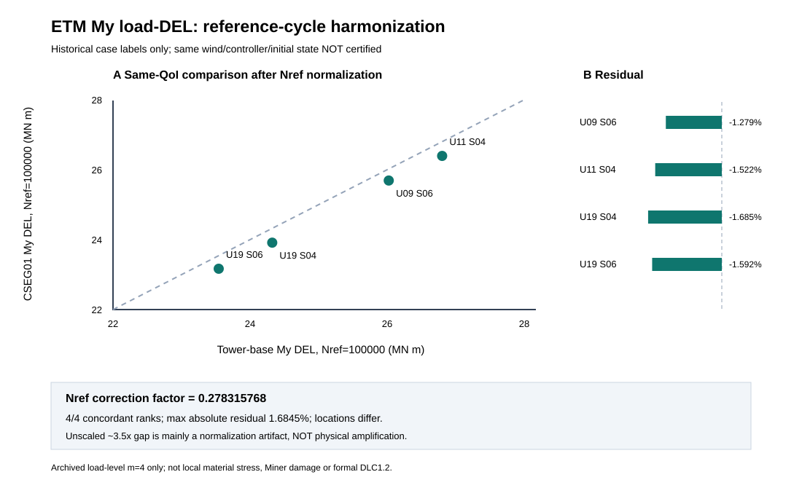

[源级Node程序](../../../experiments/T062/s06_etm_base_cseg01_nref_harmonization.cjs) SHA256 `c10c4a95dc81fa6210856375c1d64129596ff7406a68fada0d23828c8a686a95`；[四行结果表](../../../experiments/T062/S06_ETM_BASE_CSEG01_NREF_HARMONIZED_20261108.csv) SHA256 `b538a3f44030bcdf09e9d620f67326b40aea0475c5c10893467721cadf82466b`；SVG SHA256 `e69436a2482aea2206ce35e569984f43b8d243ccf67b65403d8132b044a446ae`。程序在真实派生源上完成5项数值oracle和8类异常输入拒绝测试；原生Node CLI/CI未运行，原始OUTB本轮未重新读取。该研究不构成材料局部应力、Miner寿命或正式DLC1.2验收。

### 4.7.15 既有ETM毛截面应力极值的条件性压应力偏置筛查（S10）

**科学问题。** 对于已经归档的四组ETM×31段同步截面（每段内16个固定周向方位）毛截面弹性应力，假定在**不改变动力响应**的数学情景下施加一个对所有时刻、方位和截面均相同的压应力偏置 q≥0，多少个塔段的历史正向（受拉为正）应力峰仍大于零？这一计算只检验历史极值包络对加性偏置的敏感性，**不等于真实预应力施加、混凝土局部应力、开裂验算或材料疲劳寿命**。

设 `p(c,j)=max[t,θ] σgross(c,j,t,θ)`，其中c为历史ETM工况、j=1,…,31为混凝土塔段，θ为16个离散方位；条件性转换为 `σ*(c,j,t,θ;q)=σgross(c,j,t,θ)−q`。为避免Word公式转换器对上标和指示函数的错误排版，本稿采用等价的可读记号：`Npos(c,q)=Σ[j=1,…,31] I[p(c,j)>q]`，`qcrit(c)=max[j=1,…,31] p(c,j)`，其中I[条件]为条件成立取1、否则取0的指示函数。qcrit(c)仅是使本批**离散方位/时窗的毛截面正峰**全部不大于零所需的均匀偏置阈值。其单位为MPa，绝不是可直接采用的PT设计应力。对于严格加性且不改变响应的偏置，任一固定材料点的雨流应力范围不变、循环均值减去 q；但真实预应力可改变接触、刚度、几何非线性和应力传递，不能从这一代数性质推出真实疲劳损伤不变或降低。

直接读取[T077已归档四ETM×31段毛截面控制表](../../../experiments/T077/recovery/S10_4CASE_31SEG_SYNC_GROSS_CONTROL_20261030.csv)，其源SHA256为`36c0a8a97db36885159fff79cc61daced9c939ab688f98ce1c6b860a89ac91d3`。表内每行是16方位、600s历史时窗的毛截面峰值和载荷层以外的名义应力DEL诊断；极大拉应力与极大压应力一般**不在同一时刻/方位**，两者差值不能视为一次雨流循环幅值。四组阈值与条件性正峰段数为：

| 历史ETM工况 | qcrit(c) / MPa | 控制段 | Npos(c,0) | Npos(c,20 MPa) | Npos(c,22.5 MPa) | Npos(c,25 MPa) |
|---|---:|---|---:|---:|---:|---:|
| U09p343881_ETM_S06 | **24.963984** | CSEG17，约60.026m | 31 | **27** | **19** | 0 |
| U11p4_ETM_S04 | **22.128598** | CSEG17，约60.026m | 31 | **22** | 0 | 0 |
| U19p202140_ETM_S04 | **16.281708** | CSEG17，约60.026m | 31 | 0 | 0 | 0 |
| U19p202140_ETM_S06 | **18.261383** | CSEG17，约60.026m | 31 | 0 | 0 | 0 |

在统一假定 q=20 MPa时，124个“工况×塔段”筛查单元中有**49个**仍出现正向毛截面峰（27+22+0+0）；q=22.5 MPa时为**19个**，q=25 MPa时为0。这里的124不是124个独立统计样本，也不代表全年运行概率。所有四组的阈值控制段均为CSEG17；这只是历史毛截面极值的控制位置，不是已经证明的混凝土/PT/钢塔材料疲劳控制位置。

**新增有界峰值误差敏感性（非实际误差估计）。** 设归档峰值为 `p_hat(c,j)`，未知真值与归档值的绝对差满足假设界 `|p_true(c,j)−p_hat(c,j)|≤δ`（单位MPa）。由严格大于号定义可得确定性的夹逼关系：`Σ I[p_hat>q+δ] ≤ Npos_true(c,q) ≤ Σ I[p_hat>q−δ]`；对四工况合并124个单元也逐项成立。这是对**假定绝对误差界**的数学包络，不是从仿真获得的可信误差预算。直接读取同一124行来源，以δ=0、0.1、0.5、1.0 MPa作条件性压力测试，得到：

| 假设偏置q / MPa | δ=0 | δ=0.1 MPa | δ=0.5 MPa | δ=1.0 MPa |
|---|---:|---:|---:|---:|
| 20 | 49–49 | 49–50 | 47–52 | 40–55 |
| 22.5 | 19–19 | 19–20 | 17–23 | 9–28 |
| 25 | 0–0 | 0–2 | 0–3 | 0–6 |

每个区间为“保证仍为正峰的单元数下界—可能为正峰的单元数上界”。特别是历史归档的`q=25 MPa`计数0/124，**即使仅假设0.1 MPa的逐单元误差界，也只能推出0—2，而不能无条件证明0**。该反例使本节“全部无正峰”的结论显式依赖峰值精度；δ的取值均为分析情景，并非已有物理模型或网格的实测误差。区间只对归档毛截面正峰成立，不能转为材料开裂、Miner或PT安全裕度。[12行来源派生表](../../../experiments/T077/recovery/S10_ETM31_OFFSET_INTERVAL_BOUNDS_12ROW_20261111.csv) SHA256 `9cc2c6eb91df0b5e71ed8bdcdc1bcae6f846c1168d81591c79061ed772b6cad4`；[独立可运行Python/拒绝测试](../../../experiments/T077/recovery/s10_etm31_offset_interval_bounds.py) SHA256 `b25ca3e5e8240b82691794a9c76674e4f347ce17a303236ff5058f24ba6e3626`。本轮直接读取真实124行CSV、V8按定义逐行计数及独立Python 5位小数截取复核12/12一致；原始SHA锁CSV的提交版Python CLI尚未独立执行，不能宣称完整源级程序PASS。

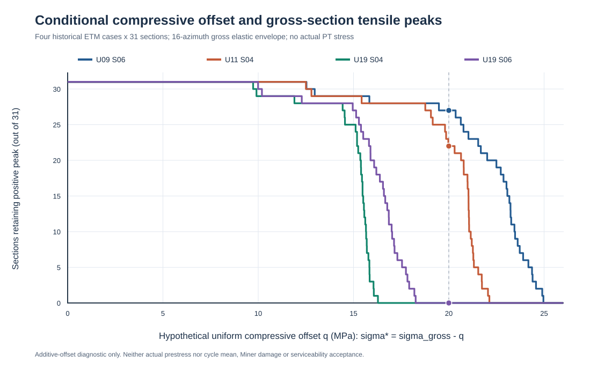

[源级可运行程序](../../../experiments/T077/recovery/s10_etm31_gross_offset_envelope.cjs)（SHA256 `7fdd2987f9641fe88719b255c910f56a2c06980d514752475a76075a22e471c3`）与[24行结果表](../../../experiments/T077/recovery/S10_ETM31_GROSS_COMPRESSION_OFFSET_SCREEN_20261108.csv)（SHA256 `e709fff7ad4103a37c87f00fa67c2c377f58bf7d783e07cf327741d34badc2e1`）保留所有预设偏置的逐工况结果；正式SVG SHA256 `4d6a8c8fc6741339e06fef3a06b322c3acbd87d2a892b611c780c6e437e22f85`。已在V8实际执行仓库同一源码的124行解析、4项真实阈值oracle、4项段数oracle、9项污染输入拒绝、单调性及加性偏置解析恒等式；**原生Node CLI/CI和原始OUTB本轮未执行/重读**。

**适用范围与失败边界。** 本结果来自既有分批归档的31段数据，不能将不同批次截面当作同一时刻全塔应力场。偏置 q 是假设量而非真实有效PT局部应力，且未提供每个材料点的完整循环均值、局部钢筋/PT应力、材料S–N参数或DLC1.2全年覆盖。故本节可作为“名义峰值对压应力偏置的条件性敏感性”图表，**不得生成Miner损伤、材料寿命、预应力设计通过或风震安全结论**。下一步真正需要的是与同一模型状态配对的局部材料点全时程及其雨流范围—均值—次数分布，而不是再由毛截面极值外推寿命。

### 4.7.16 历史18组NTM毛截面循环强度与时均应力控制方位的分离（S10）

**研究问题与真实数据。** 当仅以等效应力范围选择周向疲劳候选测点时，是否会遗漏时均拉应力更不利的方位？本文从已归档的同一158 m OpenFAST历史18组NTM（3个代表风速×6个随机种子）原始OUTB后处理表中，直接读取近塔底BASE及G01—G09共10测站、16个固定周向方位的**2880行毛截面弹性名义应力统计**。每个工况—测站的16方位来自同一原始OUTB及同步Fz/Mx/My，测站范围为0—2.750893 m；数据并非材料点应力，也未加入有效预应力或接缝局部传力。来源为[T062历史实算表](../../../experiments/T062/S10_18NTM_10NEARBASE_16AZ_GROSS_RAINFLOW_20261031.csv)，原CSV SHA256 `d45f047f5d622fb834d63728c13cead49b614b6cf42e598918e55242ed45f94b`，其原始OUTB身份和600 s分析窗口见T062来源收据。

在每个工况—测站内，定义 `θ_D=argmax_θ DEL4(θ)`，`θ_μ=argmax_θ mean_t[σ_gross(t,θ)]`，并以最小周向夹角 `Δθ=min(|θ_D−θ_μ|,360°−|θ_D−θ_μ|)` 衡量两个筛选指标的分离。这里的`mean_MPa`是**时间平均毛截面名义应力**，绝不是雨流循环的逐循环均值；`DEL4`采用原历史程序的`m=4,Nref=600`，单位MPa，只作为统一口径的名义应力循环筛查量，不对应混凝土、PT或钢材的材料S–N寿命模型。

**表4-X 历史NTM不同风速下的周向指标控制方位（真实历史源级后处理）**

| 历史NTM风速 | 工况—测站组合数 | DEL4控制方位与时均应力最大方位相差180° | 说明 |
|---|---:|---:|---|
| U9.343881 | 60 | **60/60** | 6 seeds×10近底部测站 |
| U11.4 | 60 | **60/60** | 6 seeds×10近底部测站 |
| U19.202140 | 60 | **50/60** | 其余10组两方位一致 |
| **合计** | **180** | **170/180（94.44%）** | 180组高度相关，不能当作180个独立统计样本 |

在这180组中，时均应力最大方位与单点正向应力峰值最大方位**180/180一致**；而DEL4与时均应力最大方位在170组中相差180°。如果改选时均应力最大的方位，原始DEL4相对其最大值的损失中位数仅**0.159605%**、最大**0.261058%**，但相应时间平均名义应力的增量中位数为**25.943882 MPa**、最大**29.431306 MPa**。例如U09p343881_NTM_S01的BASE测站，DEL4控制方位为0°（3.708564 MPa，时均应力−16.571550 MPa），时均应力最大方位为180°（DEL4为3.699759 MPa，时均应力+9.337149 MPa）；两者DEL4差约0.237404%，时均应力差约25.908699 MPa。对`m=10`的同源诊断，160/180组出现180°分离；m4与m10控制方位在10/180组不同，提示近并列的方位选择依赖循环指数。

**科学解释与边界。** 在此近底部毛截面数据中，纯循环幅值筛选容易把周向0°/180°中**时均受压较大**的一侧选为控制点，而另一侧的时间平均拉应力和正峰显著更大。该现象与轴力—弯矩同步叠加及圆环截面两侧弯曲符号相反相容，但**不能仅凭此表确定因果机制**。尤其DEL4差异很小，历史表提供的单样本量化界并不是DEL4方位排序的严格置信区间，不能把170/180解释为稳健总体概率。10个近底部测站高度相关，真正的风场独立实现仅有18个历史seed-case，且仅覆盖三个代表风速；没有完整DLC1.2风速箱和材料点的雨流`(range,cycle-mean,count)`、有效预应力及非线性局部响应，因此**不能据此给出材料Miner损伤、寿命或控制材料**。本结果对第四章的直接方法贡献是：进入真实局部材料疲劳评价前，应同时保留`θ_D`和`θ_μ`（及正峰方位）作为**候选观察方位**，不得用一个近并列的DEL最大方位排除另一侧。该选择规则是本文历史数据支持的筛查建议，并非声称首次研究均值应力效应；REF018、REF023已有相关疲劳研究。

**可复现证据。** [180行逐工况—测站表](../../../experiments/T062/S10_NTM18_180PAIR_DEL_MEAN_AZIMUTH_20261108.csv) SHA256 `652929e6e1d03aced08f7af9204e389d503ec3d7835df76bd384114ea410bccd`；[源锁定Node程序](../../../experiments/T062/s10_ntm18_mean_del_azimuth_decoupling.cjs) SHA256 `701ddfd282404d6c0a02aa03af5ac9cac4d7dffee2700fa51b990a649c8590bf`；[双面板科研图](../figures/FIG4_S10_NTM18_DEL_MEAN_AZIMUTH_20261108.svg) SHA256 `c30fe3011b3106f4d947a8be331ac983f4437fad711ad84084ad48f8d431975a`。程序以完整CSV SHA256校验、2880行/180组/16方位身份约束及污染输入拒绝为前提；V8执行5项真实数据断言、7项坏输入拒绝和逆序不变性PASS。**本轮未运行原生Node CLI/CI、未重新解码原始OUTB**，属于已归档原始OUTB派生表的SOURCE-LEVEL新研究，不能代替正式材料物理验收。

### 4.7.17 循环指数改变时周向控制方位的独立风场级稳定性（S10）

**科学问题。** 上节发现周向0°与180°的毛截面名义应力循环DEL接近，但时间平均应力相差较大。不同Wöhler指数会不会改变“控制方位”，这种改变究竟发生在多少个**独立风场实现**中？直接对[同一历史18组NTM×10测站×16方位的2880行来源表](../../../experiments/T062/S10_18NTM_10NEARBASE_16AZ_GROSS_RAINFLOW_20261031.csv)逐组重新取`argmax_θ DEL_m4`与`argmax_θ DEL_m10`，原数据SHA256为`d45f047f5d622fb834d63728c13cead49b614b6cf42e598918e55242ed45f94b`。两个指数仅用于**同一来源的名义应力循环筛查**；不将其等同于已确定的混凝土、PT或钢塔材料疲劳曲线，也不直接比较不同指数DEL的绝对大小。

在同一case、同一测站，令`θ₄=argmax DEL₄`、`θ₁₀=argmax DEL₁₀`，并分别计算选择另一指数控制方位时在本指数下的相对损失
\[
r_4=100\frac{DEL_4(\theta_4)-DEL_4(\theta_{10})}{DEL_4(\theta_4)},\quad
r_{10}=100\frac{DEL_{10}(\theta_{10})-DEL_{10}(\theta_4)}{DEL_{10}(\theta_{10})}.
\]
该“损失”只量化离散方位筛选代价，**不是**材料Miner损伤差、寿命差或模型误差上界。

**表4-X 以独立风场实现为单位的指数依赖性（真实历史来源）**

| 历史风速箱 | seed-case数 | 发生m4/m10控制方位变化的case | 对应发生变化的测站数 |
|---|---:|---:|---:|
| U9.343881 NTM | 6 | 0 | 0/60 |
| U11.4 NTM | 6 | 0 | 0/60 |
| U19.202140 NTM | 6 | **1（S03）** | **10/60** |
| **合计** | **18** | **1/18** | **10/180** |

唯一变化的`U19p202140_NTM_S03`在BASE至G09全部10个近底测站出现180°方位切换：m4选0°，m10选180°。然而同一指数下的选择代价很小：10站中`r₄`为**0.030791%—0.031234%**，`r₁₀`为**0.003129%—0.004492%**。BASE处m4控制方位的时间平均名义应力为−11.526115 MPa，m10控制方位为+4.309740 MPa，差**15.835855 MPa**。这不是十个独立反例，而是**一个风场实现中十个相关高度测站的同向变化**。其余17个case的两个指数控制方位一致。

**解释及可证伪边界。** 在该有限历史样本内，改变循环指数几乎不改变离散最大DEL的数值，却可能在一个seed中把筛查方位切换到均值应力显著不同的另一侧。因此，后续若材料点研究仅保留一个“最大名义DEL方位”，就可能遗漏不同材料指数和均值效应下的候选点；建议至少保留0°与180°的成对候选，待真实材料点`(range,cycle-mean,count)`及有效预应力确定后再作物理裁决。该建议是**筛查设计**，不是已证材料控制机理。原表的`quantization_sample_bound_MPa`仅为单时程样本量化界，不能未经误差传播当作DEL排序显著性界；10个测站高度相关，18个历史case又仅有三个风速箱、每箱六个seed，故**不能**把10/180当作总体切换概率或显著性检验样本量。原OUTB本轮未重新解码，正式DLC1.2仍未闭合。

**图4-X（候选）** [18个独立case的指数依赖控制方位与十测站选择代价](../figures/FIG4_S10_NTM_EXPONENT_AZIMUTH_SWITCH_20261108.svg)；**表4-X（来源级）** [18个case结果](../../../experiments/T062/S10_NTM18_EXPONENT_AZIMUTH_18CASE_20261108.csv)、[十个切换测站明细](../../../experiments/T062/S10_NTM18_EXPONENT_AZIMUTH_10SWITCH_20261108.csv)；[可复算程序](../../../experiments/T062/s10_ntm18_exponent_azimuth_switch.cjs)（输入SHA锁定，9类异常输入拒绝）。这一结果与2026年已发表风震及PT地震研究的对象/结论不同，但仅构成历史数据筛查增量，不主张新材料疲劳定律或风震首创。

### 4.7.18 真实ERA5有源风速支持域的概率集中、载荷四次矩放大与单小时扰动（S10，2026-11-09）

**研究问题。** 仅有三个历史NTM风速箱时，六个seed等数量采样能否代表场址长期风速概率？高风速稀有小时对不同塔底弯矩分量的部分四次矩有多敏感？本节不重复§4.7.4的三箱加权四次矩或§4.7.7的无源箱不可识别性证明，而进一步量化**已知支持域内部的概率集中程度及有限小时影响**。来源为[2005—2025 ERA5派生31行1 m/s分箱](../../../experiments/T062/S10_ERA5_2005_2025_HUB_1MS_BINS_20261031.csv)（SHA256 `e4058620a36b23bb218103875d4dc5b0711fc45d418b23a2208c2fc9c16c9102`）和[18组历史NTM六seed归并的双通道6行M4表](../../../experiments/T062/partial-annual-load-diagnostic-20261102/S10_REAL_18NTM_3BIN_PARTIAL_M4_BY_CHANNEL_20261102.csv)（SHA256 `d43f963fb30e16a33e87acdf6e9571710826974eee89d1f3527ab6504d85f695`）。这两份为已核历史原始资料的**派生表**，本轮未重下载ERA5原件或重新解码18份OUTB。

令全部小时数`N=184080`、非规范诊断运行区间`4≤U<25m/s`内小时数`N_op=106900`、三个有历史NTM载荷的bin `B_K={9,11,19}`小时数`H_K=5736+1426+2=7164`。全小时概率为`p_b=H_b/N`；在**仅三个有源bin内**的归一化概率为`q_b=H_b/H_K`，不得误称为运行区间条件概率。三箱各六seed时，赋予第`b`箱每条历史case权重`w_{bs}=q_b/6`，其代数Kish集中指标为
\[
N_{\mathrm{eff},K}=\frac{(\sum_{b,s}w_{bs})^2}{\sum_{b,s}w_{bs}^2}
=\frac{6H_K^2}{\sum_{b\in B_K}H_b^2}=8.814536.
\]
它说明18条历史case按已知支持域风速频率加权后权重显著不均衡，**不是**18个独立随机试验的统计等效样本量、不是有效seed数估计或总体置信区间；跨风速同标签seed的独立性及不同bin方差均未证明。三个有源bin仅占全部小时**3.891786%**、诊断运行小时**6.701590%**；其余诊断运行小时不能赋零载荷。

对载荷通道`c`，继承历史同一`N_ref=600`、`m=4`的六seed均值`M_{4,bc}=\frac16\sum_s L_{bsc}^4`（单位`(MN·m)^4`），定义**有源部分**`K_c=\sum_{b\in B_K}(H_b/N)M_{4,bc}`，以及其内部贡献份额`r_{bc}=[(H_b/N)M_{4,bc}]/K_c`。由原始整数小时重新计算，`K_{Mx}=125.606638`、`K_{My}=209257.299448\ (MN·m)^4`，与§4.7.4独立归档的数值一致。

| 历史有源风速bin | 已知支持域小时份额 | Mx有源部分四次矩贡献份额 | My有源部分四次矩贡献份额 |
|---|---:|---:|---:|
| 9—10 m/s（5736h） | 80.067002% | 56.477350% | 59.138157% |
| 11—12 m/s（1426h） | 19.905081% | 40.793436% | 40.786853% |
| 19—20 m/s（2h） | 0.027917% | **2.729214%** | **0.074990%** |

虽然19—20m/s仅占有源小时0.027917%，其Mx部分四次矩份额达到2.729214%，相对小时份额的放大倍数为**97.760458**；My对应仅**2.686136**倍。该差异来自两通道的历史载荷四次矩，**不能推导出高风速对完整材料疲劳风险的大小**。为量化极少小时的离散敏感性，设置一个**明确不代表传感器误差或真实风速变化**的反事实：保持总小时`N`不变，把19—20m/s中的1小时改归9—10m/s，固定各箱历史`M_4`不变，则`\Delta K_c=(M_{4,9,c}-M_{4,19,c})/N`。Mx的`\Delta K=-1.701670\ (MN·m)^4`，相对有源`K`为**−1.354761%**；My为`−56.886425\ (MN·m)^4`，相对**−0.027185%**。一个小时占原19—20m/s两小时的50%，但该假想重分配**不是**概率置信区间或气象误差上界；若重分配至无源风速箱，则其载荷四次矩未知，不能计算同样的总变化。

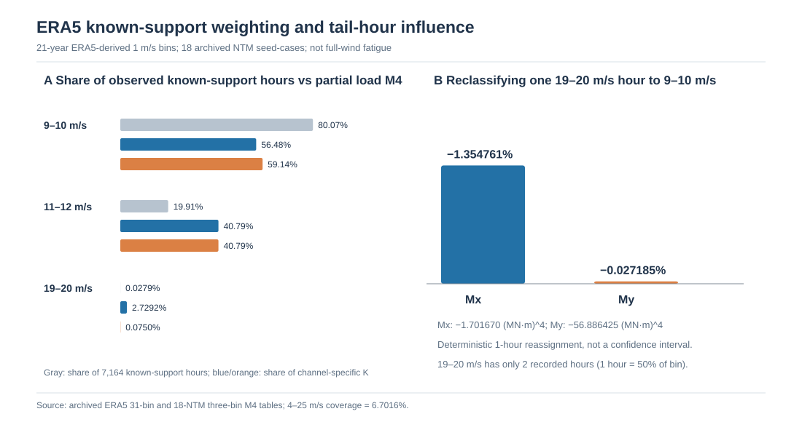

[六行可复算数表](../../../experiments/T062/S10_ERA5_KNOWN_SUPPORT_TAIL_INFLUENCE_20261109.csv)和[无外部依赖Node源锁定程序](../../../experiments/T062/s10_era5_known_support_tail_influence.cjs)分别记录逐bin`q_b/r_{bc}`、集中指标和两通道有限扰动。源级5项正向、9项污染拒绝及行序不变测试通过；原生Node CLI、原ERA5工作簿及OUTB本轮未重新运行。**结论边界**：这些结果揭示“等seed采样≠等气候权重”以及高风速尾部贡献对通道和极少小时的敏感性，但没有获得缺失风速的载荷、局部材料应力、正式DLC1.2、材料Miner或寿命，不构成任何物理验收。

### 4.7.19 四组历史ETM的名义应力循环强度与最大受拉峰值控制方位（S10，2026-11-09）

**研究问题。** 第4.7.16节已对18组NTM近塔底测站比较时均应力和DEL方位；本节采用另一组已归档的**四ETM×31段×16方位**数据，检验按最大循环DEL选取周向测点是否会漏掉最大正向名义应力峰值，以及同时保留最大正峰方位会损失多少循环DEL。直接读取[四ETM原有1984行同步毛截面雨流统计](../../../experiments/T077/recovery/S10_4CASE_31SEG_16AZ_SYNC_GROSS_RAINFLOW_20261030.csv)（SHA256 `16c9864ef7a344e5b97338c31ce26de6adb86c0f0f64942ef894fe9983926b2b`），每个工况—塔段16个22.5°间隔方位均由600s、12001个0.05s采样的名义弹性应力时程归并。未计入真实有效预应力、局部材料应力、接缝或钢筋应力集中；历史批次之间的全局同态尚未独立证明。

对于同一工况\(c\)、塔段\(j\)，分别定义\(\theta_D=\arg\max_\theta\mathrm{DEL}_{4,cj}(\theta)\)和\(\theta_T=\arg\max_\theta\max_t\sigma^{\mathrm{gross}}_{cj}(t,\theta)\)。以最大受拉峰值方位替代最大DEL方位的循环指标损失及正峰增益定义为
\[
L_D=100\left[1-\frac{\mathrm{DEL}_4(\theta_T)}{\mathrm{DEL}_4(\theta_D)}\right]\%,\qquad
G_T=\max_t\sigma^{\mathrm{gross}}(t,\theta_T)-\max_t\sigma^{\mathrm{gross}}(t,\theta_D).
\]
两个指标只在同一工况、同一塔段内部计算，避免跨工况或异时极值混用。

**结果。** 四工况共124个工况—塔段组合的\(\theta_D\)和\(\theta_T\)全部相差**180°（124/124）**。改选\(\theta_T\)的DEL4损失为**0.016753%—0.266934%**，中位数**0.133549%**；相对于只保留\(\theta_D\)，正向名义应力峰值增益为**8.780294—24.277101 MPa**，中位数**18.104230 MPa**。其中83/124组的DEL最大方位**整个时程的最大名义应力仍为负值**，而124/124组的最大受拉峰值方位正峰为正。31个高度来自同一条风场时程，彼此相关，不能将124组视为124个独立随机风场或计算总体置信区间。

**排序可辨识性反例。** 在仅作算法拒绝试验的“两个候选方位DEL4各自可能存在独立±0.5%相对扰动”假设下，严格优势条件\(D_{\max}(1-0.005)>D_T(1+0.005)\)在**0/124**组成立。这是人为设置的容差敏感性，不是已测得的模型误差、seed统计误差或材料参数不确定性；也不能证明两侧材料疲劳损伤相等。该真实来源级结果支持在后续材料局部应力取点时**保留两侧相反方位**，而非只按名义DEL选择一个方位。ETM并非正式DLC1.2长期正常运行风，正峰也不等于混凝土开裂或Miner损伤。

[124行可复核数表](../../../experiments/T077/recovery/S10_ETM4_31SEG_TENSION_DEL4_AZIMUTH_TRADEOFF_20261109.csv)、[图4-X两面板](../figures/FIG4_S10_ETM4_TENSION_DEL4_AZIMUTH_TRADEOFF_20261109.svg)和[输入SHA锁定的Node程序](../../../experiments/T077/recovery/s10_etm4_tension_del4_azimuth_tradeoff.cjs)给出沿高结果。源码在V8通过解析已知解、行序不变性、8种坏输入拒绝和真实来源断言；原生Node CLI、原始OUTB重新解码与物理RUN未执行。两篇2026年160m混塔风震和PT地震先行研究（DOI 10.1080/13632469.2026.2671807；10.1016/j.rcns.2026.03.002）本轮未全文新核，不宣称本节首次发现相关物理规律。

### 4.7.20 原始雨流循环均值与时间均值的非等价性（S10，2026-11-10）

为检验“以时程平均弯矩代替雨流循环平均弯矩”的简化是否有数据支持，本节直接读取T062从原始158 m OpenFAST历史载荷重新计数的**48,070行rainflow循环账本**，覆盖36个风工况、塔底Mx/My两通道共72组。每一行保留循环范围 \(\Delta M_i\)、循环均值 \(\mu_i\) 和循环计数 \(n_i\)（0.5或1）。在载荷筛查指数 \(m=4\) 下，定义

\[
w_i=n_i(\Delta M_i)^4,\qquad
\bar M_{\mathrm{RF},4}=\frac{\sum_iw_i\mu_i}{\sum_iw_i},\qquad
N_{\mathrm{conc},4}=\frac{(\sum_iw_i)^2}{\sum_iw_i^2}.
\]

其中 \(\bar M_{\mathrm{RF},4}\) 为**载荷范围四次矩加权的循环均值**，并非时间均值 \(\bar M_t\)；\(N_{\mathrm{conc},4}\) 只衡量四次矩贡献集中程度，不是独立统计样本数，也不提供置信区间。以相同账本计算 \(\mathrm{DEL}_4=[\sum_iw_i/100000]^{1/4}\)，与历史72行独立DEL表**72/72逐项一致**（当前双精度复算最大绝对差0 kN·m）。

在36组Mx中，\(|\bar M_{\mathrm{RF},4}-\bar M_t|/|\bar M_t|>5\%\) 的有**24组**，超过10%的有**12组**；My对应为**17组**和**3组**。Mx最大差出现在U09p343881_ETM_S01：时间均值**9,911.824154 kN·m**，四次矩加权循环均值**12,687.528181 kN·m**，差异**+28.003968%**。My最大差出现在U09p343881_ETM_S06：时间均值**166,685.655217 kN·m**，加权循环均值**133,366.174852 kN·m**，差异**−19.989411%**；另一个独立NTM风场U11p4_NTM_S06的My差异为**−17.122604%**。两通道 \(N_{\mathrm{conc},4}\) 中位数分别为**20.434672**和**10.676096**；My最小仅**3.179510**，单循环贡献最高可占该工况四次矩的**43.223661%**。因此，少量大范围循环可对载荷四次矩产生显著影响，不能用时程均值描述其对应的循环均值。

[72行逐工况结果](../../../experiments/T062/S10_T062_RAINFLOW_CYCLE_MEAN_WEIGHTED_72ROW_20261110.csv)、[图4-X 双通道对照](../figures/FIG4_S10_RAINFLOW_CYCLE_MEAN_VS_TIME_20261110.svg)与[可运行Node复算程序](../../../experiments/T062/s10_rainflow_cycle_mean_weighted_diagnostic.cjs)提供完整复算入口。**本结果仅为历史载荷弯矩层的确定性筛查**：OpenFAST弯矩正负号不能直接当作材料点拉压应力符号；四次矩加权循环均值也不是Goodman修正。本节没有材料点 \((\Delta\sigma,\sigma_m,n)\) 账本、PT有效应力、材料S–N或Miner损伤，不能计算材料寿命。真实均值效应须在同一材料点、同一结构状态下分别针对混凝土、钢绞线与钢材进行评价。

### 4.7.21 循环均值替代的可识别边界：仿射敏感性恒等式与非线性反例（S12）

上一节表明时间均值与四次矩加权循环均值不相同，但其差异究竟能支持何种疲劳推断，必须区分**数学上可识别的载荷敏感性**和**尚未取得的材料损伤**。对同一工况与弯矩通道，令 \(W=\sum_i n_i(\Delta M_i)^4>0\)，\(p_i=n_i(\Delta M_i)^4/W\)，则 \(\sum_i p_i=1\)、\(\mu_w=\sum_i p_i\mu_i=\bar M_{\mathrm{RF},4}\)。仅定义**无材料参数意义的仿射均值敏感性诊断算子**：

\[
G_\lambda(\mu)=1+\lambda\frac{\mu-\bar M_t}{M_*},\qquad
Q_\lambda=\sum_i n_i(\Delta M_i)^4G_\lambda(\mu_i),\qquad M_*>0 .
\]

这里 \(\lambda\) 是无量纲符号参数，**不是**Goodman、混凝土或预应力钢绞线材料常数。若将每个循环均值错误地替换为时均 \(\bar M_t\)，则 \(Q_\lambda^{(t)}=W\)。由加权求和线性性，严格得到

\[
\frac{Q_\lambda-Q_\lambda^{(t)}}{W}
=\lambda\frac{\bar M_{\mathrm{RF},4}-\bar M_t}{M_*}.
\tag{4-21}
\]

当 \(M_*=|\bar M_t|>0\) 时，式（4-21）右侧对 \(\lambda\) 的系数 \(B=(\bar M_{\mathrm{RF},4}-\bar M_t)/|\bar M_t|\) 可由72行历史统计**精确识别**。72组中 \(B>0\) 为**47组**，\(B<0\) 为**25组**；Mx为28正、8负，My为19正、17负。三个真实工况呈现相反方向：

| 历史工况与塔底通道 | \(\bar M_t\)（kN·m） | \(\bar M_{\mathrm{RF},4}\)（kN·m） | \(100B\)（%） |
|---|---:|---:|---:|
| U09p343881_ETM_S01，Mx | 9,911.824154 | 12,687.528181 | **+28.003968** |
| U09p343881_ETM_S06，My | 166,685.655217 | 133,366.174852 | **−19.989411** |
| U11p4_NTM_S06，My | 194,802.895952 | 161,447.567384 | **−17.122604** |

因此，即使在**同一个预先给定的仿射诊断模型**内，时均替代误差也不是固定正偏或固定负偏；不能把其绝对值当作统一“保守系数”。式（4-21）是代数恒等式，不能被重新命名为材料损伤率或疲劳寿命修正。

更重要的是，**72行汇总表不足以识别一般非线性均值效应**。若仅用于数学讨论的二次可微函数 \(g(\mu)\) 在全部循环均值区间内满足 \(|g''(\mu)|\le K\)，泰勒定理给出

\[
\left|\sum_i p_i g(\mu_i)-g(\mu_w)\right|
\le \frac{K}{2}\sum_i p_i(\mu_i-\mu_w)^2.
\tag{4-22}
\]

右侧需要**逐循环加权方差**，不能从 \(\mu_w\) 或载荷DEL单独恢复。严格反例为两组等权循环：A组均值 \(\mu_0-a,\mu_0+a\)，B组均值 \(\mu_0,\mu_0\)；两组循环范围和计数相同，因而具有相同 \(W\)、DEL及 \(\mu_w=\mu_0\)，但对 \(g(\mu)=(\mu-\mu_0)^2\)，A组加权平均为 \(a^2\)，B组为零。可见即使载荷DEL与加权循环均值相同，**非线性均值效应仍可能不同**。

上述可识别结论仅涉及历史塔底弯矩与定义的仿射算子。保存的48,070行**载荷**循环 \((\Delta M,\mu,n)\) 不能直接替代任何材料点 \((\Delta\sigma,\sigma_m,n)\)；结构轴系、有效预应力、局部应力与材料关系未闭合时，不得据此填造Goodman修正、Miner损伤或20年寿命。材料层须在同一物理位置、同一初态下重新计数，保留逐循环范围、均值、次数和经证据支持的材料关系。三行实例可从[72行源级统计](../../../experiments/T062/S10_T062_RAINFLOW_CYCLE_MEAN_WEIGHTED_72ROW_20261110.csv)核对；[原雨流复算程序](../../../experiments/T062/s10_rainflow_cycle_mean_weighted_diagnostic.cjs)保持不变。

### 4.7.22 四组真实ETM毛截面双指标控制点的精确极小极大筛选（S12）

**科学问题与来源。** 已有§4.7.9—4.7.19指出31段沿高控制工况转换，以及最大名义循环强度与最大正向应力峰值可能对应相反方位。本节直接使用T077已归档的[1984行同步毛截面名义应力统计](../../../experiments/T077/recovery/S10_4CASE_31SEG_16AZ_SYNC_GROSS_RAINFLOW_20261030.csv)（历史SHA256 `16c9864ef7a344e5b97338c31ce26de6adb86c0f0f64942ef894fe9983926b2b`），包括4组ETM×31段×16个22.5°固定方位。每行给出600 s、12001点历史名义弹性应力时程的DEL4（MPa）与最大正向名义应力峰值（MPa）。DEL4只是截面名义应力范围四次矩的诊断，**不是已确认材料S–N曲线的疲劳指标**。

**可证伪的精确离散优化。** 令共同候选点集合 \(\mathcal P\) 包含496个名义位置 \((\mathrm{CSEG}_j,\theta_k)\)，四工况集合为 \(\mathcal C\)，两指标为 \(\mathcal Q=\{\mathrm{DEL}_4,\sigma_{\max}^{+}\}\)。对选择的共同点集 \(S\)，定义每一工况—指标的极值保留率及最差保留率：

\[
r_{cq}(S)=\frac{\max_{p\in S}Q_{cq}(p)}{\max_{p\in\mathcal P}Q_{cq}(p)},\qquad
R_k^*=\max_{\substack{S\subset\mathcal P\\|S|=k}}\min_{\substack{c\in\mathcal C\\q\in\mathcal Q}}r_{cq}(S).
\tag{4-23}
\]

正峰以非负部分参与比值，四工况全域最大正峰均大于零。对 \(k=1,2\) 分别穷举496个单点及 \(\binom{496}{2}=122760\) 个双点集合，未使用随机启发式。**位置配对按同一CSEG编号与方位进行**：原始四批次同名测点的实际 `gage_z_m` 并非字节完全相同，跨工况最大高度差为**0.000726193 m（0.726193 mm）**，所以本结果属于1 mm容差内的**名义共同位置**筛查，不是严格同一物理坐标/初态的跨批同态证明。

**真实数值结果。** 单点最优为CSEG09/180°（名义 \(z\approx30.965141\) m），最差保留率\(R_1^*=\mathbf{92.302769\%}\)；双点最优为**CSEG04/0°（\(z\approx12.766956\) m）和CSEG17/180°（\(z\approx60.025722\) m）**，最差保留率\(R_2^*=\mathbf{99.879547\%}\)，最坏遗漏仅**0.120453个百分点**。四个历史工况的全域最大正峰均由CSEG17/180°取得（4/4保留率100%）；两点对四工况的DEL4保留率为**99.905518%、100%、99.879547%、100%**。在95%保留率门槛下，496个单点中**0个**同时覆盖8指标，而122760个双点中有**68个**可行组合；本节双点解进一步最大化最差保留率，不意味着95%可行组合唯一。

| ETM工况 | 双点DEL4保留率/% | 双点最大正峰保留率/% |
|---|---:|---:|
| U09p343881_ETM_S06 | 99.905518 | 100.000000 |
| U11p4_ETM_S04 | 100.000000 | 100.000000 |
| U19p202140_ETM_S04 | 99.879547 | 100.000000 |
| U19p202140_ETM_S06 | 100.000000 | 100.000000 |

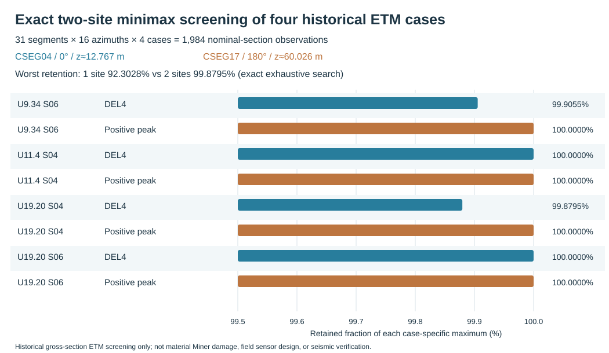

**留一工况检验。** 每次将一组ETM完全留出，仅用另三组的6项指标重新精确选择两点，再计算留出工况的两项保留率。四次训练均选择相同的CSEG04/0°与CSEG17/180°；留出DEL4最小**99.879547%**、正峰均为**100%**。这只是四个既有ETM工况之间的**回顾性有限样本迁移检查**，不是独立新风场、总体置信区间或DLC1.2验证；四工况共享同一几何和处理规则，不能当作独立物理验证。

**解释边界。** 该结论仅适用于这批四ETM、31个混凝土测站、16方位、毛截面线弹性应力映射及既有雨流口径。两个点**不是**材料疲劳控制点或推荐安装的真实传感器；钢塔、PT、钢筋、接缝局部应力、有效预应力、其他NTM风速箱/seed、严格同态风震均未纳入。不同材料位置或新增工况可以使保留率下降，**99.879547%绝非未来工况的误差保证**。这一结果提供了后续材料候选点筛选的条件性优先顺序，不能以两点替代31段局部疲劳评价。

[8行真实指标保留表](../../../experiments/T077/recovery/S12_ETM4_DUAL_QOI_TWO_SITE_RETENTION_8ROW_20261111.csv)、[4行留出表](../../../experiments/T077/recovery/S12_ETM4_DUAL_QOI_TWO_SITE_HOLDOUT_4ROW_20261111.csv)及[精确穷举与独立集合覆盖检验程序](../../../experiments/T077/recovery/s12_etm4_dual_qoi_two_site_exact.cjs)构成可复现结果。RUN为1984行历史来源解析、496单点/122760双点精确比较、四次留出和独立8任务集合覆盖动态规划；SOURCE-LEVEL NUMERIC PASS，非新增OpenFAST或结构生产RUN。CSV印刷精度对本节报告的6位百分数影响极小，但来源坐标、初态、毛截面近似、风场代表性和真实局部应力的误差**没有可信上界**。REF018 Huang等2025截面应力方法为已核先行工作；2026两篇混塔风震/PT地震先行研究（DOI 10.1080/13632469.2026.2671807；10.1016/j.rcns.2026.03.002）本轮未新增全文阅读，不宣称普遍首创。未新增IEC/GB授权条文，材料Miner/寿命与结构物理验收继续HOLD。

### 4.7.23 四组ETM同步名义应力与独立分量DEL4组合的控制工况反例（2026-11-12）

**研究问题。** 对同一四组历史ETM×31个混凝土塔段，先分别对Fz、Mx、My作雨流并换算名义应力DEL4，再作最大分量、平方和开方（RSS）或算术和，能否代替先按同一时刻组合截面应力、再作雨流？本节直接读取[124行分量源](../../../experiments/T077/recovery/S10_4ETM_31SEG_NOMINAL_COMPONENT_STRESS_DEL_M4_20261102.csv)与[1984行同步16方位源](../../../experiments/T077/recovery/S10_4CASE_31SEG_16AZ_SYNC_GROSS_RAINFLOW_20261030.csv)，源SHA256分别为`7ca2dd4fa683b6f3c4534528bd0bcad7b2039c94ea37398e42941987f9580df4`与`16c9864ef7a344e5b97338c31ce26de6adb86c0f0f64942ef894fe9983926b2b`。两者均为600s、12001点、0.05s、m=4、Nref=600的历史毛截面弹性筛查，按工况/段号严格配对；同工况两来源测点高度差小于 5e-10 m（仅代表数值配对精度）。

令`D_sync=max_θ DEL4[σ(t,θ)]`（16个22.5°固定方位），独立分量名义应力DEL4为`d_Fz,d_Mx,d_My`，三个**事后启发式**代理为`D_dom=max(d_Fz,d_Mx,d_My)`、`D_RSS=sqrt(d_Fz²+d_Mx²+d_My²)`和`D_sum=d_Fz+d_Mx+d_My`。计算相对偏差`100(D_proxy/D_sync−1)%`；RSS或简单相加并无普适上下界性质。

**实际结果。** 124组全部完成源级配对。RSS相对同步基准偏差为**+0.471954%—+7.574874%**，最大位于U19p202140_ETM_S04/CSEG_14，同步DEL4=5.642067MPa，RSS=6.069446MPa；四工况沿31段RSS平均偏差依次为0.664718%、1.066873%、6.730360%、6.416429%。算术和偏差为+10.349871%—+40.412173%；最大单分量代理则比同步基准低0.008854%—0.135963%。按每个塔段四工况独立选取最大DEL4，RSS改变**2/31段**的控制身份（CSEG06、CSEG23），算术和改变**31/31段**，最大分量改变0/31段。同步基准的31段控制工况仅来自9.343881 m/s 和 11.4 m/s 两组ETM，而算术和全部选择19.202140 m/s 两组ETM。这一结果构成同一批历史风载派生数据下的控制排序反例，但不代表未来风况的概率。

**独立测试、误差与限制。** 本轮直接执行拟提交的Node同字节计算核心，并用独立逐组最大值和RSS平方恒等式交叉核对124/124；源级门禁拒绝错SHA、缺行、重复工况/方位、非有限值、时间/方位不一致。打印舍入约10⁻⁹MPa级，远小于所观测百分比差异；但结构坐标、材料局部应力、有效PT、接缝非线性、风速/seed覆盖和材料疲劳模型的不确定性无可信上界。**在这四组ETM中RSS均高估只是样本事实，不是一般定理。** 本节不是正式DLC1.2、不是混凝土/PT/钢材料Miner损伤，更不支持寿命或风震安全结论；说明不能由三个边际DEL推回同步材料点雨流。

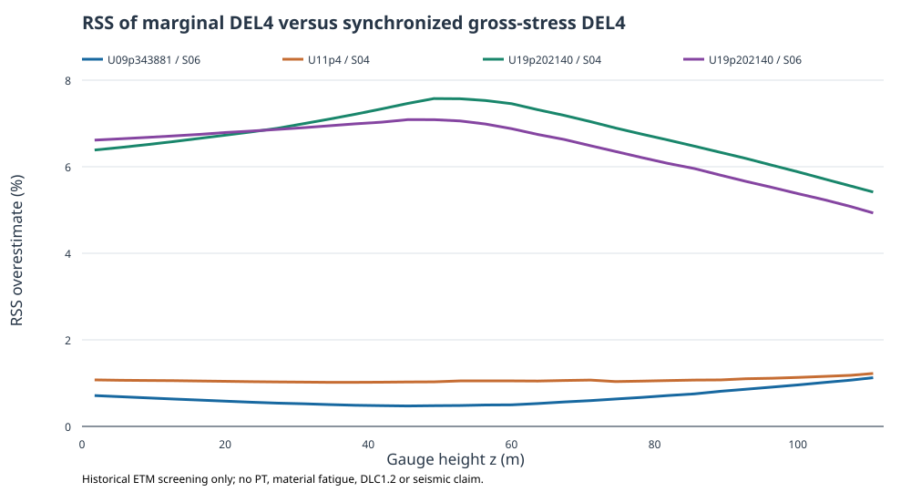

[124行结果表](../../../experiments/T077/recovery/S10_4ETM_31SEG_COMPONENT_RSS_VS_SYNC_124ROW_20261112.csv)；[可复算Node程序](../../../experiments/T077/recovery/s10_component_rss_vs_sync_20261112.cjs)。REF018与2026先行两篇混塔研究沿用既有阅读深度，未新读授权IEC/GB原条文；无新增OpenFAST或结构物理RUN，S10材料疲劳HOLD。

### 4.7.24 同步目标选控后悔度：控制工况翻转的实际筛查代价（2026-11-12）

**研究问题。** §4.7.23已发现，对四组真实历史ETM×31个混凝土塔段，先对轴力和双轴弯矩的名义应力分量分别雨流，再组合DEL4，可能改变筛查控制工况。然而，**工况标签改变不等于同步目标损失很大**。本节继承已核124行同身份配对和31行后悔度源表，不新增动力学仿真，而用同步16方位名义应力雨流DEL4评价代理选控的实际损失。

设塔段s的历史四工况集合为C，c*(s)=argmax_{c∈C}D_sync(s,c)，代理选择c_p(s)=argmax_{c∈C}D_p(s,c)。D_sync是16个固定方位同步名义应力时程各自雨流后DEL4的最大值；D_p分别为最大单分量、RSS或算术和。定义同步目标后悔度及绝对差：

\[
R_p(s)=100\frac{D_{\mathrm{sync}}(s,c^*)-D_{\mathrm{sync}}(s,c_p)}{D_{\mathrm{sync}}(s,c^*)}\%,\qquad
\Delta_p(s)=D_{\mathrm{sync}}(s,c^*)-D_{\mathrm{sync}}(s,c_p)\quad(\mathrm{MPa}).
\]

本数据D_sync>0，故R_p≥0。此指标是**有限四工况历史集合上的选控损失**，不是未来风况的失效概率、材料Miner损伤或经济代价。

| 代理选控方法 | 改变控制工况的塔段 | 同步目标后悔度范围 | 31段平均后悔度 |
|---|---:|---:|---:|
| 最大单分量 | 0/31 | 0% | 0% |
| 分量DEL4的RSS | 2/31 | 0—0.074245% | 0.003552% |
| 分量DEL4算术和 | 31/31 | 5.824936%—18.613504% | 12.440373% |

**结果与机制。** RSS选错的CSEG06、CSEG23分别只损失同步目标的**0.035852787%**和**0.074244607%**，属于近并列的筛查排序翻转，不宜夸大为大幅响应误判。相反，算术和代理将31段全部改判，CSEG15同步目标绝对差达到**1.304020390 MPa**，最大相对后悔度为**18.613504366%**。这表明代理指标的“控制工况改变率”必须同时报告以同步目标衡量的决策代价；在该历史样本中，直接按同步应力时程雨流选控比先合成边际DEL更有证据支持。RSS在这四工况表现较好不构成普遍上界或其他风场的保证。

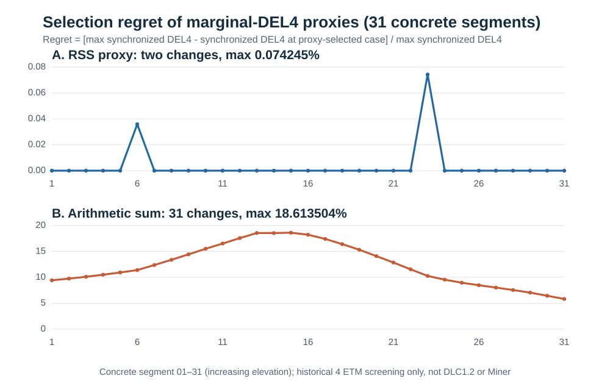

**可复核性与限制。** [31行结果](../../../experiments/T077/recovery/S10_4ETM_31SEG_PROXY_SELECTION_REGRET_31ROW_20261112.csv) SHA256 `83fe5adb816271ef721d46d13d794cb17c4dd57126f18296bfad850f1e18f219`；[Node程序](../../../experiments/T077/recovery/s10_proxy_selection_regret_20261112.cjs) SHA256 `7759bbf34d31a009c921c616bbfebe3630ed8efc8567467ace00df863b181f37`；原124行源SHA256 `c9dcca1a582fd5343f181a7adb146d44f9ebeac164b4f5b2ea2d3f8f3ca19dbd`。历史原生Node22 Actions #43085211081已通过真实源复算、逐字节结果和坏SHA拒绝；本节独立复核31×3个非负后悔度恒等式。**同段跨四工况gage高度最大差0.000726193m**，其物理影响没有独立误差上界；数值打印精度不等于模型精度。四组ETM仅用于历史screening，非正式DLC1.2；毛截面名义应力DEL4不能替代混凝土、钢筋、PT或钢塔局部应力、材料寿命或同态风震结果。

### 4.7.25 真实36风工况雨流载荷范围矩指数与控制工况交叉（S10，2026-11-13）

**科学问题。** 当材料点循环应力和材料专属S–N曲线尚不可用时，仅在同一历史载荷循环账本中改变诊断范围矩指数，塔底Mx/My的控制风况身份是否不变？这不是把指数直接赋给混凝土、钢筋或PT，而是检验“用固定四次矩筛选所有材料控制工况”这一前置假设是否可靠。

采用原始158 m整机历史36组NTM/ETM、600 s截取窗的**48,070条已归档雨流range–mean–count载荷循环**，共36工况×2弯矩通道=72个来源组。保留原循环数\(n_i=0.5\)或1、单位kN·m和固定参考循环数\(N_{\mathrm{eq}}=100000\)，定义仅用于诊断的载荷范围矩

\[
L_{c,h}(m)=\left[\frac{\sum_i n_i|\Delta M_{c,h,i}|^m}{100000}\right]^{1/m},\quad m\in\{3,4,5,6,8,10\}.
\tag{4-25}
\]

该式**不使用循环均值**，不包含局部应力映射、均值修正、材料S–N截距、年风速概率或Miner损伤；改变\(m\)后比较的是不同数学泛函，不是同一材料的寿命改变。源程序对72组\(m=4\)均逐项回归历史DEL，双精度复算的最大差为0 kN·m；此处复用历史雨流循环，未重新运行OpenFAST或重新计数雨流。

| 通道 | \(m\) | 控制工况 | 控制\(L_m\)（kN·m） | 对次高工况优势 | 对每组各移除最大范围矩权重条目后的控制工况 |
|---|---:|---|---:|---:|---|
| Mx | 4 | U19p202140_ETM_S02 | 9468.855048 | 0.170693% | U19p202140_ETM_S02 |
| Mx | 5 | U19p202140_ETM_S01 | 14272.674966 | 0.667234% | U19p202140_ETM_S02 |
| Mx | 10 | U19p202140_ETM_S01 | 36107.671398 | 4.993134% | U19p202140_ETM_S02 |
| My | 4 | U11p4_ETM_S04 | 26802.478502 | 2.993814% | U11p4_ETM_S04 |
| My | 5 | U09p343881_ETM_S06 | 44181.094341 | 3.402100% | U11p4_ETM_S04 |
| My | 10 | U09p343881_ETM_S06 | 134458.326483 | 15.638530% | U09p343881_ETM_S06 |

对于表中成对竞争的实际工况，直接对完整循环分布计算连续\(m\)下的两个载荷矩比，并用60轮二分求得Mx交叉点**\(m_*=4.211770411285\)**（U19 ETM S02/S01）和My交叉点**\(m_*=4.410933756117\)**（U11 ETM S04/U09 ETM S06）。在\(3\le m\le10\)的0.05指数网格上检查全部36个工况，未出现第三个全局控制者。交叉点只是该有限来源、相同参考循环数下的数学排序分界，不能解释为某种材料的已知疲劳指数。

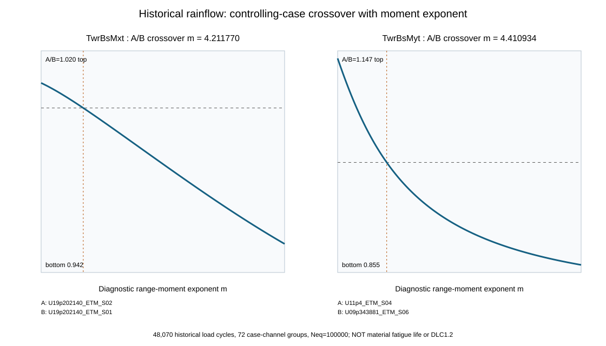

**尾部影响拒绝试验。** 对每个工况分别删除其\(n_i|\Delta M_i|^m\)最大的**一条已计权雨流记录**，再重排36个工况，而非只删除当前冠军的一条记录。\(m=5\)时，Mx原冠军S01删除自身最大条目后的\(L_5\)下降**3.665820%**，My原冠军U09 S06下降**12.841021%**；两通道控制工况均回到\(m=4\)的冠军。\(m=10\)时，Mx仍被这一单条目影响而反转，My则未反转。删除条目只是对尾部依赖的确定性影响诊断，**不是数据清洗、置信区间或实际风机中该循环可被消除的证据**。

对正范围循环，还可独立校验导数恒等式
\[
\frac{\partial\ln L_m}{\partial m}=\frac{\sum_i n_i(\Delta M_i)^m\ln(\Delta M_i)/\sum_i n_i(\Delta M_i)^m-\ln L_m}{m}.
\tag{4-26}
\]
程序以两循环解析算例、中心差分和八种污染输入拒绝测试验证算法。连续指数根求解的数值残差小于\(10^{-12}\)（对数比），但**不构成风场、控制器、有限seed或雨流来源的物理误差界**。未获得材料点的同步局部\(\Delta\sigma\)、\(\sigma_m\)和有效PT状态，也没有正式DLC1.2全分箱，因此本结果只用于提醒第五章：若代理模型或DOE采用一个固定\(m=4\)载荷目标筛选控制工况，必须预先声明其适用范围，并对尾部循环和材料目标另行验证，不能据此宣称分材料疲劳寿命或优化改进。

SOURCE：历史循环账本SHA256 \`067c60cea61b35398edd186ff509fe759d1c4420395f082d06c666d92d897ecb\`；m4参考表SHA256 \`b362bcd7c37ccc56e21035de39448b5e761ec03f371b6b2f3eb30f41b013630d\`。RUN：本轮Node源码源级V8真实48,070条/72组计算；TAB：[12行结果](../../../experiments/T062/S10_RAINFLOW_EXPONENT_CONTROL_12ROW_20261113.csv)；FIG：本节图4-S10；STANDARD：无新增授权IEC/GB条文；REF：继承既有Huang 2025及2026风震/PT先行研究，不宣称本指数诊断为其物理结论。阶段正式PASS仍为0/12。

### 4.7.26 ERA5已覆盖三风速箱的部分年化载荷范围四次幂及不可外推边界（2026-11-13）

为避免把单一风速的10 min载荷等效值误认为全寿命材料疲劳，本文将历史158 m混塔OpenFAST正常湍流（NTM）六随机种子结果与2005—2025年嘉鱼ERA5逐小时风速分箱进行**仅在有真实载荷归档的风速箱内**的概率加权。原ERA5分箱含184080小时；与现有NTM风速标签9.343881、11.4、19.202140 m/s对应的区间分别为[9,10)、[11,12)、[19,20) m/s，观测5736、1426、2小时，共7164小时，占**全部ERA5小时的3.89178618%**。这一比例不是4—25 m/s诊断运行小时中的覆盖率，二者分母不得混用。

设第j个有源风速箱的小时数为h_j，历史第s个随机种子对应塔底弯矩分量c的雨流范围四次幂等效载荷为DEL_{jsc}（单位kN·m），每段有效记录T=600 s、参考循环次数N_eq=100000。以365天为一年，定义**部分年化载荷范围四次幂筛查指标**：

\[
A_{4,c}^{\mathrm{partial}}=\frac{365\times24\times3600}{600}\frac{N_{\mathrm{eq}}}{10^{12}}
\sum_{j\in\{9,11,19\}}\frac{h_j}{184080}
\left[\frac{1}{6}\sum_{s=1}^{6}(\mathrm{DEL}_{jsc})^4\right].
\]

式中10^12仅为(kN·m)^4到(MN·m)^4的单位换算；六seed须先对DEL四次幂取均值，而不是先对DEL取均值后再四次方。年化因子为52560段600 s记录/年。此处每个风速箱只用其**单个历史风速标签**近似整个1 m/s区间，属于未验证的箱内常值假设；ERA5概率也不是湍流类型发生概率，故不对ETM赋予全年权重。

**表4-X 已有NTM三风速箱的部分年化载荷范围四次幂（历史来源派生，非完整年疲劳）**

| ERA5风速区间及NTM代表标签 | 小时数 | 全时段概率 | Mx贡献 [(MN·m)^4/年] | My贡献 [(MN·m)^4/年] |
|---|---:|---:|---:|---:|
| [9,10)；9.343881 m/s | 5736 | 0.0311603651 | 2.237142×10^9 | 3.902609×10^12 |
| [11,12)；11.4 m/s | 1426 | 0.0077466319 | 1.615881×10^9 | 2.691581×10^12 |
| [19,20)；19.202140 m/s | 2 | 0.00001086484 | 1.081078×10^8 | 4.948683×10^9 |
| **已覆盖三箱合计** | **7164** | **0.0389178618** | **3.961131×10^9** | **6.599138×10^12** |

该表由历史72行 `T062/05_LOAD_DEL_M4_ALL36_RECOMPUTED.csv` 和31箱ERA5统计CSV派生，原件历史SHA256分别为`b362bcd7c37ccc56e21035de39448b5e761ec03f371b6b2f3eb30f41b013630d`及`e4058620a36b23bb218103875d4dc5b0711fc45d418b23a2208c2fc9c16c9102`；本次沿用已归档的数值复算和来源哈希，未重新计算OpenFAST物理响应，也未重新哈希原始字节。期刊研究稿§4.25—4.26记录了条件年化及分箱概率计算；本节仅将已完成的真实来源派生结果纳入学位论文的科学论证。

**物理解释与拒绝条件。** My的已覆盖三箱部分指标大于Mx，并不证明My控制混凝土、钢筋、预应力束或钢塔疲劳；截面载荷需先转换为相应位置的应力循环、均值及材料疲劳参数。19—20 m/s仅有2个小时，概率估计存在严重时间相关性和尾部不确定性。未覆盖的176916小时（96.10821382%）绝不能按零载荷处理；即使假定所有缺失贡献非负，由于代表风速对箱内响应的近似尚未验证，表中部分和也不能作为真实全年材料损伤的严格下界。正式DLC1.2风速箱及控制状态、真实局部应力、分材料S–N和Miner损伤仍未闭合。该表只能用于**历史载荷级筛查与数据缺口定量呈现**，不得写为20年寿命或结构安全结论。

## 4.8 关键影响因素与不确定性

本节只研究能够改变疲劳判断或解释机理的参数，不独立扩成“优化章”。

### 4.8.1 必做敏感性

1. seed/sample size；
2. wind-bin discretization；
3. mean-stress treatment；
4. PT effective prestress；
5. local stress extraction；
6. local mesh density。

### 4.8.2 条件敏感性

只有主结果证明相关时再研究：

- foundation stiffness；
- concrete elastic modulus；
- joint friction；
- PT radius / bundle configuration；
- steel local detail；
- controller strategy。

REF018 p13 Fig.24–26说明基础刚度、混凝土弹模和控制策略都可能改变damage，但这些是其工程对象的project-specific factors。本文不为模仿文献而全部复制，而是根据自己模型最主要的不确定性选取。

### 4.8.3 单因素控制原则

每个敏感性分支只改变一个目标因素，其余模型身份保持一致。对每个参数报告：

- baseline value；
- variation range；
- source/evidence；
- control damage；
- relative change；
- control location是否改变。

若某因素影响很小，应如实报告non-sensitive，而不是人为扩大差异。

### 4.8.4 截面合力矩对材料局部应力的非唯一性：31段真实几何上的零空间反例（S10，2026-11-12）

**科学问题。** §4.7.23已证明分别雨流后组合DEL4不能普遍恢复同步名义应力DEL4；期刊§4.7.3还证明边际弯矩谱缺少相位信息。本节研究更强的命题：**即使截面轴力、双向弯矩及其完整同步时程全部已知，能否仅由这些合力矩唯一确定混凝土、普通筋、预应力筋或接缝材料点的局部应力？** 以下构造一个截面合力矩映射零空间的严格反例；它不是新增物理场、真实局部应力或Miner损伤。

取圆环截面外半径 \(R\)、内半径 \(r_i\)，面积 \(A=\pi(R^2-r_i^2)\)，惯性矩 \(I=\pi(R^4-r_i^4)/4\)。在与合弯矩方向对齐的周向坐标 \(\theta\) 下，历史固定内力毛截面弹性代理为
\[
\sigma_0(r,\theta)=\sigma_N+\frac{M}{I}r\cos\theta,\qquad
\sigma_N=-N/A,\quad \sigma_M=MR/I.
\]
沿用T071符号约定：压轴力 \(N<0\) 对应正的 \(\sigma_N\)；kN和kN·m先换算为MN和MN·m。构造两个不同的轴向应力场：
\[
\sigma_\pm(r,\theta)=\sigma_0(r,\theta)\pm K\cos(2\theta),\qquad
K=\eta\sigma_M,\quad\eta=0.10.
\]
因为 \(\int_0^{2\pi}\cos2\theta\,d\theta=\int_0^{2\pi}\cos2\theta\cos\theta\,d\theta=\int_0^{2\pi}\cos2\theta\sin\theta\,d\theta=0\)，附加项对轴力及两个弯矩的积分增量**严格为零**；不增加剪切牵引时两个横向剪力及扭矩也不变。对 \(0<\eta<1/4\)，外缘 \(\theta=0\) 的正号场最大值及 \(\theta=\pi\) 的负号场最小值分别为 \(\sigma_N+(1+\eta)\sigma_M\) 和 \(\sigma_N-(1+\eta)\sigma_M\)，不同于原毛截面的 \(\sigma_N\pm\sigma_M\)。若附加项乘任意时间函数 \(g(t)\)，上述正交性在**每个时刻**仍成立。因此仅有同步六分量合力时程仍不能排除这一零空间。

**真实来源驱动的数值反例。** 读取T071既有31段几何、固定 \(N/M\) 及 \(A/I\) 表，源SHA256为 fff6dfcc6bc094353ebee042392033e8df47e7fb792ccc1812c0962c9c43f800；没有改变内力或假装新风机运行。假设谐波幅度 \(K=0.1\sigma_M\) 在31段为**2.544439—5.884493 MPa**。CSEG_01的名义最大有符号应力由29.102481变为31.646920 MPa；CSEG_27由**64.548868变为70.433361 MPa**，其原名义最小值−53.140996在另一数学场中变为**−59.025489 MPa**。这些场仅满足截面合力矩约束，**未证明满足实际材料本构、位移相容、接触、开裂、局部平衡或施工残余应力条件**，故不得解释为实测应力集中或结构安全裕度。

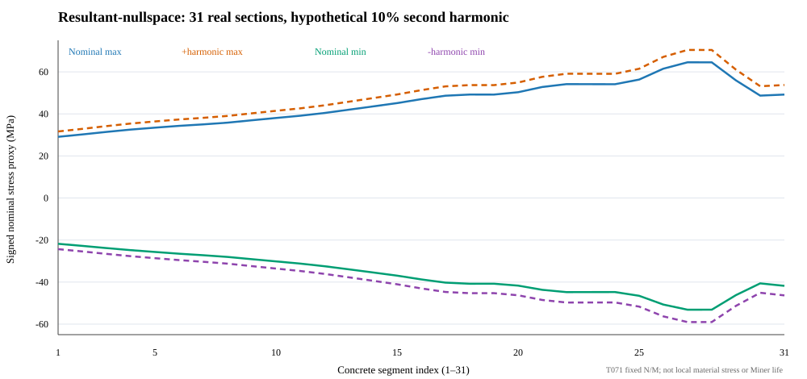

**循环效应的解析反例。** 对人为构造的同频零均值正弦应力，若局部谐波与指定外缘应力同相，局部范围从 \(\Delta\sigma\) 变为 \(1.1\Delta\sigma\)，且循环数相同、均值效应忽略、位于同一幂律S–N分支，则范围幂比 \(1.1^m\) 在 \(m=3,4,5\) 时分别为**1.331、1.4641、1.61051**。这些是条件性数学数值，不是实际材料指数选择、真实循环、Miner比或寿命。没有经物理验证的局部零空间幅值上界时，截面合力矩本身不提供局部峰值/范围的有限通用上界；但在经验证的均匀线弹性Euler–Bernoulli假设下，相容及本构可排除附加自由度，故**数学非唯一性不等于实际物理场必然出现该谐波**。

**程序、独立检验与误差。** [可复算Node程序](../../../experiments/T062/s10_section_resultant_nullspace.cjs)、[31行真实来源派生表](../../../experiments/T062/S10_T071_31SEG_SECTION_NULLSPACE_20261112.csv)与上图可由T071原件SHA门禁再生。程序核对31段唯一性、面积/惯性矩、N/M与名义应力恒等式；720个周向中点的数值积分对31段均满足 \(|\Delta N|,|\Delta M_x|,|\Delta M_y|<1.2\times10^{-14}\)，各自单位为MN、MN·m、MN·m；常数谐波和一阶谐波作为故意失败反例。源表重算A/I/应力的最大绝对偏差约为 \(1.2\times10^{-14}\,\mathrm{m^2}\)、\(6.4\times10^{-14}\,\mathrm{m^4}\)、\(5.0\times10^{-14}\,\mathrm{MPa}\)；CSV保留9位小数，单值舍入≤\(5\times10^{-10}\,\mathrm{MPa}\)。**浮点误差不等于物理模型误差**，后者没有可信上界。本轮V8执行提交版纯计算核心及坏输入拒绝PASS，原生Node CLI尚未单独运行。

本节对S10的实际意义是建立**拒绝条件**：T071静力毛截面值、T077同步名义应力DEL4、T062载荷DEL即使完全可复算，仍不能识别混凝土、钢筋、PT或钢塔局部range–mean–count与材料Miner；需要独立的局部传递关系、均值处理及材料S–N适用域。2026年160m混塔风震研究（DOI 10.1080/13632469.2026.2671807）和PT抗震研究（DOI 10.1016/j.rcns.2026.03.002）已有各自研究贡献；本节不声称首创风震或PT，也不将数学反例冒充结构性能创新的物理验证。

## 4.9 第四章最终结果与图表清单

正式结果至少包括：

1. 场址正常运行wind-bin概率表；
2. seed/sample-size convergence；
3. representative fatigue cases；
4. concrete/PT/steel candidate regions；
5. local stress time histories；
6. range–mean rainflow matrices；
7. short-term damage by wind bin；
8. annual damage contribution；
9. concrete/PT/steel control comparison；
10. azimuth/PT-position comparison；
11. mean-stress and effective-prestress sensitivity；
12. peak vs thickness/path-average sensitivity；
13. load-DEL control vs material-damage control；
14. 若证据链完整，则给出 \(D_{\text{annual}}\)、\(D_{20}\) 和等效寿命；
15. 若材料标准、概率或局部网格未闭合，则只给relative damage，不虚构寿命。

建议最终图表编号：

- 图4-1 疲劳研究技术路线；
- 图4-2 正常运行wind bins及场址概率；
- 图4-3 seed收敛；
- 图4-4 疲劳候选区域及观测点；
- 图4-5 控制混凝土应力时程；
- 图4-6 混凝土range–mean rainflow matrix；
- 图4-7 wind-bin concrete damage contribution；
- 图4-8 36个PT位置stress/damage周向分布；
- 图4-9 PT load spectrum及damage contribution；
- 图4-10 钢塔控制截面nominal/hot-spot stress；
- 图4-11 三类材料annual damage比较；
- 图4-12 mean stress / effective prestress敏感性；
- 图4-13 load-DEL与material-damage控制工况比较。

### 4.10.1 已证实结果的三级证据分层与可检验研究结论（2026-11-13）

本章的证据并非同一层级。**第一层：真实风机载荷及其雨流归档**。36个历史NTM/ETM筛查工况、18个NTM原始OUTB及72条DEL4记录证明特定158 m塔架模型、历史控制状态与记录窗口内的载荷响应确实存在；它们并非覆盖完整运行风速域的正式DLC1.2样本。**第二层：同步毛截面名义应力及诊断指标**。18个NTM近塔底测站的同一时刻Fz/Mx/My、16个候选方位与雨流统计支持“控制风速随诊断指数变化”和“相近DEL并不唯一决定循环均值/符号域”的来源级结论，但不识别混凝土、普通筋、预应力筋和钢塔的真实材料点应力。**第三层：气候概率与年化筛查**。ERA5全时段184080小时中，三个有对应NTM归档的1 m/s风速箱只占7164小时；由这三箱得到的部分年化A4是一个有明确覆盖域的统计量，不是全年Miner损伤的下界或寿命。

为了避免在讨论中混淆研究问题，本章明确区分三个命题：

（1）**指标排序命题**：对同一历史样本，载荷DEL、毛截面名义应力DEL及不同指数的控制风速可能不同。这已由§4.3.8和§4.7相关实数表支持；其可证伪条件是在相同来源、固定方位与统一循环定义下重算后排序不再发生所述差异。

（2）**年度载荷贡献命题**：对三箱定义的部分和，六seed先取四次幂均值、再乘全时段概率，得到Mx=3.961131×10^9、My=6.599138×10^12 (MN·m)^4/年。该等式是特定DEL定义和代表风速常值假设下的派生计算；若箱内风速变化使响应四次矩不恒定，便不能将它当作严格箱积分。其余176916小时不得作为零载荷补入。

（3）**材料疲劳命题**：真实局部应力范围、循环均值、材料适用的疲劳关系和完整正常运行概率共同决定材料损伤；目前缺少这些物理输入，因而不能证明哪种材料先失效、20年寿命或预应力优化有效。§4.8.4的零空间构造进一步表明，单靠截面合力时程不能在未限定本构与相容条件时唯一恢复局部应力场；这一解析反例不等于真实塔架出现了对应应力集中。

从学术贡献角度，本章当前可主张的是**同一历史载荷来源下，控制指标非等价性及气候加权可识别边界的可复算诊断**，而不是提出新的风震耦合求解器或完成混合塔分材料疲劳设计。与Huang等（2025，Engineering Structures 334:120295）已发表的分箱、截面应力和疲劳研究相比，本章必须保留其先行方法地位；与2026年160 m混塔风震（DOI:10.1080/13632469.2026.2671807）和预应力抗震（DOI:10.1016/j.rcns.2026.03.002）研究相比，不能把“考虑风震/PT”本身当作首创。两篇2026研究的全文逐项参数和结论未在本节重新核读，因此不对其作未经原页支持的优劣判断。

本节的三层划分还规定了图表使用边界：历史真实载荷图只标记“screening”；近塔底名义应力图标记“gross-section diagnostic”；ERA5三箱图标记“partial climate-weighted load index”；任何未取得局部应力与S–N证据的图均不得标记“material damage/life”。源身份沿用§4.3.6、§4.7.26和§4.8.4已列SHA256；本节为已核结果的跨节科学综合，**无新物理RUN、无新原件哈希、无新规范条款验收**。

## 4.10 本章小结

本章已在**载荷级—毛截面名义应力级**形成可复算的筛查结果，但尚未取得材料点疲劳损伤。依据Huang等[REF018]的截面应力与风速概率加权研究思路，本文以真实历史NTM/ETM派生数据研究控制指标差异，并严格区分截面名义量、材料点循环量及长期Miner损伤。已有数据说明，最大载荷循环强度、最大正向名义应力、时均名义应力和某一时刻的沿高应力场**不能互相替代**。

| 可核实的历史来源 | 定量观察 | 对控制点选择的含义 | 解释边界 |
|---|---|---|---|
| 四组ETM、31段毛截面极值（§4.7.12） | U11p4_ETM_S04各段正峰时刻跨度**86.85 s** | 逐段极值包络可筛查高度，不是同步全塔应力快照 | 测站分批归档，跨批完全同态未证 |
| 四组ETM塔底My DEL与截面正峰（§4.7.13） | 六个两两排序中**2对反转**；正峰最大在U09 S06，My DEL最大在U11 S04 | 不同QoI须分别保留候选工况 | 两归档初态/控制状态未独立配对，属跨来源描述 |
| 18组NTM、10近底测站周向筛查（§4.7.16） | **170/180**组最大DEL4与最大时均应力方位相差180°；改选时均最大方位时DEL4损失至多**0.261058%**，时均应力增量至多**29.431306 MPa** | 仅保留最大DEL方位可能漏掉另一侧高平均拉应力 | 测站高度相关、DEL方位近并列；时间均值不是雨流循环均值 |
| 18组NTM的m4/m10周向控制方位（§4.7.17） | **10/180**测站切换，但全部来自**1/18**个seed-case；最大相对选择代价m4 **0.031234%**、m10 **0.004492%** | 保留相反周向方位的候选，避免仅凭一个循环指数删去高均值应力一侧 | 10测站非独立；名义DEL指数不等于材料疲劳模型，未得局部循环均值 |\n| 36组历史风况×Mx/My雨流（§4.7.20—4.7.21） | **48,070**条载荷循环；**47/72**组加权均值高于时均、**25/72**组低于；有符号偏差 **+28.003968% 至 −19.989411%** | 仿射均值敏感性可识别且误差方向随风况改变 | 不等于材料局部平均应力；非线性均值效应还需逐循环分布及材料关系 |
| 四组ETM、31段条件性压应力偏置（§4.7.15） | 假设20 MPa统一偏置后仍有**49/124**个工况—塔段单元出现正峰 | 表明正峰筛查对基准应力假设敏感 | 20 MPa不是实测有效预应力，不证明开裂或疲劳安全 |

这些结果共同否定“单一塔底DEL最大工况—单一方位—逐段峰值连线”足以确定材料疲劳控制机制的简化推断。第三章缺失的风速箱决定长期循环**权重能否识别**；本章的周向和非同时性结果决定**哪些物理量可以用于控制点筛查**；两者都不能代替材料点range–mean–count循环矩阵。混凝土、普通钢筋、PT及钢塔具有不同的均值效应和S–N适用域，不能统一套用\(m=4\)载荷DEL。

§4.7.20—4.7.21进一步证明：**时间均值不能代替循环范围加权均值，仅凭DEL与加权均值仍不能识别非线性材料均值效应**。式（4-21）是载荷层可审计的仿射敏感性恒等式，而不是材料寿命结果。

目前可成立的结论限于**历史来源级载荷与毛截面筛查**：存在指标排序差异、方位筛选差异和沿高峰值非同时性；不能给出材料年Miner损伤、20年寿命或实际预应力调整后的疲劳安全性。后续只有在相同结构状态、风速箱、seed、截面位置和时钟下取得材料点应力，逐循环记录\(\Delta\sigma\)、\(\sigma_m\)、\(n\)，并按材料关系与有证据的风速概率累积，才能为第五章提供真实疲劳损伤目标。

---

# 工作区证据与门禁（不进入最终Word）

|项目|状态|
|---|---|
|REF018 Huang 2025第一主参考|FROZEN|
|REF002/023/041/143/036职责|FROZEN|
|30张参考文献原页证据图|ARCHIVED / T066|
|疲劳方法证据图谱|FROZEN / source-evidence atlas|
|Huang Model Code 2020 与 Wang fib MC2010版本差异|IDENTIFIED / FINAL STANDARD PENDING|
|T057 native Abaqus Data Check|PENDING|
|Gravity+PT equilibrium|PENDING|
|OpenFAST→Abaqus load ownership / ΣF / ΣM|PENDING|
|DLC1.2长期wind bins|S10 18 NTM真实部分载荷4th-moment有源3bin / 6.70%诊断运行小时；21bin全谱及2025/26IEC授权条款HOLD|
|seed convergence|PENDING|
|fatigue-specific Abaqus outputs|T064 CONTRACT FROZEN / RUN PENDING|
|historical S03 vs archived S04 load-DEL conflict|T062 CLOSED: original 36 OUTB same SHA, 72/72 old/fixed/independent rainflow reproducible; legacy comparator reversed|
|absolute material life|HOLD UNTIL ALL REQUIRED EVIDENCE CLOSES|

### 4.7.27 已覆盖三风速箱的载荷贡献集中度与稀疏箱影响（历史表派生）

为判断已覆盖箱内哪些工况对部分年化载荷筛查指标更敏感，定义第j箱对已覆盖三箱部分和的**相对贡献份额** \(q_{jc}=A_{4,jc}/\sum_{k\in J}A_{4,kc}\)，并定义相对于三箱观测小时份额的贡献富集系数 \(L_{jc}=q_{jc}/[h_j/(\sum_{k\in J}h_k)]\)。这两个量只描述已有三箱内部的构成，既不是全气候概率，也不是材料损伤的敏感性。

按§4.7.26已归档的三箱贡献表直接计算，9—10、11—12、19—20 m/s三箱在Mx部分和中的份额分别为56.4774%、40.7934%、2.7292%；在My部分和中的份额分别为59.1382%、40.7869%、0.0750%。19—20 m/s箱仅有2/7164=0.02792%的**已覆盖小时**，其Mx富集系数约97.76，而My约2.69。这一差异说明两个塔底弯矩通道对高风速稀疏样本的相对贡献不相同；但不能据此断言19—20 m/s是全年Mx疲劳控制箱，因为96.1082%的全时段小时没有对应的已核NTM载荷，且该箱概率仅来自两小时观测。

**反证与误差边界：** 上述份额用已发表在本章表4-X中的六位有效数字贡献值复算，末位舍入误差远小于箱内代表风速近似、ERA5时间相关性、控制状态与seed抽样误差；这些主要误差目前未定量闭合。若19—20 m/s的真实风速箱内响应或概率估计改变，富集系数可能显著改变。尤其不能将高富集系数当作该箱需要补算的统计显著性检验，也不能将部分和归一化后的百分比误读为全寿命损伤占比。本节不增加任何新OpenFAST物理结果，属于既有真实表格的**跨通道贡献结构诊断**。

### 4.7.28 ERA5条件概率归一化与年度时钟的双重计数反例（方法纠偏）

**科学问题。** 仅对已具备载荷的三个风速箱归一化概率后，若仍乘以全年8760 h，是否可以解释为该三个箱对全年载荷范围四次幂的贡献？答案是否定的。这个错误与雨流算法无关，而是统计估计对象和暴露时间的错配；即使三个箱内的六seed载荷统计完全准确，也会产生确定性的系统偏差。

设ERA5观测总小时数为 \(H=184080\)，有载荷证据的三个箱集合为 \(J\)，对应观测小时 \(H_J=7164\)。令 \(p_j=h_j/H\) 表示**无条件**时间概率，\(p_{j|J}=h_j/H_J\) 表示**在已覆盖集合内**的条件概率；对每箱定义 \(r_{jc}=N_{\mathrm{eq}}\overline{DEL_{jc}^{4}}/T_{\mathrm{sim}}\)，单位为 \((\mathrm{MN\,m})^4/\mathrm{h}\)（在DEL以MN·m表示、\(T_{\mathrm{sim}}\)以小时表示时）。若目标为按全年8760 h计的已覆盖部分年度四次幂循环范围总量，则
\[
A_{4,J,c}=8760\sum_{j\in J}p_jr_{jc}
=8760\,\frac{H_J}{H}\sum_{j\in J}p_{j|J}r_{jc}.
\]
相反，误将条件概率直接乘8760 h会得到 \(A^{\mathrm{wrong}}_{4,J,c}=8760\sum_{j\in J}p_{j|J}r_{jc}\)，其与正确部分和之比严格为 \(H/H_J\)，与弯矩通道、DEL数值及seed分布无关。该恒等式仅要求同一总时段、同一集合及同一时长口径，不要求三个箱的真实载荷已完全验证。

| 由既有ERA5时数确定的量 | 数值 | 正确解释 |
|---|---:|---|
| 全时段观测小时 \(H\) | 184080 h | 经验无条件概率分母 |
| 三箱已覆盖小时 \(H_J\) | 7164 h | 条件概率分母 |
| 覆盖概率 \(H_J/H\) | 0.0389178618 | 3.89178618% |
| 对应年度暴露时间 \(8760H_J/H\) | 340.920469 h/year | 仅是三个箱的经验时间份额，不是运行可用率 |
| 错误归一化膨胀因子 \(H/H_J\) | 25.69514238 | 对三个箱部分和的**确定性偏差** |

这意味着§4.7.26中的部分年化四次幂总量，只有在沿用原始无条件概率、600 s有效窗口、\(N_{\mathrm{eq}}=100000\)及六seed四次幂平均定义时才保持其有限覆盖的解释。若在已覆盖三个箱内把概率强制归一到1，则得到的是**假设全年所有小时都落在这三个箱**的反事实量，不是可用于补齐96.1082%缺失小时的估计量。特别地，条件概率加权的平均每小时循环范围强度本身可以合法报告，但必须再乘正确的暴露小时，而不能直接乘全年时数。

**可证伪检查。** 对任意正的三箱 \(r_{jc}\)，以两种路径独立计算 \(A_{4,J,c}\)：(i) \(8760\sum h_jr_{jc}/H\)；(ii) \(8760(H_J/H)\sum h_jr_{jc}/H_J\)。两者应在浮点舍入内一致；删除覆盖率因子后，错误结果与正确结果的比值应等于25.69514238。该反例不依赖材料S–N曲线，不能替代材料点的应力范围、均值修正和Miner计算。对于停机/限功率时段，必须进一步将运行状态作为联合变量，\(p(v,\mathrm{state})\)，不能把ERA5气象小时自动视为发电运行小时。20年非平稳性、ERA5与轮毂高度换算误差、风速箱代表性、seed有限样本及缺失箱载荷均未因此消除；尤其**不得**把340.920469 h/year解释为实际机组可利用小时。

本节SOURCE为已归档184080/7164小时ERA5历史统计和§4.7.26载荷派生定义；RUN为上述两条可独立复算的恒等式及数值反例；TAB为本节五行；REF/STANDARD/OFFICIAL没有新增授权依据。该结果是对年化估计对象的**方法学纠偏**，不是新的OpenFAST风机物理结果，也不是完整年度疲劳或材料寿命。
