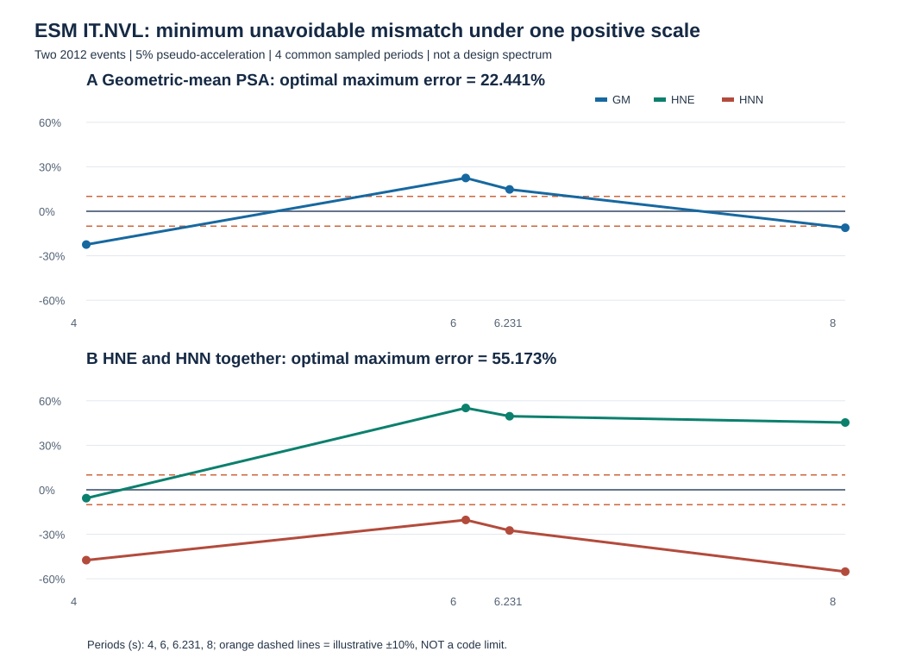
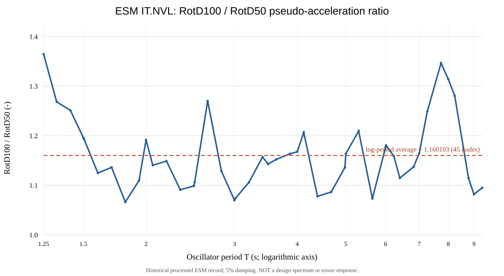
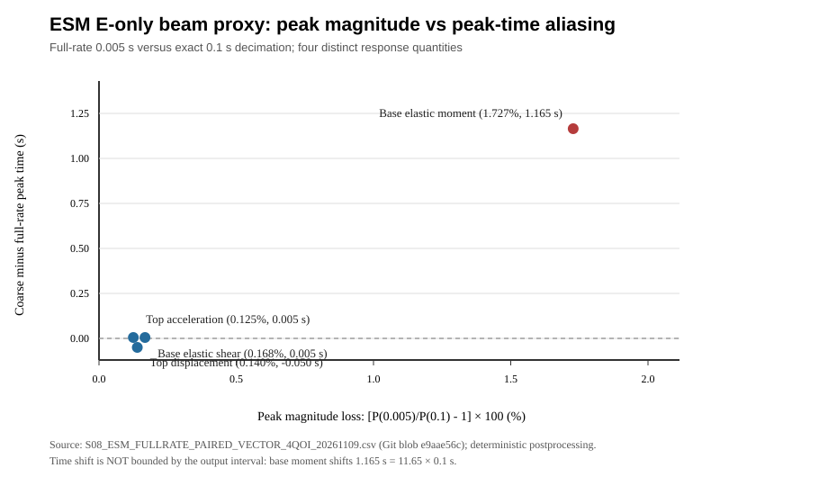

# 拟增第五章 地震输入与双水平线性梁代理响应（科研正文草稿，非现行六章正式替换）

> 研究对象为DTU 10 MW公开参考机组与158 m（混凝土112 m、钢塔46 m）研究性混塔组合。本文本仅装配**真实ESM记录驱动的非生产线性梁代理**已经获得的结果，不是风机精细结构地震验算、W/E/WE结果或已确定的嘉鱼实址抗震设计。本稿待导师确定六章/七章目录后再决定是否转入正式章节；截至2026-11-09，12阶段仍为0/12。

## 5.1 科学问题及先行工作的定位

风机塔架同时承受风致运行载荷与可能的地震激励，其动力响应受运行状态、基础运动、塔—机组耦合、分段连接及预应力状态共同影响。对于预应力混凝土—钢混合塔架，地震响应研究必须区分整体动力响应的可计算性与局部接缝、钢筋、预应力筋的抗震承载安全。现有160 m级混塔研究已经讨论了风震同时作用（DOI:10.1080/13632469.2026.2671807）和地震下PT水平的影响（DOI:10.1016/j.rcns.2026.03.002），因此本研究不将“首次考虑风震叠加”或“首次增加PT”作为创新。前者现有证据阅读至出版社摘要/元数据，后者已有出版社网页工程参数与PT响应节阅读记录；未据此宣称已逐页复现两文的建模细节。

本节提出更有限、可证伪的问题：在**同一真实地震事件、同一线性算子和同步时间轴**下，正交双水平响应的峰值是否可以由两轴各自最大值合成？输出采样从0.005 s稀疏为0.1 s会怎样影响峰值及控制时刻？进一步，在四个不同物理量各自的同步峰时，两个水平分量的平方幅值占比和独立峰时偏移是否相同？这些问题可以通过已有原始输出直接回答，但并不等价于混塔抗震安全验收。

## 5.2 地震输入、来源身份与线性代理假设

地震输入来自历史归档的ESM IT2012_0009 / IT.NVL记录HNE、HNN正交水平分量，属于外部实测事件的处理数据，不应称作“嘉鱼地震记录”。既有源收据分别锁定塔数据SHA256 `f738d35fc9c8b8d8745f2ed9490c92578b056cfe37201bbfa0bfdb24906d2983`、ESM处理源SHA256 `a353c1216b80cf2739b9cedfbd09b68bab3d3ffe49f1d6f3b537366c3559db34`。历史完整输出在[Actions artifact #13515201520](https://github.com/g2066203208-beep/voxel-frontier/actions/runs/42240081368/artifacts/13515201520)（ZIP SHA256 `9d63e41e3e6872d7721b8b0f932d7e3abc325d7fdafc40f9e4765e5c1472d673`，记录到期2027-02-04）；其中双方向CSV SHA256 `bab269897640e91d11da3ad02f8a0f3cf537c5e5aaf0f173bba6b1244a3591e0`，共64080行，每轴32040个0.005 s采样点，时段0—160.195 s。

该代理从历史158 m OpenFAST塔数据构建35个Euler–Bernoulli梁段，假定固定底座、连续线弹性、两水平轴同构、零初始状态和5%模态阻尼；RNA简化为塔顶集中质量，未保留真实叶片/机舱惯量与气动反馈，也没有预应力、分段接缝开闭、混凝土开裂、地基土—结构相互作用或竖向地震分量。塔底剪力与弯矩是**弹性恢复项**，不是包含所有惯性和基础运动贡献的总动态支座反力。双轴可正交合成是这些代理假设下的条件性方法，不能自动推广到非线性混塔。

场址地震目标谱尚未由适用的风机专项规范、场地地勘与危险性分析共同闭合。GB 18306—2015嘉鱼城镇区划参数只能作为参考；建筑抗震设计标准常规谱超过6 s的适用问题已另行核查，不能以建筑谱未经论证外推来代替本风机长周期设计目标谱。故本节不进行设计水准的“达标”判断，也不将此条记录视为代表性选波组。

### 5.2.1 官方长周期最小地震剪力下限的条件性参数研究（S05；不作为风机设计谱）

为了避免将一般建筑的地震影响系数曲线直接套用于158 m风机混塔，本研究进一步区分**地震反应谱纵坐标**、**最小地震剪力系数**与**实际结构底部剪力**三个不同量。住建部公开的《建筑与市政工程抗震通用规范》GB 55002—2021原文，印刷第12页第4.2.2条及表4.2.2-1、4.2.2-2规定建筑市政结构的水平地震影响系数最大值与场地类别/设计地震分组相关的特征周期；印刷第13页第4.2.3条及表4.2.3则规定最小地震剪力系数的分段下限。上述条款针对**建筑与市政工程**，其能否直接约束风电机组支撑结构，尚须通过IEC 61400-1/6、风电塔架专用标准与工程分类的适用性审查，不能把下列数值写成风机设计验算结果。

在第4.2.3条所规定的普通（非扭转不规则）结构条件下，令表4.2.3所列基准下限为λ₀，基本周期为T₁（s），将该条文写成可审计的分段**下限倍率**k(T₁)：T₁≤3.5 s时k=1；3.5<T₁<5 s时k=(9.5−T₁)/6；T₁≥5 s时k=0.75。对于该条文所指扭转不规则结构，仍按k=1的基准下限处理。这个k仅修正**最低剪力系数下限**λ_min=kλ₀，不是反应谱放大系数、地震记录缩放系数或动力响应衰减规律。尤其不允许把“5 s后k=0.75”理解为长周期谱加速度或实际塔底剪力自动下降25%。

以表4.2.3中**7度、0.10g**这一纯参数情景（λ₀=0.016）为例，T₁=3.5/4.0/4.5/5.0/6.0 s时，非扭转不规则的λ_min分别为**0.016000、0.014667、0.013333、0.012000、0.012000**；扭转不规则条件下上述周期均为**0.016000**。因而在T₁≥5 s的分支，非扭转不规则结构的下限相对λ₀减少25%，而不是实际地震作用减少25%。六种表列烈度/加速度情景的比例变化完全一致，数值见[六周期×六烈度源级数表](../../../experiments/T079/real-records/S05_GB55002_LONG_PERIOD_MIN_SHEAR_20261109.csv)及[分段曲线图](../figures/FIG_S05_GB55002_LONG_PERIOD_MIN_SHEAR_20261109.svg)，由[可运行Node程序](../../../experiments/T079/s05_gb55002_long_period_floor.cjs)复算。

第4.2.2条表4.2.2-2给出的15组场地类别—设计分组特征周期Tg范围为**0.20—0.90 s**。在仅用于敏感性扫描、并非已验证风机一阶周期的T₁=3.5—6.0 s窗口，T₁/Tg可跨越**3.889—30.000**。因此，研究长周期地震输入时必须核查实际结构周期、地基条件及目标谱的长周期定义与有效频带，不能仅以短周期平台值或城镇级0.05g/0.35s区划数值生成未经论证的设计目标谱。此处15组Tg只是规范表列参数组合，**不是15个实测场地，也不是15条地震记录**。

已于2026-11-08核实的GB 18306—2015附录C.17嘉鱼八镇0.05g/0.35s及2026年第1号修改单（仅针对西藏林芝、山南部分地区）属于**既有来源成果**，本次不重复计为新发现；修改单没有为本研究提供风机工址、地勘或长周期目标谱。本节新增证据限于住建部**官方规范原页第4.2.2—4.2.3条**的分段数值、可复现算式及适用边界。官方原页入口：[住建部2021年第61号公告及附件](https://www.mohurd.gov.cn/gongkai/zc/wjk/art/2021/art_17339_761174.html)；修改单政府附件：[宝鸡市地震局2026-04-07公告](https://dzj.baoji.gov.cn/col3813/col3811/202604/t20260407_1261239.html)。规范PDF已逐页目视核读但**未能取得其原始字节SHA256**，不以网页链接冒充已入Git的授权PDF。源级数值/算法PASS；风机规范适用性、场址危险水准、地勘、真实T₁、设计谱及抗震物理验收均HOLD。

### 5.2.2 两次实测事件谱形的最优单尺度匹配及不可消除残差（S05；经验参照而非设计谱）

为了检验“同台站两次实测记录仅需调整一个幅值系数即可互相代表”的假设，选取ESM v3的IT-2012-0008与IT-2012-0009事件、同一IT.NVL台站HNE/HNN处理后5%阻尼伪加速度反应谱（PSA，m/s²）。二者为2012年同一Emilia地震序列中的不同事件，**不构成两个独立场址危险性样本**。本节仅以0009事件作为**经验参照谱**，绝不将其称为嘉鱼或本研究混塔的规范设计目标谱。仅在两份原始派生表实际共有的T=4、6、6.230957763、8 s四个离散周期进行比较，不插值、不伪造连续谱。

记0008与0009事件在周期T处的同周期双水平几何均值分别为G₈(T)=√[PSA₈,E(T)PSA₈,N(T)]和G₉(T)，定义无量纲比r(T)=G₈(T)/G₉(T)。若用同一正尺度c将0008匹配至0009，且采用最大绝对相对偏差准则，则有限周期集合上的问题为

$$
\min_{c>0}\max_{T\in\mathcal{T}}|c\,r(T)-1|.
$$

设r_min和r_max为四个实测比值的最小与最大值，目标函数的最大值由端点控制，故在两端残差等幅异号时达到全局最小：

$$
c^*=\frac{2}{r_{\min}+r_{\max}},\qquad
\varepsilon^*=\frac{r_{\max}-r_{\min}}{r_{\max}+r_{\min}}.
$$

这是有限样本的解析极小极大解，并非规范规定的缩放方法。原始谱给出r_min=11.219431908（4 s）、r_max=17.711977969（6 s），因此**c*=0.069129020，最小可能最大相对误差仍为22.441167%**。四个周期的最优缩放残差依次为−22.441167%、+22.441167%、+14.744194%、−11.112638%。若采用常见的“仅使4 s谱值相等”的锚点缩放，其最大残差反而达到**57.868759%**。因此对这两份已处理实测谱，在给定四周期和该误差定义下，不存在使四点全部进入人为±10%带内的单一幅值系数。

进一步要求**同一尺度同时匹配HNE与HNN两方向**（共8个真实谱值比），最优尺度变为c*=0.062780283，最大相对误差至少为**55.173117%**；控制极值分别来自6 s的HNE（正残差）与8 s的HNN（负残差）。这证明仅检验两水平几何均值可能掩盖方向分量的不相容性，但不说明结构响应一定存在同幅度误差。该结果是关于**有限四周期、两个已处理事件、一个统一正尺度的可证伪不相容性**，并非地震波选配总体结论或风震结构效应。

表5-x的四周期、两个分量及几何均值的原始比值与最优残差见[实测派生CSV](../../../experiments/T079/real-records/S05_ESM_MINIMAX_SCALE_4PERIOD_20261110.csv)，可由[独立Node程序](../../../experiments/T079/s05_esm_empirical_minimax_scale.cjs)重新生成。输入为已归档46周期0008谱（SHA256 `31fea6aa2064abbd042e4a1b1a15b9aee90a598a7d1991bc0869bcd63177dd8c`）和5周期0009谱（SHA256 `0c790ae1ae5cd4e4bc94a08561e7cdfc39354baa4aa1d7e5fc76800c887192ce`），并核对ESM官方事件、台站与水平分量元数据。0008处理高通为0.04 Hz，0009两水平为0.08 Hz；8 s对应0.125 Hz，仅为0009处理高通的1.5625倍，**该比值不是可靠长周期的合格判据**。仪器低频、滤波、震源与场地差异、未验证的真实结构周期、目标谱适用性及输入不确定性尚无可信误差上界。图中±10%仅是明确标注的**演示性拒绝阈值**，不是IEC/GB规定。2026年已有160 m混塔风震和PT地震研究（DOI 10.1080/13632469.2026.2671807；10.1016/j.rcns.2026.03.002），本节不将实测选波或地震作用本身声称为首创。

## 5.3 同步二维峰值、非同步RSS与抽样误差的定义

对某一响应量q，令同一离散时刻t_i的两轴输出为q_E(t_i)、q_N(t_i)，定义R_q(t_i)=√[q_E(t_i)²+q_N(t_i)²]，同步二维离散峰值为P_q(Δt)=max_i R_q(t_i)。单轴筛查值M_q=max(max_i|q_E|,max_i|q_N|)，非同步峰值RSS为S_q=√[(max_i|q_E|)²+(max_i|q_N|)²]。同一时间网格下恒有M_q≤P_q≤S_q；S_q一般不对应任何真实时刻，不能把它写成同位峰值。0.1 s显示序列由0.005 s历史序列严格每20点抽取，因而P_q(0.1 s)≤P_q(0.005 s)；该不等式只适用于相同历史离散输出的子集，不是时间积分收敛误差的上界。

本节使用三项明确分母的指标：抽样漏失e_s=[P_q(0.005)/P_q(0.1)−1]×100%；最大单轴漏选e_a=[P_q(0.005)/M_q−1]×100%；异时RSS偏差e_r=[S_q/P_q(0.005)−1]×100%。所有百分比都是**本次历史时程的确定性比值**，并非统计置信区间、材料应力裕度或结构安全系数。

| 响应量 | 0.005 s同步二维峰值 | 峰时/s | 0.1 s抽样漏失/% | 单轴漏选/% | 异时RSS高估/% |
|---|---:|---:|---:|---:|---:|
| 塔顶相对位移 | 37.929954 mm | 50.150 | 0.139519 | 8.256767 | 20.421579 |
| 塔顶绝对加速度 | 0.182811 m/s² | 38.795 | 0.125075 | 18.759147 | 15.695381 |
| 塔底弹性恢复剪力 | 367.150090 kN | 38.595 | 0.167614 | 12.633693 | 21.159006 |
| 塔底弹性恢复弯矩 | 11952.345959 kN·m | 35.435 | 1.727466 | 6.397966 | 18.432811 |

数据来源：[四项全采样同位峰值表](../../../experiments/T079/real-records/S08_ESM_FULLRATE_PAIRED_VECTOR_4QOI_20261109.csv)，其SHA256 `0566ccfa604e2a4e7538fd9a20fe8d2f36f8e661d024baaf305b3d0d1cbd0af9`；[原图](../figures/FIG_S08_ESM_FULLRATE_PAIRED_VECTOR_20261109.svg)。本次仅复用历史已经完成的响应积分结果，不开展新结构动力求解。

## 5.4 新增结果：各响应峰时的方向平方占比与峰时错位

仅报告同步范数峰值还不足以说明**峰值由哪个水平分量主导，以及峰时是否与任一单轴最大时刻重合**。为此在每个响应量自己的同步峰时t*_q计算平方分量占比w_E=q_E(t*_q)²/P_q²、w_N=q_N(t*_q)²/P_q²，以及峰时差Δt_E=t*_q−argmax|q_E|、Δt_N=t*_q−argmax|q_N|。w_E+w_N=1是恒等式；这里的“平方占比”仅表示矢量几何分解，**不是模态能量、地震输入能量或材料耗能分配**。符号与时间偏移保留各方向真实输出的正负和先后关系。

| 响应量 | 同步峰时/s | HNE平方占比/% | HNN平方占比/% | Δt_E/s | Δt_N/s |
|---|---:|---:|---:|---:|---:|
| 塔顶相对位移 | 50.150 | 85.322 | 14.678 | -0.010 | -13.820 |
| 塔顶绝对加速度 | 38.795 | 42.588 | 57.412 | 4.270 | 4.545 |
| 塔底弹性恢复剪力 | 38.595 | 32.030 | 67.970 | 4.255 | 0.000 |
| 塔底弹性恢复弯矩 | 35.435 | 86.839 | 13.161 | 0.010 | -1.150 |

图5-x：[各响应同步峰时的方向平方占比](../figures/FIG_S08_FULLRATE_VECTOR_DIRECTIONAL_PEAK_20261109.svg)；新数表：[4 QoI方向峰时分解](../../../experiments/T079/real-records/S08_ESM_FULLRATE_VECTOR_DIRECTIONAL_PEAK_4QOI_20261109.csv)。

**可检验的现象是不同响应量的方向组成并不相同。** 塔顶相对位移和塔底弹性恢复弯矩的同步峰值分别由HNE平方分量贡献85.322%和86.839%；而塔顶绝对加速度与塔底弹性恢复剪力则以HNN为主，分别占57.412%和67.970%。特别是塔顶绝对加速度的同步峰发生于38.795 s，较HNE、HNN各自的独立峰时分别晚4.270 s、4.545 s；这意味着两方向**均未达到各自独立最大值时，合成矢量仍可达到全程最大值**。与之对照，剪力同步峰时恰好等于HNN独立峰时38.595 s，而HNE独立峰早4.255 s。由此可证，使用某一个“全塔统一控制时刻”或把两个不同时间的分量峰值相加，均可能错配响应量与物理时刻。

这种错位**不证明**地震双轴耦合的材料非线性，也不能推断混塔接缝哪个方向先张开；它仅说明即使在本次线性梁代理中，时域矢量合成也需要同步时序。将来若研究非线性接缝或PT峰值，必须直接从同一物理状态的原始局部响应时程提取，不得用此代理的w_E、w_N替代。

## 5.5 误差预算、反例与结果的适用范围

数据字节与时间网格可追溯：历史0.005 s与0.1 s每20点精确抽取在全部五个数值列上最大绝对差为0；独立NumPy已复核四项同步峰值。新方向分解采用同一四行原始表中的峰时分量值，逐行验证√(q_E²+q_N²)=P_q，w_E+w_N=100%，双精度恒等残差最大约4×10⁻¹⁵；程序以3–4–5已知解与非有限数、时刻偏离0.005 s网格、分量超出独立峰值及矢量不一致等污染输入做拒绝测试。表内占比显示到0.001个百分点，末位舍入误差不超过0.0005个百分点。

必须分别看待四类尚未闭合的不确定性。**离散采样误差**可在本次0.005 s与0.1 s输出之间定量比较，却不界定0.005 s与连续时间真实极值的差。**代理模型误差**涉及固定基础、5%阻尼、RNA集中质量、线弹性连续塔身、没有接缝/PT/地基/竖向输入，其物理影响尚无可信区间。**输入适用性误差**涉及记录滤波有效频带、长周期谱、目标危险水准、场址类别及记录代表性，目前不能声称本波满足设计谱。**跨工况配对误差**涉及未取得同一初态SHA与相同运行状态的B/W/WE，故不能从E-only结果构造风震增量或交互效应。图表中的有限数值均不构成抗震安全或材料疲劳寿命结论。

## 5.6 阶段性结论与后续正式章节的使用条件

在历史真实ESM记录驱动的非生产线性梁代理中，四项响应的同步双水平峰值、控制时刻和方向平方占比具有可复现的差异。对本事件，塔底弹性恢复弯矩由0.1 s抽取改用0.005 s输出时，识别出的离散峰值由11749.379416 kN·m增至11952.345959 kN·m，控制时刻由36.600 s变为35.435 s；将不同时间的两轴峰值直接RSS合成会比0.005 s同步峰值高18.432811%。塔顶加速度峰时与两轴独立峰时均相差超过4 s，说明“同位”要求不能被单轴峰值合成替代。该结论是**源级时程后处理的方法性发现**，不是风机抗震承载力证明。

本稿保留原六章正式正文不变。只有在地震目标谱/选波适用性、真实结构状态与双向动力响应、W/E/WE同态配对、局部材料与PT响应及标准适用条款全部得到相应证据后，才可以把这里的方法性章节扩展为实际混塔的地震响应与抗震约束结论；在此之前，S08/S09物理HOLD、正式DLC1.2=0/126、12阶段=0/12，期刊独立送审HOLD。

### 5.2.3 实测双水平谱的方向包络放大：对数周期积分（2026-11-14）

为避免用单一周期的RotD100/RotD50比值评价全部长周期输入，本文直接从既有ESM v3 IT.NVL同事件双水平、5%阻尼、46周期真实派生伪加速度谱出发，定义 R(T)=PSA_RotD100(T)/PSA_RotD50(T)，并以对数周期权重作梯形积分：R_bar = sum[0.5*(R_i+R_(i+1))*ln(T_(i+1)/T_i)]/ln(T_b/T_a)。此指标只描述所选事件的谱方向敏感性。

| 周期窗 | 点数（含端点） | 对数周期平均比值 | 离散比值最小–最大 | 最大值所在周期 |
|---|---:|---:|---:|---:|
| 1.25–4.00 s | 25 | 1.155472 | 1.066187–1.364424 | 1.25 s |
| 4.00–9.346436644298 s | 21 | 1.166449 | 1.073070–1.346402 | 7.737650 s |
| 1.25–9.346436644298 s | 45 | 1.160103 | 1.066187–1.364424 | 1.25 s |

4.00 s是两个子窗共享端点，故子窗点数不能相加解释为独立样本数。6.00 s的方向比值为1.176521，9.00 s为1.081687。长周期窗的对数平均比短周期窗高0.010976（相对约0.95%），但两窗来自同一事件、且周期谱点高度相关，不能据此作统计显著性或场址总体结论。该比值不是规范地震方向组合系数、不是结构动力放大系数，也不支持风震耦合或抗震承载力结论。

SOURCE：直接读取历史46行CSV experiments/T079/real-records/S05_ESM_NVL_PSA_PSD_46PERIOD_20261107.csv，Git blob 99b0b662fcc776701f15df8e4cbe28c109727c7b，历史文件SHA256 d85bd916c34cc4e0a008a26d07ef49935a4aa90c3feb5d9bb9a5f96a12f1c0cf；OFFICIAL：ESM v3 DOI 10.13127/esm.3；原MP处理双水平记录历史SHA256 a353c1216b80cf2739b9cedfbd09b68bab3d3ffe49f1d6f3b537366c3559db34，本轮未取得原波字节。RUN：V8直接解析真实46行CSV并对45点执行对数梯形积分、极值及6/9s比值核对；没有新增结构或风机生产RUN。TAB：上表3行；FIG：无新增；REF：沿用既有ESM来源，未重新全文核两篇2026先行论文；STANDARD：没有新增授权规范原文。误差预算：CSV舍入影响末位，46周期离散积分误差无独立上界，需更密周期重算；0.04Hz处理低切、0.09Hz报告信噪边界、旋转角步长及单事件代表性均未量化，9.346s对应0.107Hz尤其需审慎。反证：更密周期/独立原波谱若不支持此窗积分则撤回数值结论。S05 INPUT_RESEARCH_PARTIAL；S08/S09及12阶段物理验收保持HOLD、晋级0/12。

### 5.2.4 实测谱离散积分的抽稀稳定性与长周期截断敏感性（2026-11-14）

为检验§5.2.3的单一46周期表积分是否对周期节点选取敏感，直接使用同一ESM历史派生谱CSV（Git blob `99b0b662fcc776701f15df8e4cbe28c109727c7b`，历史SHA256 `d85bd916c34cc4e0a008a26d07ef49935a4aa90c3feb5d9bb9a5f96a12f1c0cf`），只保留T≥1.25 s的45个节点。保持端点1.25与9.346436644298 s不变，分别每隔2、3、4个原始节点取样，并保留末端节点；对R(T)=RotD100_PSA/RotD50_PSA沿ln(T)做非等间距梯形积分，除以ln(Tmax/Tmin)。这些是对**已采样谱表的抽稀敏感性**，不是重新处理原加速度或加密周期谱。

| 原始节点抽样 | 保留节点数 | 对数周期平均R | 相对45点基准差/% |
|---|---:|---:|---:|
| 全部节点 | 45 | 1.160102738 | 0 |
| 每2点取1点并保留终点 | 23 | 1.160143556 | +0.003518 |
| 每3点取1点并保留终点 | 16 | 1.174488494 | +1.240042 |
| 每4点取1点并保留终点 | 12 | 1.165239974 | +0.442826 |

结果**并非随抽样步长单调收敛**：16点方案偏移1.240%，而更稀的12点方案偏移0.443%。因此，不能因为23点与45点相差仅0.0035%就断言45点结果已达到某一精度；该表反而揭示周期节点布局与局部谱峰捕获存在混叠风险。1.240%是本次三种抽稀方案中的最大观测偏移，不是对真实连续周期积分误差的严格上界。

进一步保持下端1.25 s不变，仅截断积分上限，以区分长周期处理边界对**所定义积分区间**的影响：

| 上限周期/s | 使用节点数 | 对数周期平均R | 上限点f/0.09Hz |
|---|---:|---:|---:|
| 6.0 | 33 | 1.150207717 | 1.851852 |
| 7.0 | 38 | 1.149544891 | 1.587302 |
| 8.0 | 41 | 1.158953954 | 1.388889 |
| 9.0 | 44 | 1.161476821 | 1.234568 |
| 9.346436644298 | 45 | 1.160102738 | 1.188807 |

从6 s截断扩展到9.3464 s，平均R变化+0.009895021（约+0.8603%），但该变化同时改变了积分定义域，**不是**滤波误差或原波可靠性的估计。最后一列仅为频率与历史报告0.09 Hz SNR边界的比值，不是信噪比或可靠性合格证据。若要宣称更密周期积分收敛，必须恢复同一原始双水平加速度与处理配置，重新生成密集周期RotD谱并与45点基准比较；本轮未取得原波，故维持HOLD。

**验收与反证：** SOURCE为上述46行真实历史派生CSV；RUN为GitHub连接器读取全部46行后V8按原列索引直接重算45点、三种抽稀及五个截断区间；单位R无量纲，周期s；TAB为上述两表共9行，FIG无新增；OFFICIAL/REF/STANDARD无新增授权原文。已知反例为16点与12点非单调偏移；误差预算不包括原始记录滤波、谱求解器角度步长、单事件抽样和目标设计谱偏差。S05仅SOURCE-LEVEL PARTIAL，不能上升为风机设计地震谱或S08/S09结构PASS；正式12阶段晋级0/12。

### 5.2.5 实测双水平谱方向比值的周期分布图（2026-11-14）

**图5-X** 真实历史ESM IT2012_0009 / IT.NVL记录5%阻尼伪加速度谱的方向包络比值。横坐标为振子周期T（s，对数刻度），纵坐标为RotD100_PSA/RotD50_PSA（无量纲）；蓝线连接原始派生谱表中T≥1.25 s的45个离散周期点，红色虚线为§5.2.3定义的对数周期平均值1.160103。图像直接从历史46行谱CSV生成，源文件Git blob `99b0b662fcc776701f15df8e4cbe28c109727c7b`；图像文件见[图5-X源SVG](../figures/FIG_S05_ESM_ROTD_RATIO_LONG_PERIOD_20261114.svg)。在这45个离散节点上，方向比值最小约1.06619，最大约1.36442；这只是离散节点极值，不能作为连续周期极值的上/下界。曲线局部起伏表明，单一常数倍率无法保留周期选择效应；对数周期平均也不应直接用作任何风机规范方向系数。图中的线段仅为相邻采样点的视觉连接，不代表已恢复原始加速度并进行密集周期谱求解。既有0.04 Hz处理低切、0.09 Hz信噪边界、旋转角度离散及单事件代表性均未被本图消除。该图属于**实测地震记录的历史派生谱可视化**，不包含158 m混塔结构响应，也不提供抗震安全结论。

### 5.4.1 峰值幅值稳定不等于控制时刻稳定：0.1 s抽样的真实历史代理反例（2026-11-14）

为了区分输出抽样造成的**峰值幅值误差**与**峰值发生时刻误差**，直接对历史同一0.005 s双水平E-only线性梁代理四项响应表逐行计算。令 t_h 为0.005 s同步矢量峰时、t_c 为从同一序列每20点严格抽取的0.1 s峰时，定义有符号偏移 Δt=t_c−t_h、幅值漏失 e=[P_h/P_c−1]×100%。两者衡量不同的误差对象，不能用幅值误差小来推断控制时刻准确。

| 响应量 | 0.005 s峰时/s | 0.1 s峰时/s | 有符号偏移/s | 幅值漏失/% | 偏移绝对值/0.1 s |
|---|---:|---:|---:|---:|---:|
| 塔顶相对位移 | 50.150 | 50.100 | -0.050 | 0.139519 | 0.50 |
| 塔顶绝对加速度 | 38.795 | 38.800 | +0.005 | 0.125075 | 0.05 |
| 塔底弹性恢复剪力 | 38.595 | 38.600 | +0.005 | 0.167614 | 0.05 |
| 塔底弹性恢复弯矩 | 35.435 | 36.600 | **+1.165** | **1.727466** | **11.65** |

**图5-X** 横轴为同步二维峰值幅值漏失，纵轴为粗采样峰时减全采样峰时。塔底弹性恢复弯矩幅值仅相差1.727466%，但识别出的控制时刻相差1.165 s，是0.1 s输出间隔的11.65倍。这不是0.1 s网格取整所能解释的时刻偏移，而是不同离散采样集所选全局最大值时刻发生切换的直接证据；本轮未恢复原时程的局部峰邻域，故不推断具体局部峰曲率、排序裕量或物理因果机理。对于同一离散序列，抽样子集的最大幅值不会超过全序列最大幅值，但argmax的时间偏移**没有仅由采样间隔决定的普适上界**。若依据0.1 s峰时截取其他响应或局部材料应力，可能产生跨响应错时；应从原始同步时程提取对应物理量。

SOURCE：[四项全采样与粗采样同位峰值表](../../../experiments/T079/real-records/S08_ESM_FULLRATE_PAIRED_VECTOR_4QOI_20261109.csv)，Git blob e9aae56c1da761f6ce19fe97b7e97a4bf3d6c62b，历史SHA256 0566ccfa604e2a4e7538fd9a20fe8d2f36f8e661d024baaf305b3d0d1cbd0af9；RUN=直接读取四行真实历史派生表，计算Δt、e、|Δt|/0.1并检查幅值漏失非负；TAB=4行，FIG=1张。REF/STANDARD/OFFICIAL无新增授权原文，ESM v3 DOI 10.13127/esm.3及2026混塔先行文献仅沿用既有阅读深度。误差预算：时间源精度0.005 s，表中时间显示到0.001 s；0.005 s对连续时间极值的漏失、原波滤波、代理模型与场址代表性均未量化。反证：若重新从原始64080行CSV以相同双轴同步定义和每20点抽样复算不一致，则撤回本表。**这是E-only线性梁代理后处理结果，不是实际混塔PT/接缝/抗震安全或W/WE物理结论；12阶段晋级0/12。**
