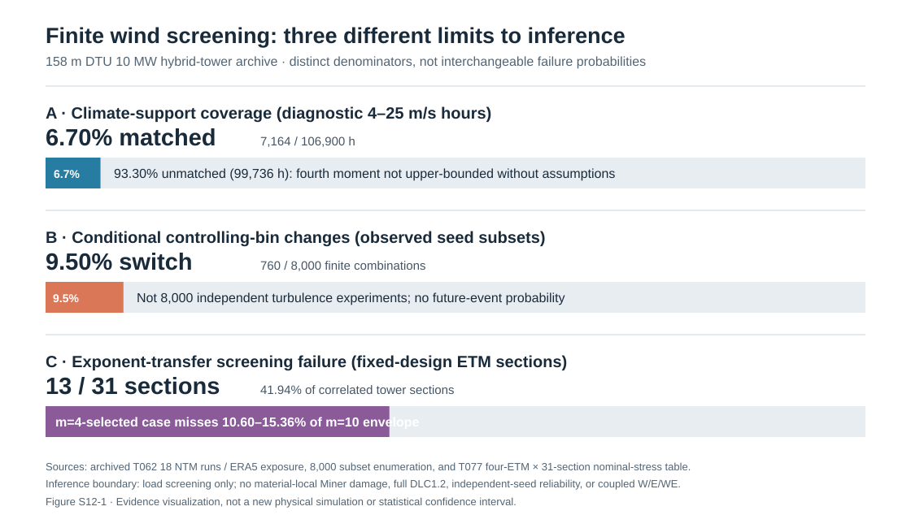

# When wind-load screening is not fatigue reliability: conditional rankings and missing-climate identification in a 158 m hybrid tower

**Status:** Condensed scientific manuscript candidate, 21 November 2026. Not submission-ready; no new physical simulations. This is a selective replacement candidate for the overgrown research manuscript, not a claim of an additional independent experiment.

## Abstract

**Research question.** Under what conditions do rainflow-derived load rankings from a finite set of turbulent inflows identify a reliable long-term fatigue-load decision? **Data and methods.** We examine archived OpenFAST load-screening results for a DTU 10 MW, 158 m concrete–steel tower (112 m concrete and 46 m steel), including 36 historical 600 s realizations, 18 NTM runs at three wind speeds with six seeds each, and 184,080 hourly ERA5-derived wind entries. We separate (a) reproducibility of rainflow ordering, (b) conditional selection under the observed seeds, and (c) identification of a climate-weighted fourth-order load moment under missing wind-speed bins. Four ETM cases and 31 sections provide a separate fixed-design nominal-stress stress test. **Results.** Correcting historical rainflow closure changes 102/630 My and 12/630 Mx pairwise rankings. Enumerating all 8,000 combinations of three of six seeds per NTM speed changes the My controlling-bin identity in 760 cases (9.50% of the finite observed subset space). Of 106,900 ERA5 hours in the diagnostic [4,25) m/s interval, only 7,164 (6.70%) have matching NTM load summaries. With unconstrained nonnegative load moments in the other 99,736 hours, the total fourth moment has a computable lower bound but no finite upper bound. In the separate four-ETM fixed-design experiment, reusing an m=4-selected case for m=10 misses 10.60–15.36% of the observed m=10 nominal-stress DEL envelope in 13/31 sections. **Interpretation.** These are conditional screening counterexamples, not material-specific Miner damage, independent-seed reliability estimates, complete IEC DLC1.2 or combined wind–earthquake validation.

**Keywords:** hybrid tower; rainflow counting; damage-equivalent load; partial identification; wind climate; screening robustness.

## 1. Introduction

Fatigue assessment of a prestressed-concrete–steel tower requires a chain from wind climate and operating state through time-dependent loads, local material stress cycles and material-appropriate fatigue laws. A tower-base moment DEL collapses the first part of that chain to a scalar under a chosen exponent and equivalent-cycle convention. It does not identify mean stress, stress concentration, concrete/reinforcement/tendon/steel S–N behavior or Miner accumulation. The scientific question here is narrower: can an observed load-screening ranking be relied upon before those further steps?

Published 160 m-class hybrid-tower wind–earthquake research (Wang et al., DOI 10.1080/13632469.2026.2671807) and a different 163.24 m prestress/seismic study (DOI 10.1016/j.rcns.2026.03.002) preclude claims that simultaneous wind–earthquake analysis or prestress-related seismic effects are new in themselves. The first source has been checked at publisher abstract/metadata level in this archive; the second has publisher full-text/selected-page review. Neither is claimed to validate the present load-screening archive or to lack the present statistical tests. The present contribution is a falsifiable separation of *ranking reproducibility*, *finite-seed conditional stability* and *climate-support identifiability*.

## 1.1. Prior-art boundary and non-transferability of seismic conclusions (publisher-source check, 22 November 2026)

Two 2026 studies already establish that wind–earthquake response and prestress-based seismic strengthening of tall hybrid towers are active prior art. Wang et al., *Journal of Earthquake Engineering*, DOI [10.1080/13632469.2026.2671807](https://doi.org/10.1080/13632469.2026.2671807), published online 16 May 2026, describe a 160 m-class hybrid tower, three Davenport-spectrum wind-speed conditions, three PEER records selected against a Site Class II response spectrum, and simultaneous wind–earthquake response analysis. These statements are directly supported by the publisher abstract; its detailed time synchronization, load provenance, response quantities and uncertainty treatment were **not** independently extracted from a complete article in this check.

Wang et al., *Resilient Cities and Structures* **5**(2), 47–64 (June 2026), DOI [10.1016/j.rcns.2026.03.002](https://doi.org/10.1016/j.rcns.2026.03.002), provide a distinct, open-access full-text example: the nominal 160 m-class prototype is **163.24 m** in the project overview, with a **129.36 m/42-segment** concrete section, a **3.08 m** transition and a **30.8 m** steel upper section; the reported model uses **16 prestressing cable bundles**. Their publisher abstract identifies a **37.5 m/s** strong-wind case, three PEER motions for Site Class II and three earthquake levels, reports **0.40 MPa** concrete tensile stress in a rare-earthquake case, and states that a **21.9%** prestress increase eliminated that tensile stress in their modeled scenario. These numerical findings are *their model-specific outcomes*, not independently validated design rules, and neither the percentage nor their geometry is transferable to our **158 m = 112 m concrete + 46 m steel**, **31-section**, DTU 10 MW research model. The 31 sections here are post-processing stations and must not be mislabeled as the 42 concrete construction segments of the published prototype.

Consequently, the present article makes **no novelty claim** for simultaneous wind–earthquake application, for using prestress to mitigate seismic tensile stress, or for the physical performance of a 160 m-class hybrid tower. Its independently testable question is whether finite turbulent-wind **load-screening decisions** remain identifiable under rainflow convention changes, observed-seed subset selection and missing wind-climate support. Neither prior article is claimed to have omitted those analyses without a full methods-and-results comparison. A separate future wind–earthquake article would need matched physical input histories and an explicit method-by-method comparison before claiming any novelty. The prior seismic stress and prestress percentages cannot validate our fatigue or seismic conclusions.

**Source depth and remaining evidence gap.** The first DOI was read at publisher metadata/abstract level; the second at publisher abstract, project overview and selected full-text method sections. Figure-level numerical replication, supplementary datasets, precise pages/figure IDs and full reference-list cross-check are NOT_VERIFIED. Publisher sources are REF, not this study's SOURCE/RUN; no authorized IEC/GB standard clauses or site-specific design spectrum were acquired in this check.

## 2. Data, definitions and decision protocol

The 36 historical screening realizations are not represented as a completed design-load-case matrix. For a load-channel rainflow ledger with ranges ΔL_j, cycle counts n_j and fixed reference count N_eq, define the diagnostic equivalent range at exponent m as

\[
L_{\mathrm{DEL},m}=\left(\frac{\sum_j n_j(\Delta L_j)^m}{N_{\mathrm{eq}}}\right)^{1/m}.
\]

All comparisons must keep the channel, coordinate convention, reference count, counting/closure method, simulation window and exponent fixed. A different exponent is a *different screening functional*, not an automatic material fatigue law.

The seed-subset experiment enumerates \(\binom{6}{3}^3=8000\) equally weighted subsets of *already observed* seeds. Its 9.50% is the exact fraction in that finite combinatorial universe, **not** an empirical frequency from 8,000 independent turbulence experiments and not a confidence interval. Seed independence, sampling representativeness and operational stationarity remain unverified.

For wind-speed bins b with climate hours h_b and conditional load fourth moments q_b ≥ 0, write the diagnostic unnormalised climate load moment as \(M_4=\sum_b h_b q_b\). Split observed and missing support into O and U. Then \(M_4=M_{4,O}+\sum_{b\in U}h_bq_b\), giving the sharp identification set \([M_{4,O},\infty)\) whenever at least one missing bin has positive hours and no finite bound on its moment. Dividing by a fixed total exposure or taking the fourth root preserves the absence of a finite upper bound. This statement requires only nonnegativity and the stated support definition; it is not a probability estimate or a material lifetime bound.

The prospective rejection protocol is declared before new data: (i) retain a predeclared union of controlling cases across specified screening exponents; (ii) reject predictor use outside the wind-speed/operating-state training domain; (iii) admit material fatigue only after matched local cycle histories and material laws are available. Failures are recorded rather than re-tuning thresholds after seeing outcomes.

## 3. Results

| Question | Source-derived result | Admissible inference |
|---|---|---|
| Rainflow closure sensitivity | 102/630 My and 12/630 Mx historical pairwise rankings change | Numerical case ranking depends on the closure convention |
| Conditional finite-seed selection | 760/8,000 observed subset combinations (9.50%) change the My controlling-bin identity | Exact conditional enumeration; no independent-sample CI |
| Climate support | 7,164/106,900 diagnostic hours covered; 99,736 uncovered (93.30%) | Missing nonnegative moments imply no finite upper bound |
| Exponent transfer, four ETM | 13/31 sections lose 10.60–15.36% of observed m=10 envelope if selected at m=4 | A fixed-design nominal-stress case-selection counterexample |
| Cross-speed prediction | LOBO affine RMSE 0.213951, 0.169327, 0.813993 MPa for low/middle/high held-out bins | Edge-bin extrapolations rejected before evaluating response |

**Figure 1** contrasts three non-exchangeable denominators: the share of diagnostic ERA5 hours with matched NTM load summaries (7,164/106,900), the fraction of all observed three-of-six-seed subset combinations that change the My controlling wind-speed bin (760/8,000), and the fraction of correlated sections whose m=4-selected ETM case undercaptures the observed m=10 envelope (13/31). Their visual juxtaposition does **not** imply a joint probability, an independent sampling distribution, or a common population. In particular, 13/31 is a spatial section count rather than an estimate of the proportion of future turbulent realizations. The percentage of climate hours covered also cannot be interpreted as the fraction of the load fourth moment covered.

The 31 sections are spatially correlated and cannot be treated as 31 independent seeds. The four ETM records are also not a formal long-term wind-climate sample. The high-speed LOBO error is not evidence of generalization to other tower designs; the middle-bin result is an interpolation diagnostic based on a single held-out realization.

## 3.1 A constructive ranking non-identification test

The absence of an upper bound for an individual climate-weighted moment also implies a stronger decision-level limitation. Consider two candidate screening decisions A and B with known covered-bin fourth-moment contributions \(a\) and \(b\), respectively, and \(H_U>0\) uncovered climate hours. Write \(M_A=a+H_U q_A\) and \(M_B=b+H_U q_B\), with \(q_A,q_B\geq0\). Even when \(a<b\), the covered-bin ranking does not determine the full-climate ranking: choosing \((q_A,q_B)=(0,2(b-a)/H_U)\) preserves A as the smaller total, whereas choosing \((2(b-a)/H_U,0)\) makes A the larger total. Both assignments respect nonnegativity. Thus no strict climate-wide ordering is identified from the covered-bin ranking alone. The result applies to the fourth-moment *screening objective* and does not establish any material fatigue ranking.

If an externally justified common cap \(0\leq q_A,q_B\leq Q\) is available, sharp bounds are \(M_A\in[a,a+H_UQ]\) and \(M_B\in[b,b+H_UQ]\). A strict robust ranking \(M_A<M_B\) for every admissible assignment holds if and only if \(a+H_UQ<b\). Equality permits a tie and therefore fails the strict test. The reverse condition is \(b+H_UQ<a\); otherwise the decision is unresolved. These are *worst-case interval tests*, not confidence intervals; the cap must come from independent physics or observations, not be fitted to obtain a desired ranking.

For an executable rejection example only, set the archived uncovered-hour count \(H_U=99,736\) and arbitrary normalized covered contributions \(a=1,b=2\). The cap threshold for strict A dominance is \(Q<1/99,736=1.002646988\times10^{-5}\) normalized moment per hour. With no cap, witnesses \((q_A,q_B)=(0,2/H_U)\) and \((2/H_U,0)\) reverse the ranking. **The values 1 and 2 and the witness moments are synthetic mathematical counterexamples, not reconstructed OpenFAST or ERA5 load values.** The test is implemented with boundary, equality and invalid-input rejection assertions in [the source-level Node script](../experiments/T080/s12_missing_bin_ranking_identification.cjs). This formal result upgrades the missing-climate discussion from an unbounded scalar estimate to a falsifiable decision-identification criterion without inventing missing wind records.

## 4. Discussion

The results show three distinct failure modes. First, a counting implementation can alter the rank order even with identical wind records. Second, a control case may depend on the finite subset of observed turbulence seeds; combinatorial enumeration describes the archived sample, not the probability of future failure. Third, even a perfectly reproduced ranking within the covered bins cannot identify the unconditional fourth moment when the missing-bin moments remain unrestricted. The fixed-design ETM comparison adds a fourth, separate warning: a control case selected for one exponent need not preserve the envelope for another exponent.

The lack of a finite upper bound is an *identification result*, not a prediction that unobserved bins necessarily produce very large loads. A finite bound would require an independently justified physical cap, a validated response model, or actual missing-bin loads. Neither extrapolating the three available wind speeds nor assigning zero to missing bins is justified by the present data. The ERA5 series is a reanalysis wind-climate proxy, not a measured turbine operating history; cut-in, cut-out, parked states and availability cannot be silently inferred.

The original 2026 prior studies investigate different towers and loading questions. Our source-level archive supports no claim of superior seismic performance, material lifetime, tendon optimality or novelty of wind–earthquake combination. Independent replication from the original OpenFAST output binaries, verification of the run-state and force/inertia decomposition, independent seeds, fuller wind-bin coverage and local material stress histories remain necessary before moving beyond screening.

## 5. Conclusions

1. Historical rainflow closure choices can change the ordering used to choose a controlling case; a reproducible implementation and retained source ledger are prerequisites for any downstream decision.
2. The 9.50% conditional subset-switch fraction measures finite-archive sensitivity, not a future-event probability.
3. With 93.30% of the diagnostic climate hours lacking matched load summaries, the unrestricted nonnegative missing contribution makes the long-term fourth moment only partially identified, with no finite upper bound.
4. A single m=4-selected ETM case misses 10.60–15.36% of the observed m=10 nominal-stress envelope in 13 sections. Material fatigue damage, seismic safety and optimisation remain untested.

## Evidence and reproducibility boundary

**SOURCE:** archived 36-case rainflow ledger (48,070 cycle rows, historical SHA256 `067c60cea61b35398edd186ff509fe759d1c4420395f082d06c666d92d897ecb`); T062 NTM summary (72 rows, Git blob `1b334e9afdbd792a2f4b1a41cdb150dc3698352d`); T077 four-ETM nominal-stress table (1,984 rows, Git blob `b5effa2a493cec0a9af8a10a3b93df0ff997d2d0`); ERA5 hourly archive (184,080 entries). **RUN:** values inherited from previously source-level checked analyses in T079/T080; this condensed draft performs no new source-level numerical execution. **REF:** two 2026 DOI publications above; first abstract only, second selected full-text pages; further page-level comparison needed before submission. **STANDARD/OFFICIAL:** no new authorized IEC/GB clause or official site design spectrum verified. **FIG:** one new source-traced SVG figure (Figure 1; visualization of inherited values, not new numerical simulation); **TAB:** one selective results table. **Uncertainty:** finite seed sample, climate/model mismatch, historical output precision and unknown local stresses are not bounded by the reported arithmetic. **PASS:** faithful synthesis of identified archived numerical claims. **HOLD:** independent source rerun, citation completeness, publication-ready figures, formal DLC1.2, local Miner, coupled W/E/WE and journal submission.

## 3.2. Exact empirical resampling of the high-wind-bin contribution (22 November 2026)

The six archived NTM seeds at 19.202140 m/s permit a finite, fully enumerated *empirical* sensitivity experiment without generating new turbulence. Holding the 9.343881 and 11.4 m/s bin means and diagnostic hours (5,736 and 1,426 h) fixed, draw six times **with replacement** from the six observed high-bin seed fourth moments, each draw having six equiprobable choices. The full sample space contains exactly \(6^6=46,656\) ordered tuples. For each tuple compute \(100[2\overline{D^4}_{H}]/[5736\overline{D^4}_{L}+1426\overline{D^4}_{M}+2\overline{D^4}_{H}]\). Here \(D\) is the archived m=4 load DEL, and the common fourth-power scaling cancels. The empirical inverse CDF uses the smallest order statistic with cumulative frequency at least the stated quantile. These 46,656 correlated resamples are *not* independent wind simulations and their quantiles are **not** 95% confidence limits for an unknown wind climate.

| Archived channel | Original high-bin share | Empirical 2.5% | Median | Empirical 97.5% | Exact attainable min–max |
|---|---:|---:|---:|---:|---:|
| TwrBsMxt | 2.729214% | 1.797546% | 2.736287% | 3.603719% | 0.803208%–4.296102% |
| TwrBsMyt | 0.074990% | 0.061800% | 0.074891% | 0.089623% | 0.048398%–0.105774% |

Neither channel exceeds a 5% high-bin share in any of the 46,656 resamples, because even the largest observed high-bin fourth moment repeated six times is below that threshold under **fixed other-bin means and fixed historical hours**. This is an exact finite-support statement, not a future-seed guarantee. New seeds, alternative operating states, missing wind bins, changed exposure, or a different material exponent can overturn it. The result strengthens the distinction between observed-seed uncertainty and unbounded missing-climate uncertainty: resampling within a six-point empirical support cannot constrain unobserved wind-bin fourth moments.

### 3.3. Exposure sensitivity of the observed-seed high-bin bound

The 5% statement above is **not robust to an arbitrarily small change in the high-speed exposure**. Holding the two lower NTM bins' 7,162 hours and six-seed fourth-moment means fixed, let (h) replace the observed two high-bin hours and let (x) denote the high-bin mean of the six resampled fourth powers of DEL (units ((\mathrm{kN\,m})^4)). For a target share (p=0.05), the exact boundary is (h_{\rm crit}(x)=pF/[(1-p)x]=F/(19x)), where (F=5736\bar x_{9.34}+1426\bar x_{11.4}). Because any six-draw mean lies between the smallest and largest observed high-bin fourth powers, **all** 46,656 empirical resamples remain strictly below 5% if and only if (h<F/(19x_{\max})). Conversely, **all** exceed 5% if (h>F/(19x_{\min})); equality is a boundary, not a strict exceedance. These are algebraic finite-support guarantees conditional on the existing six observed seeds, not probability bounds for new inflows.

| NTM tower-base channel | Historical high-bin exposure | Exposure threshold for *all* resamples below 5% | Exposure above which *all* exceed 5% |
|---|---:|---:|---:|
| TwrBsMxt | 2 h | 2.344938 h | 13.000078 h |
| TwrBsMyt | 2 h | 99.411836 h | 217.391599 h |

The contrast is material for **screening robustness**: although the observed Mx high-bin share is only 2.729214%, increasing its exposure from 2 h to just 2.344938 h (17.25%) reaches the worst-observed-seed 5% boundary. The My channel tolerates a much larger change within this *same restricted empirical support*. This demonstrates why a zero exceedance count under fixed hours must not be generalized into a wind-climate or material-fatigue guarantee. Neither extrapolation to missing wind bins nor physical local-stress validation is performed here.

**Traceability:** SOURCE = T062 `experiments/T062/recomputed-load-fatigue/05_LOAD_DEL_M4_ALL36_RECOMPUTED.csv`, Git blob `1b334e9afdbd792a2f4b1a41cdb150dc3698352d`, 72 archived rows including 18 NTM × two channels; RUN = exact 46,656 enumeration in connector V8 over the source file; reproducibility code = `experiments/T080/s10_ntm_highbin_exact_empirical_bootstrap.cjs`. TEST = direct source-derived arithmetic PASS; repository Node CLI, independent source-byte SHA256 and original OUTB recoding NOT_RUN. REF = earlier two 2026 prior-art papers (not evidence for this statistic); STANDARD/OFFICIAL = no new authorized clauses; FIG 0, TAB 2. This is load-moment screening, not local stress/Miner life or DLC1.2 validation.
