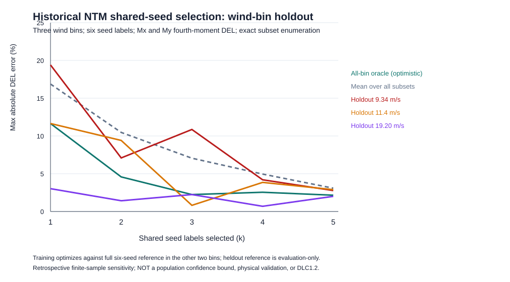
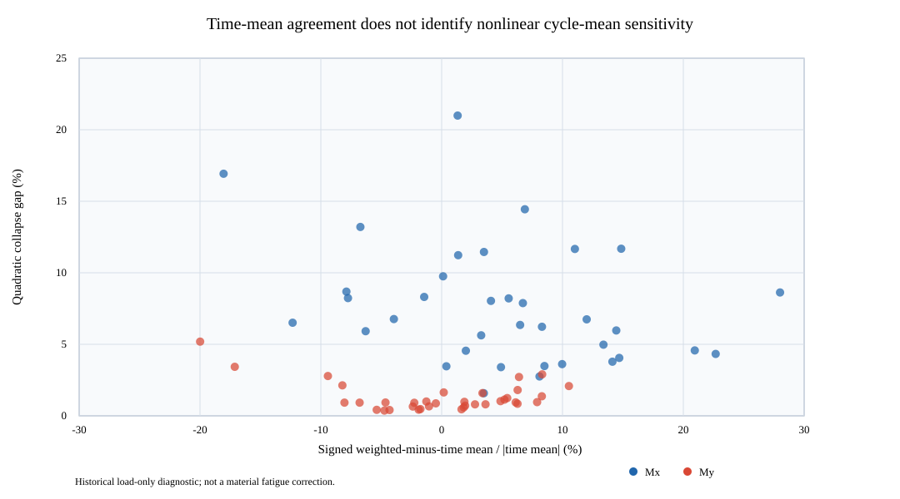
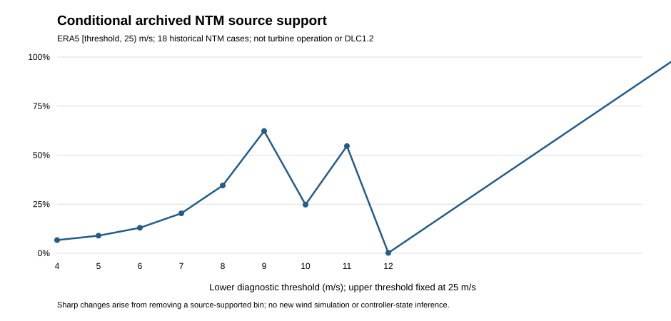
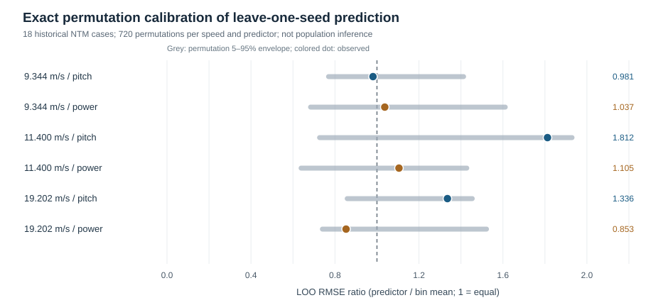

# Reliability limits of wind-load screening: rainflow ranking, finite-seed sensitivity and incomplete wind-climate coverage for a 158 m hybrid wind-turbine tower

**Manuscript status:** condensed research manuscript for critical review; not submitted, and not yet independently submission-ready. The object is a historical DTU 10 MW / 158 m (112 m concrete + 46 m steel) hybrid-tower OpenFAST *load-screening* archive. The reported fourth-power damage-equivalent moments are load diagnostics, not verified material-specific fatigue lives. The Jiayu ERA5 wind archive is reanalysis rather than measured turbine operation; no wind–earthquake or structural safety result is claimed.

## Abstract

Fatigue-oriented selection of wind-turbine tower load cases can be unreliable even before local material stresses are calculated. We test three distinct screening claims using a historical OpenFAST archive for a DTU 10 MW reference turbine combined with a 158 m concrete–steel hybrid tower: reproducibility of rainflow-based rankings, stability under finite turbulence-seed selection, and identifiability of a climate-weighted fourth-order *load* diagnostic. The source archive comprises 36 historical 600 s screening cases, 18 normal-turbulence cases at three speeds with six seeds each, and 184,080 ERA5-derived hourly wind estimates. A historical rainflow closure correction reverses 102/630 My and 12/630 Mx pairwise case rankings and changes the My controlling realization. Among 8,000 exact ways to select three of the six observed seeds independently in each wind bin, 760 (9.50%) change the internal My controlling-bin identity; this is a finite-archive fraction, not an unseen-seed failure probability. An independent retrospective whole-bin holdout yields 1.3213% training error but 10.8586% error in the withheld observed bin. Only 7,164 of the 106,900 ERA5 hours in the diagnostic [4,25) m/s interval have matched NTM load summaries; the remaining 99,736 hours (93.30%) leave the defined climate-weighted fourth-power load moment sharply identified only on [K, infinity) under nonnegativity. We additionally give a constructive two-design non-ranking result: without bounded missing-bin contributions, even a strict ordering of observed contributions cannot guarantee the lifetime ordering. Independent source-level checks distinguish DEL reference-cycle normalization from actual load changes. These are retrospective *load-screening* results, not formal DLC1.2 coverage, material Miner damage, optimized structural performance or wind–earthquake response.
**Keywords:** hybrid wind-turbine tower; rainflow counting; damage-equivalent load; turbulence-seed sensitivity; ERA5; partial identification; fatigue screening.

## 1. Introduction

### 1.1. From wind-load screening to fatigue inference

As rotor diameters and support-structure heights increase, prestressed-concrete–steel hybrid towers offer a practical structural configuration for large wind turbines [1–3]. Their fatigue assessment, however, spans several different physical and statistical levels: turbulent inflow produces time-dependent tower loads; section forces must be transferred consistently to local stress histories; cycle ranges, means and counts must then be evaluated using material-appropriate fatigue laws and a defensible long-term distribution of operating states. A damage-equivalent *load* calculated from tower-base bending moments is useful for comparing historical simulations under a common cycle-counting convention, but it cannot, by itself, determine fatigue damage in concrete, ordinary reinforcement, prestressing tendons or structural steel. In particular, a single fourth-power exponent used for screening must not be interpreted as a common material S–N slope.

Control-case selection is an intermediate decision with potentially disproportionate consequences. If a subsequent detailed analysis is performed only on a few apparently critical realizations, an error that changes their order can propagate into the research design even when the underlying wind simulation is unchanged. Three questions therefore precede a lifetime-fatigue claim. First, is the numerical ordering reproducible under independently checked rainflow cycle counting? Second, is the selected controlling wind-speed bin stable with respect to the finite set of turbulent realizations actually available? Third, do those simulated wind-speed bins cover enough of the climate to identify a long-term load moment? These are distinct questions: passing one does not resolve the others.

### 1.2. Prior research and the boundary of the present contribution

Existing wind-turbine fatigue research distinguishes short-duration turbulent load statistics from lifetime accumulation, and numerical fatigue estimates depend on the specified wind climate, operating-state classification, structural response and material stress definitions [3]. For the present study, the original OpenFAST and ERA5 provenance is inherited from the archived research workflow; no new authorized IEC/GB clause is asserted as checked in this manuscript revision. Consequently, the 36 historical cases are described as a *screening matrix*, not as a completed design-load-case DLC1.2 matrix. The use of three historical wind speeds is a property of the archive, not a claim that three bins are sufficient for a 20-year assessment.

Recent hybrid-tower research also constrains any broader novelty statement. Ishihara et al. [5] compared coupled and uncoupled seismic/aerodynamic response for a different 2.4 MW wind turbine; their response-combination approximations are not transferred to this 10 MW tower. Wang et al. [6] reported combined wind–earthquake loading for an approximately 160 m hybrid tower, while Wang et al. [7] examined earthquake response and prestress-related resistance enhancement for a **different 163.24 m, 42-segment** tower. The evidence levels differ: **[6] has only publisher abstract/metadata review in this archive**, whereas **[7] has an archived 18-page original publisher PDF, with selected physical PDF pages 5–7 and 14–16 reviewed in earlier T079 work** (SHA256 74a2213d18a15cfd0ea7690a262037d8e928d0becf5ec576e12db35820a8c338). Neither study has been systematically compared section by section with all methods and data in the present article. Thus neither simultaneous wind–earthquake excitation nor the consideration of prestress in seismic response can be claimed as novel, and no absence of a specific screening method in [6] or [7] is asserted. The present article addresses a narrower, independently testable problem: whether a historical wind-load screening dataset supports robust ranking and long-term fourth-moment inference *before* material fatigue or seismic-constrained optimization is attempted.

A direct reading of the publisher's open full text for Wang et al. [7] also exposes a quantitative boundary that is relevant to the proposed future fatigue–seismic optimization: in its **different 163.24 m, 42-segment, C80 tower**, increasing nominal tendon stress from 1000 to 1219 MPa was accompanied by a reported strong-wind tower-top displacement change from 0.57 to 1.10 m, while the three reported rare-earthquake displacement pairs were 0.58 to 0.57 m, 0.52 to 0.52 m and 0.77 to 0.58 m. The corresponding wind change is +92.98% and the largest earthquake reduction is 24.68%; simple decimal-rounding bounds retain the signs of those two changes (+82.61% to +103.54%, and −25.81% to −23.53%, respectively). These are **published response values and a secondary arithmetic comparison**, not results for the present tower or a validation of the source paper's physical interpretation. They preclude treating higher prestress as an *a priori* improvement of every hazard-related objective. Conversely, [6] establishes the existence of a published simultaneous wind–earthquake hybrid-tower study from its publisher abstract, but its full methods and reported Zenodo data (DOI 10.5281/zenodo.19346369) were **not retrieved or independently verified** here; absence of a particular operating-state treatment in [6] is not asserted. The reproducible secondary comparison and source-depth statement are recorded in the thesis Ch. 1 and T079, rather than represented as a new fatigue or wind–earthquake simulation.

The novelty claim is therefore methodological and conditional rather than a claim to have discovered a new tower response. We combine a paired, source-locked rainflow-implementation comparison with exact finite-archive seed-subset enumeration and a partial-identification treatment of missing wind-speed-bin loads. The combined analysis makes visible how a numerically corrected controlling realization may still be an uncertain basis for long-term assessment. Each part can be independently reproduced from archived derived tables, and each is designed to admit a negative result. No assertion of priority over all earlier literature is made without a full-text systematic comparison.

### 1.3. Retrospective estimands versus prospective falsifiers

The retrospective study answers three questions with different evidence units and therefore different permissible conclusions. **R1 (algorithmic rank invariance)** asks whether correcting the historical rainflow closure implementation preserves the ordering of the same 36 wind cases within each tower-base moment channel. Its estimand is the number of discordant unordered case pairs (630 possible pairs per channel), accompanied by the identity of the maximum case; this is a paired numerical comparison, not a sample-based significance test. **R2 (finite-archive seed stability)** asks whether the full-six-seed NTM control-bin identity is invariant to selecting k of the six observed seeds. Its estimand is the exact fraction of subsets that disagree with that *internal* reference under each declared subset-selection rule; overlapping subsets and the reference built from their parent archive are not independent replicates. **R3 (long-term load-moment identifiability)** asks whether a fourth-order load moment over the ERA5 diagnostic interval can be uniquely determined when only three wind-speed bins have matching NTM histories. Its result is an identified observed contribution K and an unknown nonnegative contribution X, rather than a conventional null-hypothesis test. R1–R3 are directly addressed below, but none estimates a material fatigue life.

Three **different, prospective** hypotheses are deliberately left untested. **H1 (exposure-order adequacy)** states that the three most frequent previously unsampled operating wind bins are also the three largest contributors to a newly observed, seed-aggregated, bin-weighted fourth-order load moment, using a fixed wind-bin partition and operating-state definition. **H2 (independent-seed stability)** states that a preselected k-seed procedure preserves both the control-bin identity and its fourth-root load amplitude to a predeclared relative tolerance on *new, independently generated* turbulent realizations. **H3 (material transfer)** states that corrected tower-base load-DEL rankings agree, within an explicit ranking uncertainty budget, with the rankings of *material-specific* Miner damage from matched local stress-cycle histories, constitutive assumptions and climate weights. H1 is falsified by a verified top-three mismatch, H2 by a held-out identity mismatch or tolerance exceedance, and a universal form of H3 by a resolved material-damage rank reversal. Ties and uncertainty intervals must be specified before testing; an unresolved tie is not a verified agreement.

These hypotheses cannot be accepted by reusing the retrospective sample as its own validation set. In particular, a rainflow correction may reject R1 rank invariance without testing H3; the 760/8000 subset result may reject R2 invariance within the archive without estimating H2's future-seed error; and R3 non-identifiability prevents a conclusion about H1's unmeasured top contributors. This separation is essential to the interpretation of the paper's contribution.

### 1.4. Study scope and organization

The analysis uses a DTU 10 MW reference rotor–nacelle assembly [1] with a literature-derived 158 m hybrid tower (112 m concrete and 46 m steel) [2]. It does not claim that this combination is an officially commissioned Jiayu wind turbine. The 36 historical wind simulations represent three reference speeds, normal and extreme turbulence categories, and six seed labels, with a common 100–700 s analysis window. The ERA5-derived 184,080 hourly values provide wind-speed exposure, not a direct observation of turbine control state or material damage. Only three wind-speed bins have matched historical NTM load evidence. All long-term fourth-moment quantities reported below are explicitly *load-level diagnostics* and are not normalized into annual Miner damage.

Section 2 defines the source identities, estimands, cycle-counting and seed-subset methods, and missing-bin identification bounds. Section 3 presents the paired rainflow ranking and finite-seed results. Section 3 also establishes the missing-bin exposure and sharp partial-identification boundary. Section 4 discusses the three non-substitutable failure mechanisms, prospective falsification tests, prior-art limits and uncertainty. The central conclusion is a conditional one: verified short-duration load rankings can support screening within the observed archive, but incomplete climate/load pairing prevents a defensible complete-interval fourth moment, let alone a material-specific fatigue-life or seismic-constrained optimum.

## 2. Materials and methods

### 2.1. Design, evidence units and provenance

This retrospective analysis considers a research combination of the public DTU 10 MW reference rotor–nacelle assembly [1] and a literature-derived 158 m hybrid tower (112 m concrete, 46 m steel) [2]. It is not an official Jiayu wind turbine. The wind archive comprises 36 historical OpenFAST screening cases; the independent ERA5 reanalysis archive supplies climate exposure, not measured turbine operation. The former 115.63 m reference-tower model is not admitted as an interchangeable 158 m source.

The three estimands have **different units of analysis**. R1 compares two rainflow implementations on exactly the same 36 case histories for each of two moment channels. R2 enumerates overlapping subsets of six *observed* NTM seeds in each of three wind bins. R3 identifies the contribution of wind bins with known load summaries to a specified fourth-order climate-weighted *load* functional. The 630 pairwise comparisons, 8000 subset combinations and 184080 ERA5 hours are not interchangeable independent replications; no significance test is based on treating them as such.

The original OUTB binary provenance, independent rainflow 3.2.0 cycle check and ERA5 processing are inherited from earlier source-locked T062 receipts. The current manuscript is assembled from archived derived CSVs, not a new OpenFAST run, an independent validation of future seeds or a rerun of the 184080 original hourly values. The full secondary analyses (operating state, ETM, azimuth, extrapolation, alternative exponents and permutation diagnostics) and their original source-to-claim ledger are retained in [Supplementary evidence](journal-wind-fatigue-secondary-evidence.md); they are not independent corroborations of R1–R3.

### 2.2. Wind histories, coordinates and rainflow calculation

The historical 158 m screening matrix contains **36 distinct cases**: three reference speeds (**9.343881, 11.4, 19.202140 m s⁻¹**), two historical turbulence classes (NTM and ETM) and six labeled random seeds (S01–S06) per speed/class. The archived analysis window is **100–700 s (600 s)**. Each case has two OpenFAST tower-base bending-moment channels, TwrBsMxt and TwrBsMyt, reported in **kN m**, giving **72 case–channel rows**. Each case's two channels must share the original OUTB SHA256. These channel labels are preserved; no unverified conversion to geographic axes is introduced. Historical screening must not be presented as a completed IEC DLC1.2 lifetime matrix.

For moment history \(M(t)\), rainflow yields ranges \(\Delta M_i\) and full/half-cycle weights \(n_i\). The generic fourth-power damage-equivalent *load* is
\[
L_4=\left[\frac{\sum_i n_i|\Delta M_i|^4}{N_{\mathrm{eq}}}\right]^{1/4}.
\]
Within the paired legacy/corrected R1 comparison, the reference-cycle normalization, time window and **m = 4** are identical (**N_eq = 100,000 cycles**). The separately archived 18-NTM all-channel DEL table used for R2/R3 instead has **N_ref = 600 cycles**. Their reported amplitudes cannot be compared directly without changing the normalization, even when the original wind history, channel and rainflow cycles are identical. Here m = 4 is a **load-ranking diagnostic**, not a shared fatigue slope for the different tower materials. The earlier T062 primary-source investigation isolated an incorrect cycle-closure comparison in the legacy implementation and compared corrected cycle multisets with independent rainflow 3.2.0. The present analysis **inherits** that prior original-binary verification; it does not claim a fresh OUTB run.

### 2.2.1. Cross-source reference-cycle compatibility test

Before comparing absolute DEL amplitudes between the paired R1 correction archive and the 18-NTM source used in R2/R3, we matched **18 NTM cases × two tower-base moment channels** by case/channel key, original OUTB SHA256 and rainflow weighted-cycle count. For fixed cycle ranges and exponent \(m=4\), changing only the reference count from \(N_a\) to \(N_b\) must satisfy

\[
\frac{L_{4,b}}{L_{4,a}}=\left(\frac{N_a}{N_b}\right)^{1/4}.
\]

This identity is independent of load units and turbulence realization, and requires equality of the **weighted fourth-power range sums**, not necessarily equality of the individual cycle multisets. The matching OUTB digests and weighted-cycle counts establish common source-file identity and the same total count; the observed ratio additionally tests equality of one scalar fourth-power sum. None of these summary checks independently establishes equality of individual ranges, means or closure sequences across the two processing pipelines. The archived corrected R1 table has \(N_a=100000\) as independently corroborated by the ratio test, whereas the native NTM all-channel table explicitly labels \(N_b=600\). A source-locked, fail-closed program rejects duplicate or missing case/channel keys, changed OUTB digests, unequal cycle counts, nonfinite DELs and departures from the expected factor. The 36-row [normalization crosswalk](../experiments/T062/S12_NTM18_DEL_NORMALIZATION_CROSSWALK_36ROW_20261110.csv) is Supplementary Table S1; its values are **not** a new structural simulation or a comparison of material fatigue laws. No NTM-to-ETM cross-source normalization identity is asserted because the native comparison source here contains NTM cases only.

### 2.2.2. A constructive non-identifiability test for cycle summaries

The mapping from a rainflow range–count multiset to \((C,L_4)\), where \(C=\sum_i n_i\) and \(L_4^4=\sum_i n_i(\Delta M_i)^4/N_{\rm eq}\), is **not injective**. To make the limitation testable, take any positive observed \(L_4\) and \(C>16\), and set \(r_0=L_4(N_{\rm eq}/C)^{1/4}\). Construct algebraic distribution A with total cycle weight \(C\) at range \(r_0\). Construct distribution B with one full cycle at range \(2r_0\) and remaining cycle weight \(C-1\) at range

\[
r_1=r_0\left(\frac{C-16}{C-1}\right)^{1/4}.
\]

Both have identical total cycle weight \(C\) and identical fourth-power range sum, because \(16r_0^4+(C-1)r_1^4=Cr_0^4=N_{\rm eq}L_4^4\); their **largest ranges differ by a factor of two**. A half-integer \(C\) is accommodated by aggregating full- and half-cycle weights at the stated range. These are **mathematical witnesses, not recovered wind histories or physically generated rainflow outputs**. Their cycle means can also differ without changing either scalar summary. Consequently, agreement of DEL and total cycle count—even with the same OUTB digest—cannot prove that two algorithms returned the same cycle multiset, peak cycle range or mean-stress distribution. Such claims require direct cycle-by-cycle or multiset comparison.

The [source-locked falsifier](../experiments/T062/s12_del_summary_identifiability.cjs) evaluates this construction against all 36 archived NTM crosswalk rows, without altering the original data. It rejects a changed source SHA256, malformed keys, non-half-integer counts, nonpositive loads and a failed DEL ratio. Its negative tests and algebraic witnesses are **not** independent physical validations.

### 2.3. Paired algorithmic ranking comparisons

For each channel \(c\) and case \(j\), define the signed implementation bias
\[
b_{jc}=100(L_{jc}^{\mathrm{legacy}}/L_{jc}^{\mathrm{corrected}}-1)\%.
\]
Compute the median, minimum and maximum across **36 cases per channel**. Sort the same 36 case IDs by decreasing DEL under both algorithms, and report: (a) the number of strict rank reversals among \({36\choose2}=630\) unordered pairs; (b) Spearman's \(\rho=1-6\sum_jd_j^2/[36(36^2-1)]\) in the no-ties setting; and (c) top-five set overlap. A reversal occurs only when the two algorithms assign opposite signs to a pairwise DEL difference; ties require explicit handling rather than row-order decisions. Pair comparisons share case observations and are **not 630 independent replicates**. Since some legacy errors are positive and others negative, a single global DEL correction factor is not assumed.

### 2.4. Exact finite-six-seed NTM subset design

The seed experiment uses only the **18 NTM cases** (three wind speeds × six seeds), not the ETM records. For wind-speed bin \(b\), channel \(c\), and a subset \(S_b\) of \(k\) archived seeds, define
\[
\bar L_{bc}(S_b)=\left[\frac{1}{k}\sum_{s\in S_b}L_{bcs}^4\right]^{1/4}.
\]
The bin with the largest full-six-seed aggregate is the **internal reference**, not a population truth. For each \(k=1,\ldots,5\), enumerate two distinct sampling designs exactly: independently choose a \(k\)-subset in each bin, giving \({6\choose k}^3\) combinations; or choose one common seed-label subset across all bins, giving \({6\choose k}\) combinations. The latter is a sensitivity to label coupling, not proof that the underlying turbulent inflows are common random numbers.

For every combination, count whether its maximum-aggregate bin differs from the full-six reference, and compute the absolute relative error of the **reference winner's** aggregate load, \(|\bar L_{b^\star c}(S_{b^\star})/\bar L_{b^\star c}(S_{\rm all})-1|\). A tie at the maximum must be explicitly flagged. The wrong-bin fraction is an exact **finite-archive combinatorial frequency**; the full reference contains the selected subsets, so it is not an independent validation, an unseen-seed failure probability or an IEC minimum-seed recommendation. The distinction between a stable winner and a stable load amplitude is retained.

### 2.4.1. Retrospective whole-wind-bin holdout of shared seed labels

A stable control-bin identity is not equivalent to transportable **load-amplitude** estimation. To examine this distinction without generating new wind fields, we used the same 18 archived NTM cases and both tower-base channels in a separate three-fold, leave-one-wind-bin-out diagnostic. For a common subset of seed labels \(S\subset\{1,\ldots,6\}\) with \(|S|=k\), define the relative fourth-root load error \(e_{bc}(S)=100|\bar L_{bc}(S)/\bar L_{bc}(S_{\mathrm{all}})-1|\) in percentage points, where the denominator is the archived six-seed value **for the same bin and channel**. Given a held-out wind bin (h), select \(S_k^{(-h)}=\arg\min_{|S|=k}\max_{b\ne h,c\in\{x,y\}}e_{bc}(S)\), then report the training maximum and \(E_h(k)=\max_c e_{hc}(S_k^{(-h)})\). All \(\binom{6}{k}\) common-label subsets are enumerated; ties are resolved by ascending seed-label order as implemented in the archived script. The retrospective all-three-bin oracle \(E_{\mathrm{all}}^\star(k)=\min_{|S|=k}\max_{b,c}e_{bc}(S)\) is an **in-sample comparator**, not a deployable estimator.

This design tests sensitivity to withholding one of the **three already observed wind-speed bins**, not to new seeds or a new atmospheric population. Selection uses six-seed reference targets in the two training bins and scoring uses the six-seed reference in the held-out bin; the same parent archive supplies both. Thus the term *holdout* refers only to excluding one bin from the subset-selection objective. It does not imply independent external validation. The finite-archive training-to-held-out difference \(G_h(k)=E_h(k)-E_{-h}(S_k^{(-h)})\) can have either sign because the maxima are taken over different bins. Neither \(G_h\) nor its ratio to training error is a population generalization bound. No common-random-number equivalence is inferred from matching seed labels across wind speeds.

### 2.5. ERA5 exposure and partial identification

The archived ERA5-derived climate (reanalysis dataset [4], not site measurements) covers **184,080 hourly estimates** (2005–2025) tabulated in 31 integer-lower-edge speed bins. The **diagnostic** interval \([4,25)\) m s⁻¹ contains **106,900 h**; it is not a verified turbine cut-in/cut-out range. Only the three bins with lower edges **9, 11 and 19 m s⁻¹** have historical NTM load summaries, covering **7,164 h**. The remaining **99,736 h** lack a matching load source, rather than having zero load. Thirteen missing bins have positive exposure; five missing bins have zero observed hours.

Let \(H_b\) be the observed count in bin \(b\) and \(H=184080\). The unconditional probability \(p_b=H_b/H\) differs from the diagnostic-interval conditional probability \(p_{b\mid O}=H_b/106900\), with
\[
p_b=(106900/184080)\,p_{b\mid O}\quad(b\in O).
\]
For the historical fourth-power *load* diagnostic with bin aggregate \(L_{bc}\) in **MN m**, the identifiable contribution is
\[
K_c=\sum_{b\in B_{\rm obs}}p_bL_{bc}^4,\qquad
X_c=\sum_{b\in O\setminus B_{\rm obs}}p_bL_{bc}^4.
\]
The complete diagnostic contribution would be \(K_c+X_c\). **This is a climate-weighted fourth power of a rainflow damage-equivalent *range* load, not the instantaneous time-series moment \(\mathbb{E}[M(t)^4]\), and not a material damage rate.** Without credible missing-bin load values, only \(X_c\ge0\) is known; hence \(K_c\) is a lower bound on this **defined load-moment functional**, while its upper bound is unbounded. This is **not** a lower bound on material Miner damage, which requires local stress ranges, mean stresses, cycle rates, fatigue laws and verified operating-state exposure.

Define a common missing-bin fourth-power-equivalent load by \(X_c=(99736/184080)L_{\rm miss,c}^4\). The equal-contribution threshold is
\[
L_{\rm miss,c}^{(50\%)}=\left[K_c/(99736/184080)\right]^{1/4}.
\]
For one positive-hour missing bin, the corresponding threshold is \((K_c/p_b)^{1/4}\). These are **identifiability thresholds**, not predictions or design limits. Report \(K_c\) in \((\mathrm{MN\,m})^4\), the thresholds in \(\mathrm{MN\,m}\), and exposure in hours. The denominator 184,080 must not be silently replaced by 106,900.

### 2.5.1. Nonlinear identifiability from individual load-cycle means

For each archived rainflow cycle, retain its load range \(\Delta M_i\), signed load-cycle mean \(\mu_i\) and full/half-cycle count \(n_i\). Define the normalized load-level weights \(p_i=n_i|\Delta M_i|^4/\sum_jn_j|\Delta M_j|^4\), the weighted mean \(\bar\mu_w=\sum_i p_i\mu_i\) and weighted variance \(v_w=\sum_i p_i(\mu_i-\bar\mu_w)^2\). The exact identity

\[
Q_2=\sum_i p_i\mu_i^2=\bar\mu_w^2+v_w,\qquad
J_2=\frac{Q_2-\bar\mu_w^2}{Q_2}=\frac{v_w}{\bar\mu_w^2+v_w}
\]

defines the *quadratic collapse gap*: the fraction of the explicitly chosen quadratic load-mean functional lost by replacing individual cycle means with their fourth-power-weighted average. \(Q_2\) is a **mathematical moment-of-load-means diagnostic**, not a calibrated Goodman correction, a material S–N rule, Miner damage or a fatigue life. The one-largest-weight-cycle deletion diagnostic quantifies the influence of a single archived rainflow cycle on \(\bar\mu_w\), not a physically realizable perturbation to the wind loading.

The source-locked calculation reads all 48,070 individual cycle rows and compares all 72 groups with the previously verified load DEL, weighted mean and largest-cycle share. Weighted variance is independently evaluated using a centered second pass and the uncentered second-moment identity. The resulting 72-row Supplementary Table S2 and Fig. 5 are distinct from the 72-row prior time-mean diagnostic and do not require a new physical simulation.

### 2.6. Source admission and independent rejection tests

The principal paired rainflow source is a 72-row CSV with exactly 36 distinct case labels × two tower-base channels, original OUTB SHA256 identities and both legacy and corrected fourth-power DELs. The archive's SHA256 is `12dabbb1273ce03d3920aedda3f72f9fa1d75b671e01a1db145c0a972ffe15e2`. A valid row must contain finite positive DELs, an allowed case/seed/channel key and a 64-character original-OUTB digest; the two channel rows for one case must share the same digest. Corrected and third-party DEL values must agree within the inherited 10⁻⁵ kN m source tolerance. Missing or duplicated keys, nonfinite values and altered third-party comparisons are rejected, not silently repaired.

The finite-subset output table is archived at SHA256 `f7d9427d15b378661aaebf2fdf0feb1e5eea07cefb3721088a98439265320cf1`; the ERA5 31-bin exposure table at `e4058620a36b23bb218103875d4dc5b0711fc45d418b23a2208c2fc9c16c9102`; and the six-row NTM fourth-moment table at `d43f963fb30e16a33e87acdf6e9571710826974eee89d1f3527ab6504d85f695`. Source identity, counting and numerical checks are distinct from wind-field/model-state validation. Source hashes above are inherited **SHA256** receipts; a Git blob SHA is a different identifier and must not be substituted for them.

For this consolidation, the connected repository's 72-row paired source was independently regrouped in JavaScript by case, channel, turbulence class and seed. Direct strict-pair enumeration reproduced 12/630 (Mx) and 102/630 (My) reversals; a separate exhaustive six-seed enumeration reproduced the My independent-subset counts 66/216, 630/3375, 760/8000, 105/3375 and 0/216 for k=1–5. The climate equal-contribution thresholds were independently recomputed from the displayed K and exposure totals, not from newly downloaded hourly ERA5. These are **derived-source arithmetic checks**, not new original-binary or physical verification.

### 2.7. Source-locked spectral partition of synchronized base reactions

A separate retrospective frequency-domain experiment uses the complete 18-case, six-component tower-base reaction histories recovered from the archived original 158 m OpenFAST OUTB files (historical Actions artifact 13775054290; gzip SHA256 45cc308625ead8411d1565adc66c99e7ee8d0a979e5c3c6c18f23e744ba74dd1). Each NTM realization contains 12,001 samples at 0.05 s from 100 to 700 s. The final endpoint is omitted to define exactly 12,000 samples over 600 s. Both Mx and My are analyzed independently as base *reaction* moments in kN m, not as externally applied aerodynamic moments. No wind or structural solver is rerun.

For each demeaned series, a one-sided discrete Fourier variance spectrum is formed with the exact DC/Nyquist normalization and a rectangular 600 s window. Parseval closure is required to relative tolerance 1e-10. The descriptive estimand is the fraction of within-record variance within [0.05, 0.25) Hz; the corresponding band-limited RMS is also retained. This band is an explicitly chosen diagnostic, not a turbine-mode or rotor-harmonic identification. Prespecified sensitivities include 4096-point Hann/50%-overlap Welch estimates, linear detrending, lower cutoffs 0.04/0.06/0.08/0.10 Hz, and separate 300 s halves. All 36 case-by-channel values are retained; six historical seeds per wind speed are not treated as six independent climate observations.

### 2.8. Case-matched spectral proxy test with genuinely held-out seed labels

A separate, non-causal test combines the existing 18-case operating-state summaries with the independently archived tower-base My 0.05–0.25 Hz spectral RMS for the same historical NTM case names. The response is a **section-reaction spectral statistic**, not an aerodynamic force, material stress or Miner damage. For each of three wind-speed bins and each candidate predictor (600 s mean blade pitch or generator power), we fit a univariate within-bin slope using five cases and predict the sixth. The same five cases also define the no-predictor bin-mean baseline. The ratio of leave-one-seed-out (LOO) RMSEs is reported; values greater than one indicate degradation. For each bin and predictor, all 6!=720 permutations of the six observed response labels give an exact two-sided finite-archive absolute-correlation tail fraction. The six permutation tests are descriptive and do not establish independent sampling, controller causality, or generalization to unseen wind seeds. Source identity, complete 18×600 s pairing and 36 held-out predictions are checked by a source-locked executable and malformed-source refusals.

**Predictive-loss-aligned exact permutation check.** The original exact correlation test does not calibrate the selected *LOO prediction loss*. We therefore fix the six predictor values and enumerate all 720 permutations of the six observed My band-RMS responses within each speed bin. Every permutation refits all six five-train/one-test linear regressions and the five-train wind-bin mean baselines. With \(R=\mathrm{RMSE}_{\rm linear,LOO}/\mathrm{RMSE}_{\rm binmean,LOO}\), report \(p_{\rm gain}=\#\{R_\pi\le R_{\rm obs}\}/720\) and \(p_{\rm harm}=\#\{R_\pi\ge R_{\rm obs}\}/720\), including the observed arrangement. Selecting the favorable tail after seeing the sign is **not** a preregistered one-sided hypothesis test. The permutation 5th/50th/95th order statistics are sorted indices 35/359/683 (zero-based). Source SHA256, all case identities, time grid, operating heuristic and finite inputs are checked before any calculation. The exchangeability assumption remains conditional and unverified.

## 3. Results

### 3.1. Paired rainflow ranking and controlling-case changes

The historical 36 simulations comprise three reference wind speeds, two turbulence classes (NTM/ETM) and six seed labels per wind-speed/class combination. Each original output provided a 600 s analysis window. A prior primary-source audit established that the paired archived copies for each of the 36 disputed OpenFAST cases were byte-identical and that 72 corrected tower-base bending-moment rainflow cycle multisets agreed with independent rainflow 3.2.0. The discrepancy was isolated to the direction of the legacy cycle-closure comparison, rather than to the wind inputs or tower model.

The present analysis tests a separate question: whether this implementation defect changes which simulation is selected for subsequent structural assessment. For each of the tower-base Mx and My channels, all 36 cases were ranked using the legacy and independently corrected damage-equivalent moments. Bias was defined as 100 × (legacy DEL / corrected DEL − 1)%. We enumerated all 630 unordered pairs of cases and counted ranking reversals, then calculated Spearman rank correlation and top-five membership overlap. The pairwise comparisons are not independent replicates (Table 1).

**Table 1.** Paired legacy/corrected tower-base load-DEL ranking diagnostics for 36 historical cases per channel (m = 4; no material-fatigue interpretation). Source: archived T062 72-row comparison, SHA256 `12dabbb1273ce03d3920aedda3f72f9fa1d75b671e01a1db145c0a972ffe15e2`.

| Channel | Median legacy bias | Full range | Reversed pairs | Spearman rho | Top-five overlap |
|---|---:|---:|---:|---:|---:|
| Mx | −20.8797% | −29.0675% to +2.6041% | 12/630 (1.90%) | 0.99537 | 5/5 |
| My | −25.5452% | −54.5115% to +22.4800% | 102/630 (16.19%) | 0.85946 | 4/5 |

The legacy method underestimated the corrected DEL for 34 of 36 Mx records and 32 of 36 My records; a uniform correction factor is therefore inappropriate because the remaining records were overestimated. The My controlling realization changed from U11p4_ETM_S03 (historical 28.177010 MN·m; corrected 23.005398 MN·m) to U11p4_ETM_S04 (corrected 26.802479 MN·m). The corrected Mx maximum remained U19p202140_ETM_S02 (9.468855 MN·m). This is an algorithm-induced change in screening identity, not a new physical response to turbulence.

The paired rank–rank diagram in Fig. 1 exposes the case-level mechanism behind Table 1. For My, the legacy maximum U11p4_ETM_S03 moves from rank 1 to **corrected rank 7**, whereas the corrected maximum U11p4_ETM_S04 rises from legacy rank 2 to corrected rank 1. The Mx maximum U19p202140_ETM_S02 remains rank 1 under both implementations. The diagonal represents unchanged ranks; departures reflect algorithmic differences for **identical archived load histories**, not stochastic uncertainty intervals. The complete 72-row rank-transition ledger is archived as `T062_72CASE_RAINFLOW_RANK_TRANSITIONS_20261107.csv` (SHA256 `1bf750ba3ea33153dbe4b23e87a1b973ca73ab41e446b2d9d5f3fac2881238a9`).

**Fig. 1.** Rank–rank comparison for all 36 historical cases per tower-base moment channel: (a) Mx and (b) My. Horizontal = legacy rank, vertical = corrected rank; rank 1 denotes the largest fourth-power load DEL. Blue markers represent NTM, orange ETM; the two emphasized My markers identify the legacy and corrected controlling realizations. The dashed diagonal denotes unchanged rank. Source: T062 original 72-row paired comparison (SHA256 `12dabbb1273ce03d3920aedda3f72f9fa1d75b671e01a1db145c0a972ffe15e2`); reproducible figure SHA256 `1a17a1f36e68aff8280a33a1f318b98adcee1581556ea8e923fea1ef502a002a`. These are load-level diagnostics, not local material-fatigue results.

### 3.1.1. Exact reconciliation of the two archived DEL normalizations

The source-level crosswalk matches all **36/36 NTM case–channel pairs** between the R1 corrected rainflow table and the separately generated 18-NTM native DEL table. Every matched pair has the same original OUTB SHA256 and the same weighted rainflow cycle count. The observed ratio \(L_{4,N_{\rm ref}=600}/L_{4,N_{\rm eq}=100000}\) equals the analytical factor

\[
(100000/600)^{1/4}=3.593041119630842.
\]

The largest absolute **relative ratio residual** across 36 pairs is \(1.064\times10^{-12}\); independently inverting the ratio gives an implied R1 reference count ranging from **99,999.999999638 to 100,000.000000425** cycles. For example, U09p343881_NTM_S01 / TwrBsMyt has corrected R1 DEL **14,214.854620 kN m** and native NTM DEL **51,074.557159 kN m**, with 678 weighted cycles and an identical OUTB digest. The observed factor **3.593** is numerically explained by the reference-cycle convention and is not evidence of additional wind loading or fatigue amplification. It does **not** by itself establish cycle-multiset identity or exclude downstream processing differences. Supplementary Table S1 records every paired input and residual.

This finding makes the inferential separation of R1 and R2/R3 explicit: R1 legacy-versus-corrected *rank* comparisons are valid within the common \(N_{\rm eq}=100000\) convention; R2/R3 seed and climate-weighted *load* summaries are internally evaluated at \(N_{\rm ref}=600\). Any future absolute cross-study DEL comparison must first fix \(m\), \(N_{\rm ref}\), time window, cycle closure and source identity. Equal normalization does **not** imply equal material stress, fatigue rate or structural state.

The summary-identifiability falsifier provides a concrete counterexample to a stronger, unjustified inference from this match. The 36 real source rows have weighted cycle counts from **546 to 724**, so all satisfy the construction's \(C>16\) condition. For the real **U09p343881_NTM_S01 / TwrBsMyt** summary (\(C=678\), corrected \(L_4=14214.854620029\) kN m at \(N_{\rm eq}=100000\)), distribution A assigns all weight to range **49,537.604206 kN m**. Distribution B assigns one full cycle to range **99,075.208411 kN m** and the remaining 677 cycles to range **49,260.898518 kN m**. Both reproduce the same fourth-power sum and therefore both DEL normalizations, but their maximum cycle ranges differ by exactly **2×**. Across all 36 archived summary values, the largest numerical fourth-sum identity residual is below **4×10⁻¹⁶**, and the crosswalk DEL ratio residual remains below **1.1×10⁻¹²**. These are deliberately constructed **algebraic alternative distributions**, not measured or simulated cycles; they prove only that the summaries cannot identify the underlying cycle distribution. The original R1 rainflow 3.2.0 multiset validation is a separate historical receipt and is not replaced by this test.

### 3.2. Exact finite-six-seed subset sensitivity of NTM control-wind-speed selection

We further examined whether using fewer random realizations could change the wind-speed bin selected for subsequent load-level assessment. The analysis used the corrected tower-base Mx/My damage-equivalent moments from the 18 historical NTM runs (three reference wind speeds × six seeds; 600 s per record). For each wind-speed bin and seed subset S, we calculated the fourth-power aggregate \(L_{j,S}=[|S|^{-1}\sum_{s\in S} DEL_{j,s}^4]^{1/4}\), where the exponent is a **load-level diagnostic** and not a universal material fatigue slope. The six-seed aggregate within each bin was the internal reference, not an independently known population value.

We exhaustively enumerated both (i) independently selected k-seed subsets for each of the three wind speeds, yielding \({6\choose k}^3\) combinations, and (ii) shared seed-label subsets across wind speeds, yielding \({6\choose k}\) combinations. Shared labels are a design sensitivity, not evidence of common-random-number coupling between the simulations. The full six-seed reference selected 19.202140 m/s for both Mx and My; the corresponding reference margins over the runner-up were 162.805% and 7.002%, respectively. The finite-archive subset comparisons are summarized in Table 2 and Fig. 2.

**Table 2.** Exact finite-six-seed subset counts for three archived NTM wind-speed bins; fractions are conditional on this archive, not out-of-sample failure probabilities. Source: T062 10-row seed-subset CSV, SHA256 `f7d9427d15b378661aaebf2fdf0feb1e5eea07cefb3721088a98439265320cf1`.

| k | Independent subsets | My wrong-bin selections | My shared-label wrong-bin selections | Mx wrong-bin selections |
|---:|---:|---:|---:|---:|
| 1 | 216 | 66 (30.56%) | 1/6 (16.67%) | 0 |
| 2 | 3375 | 630 (18.67%) | 0/15 | 0 |
| 3 | 8000 | 760 (9.50%) | 0/20 | 0 |
| 4 | 3375 | 105 (3.11%) | 0/15 | 0 |
| 5 | 216 | 0 | 0/6 | 0 |

At k=3, 760 of 8000 independent subset combinations selected the 11.4 m/s bin rather than the six-seed My reference winner. No Mx subset changed the reference winner, although the worst absolute relative error in the winner's aggregate Mx load DEL was still 26.71% at k=1. Thus, stable control-bin identity does not imply convergence of load amplitude. The marked difference between independent and shared-label subset enumeration also cautions against reporting a seed-count requirement without defining the sampling design.

**Fig. 2.** Conditional My control-bin mis-selection frequency versus the number of archived seeds selected per wind bin, with independent and common-label subset designs. Original source-derived SVG SHA256 `5e3df353b8631bf3eb9bc03ede3551a3e91aaf93f41d4b61dd70f88524eb2cb4`; **not** an IEC convergence curve.

These are **exact conditional combinatorial frequencies within the observed six-seed archive**, not probabilities for unseen turbulent realizations or confidence intervals for a stochastic population. Because the reference includes the subsampled seeds, this is an internal sensitivity/leave-subset-out experiment, not a genuinely independent external validation. Zero misidentifications at k=5 therefore cannot certify five-seed convergence. The study does not establish IEC DLC1.2 compliance or material-specific Miner damage; the archived 18 NTM cases cover only three historical wind-speed bins.

**Reproducibility:** corrected 72-row source CSV SHA256 `12dabbb1273ce03d3920aedda3f72f9fa1d75b671e01a1db145c0a972ffe15e2`; script `experiments/T062/t062_ntm_seed_subset_robustness.js` SHA256 `bbf923bb509679edf76ae60dc5dda00648fb181ca4aa7d13ac06d0ef0712f333`; 10-row output SHA256 `f7d9427d15b378661aaebf2fdf0feb1e5eea07cefb3721088a98439265320cf1`; figure SHA256 `5e3df353b8631bf3eb9bc03ede3551a3e91aaf93f41d4b61dd70f88524eb2cb4`. Eight real-value oracles and 11 malformed-source refusals passed in V8; native Node CI and new original-OUTB reading were not performed. Authorized 2025/26 IEC clauses were not reread.

### 3.2.1. Whole-bin holdout exposes cross-speed amplitude instability

The common-label leave-one-bin-out diagnostic (Table 3, Fig. 3) separates the *selection* criterion in two wind-speed bins from the *evaluation* criterion in the third. Each entry is an absolute relative error of the fourth-root aggregated **load DEL**, maximized over the Mx/My channels, and expressed in percent. The worst held-out error is the maximum over three bin folds; the all-bin oracle is selected with knowledge of all three bins. Both are deterministic summaries of the same 18 NTM histories, not sampling-distribution estimates.

**Table 3.** Common-label k-seed selection: three-fold mean training and held-out maximum relative load-DEL errors, worst held-out fold and all-three-bin oracle. Recomputed from the complete 15-row historical holdout table, SHA256 `a16dfe3379f7cfd0b353b23f76ac6cb6cfb79242afe232215f1f3f64da9439a4`; percentages are rounded to six decimals.

| k | Mean training max (%) | Mean held-out max (%) | Worst held-out max (%) | All-bin oracle max (%) |
|---:|---:|---:|---:|---:|
| 1 | 7.661691 | 11.357377 | 19.403170 | 11.646167 |
| 2 | 2.918711 | 5.975848 | 9.409461 | 4.579323 |
| 3 | 1.460097 | 4.639208 | 10.858592 | 2.241689 |
| 4 | 1.518197 | 2.914184 | 4.199770 | 2.547498 |
| 5 | 1.409677 | 2.557546 | 2.891671 | 2.154620 |

For \(k=3\), the all-bin oracle selects S02/S03/S04 with a 2.241689% maximum error across three bins and two channels. Holding out the **9.343881 m s⁻¹** bin instead selects S02/S05/S06 from the remaining bins, with a **1.321257%** training maximum but **10.858592%** held-out maximum; the within-fold gap is **9.537335 percentage points**. The held-out/training ratio is approximately **8.2184**, which describes only this archived contrast and is not a predictive error multiplier. For the other two held-out bins, the k=3 held-out errors are 0.817344% (11.4 m s⁻¹) and 2.241689% (19.202140 m s⁻¹). A k=3 selection made with all bins therefore does not protect a choice made without one bin.

The worst held-out maximum is **not monotonic in k**: it increases from 9.409461% at k=2 to 10.858592% at k=3, then decreases to 4.199770% at k=4 and 2.891671% at k=5. This does not contradict reduced variance in a population average under appropriate independent sampling assumptions: the quantity optimized here is a finite-archive, common-label **minimax absolute error**, and the admissible equal-weight subsets for different k are not nested. The full all-bin oracle is likewise nonmonotonic (2.241689% at k=3 versus 2.547498% at k=4). No IEC seed-count rule or material fatigue threshold follows from these numbers.

**Fig. 3.** Retrospective common-label seed-budget and whole-bin holdout load-DEL error diagnostic, based on the same 18 NTM cases. Original reproducible SVG SHA256 `504428c6d6e48efcb0a0e22541b64bc1d9c651174bc4fe0e0f485ab8b9e21f22`. It is **not** an unseen-wind-bin forecast or material-damage validation.

**Reproducibility and error budget:** The source-locked program `experiments/T062/s06_ntm_joint_seed_holdout.cjs` has SHA256 `1735ad977db03149b438bc9fb0820097fd13838e3d25f1639f5e6551a2b3372f`; its input is the 72-row paired rainflow table SHA256 `12dabbb1273ce03d3920aedda3f72f9fa1d75b671e01a1db145c0a972ffe15e2`. The archived output contains 15 rows (five budgets × three held-out bins). Independent re-aggregation of those 15 displayed rows reproduced all five table rows; five deliberately malformed/duplicated/missing-row inputs were rejected in the current V8 source-level check. Displayed source errors have nine decimal places; rounding contributes at most approximately \(5\times10^{-10}\) percentage points to a single displayed error, while source-bin selection, six-seed representativeness, model/controller identity and wind-speed transport uncertainty are **not bounded** by that precision. The original OUTB histories were not reread and no new OpenFAST run was performed.

### 3.3. Exposure coverage does not identify lifetime fatigue contributions

The 21-year ERA5-derived archive contains 184,080 hourly wind estimates, of which 106,900 fall in the deliberately diagnostic [4,25) m/s interval. Only 7,164 of these hours (6.70159%) occupy the three bins represented by the historical NTM load records; 99,736 hours (93.29841%) have no matched historical NTM load source. Of the unrepresented hours, 95,402 (95.65453%) fall in the five consecutive 4–9 m/s bins (Fig. 4; Table 4). This is a statement about **wind-speed exposure and data provenance**, not an assertion that the turbine is operating or producing fatigue damage during all those hours. ERA5 reanalysis is not site-measured wind, and the interval is not an IEC-certified operating envelope.

**Fig. 4.** ERA5-derived hourly exposure by wind-speed bin and the three bins with historical NTM load sources. Source-derived SVG SHA256 `b2f4747a7196d772c5d42f6a06f37febab5f606eb8c40ab5e57897807e09f55e`; coverage is not turbine operating status, IEC DLC1.2 completion, or material damage.

**Table 4.** Partial-identification inputs and equal-contribution thresholds for the defined unconditional fourth-power **load** diagnostic; derived from archived 31-bin ERA5 and six-row NTM aggregates (not Miner damage).

| Quantity | Mx | My | Interpretation |
|---|---:|---:|---|
| Known three-bin contribution K / (MN m)^4 | 125.606638 | 209257.299448 | Sum weighted by H_b/184080 |
| Missing-bin hours | 99736 | 99736 | 93.29841% of diagnostic [4,25) m/s hours |
| Missing-bin equivalent DEL at X = K / MN m | 3.902041 | 24.929227 | Sensitivity threshold, **not imputation** |
| Finite data-supported upper bound on K + X | None | None | Assumes only missing-bin fourth powers are nonnegative |

For a tower-base moment channel and the historical fourth-power load diagnostic, let \(p_b=H_b/184080\), \(L_b\) be the bin's six-seed-equivalent load DEL in MN m, and \(K=\sum_{b\in B_{obs}}p_bL_b^4\). The recovered three-bin contributions are \(K_x=125.606637743\) and \(K_y=209257.299447600\), both in (MN m)^4. The unobserved contribution \(X=\sum_{b\notin B_{obs}}p_bL_b^4\) is nonnegative, so \(K\) is a lower bound on the *diagnostic fourth moment* under these definitions. With no defensible upper bound on the missing \(L_b\), \(X\) has no finite upper bound; consequently, a complete-interval fourth-power-equivalent load cannot be identified from the three observed bins. This lower bound is **not** a lower bound on material-specific Miner damage, which also depends on local stress, cycle rate, mean stress, material fatigue laws, and operating-state classification.

The missing-bin equivalent load \(L_{miss}\) that would make \(X=K\), when applied uniformly in fourth-moment terms across all unrepresented diagnostic hours, is 3.902041 MN m for Mx and 24.929227 MN m for My. These are *equal-contribution thresholds*, not imputed loads (Table 4). The exact equality is \(L_{miss}=(K/(H_{miss}/184080))^{1/4}\). Thus, even a large fraction of observed hours does not by itself determine the missing fourth-moment contribution.

### 3.3.1. Mean agreement fails to identify a nonlinear cycle-mean functional

Across 48,070 archived rainflow cycles (36 wind cases × two tower-base moment channels), the quadratic collapse gap \(100J_2\) exceeds **5% for 25 of 72** case–channels and **10% for 8 of 72**. The maximum is **20.990052%** in U09p343881_ETM_S06 / TwrBsMxt. The largest single-cycle fourth-power share is **43.223661%** in U09p343881_NTM_S06 / TwrBsMyt; deleting the most heavily weighted cycle changes the weighted mean by up to **5.776011%** in U11p4_NTM_S06 / TwrBsMyt. These are deterministic finite-archive *load-cycle* diagnostics, not probabilities or physically simulated cycle removals.

A particularly informative real counterexample is **U09p343881_ETM_S02 / TwrBsMxt**. Its range-fourth-power-weighted cycle mean differs from the ordinary time mean by only **0.118408%**, but its quadratic collapse gap is **9.753158%**. Thus closeness of the two mean estimators does not imply that a nonlinear functional of the underlying cycle means can be collapsed to a function of their mean. This is not a quantitative estimate of material mean-stress correction: no material-specific local stress history has been supplied.

**Table 5.** Source-level quadratic load-cycle-mean diagnostics. The quadratic gap is defined by \(J_2\), not by a material fatigue law.

| Quantity | Real-archive result | Interpretation |
|---|---:|---|
| Source cycles / case–channels | 48,070 / 72 | Original corrected rainflow ledger |
| Groups with \(100J_2>5\%\) / \(>10\%\) | 25 / 8 | Finite-archive counts |
| Maximum quadratic collapse gap | 20.990052% | U09p343881_ETM_S06 / Mx |
| Maximum single-cycle-removal mean shift | 5.776011% | U11p4_NTM_S06 / My |
| Near-equal means counterexample | 0.118408% mean shift vs 9.753158% quadratic gap | U09p343881_ETM_S02 / Mx |

**Fig. 5.** Signed fourth-power-weighted minus time-mean load (horizontal) versus quadratic collapse gap (vertical) across 72 historical case–channels. Neither quantity is a material fatigue metric. Input ledger SHA256 067c60cea61b35398edd186ff509fe759d1c4420395f082d06c666d92d897ecb; previous 72-row reference SHA256 e1d20adb86975060f013e40b6670b0e8ecfb33e928e80819a17112980ff63d51; independent program SHA256 8b75ebb110c45e8cd6c40442ee015e69a83eda618b6f0726be85f85ede2992bf; new Supplementary Table S2 SHA256 cbe5f3c13290641789a11fc7551169a4b16fd9b347b03de74f8bde1209e76a49; SVG SHA256 568e594b49bf3476833d97729fc2ef9cf16d505ec58f47ddba9c2074d72f57da. Source-level real-data, analytic and rejection tests passed in the connector V8 environment; native Node, original OUTB decoding and new physical simulations were not run.

### 3.3.2. Conditional wind-domain support and non-monotone source coverage

The 93.29841% unsupported-hour fraction is **conditional on the diagnostic [4,25) m/s interval**, not an invariant property of the wind climate or an established turbine operating range. We recompute archived six-seed NTM source support for ten lower wind-speed thresholds with the upper bound fixed at 25 m/s, retaining the same 31-bin ERA5 and 126 source-identity records. A bin counts as supported only when all six historical case identities and OUTB/FST hashes exist; no bin is formally DLC1.2 validated. This is a source-availability analysis, not an estimate of cut-in, shutdown state, missing-bin loads or fatigue damage.

The fraction is **6.701590%** (7,164/106,900 h) for [4,25), **62.306488%** (7,164/11,498 h) for [9,25), **24.783061%** (1,428/5,762 h) for [10,25), **54.649828%** (1,428/2,613 h) for [11,25), and **0.168492%** (2/1,187 h) for [12,25). The decrease from 62.31% to 24.78% as the lower threshold changes from 9 to 10 m/s is caused by removing the source-supported [9,10) bin, **not a change in physical response**. At [19,25), the nominal 100% support corresponds to only two ERA5 hours and cannot demonstrate representative high-wind behavior. Conditional source support is non-monotone in the selected threshold, so each reported percentage requires its numerator, denominator and admitted source identities (Fig. 6; Supplementary Table S3).

Under an **administrative, non-normative** target of six-seed source identities covering at least 90% of the historical [4,25) exposure hours, and equal per-bin completion cost, five additional 1 m/s bins are necessary and sufficient. The four highest-hour missing bins plus the existing sources cover 93,321/106,900 = **87.297474%**; adding the fifth reaches 102,566/106,900 = **95.945744%**. Hence the minimal five bins [4,5)–[8,9) correspond to **30 additional six-seed source slots**, not 30 validated IEC simulations. This exact equal-cost set-cover result does not bound fourth-power load moments or material fatigue, because a low-probability bin may still dominate a nonlinear response.

**Fig. 6.** ERA5-derived exposure fraction covered by archived six-seed NTM source identities under ten diagnostic lower thresholds. Discontinuities reflect conditioning and source-bin removal; they are not controller transitions, DLC1.2 compliance or new wind-turbine response. The ten-row source table is `S06_NTM18_CONDITIONAL_SUPPORT_THRESHOLD_10ROW_20261112.csv`.

### 3.4. Spectral redistribution in 18 real NTM base-reaction histories

The six-seed mean shares of demeaned reaction variance in [0.05, 0.25) Hz increase across the three archived wind speeds (9.343881, 11.4 and 19.202140 m/s). For Mx, the shares are 22.570%, 35.564% and 64.700%, respectively; for My, they are 3.896%, 24.154% and 50.735%. In both channels, every one of the six 19.202140 m/s records has a larger full-window share than every 11.4 m/s record. The minimum observed separation is 6.808 percentage points for Mx and 16.344 percentage points for My, without any inferential extrapolation to future turbulence seeds.

The My mean base reaction falls from 193,080.52 to 106,926.60 kN m (−44.62%) between 11.4 and 19.202140 m/s, while its mean [0.05, 0.25) Hz band RMS rises from 16,513.77 to 22,139.81 kN m (+34.07%). The band share rises by 26.581 percentage points. Thus a lower time-mean base reaction does not imply weaker fluctuations in a selected frequency band. The result is not an aerodynamic-force decomposition or a material-fatigue result.

Across the alternative full-record Welch, linear-detrended and 0.04–0.10 Hz cutoff definitions, the strict 19.2-versus-11.4 m/s six-seed separation persists; the smallest margin across all alternatives is 2.330 percentage points (Mx) and 8.337 percentage points (My). **A genuine negative sensitivity result** is obtained when the record is split: for Mx the two wind-speed ranges overlap in each 300 s half, by 9.439 and 4.924 percentage points respectively; My remains separated in both halves. Therefore the full-window ranking is not invariant to arbitrary record duration. Figure 3-S06-23 and the 36-row source-derived table provide the individual realization values.

### 3.5. Out-of-seed prediction of spectral RMS from operating summaries

| NTM speed (m s⁻¹) | Mean pitch (°) | My band RMS (kN m) | Pitch correlation / exact p | Pitch LOO RMSE ratio | Power correlation / exact p | Power LOO RMSE ratio |
|---|---:|---:|---:|---:|---:|---:|
| 9.344 | 0.3952 | 6912.612 | +0.494 / 0.3194 | 0.9811 | +0.559 / 0.2292 | 1.0373 |
| 11.400 | 3.7424 | 16513.771 | −0.361 / 0.5000 | **1.8122** | +0.400 / 0.4014 | 1.1048 |
| 19.202 | 16.6021 | 22139.805 | +0.442 / 0.3875 | **1.3356** | +0.686 / 0.1444 | 0.8529 |

The historical 11.4 m s⁻¹ pitch proxy increases the held-out prediction RMSE by 81.2% relative to a wind-bin mean, while the 19.2 m s⁻¹ pitch proxy increases it by 33.6%. The low-speed pitch improvement is only 1.9%. Mean generator power improves the high-speed LOO RMSE by 14.7% but worsens it in the other two bins. All six exact within-bin permutation fractions exceed 0.05 *before* multiplicity adjustment. These results reject the operational shortcut that a single averaged control signal is an automatically reliable predictor of a separate, frequency-selective tower reaction. They do not reject a physically specified, independently validated dynamic predictor, nor do they estimate an unseen-seed prediction distribution.

**Figure 3-S07 (source-level diagnostic):** [LOO error ratios for pitch and generator-power predictors](final-thesis/figures/FIG3_S07_NTM18_OPERATING_PROXY_SPECTRAL_LOO_20261112.svg). The 18 original case identities are inherited from the OpenFAST OUTB receipts; the spectral 36-row table SHA256 is `c3de99d45c70675f6a95a767e73dcfc50d57d07b4f33438ee705690b694ae622` and the operating-state 18-row table SHA256 is `0f577f3197870a1350c740c2e0c118073fb9b6f796b4c471765c6f616d5a1b04`. The [executable](../experiments/T062/s07_ntm18_operating_proxy_spectral_loo.cjs) SHA256 is `a88a4835e867e77c7de008e06c6ab6c88da861d715190b26d39483ed79621e20`; [three-row output](../experiments/T062/S07_NTM18_OPERATING_PROXY_SPECTRAL_LOO_3BIN_20261112.csv) SHA256 is `1e78e8a796887b86bd57865efd8f0de082bfeb15be8aa3525549409881eedad3`. The committed core module was executed in V8 against the two original derived tables with exact output-byte agreement; native Node CLI execution remains unverified.

### 3.5.1. Exact predictive-loss permutation calibration

The earlier exact correlation tail does not test the actual LOO RMSE ratio. We recalculated all six held-out regressions and their wind-bin-mean baselines for each of 720 response-label permutations, across three wind-speed bins and two predictors (**4,320 six-fold refits; 25,920 individual fold predictions**). This is a new loss-aligned negative control on the *same 18 historical NTM cases*, not independent-seed validation or a new wind simulation.

**Table 7. Exact finite-archive LOO predictive-loss permutation tails.** Ratios below one favor the univariate predictor. Both tails are descriptive and the direction was not selected before observing the data.

| Speed (m/s) | Predictor | Observed LOO ratio | Gain tail | Harm tail | Null 5–95% range |
|---|---|---:|---:|---:|---:|
| 9.344 | pitch | 0.9811 | 0.1792 (129/720) | 0.8222 (592/720) | 0.769–1.413 |
| 9.344 | power | 1.0373 | 0.2708 (195/720) | 0.7306 (526/720) | 0.684–1.611 |
| 11.400 | pitch | 1.8122 | 0.8903 (641/720) | 0.1111 (80/720) | 0.727–1.929 |
| 11.400 | power | 1.1048 | 0.3333 (240/720) | 0.6681 (481/720) | 0.639–1.428 |
| 19.202 | pitch | 1.3356 | 0.9028 (650/720) | 0.0986 (71/720) | 0.858–1.454 |
| 19.202 | power | 0.8529 | 0.1000 (72/720) | 0.9014 (649/720) | 0.740–1.522 |

The largest observed gain is the 19.202 m/s power proxy (ratio 0.8529), but **72/720 = 0.1000** permutations perform at least as well; the low-speed pitch gain (0.9811) has a gain tail of 129/720 = 0.1792. The largest pitch-model deterioration at 11.4 m/s (ratio 1.8122) is matched or exceeded by 80/720 = 0.1111 permutations, and the 19.202 m/s pitch deterioration by 71/720 = 0.0986. No observed gain or deterioration lies in an extreme 5% tail even before multiple-comparison adjustment. The historical six-seed loss changes remain genuine retrospective comparisons but are not strong evidence of reproducible predictive skill or harm.

**Fig. 7.** Observed LOO RMSE ratio (colored dot) and exact response-permutation 5–95% envelope (grey), with equal-error reference at one. The chart is a finite-archive statistical sensitivity, not an aerodynamic or material fatigue result.

## 4. Discussion

### 4.1. Three non-substitutable failure mechanisms

R1 is a paired software implementation comparison: when the physical time history is fixed, a cycle-closure defect can change the controlling case. Its 102 My inversions are not a 16.19% probability of selecting the wrong case in future weather. R2 concerns **finite observed turbulence realizations**: selecting three of six seeds independently per wind bin changes the internal My winner in 9.50% of enumerated combinations, yet the same observed six-seed set supplies the reference. The fraction cannot estimate an out-of-sample mis-selection probability or a minimum IEC seed count. R3 is an **identification failure**: even perfect arithmetic on the three represented bins does not recover the fourth moment for missing wind bins. Correcting R1 or increasing numerical precision in R2 cannot supply missing R3 data. The three results must therefore be reported as separate estimands rather than pooled into a single uncertainty percentage. The cross-source reference-cycle identity in §3.1.1 supplies an additional **measurement-definition gate**: a 3.593-fold difference in printed DEL values is explained by different reference counts, while equality of the corrected fourth-power sums still does **not** identify the individual rainflow cycles (§2.2.2). It must not be added to the rainflow-closure bias, seed dispersion or climate-support uncertainty.

The additional whole-bin holdout gives a distinct, limited falsifier of the assumption that a *well-fitted* common-label subset will preserve load amplitude at a withheld **observed** wind speed. The k=3 example (1.321257% training versus 10.858592% held-out) rejects that assumption **for this finite three-bin archive**, despite the zero shared-label k=3 My control-bin misidentifications in Table 2. There is no contradiction: Table 2 measures *winner identity*, whereas Table 3 measures *two-channel amplitude errors* under a different training/test split. The holdout is neither an independent-seed test of H2 nor evidence that increasing k can worsen a population estimator; it exposes how the choice of estimand and conditioning set changes the inference. To test H2 prospectively, seed selection and tolerance must be frozen before independently generated wind realizations are examined.

### 4.2. Sharp partial-identification set and its limits

The statement that the missing fourth-order contribution is unbounded can be strengthened to a constructive identification result. Write \(p_{\mathrm{miss}}=99736/184080>0\) and let \(Q=K+X\) be the *defined unconditional diagnostic-interval fourth moment* for one bending channel, with every unobserved bin's equivalent load constrained only by \(L_b\ge0\). For any proposed \(Q_0\ge K\), assign the same nonnegative fourth-power-equivalent load \(L_b=[(Q_0-K)/p_{\mathrm{miss}}]^{1/4}\) to all positive-hour missing bins. This construction attains \(Q=Q_0\). Hence the **sharp identified set under those assumptions** is \([K,\infty)\), not merely a loose inequality. The construction is a proof of non-identifiability, **not** a physical load imputation or an assertion that arbitrary high loads are plausible.

If a justified physical upper bound \(L_{b,\max}\) were later available for each missing bin, the upper endpoint would become \(K+\sum_{b\in B_{\mathrm{miss}}}p_b L_{b,\max}^4\). Such limits must come from independently verified wind/load and operating-state evidence; they cannot be selected to make a desired fatigue-life estimate. Replacing the denominator 184080 with 106900 changes the estimand to a *conditional* diagnostic-interval fourth moment. Moreover, the 77180 hours outside [4,25) m/s are excluded by definition, **not** assigned zero full-year structural damage. No transformation from this load-level identified set to material Miner damage is valid without synchronized local stresses, mean-stress corrections, cycle counts, material-specific S–N laws and operational probabilities.

### 4.3. Prior-art positioning and the claim that remains

The present object combines the DTU 10 MW reference [1] and the He-derived 158 m tower [2]; it is not an independently certified installed prototype. Huang et al. [3] studied fatigue of segmental post-tensioned concrete towers and supply relevant physical context, but the current study does not reproduce their material-specific stress/life calculations. Ishihara et al. [5] investigated coupled and uncoupled wind–seismic effects for a different turbine. Wang et al. [6] published a 2026 approximately 160 m hybrid-tower wind–earthquake study, and Wang et al. [7] studied seismic/prestress performance in a distinct 163.24 m, 42-segment hybrid tower. Thus combined wind–earthquake excitation and seismic effects of prestress **are not new claims** here.

The source-depth limitation is material: [6] has been examined at publisher abstract/metadata level only; for [7], selected original publisher-PDF pages 5–7 and 14–16 were reviewed in earlier T079 work, not every section. This is not a systematic full-text novelty clearance. The defensible contribution is narrower: a falsifiable, source-traceable demonstration that rainflow implementation, within-archive seed selection and climate/load support create distinct failure modes in selecting load-level screening cases. A stronger originality claim would require a systematic comparison of methods and datasets against the complete prior literature.

### 4.4. Predeclared prospective tests

**H1, exposure-priority transfer:** after acquiring genuinely new source-verified NTM load histories for previously missing operating bins, the three most frequent missing bins will also be the three largest contributors to the bin-weighted fourth-order load moment. A verified top-three mismatch falsifies this claim. The missing-bin contributions must be computed with the same reference-cycle normalization, controller state and bin definitions; ties must be resolved by a predeclared rule.

**H2, independent-seed stability:** a prespecified k-seed rule will reproduce both the controlling wind-bin identity and its fourth-root load amplitude within a preregistered tolerance on *new independent* seeds. A winner change or tolerance violation falsifies the claim. Neither k=5 zero internal reversals nor the 760/8000 internal fraction can establish H2.

**H3, material-transfer validity:** corrected tower-base load-DEL ranking will agree with the ranking of material-specific Miner damage across matched design cases, subject to a prespecified rank uncertainty budget. A resolved material-damage rank reversal rejects a universal transfer claim. This test requires real material-specific local stress-cycle histories and cannot be carried out with gross-section nominal stress, six-component maxima or load DEL alone. No H1–H3 prospective test is claimed complete.

### 4.5. Error budget, reproducibility and negative evidence

The arithmetic of rank inversions and exact subset enumeration has zero Monte Carlo sampling error **conditional on the archived input table**, but it retains numerical source rounding and upstream rainflow/OUTB provenance uncertainty. The fourth-moment threshold calculation has ordinary floating-point/printed-value error far smaller than the missing-load uncertainty. The dominant **unquantified** uncertainties are wind-climate representativeness, operating/parked-state weights, controller identity, limited independent seeds, missing bins, load-coordinate and inertial ownership, local stress transfer, material fatigue laws and the absence of an externally validated same-state wind–earthquake baseline. No credible joint confidence interval can be attached to the three estimands. A positive source-level regression test is not physical validation; malformed-source rejection, independent seeds and out-of-archive wind-bin coverage are necessary but distinct gates.

### 4.6. What a nonlinear cycle-mean result can and cannot identify

The §3.3.1 result is a **fourth, auxiliary load-cycle identifiability diagnostic**, not a new independent physical validation of R1–R3. A load DEL constrains \(\sum_i n_i|\Delta M_i|^4\). Even knowing the weighted cycle mean \(\bar\mu_w\) does not identify \(\sum_i p_i f(\mu_i)\) for general nonlinear \(f\). The observed variance closes this gap for the explicitly quadratic mathematical functional \(f(\mu)=\mu^2\), but not for arbitrary nonlinear laws, which may require higher moments and the joint range–mean–count distribution. The real case with 0.118408% agreement of mean estimators yet 9.753158% quadratic collapse gap is a counterexample to using mean agreement as a nonlinear adequacy test.

Crucially, tower-base moment-cycle means are **not local material mean stresses**. A defensible material fatigue analysis still needs synchronized local stress-cycle ranges, means and counts; gravity/prestress state and mean-stress assumptions; constituent-specific S–N or other fatigue laws; verified operating-state probabilities; and independent uncertainty tests. The present diagnostic cannot provide Goodman factors, Miner damage, fatigue-life improvements or seismic optimization constraints.

### 4.7. A falsifiable decision rule for progressing beyond load screening

The three primary results are **not three estimates of the same uncertainty**. Their observational units, logical conclusions and next experiments differ (Table 5). A change in the rank of the same 36 records (R1) is an algorithmic reproducibility failure; the fraction of overlapping subsets of six existing seeds (R2) is a finite-archive selection sensitivity; and the unbounded missing-bin fourth moment (R3) is an identification failure. Adding their percentages or interpreting them as independent confidence limits would be statistically invalid.

**Table 6. Decision-level evidence and prospective rejection conditions.** The numbers are inherited from source-locked T062 data; this table synthesizes existing results rather than reporting a new wind simulation.

| Gate | Actual evidence unit and result | Permissible conclusion | Evidence that could reject a stronger claim |
|---|---|---|---|
| R1: numerical ranking | Same 36 histories, 630 unordered case pairs/channel; 102 My and 12 Mx reversals | The legacy closure implementation is not rank invariant | Independent corrected rainflow cycle multisets and a stable, prespecified ranking on source-identical histories |
| R2: finite-seed selection | 18 NTM records; 760/8000 wrong internal My winners for k=3 independently selected subsets | Observed-subset winner identity is selection dependent | Fresh independent seeds evaluated under a frozen k-seed rule, with winner identity and amplitude tolerance both specified |
| R3: climate support | ERA5 184080 h; 99736/106900 diagnostic-interval hours without matched NTM loads | The defined fourth-order load contribution has no data-supported finite upper endpoint | Source-verified operating-state and load histories in missing positive-hour bins, or independently justified physical bounds |

**Proposition 1 (absence of robust design ordering).** Consider two hypothetical candidate designs A and B, each with a finite, source-known contribution \(K_A,K_B\) to the *same* climate-weighted fourth-order load diagnostic and at least one positive-probability missing wind bin. Assume only nonnegative missing-bin equivalent loads, with no cross-design relation or finite upper bound. Even if \(K_A<K_B\), the sign of the completed difference \(Q_A-Q_B\), where \(Q_j=K_j+X_j\), is not identified. To obtain \(Q_A<Q_B\), set \(X_A=X_B=0\). To obtain \(Q_A>Q_B\), set \(X_B=0\) and assign a missing-bin load for A large enough that \(X_A>K_B-K_A\). Both completions satisfy the same observed evidence and nonnegativity constraint. This is a **mathematical counterexample**, not two simulated designs or a prediction of their loads. It extends the single-design sharp set in §4.2 to a comparative optimization decision: a lower observed load moment alone cannot certify a better full-climate objective.

If independent physical evidence later supplies finite intervals \(X_A\in[\ell_A,u_A]\) and \(X_B\in[\ell_B,u_B]\), a **sufficient robust-dominance certificate** for minimizing this diagnostic is \(K_A+u_A<K_B+\ell_B\). Otherwise the intervals overlap or reverse and the ranking must remain unresolved; strict inequality is essential. This certificate still concerns a load-level moment and does not certify material fatigue or structural safety.

For scale, the real three-bin source gives \(K_x=125.6066377435\) and \(K_y=209257.2994476005\) in (MN m)^4, with missing exposure \(p_{\rm miss}=99736/184080=0.5418079096\). Writing \(L_{\rm miss,c}=\alpha L_{\rm miss,c}^{(50\%)}\), the missing-to-known contribution ratio is **exactly** \(X_c/K_c=\alpha^4\), independently of channel. The source-derived break-even loads are 3.902041 MN m (Mx) and 24.929227 MN m (My). At \(\alpha=0.5,1,2\), the hypothetical ratios are 0.0625, 1 and 16. These values are an algebraic sensitivity illustration anchored to real \(K\) and exposure totals, **not inferred missing-bin loads**; Mx and My are different response channels, not the two candidate designs in Proposition 1.

The operational consequence is a staged test rather than a fatigue-life estimate. Preserve the corrected 36-case rankings as *screening decisions*, freeze a prospective seed rule before new runs, obtain independent missing-bin loads and operating-state support, and only then test whether load rankings transfer to synchronized, constituent-specific local stress cycles. Historical spectral, sign-regime, quantization, directional and nominal-stress counterexamples remain valuable as **secondary negative controls**, but they do not supply independent confirmation of R1–R3. Their complete methods, actual results, failed tests and source limitations are retained in [Supplementary evidence, §S-D](journal-wind-fatigue-secondary-evidence.md#s-d-preserved-12-november-secondary-discussion). The 2026 hybrid-tower wind–earthquake and prestress/seismic papers [6,7] already address those physical phenomena; this paper makes no priority claim for them.

### 4.8. Why an averaged operating-state proxy is not a spectral-response model

The added case-matched spectral test supplies a different falsifier from the earlier load-DEL proxy tests: even with an identical 600 s case identifier and a consistent wind-speed bin, a control-summary predictor can increase held-out error for a frequency-selective tower-base response. A bin-specific association is neither a transfer function nor evidence of causality, especially when rotor dynamics, turbulent excitation and the 0.05–0.25 Hz band are jointly evolving. The three six-seed bins cannot identify a universal control-to-structure mapping. A prospective study would need synchronous aerodynamic forcing, structural inertia, controller version and independently held-out wind histories before treating pitch or power as a physical W-side input. No claim of a new wind–earthquake or prestress mechanism is made; the published 2026 hybrid-tower wind–earthquake and PT/seismic studies [6,7] remain prior art for those phenomena.

The §3.5.1 loss-aligned permutation calculation resolves an inferential mismatch: an exact within-bin *correlation* tail is not automatically a tail test of the *LOO prediction error*. Under 720 response-label rearrangements per bin/predictor, the smallest observed descriptive tail is 71/720 (0.0986). The reported 81.2% and 33.6% pitch-model error deteriorations are therefore real comparisons of these six cases, but not unusually extreme under the stated 5% permutation reference. Likewise the 14.7% high-speed power-model gain is matched or exceeded by 72/720 permutations (0.1000). Overlapping LOO folds, six comparisons and unverified response-label exchangeability preclude population, causal or generalization claims; a prospectively frozen predictor tested on independently generated seeds remains necessary.

## 5. Conclusions

In 36 archived 600 s OpenFAST screening cases for a 158 m concrete–steel hybrid tower, correcting a historical rainflow closure error changes 102/630 My and 12/630 Mx pairwise load-DEL rankings and the My controlling realization. A separate reconciliation of 18 NTM cases shows that the 100,000- versus 600-reference-cycle DEL convention changes amplitudes by the expected factor 3.593041; this is a definition change, not a new load response. Agreement of scalar DEL and cycle count does not establish equality of cycle multisets.

For the 18 NTM cases, exact three-of-six seed-subset enumeration changes the internal My control-bin identity in 760/8000 independent-per-bin selections (9.50%). A retrospective common-label three-seed choice can fit the two training bins within 1.3213% while missing the withheld observed bin by 10.8586%. Neither finding is a probability for future turbulence realizations or an independent external validation.

Of 106,900 ERA5-derived hours in the explicitly diagnostic [4,25) m/s interval, 99,736 (93.30%) lack matched NTM load summaries. The defined unconditional climate-weighted fourth-power *load* moment is therefore only partially identified: \(Q_x\in[125.606637743,\infty)\) and \(Q_y\in[209257.299448,\infty)\) in (MN m)^4, under nonnegativity alone. Proposition 1 further proves that observed contributions cannot certify a two-design ranking when missing-bin loads remain unconstrained. The results justify a **falsifiable load-screening reliability protocol**, not a 20-year fatigue life, a material Miner-damage comparison, a formal IEC DLC1.2 matrix, an optimized tower or a same-state wind–earthquake conclusion. Independent operating-state wind-bin histories, new seeds and material-specific local stress-cycle evidence are required before those stronger claims can be tested.

## 6. Data and code availability

The analysis uses previously archived derived tables and programs in `research/wind-tower/experiments/T062/`. The primary R1 input is `legacy-primary-recovered-20261102/T062_ALL36_RAINFLOW_CAUSAL_DEL_COMPARE_20261102.csv` (SHA256 `12dabbb1273ce03d3920aedda3f72f9fa1d75b671e01a1db145c0a972ffe15e2`). R2's source-locked subset program is `t062_ntm_seed_subset_robustness.js` (SHA256 `bbf923bb509679edf76ae60dc5dda00648fb181ca4aa7d13ac06d0ef0712f333`), with archived ten-row output SHA256 `f7d9427d15b378661aaebf2fdf0feb1e5eea07cefb3721088a98439265320cf1`. R3 uses the 31-bin ERA5-derived source SHA256 `e4058620a36b23bb218103875d4dc5b0711fc45d418b23a2208c2fc9c16c9102` and six-row load-moment source SHA256 `d43f963fb30e16a33e87acdf6e9571710826974eee89d1f3527ab6504d85f695`. The new retrospective whole-bin holdout uses `s06_ntm_joint_seed_holdout.cjs` (SHA256 `1735ad977db03149b438bc9fb0820097fd13838e3d25f1639f5e6551a2b3372f`), its 15-row result `S06_NTM_SHARED_SEED_WIND_BIN_HOLDOUT_15ROW_20261110.csv` (SHA256 `a16dfe3379f7cfd0b353b23f76ac6cb6cfb79242afe232215f1f3f64da9439a4`) and figure `FIG3_S06_SHARED_SEED_BIN_HOLDOUT_20261110.svg` (SHA256 `504428c6d6e48efcb0a0e22541b64bc1d9c651174bc4fe0e0f485ab8b9e21f22`). The normalization reconciliation is reproducible with `s12_ntm18_del_normalization_crosswalk.cjs` (SHA256 `7aa3de75ba04e694c6f7784e066538a1f1e854a63de40f38173411f7bd0c6203`) and Supplementary Table S1 `S12_NTM18_DEL_NORMALIZATION_CROSSWALK_36ROW_20261110.csv` (SHA256 `c630110d2aa1dcb15ae607469c7f8cba713c1bf1705544236b372a4f24c15142`), using the original 72-row R1 source SHA256 `12dabbb1273ce03d3920aedda3f72f9fa1d75b671e01a1db145c0a972ffe15e2` and 1,080-row native NTM source SHA256 `95de6578cf379d1b2e1d99a68c26954a68e93cc8bfc4bdcd63dd324ae2999a0f`. The load-cycle heterogeneity program is s10_rainflow_mean_heterogeneity.cjs (SHA256 8b75ebb110c45e8cd6c40442ee015e69a83eda618b6f0726be85f85ede2992bf), reading 03_RAINFLOW_CYCLE_LEDGER_RECOMPUTED.csv (SHA256 067c60cea61b35398edd186ff509fe759d1c4420395f082d06c666d92d897ecb) and S10_T062_RAINFLOW_CYCLE_MEAN_WEIGHTED_72ROW_20261110.csv (SHA256 e1d20adb86975060f013e40b6670b0e8ecfb33e928e80819a17112980ff63d51). It generates Supplementary Table S2 S10_RAINFLOW_MEAN_HETEROGENEITY_72ROW_20261110.csv (SHA256 cbe5f3c13290641789a11fc7551169a4b16fd9b347b03de74f8bde1209e76a49) and Fig. 5 (SHA256 568e594b49bf3476833d97729fc2ef9cf16d505ec58f47ddba9c2074d72f57da). The [summary-identifiability falsifier](../experiments/T062/s12_del_summary_identifiability.cjs) (SHA256 `362b576ecb1c39a86f08de428dbccaece0c87aa068501614a7f8ad91ac777f7d`) reads the existing 36-row crosswalk (SHA256 `c630110d2aa1dcb15ae607469c7f8cba713c1bf1705544236b372a4f24c15142`) and provides an algebraic non-injectivity witness plus malformed-source refusal tests; it is not a reconstruction of actual cycles. The detailed secondary-method/source trace, including negative tests and its original **historical, non-submission** table numbering, is preserved in [Supplementary evidence](journal-wind-fatigue-secondary-evidence.md).

The source files were obtained from the connected research repository. The earlier original OUTB byte-level and rainflow 3.2.0 comparisons are **inherited receipts**; this consolidation independently recomputed the R1 and R2 combinatorics from the 72-row derived source but did not rerun original OUTB decoding, ERA5 hourly processing, native OpenFAST or structural solvers. The GitHub connector supplies blob SHA identifiers; these are not the SHA256 hashes above. Formal design-standard clauses in IEC 61400-1/6 [8,9] have not been independently read under license for this manuscript. A submission version will require a journal-specific bibliography/figure audit and clear access conditions for any nonpublic original binaries.

The [new source-locked exact predictive-loss executable](../experiments/T062/s12_ntm18_predictive_loo_permutation.cjs) (SHA256 `669d383861aaeee21dbeea902972b6e3495dfff1a0f173d7d53bc52a08d1f6d3`) generates [six-row Table 7 CSV](../experiments/T062/S12_NTM18_PREDICTIVE_LOO_PERMUTATION_6ROW_20261112.csv) (SHA256 `edc17c35f134e2968e13779b4e49220783f509fb25db5b40ff52519dbfa87584`) and [Fig. 7 SVG](final-thesis/figures/FIG7_S12_NTM18_PREDICTIVE_LOO_PERMUTATION_20261112.svg) (SHA256 `90cb4e9eaa17d45aaa94c5f94df8426c684aca6881aa5b1b84b5de34b2e6c9d9`). Its inputs are the existing 36-row spectral and 18-row operating-state tables (SHA256 `c3de99d45c70675f6a95a767e73dcfc50d57d07b4f33438ee705690b694ae622` and `0f577f3197870a1350c740c2e0c118073fb9b6f796b4c471765c6f616d5a1b04`). The same core was executed against the actual derived source bytes in V8 with exact 6×720 permutations, a linear known-solution test, affine-invariance tests and malformed-input refusals. **Native Node CLI and original OUTB re-decoding were not performed in this transaction.**

## References

[1] Bak, C., Zahle, F., Bitsche, R., Kim, T., Yde, A., Henriksen, L. C., Natarajan, A., and Hansen, M. H. (2013). *Description of the DTU 10 MW Reference Wind Turbine*. DTU Wind Energy Report-I-0092. Technical University of Denmark. Official model/report context: https://www.hawc2.dk/models/dtu-10-mw.

[2] He, Z. (2024). *大型混塔式风力机的建模与可靠度分析* [Thesis, Hunan University]. Archived complete 90-page source: `references/user-provided/He_Zeyu_2024_hybrid_tower_thesis.pdf`; SHA256 `85fb7d2e35a039e38e4b442deadab6ce7ddbf8bf0e57885de0238d92113f511c`. Repository provenance is not a public publisher URL.

[3] Huang, X., Cui, J., Zhou, X., Zhu, D., Wang, Y., and Li, T. (2025). Fatigue analysis of segmental precast post-tensioned concrete towers under operational wind turbine loads. *Engineering Structures*, **334**, 120295. https://doi.org/10.1016/j.engstruct.2025.120295. Previous REF018 full-PDF method audit; original pages not reread this pass.

[4] Copernicus Climate Data Store / ECMWF. *ERA5 hourly data on single levels from 1940 to present* [Dataset and documentation]. https://cds.climate.copernicus.eu/datasets/reanalysis-era5-single-levels. The derived 2005–2025 Jiayu exposure bins are research products, not a directly validated site observation.

[5] Ishihara, T., Iida, Y., and Wang, L. (2024). Numerical study of combined seismic and aerodynamic loads on wind turbine support structures by coupled and uncoupled approaches. *Structures*, **60**, 105886. https://doi.org/10.1016/j.istruc.2024.105886. Previously read selected pages of author 17-page PDF; source SHA256 `3ba73647db2b158f94c18c6dca0350489dc5c36e7826a298e754bd8a7f2d5238`.

[6] Wang, W., Diao, H., Ma, H., Gao, X., Ji, B., and Zhang, Z. (2026). Research on the Dynamic Response of Hybrid Tower Wind Turbines Under Combined Earthquake–Wind Multi-Hazard Conditions. *Journal of Earthquake Engineering* (online publication). https://doi.org/10.1080/13632469.2026.2671807. **Publisher abstract/metadata only**; original full text not reviewed.

[7] Wang, W., Ji, B., Ma, H., Diao, H., and Zhang, Z. (2026). Research on the dynamic response and disaster-resistance performance enhancement of hybrid tower under strong wind and earthquake. *Resilient Cities and Structures*, **5**(2), 47–64. https://doi.org/10.1016/j.rcns.2026.03.002. Original 18-page publisher PDF `references/open-access/Wang_2026_RCS_5_2_47_64.pdf`, SHA256 `74a2213d18a15cfd0ea7690a262037d8e928d0becf5ec576e12db35820a8c338`; selected physical pages 5–7, 14–16 previously reviewed.

[8] International Electrotechnical Commission (IEC). *IEC 61400-1:2019+AMD1:2025 CSV*, Wind energy generation systems—Part 1: Design requirements. Product metadata: https://webstore.iec.ch/en/publication/111042. **Authorized clauses not read**; no compliance certification.

[9] International Electrotechnical Commission (IEC). *IEC 61400-6:2020+AMD1:2025 CSV*, Wind energy generation systems—Part 6: Tower and foundation design requirements. Product metadata: https://webstore.iec.ch/en/publication/107942. **Authorized clauses not read**; no compliance certification.
