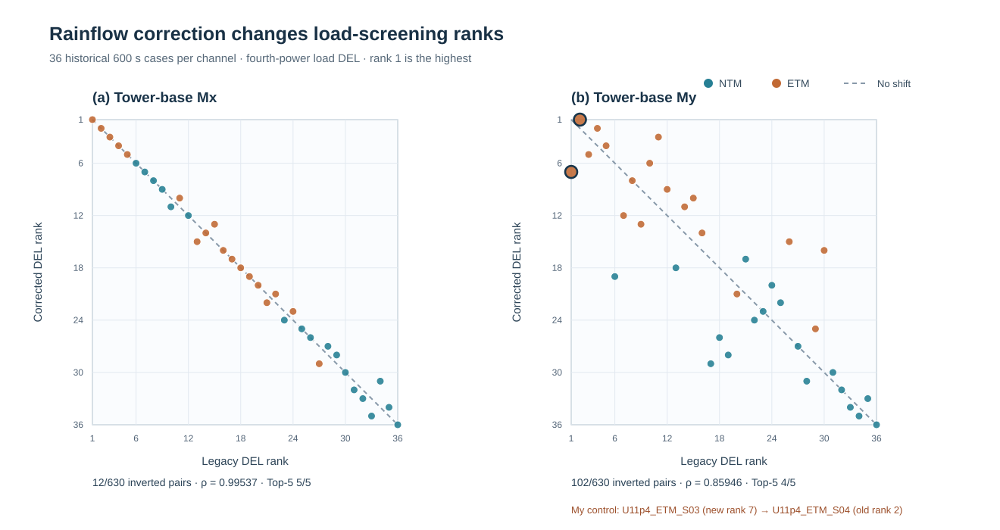
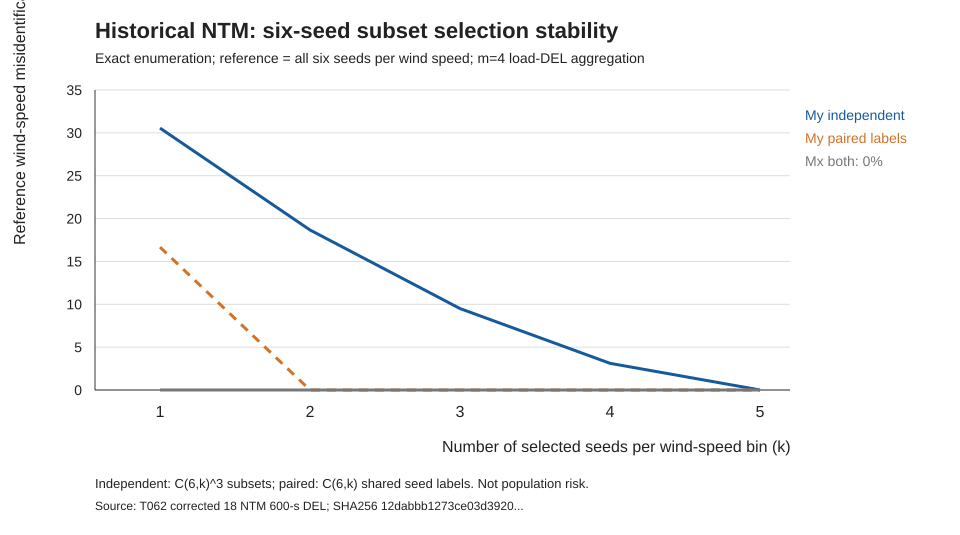
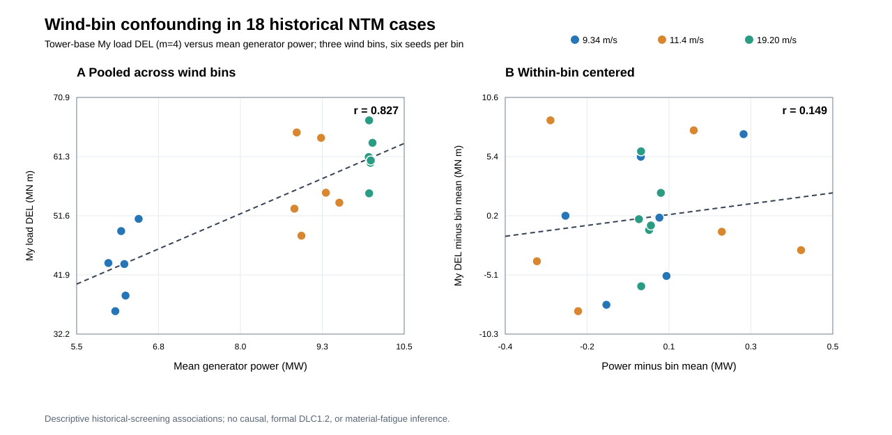
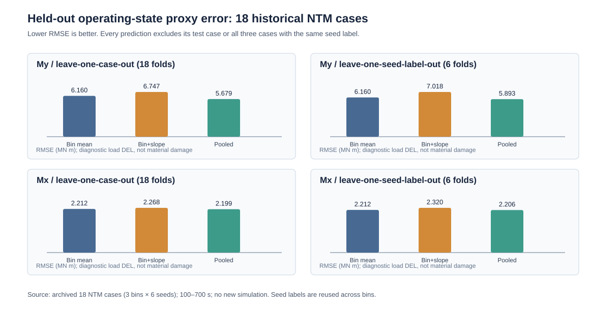
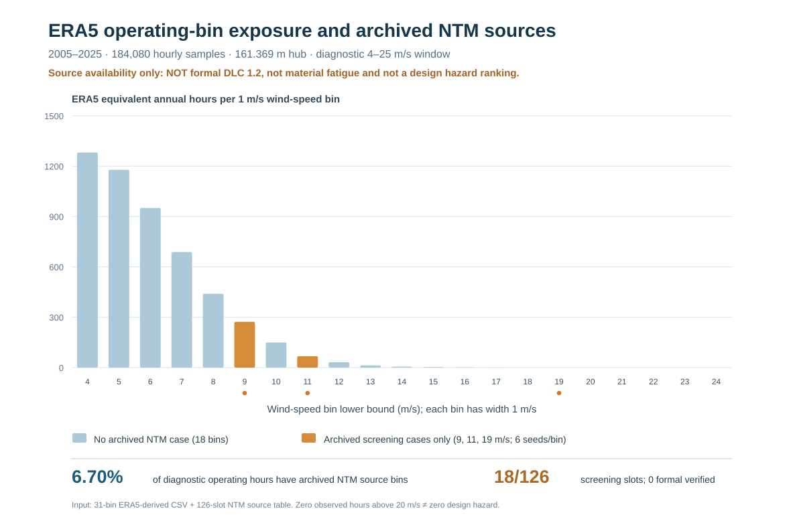

# Reliability limits of wind-load screening: rainflow ranking, finite-seed sensitivity and incomplete wind-climate coverage for a 158 m hybrid wind-turbine tower

**Manuscript status:** evidence-traceable research draft; **not submitted and not yet suitable for independent journal submission**. The object is a historical DTU 10 MW / 158 m (112 m concrete + 46 m steel) hybrid-tower OpenFAST *load-screening* archive. The reported fourth-power damage-equivalent moments are load diagnostics, not verified material-specific fatigue lives. The Jiayu ERA5 wind archive is reanalysis rather than measured turbine operation; no wind–earthquake or structural safety result is claimed.

## Abstract

Selecting a small set of controlling wind-load cases is a common precursor to detailed fatigue assessment, but the selection may depend on the cycle-counting implementation, the available turbulence seeds and the fraction of the wind climate represented by the simulated cases. We examine these three sources of uncertainty using an archived 158 m prestressed-concrete–steel hybrid tower assembled with the DTU 10 MW reference turbine. The evidence comprises 36 historical 600 s wind histories (three reference speeds, two turbulence classes and six seeds), 72 paired tower-base moment damage-equivalent-load (DEL) comparisons, 18 normal-turbulence records and an ERA5-derived 184,080-hour wind-speed archive. Correcting a previously identified rainflow cycle-closure error reverses the order of 102/630 case pairs in the tower-base My channel (Spearman's rho = 0.85946), changing its controlling realization; the Mx channel has 12/630 reversals. Within the observed six-seed NTM archive, choosing three seeds independently in each speed bin selects a different My control bin from the six-seed reference in 760/8000 exact subset combinations (9.50%). Of 106,900 hours in the diagnostic [4,25) m/s interval, 99,736 (93.30%) lack a corresponding historical NTM load source. The observed-bin fourth-order moment therefore has a nonnegative missing contribution without a finite data-supported upper bound. A counterfactual load-growth experiment also reverses the wind-bin sampling priority as its assumed exponent varies; it does not predict unobserved loads. An exact analytic counterexample also demonstrates that moment-DEL rankings do not universally determine local stress rankings. The results show that accurate cycle counting, seed selection and climate coverage are separate requirements for defensible *load-level* screening. They do not establish IEC DLC1.2 compliance, local material stresses, Miner damage or lifetime fatigue, and they motivate explicitly falsifiable independent validation before fatigue-driven optimization.

**Keywords:** hybrid wind-turbine tower; rainflow counting; damage-equivalent load; turbulence-seed sensitivity; ERA5; partial identification; fatigue screening.

## 1. Introduction

### 1.1. From wind-load screening to fatigue inference

As rotor diameters and support-structure heights increase, prestressed-concrete–steel hybrid towers offer a practical structural configuration for large wind turbines [1–3]. Their fatigue assessment, however, spans several different physical and statistical levels: turbulent inflow produces time-dependent tower loads; section forces must be transferred consistently to local stress histories; cycle ranges, means and counts must then be evaluated using material-appropriate fatigue laws and a defensible long-term distribution of operating states. A damage-equivalent *load* calculated from tower-base bending moments is useful for comparing historical simulations under a common cycle-counting convention, but it cannot, by itself, determine fatigue damage in concrete, ordinary reinforcement, prestressing tendons or structural steel. In particular, a single fourth-power exponent used for screening must not be interpreted as a common material S–N slope.

Control-case selection is an intermediate decision with potentially disproportionate consequences. If a subsequent detailed analysis is performed only on a few apparently critical realizations, an error that changes their order can propagate into the research design even when the underlying wind simulation is unchanged. Three questions therefore precede a lifetime-fatigue claim. First, is the numerical ordering reproducible under independently checked rainflow cycle counting? Second, is the selected controlling wind-speed bin stable with respect to the finite set of turbulent realizations actually available? Third, do those simulated wind-speed bins cover enough of the climate to identify a long-term load moment? These are distinct questions: passing one does not resolve the others.

### 1.2. Prior research and the boundary of the present contribution

Existing wind-turbine fatigue research distinguishes short-duration turbulent load statistics from lifetime accumulation, and numerical fatigue estimates depend on the specified wind climate, operating-state classification, structural response and material stress definitions [3]. For the present study, the original OpenFAST and ERA5 provenance is inherited from the archived research workflow; no new authorized IEC/GB clause is asserted as checked in this manuscript revision. Consequently, the 36 historical cases are described as a *screening matrix*, not as a completed design-load-case DLC1.2 matrix. The use of three historical wind speeds is a property of the archive, not a claim that three bins are sufficient for a 20-year assessment.

Recent hybrid-tower research also constrains any broader novelty statement. Ishihara et al. [5] compared coupled and uncoupled seismic/aerodynamic response for a different 2.4 MW wind turbine; their response-combination approximations are not transferred to this 10 MW tower. Wang et al. [6] reported combined wind–earthquake loading for an approximately 160 m hybrid tower, while Wang et al. [7] examined earthquake response and prestress-related resistance enhancement for a **different 163.24 m, 42-segment** tower. The evidence levels differ: **[6] has only publisher abstract/metadata review in this archive**, whereas **[7] has an archived 18-page original publisher PDF, with selected physical PDF pages 5–7 and 14–16 reviewed in earlier T079 work** (SHA256 74a2213d18a15cfd0ea7690a262037d8e928d0becf5ec576e12db35820a8c338). Neither study has been systematically compared section by section with all methods and data in the present article. Thus neither simultaneous wind–earthquake excitation nor the consideration of prestress in seismic response can be claimed as novel, and no absence of a specific screening method in [6] or [7] is asserted. The present article addresses a narrower, independently testable problem: whether a historical wind-load screening dataset supports robust ranking and long-term fourth-moment inference *before* material fatigue or seismic-constrained optimization is attempted.

The novelty claim is therefore methodological and conditional rather than a claim to have discovered a new tower response. We combine a paired, source-locked rainflow-implementation comparison with exact finite-archive seed-subset enumeration and a partial-identification treatment of missing wind-speed-bin loads. The combined analysis makes visible how a numerically corrected controlling realization may still be an uncertain basis for long-term assessment. Each part can be independently reproduced from archived derived tables, and each is designed to admit a negative result. No assertion of priority over all earlier literature is made without a full-text systematic comparison.

### 1.3. Research questions and falsifiable tests

The first research question is whether an implementation defect can alter the identity, rather than only the magnitude, of the controlling load case. We compare legacy and independently corrected fourth-power DELs for the same 36 cases in each of two tower-base bending-moment channels. The paired design holds the archived input cases fixed and counts strict rank reversals across all 630 unordered case pairs per channel. If the rankings were invariant, the hypothesis that the error affects control-case identity would be rejected for this archive; a change in the maximum case directly demonstrates a selection consequence. The rainflow comparison is an algorithmic audit, not a physical change in the tower.

The second question is how much the controlling NTM wind-speed bin depends on seed selection *conditional on the six archived seeds*. For each of three speed bins we aggregate fourth powers of corrected DELs, then enumerate both independent k-seed subsets per bin and common-label subsets. Their exact combinatorial frequencies quantify archive-internal sensitivity, not an out-of-sample probability of error. The six-seed reference includes the subsets being assessed and is not an independently observed population truth. A future test must predeclare a seed budget and load-amplitude tolerance, then evaluate genuinely new realizations; a reversal or excessive error on those held-out seeds would reject a proposed robustness criterion.

The third question is whether the ERA5-derived exposure distribution and three simulated NTM bins identify a long-term fourth-order load moment. Writing the full weighted diagnostic as the observed contribution K plus an unknown missing-bin contribution X, nonnegative load fourth powers imply X >= 0, but do not imply a finite upper bound without additional load evidence or justified physical constraints. We calculate equal-contribution thresholds to express the missing-data sensitivity in the same units as the observed DELs. We separately introduce a deliberately *counterfactual* family of wind-speed-dependent scores to test whether a frequency-only sampling priority remains invariant under alternative assumed load-growth patterns. Those scores are not substituted for missing OpenFAST loads, nor are they used to compute Miner damage.

Three prospective, falsifiable propositions follow. **H1:** wind-speed frequency ranking agrees with the ranking of independently measured or simulated, seed-aggregated fourth-moment contributions in previously missing bins. **H2:** a predeclared seed subset identifies the controlling bin and its load amplitude within a predeclared tolerance on independent realizations. **H3:** corrected tower-base load-DEL rankings agree with independently validated local *material-specific* Miner-damage rankings for matched designs and climate. Failure of any one proposition limits the use of that proxy or selection strategy; the present retrospective analysis does not claim to have tested H3.

### 1.4. Study scope and organization

The analysis uses a DTU 10 MW reference rotor–nacelle assembly [1] with a literature-derived 158 m hybrid tower (112 m concrete and 46 m steel) [2]. It does not claim that this combination is an officially commissioned Jiayu wind turbine. The 36 historical wind simulations represent three reference speeds, normal and extreme turbulence categories, and six seed labels, with a common 100–700 s analysis window. The ERA5-derived 184,080 hourly values provide wind-speed exposure, not a direct observation of turbine control state or material damage. Only three wind-speed bins have matched historical NTM load evidence. All long-term fourth-moment quantities reported below are explicitly *load-level diagnostics* and are not normalized into annual Miner damage.

Section 2 defines the source identities, estimands, cycle-counting and seed-subset methods, and missing-bin identification bounds. Section 3 presents the paired rainflow ranking and finite-seed results. Section 4 examines the exposure gap, counterfactual priority reversals, falsifiable next tests and limitations. The central conclusion is a conditional one: verified short-duration load rankings can support screening within the observed archive, but incomplete climate/load pairing prevents a defensible complete-interval fourth moment, let alone a material-specific fatigue-life or seismic-constrained optimum.

## 2. Materials and methods

### 2.1. Scope, study design and provenance

This retrospective study investigates the reliability of **load-level control-case screening**, not material-specific fatigue life. The research assembly combines the public DTU 10 MW rotor–nacelle reference [1] with a literature-derived **158 m hybrid tower (112 m concrete, 46 m steel)** [2] in the archived OpenFAST model. The ERA5-derived Jiayu wind climate is a separate reanalysis source, not measured operation of an official Jiayu turbine. A separate 115.63 m reference tower is excluded from the 158 m screening-data identity.

Three predeclared estimands are evaluated: (i) the change in tower-base load-DEL ranking when a legacy rainflow closure error is corrected; (ii) the conditional sensitivity of the selected NTM control wind-speed bin to finite-six-seed subsampling; and (iii) the identifiable part of an ERA5-weighted fourth-order load moment when most bins lack matching load histories. None of these estimands is a concrete, reinforcement, tendon or steel Miner damage. The evidence chain distinguishes historically verified original OUTB/ERA5 inputs, **directly reread derived CSVs**, source-locked post-processing scripts and resulting tables. This Methods pass did **not** reacquire original OUTB binaries, original hourly ERA5 files, authorized IEC/GB clauses or the full texts of the two 2026 prior-art studies.

### 2.2. Wind histories, coordinates and rainflow calculation

The historical 158 m screening matrix contains **36 distinct cases**: three reference speeds (**9.343881, 11.4, 19.202140 m s⁻¹**), two historical turbulence classes (NTM and ETM) and six labeled random seeds (S01–S06) per speed/class. The archived analysis window is **100–700 s (600 s)**. Each case has two OpenFAST tower-base bending-moment channels, TwrBsMxt and TwrBsMyt, reported in **kN m**, giving **72 case–channel rows**. Each case's two channels must share the original OUTB SHA256. These channel labels are preserved; no unverified conversion to geographic axes is introduced. Historical screening must not be presented as a completed IEC DLC1.2 lifetime matrix.

For moment history \(M(t)\), rainflow yields ranges \(\Delta M_i\) and full/half-cycle weights \(n_i\). The generic fourth-power damage-equivalent *load* is
\[
L_4=\left[\frac{\sum_i n_i|\Delta M_i|^4}{N_{\mathrm{eq}}}\right]^{1/4}.
\]
The original reference-cycle normalization, time window and **m = 4** are identical in the legacy and corrected outputs. Here m = 4 is a **load-ranking diagnostic**, not a shared fatigue slope for the different tower materials. The earlier T062 primary-source investigation isolated an incorrect cycle-closure comparison in the legacy implementation and compared corrected cycle multisets with independent rainflow 3.2.0. The present analysis **inherits** that prior original-binary verification; it does not claim a fresh OUTB run.

### 2.3. Paired algorithmic ranking comparisons

For each channel \(c\) and case \(j\), define the signed implementation bias
\[
b_{jc}=100(L_{jc}^{\mathrm{legacy}}/L_{jc}^{\mathrm{corrected}}-1)\%.
\]
Compute the median, minimum and maximum across **36 cases per channel**. Sort the same 36 case IDs by decreasing DEL under both algorithms, and report: (a) the number of strict rank reversals among \({36\choose2}=630\) unordered pairs; (b) Spearman's \(\rho=1-6\sum_jd_j^2/[36(36^2-1)]\) in the no-ties setting; and (c) top-five set overlap. A reversal occurs only when the two algorithms assign opposite signs to a pairwise DEL difference; ties require explicit handling rather than row-order decisions. Pair comparisons share case observations and are **not 630 independent replicates**. Since some legacy errors are positive and others negative, a single global DEL correction factor is not assumed.

### 2.4. Exact finite-six-seed NTM subset design

The seed experiment uses only the **18 NTM cases** (three wind speeds × six seeds), not the ETM records. For wind-speed bin \(b\), channel \(c\), and a subset \(S_b\) of \(k\) archived seeds, define
\[
\bar L_{bc}(S_b)=\left[\frac{1}{k}\sum_{s\in S_b}L_{bcs}^4\right]^{1/4}.
\]
The bin with the largest full-six-seed aggregate is the **internal reference**, not a population truth. For each \(k=1,\ldots,5\), enumerate two distinct sampling designs exactly: independently choose a \(k\)-subset in each bin, giving \({6\choose k}^3\) combinations; or choose one common seed-label subset across all bins, giving \({6\choose k}\) combinations. The latter is a sensitivity to label coupling, not proof that the underlying turbulent inflows are common random numbers.

For every combination, count whether its maximum-aggregate bin differs from the full-six reference, and compute the absolute relative error of the **reference winner's** aggregate load, \(|\bar L_{b^\star c}(S_{b^\star})/\bar L_{b^\star c}(S_{\rm all})-1|\). A tie at the maximum must be explicitly flagged. The wrong-bin fraction is an exact **finite-archive combinatorial frequency**; the full reference contains the selected subsets, so it is not an independent validation, an unseen-seed failure probability or an IEC minimum-seed recommendation. The distinction between a stable winner and a stable load amplitude is retained.

### 2.5. ERA5 exposure and partial identification

The archived ERA5-derived climate (reanalysis dataset [4], not site measurements) covers **184,080 hourly estimates** (2005–2025) tabulated in 31 integer-lower-edge speed bins. The **diagnostic** interval \([4,25)\) m s⁻¹ contains **106,900 h**; it is not a verified turbine cut-in/cut-out range. Only the three bins with lower edges **9, 11 and 19 m s⁻¹** have historical NTM load summaries, covering **7,164 h**. The remaining **99,736 h** lack a matching load source, rather than having zero load. Thirteen missing bins have positive exposure; five missing bins have zero observed hours.

Let \(H_b\) be the observed count in bin \(b\) and \(H=184080\). The unconditional probability \(p_b=H_b/H\) differs from the diagnostic-interval conditional probability \(p_{b\mid O}=H_b/106900\), with
\[
p_b=(106900/184080)\,p_{b\mid O}\quad(b\in O).
\]
For the historical fourth-power *load* diagnostic with bin aggregate \(L_{bc}\) in **MN m**, the identifiable contribution is
\[
K_c=\sum_{b\in B_{\rm obs}}p_bL_{bc}^4,\qquad
X_c=\sum_{b\in O\setminus B_{\rm obs}}p_bL_{bc}^4.
\]
The complete diagnostic contribution would be \(K_c+X_c\). Without credible missing-bin load values, only \(X_c\ge0\) is known; hence \(K_c\) is a lower bound on this **defined load-moment functional**, while its upper bound is unbounded. This is **not** a lower bound on material Miner damage, which requires local stress ranges, mean stresses, cycle rates, fatigue laws and verified operating-state exposure.

Define a common missing-bin fourth-power-equivalent load by \(X_c=(99736/184080)L_{\rm miss,c}^4\). The equal-contribution threshold is
\[
L_{\rm miss,c}^{(50\%)}=\left[K_c/(99736/184080)\right]^{1/4}.
\]
For one positive-hour missing bin, the corresponding threshold is \((K_c/p_b)^{1/4}\). These are **identifiability thresholds**, not predictions or design limits. Report \(K_c\) in \((\mathrm{MN\,m})^4\), the thresholds in \(\mathrm{MN\,m}\), and exposure in hours. The denominator 184,080 must not be silently replaced by 106,900.

### 2.6. Counterfactual priority-ranking experiment

To test whether the frequency-only ordering uniquely determines which missing wind bins deserve new load data, construct the explicitly counterfactual score
\[
S_b(q)=H_b[(b+0.5)/U_{\rm ref}]^{4q},
\quad 0\le q\le2,\quad U_{\rm ref}=9.343881\ \mathrm{m\,s^{-1}}.
\]
Here \(b\) is the integer lower edge (m s⁻¹), \(b+0.5\) its center, and \(q\) an **assumed** growth exponent, neither a fitted wind-load law nor a material S–N exponent. \(U_{\rm ref}\) cancels from all rankings. Compute normalized shares \(S_b/\sum S_b\) at \(q=0,1,2\), then locate every pairwise score crossing analytically:
\[
q_{ab}=\frac{\log(H_a/H_b)}{4\log[(b+0.5)/(a+0.5)]}.
\]
Retain crossings inside \((0,2)\), sort with endpoints and evaluate each interval midpoint to determine the upper envelope. This exact crossing method avoids arbitrary discretization of \(q\). A scenario score is **not** an estimated missing-bin load or fatigue contribution. The exercise tests the logical sufficiency of frequency-only ranking, not an optimal production-run plan.

### 2.7. Source admission, error controls and limitations

The source-admission contract requires exactly **36 distinct cases × two channels**, unique case/channel keys, recognized speed/class/seed labels, 64-character hexadecimal original OUTB hashes, finite positive DELs, and third-party/corrected DEL agreement within the archived **10⁻⁵ kN m** tolerance. Both channel rows must have the same original OUTB hash. The archived 10-row seed-subset and 26-row missing-bin threshold tables must retain their channel/bin counts and numerical identities. Duplicate/missing rows, altered channel labels, nonfinite values and corrupted third-party DELs are rejected rather than repaired.

In this Methods pass, the connected GitHub source was directly reread for **72 + 10 + 26 derived rows** and checked with **eight positive source-level invariants and three malformed-source refusals** using JavaScript V8. The initial negative-test harness failed its expected count because its third predicate did not actually mutate an input; this *test-harness failure* was corrected by corrupting a third-party DEL, after which all three refusals passed. This is not a claim of native Node CI or physical validation. Source SHA256s were inherited from archived byte-level receipts; this pass's connector reads return Git blob SHA1, which must not be mislabeled SHA256.

**Input provenance:** T062 72-row legacy/corrected comparison SHA256 **12dabbb1273ce03d3920aedda3f72f9fa1d75b671e01a1db145c0a972ffe15e2**; 10-row seed subset SHA256 **f7d9427d15b378661aaebf2fdf0feb1e5eea07cefb3721088a98439265320cf1**; 26-row threshold SHA256 **69fe2ba8077df9cfe9122f1aafb03f315cd143f8313a557763954560b5870b60**; inherited 31-row ERA5 source SHA256 **e4058620a36b23bb218103875d4dc5b0711fc45d418b23a2208c2fc9c16c9102** and six-row NTM fourth-moment source SHA256 **d43f963fb30e16a33e87acdf6e9571710826974eee89d1f3527ab6504d85f695**. Reproduction uses the existing T062 scripts for rainflow-rank robustness, NTM subset enumeration, missing-bin identifiability and counterfactual sampling priority; exact paths and earlier test receipts are in T080 PROCESS_LOG. The archived six-seed aggregates and DELs are **load diagnostics only**.

Unquantified error sources include ERA5/site representativeness, controller and operating-state identity, incomplete wind-bin coverage, the unseen-seed population, tower-local-to-global coordinate interpretation, local stress transfer, material S–N laws and seismic initial-state compatibility. No joint confidence interval is justified. A future source-complete study must independently validate missing-bin operating load histories and held-out seeds before reporting a climate-weighted lifetime load statistic; **material-specific Miner** additionally requires verified local stresses and material-specific mean-stress/fatigue models. The 2026 hybrid-tower wind–earthquake [6] and earthquake/prestress [7] studies rule out generic novelty claims for those phenomena. Source [6] is abstract/metadata-only in this archive; selected original PDF pages of [7] were previously examined, but the two studies have not undergone a complete side-by-side methods/data comparison. The current IEC 61400-1 and IEC 61400-6 consolidated-edition product pages [8,9] are catalog-level evidence only; their authorized design clauses have not been audited here.

### 2.8. Wind-bin-conditioned operating-state association

An exploratory proxy test paired the historical 18 NTM operating-state summaries with tower-base My/Mx fourth-power load DEL by identical case and original OUTB SHA256. All 18 records have 12,001 samples at 0.05 s over 100–700 s, three wind-speed bins with six seeds each, and the archived active-operation heuristic. Generator power (kW) and DEL (kN m) were converted to MW and MN m. Pooled Pearson correlation was contrasted with Pearson correlation after subtracting the six-seed mean separately from predictor and DEL within each wind bin. The centered cross-product was exactly decomposed into between-bin and within-bin contributions. Eighteen leave-one-case-out recalculations re-estimated the bin means. This is a descriptive, noncausal finite-archive test, without p-values or claims about future seeds, DLC1.2, or material fatigue.

### 2.9. Diagnostic-exponent sensitivity of near-base nominal-stress screening

A separate sensitivity analysis uses the previously archived 2,880-row, source-locked 18-NTM gross-section stress-rainflow table (three wind speeds, six seeds per speed, ten stations between 0 and 2.751 m, and 16 candidate local azimuths). The original OUTB files were SHA-verified in earlier work; this analysis re-reads the derived table and an independent 30-row six-seed control table, not the original binary histories. For each diagnostic exponent \(m\in\{4,10\}\), the six-seed score at each wind bin, station and local azimuth is \(\{\sum_{r=1}^{6}D_{m,r}^{m}/6\}^{1/m}\). The maximization over azimuth and wind bin is repeated separately for each exponent. Neither exponent is assigned to concrete, prestressing steel or any other material.

At the BASE station, the full-six-seed controlling azimuth is 0° for both exponents in all three wind bins. Holding this azimuth fixed, we exhaustively enumerate all 20 common-label three-of-six seed subsets and all \(20^3=8000\) independent-within-bin subset combinations. These are finite-archive combinatorial counts, not independent experiments, confidence intervals or probabilities for new turbulence seeds. All comparisons use the same 600 s reference-cycle normalization within each exponent; no cross-exponent numerical DEL magnitude is interpreted as a damage ratio.

### 2.10. Held-out operating-state proxy test

To test whether the within-wind-bin association in §2.8 improves **held-out** load-DEL estimates, the same 18 SHA-paired historical NTM records were used without adding or generating simulations. Two pre-specified scalar predictors were examined: mean generator power (MW) for tower-base My load DEL and mean pitch angle (degrees) for tower-base Mx load DEL. The responses are fourth-power load DEL (MN m), not local material stresses. Three estimators were compared: (A) the training-only mean response of the target wind bin; (B) that bin mean plus a single within-bin slope estimated from the sum of within-bin-centered predictor–response cross-products over all training bins; and (C) an unstratified pooled linear regression. All means and slopes were **re-fitted after excluding the held-out observations**, avoiding use of the test response to calculate bin means.

Two deterministic splits were evaluated. Leave-one-case-out (LOCO) removes one case (17 training cases; 18 test predictions). Leave-one-seed-label-out (LOSO) removes the same S01–S06 label simultaneously from all three wind bins (15 training cases; six three-case folds). LOSO is a conservative grouping check for labels shared across bins, **not** evidence that identical seed labels represent independent or physically matched turbulence realizations. Each of the 18 observations contributes once to the out-of-fold RMSE and MAE. We do not interpret these 18 correlated errors as independent samples or calculate confidence intervals. The predictor summaries and DEL are computed from the same 100–700 s history; this is a diagnostic proxy test, not prospective prediction before a wind simulation.

The input is the previously audited 18-row case/OUTB-SHA-matched table (SHA256 `4abf76252fa34b2c12635d409e5abc23c4a7d6f759b66dbec12b1932379f4bea`). The new source-locked program, 12-row summary and Fig. 5 are archived under T062. No original OUTB was reopened in this pass. Model comparison is descriptive and does not establish causality, population generalization, a formal DLC1.2 fatigue load, or material life.

## 3. Results: rainflow implementation and controlling-case robustness

### 3.1. Paired rainflow ranking and controlling-case changes

The historical 36 simulations comprise three reference wind speeds, two turbulence classes (NTM/ETM) and six seed labels per wind-speed/class combination. Each original output provided a 600 s analysis window. A prior primary-source audit established that the 36 disputed OpenFAST binaries were byte-identical and that 72 corrected tower-base bending-moment rainflow cycle multisets agreed with independent rainflow 3.2.0. The discrepancy was isolated to the direction of the legacy cycle-closure comparison, rather than to the wind inputs or tower model.

The present analysis tests a separate question: whether this implementation defect changes which simulation is selected for subsequent structural assessment. For each of the tower-base Mx and My channels, all 36 cases were ranked using the legacy and independently corrected damage-equivalent moments. Bias was defined as 100 × (legacy DEL / corrected DEL − 1)%. We enumerated all 630 unordered pairs of cases and counted ranking reversals, then calculated Spearman rank correlation and top-five membership overlap. The pairwise comparisons are not independent replicates (Table 1).

**Table 1.** Paired legacy/corrected tower-base load-DEL ranking diagnostics for 36 historical cases per channel (m = 4; no material-fatigue interpretation). Source: archived T062 72-row comparison, SHA256 `12dabbb1273ce03d3920aedda3f72f9fa1d75b671e01a1db145c0a972ffe15e2`.

| Channel | Median legacy bias | Full range | Reversed pairs | Spearman rho | Top-five overlap |
|---|---:|---:|---:|---:|---:|
| Mx | −20.8797% | −29.0675% to +2.6041% | 12/630 (1.90%) | 0.99537 | 5/5 |
| My | −25.5452% | −54.5115% to +22.4800% | 102/630 (16.19%) | 0.85946 | 4/5 |

The legacy method underestimated the corrected DEL for 34 of 36 Mx records and 32 of 36 My records; a uniform correction factor is therefore inappropriate because the remaining records were overestimated. The My controlling realization changed from U11p4_ETM_S03 (historical 28.177010 MN·m; corrected 23.005398 MN·m) to U11p4_ETM_S04 (corrected 26.802479 MN·m). The corrected Mx maximum remained U19p202140_ETM_S02 (9.468855 MN·m). This is an algorithm-induced change in screening identity, not a new physical response to turbulence.

The paired rank–rank diagram in Fig. 1 exposes the case-level mechanism behind Table 1. For My, the legacy maximum U11p4_ETM_S03 moves from rank 1 to **corrected rank 7**, whereas the corrected maximum U11p4_ETM_S04 rises from legacy rank 2 to corrected rank 1. The Mx maximum U19p202140_ETM_S02 remains rank 1 under both implementations. The diagonal represents unchanged ranks; departures reflect algorithmic differences for **identical archived load histories**, not stochastic uncertainty intervals. The complete 72-row rank-transition ledger is archived as `T062_72CASE_RAINFLOW_RANK_TRANSITIONS_20261107.csv` (SHA256 `1bf750ba3ea33153dbe4b23e87a1b973ca73ab41e446b2d9d5f3fac2881238a9`).

**Fig. 1.** Rank–rank comparison for all 36 historical cases per tower-base moment channel: (a) Mx and (b) My. Horizontal = legacy rank, vertical = corrected rank; rank 1 denotes the largest fourth-power load DEL. Blue markers represent NTM, orange ETM; the two emphasized My markers identify the legacy and corrected controlling realizations. The dashed diagonal denotes unchanged rank. Source: T062 original 72-row paired comparison (SHA256 `12dabbb1273ce03d3920aedda3f72f9fa1d75b671e01a1db145c0a972ffe15e2`); reproducible figure SHA256 `1a17a1f36e68aff8280a33a1f318b98adcee1581556ea8e923fea1ef502a002a`. These are load-level diagnostics, not local material-fatigue results.

### 3.2. Exact finite-six-seed subset sensitivity of NTM control-wind-speed selection

We further examined whether using fewer random realizations could change the wind-speed bin selected for subsequent load-level assessment. The analysis used the corrected tower-base Mx/My damage-equivalent moments from the 18 historical NTM runs (three reference wind speeds × six seeds; 600 s per record). For each wind-speed bin and seed subset S, we calculated the fourth-power aggregate \(L_{j,S}=[|S|^{-1}\sum_{s\in S} DEL_{j,s}^4]^{1/4}\), where the exponent is a **load-level diagnostic** and not a universal material fatigue slope. The six-seed aggregate within each bin was the internal reference, not an independently known population value.

We exhaustively enumerated both (i) independently selected k-seed subsets for each of the three wind speeds, yielding \({6\choose k}^3\) combinations, and (ii) shared seed-label subsets across wind speeds, yielding \({6\choose k}\) combinations. Shared labels are a design sensitivity, not evidence of common-random-number coupling between the simulations. The full six-seed reference selected 19.202140 m/s for both Mx and My; the corresponding reference margins over the runner-up were 162.805% and 7.002%, respectively. The finite-archive subset comparisons are summarized in Table 2 and Fig. 2.

**Table 2.** Exact finite-six-seed subset counts for three archived NTM wind-speed bins; fractions are conditional on this archive, not out-of-sample failure probabilities. Source: T062 10-row seed-subset CSV, SHA256 `f7d9427d15b378661aaebf2fdf0feb1e5eea07cefb3721088a98439265320cf1`.

| k | Independent subsets | My wrong-bin selections | My shared-label wrong-bin selections | Mx wrong-bin selections |
|---:|---:|---:|---:|---:|
| 1 | 216 | 66 (30.56%) | 1/6 (16.67%) | 0 |
| 2 | 3375 | 630 (18.67%) | 0/15 | 0 |
| 3 | 8000 | 760 (9.50%) | 0/20 | 0 |
| 4 | 3375 | 105 (3.11%) | 0/15 | 0 |
| 5 | 216 | 0 | 0/6 | 0 |

At k=3, 760 of 8000 independent subset combinations selected the 11.4 m/s bin rather than the six-seed My reference winner. No Mx subset changed the reference winner, although the worst absolute relative error in the winner's aggregate Mx load DEL was still 26.71% at k=1. Thus, stable control-bin identity does not imply convergence of load amplitude. The marked difference between independent and shared-label subset enumeration also cautions against reporting a seed-count requirement without defining the sampling design.

**Fig. 2.** Conditional My control-bin mis-selection frequency versus the number of archived seeds selected per wind bin, with independent and common-label subset designs. Original source-derived SVG SHA256 `5e3df353b8631bf3eb9bc03ede3551a3e91aaf93f41d4b61dd70f88524eb2cb4`; **not** an IEC convergence curve.

These are **exact conditional combinatorial frequencies within the observed six-seed archive**, not probabilities for unseen turbulent realizations or confidence intervals for a stochastic population. Because the reference includes the subsampled seeds, this is an internal sensitivity/leave-subset-out experiment, not a genuinely independent external validation. Zero misidentifications at k=5 therefore cannot certify five-seed convergence. The study does not establish IEC DLC1.2 compliance or material-specific Miner damage; the archived 18 NTM cases cover only three historical wind-speed bins.

**Reproducibility:** corrected 72-row source CSV SHA256 `12dabbb1273ce03d3920aedda3f72f9fa1d75b671e01a1db145c0a972ffe15e2`; script `experiments/T062/t062_ntm_seed_subset_robustness.js` SHA256 `bbf923bb509679edf76ae60dc5dda00648fb181ca4aa7d13ac06d0ef0712f333`; 10-row output SHA256 `f7d9427d15b378661aaebf2fdf0feb1e5eea07cefb3721088a98439265320cf1`; figure SHA256 `5e3df353b8631bf3eb9bc03ede3551a3e91aaf93f41d4b61dd70f88524eb2cb4`. Eight real-value oracles and 11 malformed-source refusals passed in V8; native Node CI and new original-OUTB reading were not performed. Authorized 2025/26 IEC clauses were not reread.

### 3.3. Wind-bin confounding of operating-state/load-DEL associations

For the 18 source-matched historical NTM cases, mean generator power and tower-base My load DEL had pooled Pearson **r=0.827168** (R²=0.684207). After wind-bin centering, the coefficient was only **r=0.148564** (R²=0.022071). The between-bin term accounted for **98.9421%** of the total signed cross-product. The three separate bin coefficients were 0.500028, -0.003276, 0.162506; the within-bin coefficient varied from 0.007570 to 0.377205 across 18 leave-one-case-out checks. Mean blade pitch versus tower-base Mx load DEL similarly changed from pooled r=0.968215 to centered r=0.315669. This is a wind-bin confounding counterexample, not evidence of controller causation or a material-fatigue mechanism.

**Table 3.** Descriptive associations of operating-state means and fourth-power load DEL, three bins × six seeds. Between-bin percentage is a signed cross-product share, not a variance-explained fraction.

| Load channel | Operating predictor | Pooled r | Bin-centered r | Between-bin covariance share | Bin-centered leave-one-out r |
|---|---|---:|---:|---:|---:|
| My | Mean generator power | 0.827168 | 0.148564 | 98.942% | 0.007570–0.377205 |
| My | Mean rotor speed | 0.835976 | 0.292446 | 98.015% | 0.135925–0.546127 |
| My | Mean blade pitch | 0.688601 | 0.250498 | 99.423% | 0.114886–0.645439 |
| Mx | Mean blade pitch | 0.968215 | 0.315669 | 99.776% | 0.139893–0.493501 |

**Fig. 3.** Same 18 historical NTM cases: (A) pooled mean generator power versus My load DEL and (B) both variables centered within their six-seed wind-speed bin. Dashed lines are descriptive fits. Original derived source SHA256: operating-state CSV `0f577f3197870a1350c740c2e0c118073fb9b6f796b4c471765c6f616d5a1b04`, load-DEL CSV `95de6578cf379d1b2e1d99a68c26954a68e93cc8bfc4bdcd63dd324ae2999a0f`; reproducible figure SHA256 `a0c4bce68e90143198bcbeedbe8c0625a27c31e8377fe6167a52ddcf4bd50adf`. No formal DLC1.2, causal, or material-life inference.

### 3.4. Control-wind-speed reversal under diagnostic exponent choice

The gross-section six-seed stress scores reveal a control-bin reversal (Table 4 and Fig. 4). At BASE, the 9.343881/11.4/19.202140 m/s bins have \(m=4\) scores of 3.241072/4.181816/**4.472304** MPa, whereas their \(m=10\) scores are 7.850583/**9.489058**/8.232228 MPa. Thus the largest diagnostic score occurs at 19.202140 m/s for \(m=4\) but at 11.4 m/s for \(m=10\). The winner-to-runner-up margins are 6.9465% and 15.2672%, respectively. This same reversal occurs at all ten near-base stations; their proximity means they are not independent structural replications. The original 30-row control-table oracle agrees with the independent 2,880-row aggregation to within \(6.83\times10^{-12}\) MPa (\(m=4\)) and \(2.46\times10^{-11}\) MPa (\(m=10\)).

**Table 4.** Gross-section nominal-stress diagnostic exponent sensitivity at BASE (historical NTM; not material fatigue).

| Wind bin | Diagnostic \(m=4\) stress DEL (MPa) | Diagnostic \(m=10\) stress DEL (MPa) |
|---|---:|---:|
| 9.343881 m/s | 3.241072 | 7.850583 |
| 11.4 m/s | 4.181816 | **9.489058** |
| 19.202140 m/s | **4.472304** | 8.232228 |

**Fig. 4.** Source-locked six-seed gross-section nominal-stress DELs at BASE, with separate azimuth optimization for each diagnostic exponent. This is neither a material-specific S–N assessment nor a design-life damage comparison.

The independent three-of-six subsets preserve **both** full-six-seed winners in 6,024/8,000 combinations (75.30%), while the exponent-specific winners differ in 6,258/8,000 (78.225%). Common-label subsets preserve both full-six-seed winners in 18/20 combinations (90%), yet the two exponents select different bins in all 20. The different counts reflect the subset construction, not different underlying wind simulations. No new OpenFAST run was performed.

### 3.5. Held-out tests of operating-state proxies

**Table 5.** Out-of-fold RMSE (MN m) for two load-DEL channels, with three estimators and two splitting rules. All 18 test errors are evaluated once in each row; smaller is better. Source: 18 archived SHA-paired NTM cases, program and 12-row output in T062.

| Channel / predictor | Holdout | Bin mean | Bin + within-bin slope | Pooled linear |
|---|---|---:|---:|---:|
| My / mean power | One case | 6.1602 | 6.7473 | 5.6788 |
| My / mean power | One seed label across bins | 6.1602 | **7.0176** | 5.8935 |
| Mx / mean pitch | One case | 2.2124 | 2.2676 | 2.1994 |
| Mx / mean pitch | One seed label across bins | 2.2124 | **2.3201** | 2.2057 |

For My, adding the within-bin operating-state slope **increases** held-out RMSE relative to the wind-bin-mean benchmark by 9.53% (LOCO) and 13.92% (LOSO). For Mx, the corresponding increases are 2.49% and 4.87%. Thus, in this finite archive, neither pre-specified operating-state covariate demonstrates improved held-out accuracy **after conditioning on wind bin**. The unstratified pooled regressions achieve smaller RMSE in this particular archive (e.g., My LOSO 5.8935 versus 6.1602 MN m), but they also exploit between-bin differences; this does not overturn the confounding analysis or establish transfer to unobserved wind speeds. Because each bin contains only six seeds, the result is sensitive to individual realizations, and no new-seed uncertainty interval is available.

**Fig. 5.** Historical 18-NTM held-out load-DEL errors for a wind-bin mean, a wind-bin mean with fitted within-bin slope, and a pooled linear model. RMSE is in MN m; the figure is not a structural or material-fatigue validation.

## 4. Discussion, falsifiability and scope

A verified rainflow implementation is a necessary upstream condition for reliable selection of candidate load cases. It is not sufficient for predicting fatigue of concrete, prestressing tendons, ordinary reinforcement or structural steel: those require local material stress cycles, material-specific fatigue laws, validated mean stress, and wind-speed exposure. The 36 simulations are representative-wind screening records, not a verified DLC1.2 lifetime matrix. The archived ERA5-derived 184,080-hour series contains 106,900 hours in a deliberately diagnostic [4,25) m/s operating interval; only 7,164 hours (6.70159% of that interval) lie in the three wind-speed bins with historical NTM source coverage. The missing bins cannot be assigned zero fatigue damage.

Two already published 2026 studies address combined wind–earthquake response [6] and earthquake/prestress enhancement [7]. The first remains publisher-abstract-level evidence here; the second has selected original PDF pages reviewed (see §1.2). Simultaneous wind–earthquake loading and prestress-based seismic improvement are therefore not original claims. A falsifiable broader hypothesis is whether a *validated material-specific fatigue* optimum changes after *state-matched seismic constraints* are imposed. The present load-level ranking result does not test that hypothesis.

### 4.1. Exposure coverage does not identify lifetime fatigue contributions

The 21-year ERA5-derived archive contains 184,080 hourly wind estimates, of which 106,900 fall in the deliberately diagnostic [4,25) m/s interval. Only 7,164 of these hours (6.70159%) occupy the three bins represented by the historical NTM load records; 99,736 hours (93.29841%) have no matched historical NTM load source. Of the unrepresented hours, 95,402 (95.65453%) fall in the five consecutive 4–9 m/s bins (Fig. 6; Table 6). This is a statement about **wind-speed exposure and data provenance**, not an assertion that the turbine is operating or producing fatigue damage during all those hours. ERA5 reanalysis is not site-measured wind, and the interval is not an IEC-certified operating envelope.

**Fig. 6.** ERA5-derived hourly exposure by wind-speed bin and the three bins with historical NTM load sources. Source-derived SVG SHA256 `b2f4747a7196d772c5d42f6a06f37febab5f606eb8c40ab5e57897807e09f55e`; coverage is not turbine operating status, IEC DLC1.2 completion, or material damage.

**Table 6.** Partial-identification inputs and equal-contribution thresholds for the defined unconditional fourth-power **load** diagnostic; derived from archived 31-bin ERA5 and six-row NTM aggregates (not Miner damage).

| Quantity | Mx | My | Interpretation |
|---|---:|---:|---|
| Known three-bin contribution K / (MN m)^4 | 125.606638 | 209257.299448 | Sum weighted by H_b/184080 |
| Missing-bin hours | 99736 | 99736 | 93.29841% of diagnostic [4,25) m/s hours |
| Missing-bin equivalent DEL at X = K / MN m | 3.902041 | 24.929227 | Sensitivity threshold, **not imputation** |
| Finite data-supported upper bound on K + X | None | None | Assumes only missing-bin fourth powers are nonnegative |

For a tower-base moment channel and the historical fourth-power load diagnostic, let \(p_b=H_b/184080\), \(L_b\) be the bin's six-seed-equivalent load DEL in MN m, and \(K=\sum_{b\in B_{obs}}p_bL_b^4\). The recovered three-bin contributions are \(K_x=125.606637743\) and \(K_y=209257.299447600\), both in (MN m)^4. The unobserved contribution \(X=\sum_{b\notin B_{obs}}p_bL_b^4\) is nonnegative, so \(K\) is a lower bound on the *diagnostic fourth moment* under these definitions. With no defensible upper bound on the missing \(L_b\), \(X\) has no finite upper bound; consequently, a complete-interval fourth-power-equivalent load cannot be identified from the three observed bins. This lower bound is **not** a lower bound on material-specific Miner damage, which also depends on local stress, cycle rate, mean stress, material fatigue laws, and operating-state classification.

The missing-bin equivalent load \(L_{miss}\) that would make \(X=K\), when applied uniformly in fourth-moment terms across all unrepresented diagnostic hours, is 3.902041 MN m for Mx and 24.929227 MN m for My. These are *equal-contribution thresholds*, not imputed loads (Table 6). The exact equality is \(L_{miss}=(K/(H_{miss}/184080))^{1/4}\). Thus, even a large fraction of observed hours does not by itself determine the missing fourth-moment contribution.

### 4.2. A counterexample to frequency-only sampling priority

To make the ambiguity falsifiable without inventing missing OpenFAST outputs, consider the explicitly counterfactual score \(S_b(q)=H_b[(b+0.5)/9.343881]^{4q}\), with integer lower wind-bin edge \(b\) (m/s), recorded hours \(H_b\), and an assumed load-growth exponent \(q\in[0,2]\). The reference speed cancels from the ranking. This is **not a fitted wind-load law**, and \(q\) is not a material S–N exponent. At \(q=0\), the most frequent missing bin, 4–5 m/s, ranks first with 26.9983% of total missing-bin scenario score. At \(q=1\), the 8–9 m/s bin ranks first (20.1072%). At \(q=2\), the 10–11 m/s bin ranks first (19.4334%), despite representing only 3,149/99,736 = 3.1573% of missing hours. Conversely, the 4–5 m/s bin's scenario score share drops to 0.1891% at \(q=2\). The latter two scores differ by a factor of approximately 102.75. These are computed from the 13-bin source table, **not** from simulated or measured loads at those bins.

The exact envelope of the 13 positive-hour score curves has six winning intervals on \(q\in[0,2]\): lower bin edges 4, 5, 6, 7, 8, and 10 m/s, with changes at approximately \(q=0.104072,0.320496,0.565269,0.894407,1.274197\). Therefore a unique sampling order cannot be justified from occurrence hours alone unless a defensible load-growth or uncertainty model is specified. In particular, the 4–9 m/s group accounts for 95.65% of the missing hours but need not dominate a high-order load moment. Conversely, selecting rare high-wind bins solely on a speculative power law would also be unjustified.

### 4.3. Seed-selection uncertainty and the risk of double selection

Within the *observed* 18 NTM records, the corrected six-seed My fourth-power aggregate is 17.157449 MN m at 19.202140 m/s, with only a 7.0023% margin over the second-ranked bin. Exhaustively drawing three of the six archived seeds independently in each of the three wind bins selects the wrong bin relative to the six-seed internal reference in 760/8000 combinations (9.50%). Choosing the same three seed labels across all bins produces 0/20 such reversals. This difference shows that the sampling design matters, but neither frequency estimates an out-of-sample mis-selection probability: the six-seed reference is itself estimated from the same small archive. The earlier corrected-versus-legacy rainflow comparison further showed 102/630 reversed My case pairs, demonstrating a *distinct* algorithmic selection error. The two fractions must not be multiplied or interpreted as independent error probabilities.

Together, the observations identify two separable selection mechanisms: (i) uncertainty about which wind-speed bins contribute to the long-term load moment, and (ii) uncertainty about the controlling realization within the bins that have already been simulated. Neither mechanism alone establishes a material fatigue-control location, and their combination cannot be resolved by adding the missing-hour exposure to the existing three-bin DEL table as zeros.

### 4.4. Pre-registered tests and distinction from prior multi-hazard studies

A subsequent source-complete study can test the following propositions without changing their acceptance criteria after viewing results. **H1 (exposure-ranking adequacy):** ranking missing wind bins by hours alone yields the same leading bins as ranking their independently computed, seed-aggregated fourth-moment contributions; disagreement rejects H1. **H2 (seed robustness):** a predeclared k-seed selection retains the controlling bin and its load amplitude within a predeclared engineering tolerance on genuinely independent held-out realizations; an archive-internal subset count is insufficient evidence. **H3 (fatigue-proxy validity):** corrected tower-base load-DEL ordering predicts the ordering of independently verified material-specific Miner damage for the same matched designs and wind climate; any robust ordering reversal rejects the proposed universal proxy. A further state-matched seismic-constraint hypothesis may be tested only after genuine B/W/E/WE records and structural validation exist.

The hybrid-tower wind–earthquake investigation [6] and the seismic/prestress study [7] rule out claiming novelty merely for simultaneous wind and earthquake loading or for examining prestress in seismic response. Source [6] is abstract/metadata-only in the current archive; selected physical pages of [7] have been read, but no comprehensive methods/data comparison of both studies was performed. Neither source establishes whether the exact ERA5 exposure-identifiability, seed-subset or rainflow-rank analysis reported here is absent from prior art. The present contribution is a reproducible *limitation and test-design result* for historical wind-load screening, not yet a validated lifetime-fatigue or wind–earthquake mechanism.

**Study limitations and reproducibility.** All new calculations in §§4.1–4.2 use previously archived, source-locked *derived* CSVs, not a fresh read of original ERA5 hours or OpenFAST OUTB. No new solver run, authorized IEC/GB clause verification, local material stress, Miner lifetime, or coupled wind–earthquake structural response was produced. SOURCE: T062 `S10_MISSING_BIN_SAMPLING_PRIORITY_20261107.csv` (13 rows; SHA256 `a89ff922b2442fd6aa666374e2a76150a65d326d7856c0dea3f634fa5d70e939`), `S10_MISSING_BIN_M4_IDENTIFIABILITY_20261107.csv` (26 rows; SHA256 `69fe2ba8077df9cfe9122f1aafb03f315cd143f8313a557763954560b5870b60`), and `T062_18NTM_SEED_SUBSET_ROBUSTNESS_20261107.csv` (10 rows; SHA256 `f7d9427d15b378661aaebf2fdf0feb1e5eea07cefb3721088a98439265320cf1`). The two-channel 72-row rainflow comparison has SHA256 `12dabbb1273ce03d3920aedda3f72f9fa1d75b671e01a1db145c0a972ffe15e2`. The stated ratios are deterministic arithmetic on the archived rounded tables; uncertainty in site wind, bin coverage, seed population, controller operation, load response, and local stress is not included. This is **PARTIAL / METHOD-AND-DISCUSSION**, not an S10/S12 scientific PASS.

### 4.5. Why the diagnostic exponent cannot be treated as a material model

The exponent-induced reversal is a concrete counterexample to the assumption that a single generic load-screening exponent selects the same critical normal-operation wind bin as an alternative high-order stress diagnostic. The result is observed in **gross-section nominal stress** computed from synchronous force and bending-moment histories, not in material integration-point stress. It does not demonstrate that a particular concrete, reinforcement, prestressing-tendon or structural-steel fatigue law would reverse the ranking, because local mean stress, reference prestress, S–N definitions and the full wind climate are not available. Moreover, ten adjacent near-base stations provide spatial consistency within one source model, not ten independent validations. A falsifying independent test would apply predeclared material-specific stress-cycle and fatigue laws to new seed histories across complete operating wind bins, and check whether the same reversal persists.

### 4.6. Held-out proxy failure and the limits of pooled correlations

The within-bin correlation test in §3.3 identifies a potential ecological confounding mechanism but does not by itself quantify prediction error. The additional held-out experiment supplies a falsifiable countercheck: if a mean operating-state proxy truly captures useful **within-bin** information, the training-only bin-plus-slope estimator should outperform the training-only bin-mean baseline on unseen archive members. It does not do so for either pre-specified channel/predictor pairing under LOCO or LOSO. This is a negative result in the archived sample, not proof that power or pitch can never predict loads. In particular, same-window operating means may encode operating-state information only weakly, and the small six-seed bins do not identify nonlinear interactions, turbulence features or future-seed generalization. The pooled estimator's favorable error for My cannot be interpreted as causal evidence: wind-bin membership changes both power and load. A stronger test would pre-register an independent new-seed holdout across a complete wind-bin grid, then compare against the same bin-mean benchmark before claiming a transferable proxy.

### 4.7. A constructive limit on transferring moment-DEL rankings to local material stress

Even if cycle counting, finite-seed selection and wind-climate coverage were fully resolved, a larger tower-base bending-moment DEL would not **necessarily** imply a larger local material stress range. At a fixed elastic section and a chosen fibre, consider the elementary signed stress relation σ(t)=N(t)/A+M(t)/W. For synchronous sinusoidal cycles with identical mean axial force, the signed range is Δσ=ΔN/A+ΔM/W. This equation is used as an **analytic counterexample**, not a validated local-stress calculation for the 158 m tower; a related section-force-to-stress relation was inspected previously in Huang et al. [3], original publisher page 6, Eq. (1).

Take the **same hypothetical section** in two cases, with area A=1 m², section modulus W=1 m³, mean compressive axial force N₀=5 MN, zero mean bending, and one full counted sinusoidal cycle per case (N_eq=1). In A, ΔM=2 MN m and ΔN=−1.5 MN; in B, ΔM=1 MN m and ΔN=0. Both axial-force histories remain compressive. The moment DELs rank A:B=2:1, yet the stress ranges at the selected fibre are **0.5:1 MPa**. The ranking reverses despite identical section properties and mean force. For an *illustrative* fourth-power range score, not a material S–N or Miner model, A/B=(0.5/1)⁴=**1/16**. Removing axial-force fluctuations in both cases restores matching moment and stress rankings (the illustrative range-score ratio becomes 16:1).

**Table 7.** Exact single-cycle analytic counterexample, not a physical turbine response or material fatigue life.

| Case | ΔM (MN m) | ΔN (MN) | Moment DEL (MN m) | Local stress range (MPa) | Illustrative (Δσ/1 MPa)⁴ |
|---|---:|---:|---:|---:|---:|
| A | 2 | −1.5 | 2 | 0.5 | 0.0625 |
| B | 1 | 0 | 1 | 1 | 1 |
| A, fixed axial force | 2 | 0 | 2 | 2 | 16 |
| B, fixed axial force | 1 | 0 | 1 | 1 | 1 |

A sufficient **restricted** condition for rank preservation is that every counted local stress range equals its corresponding moment range multiplied by the *same* nonzero coefficient c, with matched cycle counting, equivalent-cycle normalization, exponent and no unequal mean-stress weighting. Then stress DEL is exactly |c| times moment DEL. That condition is **not established** for this tower: synchronous axial loads, joint transfer, effective prestress and material-specific mean-stress laws remain relevant. The example refutes a universal load-to-material ranking implication; it does **not** establish an actual material-control reversal. H3 requires matched, independently verified local stress-cycle ledgers and material-specific damage with a predeclared ranking uncertainty budget.

The analytic program `experiments/T062/s12_rank_transfer.cjs` (SHA256 `fba182d17003b9f7e931dd32987286c3c91e052b8dd10f346bd124325c00d652`) and four-row `s12_rank_transfer.csv` (SHA256 `509158e29c0f3a732df81a875aca9f9cd67a9f3a83432cb60b3eb8fbab61c66d`) reproduce Table 7. Native Node v22.16.0 passed five exact analytic invariants and seven invalid-input refusals. This is a **mathematical-method test only**, not a new physical RUN.

## 5. Conclusions

The archived 158 m hybrid-tower load-screening results establish limitations of *control-case selection*, not material fatigue lives. Correcting the historical rainflow closure error changes the My controlling realization and reverses 102/630 pairwise rankings; thus numerical cycle-counting choices can affect which cases proceed to more detailed study. Independently selecting three of six archived NTM seeds per wind bin changes the My controlling bin in 760/8000 exact finite-archive combinations (9.50%) relative to the internal six-seed reference. That percentage does not estimate future-seed failure probability.

Of 106,900 ERA5-derived hours in the diagnostic [4,25) m/s interval, 99,736 (93.30%) lack matched historical NTM loads. Consequently, the complete-interval fourth-order **load** moment has an identifiable observed nonnegative contribution but no finite data-supported upper bound; treating unobserved bins as zero would be unjustified. The finite-archive held-out operating-state proxy test also fails to improve within-bin prediction: My leave-seed-label-out RMSE increases from 6.1602 to 7.0176 MN m when a power slope is added to the bin mean, and Mx increases from 2.2124 to 2.3201 MN m when a pitch slope is added. These are limited-sample negative results, not universal causal conclusions.

The constructive test in §4.7 proves a further **logical** limitation: even perfectly ranked moment DELs cannot universally determine local stress-range rankings when synchronous axial-force variations are unconstrained. Its numerical reversal is hypothetical and **not** a physical finding for the present tower. Thus the next falsifiable steps are to complete and independently validate normal-operation wind bins and seeds, recover synchronized section-force-to-local-stress evidence, and test whether load-level control identities predict actual material-specific damage. The 36 cases remain historical screening rather than a verified IEC DLC1.2 matrix. No material Miner life, high-fidelity optimum or same-state wind–earthquake result is claimed. The 2026 wind–earthquake and prestress/seismic studies [6,7] also preclude novelty claims based solely on those phenomena; this paper's narrower contribution concerns the reliability and identifiability of upstream load screening.

## 6. Data availability, source-to-claim trace and limitations

SOURCE: Existing 72-row CSV at experiments/T062/legacy-primary-recovered-20261102/T062_ALL36_RAINFLOW_CAUSAL_DEL_COMPARE_20261102.csv; SHA256 12dabbb1273ce03d3920aedda3f72f9fa1d75b671e01a1db145c0a972ffe15e2. This increment directly reads the derived CSV, not the original OUTB binaries. REF: existing T062 independent cycle-count audit and T080 PRE-01/PRE-02 abstract-level prior-art review; no newly read full-text journal pages. STANDARD: 2025/26 authorized IEC/GB clauses not newly inspected. OFFICIAL: archived OpenFAST source identity inherited; no new official site observation. RUN: source-level JavaScript V8 numerical analysis (three real-value oracles and eight negative-input refusals); native Node CI for this increment NOT_RUN. Script experiments/T062/t062_rainflow_rank_robustness.js SHA256 54a6103a6926cdaf731df70034ef7f6e8885829060658dc0c5d8c8dc20ca93c2. FIG=0; TAB=one two-channel quantitative ranking table. Prior original-OUTB/third-party cycle-count CI: Actions #41391433429. Error budget: 1e−5 kN·m source-level DEL comparison tolerance; reported values rounded; site, controller, stress mapping, material and seismic uncertainties not quantified. HOLD: verified DLC1.2 coverage, material-specific Miner damage, and same-state W/E/WE responses.

**Next falsifiable test:** on an independently held-out set of validated operating wind cases, determine whether the load-DEL ordering predicts material-specific Miner-damage ordering within a predeclared uncertainty budget. A discordant ordering would reject the use of load DEL as a universal fatigue-control proxy.

### 6.1. Source-to-claim and figure/table trace

**Table 8.** Claim-level trace; “direct” refers to a source read in this research archive, not a new original-OUTB read in the present manuscript pass.

| Claim or method | Internal source and SHA256 / primary literature | Reading depth | Paper output | Status |
|---|---|---|---|---|
| Reference rotor and 158 m prototype | REF001 Bak 2013 [1]; REF008 He 2024 [2], original thesis PDF SHA256 `85fb7d2e35a039e38e4b442deadab6ce7ddbf8bf0e57885de0238d92113f511c` | Official reference report and selected thesis geometry/reinforcement pages previously verified; not reopened here | §2.1 | SOURCE-IDENTIFIED; no design validation |
| Material-specific fatigue is downstream of load DEL | REF018 Huang et al. [3] | Previously audited full PDF; **not reread in this pass** | §§1.1, 2.2, 4 | METHOD CONTEXT; no local Miner result |
| ERA5 exposure source and source-bin coverage | REF062 CDS [4]; T062 31-bin CSV SHA256 `e4058620a36b23bb218103875d4dc5b0711fc45d418b23a2208c2fc9c16c9102` | Official dataset documentation + archived derived bins; original hourly file **not reopened** | Fig. 6; Table 6 | DERIVED SOURCE, not site measurements |
| Paired rainflow case ranking | T062 72-row CSV SHA256 `12dabbb1273ce03d3920aedda3f72f9fa1d75b671e01a1db145c0a972ffe15e2`; new 72-row rank-transition CSV SHA256 `1bf750ba3ea33153dbe4b23e87a1b973ca73ab41e446b2d9d5f3fac2881238a9`; earlier independent rainflow 3.2.0 check | Direct derived CSV; original OUTB verification inherited; 5 positive and 10 malformed-source refusals in V8 | Table 1; Fig. 1 | ALGORITHM/SOURCE QC; no material life |
| Exact finite-seed sensitivity | T062 10-row CSV SHA256 `f7d9427d15b378661aaebf2fdf0feb1e5eea07cefb3721088a98439265320cf1` | Direct derived CSV and source-locked enumeration | Table 2; Fig. 2 | FINITE ARCHIVE ONLY |
| Missing-bin fourth-moment thresholds | T062 26-row CSV SHA256 `69fe2ba8077df9cfe9122f1aafb03f315cd143f8313a557763954560b5870b60` | Direct derived CSV; underlying 31-bin and six-row aggregation inherited | Table 6 | PARTIAL IDENTIFICATION, not prediction |
| Counterfactual bin ranking | T062 13-row CSV SHA256 `a89ff922b2442fd6aa666374e2a76150a65d326d7856c0dea3f634fa5d70e939` | Direct derived CSV, analytic score-crossing method | §4.2 | ASSUMPTION-SENSITIVE, not actual loads |
| Operating-state/DEL wind-bin confounding | T062 18-case operating-state SHA256 `0f577f3197870a1350c740c2e0c118073fb9b6f796b4c471765c6f616d5a1b04` and 18-case original load-DEL SHA256 `95de6578cf379d1b2e1d99a68c26954a68e93cc8bfc4bdcd63dd324ae2999a0f`; 18-case paired CSV `4abf76252fa34b2c12635d409e5abc23c4a7d6f759b66dbec12b1932379f4bea`, 4-row summary `f4a3cc059cc39cc343d83c30a4927362ff18796d2542c059eee4dbcca50173be` | Direct source-derived CSV and case/OUTB SHA match; original OUTB not reopened | §2.8, §3.3, Table 3, Fig. 3 | DESCRIPTIVE ONLY, no causation/material life |
| Wind–earthquake / prestress novelty boundary | Ishihara [5], Wang [6], Wang [7] | [5] selected original author PDF pages previously reviewed; [6] publisher abstract/metadata only; [7] selected original publisher PDF pages previously reviewed | §§1.2, 4.4 | PRIOR ART; not a complete systematic review |
| IEC applicability | IEC 61400-1/6 consolidated-edition catalog entries [8,9] | **Product metadata only**, no licensed clauses | §§2.7, 4 | HOLD: no standards compliance claim |
| Diagnostic-exponent control-bin reversal | 2,880-row 18-NTM gross-stress SHA256 `d45f047f5d622fb834d63728c13cead49b614b6cf42e598918e55242ed45f94b`; 30-row independent control SHA256 `619e28d6ae2b76292224df999efc04e0650dcf4e001353647e75b9536d7cecd6`; 10-row result and 2-row seed table in T062 | Direct derived-source re-read; earlier OUTB SHA receipt, no binary re-read this pass | §§2.9, 3.4, 4.5; Table 4, Fig. 4 | DIAGNOSTIC ONLY, not material life |
| Held-out operating-state proxy test | T062 18-row case/OUTB paired CSV SHA256 `4abf76252fa34b2c12635d409e5abc23c4a7d6f759b66dbec12b1932379f4bea`; source-locked LOCO/LOSO program SHA256 `3c29dd33f3eeb339b22a2d6d89567d23a1f8b8a5b6de7f5855beefaa42dbcc3b`; 12-row summary SHA256 `6c154ded694eac40c12bb43e0bb8aa6361386b9d476ccaf4bb8a5618b782a0f7` | Direct 18-row derived CSV; earlier OUTB receipts, no new binary read; 4 positive / 5 rejection checks via V8, no native Node CLI | §§2.10, 3.5, 4.6; Table 5, Fig. 5 | FINITE-ARCHIVE NEGATIVE RESULT, not independent future-seed validation |

| Analytic moment-to-stress ranking counterexample | T062 Node SHA256 `fba182d17003b9f7e931dd32987286c3c91e052b8dd10f346bd124325c00d652`; four-row CSV SHA256 `509158e29c0f3a732df81a875aca9f9cd67a9f3a83432cb60b3eb8fbab61c66d` | Native Node 22 exact one-cycle arithmetic; five positive invariants and seven invalid-input refusals | §4.7, Table 7, §5 | ANALYTIC ONLY; not physical material damage |

### 6.2. Bibliographic references

[1] Bak, C., Zahle, F., Bitsche, R., Kim, T., Yde, A., Henriksen, L. C., Natarajan, A., and Hansen, M. H. (2013). *Description of the DTU 10 MW Reference Wind Turbine*. DTU Wind Energy Report-I-0092. Technical University of Denmark. Official model/report context: https://www.hawc2.dk/models/dtu-10-mw.

[2] He, Z. (2024). *大型混塔式风力机的建模与可靠度分析* [Thesis, Hunan University]. Archived complete 90-page source: `references/user-provided/He_Zeyu_2024_hybrid_tower_thesis.pdf`; SHA256 `85fb7d2e35a039e38e4b442deadab6ce7ddbf8bf0e57885de0238d92113f511c`. Repository provenance is not a public publisher URL.

[3] Huang, X., Cui, J., Zhou, X., Zhu, D., Wang, Y., and Li, T. (2025). Fatigue analysis of segmental precast post-tensioned concrete towers under operational wind turbine loads. *Engineering Structures*, **334**, 120295. https://doi.org/10.1016/j.engstruct.2025.120295. Previous REF018 full-PDF method audit; original pages not reread this pass.

[4] Copernicus Climate Data Store / ECMWF. *ERA5 hourly data on single levels from 1940 to present* [Dataset and documentation]. https://cds.climate.copernicus.eu/datasets/reanalysis-era5-single-levels. The derived 2005–2025 Jiayu exposure bins are research products, not a directly validated site observation.

[5] Ishihara, T., Iida, Y., and Wang, L. (2024). Numerical study of combined seismic and aerodynamic loads on wind turbine support structures by coupled and uncoupled approaches. *Structures*, **60**, 105886. https://doi.org/10.1016/j.istruc.2024.105886. Previously read selected pages of author 17-page PDF; source SHA256 `3ba73647db2b158f94c18c6dca0350489dc5c36e7826a298e754bd8a7f2d5238`.

[6] Wang, W., Diao, H., Ma, H., Gao, X., Ji, B., and Zhang, Z. (2026). Research on the Dynamic Response of Hybrid Tower Wind Turbines Under Combined Earthquake–Wind Multi-Hazard Conditions. *Journal of Earthquake Engineering* (online publication). https://doi.org/10.1080/13632469.2026.2671807. **Publisher abstract/metadata only**; original full text not reviewed.

[7] Wang, W., Ji, B., Ma, H., Diao, H., and Zhang, Z. (2026). Research on the dynamic response and disaster-resistance performance enhancement of hybrid tower under strong wind and earthquake. *Resilient Cities and Structures*, **5**(2), 47–64. https://doi.org/10.1016/j.rcns.2026.03.002. Original 18-page publisher PDF `references/open-access/Wang_2026_RCS_5_2_47_64.pdf`, SHA256 `74a2213d18a15cfd0ea7690a262037d8e928d0becf5ec576e12db35820a8c338`; selected physical pages 5–7, 14–16 previously reviewed.

[8] International Electrotechnical Commission (IEC). *IEC 61400-1:2019+AMD1:2025 CSV*, Wind energy generation systems—Part 1: Design requirements. Product metadata: https://webstore.iec.ch/en/publication/111042. **Authorized clauses not read**; no compliance certification.

[9] International Electrotechnical Commission (IEC). *IEC 61400-6:2020+AMD1:2025 CSV*, Wind energy generation systems—Part 6: Tower and foundation design requirements. Product metadata: https://webstore.iec.ch/en/publication/107942. **Authorized clauses not read**; no compliance certification.

**Submission boundary:** Tables 1–8 and Figs. 1–6 are derived from archived load-level evidence, not a full formal DLC1.2 simulation set, material Miner damage, or state-matched wind–earthquake structural validation. The references establish context and provenance; they do not certify the model or fill unobserved wind bins.
