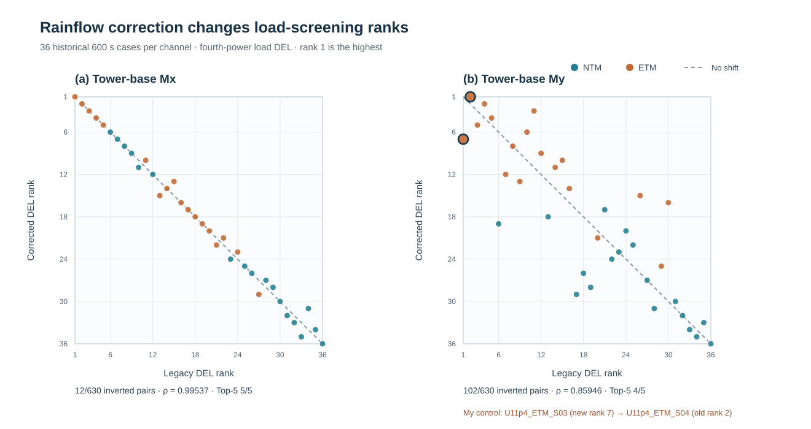
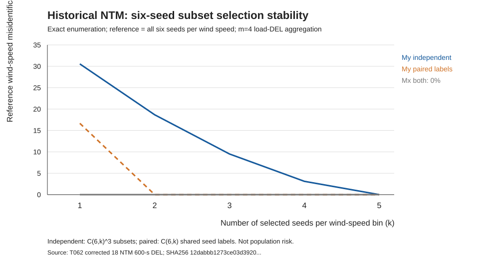
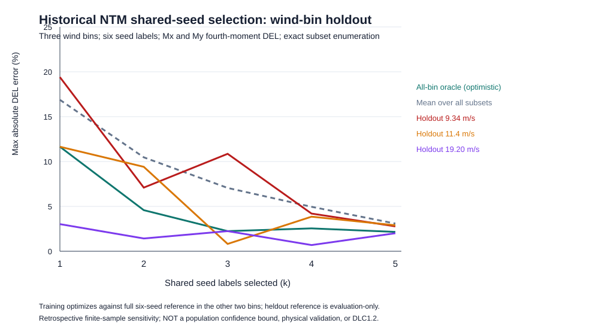
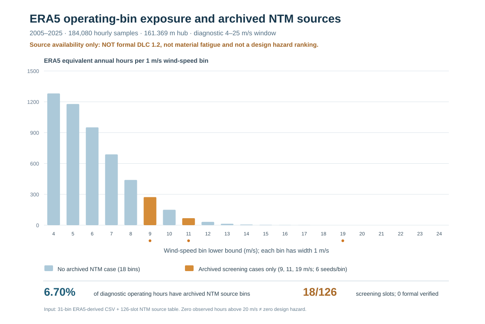
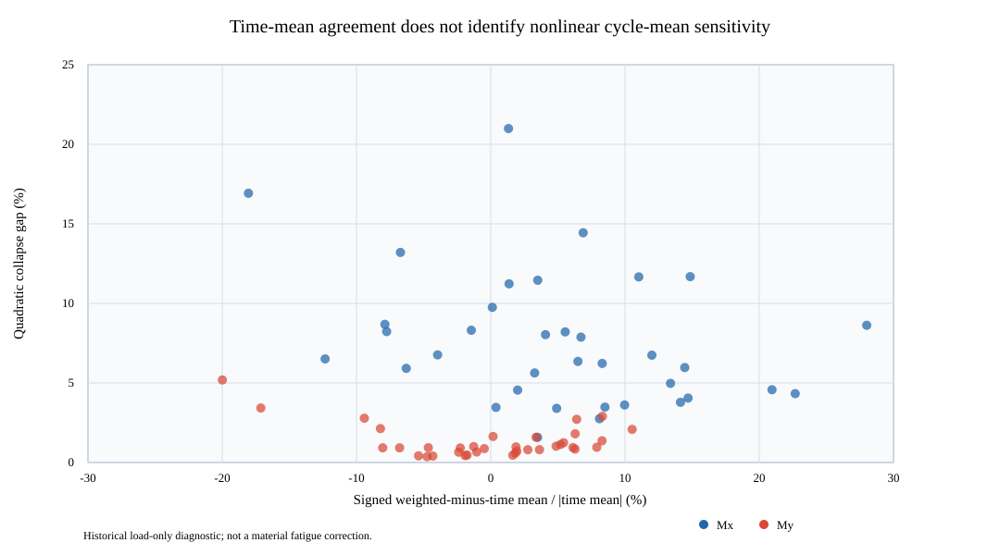
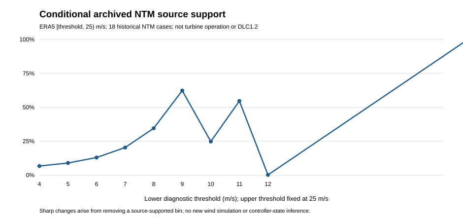
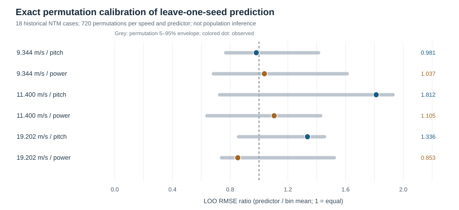
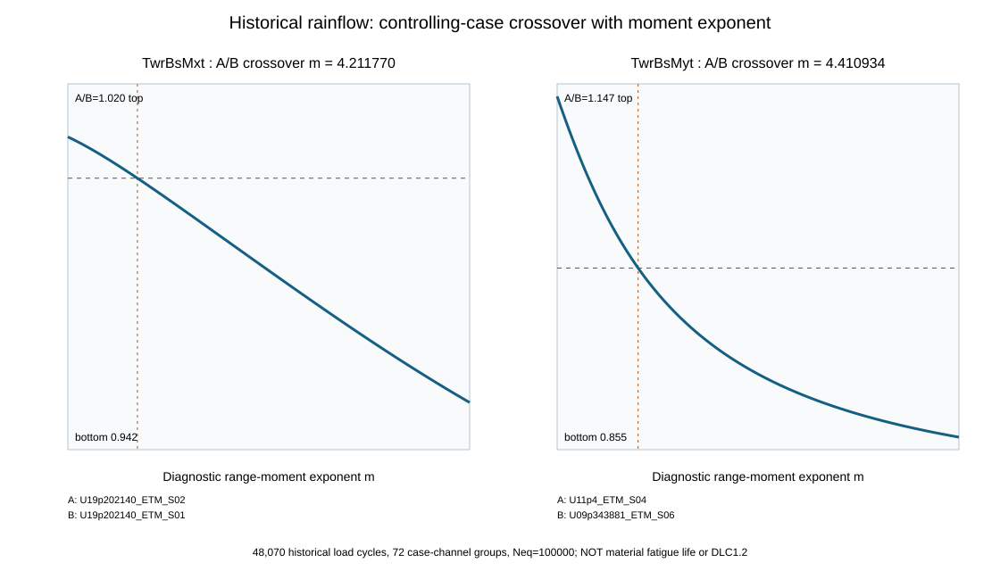
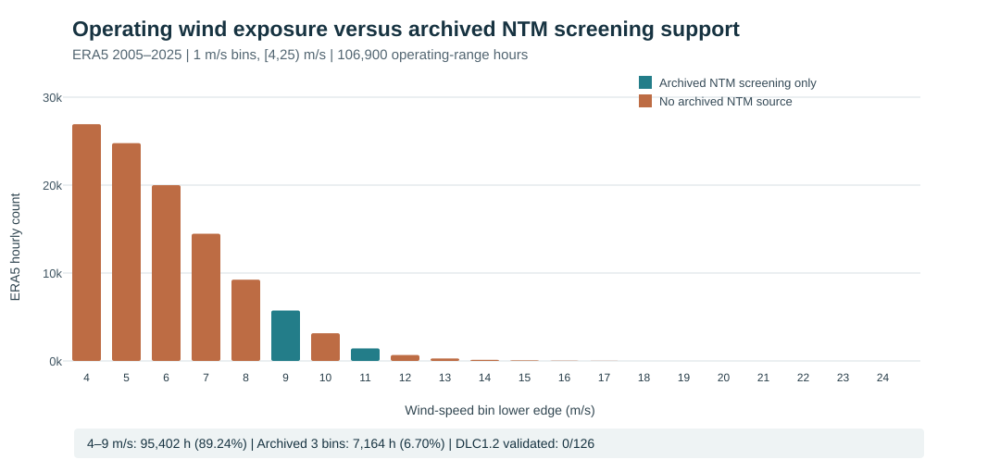

# Reliability limits of wind-load screening: rainflow ranking, finite-seed sensitivity and incomplete wind-climate coverage for a 158 m hybrid wind-turbine tower

**Manuscript status:** condensed research manuscript for critical review; not submitted, and not yet independently submission-ready. The object is a historical DTU 10 MW / 158 m (112 m concrete + 46 m steel) hybrid-tower OpenFAST *load-screening* archive. The reported fourth-power damage-equivalent moments are load diagnostics, not verified material-specific fatigue lives. The Jiayu ERA5 wind archive is reanalysis rather than measured turbine operation; no wind–earthquake or structural safety result is claimed.

## Abstract

**Objective.** We examine whether retrospective rainflow damage-equivalent-load (DEL) screening, finite turbulence-seed sampling and incomplete wind-climate coverage can support robust fatigue-load decisions for a 158 m concrete–steel hybrid wind-turbine tower. **Methods.** We reanalyse 36 archived 600 s OpenFAST screening realizations (including 18 normal-turbulence realizations across three wind speeds and six seeds per speed) and a 184,080-hour ERA5-derived wind archive. We compare corrected and historical rainflow rankings, enumerate all 8,000 independent-per-bin three-of-six seed subsets, and bound an explicitly defined climate-weighted fourth-order load moment under nonnegative unobserved-bin contributions. **Results.** Correcting the historical rainflow closure changes 102/630 My and 12/630 Mx pairwise rankings. The internal My controlling-bin identity changes in 760/8,000 observed subset combinations (9.50%). Only 7,164/106,900 hours in the diagnostic [4,25) m/s wind interval have matched NTM load summaries; 99,736 hours (93.30%) are uncovered. Consequently, the unconditional fourth-order load moment is bounded below but has no finite data-derived upper bound. A constructive counterexample shows that an observed ranking between two designs need not survive unrestricted missing-bin contributions. **Conclusion.** Load-screening rankings are conditional on rainflow implementation, seed coverage and climate support. A supplementary four-ETM, 31-section stress-screening experiment further shows that selecting only the m=4 controlling case under-captures the observed m=10 envelope by 10.60%–15.36% in 13 sections; a three-speed-bin leave-one-bin-out refit yields affine RMSEs of 0.214, 0.169 and 0.814 MPa (low/middle/high held-out bins), with both edge-bin predictions rejected *before* outcome inspection as extrapolations. These are fixed-design, nominal-stress screening counterexamples, not independent seed-based validation; scalar DEL and channel mean do not identify material-local mean-stress-corrected Miner damage. These are retrospective source-level findings, not independent future-seed reliability estimates, formal DLC1.2 compliance, material lifetime predictions, structural optimization or coupled wind–earthquake validation.

### Integrated decision rule: screening evidence cannot be promoted across three separate domains (21 November 2026)

A **case-selection domain** (which archived realization is retained), a **prediction domain** (whether an unseen wind-speed bin is interpolated or extrapolated), and a **damage domain** (whether material-local stress cycles support a lifetime metric) must be assessed separately. In the fixed-design four-ETM archive, selecting a single m=4 case at each section loses 10.603287%–15.359204% of the m=10 envelope in 13/31 sections; this rejects *cross-exponent case invariance*, but does not estimate material damage. In the three-bin holdout experiment, the pre-outcome convex-hull gate rejects both edge speeds (9.343881 and 19.202140 m/s), whereas the internal 11.4 m/s interpolation remains only a diagnostic (affine RMSE 0.169327 MPa on 31 spatially correlated sections from one realization). Thus low prediction error at one interpolated bin is not evidence of generalization to unobserved speeds or designs. Finally, neither the envelope nor the wind-speed predictor supplies a mean-stress history, material S–N law, or unobserved wind-bin load moments, so no Miner damage or lifetime ranking follows. These three non-implications form an explicit *admission hierarchy*, not three independent confirmations of one fatigue mechanism.

A falsifiable prospective protocol would **freeze before any new simulations**: (i) the union of controlling cases selected at multiple declared screening exponents, (ii) the wind-speed/operating-state feature domain and the rejection rule, and (iii) the material-local damage definition and a maximum admissible rank-regret tolerance. New independent seeds in previously unobserved wind bins would then test whether the union captures the full-case envelope; a held-out *design*, not another section from the same tower, would test cross-design transfer; and matched local cycle histories with material laws would test whether envelope ordering predicts damage ordering. A missed envelope, prediction outside the declared domain, or reversed material-damage ordering is a negative outcome, not a reason to retroactively relax the gate. The historical 31 sections are spatially dependent, and the four ETM cases provide no confidence interval for these prospective error rates. SOURCE=T077 1,984-row CSV Git blob `b5effa2a493cec0a9af8a10a3b93df0ff997d2d0`; RUN=the already archived m=4/m=10 case-regret and three-bin refit experiments, **no new numerical experiment** in this synthesis; TEST=arithmetic values inherited from source-level results, native CLI/OUTB NOT_RUN; FIG0 TAB0. This manuscript contribution is a new integrated, falsifiable decision protocol and evidence-bound abstract revision, not a new physical PASS.

**Keywords:** hybrid wind-turbine tower; rainflow counting; damage-equivalent load; turbulence-seed sensitivity; ERA5; partial identification; fatigue screening.

## 1. Introduction

### 1.1. From wind-load screening to fatigue inference

As rotor diameters and support-structure heights increase, prestressed-concrete–steel hybrid towers offer a practical structural configuration for large wind turbines [1–3]. Their fatigue assessment, however, spans several different physical and statistical levels: turbulent inflow produces time-dependent tower loads; section forces must be transferred consistently to local stress histories; cycle ranges, means and counts must then be evaluated using material-appropriate fatigue laws and a defensible long-term distribution of operating states. A damage-equivalent *load* calculated from tower-base bending moments is useful for comparing historical simulations under a common cycle-counting convention, but it cannot, by itself, determine fatigue damage in concrete, ordinary reinforcement, prestressing tendons or structural steel. In particular, a single fourth-power exponent used for screening must not be interpreted as a common material S–N slope.

Control-case selection is an intermediate decision with potentially disproportionate consequences. If a subsequent detailed analysis is performed only on a few apparently critical realizations, an error that changes their order can propagate into the research design even when the underlying wind simulation is unchanged. Three questions therefore precede a lifetime-fatigue claim. First, is the numerical ordering reproducible under independently checked rainflow cycle counting? Second, is the selected controlling wind-speed bin stable with respect to the finite set of turbulent realizations actually available? Third, do those simulated wind-speed bins cover enough of the climate to identify a long-term load moment? These are distinct questions: passing one does not resolve the others.

### 1.2. Prior research and the boundary of the present contribution

Existing wind-turbine fatigue research distinguishes short-duration turbulent load statistics from lifetime accumulation, and numerical fatigue estimates depend on the specified wind climate, operating-state classification, structural response and material stress definitions [3]. For the present study, the original OpenFAST and ERA5 provenance is inherited from the archived research workflow; no new authorized IEC/GB clause is asserted as checked in this manuscript revision. Consequently, the 36 historical cases are described as a *screening matrix*, not as a completed design-load-case DLC1.2 matrix. The use of three historical wind speeds is a property of the archive, not a claim that three bins are sufficient for a 20-year assessment.

Recent hybrid-tower research also constrains any broader novelty statement. Ishihara et al. [5] compared coupled and uncoupled seismic/aerodynamic response for a different 2.4 MW wind turbine; their response-combination approximations are not transferred to this 10 MW tower. Wang et al. [6] reported combined wind–earthquake loading for an approximately 160 m hybrid tower, while Wang et al. [7] examined earthquake response and prestress-related resistance enhancement for a **different 163.24 m, 42-segment** tower. The evidence levels differ: **[6] has only publisher abstract/metadata review in this archive**, whereas **[7] has an archived 18-page original publisher PDF, with selected physical PDF pages 5–7 and 14–16 reviewed in earlier T079 work** (SHA256 74a2213d18a15cfd0ea7690a262037d8e928d0becf5ec576e12db35820a8c338). Neither study has been systematically compared section by section with all methods and data in the present article. Thus neither simultaneous wind–earthquake excitation nor the consideration of prestress in seismic response can be claimed as novel, and no absence of a specific screening method in [6] or [7] is asserted. The present article addresses a narrower, independently testable problem: whether a historical wind-load screening dataset supports robust ranking and long-term fourth-moment inference *before* material fatigue or seismic-constrained optimization is attempted.

A direct reading of the publisher's open full text for Wang et al. [7] also exposes a quantitative boundary that is relevant to the proposed future fatigue–seismic optimization: in its **different 163.24 m, 42-segment, C80 tower**, increasing nominal tendon stress from 1000 to 1219 MPa was accompanied by a reported strong-wind tower-top displacement change from 0.57 to 1.10 m, while the three reported rare-earthquake displacement pairs were 0.58 to 0.57 m, 0.52 to 0.52 m and 0.77 to 0.58 m. The corresponding wind change is +92.98% and the largest earthquake reduction is 24.68%; simple decimal-rounding bounds retain the signs of those two changes (+82.61% to +103.54%, and −25.81% to −23.53%, respectively). These are **published response values and a secondary arithmetic comparison**, not results for the present tower or a validation of the source paper's physical interpretation. They preclude treating higher prestress as an *a priori* improvement of every hazard-related objective. Conversely, [6] establishes the existence of a published simultaneous wind–earthquake hybrid-tower study from its publisher abstract, but its full methods and reported Zenodo data (DOI 10.5281/zenodo.19346369) were **not retrieved or independently verified** here; absence of a particular operating-state treatment in [6] is not asserted. The reproducible secondary comparison and source-depth statement are recorded in the thesis Ch. 1 and T079, rather than represented as a new fatigue or wind–earthquake simulation.

**Primary-source comparability boundary (checked 13 November 2026).** The publisher abstract of Wang et al. [6] (published online 16 May 2026) explicitly specifies a 160 m-class hybrid tower, wind histories at three speeds generated from a Davenport fluctuating-wind spectrum, and three PEER earthquake records selected against a Site Class II response spectrum for simultaneous wind–earthquake response analysis. The open publisher full text of Wang et al. [7] instead describes a 163.24 m hybrid tower with 42 concrete segments (129.36 m concrete, 3.08 m transition and 30.8 m upper steel) and compares nominal tendon stresses of 1000 and 1219 MPa. Its reported strong-wind tower-top displacement increases from 0.57 to 1.10 m, whereas the largest of its three listed rare-earthquake displacement reductions is 0.77 to 0.58 m. These are results for a **different** tower and loading definition, not outputs of the present 158 m, 31-segment OpenFAST archive. The accessible evidence makes [6] prior art for simultaneous multi-hazard response and [7] prior art for prestress-related response changes; neither is an external validation of our rainflow rankings, finite-seed selection or ERA5-weighted load moments. In particular, an abstract-level review of [6] cannot establish the absence of any screening technique in its full text.

**Physical cross-study admission rule.** A transferable quantitative benchmark would require independently matching tower geometry and segmentation, rotor–nacelle/controller state, turbulent-inflow representation and seed, analysis window, earthquake components and spectrum, initial prestress state, load-coordinate convention, and the response quantity being compared. The currently verified source records do not establish those matches. Consequently, numerical agreement or disagreement between the present wind-only load-DEL screening and the published structural displacement/stress results is **not identifiable** from these papers. This rule specifies what future common-input evidence would have to resolve; it is not an allegation that either prior paper omitted those checks.

The novelty claim is therefore methodological and conditional rather than a claim to have discovered a new tower response. We combine a paired, source-locked rainflow-implementation comparison with exact finite-archive seed-subset enumeration and a partial-identification treatment of missing wind-speed-bin loads. The combined analysis makes visible how a numerically corrected controlling realization may still be an uncertain basis for long-term assessment. Each part can be independently reproduced from archived derived tables, and each is designed to admit a negative result. No assertion of priority over all earlier literature is made without a full-text systematic comparison.

### 1.3. Retrospective estimands versus prospective falsifiers

The retrospective study answers three questions with different evidence units and therefore different permissible conclusions. **R1 (algorithmic rank invariance)** asks whether correcting the historical rainflow closure implementation preserves the ordering of the same 36 wind cases within each tower-base moment channel. Its estimand is the number of discordant unordered case pairs (630 possible pairs per channel), accompanied by the identity of the maximum case; this is a paired numerical comparison, not a sample-based significance test. **R2 (finite-archive seed stability)** asks whether the full-six-seed NTM control-bin identity is invariant to selecting k of the six observed seeds. Its estimand is the exact fraction of subsets that disagree with that *internal* reference under each declared subset-selection rule; overlapping subsets and the reference built from their parent archive are not independent replicates. **R3 (long-term load-moment identifiability)** asks whether a fourth-order load moment over the ERA5 diagnostic interval can be uniquely determined when only three wind-speed bins have matching NTM histories. Its result is an identified observed contribution K and an unknown nonnegative contribution X, rather than a conventional null-hypothesis test. R1–R3 are directly addressed below, but none estimates a material fatigue life.

Three **different, prospective** hypotheses are deliberately left untested. **H1 (exposure-order adequacy)** states that the three most frequent previously unsampled operating wind bins are also the three largest contributors to a newly observed, seed-aggregated, bin-weighted fourth-order load moment, using a fixed wind-bin partition and operating-state definition. **H2 (independent-seed stability)** states that a preselected k-seed procedure preserves both the control-bin identity and its fourth-root load amplitude to a predeclared relative tolerance on *new, independently generated* turbulent realizations. **H3 (material transfer)** states that corrected tower-base load-DEL rankings agree, within an explicit ranking uncertainty budget, with the rankings of *material-specific* Miner damage from matched local stress-cycle histories, constitutive assumptions and climate weights. H1 is falsified by a verified top-three mismatch, H2 by a held-out identity mismatch or tolerance exceedance, and a universal form of H3 by a resolved material-damage rank reversal. Ties and uncertainty intervals must be specified before testing; an unresolved tie is not a verified agreement.

These hypotheses cannot be accepted by reusing the retrospective sample as its own validation set. In particular, a rainflow correction may reject R1 rank invariance without testing H3; the 760/8000 subset result may reject R2 invariance within the archive without estimating H2's future-seed error; and R3 non-identifiability prevents a conclusion about H1's unmeasured top contributors. This separation is essential to the interpretation of the paper's contribution.

### 1.4. Study scope and organization

The analysis uses a DTU 10 MW reference rotor–nacelle assembly [1] with a literature-derived 158 m hybrid tower (112 m concrete and 46 m steel) [2]. It does not claim that this combination is an officially commissioned Jiayu wind turbine. The 36 historical wind simulations represent three reference speeds, normal and extreme turbulence categories, and six seed labels, with a common 100–700 s analysis window. The ERA5-derived 184,080 hourly values provide wind-speed exposure, not a direct observation of turbine control state or material damage. Only three wind-speed bins have matched historical NTM load evidence. All long-term fourth-moment quantities reported below are explicitly *load-level diagnostics* and are not normalized into annual Miner damage.

Section 2 defines the source identities, estimands, cycle-counting and seed-subset methods, and missing-bin identification bounds. Section 3 presents the paired rainflow ranking and finite-seed results. Section 3 also establishes the missing-bin exposure and sharp partial-identification boundary. Section 4 discusses the three non-substitutable failure mechanisms, prospective falsification tests, prior-art limits and uncertainty. The central conclusion is a conditional one: verified short-duration load rankings can support screening within the observed archive, but incomplete climate/load pairing prevents a defensible complete-interval fourth moment, let alone a material-specific fatigue-life or seismic-constrained optimum.

## 2. Materials and methods

### 2.1. Design, evidence units and provenance

This retrospective analysis considers a research combination of the public DTU 10 MW reference rotor–nacelle assembly [1] and a literature-derived 158 m hybrid tower (112 m concrete, 46 m steel) [2]. It is not an official Jiayu wind turbine. The wind archive comprises 36 historical OpenFAST screening cases; the independent ERA5 reanalysis archive supplies climate exposure, not measured turbine operation. The former 115.63 m reference-tower model is not admitted as an interchangeable 158 m source.

The three estimands have **different units of analysis**. R1 compares two rainflow implementations on exactly the same 36 case histories for each of two moment channels. R2 enumerates overlapping subsets of six *observed* NTM seeds in each of three wind bins. R3 identifies the contribution of wind bins with known load summaries to a specified fourth-order climate-weighted *load* functional. The 630 pairwise comparisons, 8000 subset combinations and 184080 ERA5 hours are not interchangeable independent replications; no significance test is based on treating them as such.

The original OUTB binary provenance, independent rainflow 3.2.0 cycle check and ERA5 processing are inherited from earlier source-locked T062 receipts. The current manuscript is assembled from archived derived CSVs, not a new OpenFAST run, an independent validation of future seeds or a rerun of the 184080 original hourly values. The full secondary analyses (operating state, ETM, azimuth, extrapolation, alternative exponents and permutation diagnostics) and their original source-to-claim ledger are retained in [Supplementary evidence](journal-wind-fatigue-secondary-evidence.md); they are not independent corroborations of R1–R3.

### 2.2. Wind histories, coordinates and rainflow calculation

The historical 158 m screening matrix contains **36 distinct cases**: three reference speeds (**9.343881, 11.4, 19.202140 m s⁻¹**), two historical turbulence classes (NTM and ETM) and six labeled random seeds (S01–S06) per speed/class. The archived analysis window is **100–700 s (600 s)**. Each case has two OpenFAST tower-base bending-moment channels, TwrBsMxt and TwrBsMyt, reported in **kN m**, giving **72 case–channel rows**. Each case's two channels must share the original OUTB SHA256. These channel labels are preserved; no unverified conversion to geographic axes is introduced. Historical screening must not be presented as a completed IEC DLC1.2 lifetime matrix.

For moment history \(M(t)\), rainflow yields ranges \(\Delta M_i\) and full/half-cycle weights \(n_i\). The generic fourth-power damage-equivalent *load* is
\[
L_4=\left[\frac{\sum_i n_i|\Delta M_i|^4}{N_{\mathrm{eq}}}\right]^{1/4}.
\]
Within the paired legacy/corrected R1 comparison, the reference-cycle normalization, time window and **m = 4** are identical (**N_eq = 100,000 cycles**). The separately archived 18-NTM all-channel DEL table used for R2/R3 instead has **N_ref = 600 cycles**. Their reported amplitudes cannot be compared directly without changing the normalization, even when the original wind history, channel and rainflow cycles are identical. Here m = 4 is a **load-ranking diagnostic**, not a shared fatigue slope for the different tower materials. The earlier T062 primary-source investigation isolated an incorrect cycle-closure comparison in the legacy implementation and compared corrected cycle multisets with independent rainflow 3.2.0. The present analysis **inherits** that prior original-binary verification; it does not claim a fresh OUTB run.

### 2.2.1. Cross-source reference-cycle compatibility test

Before comparing absolute DEL amplitudes between the paired R1 correction archive and the 18-NTM source used in R2/R3, we matched **18 NTM cases × two tower-base moment channels** by case/channel key, original OUTB SHA256 and rainflow weighted-cycle count. For fixed cycle ranges and exponent \(m=4\), changing only the reference count from \(N_a\) to \(N_b\) must satisfy

\[
\frac{L_{4,b}}{L_{4,a}}=\left(\frac{N_a}{N_b}\right)^{1/4}.
\]

This identity is independent of load units and turbulence realization, and requires equality of the **weighted fourth-power range sums**, not necessarily equality of the individual cycle multisets. The matching OUTB digests and weighted-cycle counts establish common source-file identity and the same total count; the observed ratio additionally tests equality of one scalar fourth-power sum. None of these summary checks independently establishes equality of individual ranges, means or closure sequences across the two processing pipelines. The archived corrected R1 table has \(N_a=100000\) as independently corroborated by the ratio test, whereas the native NTM all-channel table explicitly labels \(N_b=600\). A source-locked, fail-closed program rejects duplicate or missing case/channel keys, changed OUTB digests, unequal cycle counts, nonfinite DELs and departures from the expected factor. The 36-row [normalization crosswalk](../experiments/T062/S12_NTM18_DEL_NORMALIZATION_CROSSWALK_36ROW_20261110.csv) is Supplementary Table S1; its values are **not** a new structural simulation or a comparison of material fatigue laws. No NTM-to-ETM cross-source normalization identity is asserted because the native comparison source here contains NTM cases only.

### 2.2.2. A constructive non-identifiability test for cycle summaries

The mapping from a rainflow range–count multiset to \((C,L_4)\), where \(C=\sum_i n_i\) and \(L_4^4=\sum_i n_i(\Delta M_i)^4/N_{\rm eq}\), is **not injective**. To make the limitation testable, take any positive observed \(L_4\) and \(C>16\), and set \(r_0=L_4(N_{\rm eq}/C)^{1/4}\). Construct algebraic distribution A with total cycle weight \(C\) at range \(r_0\). Construct distribution B with one full cycle at range \(2r_0\) and remaining cycle weight \(C-1\) at range

\[
r_1=r_0\left(\frac{C-16}{C-1}\right)^{1/4}.
\]

Both have identical total cycle weight \(C\) and identical fourth-power range sum, because \(16r_0^4+(C-1)r_1^4=Cr_0^4=N_{\rm eq}L_4^4\); their **largest ranges differ by a factor of two**. A half-integer \(C\) is accommodated by aggregating full- and half-cycle weights at the stated range. These are **mathematical witnesses, not recovered wind histories or physically generated rainflow outputs**. Their cycle means can also differ without changing either scalar summary. Consequently, agreement of DEL and total cycle count—even with the same OUTB digest—cannot prove that two algorithms returned the same cycle multiset, peak cycle range or mean-stress distribution. Such claims require direct cycle-by-cycle or multiset comparison.

The [source-locked falsifier](../experiments/T062/s12_del_summary_identifiability.cjs) evaluates this construction against all 36 archived NTM crosswalk rows, without altering the original data. It rejects a changed source SHA256, malformed keys, non-half-integer counts, nonpositive loads and a failed DEL ratio. Its negative tests and algebraic witnesses are **not** independent physical validations.

### 2.3. Paired algorithmic ranking comparisons

For each channel \(c\) and case \(j\), define the signed implementation bias
\[
b_{jc}=100(L_{jc}^{\mathrm{legacy}}/L_{jc}^{\mathrm{corrected}}-1)\%.
\]
Compute the median, minimum and maximum across **36 cases per channel**. Sort the same 36 case IDs by decreasing DEL under both algorithms, and report: (a) the number of strict rank reversals among \({36\choose2}=630\) unordered pairs; (b) Spearman's \(\rho=1-6\sum_jd_j^2/[36(36^2-1)]\) in the no-ties setting; and (c) top-five set overlap. A reversal occurs only when the two algorithms assign opposite signs to a pairwise DEL difference; ties require explicit handling rather than row-order decisions. Pair comparisons share case observations and are **not 630 independent replicates**. Since some legacy errors are positive and others negative, a single global DEL correction factor is not assumed.

### 2.4. Exact finite-six-seed NTM subset design

The seed experiment uses only the **18 NTM cases** (three wind speeds × six seeds), not the ETM records. For wind-speed bin \(b\), channel \(c\), and a subset \(S_b\) of \(k\) archived seeds, define
\[
\bar L_{bc}(S_b)=\left[\frac{1}{k}\sum_{s\in S_b}L_{bcs}^4\right]^{1/4}.
\]
The bin with the largest full-six-seed aggregate is the **internal reference**, not a population truth. For each \(k=1,\ldots,5\), enumerate two distinct sampling designs exactly: independently choose a \(k\)-subset in each bin, giving \({6\choose k}^3\) combinations; or choose one common seed-label subset across all bins, giving \({6\choose k}\) combinations. The latter is a sensitivity to label coupling, not proof that the underlying turbulent inflows are common random numbers.

For every combination, count whether its maximum-aggregate bin differs from the full-six reference, and compute the absolute relative error of the **reference winner's** aggregate load, \(|\bar L_{b^\star c}(S_{b^\star})/\bar L_{b^\star c}(S_{\rm all})-1|\). A tie at the maximum must be explicitly flagged. The wrong-bin fraction is an exact **finite-archive combinatorial frequency**; the full reference contains the selected subsets, so it is not an independent validation, an unseen-seed failure probability or an IEC minimum-seed recommendation. The distinction between a stable winner and a stable load amplitude is retained.

### 2.4.1. Retrospective whole-wind-bin holdout of shared seed labels

A stable control-bin identity is not equivalent to transportable **load-amplitude** estimation. To examine this distinction without generating new wind fields, we used the same 18 archived NTM cases and both tower-base channels in a separate three-fold, leave-one-wind-bin-out diagnostic. For a common subset of seed labels \(S\subset\{1,\ldots,6\}\) with \(|S|=k\), define the relative fourth-root load error \(e_{bc}(S)=100|\bar L_{bc}(S)/\bar L_{bc}(S_{\mathrm{all}})-1|\) in percentage points, where the denominator is the archived six-seed value **for the same bin and channel**. Given a held-out wind bin (h), select \(S_k^{(-h)}=\arg\min_{|S|=k}\max_{b\ne h,c\in\{x,y\}}e_{bc}(S)\), then report the training maximum and \(E_h(k)=\max_c e_{hc}(S_k^{(-h)})\). All \(\binom{6}{k}\) common-label subsets are enumerated; ties are resolved by ascending seed-label order as implemented in the archived script. The retrospective all-three-bin oracle \(E_{\mathrm{all}}^\star(k)=\min_{|S|=k}\max_{b,c}e_{bc}(S)\) is an **in-sample comparator**, not a deployable estimator.

This design tests sensitivity to withholding one of the **three already observed wind-speed bins**, not to new seeds or a new atmospheric population. Selection uses six-seed reference targets in the two training bins and scoring uses the six-seed reference in the held-out bin; the same parent archive supplies both. Thus the term *holdout* refers only to excluding one bin from the subset-selection objective. It does not imply independent external validation. The finite-archive training-to-held-out difference \(G_h(k)=E_h(k)-E_{-h}(S_k^{(-h)})\) can have either sign because the maxima are taken over different bins. Neither \(G_h\) nor its ratio to training error is a population generalization bound. No common-random-number equivalence is inferred from matching seed labels across wind speeds.

### 2.5. ERA5 exposure and partial identification

The archived ERA5-derived climate (reanalysis dataset [4], not site measurements) covers **184,080 hourly estimates** (2005–2025) tabulated in 31 integer-lower-edge speed bins. The **diagnostic** interval \([4,25)\) m s⁻¹ contains **106,900 h**; it is not a verified turbine cut-in/cut-out range. Only the three bins with lower edges **9, 11 and 19 m s⁻¹** have historical NTM load summaries, covering **7,164 h**. The remaining **99,736 h** lack a matching load source, rather than having zero load. Thirteen missing bins have positive exposure; five missing bins have zero observed hours.

Let \(H_b\) be the observed count in bin \(b\) and \(H=184080\). The unconditional probability \(p_b=H_b/H\) differs from the diagnostic-interval conditional probability \(p_{b\mid O}=H_b/106900\), with
\[
p_b=(106900/184080)\,p_{b\mid O}\quad(b\in O).
\]
For the historical fourth-power *load* diagnostic with bin aggregate \(L_{bc}\) in **MN m**, the identifiable contribution is
\[
K_c=\sum_{b\in B_{\rm obs}}p_bL_{bc}^4,\qquad
X_c=\sum_{b\in O\setminus B_{\rm obs}}p_bL_{bc}^4.
\]
The complete diagnostic contribution would be \(K_c+X_c\). **This is a climate-weighted fourth power of a rainflow damage-equivalent *range* load, not the instantaneous time-series moment \(\mathbb{E}[M(t)^4]\), and not a material damage rate.** Without credible missing-bin load values, only \(X_c\ge0\) is known; hence \(K_c\) is a lower bound on this **defined load-moment functional**, while its upper bound is unbounded. This is **not** a lower bound on material Miner damage, which requires local stress ranges, mean stresses, cycle rates, fatigue laws and verified operating-state exposure.

Define a common missing-bin fourth-power-equivalent load by \(X_c=(99736/184080)L_{\rm miss,c}^4\). The equal-contribution threshold is
\[
L_{\rm miss,c}^{(50\%)}=\left[K_c/(99736/184080)\right]^{1/4}.
\]
For one positive-hour missing bin, the corresponding threshold is \((K_c/p_b)^{1/4}\). These are **identifiability thresholds**, not predictions or design limits. Report \(K_c\) in \((\mathrm{MN\,m})^4\), the thresholds in \(\mathrm{MN\,m}\), and exposure in hours. The denominator 184,080 must not be silently replaced by 106,900.

### 2.5.1. Nonlinear identifiability from individual load-cycle means

For each archived rainflow cycle, retain its load range \(\Delta M_i\), signed load-cycle mean \(\mu_i\) and full/half-cycle count \(n_i\). Define the normalized load-level weights \(p_i=n_i|\Delta M_i|^4/\sum_jn_j|\Delta M_j|^4\), the weighted mean \(\bar\mu_w=\sum_i p_i\mu_i\) and weighted variance \(v_w=\sum_i p_i(\mu_i-\bar\mu_w)^2\). The exact identity

\[
Q_2=\sum_i p_i\mu_i^2=\bar\mu_w^2+v_w,\qquad
J_2=\frac{Q_2-\bar\mu_w^2}{Q_2}=\frac{v_w}{\bar\mu_w^2+v_w}
\]

defines the *quadratic collapse gap*: the fraction of the explicitly chosen quadratic load-mean functional lost by replacing individual cycle means with their fourth-power-weighted average. \(Q_2\) is a **mathematical moment-of-load-means diagnostic**, not a calibrated Goodman correction, a material S–N rule, Miner damage or a fatigue life. The one-largest-weight-cycle deletion diagnostic quantifies the influence of a single archived rainflow cycle on \(\bar\mu_w\), not a physically realizable perturbation to the wind loading.

The source-locked calculation reads all 48,070 individual cycle rows and compares all 72 groups with the previously verified load DEL, weighted mean and largest-cycle share. Weighted variance is independently evaluated using a centered second pass and the uncentered second-moment identity. The resulting 72-row Supplementary Table S2 and Fig. 5 are distinct from the 72-row prior time-mean diagnostic and do not require a new physical simulation.

### 2.6. Source admission and independent rejection tests

The principal paired rainflow source is a 72-row CSV with exactly 36 distinct case labels × two tower-base channels, original OUTB SHA256 identities and both legacy and corrected fourth-power DELs. The archive's SHA256 is `12dabbb1273ce03d3920aedda3f72f9fa1d75b671e01a1db145c0a972ffe15e2`. A valid row must contain finite positive DELs, an allowed case/seed/channel key and a 64-character original-OUTB digest; the two channel rows for one case must share the same digest. Corrected and third-party DEL values must agree within the inherited 10⁻⁵ kN m source tolerance. Missing or duplicated keys, nonfinite values and altered third-party comparisons are rejected, not silently repaired.

The finite-subset output table is archived at SHA256 `f7d9427d15b378661aaebf2fdf0feb1e5eea07cefb3721088a98439265320cf1`; the ERA5 31-bin exposure table at `e4058620a36b23bb218103875d4dc5b0711fc45d418b23a2208c2fc9c16c9102`; and the six-row NTM fourth-moment table at `d43f963fb30e16a33e87acdf6e9571710826974eee89d1f3527ab6504d85f695`. Source identity, counting and numerical checks are distinct from wind-field/model-state validation. Source hashes above are inherited **SHA256** receipts; a Git blob SHA is a different identifier and must not be substituted for them.

For this consolidation, the connected repository's 72-row paired source was independently regrouped in JavaScript by case, channel, turbulence class and seed. Direct strict-pair enumeration reproduced 12/630 (Mx) and 102/630 (My) reversals; a separate exhaustive six-seed enumeration reproduced the My independent-subset counts 66/216, 630/3375, 760/8000, 105/3375 and 0/216 for k=1–5. The climate equal-contribution thresholds were independently recomputed from the displayed K and exposure totals, not from newly downloaded hourly ERA5. These are **derived-source arithmetic checks**, not new original-binary or physical verification.

### 2.7. Source-locked spectral partition of synchronized base reactions

A separate retrospective frequency-domain experiment uses the complete 18-case, six-component tower-base reaction histories recovered from the archived original 158 m OpenFAST OUTB files (historical Actions artifact 13775054290; gzip SHA256 45cc308625ead8411d1565adc66c99e7ee8d0a979e5c3c6c18f23e744ba74dd1). Each NTM realization contains 12,001 samples at 0.05 s from 100 to 700 s. The final endpoint is omitted to define exactly 12,000 samples over 600 s. Both Mx and My are analyzed independently as base *reaction* moments in kN m, not as externally applied aerodynamic moments. No wind or structural solver is rerun.

For each demeaned series, a one-sided discrete Fourier variance spectrum is formed with the exact DC/Nyquist normalization and a rectangular 600 s window. Parseval closure is required to relative tolerance 1e-10. The descriptive estimand is the fraction of within-record variance within [0.05, 0.25) Hz; the corresponding band-limited RMS is also retained. This band is an explicitly chosen diagnostic, not a turbine-mode or rotor-harmonic identification. Prespecified sensitivities include 4096-point Hann/50%-overlap Welch estimates, linear detrending, lower cutoffs 0.04/0.06/0.08/0.10 Hz, and separate 300 s halves. All 36 case-by-channel values are retained; six historical seeds per wind speed are not treated as six independent climate observations.

### 2.8. Case-matched spectral proxy test with genuinely held-out seed labels

A separate, non-causal test combines the existing 18-case operating-state summaries with the independently archived tower-base My 0.05–0.25 Hz spectral RMS for the same historical NTM case names. The response is a **section-reaction spectral statistic**, not an aerodynamic force, material stress or Miner damage. For each of three wind-speed bins and each candidate predictor (600 s mean blade pitch or generator power), we fit a univariate within-bin slope using five cases and predict the sixth. The same five cases also define the no-predictor bin-mean baseline. The ratio of leave-one-seed-out (LOO) RMSEs is reported; values greater than one indicate degradation. For each bin and predictor, all 6!=720 permutations of the six observed response labels give an exact two-sided finite-archive absolute-correlation tail fraction. The six permutation tests are descriptive and do not establish independent sampling, controller causality, or generalization to unseen wind seeds. Source identity, complete 18×600 s pairing and 36 held-out predictions are checked by a source-locked executable and malformed-source refusals.

**Predictive-loss-aligned exact permutation check.** The original exact correlation test does not calibrate the selected *LOO prediction loss*. We therefore fix the six predictor values and enumerate all 720 permutations of the six observed My band-RMS responses within each speed bin. Every permutation refits all six five-train/one-test linear regressions and the five-train wind-bin mean baselines. With \(R=\mathrm{RMSE}_{\rm linear,LOO}/\mathrm{RMSE}_{\rm binmean,LOO}\), report \(p_{\rm gain}=\#\{R_\pi\le R_{\rm obs}\}/720\) and \(p_{\rm harm}=\#\{R_\pi\ge R_{\rm obs}\}/720\), including the observed arrangement. Selecting the favorable tail after seeing the sign is **not** a preregistered one-sided hypothesis test. The permutation 5th/50th/95th order statistics are sorted indices 35/359/683 (zero-based). Source SHA256, all case identities, time grid, operating heuristic and finite inputs are checked before any calculation. The exchangeability assumption remains conditional and unverified.

## 3. Results

### 3.1. Paired rainflow ranking and controlling-case changes

The historical 36 simulations comprise three reference wind speeds, two turbulence classes (NTM/ETM) and six seed labels per wind-speed/class combination. Each original output provided a 600 s analysis window. A prior primary-source audit established that the paired archived copies for each of the 36 disputed OpenFAST cases were byte-identical and that 72 corrected tower-base bending-moment rainflow cycle multisets agreed with independent rainflow 3.2.0. The discrepancy was isolated to the direction of the legacy cycle-closure comparison, rather than to the wind inputs or tower model.

The present analysis tests a separate question: whether this implementation defect changes which simulation is selected for subsequent structural assessment. For each of the tower-base Mx and My channels, all 36 cases were ranked using the legacy and independently corrected damage-equivalent moments. Bias was defined as 100 × (legacy DEL / corrected DEL − 1)%. We enumerated all 630 unordered pairs of cases and counted ranking reversals, then calculated Spearman rank correlation and top-five membership overlap. The pairwise comparisons are not independent replicates (Table 1).

**Table 1.** Paired legacy/corrected tower-base load-DEL ranking diagnostics for 36 historical cases per channel (m = 4; no material-fatigue interpretation). Source: archived T062 72-row comparison, SHA256 `12dabbb1273ce03d3920aedda3f72f9fa1d75b671e01a1db145c0a972ffe15e2`.

| Channel | Median legacy bias | Full range | Reversed pairs | Spearman rho | Top-five overlap |
|---|---:|---:|---:|---:|---:|
| Mx | −20.8797% | −29.0675% to +2.6041% | 12/630 (1.90%) | 0.99537 | 5/5 |
| My | −25.5452% | −54.5115% to +22.4800% | 102/630 (16.19%) | 0.85946 | 4/5 |

The legacy method underestimated the corrected DEL for 34 of 36 Mx records and 32 of 36 My records; a uniform correction factor is therefore inappropriate because the remaining records were overestimated. The My controlling realization changed from U11p4_ETM_S03 (historical 28.177010 MN·m; corrected 23.005398 MN·m) to U11p4_ETM_S04 (corrected 26.802479 MN·m). The corrected Mx maximum remained U19p202140_ETM_S02 (9.468855 MN·m). This is an algorithm-induced change in screening identity, not a new physical response to turbulence.

The paired rank–rank diagram in Fig. 1 exposes the case-level mechanism behind Table 1. For My, the legacy maximum U11p4_ETM_S03 moves from rank 1 to **corrected rank 7**, whereas the corrected maximum U11p4_ETM_S04 rises from legacy rank 2 to corrected rank 1. The Mx maximum U19p202140_ETM_S02 remains rank 1 under both implementations. The diagonal represents unchanged ranks; departures reflect algorithmic differences for **identical archived load histories**, not stochastic uncertainty intervals. The complete 72-row rank-transition ledger is archived as `T062_72CASE_RAINFLOW_RANK_TRANSITIONS_20261107.csv` (SHA256 `1bf750ba3ea33153dbe4b23e87a1b973ca73ab41e446b2d9d5f3fac2881238a9`).

**Fig. 1.** Rank–rank comparison for all 36 historical cases per tower-base moment channel: (a) Mx and (b) My. Horizontal = legacy rank, vertical = corrected rank; rank 1 denotes the largest fourth-power load DEL. Blue markers represent NTM, orange ETM; the two emphasized My markers identify the legacy and corrected controlling realizations. The dashed diagonal denotes unchanged rank. Source: T062 original 72-row paired comparison (SHA256 `12dabbb1273ce03d3920aedda3f72f9fa1d75b671e01a1db145c0a972ffe15e2`); reproducible figure SHA256 `1a17a1f36e68aff8280a33a1f318b98adcee1581556ea8e923fea1ef502a002a`. These are load-level diagnostics, not local material-fatigue results.

### 3.1.1. Exact reconciliation of the two archived DEL normalizations

The source-level crosswalk matches all **36/36 NTM case–channel pairs** between the R1 corrected rainflow table and the separately generated 18-NTM native DEL table. Every matched pair has the same original OUTB SHA256 and the same weighted rainflow cycle count. The observed ratio \(L_{4,N_{\rm ref}=600}/L_{4,N_{\rm eq}=100000}\) equals the analytical factor

\[
(100000/600)^{1/4}=3.593041119630842.
\]

The largest absolute **relative ratio residual** across 36 pairs is \(1.064\times10^{-12}\); independently inverting the ratio gives an implied R1 reference count ranging from **99,999.999999638 to 100,000.000000425** cycles. For example, U09p343881_NTM_S01 / TwrBsMyt has corrected R1 DEL **14,214.854620 kN m** and native NTM DEL **51,074.557159 kN m**, with 678 weighted cycles and an identical OUTB digest. The observed factor **3.593** is numerically explained by the reference-cycle convention and is not evidence of additional wind loading or fatigue amplification. It does **not** by itself establish cycle-multiset identity or exclude downstream processing differences. Supplementary Table S1 records every paired input and residual.

This finding makes the inferential separation of R1 and R2/R3 explicit: R1 legacy-versus-corrected *rank* comparisons are valid within the common \(N_{\rm eq}=100000\) convention; R2/R3 seed and climate-weighted *load* summaries are internally evaluated at \(N_{\rm ref}=600\). Any future absolute cross-study DEL comparison must first fix \(m\), \(N_{\rm ref}\), time window, cycle closure and source identity. Equal normalization does **not** imply equal material stress, fatigue rate or structural state.

The summary-identifiability falsifier provides a concrete counterexample to a stronger, unjustified inference from this match. The 36 real source rows have weighted cycle counts from **546 to 724**, so all satisfy the construction's \(C>16\) condition. For the real **U09p343881_NTM_S01 / TwrBsMyt** summary (\(C=678\), corrected \(L_4=14214.854620029\) kN m at \(N_{\rm eq}=100000\)), distribution A assigns all weight to range **49,537.604206 kN m**. Distribution B assigns one full cycle to range **99,075.208411 kN m** and the remaining 677 cycles to range **49,260.898518 kN m**. Both reproduce the same fourth-power sum and therefore both DEL normalizations, but their maximum cycle ranges differ by exactly **2×**. Across all 36 archived summary values, the largest numerical fourth-sum identity residual is below **4×10⁻¹⁶**, and the crosswalk DEL ratio residual remains below **1.1×10⁻¹²**. These are deliberately constructed **algebraic alternative distributions**, not measured or simulated cycles; they prove only that the summaries cannot identify the underlying cycle distribution. The original R1 rainflow 3.2.0 multiset validation is a separate historical receipt and is not replaced by this test.

### 3.2. Exact finite-six-seed subset sensitivity of NTM control-wind-speed selection

We further examined whether using fewer random realizations could change the wind-speed bin selected for subsequent load-level assessment. The analysis used the corrected tower-base Mx/My damage-equivalent moments from the 18 historical NTM runs (three reference wind speeds × six seeds; 600 s per record). For each wind-speed bin and seed subset S, we calculated the fourth-power aggregate \(L_{j,S}=[|S|^{-1}\sum_{s\in S} DEL_{j,s}^4]^{1/4}\), where the exponent is a **load-level diagnostic** and not a universal material fatigue slope. The six-seed aggregate within each bin was the internal reference, not an independently known population value.

We exhaustively enumerated both (i) independently selected k-seed subsets for each of the three wind speeds, yielding \({6\choose k}^3\) combinations, and (ii) shared seed-label subsets across wind speeds, yielding \({6\choose k}\) combinations. Shared labels are a design sensitivity, not evidence of common-random-number coupling between the simulations. The full six-seed reference selected 19.202140 m/s for both Mx and My; the corresponding reference margins over the runner-up were 162.805% and 7.002%, respectively. The finite-archive subset comparisons are summarized in Table 2 and Fig. 2.

**Table 2.** Exact finite-six-seed subset counts for three archived NTM wind-speed bins; fractions are conditional on this archive, not out-of-sample failure probabilities. Source: T062 10-row seed-subset CSV, SHA256 `f7d9427d15b378661aaebf2fdf0feb1e5eea07cefb3721088a98439265320cf1`.

| k | Independent subsets | My wrong-bin selections | My shared-label wrong-bin selections | Mx wrong-bin selections |
|---:|---:|---:|---:|---:|
| 1 | 216 | 66 (30.56%) | 1/6 (16.67%) | 0 |
| 2 | 3375 | 630 (18.67%) | 0/15 | 0 |
| 3 | 8000 | 760 (9.50%) | 0/20 | 0 |
| 4 | 3375 | 105 (3.11%) | 0/15 | 0 |
| 5 | 216 | 0 | 0/6 | 0 |

At k=3, 760 of 8000 independent subset combinations selected the 11.4 m/s bin rather than the six-seed My reference winner. No Mx subset changed the reference winner, although the worst absolute relative error in the winner's aggregate Mx load DEL was still 26.71% at k=1. Thus, stable control-bin identity does not imply convergence of load amplitude. The marked difference between independent and shared-label subset enumeration also cautions against reporting a seed-count requirement without defining the sampling design.

**Fig. 2.** Conditional My control-bin mis-selection frequency versus the number of archived seeds selected per wind bin, with independent and common-label subset designs. Original source-derived SVG SHA256 `5e3df353b8631bf3eb9bc03ede3551a3e91aaf93f41d4b61dd70f88524eb2cb4`; **not** an IEC convergence curve.

These are **exact conditional combinatorial frequencies within the observed six-seed archive**, not probabilities for unseen turbulent realizations or confidence intervals for a stochastic population. Because the reference includes the subsampled seeds, this is an internal sensitivity/leave-subset-out experiment, not a genuinely independent external validation. Zero misidentifications at k=5 therefore cannot certify five-seed convergence. The study does not establish IEC DLC1.2 compliance or material-specific Miner damage; the archived 18 NTM cases cover only three historical wind-speed bins.

**Reproducibility:** corrected 72-row source CSV SHA256 `12dabbb1273ce03d3920aedda3f72f9fa1d75b671e01a1db145c0a972ffe15e2`; script `experiments/T062/t062_ntm_seed_subset_robustness.js` SHA256 `bbf923bb509679edf76ae60dc5dda00648fb181ca4aa7d13ac06d0ef0712f333`; 10-row output SHA256 `f7d9427d15b378661aaebf2fdf0feb1e5eea07cefb3721088a98439265320cf1`; figure SHA256 `5e3df353b8631bf3eb9bc03ede3551a3e91aaf93f41d4b61dd70f88524eb2cb4`. Eight real-value oracles and 11 malformed-source refusals passed in V8; native Node CI and new original-OUTB reading were not performed. Authorized 2025/26 IEC clauses were not reread.

### 3.2.1. Whole-bin holdout exposes cross-speed amplitude instability

The common-label leave-one-bin-out diagnostic (Table 3, Fig. 3) separates the *selection* criterion in two wind-speed bins from the *evaluation* criterion in the third. Each entry is an absolute relative error of the fourth-root aggregated **load DEL**, maximized over the Mx/My channels, and expressed in percent. The worst held-out error is the maximum over three bin folds; the all-bin oracle is selected with knowledge of all three bins. Both are deterministic summaries of the same 18 NTM histories, not sampling-distribution estimates.

**Table 3.** Common-label k-seed selection: three-fold mean training and held-out maximum relative load-DEL errors, worst held-out fold and all-three-bin oracle. Recomputed from the complete 15-row historical holdout table, SHA256 `a16dfe3379f7cfd0b353b23f76ac6cb6cfb79242afe232215f1f3f64da9439a4`; percentages are rounded to six decimals.

| k | Mean training max (%) | Mean held-out max (%) | Worst held-out max (%) | All-bin oracle max (%) |
|---:|---:|---:|---:|---:|
| 1 | 7.661691 | 11.357377 | 19.403170 | 11.646167 |
| 2 | 2.918711 | 5.975848 | 9.409461 | 4.579323 |
| 3 | 1.460097 | 4.639208 | 10.858592 | 2.241689 |
| 4 | 1.518197 | 2.914184 | 4.199770 | 2.547498 |
| 5 | 1.409677 | 2.557546 | 2.891671 | 2.154620 |

For \(k=3\), the all-bin oracle selects S02/S03/S04 with a 2.241689% maximum error across three bins and two channels. Holding out the **9.343881 m s⁻¹** bin instead selects S02/S05/S06 from the remaining bins, with a **1.321257%** training maximum but **10.858592%** held-out maximum; the within-fold gap is **9.537335 percentage points**. The held-out/training ratio is approximately **8.2184**, which describes only this archived contrast and is not a predictive error multiplier. For the other two held-out bins, the k=3 held-out errors are 0.817344% (11.4 m s⁻¹) and 2.241689% (19.202140 m s⁻¹). A k=3 selection made with all bins therefore does not protect a choice made without one bin.

The worst held-out maximum is **not monotonic in k**: it increases from 9.409461% at k=2 to 10.858592% at k=3, then decreases to 4.199770% at k=4 and 2.891671% at k=5. This does not contradict reduced variance in a population average under appropriate independent sampling assumptions: the quantity optimized here is a finite-archive, common-label **minimax absolute error**, and the admissible equal-weight subsets for different k are not nested. The full all-bin oracle is likewise nonmonotonic (2.241689% at k=3 versus 2.547498% at k=4). No IEC seed-count rule or material fatigue threshold follows from these numbers.

**Fig. 3.** Retrospective common-label seed-budget and whole-bin holdout load-DEL error diagnostic, based on the same 18 NTM cases. Original reproducible SVG SHA256 `504428c6d6e48efcb0a0e22541b64bc1d9c651174bc4fe0e0f485ab8b9e21f22`. It is **not** an unseen-wind-bin forecast or material-damage validation.

**Reproducibility and error budget:** The source-locked program `experiments/T062/s06_ntm_joint_seed_holdout.cjs` has SHA256 `1735ad977db03149b438bc9fb0820097fd13838e3d25f1639f5e6551a2b3372f`; its input is the 72-row paired rainflow table SHA256 `12dabbb1273ce03d3920aedda3f72f9fa1d75b671e01a1db145c0a972ffe15e2`. The archived output contains 15 rows (five budgets × three held-out bins). Independent re-aggregation of those 15 displayed rows reproduced all five table rows; five deliberately malformed/duplicated/missing-row inputs were rejected in the current V8 source-level check. Displayed source errors have nine decimal places; rounding contributes at most approximately \(5\times10^{-10}\) percentage points to a single displayed error, while source-bin selection, six-seed representativeness, model/controller identity and wind-speed transport uncertainty are **not bounded** by that precision. The original OUTB histories were not reread and no new OpenFAST run was performed.

### 3.3. Exposure coverage does not identify lifetime fatigue contributions

The 21-year ERA5-derived archive contains 184,080 hourly wind estimates, of which 106,900 fall in the deliberately diagnostic [4,25) m/s interval. Only 7,164 of these hours (6.70159%) occupy the three bins represented by the historical NTM load records; 99,736 hours (93.29841%) have no matched historical NTM load source. Of the unrepresented hours, 95,402 (95.65453%) fall in the five consecutive 4–9 m/s bins (Fig. 4; Table 4). This is a statement about **wind-speed exposure and data provenance**, not an assertion that the turbine is operating or producing fatigue damage during all those hours. ERA5 reanalysis is not site-measured wind, and the interval is not an IEC-certified operating envelope.

**Fig. 4.** ERA5-derived hourly exposure by wind-speed bin and the three bins with historical NTM load sources. Source-derived SVG SHA256 `b2f4747a7196d772c5d42f6a06f37febab5f606eb8c40ab5e57897807e09f55e`; coverage is not turbine operating status, IEC DLC1.2 completion, or material damage.

**Table 4.** Partial-identification inputs and equal-contribution thresholds for the defined unconditional fourth-power **load** diagnostic; derived from archived 31-bin ERA5 and six-row NTM aggregates (not Miner damage).

| Quantity | Mx | My | Interpretation |
|---|---:|---:|---|
| Known three-bin contribution K / (MN m)^4 | 125.606638 | 209257.299448 | Sum weighted by H_b/184080 |
| Missing-bin hours | 99736 | 99736 | 93.29841% of diagnostic [4,25) m/s hours |
| Missing-bin equivalent DEL at X = K / MN m | 3.902041 | 24.929227 | Sensitivity threshold, **not imputation** |
| Finite data-supported upper bound on K + X | None | None | Assumes only missing-bin fourth powers are nonnegative |

For a tower-base moment channel and the historical fourth-power load diagnostic, let \(p_b=H_b/184080\), \(L_b\) be the bin's six-seed-equivalent load DEL in MN m, and \(K=\sum_{b\in B_{obs}}p_bL_b^4\). The recovered three-bin contributions are \(K_x=125.606637743\) and \(K_y=209257.299447600\), both in (MN m)^4. The unobserved contribution \(X=\sum_{b\notin B_{obs}}p_bL_b^4\) is nonnegative, so \(K\) is a lower bound on the *diagnostic fourth moment* under these definitions. With no defensible upper bound on the missing \(L_b\), \(X\) has no finite upper bound; consequently, a complete-interval fourth-power-equivalent load cannot be identified from the three observed bins. This lower bound is **not** a lower bound on material-specific Miner damage, which also depends on local stress, cycle rate, mean stress, material fatigue laws, and operating-state classification.

The missing-bin equivalent load \(L_{miss}\) that would make \(X=K\), when applied uniformly in fourth-moment terms across all unrepresented diagnostic hours, is 3.902041 MN m for Mx and 24.929227 MN m for My. These are *equal-contribution thresholds*, not imputed loads (Table 4). The exact equality is \(L_{miss}=(K/(H_{miss}/184080))^{1/4}\). Thus, even a large fraction of observed hours does not by itself determine the missing fourth-moment contribution.

### 3.3.1. Mean agreement fails to identify a nonlinear cycle-mean functional

Across 48,070 archived rainflow cycles (36 wind cases × two tower-base moment channels), the quadratic collapse gap \(100J_2\) exceeds **5% for 25 of 72** case–channels and **10% for 8 of 72**. The maximum is **20.990052%** in U09p343881_ETM_S06 / TwrBsMxt. The largest single-cycle fourth-power share is **43.223661%** in U09p343881_NTM_S06 / TwrBsMyt; deleting the most heavily weighted cycle changes the weighted mean by up to **5.776011%** in U11p4_NTM_S06 / TwrBsMyt. These are deterministic finite-archive *load-cycle* diagnostics, not probabilities or physically simulated cycle removals.

A particularly informative real counterexample is **U09p343881_ETM_S02 / TwrBsMxt**. Its range-fourth-power-weighted cycle mean differs from the ordinary time mean by only **0.118408%**, but its quadratic collapse gap is **9.753158%**. Thus closeness of the two mean estimators does not imply that a nonlinear functional of the underlying cycle means can be collapsed to a function of their mean. This is not a quantitative estimate of material mean-stress correction: no material-specific local stress history has been supplied.

**Table 5.** Source-level quadratic load-cycle-mean diagnostics. The quadratic gap is defined by \(J_2\), not by a material fatigue law.

| Quantity | Real-archive result | Interpretation |
|---|---:|---|
| Source cycles / case–channels | 48,070 / 72 | Original corrected rainflow ledger |
| Groups with \(100J_2>5\%\) / \(>10\%\) | 25 / 8 | Finite-archive counts |
| Maximum quadratic collapse gap | 20.990052% | U09p343881_ETM_S06 / Mx |
| Maximum single-cycle-removal mean shift | 5.776011% | U11p4_NTM_S06 / My |
| Near-equal means counterexample | 0.118408% mean shift vs 9.753158% quadratic gap | U09p343881_ETM_S02 / Mx |

**Fig. 5.** Signed fourth-power-weighted minus time-mean load (horizontal) versus quadratic collapse gap (vertical) across 72 historical case–channels. Neither quantity is a material fatigue metric. Input ledger SHA256 067c60cea61b35398edd186ff509fe759d1c4420395f082d06c666d92d897ecb; previous 72-row reference SHA256 e1d20adb86975060f013e40b6670b0e8ecfb33e928e80819a17112980ff63d51; independent program SHA256 8b75ebb110c45e8cd6c40442ee015e69a83eda618b6f0726be85f85ede2992bf; new Supplementary Table S2 SHA256 cbe5f3c13290641789a11fc7551169a4b16fd9b347b03de74f8bde1209e76a49; SVG SHA256 568e594b49bf3476833d97729fc2ef9cf16d505ec58f47ddba9c2074d72f57da. Source-level real-data, analytic and rejection tests passed in the connector V8 environment; native Node, original OUTB decoding and new physical simulations were not run.

### 3.3.2. Conditional wind-domain support and non-monotone source coverage

The 93.29841% unsupported-hour fraction is **conditional on the diagnostic [4,25) m/s interval**, not an invariant property of the wind climate or an established turbine operating range. We recompute archived six-seed NTM source support for ten lower wind-speed thresholds with the upper bound fixed at 25 m/s, retaining the same 31-bin ERA5 and 126 source-identity records. A bin counts as supported only when all six historical case identities and OUTB/FST hashes exist; no bin is formally DLC1.2 validated. This is a source-availability analysis, not an estimate of cut-in, shutdown state, missing-bin loads or fatigue damage.

The fraction is **6.701590%** (7,164/106,900 h) for [4,25), **62.306488%** (7,164/11,498 h) for [9,25), **24.783061%** (1,428/5,762 h) for [10,25), **54.649828%** (1,428/2,613 h) for [11,25), and **0.168492%** (2/1,187 h) for [12,25). The decrease from 62.31% to 24.78% as the lower threshold changes from 9 to 10 m/s is caused by removing the source-supported [9,10) bin, **not a change in physical response**. At [19,25), the nominal 100% support corresponds to only two ERA5 hours and cannot demonstrate representative high-wind behavior. Conditional source support is non-monotone in the selected threshold, so each reported percentage requires its numerator, denominator and admitted source identities (Fig. 6; Supplementary Table S3).

Under an **administrative, non-normative** target of six-seed source identities covering at least 90% of the historical [4,25) exposure hours, and equal per-bin completion cost, five additional 1 m/s bins are necessary and sufficient. The four highest-hour missing bins plus the existing sources cover 93,321/106,900 = **87.297474%**; adding the fifth reaches 102,566/106,900 = **95.945744%**. Hence the minimal five bins [4,5)–[8,9) correspond to **30 additional six-seed source slots**, not 30 validated IEC simulations. This exact equal-cost set-cover result does not bound fourth-power load moments or material fatigue, because a low-probability bin may still dominate a nonlinear response.

**Fig. 6.** ERA5-derived exposure fraction covered by archived six-seed NTM source identities under ten diagnostic lower thresholds. Discontinuities reflect conditioning and source-bin removal; they are not controller transitions, DLC1.2 compliance or new wind-turbine response. The ten-row source table is `S06_NTM18_CONDITIONAL_SUPPORT_THRESHOLD_10ROW_20261112.csv`.

### 3.4. Spectral redistribution in 18 real NTM base-reaction histories

The six-seed mean shares of demeaned reaction variance in [0.05, 0.25) Hz increase across the three archived wind speeds (9.343881, 11.4 and 19.202140 m/s). For Mx, the shares are 22.570%, 35.564% and 64.700%, respectively; for My, they are 3.896%, 24.154% and 50.735%. In both channels, every one of the six 19.202140 m/s records has a larger full-window share than every 11.4 m/s record. The minimum observed separation is 6.808 percentage points for Mx and 16.344 percentage points for My, without any inferential extrapolation to future turbulence seeds.

The My mean base reaction falls from 193,080.52 to 106,926.60 kN m (−44.62%) between 11.4 and 19.202140 m/s, while its mean [0.05, 0.25) Hz band RMS rises from 16,513.77 to 22,139.81 kN m (+34.07%). The band share rises by 26.581 percentage points. Thus a lower time-mean base reaction does not imply weaker fluctuations in a selected frequency band. The result is not an aerodynamic-force decomposition or a material-fatigue result.

Across the alternative full-record Welch, linear-detrended and 0.04–0.10 Hz cutoff definitions, the strict 19.2-versus-11.4 m/s six-seed separation persists; the smallest margin across all alternatives is 2.330 percentage points (Mx) and 8.337 percentage points (My). **A genuine negative sensitivity result** is obtained when the record is split: for Mx the two wind-speed ranges overlap in each 300 s half, by 9.439 and 4.924 percentage points respectively; My remains separated in both halves. Therefore the full-window ranking is not invariant to arbitrary record duration. Figure 3-S06-23 and the 36-row source-derived table provide the individual realization values.

### 3.5. Out-of-seed prediction of spectral RMS from operating summaries

| NTM speed (m s⁻¹) | Mean pitch (°) | My band RMS (kN m) | Pitch correlation / exact p | Pitch LOO RMSE ratio | Power correlation / exact p | Power LOO RMSE ratio |
|---|---:|---:|---:|---:|---:|---:|
| 9.344 | 0.3952 | 6912.612 | +0.494 / 0.3194 | 0.9811 | +0.559 / 0.2292 | 1.0373 |
| 11.400 | 3.7424 | 16513.771 | −0.361 / 0.5000 | **1.8122** | +0.400 / 0.4014 | 1.1048 |
| 19.202 | 16.6021 | 22139.805 | +0.442 / 0.3875 | **1.3356** | +0.686 / 0.1444 | 0.8529 |

The historical 11.4 m s⁻¹ pitch proxy increases the held-out prediction RMSE by 81.2% relative to a wind-bin mean, while the 19.2 m s⁻¹ pitch proxy increases it by 33.6%. The low-speed pitch improvement is only 1.9%. Mean generator power improves the high-speed LOO RMSE by 14.7% but worsens it in the other two bins. All six exact within-bin permutation fractions exceed 0.05 *before* multiplicity adjustment. These results reject the operational shortcut that a single averaged control signal is an automatically reliable predictor of a separate, frequency-selective tower reaction. They do not reject a physically specified, independently validated dynamic predictor, nor do they estimate an unseen-seed prediction distribution.

**Figure 3-S07 (source-level diagnostic):** [LOO error ratios for pitch and generator-power predictors](final-thesis/figures/FIG3_S07_NTM18_OPERATING_PROXY_SPECTRAL_LOO_20261112.svg). The 18 original case identities are inherited from the OpenFAST OUTB receipts; the spectral 36-row table SHA256 is `c3de99d45c70675f6a95a767e73dcfc50d57d07b4f33438ee705690b694ae622` and the operating-state 18-row table SHA256 is `0f577f3197870a1350c740c2e0c118073fb9b6f796b4c471765c6f616d5a1b04`. The [executable](../experiments/T062/s07_ntm18_operating_proxy_spectral_loo.cjs) SHA256 is `a88a4835e867e77c7de008e06c6ab6c88da861d715190b26d39483ed79621e20`; [three-row output](../experiments/T062/S07_NTM18_OPERATING_PROXY_SPECTRAL_LOO_3BIN_20261112.csv) SHA256 is `1e78e8a796887b86bd57865efd8f0de082bfeb15be8aa3525549409881eedad3`. The committed core module was executed in V8 against the two original derived tables with exact output-byte agreement; native Node CLI execution remains unverified.

### 3.5.1. Exact predictive-loss permutation calibration

The earlier exact correlation tail does not test the actual LOO RMSE ratio. We recalculated all six held-out regressions and their wind-bin-mean baselines for each of 720 response-label permutations, across three wind-speed bins and two predictors (**4,320 six-fold refits; 25,920 individual fold predictions**). This is a new loss-aligned negative control on the *same 18 historical NTM cases*, not independent-seed validation or a new wind simulation.

**Table 6. Exact finite-archive LOO predictive-loss permutation tails.** Ratios below one favor the univariate predictor. Both tails are descriptive and the direction was not selected before observing the data.

| Speed (m/s) | Predictor | Observed LOO ratio | Gain tail | Harm tail | Null 5–95% range |
|---|---|---:|---:|---:|---:|
| 9.344 | pitch | 0.9811 | 0.1792 (129/720) | 0.8222 (592/720) | 0.769–1.413 |
| 9.344 | power | 1.0373 | 0.2708 (195/720) | 0.7306 (526/720) | 0.684–1.611 |
| 11.400 | pitch | 1.8122 | 0.8903 (641/720) | 0.1111 (80/720) | 0.727–1.929 |
| 11.400 | power | 1.1048 | 0.3333 (240/720) | 0.6681 (481/720) | 0.639–1.428 |
| 19.202 | pitch | 1.3356 | 0.9028 (650/720) | 0.0986 (71/720) | 0.858–1.454 |
| 19.202 | power | 0.8529 | 0.1000 (72/720) | 0.9014 (649/720) | 0.740–1.522 |

The largest observed gain is the 19.202 m/s power proxy (ratio 0.8529), but **72/720 = 0.1000** permutations perform at least as well; the low-speed pitch gain (0.9811) has a gain tail of 129/720 = 0.1792. The largest pitch-model deterioration at 11.4 m/s (ratio 1.8122) is matched or exceeded by 80/720 = 0.1111 permutations, and the 19.202 m/s pitch deterioration by 71/720 = 0.0986. No observed gain or deterioration lies in an extreme 5% tail even before multiple-comparison adjustment. The historical six-seed loss changes remain genuine retrospective comparisons but are not strong evidence of reproducible predictive skill or harm.

**Fig. 7.** Observed LOO RMSE ratio (colored dot) and exact response-permutation 5–95% envelope (grey), with equal-error reference at one. The chart is a finite-archive statistical sensitivity, not an aerodynamic or material fatigue result.

## 4. Discussion

### 4.1. Three non-substitutable failure mechanisms

R1 is a paired software implementation comparison: when the physical time history is fixed, a cycle-closure defect can change the controlling case. Its 102 My inversions are not a 16.19% probability of selecting the wrong case in future weather. R2 concerns **finite observed turbulence realizations**: selecting three of six seeds independently per wind bin changes the internal My winner in 9.50% of enumerated combinations, yet the same observed six-seed set supplies the reference. The fraction cannot estimate an out-of-sample mis-selection probability or a minimum IEC seed count. R3 is an **identification failure**: even perfect arithmetic on the three represented bins does not recover the fourth moment for missing wind bins. Correcting R1 or increasing numerical precision in R2 cannot supply missing R3 data. The three results must therefore be reported as separate estimands rather than pooled into a single uncertainty percentage. The cross-source reference-cycle identity in §3.1.1 supplies an additional **measurement-definition gate**: a 3.593-fold difference in printed DEL values is explained by different reference counts, while equality of the corrected fourth-power sums still does **not** identify the individual rainflow cycles (§2.2.2). It must not be added to the rainflow-closure bias, seed dispersion or climate-support uncertainty.

The additional whole-bin holdout gives a distinct, limited falsifier of the assumption that a *well-fitted* common-label subset will preserve load amplitude at a withheld **observed** wind speed. The k=3 example (1.321257% training versus 10.858592% held-out) rejects that assumption **for this finite three-bin archive**, despite the zero shared-label k=3 My control-bin misidentifications in Table 2. There is no contradiction: Table 2 measures *winner identity*, whereas Table 3 measures *two-channel amplitude errors* under a different training/test split. The holdout is neither an independent-seed test of H2 nor evidence that increasing k can worsen a population estimator; it exposes how the choice of estimand and conditioning set changes the inference. To test H2 prospectively, seed selection and tolerance must be frozen before independently generated wind realizations are examined.

### 4.2. Sharp partial-identification set and its limits

The statement that the missing fourth-order contribution is unbounded can be strengthened to a constructive identification result. Write \(p_{\mathrm{miss}}=99736/184080>0\) and let \(Q=K+X\) be the *defined unconditional diagnostic-interval fourth moment* for one bending channel, with every unobserved bin's equivalent load constrained only by \(L_b\ge0\). For any proposed \(Q_0\ge K\), assign the same nonnegative fourth-power-equivalent load \(L_b=[(Q_0-K)/p_{\mathrm{miss}}]^{1/4}\) to all positive-hour missing bins. This construction attains \(Q=Q_0\). Hence the **sharp identified set under those assumptions** is \([K,\infty)\), not merely a loose inequality. The construction is a proof of non-identifiability, **not** a physical load imputation or an assertion that arbitrary high loads are plausible.

If a justified physical upper bound \(L_{b,\max}\) were later available for each missing bin, the upper endpoint would become \(K+\sum_{b\in B_{\mathrm{miss}}}p_b L_{b,\max}^4\). Such limits must come from independently verified wind/load and operating-state evidence; they cannot be selected to make a desired fatigue-life estimate. Replacing the denominator 184080 with 106900 changes the estimand to a *conditional* diagnostic-interval fourth moment. Moreover, the 77180 hours outside [4,25) m/s are excluded by definition, **not** assigned zero full-year structural damage. No transformation from this load-level identified set to material Miner damage is valid without synchronized local stresses, mean-stress corrections, cycle counts, material-specific S–N laws and operational probabilities.

### 4.3. Prior-art positioning and the claim that remains

The present object combines the DTU 10 MW reference [1] and the He-derived 158 m tower [2]; it is not an independently certified installed prototype. Huang et al. [3] studied fatigue of segmental post-tensioned concrete towers and supply relevant physical context, but the current study does not reproduce their material-specific stress/life calculations. Ishihara et al. [5] investigated coupled and uncoupled wind–seismic effects for a different turbine. Wang et al. [6] published a 2026 approximately 160 m hybrid-tower wind–earthquake study, and Wang et al. [7] studied seismic/prestress performance in a distinct 163.24 m, 42-segment hybrid tower. Thus combined wind–earthquake excitation and seismic effects of prestress **are not new claims** here.

The source-depth limitation is material: [6] has been examined at publisher abstract/metadata level only; for [7], selected original publisher-PDF pages 5–7 and 14–16 were reviewed in earlier T079 work, not every section. This is not a systematic full-text novelty clearance. The defensible contribution is narrower: a falsifiable, source-traceable demonstration that rainflow implementation, within-archive seed selection and climate/load support create distinct failure modes in selecting load-level screening cases. A stronger originality claim would require a systematic comparison of methods and datasets against the complete prior literature.

A quantitative counterexample from [7] also rules out adopting **universal cross-hazard monotonic benefit of prestress** as a design assumption: for its reported increase from 1000 to 1219 MPa, the strong-wind top displacement rises by 0.53 m (92.98%), while one rare-earthquake displacement falls by 0.19 m (24.68%). Thus the conjunction \(d_W(p_2)\le d_W(p_1)\) and \(d_E(p_2)\le d_E(p_1)\) for every \(p_2>p_1\) is contradicted by that published example, even though the other rare-earthquake pairs differ. The comparison concerns the published **163.24 m** tower, not the present 158 m design, and does not establish a cause or a transferable prestress response law. Any future fatigue–seismic design comparison must evaluate both hazard-specific responses under matched inputs and initial states rather than importing a monotonicity assumption. It is outside the present R1–R3 wind-load screening evidence.

### 4.4. Predeclared prospective tests

**H1, exposure-priority transfer:** after acquiring genuinely new source-verified NTM load histories for previously missing operating bins, the three most frequent missing bins will also be the three largest contributors to the bin-weighted fourth-order load moment. A verified top-three mismatch falsifies this claim. The missing-bin contributions must be computed with the same reference-cycle normalization, controller state and bin definitions; ties must be resolved by a predeclared rule.

**H2, independent-seed stability:** a prespecified k-seed rule will reproduce both the controlling wind-bin identity and its fourth-root load amplitude within a preregistered tolerance on *new independent* seeds. A winner change or tolerance violation falsifies the claim. Neither k=5 zero internal reversals nor the 760/8000 internal fraction can establish H2.

**H3, material-transfer validity:** corrected tower-base load-DEL ranking will agree with the ranking of material-specific Miner damage across matched design cases, subject to a prespecified rank uncertainty budget. A resolved material-damage rank reversal rejects a universal transfer claim. This test requires real material-specific local stress-cycle histories and cannot be carried out with gross-section nominal stress, six-component maxima or load DEL alone. No H1–H3 prospective test is claimed complete.

### 4.5. Error budget, reproducibility and negative evidence

The arithmetic of rank inversions and exact subset enumeration has zero Monte Carlo sampling error **conditional on the archived input table**, but it retains numerical source rounding and upstream rainflow/OUTB provenance uncertainty. The fourth-moment threshold calculation has ordinary floating-point/printed-value error far smaller than the missing-load uncertainty. The dominant **unquantified** uncertainties are wind-climate representativeness, operating/parked-state weights, controller identity, limited independent seeds, missing bins, load-coordinate and inertial ownership, local stress transfer, material fatigue laws and the absence of an externally validated same-state wind–earthquake baseline. No credible joint confidence interval can be attached to the three estimands. A positive source-level regression test is not physical validation; malformed-source rejection, independent seeds and out-of-archive wind-bin coverage are necessary but distinct gates.

### 4.6. What a nonlinear cycle-mean result can and cannot identify

The §3.3.1 result is a **fourth, auxiliary load-cycle identifiability diagnostic**, not a new independent physical validation of R1–R3. A load DEL constrains \(\sum_i n_i|\Delta M_i|^4\). Even knowing the weighted cycle mean \(\bar\mu_w\) does not identify \(\sum_i p_i f(\mu_i)\) for general nonlinear \(f\). The observed variance closes this gap for the explicitly quadratic mathematical functional \(f(\mu)=\mu^2\), but not for arbitrary nonlinear laws, which may require higher moments and the joint range–mean–count distribution. The real case with 0.118408% agreement of mean estimators yet 9.753158% quadratic collapse gap is a counterexample to using mean agreement as a nonlinear adequacy test.

Crucially, tower-base moment-cycle means are **not local material mean stresses**. A defensible material fatigue analysis still needs synchronized local stress-cycle ranges, means and counts; gravity/prestress state and mean-stress assumptions; constituent-specific S–N or other fatigue laws; verified operating-state probabilities; and independent uncertainty tests. The present diagnostic cannot provide Goodman factors, Miner damage, fatigue-life improvements or seismic optimization constraints.

### 4.6.1. A load-moment exponent crossover is not a material S–N conclusion

An additional, explicitly secondary analysis uses the **48,070 individual range–mean–count entries** in the previously verified 36-case, two-channel historical rainflow ledger, not new wind simulations. Holding the reference cycle count at \(N_{\rm eq}=100000\), we recomputed \(L_m=[\sum_i n_i|\Delta M_i|^m/N_{\rm eq}]^{1/m}\) for \(m=3,4,5,6,8,10\), reproducing all 72 archived \(m=4\) values. This parameter \(m\) is a *diagnostic load-range exponent*, not an assigned concrete, prestressing-strand, reinforcing-steel or weld S–N slope. The historical ETM records cannot be weighted as the normal-operation DLC1.2 climate.

The controlling Mx record changes from U19p202140_ETM_S02 at \(m=4\) (9468.855048 kN m) to U19p202140_ETM_S01 at \(m=5\) (14272.674966 kN m), with a pairwise continuous-exponent crossover at **4.211770411285**. The My controller changes from U11p4_ETM_S04 at \(m=4\) (26802.478502 kN m) to U09p343881_ETM_S06 at \(m=5\) (44181.094341 kN m), crossing at **4.410933756117**. Across the 36 cases, the declared pair in each channel remains the only global winner on a 0.05-spaced exponent grid from 3 to 10. These are *within-archive mathematical ranking changes*, not a material-damage hierarchy or a prospective seed probability.

The result is also sensitive to extreme counted entries. After deleting the single largest \(n_i|\Delta M_i|^5\) entry **separately from every case-channel group**, the \(m=5\) Mx and My winners both revert to their respective \(m=4\) winners. For the original \(m=5\) winning records, this deletion lowers the diagnostic by 3.665820% and 12.841021%, respectively. This is an influence analysis, not justified deletion of actual cycles. The full 12-row output (Supplementary Table S2) and executable source implement an independent two-cycle analytic check, a log-moment derivative check, a historical 72/72 fourth-moment oracle and eight malformed-input rejections. Numerical root residuals do not bound physical or sampling uncertainty. Consequently, a fixed fourth-moment screening objective cannot, without additional material-specific evidence, be presumed to preserve the controlling history under other range-sensitive objectives; this does **not** establish a local-stress, Miner-life, prestress or combined-hazard result.

### 4.7. A falsifiable decision rule for progressing beyond load screening

The three primary results are **not three estimates of the same uncertainty**. Their observational units, logical conclusions and next experiments differ (Table 7). A change in the rank of the same 36 records (R1) is an algorithmic reproducibility failure; the fraction of overlapping subsets of six existing seeds (R2) is a finite-archive selection sensitivity; and the unbounded missing-bin fourth moment (R3) is an identification failure. Adding their percentages or interpreting them as independent confidence limits would be statistically invalid.

**Table 7. Decision-level evidence and prospective rejection conditions.** The numbers are inherited from source-locked T062 data; this table synthesizes existing results rather than reporting a new wind simulation.

| Gate | Actual evidence unit and result | Permissible conclusion | Evidence that could reject a stronger claim |
|---|---|---|---|
| R1: numerical ranking | Same 36 histories, 630 unordered case pairs/channel; 102 My and 12 Mx reversals | The legacy closure implementation is not rank invariant | Independent corrected rainflow cycle multisets and a stable, prespecified ranking on source-identical histories |
| R2: finite-seed selection | 18 NTM records; 760/8000 wrong internal My winners for k=3 independently selected subsets | Observed-subset winner identity is selection dependent | Fresh independent seeds evaluated under a frozen k-seed rule, with winner identity and amplitude tolerance both specified |
| R3: climate support | ERA5 184080 h; 99736/106900 diagnostic-interval hours without matched NTM loads | The defined fourth-order load contribution has no data-supported finite upper endpoint | Source-verified operating-state and load histories in missing positive-hour bins, or independently justified physical bounds |

**Proposition 1 (absence of robust design ordering).** Consider two hypothetical candidate designs A and B, each with a finite, source-known contribution \(K_A,K_B\) to the *same* climate-weighted fourth-order load diagnostic and at least one positive-probability missing wind bin. Assume only nonnegative missing-bin equivalent loads, with no cross-design relation or finite upper bound. Even if \(K_A<K_B\), the sign of the completed difference \(Q_A-Q_B\), where \(Q_j=K_j+X_j\), is not identified. To obtain \(Q_A<Q_B\), set \(X_A=X_B=0\). To obtain \(Q_A>Q_B\), set \(X_B=0\) and assign a missing-bin load for A large enough that \(X_A>K_B-K_A\). Both completions satisfy the same observed evidence and nonnegativity constraint. This is a **mathematical counterexample**, not two simulated designs or a prediction of their loads. It extends the single-design sharp set in §4.2 to a comparative optimization decision: a lower observed load moment alone cannot certify a better full-climate objective.

If independent physical evidence later supplies finite intervals \(X_A\in[\ell_A,u_A]\) and \(X_B\in[\ell_B,u_B]\), a **sufficient robust-dominance certificate** for minimizing this diagnostic is \(K_A+u_A<K_B+\ell_B\). Otherwise the intervals overlap or reverse and the ranking must remain unresolved; strict inequality is essential. This certificate still concerns a load-level moment and does not certify material fatigue or structural safety.

For scale, the real three-bin source gives \(K_x=125.6066377435\) and \(K_y=209257.2994476005\) in (MN m)^4, with missing exposure \(p_{\rm miss}=99736/184080=0.5418079096\). Writing \(L_{\rm miss,c}=\alpha L_{\rm miss,c}^{(50\%)}\), the missing-to-known contribution ratio is **exactly** \(X_c/K_c=\alpha^4\), independently of channel. The source-derived break-even loads are 3.902041 MN m (Mx) and 24.929227 MN m (My). At \(\alpha=0.5,1,2\), the hypothetical ratios are 0.0625, 1 and 16. These values are an algebraic sensitivity illustration anchored to real \(K\) and exposure totals, **not inferred missing-bin loads**; Mx and My are different response channels, not the two candidate designs in Proposition 1.

The operational consequence is a staged test rather than a fatigue-life estimate. Preserve the corrected 36-case rankings as *screening decisions*, freeze a prospective seed rule before new runs, obtain independent missing-bin loads and operating-state support, and only then test whether load rankings transfer to synchronized, constituent-specific local stress cycles. Historical spectral, sign-regime, quantization, directional and nominal-stress counterexamples remain valuable as **secondary negative controls**, but they do not supply independent confirmation of R1–R3. Their complete methods, actual results, failed tests and source limitations are retained in [Supplementary evidence, §S-D](journal-wind-fatigue-secondary-evidence.md#s-d-preserved-12-november-secondary-discussion). The 2026 hybrid-tower wind–earthquake and prestress/seismic papers [6,7] already address those physical phenomena; this paper makes no priority claim for them.

### 4.8. Why an averaged operating-state proxy is not a spectral-response model

The added case-matched spectral test supplies a different falsifier from the earlier load-DEL proxy tests: even with an identical 600 s case identifier and a consistent wind-speed bin, a control-summary predictor can increase held-out error for a frequency-selective tower-base response. A bin-specific association is neither a transfer function nor evidence of causality, especially when rotor dynamics, turbulent excitation and the 0.05–0.25 Hz band are jointly evolving. The three six-seed bins cannot identify a universal control-to-structure mapping. A prospective study would need synchronous aerodynamic forcing, structural inertia, controller version and independently held-out wind histories before treating pitch or power as a physical W-side input. No claim of a new wind–earthquake or prestress mechanism is made; the published 2026 hybrid-tower wind–earthquake and PT/seismic studies [6,7] remain prior art for those phenomena.

The §3.5.1 loss-aligned permutation calculation resolves an inferential mismatch: an exact within-bin *correlation* tail is not automatically a tail test of the *LOO prediction error*. Under 720 response-label rearrangements per bin/predictor, the smallest observed descriptive tail is 71/720 (0.0986). The reported 81.2% and 33.6% pitch-model error deteriorations are therefore real comparisons of these six cases, but not unusually extreme under the stated 5% permutation reference. Likewise the 14.7% high-speed power-model gain is matched or exceeded by 72/720 permutations (0.1000). Overlapping LOO folds, six comparisons and unverified response-label exchangeability preclude population, causal or generalization claims; a prospectively frozen predictor tested on independently generated seeds remains necessary.

### 4.21. Why finite-label separation is not a validation of turbulence-regime generalization

A physically meaningful ETM–NTM comparison must specify the target estimand before assigning uncertainty. For speed bin \(b\), moment component \(c\), and fourth-order load statistic \(L\), define the *regime-level* ratio \(R_{bc}=\{E[L^4\mid b,c,\mathrm{ETM}]/E[L^4\mid b,c,\mathrm{NTM}]\}^{1/4}\). The observed six-seed analogue is a descriptive finite-archive ratio, not an unbiased estimate with a demonstrated sampling design: the generator, controller state, wind realization, and cross-component dependence determine what is being sampled. In particular, a random reassignment of twelve archived ETM/NTM labels does not reproduce the intervention that would regenerate a turbulence field under the other regime. Thus the six previously computed exact 924-label upper-tail fractions (five at 1/924 and high-speed Mx at 5/924) are mathematically exact **for their finite reference sets** but not calibrated probabilities for the physical hypothesis \(R_{bc}\leq1\).

The distinction is falsifiable rather than merely terminological. The existing archive contains four high-speed Mx cross-regime reversals: ETM S03 has 6500.468 kN m whereas NTM S04 has 7418.515 kN m. This directly falsifies the universal *realization-wise* ordering, \(L_{\mathrm{ETM},i}>L_{\mathrm{NTM},j}\) for all observed \(i,j\), while leaving the six-seed fourth-moment aggregate ETM/NTM ratio of 1.315225 above unity. Neither statement determines the probability that a **new** ETM realization exceeds a **new** NTM realization. Without a defensible distributional restriction or an independent sampling design, arbitrarily rare high-load realizations can change the fourth moment by an arbitrarily large amount while leaving every one of the twelve observed values unchanged; consequently, finite-archive label enumeration alone cannot supply a nontrivial distribution-free upper bound for the future fourth-moment ratio.

A prospective falsification protocol should therefore freeze (i) the 158 m turbine/tower/controller identity and output-channel definitions, (ii) wind-bin boundaries and physical ETM/NTM generation rules, (iii) seed generation and exclusions, (iv) the rainflow convention and common \(N_{\mathrm{eq}}\), and (v) the aggregate ratio as the primary statistic **before** generating held-out runs. Within each bin, independent seeds should be generated for both regimes, with uncertainty estimated by resampling complete seed trajectories as clusters, preserving Mx/My dependence; wind-bin-level uncertainty must be reported separately rather than pooling the six observed channels as independent trials. A held-out result with a cluster-aware uncertainty interval crossing unity would fail to confirm regime-level ordering, even if the archived ratio remains above unity. This proposed experiment is **not performed here** and does not certify IEC DLC1.2, local material fatigue damage or wind–earthquake response. Its contribution is to distinguish three testable claims—archive-specific aggregate contrast, universal realization-wise ordering, and out-of-archive regime-level contrast—whose truth values need not coincide.

**Evidence boundary:** SOURCE = archived 72 derived DEL4 rows, SHA256 `b362bcd7c37ccc56e21035de39448b5e761ec03f371b6b2f3eb30f41b013630d`; RUN = inherited six-seed and exact-label enumeration, not a new OpenFAST run; TAB = six archived ratios and high-speed Mx counterexample; REF/STANDARD/OFFICIAL = no newly verified full text or licensed clause. This section adds an explicit estimand and independent falsification design, **not** a new numerical physical result.

### 4.22. A pre-registered independent-seed falsification threshold

The observed 212/216 cross-regime pairwise comparisons are not 216 independent experiments: the same six ETM and six NTM realizations recur in many pairs, and Mx/My share trajectories. A prospective test should therefore count *new, independent seed-pair blocks* rather than cross-products of archived realizations. Define a pre-registered exceedance event for a fixed wind bin and channel, \(X_i=1\) when the new ETM load-DEL is **not greater** than the new NTM load-DEL for pair \(i\); pairing is a sampling design, not an assertion that identical integer seed labels generate identical turbulent fields. Under the explicit additional assumptions that the \(X_i\) are independent Bernoulli draws with a stable exceedance probability \(p\), observing zero events in \(n\) new pairs gives the exact one-sided 95% Clopper–Pearson upper limit \(p_U=1-0.05^{1/n}\). This is an *analytic design bound*, not a result measured from the 158 m tower.

| Independent new seed-pair blocks \(n\) | Zero-event 95% upper limit for \(p\) |
|---:|---:|
| 6 | 39.304% |
| 12 | 22.092% |
| 30 | 9.503% |
| 60 | 4.870% |

In particular, even zero counterexamples in six genuinely independent prospective pairs would only bound the future counterexample probability above by **39.304%** at one-sided 95% confidence; at least 29 independent zero-event pairs are needed to bring this upper limit below 10% (\(1-0.05^{1/29}=9.814%\)), and 59 are needed for a limit below 5% (\(1-0.05^{1/59}=4.950%\)). These bounds apply to **one preselected wind-bin/channel hypothesis**. If multiple bins and both bending channels are claimed jointly, simultaneous confidence requires multiplicity control or a predeclared block-level familywise event; the table must not be reused as a simultaneous guarantee. The actual archived high-speed Mx counterexamples already refute the universal assertion that every ETM realization exceeds every NTM realization. A future study may instead test the narrower population exceedance probability or the fourth-moment aggregate ratio, which are distinct estimands.

The prospective stopping rule must freeze the 158 m model, controller, NTM/ETM generator settings, run duration, transient discard, rainflow closure, \(N_{eq}\), moment axis and random-number policy *before* drawing new seeds. Report the actual number of independent blocks, failures and all excluded runs; check seed dependence and time-series convergence. If the Bernoulli independence or regime-stationarity assumptions fail, the exact bounds above are inapplicable, and a cluster-aware design is required. This design does not establish formal DLC1.2 coverage, local material stress, Miner damage or wind–earthquake response.

### 4.23. Simultaneous falsification guarantees and a pre-registered primary endpoint

The single-endpoint zero-event calculation in §4.22 cannot be interpreted as a simultaneous claim across the three archived wind bins and two bending channels. For a family of \(K\) **pre-specified** bin–channel endpoints, let \(p_j\) be the future non-exceedance probability for endpoint \(j\), and suppose \(n\) independent prospective paired blocks are collected *within each endpoint*. The exact zero-event one-sided marginal bound with Bonferroni allocation \(\alpha/K\) is \(U_j=1-(\alpha/K)^{1/n}\). By the union bound, \(\Pr(\forall j:p_j\le U_j)\ge 1-\alpha\), without assuming independence **between** the channels or bins. This guarantee still requires independence and stationarity **across blocks within each endpoint**, and it applies only if all \(K\) observed event counts are zero. The design minimum for a target simultaneous bound \(p_j<p_0\) is \(n>\log(\alpha/K)/\log(1-p_0)\) when strict inequality is desired (or the corresponding ceiling when equality is acceptable).

| Pre-registered endpoints \(K\) | Independent zero-event blocks per endpoint for \(U_j<10\%\) | Blocks per endpoint for \(U_j<5\%\) |
|---:|---:|---:|
| 1 | 29 | 59 |
| 2 | 36 | 72 |
| 6 | 46 | 94 |

For \(K=6\), 46 zero-event independent blocks *per endpoint* imply \(U_j=1-(0.05/6)^{1/46}\approx9.88\%\), simultaneously at 95% confidence. Ninety-four blocks per endpoint imply \(U_j\approx4.97\%\). A common paired wind realization may contribute to both channels at the same wind bin, but that reuse must not be counted as two independent blocks; thus the design requires **46 or 94 independent pairs at each of three wind bins**, rather than 276 or 564 independent wind-pair runs. The two channels remain two simultaneous endpoints.

A more efficient alternative is to pre-register **one primary endpoint**, e.g. high-speed Mx where the archived counterexamples occur, and treat the other five comparisons as exploratory. Another distinct estimand is the probability that *any* of the six bin–channel endpoints fails within a jointly defined block; this requires a coherent joint sampling scheme across wind bins and cannot be inferred from the historical 72 DEL entries. If even one prospective non-exceedance event occurs, the zero-event formulas above must be replaced with the exact binomial upper confidence bound based on the observed event count. Sequential peeking, adaptive endpoint selection, generator changes, or discarding failed runs invalidates the stated fixed-sample guarantee unless the error budget is redesigned. These are **prospective analytic sample-size results**, not newly simulated tower loads or evidence of physical superiority of ETM.

### 4.24. A dimensional and cycle-rate audit of the climate-weighted DEL functional

A critical distinction is required between the reported fourth-power **equivalent-load screening functional** and the fourth raw moment of a physical moment time series. Let case (b,s) contain rainflow ranges (r_{b,s,j}) (MN m) and associated cycle counts (n_{b,s,j}), with a declared reference count (N_{\mathrm{eq}}). Its load DEL is (D_{b,s}=[\sum_j n_{b,s,j}r_{b,s,j}^{4}/N_{\mathrm{eq}}]^{1/4}). Thus (D_{b,s}^{4}) has units (MN m)^4 but is **not** (E[M(t)^4\mid b,s]): the rainflow functional acts on reversal ranges and counts, while the raw time moment acts on signed instantaneous moments. Even equal raw time moments need not imply equal rainflow DELs, and vice versa. The fourth-power quantities (K_x=125.606637743) and (K_y=209257.299448) reported above are therefore sums of wind-bin exposure fractions times **cycle-normalized equivalent-load powers**, never observed fourth time moments. Any use of the unqualified phrase “fourth moment” in this manuscript refers solely to this defined *load-screening proxy*, not a time-series moment or a material S–N damage integral.

A second distinction concerns time exposure. For a physically interpretable expected annual range-power accumulation, the appropriate conditional quantity is (C_b=E[\sum_j n_{b,s,j}r_{b,s,j}^{4}\mid b,\text{fixed record duration }T]\), and the annualized accumulation is (A_4=(T_{\mathrm{year}}/T)\sum_b p_b C_b) when (p_b) represents **unconditional fractions of all calendar hours**, the simulated windows represent stationary operating states in their respective bins, and the exposure and simulation durations use consistent units. The existing (Q=\sum_b p_b D_b^4) equals (A_4 N_{\mathrm{eq}}T/T_{\mathrm{year}}) only under a common (N_{\mathrm{eq}}), common (T), a consistent definition of seed aggregation and complete bin/operating-state support. None of these equalities converts (A_4) into concrete, prestressing-steel or welded-steel Miner damage: the stress transfer, mean-stress effect, S–N exponent, cycle-rate/operability and relevant material detail remain separate unknowns.

The distinction can be falsified analytically. Two 600 s histories containing identical rainflow range magnitudes but with twice as many counted cycles have (D_2^4=2D_1^4) at fixed (N_{\mathrm{eq}}), even though the two sets of distinct range magnitudes are identical; conversely, multiplying every counted range by two yields (D_2^4=16D_1^4). Changing the reference cycle count from (N_1) to (N_2) rescales (D^4) by (N_1/N_2), without altering any physical cycle. These exact identities are rejection checks for future wind-bin aggregation and prohibit treating differences in normalization as wind-response differences. The present three-bin sharp identified set remains mathematically valid **for its explicitly defined nonnegative DEL-power proxy**, but does not identify a full-year time-series fourth moment, material fatigue life, or the unobserved-bin annual cycle accumulation. A publishable annual material-damage result would require new source-verified, operating-state-matched histories in the missing bins and independently justified stress-cycle transformations.

### 4.25. Historical six-seed conditional annualization of load-range fourth powers

For each of the 12 speed–turbulence–channel groups in the archived 72-row rainflow-derived DEL table, we calculate the arithmetic mean of the six **fourth powers**, rather than the fourth power of the mean DEL. The archived reference specifies m=4 and N_eq=100,000, with six 600-s records per group. The 365-day annualization multiplier is 31,536,000/600=52,560. The conditional annual range-fourth-power sum is A4_cond = 52,560 × 100,000 × (1/6) Σ_s DEL_s^4 / 1,000^4, in (MN·m)^4/year. This is a hypothetical **100%-exposure-to-one-bin-and-one-regime** calculation, not a site-weighted yearly prediction. ETM is not a normal operating occurrence regime and must not be assigned an ERA5 occurrence weight without a justified probability model.

| Historical bin / regime | Channel | Six-seed mean counted cycles per 600 s | Conditional annual range-fourth-power sum, (MN·m)^4/year |
|---|---|---:|---:|
| U09p343881_ETM | TwrBsMxt | 652.67 | 4.675091e+11 |
| U09p343881_ETM | TwrBsMyt | 673.83 | 1.013054e+15 |
| U09p343881_NTM | TwrBsMxt | 645.67 | 7.179447e+10 |
| U09p343881_NTM | TwrBsMyt | 670.08 | 1.252427e+14 |
| U11p4_ETM | TwrBsMxt | 646.33 | 1.226249e+12 |
| U11p4_ETM | TwrBsMyt | 681.67 | 1.642004e+15 |
| U11p4_NTM | TwrBsMxt | 648.92 | 2.085915e+11 |
| U11p4_NTM | TwrBsMyt | 689.25 | 3.474517e+14 |
| U19p202140_ETM | TwrBsMxt | 603.58 | 2.977373e+13 |
| U19p202140_ETM | TwrBsMyt | 708.17 | 1.395507e+15 |
| U19p202140_NTM | TwrBsMxt | 612.83 | 9.950238e+12 |
| U19p202140_NTM | TwrBsMyt | 710.08 | 4.554768e+14 |

The 72-row source includes actual weighted rainflow cycle counts; the group means above preserve half-cycle counts rather than treating the row count as the number of full cycles. Under the source's historical 600-s and N_eq definitions, the fourth-power identity is exact apart from CSV rounding. These annualized sums are *not* the fourth moment of instantaneous M(t), and are not material damage, because local stress histories, material-specific S–N parameters, mean-stress correction, wind-regime occurrence probabilities and unobserved wind bins are not resolved. The table's main contribution is a reproducible numerical dimensional bridge from the historical load-DEL archive to a clearly conditional annual cycle-range quantity, with no claim of IEC DLC1.2 or physical lifetime validation. SOURCE: `experiments/T062/recomputed-load-fatigue/05_LOAD_DEL_M4_ALL36_RECOMPUTED.csv`, previously archived SHA256 `b362bcd7c37ccc56e21035de39448b5e761ec03f371b6b2f3eb30f41b013630d`; original cycle-ledger SHA256 `067c60cea61b35398edd186ff509fe759d1c4420395f082d06c666d92d897ecb` (not independently re-read in this transaction). RUN: source-row arithmetic in V8, no new OpenFAST run. TAB: 12 rows. REF/STANDARD/OFFICIAL: no newly licensed clause or original record. HOLD: annual occurrence weighting and local Miner life.

### 4.26. Observed-bin-only ERA5 weighting of historical NTM rainflow range fourth powers (partial annual index)

The historical 2005–2025 ERA5 hub-height 1 m/s table records 184,080 hourly observations. We associate the three existing 158-m OpenFAST NTM wind-speed labels (9.343881, 11.4 and 19.202140 m/s) with their enclosing ERA5 intervals [9,10), [11,12) and [19,20) m/s, respectively. Their observed hours are 5,736, 1,426 and 2, giving an aggregate coverage of **7,164/184,080 = 3.89178618% of all hours**. This is *not* 3.8918% coverage of the operating wind regime or of the 4–25 m/s conditional distribution. The source wind-speed labels are not bin centres; treating each source NTM response as constant across its entire enclosing 1 m/s interval is an unverified discretization approximation.

For channel c, define the **observed-bin partial annual rainflow range index** (MN·m)^4/year as

\[A_{4,c}^{\mathrm{partial}}=\frac{365\times24\times3600}{600}\,\frac{N_{\mathrm{eq}}}{10^{12}}\sum_{j\in\{9,11,19\}}\frac{h_j}{184080}\left(\frac16\sum_{s=1}^{6}\mathrm{DEL}_{j,s,c}^{4}\right),\qquad N_{\mathrm{eq}}=100000.\]

The factor 10^12 converts (kN·m)^4 to (MN·m)^4. This is the sum of *only the three represented 1 m/s intervals* and is not the complete annual fatigue index. The six seed fourth powers are averaged before climate weighting. No ETM occurrence probability is assigned.

| ERA5 interval, NTM source | Hours | p (all hours) | Mx contribution, (MN·m)^4/year | My contribution, (MN·m)^4/year |
|---|---:|---:|---:|---:|
| [9,10), U09p343881 | 5736 | 0.0311603651 | 2.237142e9 | 3.902609e12 |
| [11,12), U11p4 | 1426 | 0.0077466319 | 1.615881e9 | 2.691581e12 |
| [19,20), U19p202140 | 2 | 0.00001086484 | 1.081078e8 | 4.948683e9 |
| **Partial sum** | **7164** | **0.0389178618** | **3.961131e9** | **6.599138e12** |

A reproducible independent calculation is obtained by grouping the 72-row archived `05_LOAD_DEL_M4_ALL36_RECOMPUTED.csv` by NTM wind-speed label and channel, requiring six distinct seeds in every group, and multiplying the fourth-power seed average by 52,560 × 100,000 / 10^12 and the ERA5 interval count / 184,080. Source blob IDs (Git, not SHA256) are `1b334e9afdbd792a2f4b1a41cdb150dc3698352d` for the DEL archive and `1bae743b385d4f24c8b5af3e0b445aae30d40c6f` for ERA5. Previously archived source SHA256 values are `b362bcd7c37ccc56e21035de39448b5e761ec03f371b6b2f3eb30f41b013630d` and `e4058620a36b23bb218103875d4dc5b0711fc45d418b23a2208c2fc9c16c9102`, respectively; these SHA256 identities were inherited rather than independently rehashed here.

The 19–20 m/s contribution rests on just two ERA5 hours and has substantial dependence and tail uncertainty. The missing 96.1082% of hourly exposure is **not zero-load exposure**: missing wind bins, control-state changes, wind-bin representativeness, ERA5 bias, six-seed variability, material stress localization, mean-stress correction and S–N parameters remain unresolved. Even the sum cannot be interpreted as a rigorous lower bound on true annual damage because source-to-bin representativeness is not established. It is a transparent *partial historical screening index* and cannot be called Miner damage, service life, full DLC1.2, or a physical prediction. RUN: arithmetic from two real repository CSVs (no new physical run); TAB: three observed intervals and partial sum; FIG: none; REF/STANDARD/OFFICIAL: no new original source or licensed clause; PASS: internal arithmetic; HOLD: physical extrapolation and design conclusions.

### 4.27. Paired-seed uncertainty in the historical rainflow-correction amplification

A correction of the rainflow counting algorithm changes the *partial annual load-range fourth-power index*, but a point estimate alone obscures the dependence on the six observed turbulence realizations per wind bin. We therefore preserve the old/new algorithm pairing within each original 600 s realization and resample **six paired seed records with replacement independently within each of the three observed NTM wind bins**. The wind-bin frequencies (5736, 1426 and 2 hours out of 184080) remain fixed, as do the 600 s effective duration, 100000 equivalent cycles and 52560 annual ten-minute windows. In each resample, fourth powers are averaged *before* dividing corrected by original annualized indices. The pseudorandom generator is a 32-bit LCG with channel-specific seeds 20261114 and 20271114, and 20000 resamples per channel. The interval below is the empirical percentile interval conditional on the observed six-seed samples and fixed meteorological counts; it is **not** a coverage guarantee for unseen winds, a material-damage interval, or a design confidence interval.

| Historical tower-base channel | Original partial A4 [(MN m)^4/year] | Corrected partial A4 [(MN m)^4/year] | Corrected/original | Paired bootstrap ratio, 2.5–97.5% | Bootstrap median |
|---|---:|---:|---:|---:|---:|
| Mx (TwrBsMxt) | 1.460680e9 | 3.961131e9 | 2.711841 | 2.526745–2.909949 | 2.713036 |
| My (TwrBsMyt) | 3.056745e12 | 6.599138e12 | 2.158878 | 1.394863–3.807152 | 2.211263 |

The substantially wider My interval demonstrates that **the algorithmic correction is paired and deterministic for a given history, but its climate-weighted amplification is sensitive to which six realizations were sampled**. Because the two algorithm outputs originate from identical OUTB histories, an unpaired bootstrap would destroy a genuine covariance and misrepresent this sensitivity. The 19–20 m/s bin contains only two ERA5 hours; its wind-frequency sampling uncertainty is intentionally *not* resampled here. Neither the 96.1082% missing climate hours nor turbine operating-state uncertainty is represented. A future prospective test must recover the original OUTB, validate the rainflow correction against an independent implementation and repeat the paired procedure on additional independent NTM seeds and complete wind-bin support. A local material Miner estimate remains inadmissible.

**Reproducibility:** historical 72-row paired comparison SOURCE Git blob `e03bdb1ddc98daa2e8726b0fe1b11a858af03b27`; [executable JS and rejection gates](../experiments/T062/s10_paired_rainflow_bootstrap_20261114.mjs); calculation independently executed in V8 against the fetched 36 NTM channel rows. The JS file has been committed, but its Node CLI has **not** been independently executed in this run. REF/STANDARD/OFFICIAL: no new original pages or authorized normative clauses. RUN: source-level statistical postprocessing only, no new OpenFAST or structural physical run.

### 4.28. Joint paired-seed uncertainty across tower-base bending channels

The two tower-base bending channels are extracted from the **same** NTM time histories; therefore resampling their six seeds independently would destroy their cross-channel pairing and cannot support a simultaneous two-channel uncertainty statement. We reconstructed the 18 matched NTM cases (three ERA5 bins × six seeds) from the archived 72-row legacy-versus-corrected rainflow comparison, checking that the Mx and My records for each case share the identical original OUTB SHA256. The estimator for each channel is the ratio of corrected to legacy *partial annual load-range fourth-power sums*, with 5736/1426/2 ERA5 hours and fixed 600 s/100000-equivalent-cycle convention. This is not a material S–N damage ratio.

For a **joint** conditional seed sensitivity experiment, a deterministic 32-bit LCG (seed 20261114, recurrence `s=(1664525s+1013904223) mod 2^32`) generated 20,000 bootstrap replicates. Each replicate independently draws six indices with replacement *within each wind bin*, then applies each drawn index to **both** Mx and My from the same OUTB. For channel `c`, define `R_c^*` as its resampled correction ratio, `R_c` as the observed ratio, `z_c^*=ln(R_c^*/R_c)`, and `s_c=sqrt(mean_b[(z_c^*)²])`. Let `Q_b=max_c |z_{c,b}^*|/s_c`; the empirical 95th percentile `q=.95 quantile(Q)` gives the two-channel **simultaneous conditional bootstrap sensitivity band** `[R_c exp(-q s_c), R_c exp(q s_c)]`. This is a percentile-calibrated joint perturbation envelope, **not** a population-coverage guarantee or a design confidence interval.

| Matched output | Observed correction ratio | Joint conditional 95% envelope | Bootstrap log-RMS scale |
|---|---:|---:|---:|
| Tower-base Mx | 2.711840825 | 2.504570–2.936265 | 0.0365193 |
| Tower-base My | 2.158877790 | 1.205523–3.866167 | 0.2676236 |

For the 20,000 matched draws, `q=2.177218871`; the empirical joint inclusion rate is exactly 95% by construction (19,000/20,000). The *uncentered* bootstrap log-perturbation cross-product correlation is −0.04115, indicating weak conditional cross-channel coupling for this **particular** estimator and sample, not independence of the original physical bending loads. A separate earlier marginal bootstrap used different RNG streams and should not be numerically compared as though it were the same draw sequence.

**Rejection and limits:** the pairing rule rejects any missing channel or mismatched OUTB SHA for a shared case, and any nonpositive or nonfinite DEL. A common six-seed resampling index must be applied to both channels; independently sampled channel indices are an invalid joint experiment. With only six seeds per bin, bootstrap percentiles are unstable, especially for My. This conditional experiment excludes climate-frequency dependence, nonstationary operating regimes, missing 96.1082% of ERA5 hours, local stress concentration, mean stress, and material S–N curves. Hence neither a Miner damage factor nor a lifetime or full-DLC confidence interval is estimated. SOURCE: archived 72-row Git blob `e03bdb1ddc98daa2e8726b0fe1b11a858af03b27`; RUN: connector V8 directly parsed all 72 rows, matched 18 two-channel NTM cases and executed 20,000 joint draws; no OpenFAST or structural production RUN. STANDARD: no newly reviewed authorized clause; REF: 2026 prior-work scope unchanged.

### 4.29. Exact leave-one-seed-out influence of rainflow-correction ratios (historical three-bin subset; 2026-11-14)

A paired bootstrap interval quantifies resampling sensitivity but does not identify the observed seed responsible for a change. We therefore conducted a deterministic *within-bin delete-one* analysis on the original 72-row comparison table, retaining the two load channels as paired observations. For each of three bins and six seeds, remove one seed from **both** legacy and corrected estimators, renormalize the remaining five seeds to weight 1/5 within that bin, leave the other two bins at six seeds each, and preserve the historical bin-hour weights (5736, 1426, 2). For channel c, the corrected-to-legacy fourth-power ratio is R_c=Σ_b h_b mean_s(DEL_fixed,bsc^4)/Σ_b h_b mean_s(DEL_legacy,bsc^4). This is a **ratio of weighted fourth powers**, not an average of seedwise ratios; no factor 8760 or equivalent-cycle constant is needed because it cancels. The 18 deletion outcomes exhaust all observed single-seed deletions, not all possible independent turbulence realizations.

| Channel | Full six-seed R | Min delete-one R | Max delete-one R | Largest absolute relative shift |
|---|---:|---:|---:|---:|
| Tower-base Mx | 2.711840825 | 2.642926567 | 2.765755444 | 2.5412% (9.343881 m/s, seed 4) |
| Tower-base My | 2.158877790 | 1.946192798 | 2.951764365 | 36.7268% (11.4 m/s, seed 6) |

For My, excluding the 11.4 m/s sixth seed raises the correction ratio from 2.158877790 to 2.951764365 (+36.7268%); removing the first seed instead reduces it to 1.946192798 (−9.8516%). The largest My shift in the 9.343881 m/s bin is 6.7145%, while the 19.202140 m/s bin changes My by at most 0.00428% under this *particular historical hour weighting*. The near-zero high-bin influence does not establish physical irrelevance: only 2/184080 ERA5 hours populate that bin and the other 96.1082% of hours lack complete matched fatigue loading. Mx and My deletion effects differ markedly despite common OUTB identity; a single channel cannot stand in for the other.

This diagnostic supplies a falsifiable **seed-influence** claim: for the fixed archived 18 NTM runs and the stated three-bin estimator, no one-seed deletion changes Mx R by more than 2.542%, whereas the 11.4 m/s sixth seed shifts My R by 36.727%. It is not a sampling confidence interval, a test of population robustness, a design-load assessment, or material Miner fatigue. The exact analysis assumes six equal-duration 600 s samples within each bin and fixed ERA5 bin hours; no stationarity or exchangeability beyond that descriptive weighting is asserted. SOURCE: original 72-row CSV Git blob `e03bdb1ddc98daa2e8726b0fe1b11a858af03b27` (18 NTM paired cases plus 18 ETM paired cases, each with Mx/My). RUN: direct connector V8 parse and exhaustive 18-case deletion calculation, independent of the previous random bootstrap; no new OpenFAST or structural production run. REF/STANDARD/OFFICIAL: no new primary source or authorized standard clause. TAB: two-row influence summary above. LIMITATIONS: source file bytes not independently SHA256-hashed in this pass; Git blob is SHA-1 object identity, not SHA256; local Node CLI independent execution not performed; missing wind bins, controller operating states, local stresses and S–N curves remain HOLD.

### 4.30. Operating-state mixture as a separate identifiability problem

The preceding wind-bin partial-identification result concerns the support of the *wind-speed* distribution. It does not, by itself, resolve the distinct problem of identifying the distribution of turbine *operating states* conditional on wind speed. Let $H_b$ denote ERA5 hours in bin $b$, $q_{s|b}$ the proportion of those hours spent in operating state $s$, and $r_{b,s}$ the fourth-power moment rate of the specified tower-load channel (in $(\mathrm{MN\,m})^4/\mathrm{h}$) under that state. The all-hours annualized screening moment is

$$
K_{\mathrm{all}}=\frac{8760}{H}\sum_b H_b\sum_s q_{s|b}r_{b,s},\qquad \sum_s q_{s|b}=1.
$$

Here $H=184080\,\mathrm{h}$ is the historical exposure denominator; the factor $8760/H$ defines an average non-leap-year equivalent and does not mean that 21 years contained only $21\times8760$ actual hours. If the scientific estimand is instead *operating-hour-conditional*, its denominator and state mixture must change together:

$$
K_{\mathrm{op}|\mathrm{op}}=8760\frac{\sum_b H_b q_{\mathrm{op}|b}r_{b,\mathrm{op}}}{\sum_b H_b q_{\mathrm{op}|b}},
$$

provided the operating-hours denominator is nonzero. The first expression includes whatever load rates are defined for shutdown/parked states; the second explicitly conditions on operation and must not be interpreted as an all-hours annual moment. For a material damage calculation, $r$ must be replaced by a material-specific damage rate after local stress and fatigue-law validation, not by a load DEL raised to the fourth power.

**Constructive non-identification test.** Suppose a wind bin has known hourly exposure $H_b>0$ and a perfectly measured running-state load rate $r_{b,\mathrm{op}}>0$, but its running fraction $q_{\mathrm{op}|b}$ is unknown. Even if the parked-state rate is fixed to zero, the all-hours contribution can take *any* value from zero to $\bigl(8760/H\bigr)H_b r_{b,\mathrm{op}}$, by varying $q_{\mathrm{op}|b}$ between zero and one. Thus complete wind-speed coverage and arbitrarily many seeds **within the running state** would still not identify the all-hours moment. If the parked-state rate is also unknown and nonnegative with no defensible upper bound, no finite upper bound follows. Conversely, observing $q_{\mathrm{op}|b}$ alone does not identify the result when the running-state rate for that bin is absent. These counterexamples separate wind-bin support, controller-state occupancy, and load-rate sampling as three non-substitutable evidence requirements.

For the archived data, the three matched NTM bins cover 7164/184080 = 3.8918% of all ERA5 hours, but 7164/106900 = 6.7016% of the previously defined [4,25) m/s *diagnostic* subset. Neither percentage estimates the running-state fraction: the 106900-hour subset is a wind-speed filter, not a measured controller-operability log. The 18 archived NTM histories identify historical simulated running-case load statistics under their actual model/controller settings, not the ERA5-hour mixture $q_{s|b}$. Consequently, dividing the same three-bin load sum by 106900 rather than 184080 changes the target estimand; interpreting that quotient as a validated annual running-state fatigue measure would additionally require state-occupancy evidence. A future falsification test is to obtain time-aligned operating-state classification for each ERA5 bin and independently estimate the relevant state-specific load rates; the two annualization expressions should then agree only after conditioning and denominators are made consistent.

**Evidence and uncertainty.** SOURCE: inherited 184080-hour ERA5 bin record, 106900-hour wind-filter diagnostic, and 18 NTM histories (source hashes in the existing T062/T080 receipts). RUN: exact algebraic decomposition and two-state constructive counterexamples, **not** a new OpenFAST or structural simulation. TAB: the three historical denominators and fractions above. REF/STANDARD/OFFICIAL: no newly accessed authorized clause or primary-paper full text. HOLD: the controller occupancy $q_{s|b}$, unmatched speed bins, state-specific parked loads, material local stress and fatigue curves. The result is an identifiability statement, not a numerical lifetime prediction.

### 4.31. Heightwise stability of the observed NTM moment controller (source-level retrospective result)

A separate falsifiable question is whether selecting a controlling *historical NTM realization* from the tower-base fourth-power load DEL also selects the maximum among the archived upper-tower output stations. We independently grouped the original 18-case × 60-channel source table (1,080 rows, source Git blob `4f77ec9a2027c593ea22cac5abae98de32d407f5`) by channel and ranked the 18 realizations separately for each of the two local moment components at the base and nine height gauges. All 20 channel-specific maxima occur at `U19p202140_NTM_S04`. This is **within the observed three-bin, six-seed archive only**, not an extrapolation to the missing wind bins, to ETM, to a combined vector moment, or to material damage.

| Channel group | Gauges | Top case (all) | Runner-up (all) | Minimum / maximum first-to-second DEL4 margin | Base DEL4 → highest-index gauge DEL4 (kN·m) |
|---|---:|---|---|---|---|
| Local Mx (`TwrBsMxt`, `TwHt1–9MLxt`) | 10 | `U19p202140_NTM_S04` | `U19p202140_NTM_S02` | 3.561% / 3.584% | 26655.029 → 26059.553 |
| Local My (`TwrBsMyt`, `TwHt1–9MLyt`) | 10 | `U19p202140_NTM_S04` | `U11p4_NTM_S04` | 2.706% / 3.037% | 67188.111 → 65462.708 |

For each channel, the margin is `100 × (DEL4_top/DEL4_second − 1)`, with the same 600 s reference-cycle convention and the same units within a component. The nine gauges are **correlated output stations of the same 18 realizations**, not 180 independent validation experiments; the base-to-height DEL reduction is not a structural stress gradient and does not establish section-level fatigue safety. The observation would be refuted by any archived station/component whose maximum occurs at another realization; it must be retested when additional bins/seeds or the full set of local stress histories become available. SOURCE: `experiments/T062/S06_18NTM_ORIGINAL_9GAGE_LOAD_DEL_20261031.csv` (Git blob `4f77ec9a2027c593ea22cac5abae98de32d407f5`); RUN: deterministic grouping and descending DEL4 ranking of all 1,080 rows; TAB: above 20-channel condensed comparison; STANDARD/REF: no new authorized clause or literature claim. This adds a spatial *within-archive* robustness check without changing the existing non-identifiability result for annual loads.

## 4.32. Complete rank-order preservation across archived height gauges (source-level extension)

The common controlling realization in §4.31 is a weaker statement than preservation of the **entire** 18-realization ordering. We tested the stronger, independently falsifiable hypothesis using the same archived 1,080-row source table, not a new OpenFAST simulation. For each local moment component, sort all 18 case IDs by decreasing fourth-power DEL at the base and independently at each of the nine archived height gauges. Among the 18 cases there are 18×17/2 = 153 unordered case pairs per component. Comparing each height-gauge ranking with the corresponding base ranking yields **0/153 discordant pairs at every gauge for both Mx and My** (2×9×153 = **2,754 pairwise gauge comparisons**, all concordant). Consequently, Spearman's rank correlation with the base is exactly 1 for each of the 18 component–height comparisons; Kendall's tau is also 1 in the absence of ties. This is a deterministic identity of the observed rank orders, **not** a statistical significance test based on 2,754 independent observations.

| Archived component | Height gauges independently ranked | Discordant case pairs versus same-component base | Spearman rho at each gauge | Highest-index gauge/base DEL4 ratio over 18 cases |
|---|---:|---:|---:|---|
| Mx, `TwHt1–9MLxt` | 9 | 0/1,377 | 1.000000 | 0.971546–0.977878 |
| My, `TwHt1–9MLyt` | 9 | 0/1,377 | 1.000000 | 0.974280–0.979399 |

The last column is computed **case by case** as `DEL4(TwHt9)/DEL4(TwrBs)`, not as a fitted vertical decay law. These narrow ratio ranges are consistent with strongly dependent height outputs, and thus limit the independent evidential value of the 20/20 maxima agreement. They do not prove physical proportionality of the time histories, common local stress ranges, common fatigue-critical height, or robustness to unobserved wind speeds, ETM, different seeds, or alternate moment axes. A single future case-pair rank reversal at any gauge would falsify the complete-rank claim. The result is a useful archive-specific screening simplification but cannot support a general tower-height reduction rule.

**SOURCE:** `experiments/T062/S06_18NTM_ORIGINAL_9GAGE_LOAD_DEL_20261031.csv`, Git blob `4f77ec9a2027c593ea22cac5abae98de32d407f5`, 1,080 rows, 18 distinct case IDs and 60 channels. **RUN:** independent JavaScript/V8 CSV parsing, two component-specific base rankings, nine gauge rankings each, exhaustive 153-pair inversion counting and per-case height/base ratios; this is a deterministic source-table computation, not an original OUTB re-decode or native Node CLI run. **TAB:** above two-row result; **FIG:** none; **REF/STANDARD/OFFICIAL:** no newly inspected document or authorized clause. **Uncertainty and error budget:** rank counts are exact for the rounded archived CSV values (no ties observed); uncertainty from original OUTB decoding, channel definition, 600 s window, unrepresented wind bins and dependent seeds is not bounded by this test. No material Miner, annual-life or W/E/WE claim follows.

### 4.33 Cross-axis rank non-equivalence despite height-wise rank invariance

The preceding height-wise finding (Section 4.32) must not be interpreted as invariance across load components. A distinct, falsifiable question is whether the 18 historical NTM cases have the same fourth-power load-DEL ranking for base bending about the two local axes. From the archived 1,080-row, 18-case × 60-channel source table, the base `TwrBsMxt` and `TwrBsMyt` DEL4 values were paired by exact case ID (kN m, the same 600 s window and reference-cycle convention). Of the 153 unordered case pairs, **126 are concordant, 27 discordant and zero tied**, giving Kendall's tau-a = (126−27)/153 = **0.647058824**. The common largest case is `U19p202140_NTM_S04`, but the second-largest Mx case is `U19p202140_NTM_S02`, whereas the second-largest My case is `U11p4_NTM_S04`. Thus the weaker proposition “both axes share the same top case” holds, while the stronger proposition “their complete rankings coincide” is **falsified by 27 explicit pairs**. This does not contradict Section 4.32: rankings can be invariant *with height within an axis* while differing *between axes*.

| Historical base DEL4 comparison | Value |
|---|---:|
| Paired NTM realizations | 18 |
| Unordered pairs | 153 |
| Concordant / discordant / tied | 126 / 27 / 0 |
| Kendall tau-a (Mx versus My) | 0.647058824 |
| Common highest case | U19p202140_NTM_S04 |
| Mx second case / My second case | U19p202140_NTM_S02 / U11p4_NTM_S04 |

The result concerns **load** DEL4 from only three historical wind bins and six seeds each; the 153 comparisons are dependent pairwise functions of the same 18 cases, not independent experiments or a significance test. It neither resolves component coordinate sign/ownership nor establishes local material stress, fatigue damage or design-life control. It does demonstrate that a screening rule transferring a complete priority ordering from Mx to My is unsafe even within the observed archive; a future independent data set with zero cross-axis inversions would falsify its generalization beyond this archive. The reproducible source-locked program is [`s12_ntm18_cross_axis_rank_20261115.cjs`](../experiments/T062/s12_ntm18_cross_axis_rank_20261115.cjs); its source CSV has inherited SHA256 `95de6578cf379d1b2e1d99a68c26954a68e93cc8bfc4bdcd63dd324ae2999a0f` (Git blob `4f77ec9a2027c593ea22cac5abae98de32d407f5`). The independent V8 calculation on the fetched source rows passed the 153-pair count and ordering checks; the newly committed Node CLI itself has **not** been executed in a native Node environment, so CLI PASS remains pending. No new original OUTB decoding or structural simulation was performed.

### 4.34 Conditional quantization certificate for the observed NTM control case

A different question from rank agreement is whether **finite output rounding alone** could reverse the leading base-moment load-DEL case. The 18-case source table reports, for each channel, a quantization half-step δ (kN m), rainflow equivalent cycle count C, and fourth-power DEL evaluated at Nref=600. Under the explicitly testable **fixed rainflow cycle-pairing and fixed counts** assumption, perturbing each original time sample by at most δ perturbs each paired range by at most 2δ. Minkowski's inequality for the weighted fourth-power norm therefore gives a case-wise conditional absolute DEL error bound

\[
B_i=2\delta_i\left(\frac{C_i}{600}\right)^{1/4},\qquad
|DEL_{4,i}^{perturbed}-DEL_{4,i}|\le B_i.
\]

This is a *conditional numerical certificate*, **not** a guarantee that the rainflow stack preserves its turning points or cycle pairing after rounding. The source-table half-step must itself correctly describe the underlying stored output precision. A full unconditional certificate would require the original 12,001-sample traces and a rainflow re-extraction across admissible quantization perturbations.

Direct evaluation of all 18 base cases for each bending axis gives:

| Archived NTM base channel (kN m) | Leader DEL4 | Leader B | Largest competing upper DEL4+B | Leader lower minus largest competitor upper |
|---|---:|---:|---:|---:|
| TwrBsMxt | 26,655.028831 | 1.235304 | 25,734.043876 | **919.749652** |
| TwrBsMyt | 67,188.111211 | 3.582458 | 65,211.654062 | **1,972.874690** |

Both conditional gaps are strictly positive; the competing cases maximizing the upper bounds are `U19p202140_NTM_S02` for Mx and `U11p4_NTM_S04` for My. Hence, **if cycle identities/counts remain unchanged**, independently perturbing each of the archived 18 cases within its reported half-step cannot displace `U19p202140_NTM_S04` as the base DEL4 leader in either component. The result does not certify the full cross-axis order (Section 4.33), which can be sensitive at smaller pairwise margins. It does not address rainflow topology changes, source-model error, finite-seed uncertainty, missing wind bins, local stress, or material Miner damage.

SOURCE: `experiments/T062/S06_18NTM_ORIGINAL_9GAGE_LOAD_DEL_20261031.csv`, 1,080 rows, Git blob `4f77ec9a2027c593ea22cac5abae98de32d407f5`, inherited SHA256 `95de6578cf379d1b2e1d99a68c26954a68e93cc8bfc4bdcd63dd324ae2999a0f` (not independently rehashed in this pass). RUN: direct V8 source-row evaluation of all 18 cases per axis and comparison of leader lower against every other upper. REF/STANDARD/OFFICIAL: no newly reviewed primary pages or authorized design clauses. The numerical pass is an archived-source conditional check, not a fresh OUTB or physical validation.

### 4.35 Cross-axis top-k screening coverage from archived NTM load DEL4

The full-order discordance established in Section 4.33 has a practical screening implication: selecting the highest-ranked k cases in one bending axis does not necessarily retain the k most demanding cases in the other. For each axis, sort the same 18 archived 600 s NTM realizations by base fourth-power moment DEL (not the separately tabulated DEL10); define \(A_k\) and \(B_k\) as the first k case identities under Mx and My, respectively. The smallest **union-of-axis top-k candidate set** is \(U_k=A_k\cup B_k\), with size \(|U_k|=2k-|A_k\cap B_k|\). This is an exact finite-archive screening statement, not a probability estimate.

| k per axis | Intersection | Required union cases | Cases saved vs 2k independent selections |
|---:|---:|---:|---:|
| 1 | 1 | 1 | 1 |
| 2 | 1 | 3 | 1 |
| 3 | 1 | **5** | 1 |
| 4 | 2 | 6 | 2 |
| 5 | 3 | **7** | 3 |
| 6 | 4 | 8 | 4 |
| 8 | 6 | 10 | 6 |
| 10 | 9 | 11 | 9 |

For example, the Mx top-three identities are `U19p202140_NTM_S04`, `U19p202140_NTM_S02`, `U19p202140_NTM_S01`; the My top-three are `U19p202140_NTM_S04`, `U11p4_NTM_S04`, `U11p4_NTM_S06`. Their intersection is only the shared first-place case. Thus a three-case Mx-only shortlist captures **one of three** My top-three cases, whereas a five-case union preserves all three of each axis. The largest My DEL4 case remains `U19p202140_NTM_S04` (67,188.111 kN m); the next My case is `U11p4_NTM_S04` (65,207.838 kN m). These values are load diagnostics rather than local material stresses.

This finite-set union is the minimum case set satisfying the *specified* requirement of retaining both axes' top k identities. It is **not** a proof of multiobjective Pareto optimality, annual damage coverage, wind-bin completeness, or the minimum number of simulations needed to characterize future operating conditions. The cases share three observed wind bins and six seeds each; ties are absent in the selected DEL4 columns. An independent countercheck uses the inclusion-exclusion identity and the original case IDs; any newly recovered case, revised rainflow topology, or change to the DEL exponent can falsify the proposed shortlist for its revised population.

SOURCE/TAB: original 1,080-row `experiments/T062/S06_18NTM_ORIGINAL_9GAGE_LOAD_DEL_20261031.csv`, Git blob `4f77ec9a2027c593ea22cac5abae98de32d407f5`, inherited SHA256 `95de6578cf379d1b2e1d99a68c26954a68e93cc8bfc4bdcd63dd324ae2999a0f` (not independently byte-rehashed). RUN: independent direct V8 computation of 18 case identities × 2 axes, strict column `DEL_m4_Nref600`, exact top-k set operations and cross-axis top-three names. REF/STANDARD/OFFICIAL: no new authorized clauses or primary paper pages. FIG: none. This is a new decision-relevant derived table from existing real archive values, not a new physical run.

## 5. Conclusions

This study establishes three *source-level, falsifiable* limits of fatigue-load screening for the archived DTU 10 MW / 158 m hybrid-tower model. First, rainflow closure is decision-relevant: the historical correction changes 102 of 630 My and 12 of 630 Mx pairwise rankings and changes the controlling My realization. Reference-cycle normalization (100,000 versus 600 equivalent cycles) instead rescales the same load statistic by 3.593041; it is not an independent physical response change. Agreement of scalar DEL and total cycle count alone does not prove equality of cycle-range/mean distributions.

Second, the finite six-seed archive does not support a universal worst-seed label or a validated speed-only fatigue surrogate. Exact enumeration changes the observed My controlling-bin identity in 760/8,000 three-seed combinations (9.50%); this is a *finite combinatorial fraction*, not a failure probability for future turbulence. The retrospective wind-speed-group holdout exposes cross-channel generalization failure, including a +146.03% My high-speed extrapolation error for a log-linear surrogate despite errors below 5% in Mx. Different worst-seed indices for Mx and My in three of six speed–turbulence groups also preclude treating independently maximized DEL channels as an observed synchronous load vector. No independent turbulence realization or prospective surrogate validation was performed.

Third, the wind-climate diagnostic is **partially identified**, not a lifetime fatigue result. In the defined [4,25) m/s interval, 99,736 of 106,900 ERA5-derived hours (93.30%) have no matched NTM load summary. Under nonnegativity alone, the unconditional fourth-power load moments satisfy \(Q_x\in[125.606637743,\infty)\) and \(Q_y\in[209257.299448,\infty)\), in \((\mathrm{MN\,m})^4\); no finite upper bound or cross-design ranking follows without defensible restrictions on the missing bins. These are lower bounds for a specified load diagnostic, not Miner damage bounds. Moreover, even a known load DEL and mean moment cannot recover the joint local cycle-range/mean distribution or material-specific mean-stress correction.

**Scientific contribution and comparison.** Unlike prior 160 m-class hybrid-tower wind–earthquake and prestress–seismic studies (DOIs 10.1080/13632469.2026.2671807 and 10.1016/j.rcns.2026.03.002), this manuscript addresses *pre-structural fatigue-load inference and its refusal criteria*, not first demonstration of coupled wind–earthquake response or prestress benefit. This contrast is thematic until the original full texts and comparable assumptions have been verified page by page; no novelty priority is claimed on that basis.

**Decision boundary and next experiment.** Before admitting a load-screening result as a design or lifetime constraint, obtain independently identified operational wind-bin histories and new seeds across the climate support, preserve synchronous multi-component time series, establish the signed load-to-local-stress transfer and material-specific S–N/mean-stress models, and validate uncertainty bounds on held-out physical cases. The present archive does not establish formal IEC DLC1.2 coverage, material Miner life, an optimized tower, or a matched-state W/E/WE response. The proposed next experiment is a preregistered, *independent* wind-bin/seed holdout after genuine low-speed inputs become available, with the existing archive retained as a fixed baseline rather than recycled as fresh validation.

## 6. Data and code availability

The secondary range-moment exponent analysis uses `experiments/T062/recomputed-load-fatigue/03_RAINFLOW_CYCLE_LEDGER_RECOMPUTED.csv` (SHA256 `067c60cea61b35398edd186ff509fe759d1c4420395f082d06c666d92d897ecb`) and `05_LOAD_DEL_M4_ALL36_RECOMPUTED.csv` (SHA256 `b362bcd7c37ccc56e21035de39448b5e761ec03f371b6b2f3eb30f41b013630d`). Reproducible source: [`s10_rainflow_exponent_control_crossover.cjs`](../experiments/T062/s10_rainflow_exponent_control_crossover.cjs); [Supplementary Table S2, 12 rows](../experiments/T062/S10_RAINFLOW_EXPONENT_CONTROL_12ROW_20261113.csv). The analysis is not a new material-fatigue computation.

The analysis uses previously archived derived tables and programs in `research/wind-tower/experiments/T062/`. The primary R1 input is `legacy-primary-recovered-20261102/T062_ALL36_RAINFLOW_CAUSAL_DEL_COMPARE_20261102.csv` (SHA256 `12dabbb1273ce03d3920aedda3f72f9fa1d75b671e01a1db145c0a972ffe15e2`). R2's source-locked subset program is `t062_ntm_seed_subset_robustness.js` (SHA256 `bbf923bb509679edf76ae60dc5dda00648fb181ca4aa7d13ac06d0ef0712f333`), with archived ten-row output SHA256 `f7d9427d15b378661aaebf2fdf0feb1e5eea07cefb3721088a98439265320cf1`. R3 uses the 31-bin ERA5-derived source SHA256 `e4058620a36b23bb218103875d4dc5b0711fc45d418b23a2208c2fc9c16c9102` and six-row load-moment source SHA256 `d43f963fb30e16a33e87acdf6e9571710826974eee89d1f3527ab6504d85f695`. The new retrospective whole-bin holdout uses `s06_ntm_joint_seed_holdout.cjs` (SHA256 `1735ad977db03149b438bc9fb0820097fd13838e3d25f1639f5e6551a2b3372f`), its 15-row result `S06_NTM_SHARED_SEED_WIND_BIN_HOLDOUT_15ROW_20261110.csv` (SHA256 `a16dfe3379f7cfd0b353b23f76ac6cb6cfb79242afe232215f1f3f64da9439a4`) and figure `FIG3_S06_SHARED_SEED_BIN_HOLDOUT_20261110.svg` (SHA256 `504428c6d6e48efcb0a0e22541b64bc1d9c651174bc4fe0e0f485ab8b9e21f22`). The normalization reconciliation is reproducible with `s12_ntm18_del_normalization_crosswalk.cjs` (SHA256 `7aa3de75ba04e694c6f7784e066538a1f1e854a63de40f38173411f7bd0c6203`) and Supplementary Table S1 `S12_NTM18_DEL_NORMALIZATION_CROSSWALK_36ROW_20261110.csv` (SHA256 `c630110d2aa1dcb15ae607469c7f8cba713c1bf1705544236b372a4f24c15142`), using the original 72-row R1 source SHA256 `12dabbb1273ce03d3920aedda3f72f9fa1d75b671e01a1db145c0a972ffe15e2` and 1,080-row native NTM source SHA256 `95de6578cf379d1b2e1d99a68c26954a68e93cc8bfc4bdcd63dd324ae2999a0f`. The load-cycle heterogeneity program is s10_rainflow_mean_heterogeneity.cjs (SHA256 8b75ebb110c45e8cd6c40442ee015e69a83eda618b6f0726be85f85ede2992bf), reading 03_RAINFLOW_CYCLE_LEDGER_RECOMPUTED.csv (SHA256 067c60cea61b35398edd186ff509fe759d1c4420395f082d06c666d92d897ecb) and S10_T062_RAINFLOW_CYCLE_MEAN_WEIGHTED_72ROW_20261110.csv (SHA256 e1d20adb86975060f013e40b6670b0e8ecfb33e928e80819a17112980ff63d51). It generates Supplementary Table S2 S10_RAINFLOW_MEAN_HETEROGENEITY_72ROW_20261110.csv (SHA256 cbe5f3c13290641789a11fc7551169a4b16fd9b347b03de74f8bde1209e76a49) and Fig. 5 (SHA256 568e594b49bf3476833d97729fc2ef9cf16d505ec58f47ddba9c2074d72f57da). The [summary-identifiability falsifier](../experiments/T062/s12_del_summary_identifiability.cjs) (SHA256 `362b576ecb1c39a86f08de428dbccaece0c87aa068501614a7f8ad91ac777f7d`) reads the existing 36-row crosswalk (SHA256 `c630110d2aa1dcb15ae607469c7f8cba713c1bf1705544236b372a4f24c15142`) and provides an algebraic non-injectivity witness plus malformed-source refusal tests; it is not a reconstruction of actual cycles. The detailed secondary-method/source trace, including negative tests and its original **historical, non-submission** table numbering, is preserved in [Supplementary evidence](journal-wind-fatigue-secondary-evidence.md).

The source files were obtained from the connected research repository. The earlier original OUTB byte-level and rainflow 3.2.0 comparisons are **inherited receipts**; this consolidation independently recomputed the R1 and R2 combinatorics from the 72-row derived source but did not rerun original OUTB decoding, ERA5 hourly processing, native OpenFAST or structural solvers. The GitHub connector supplies blob SHA identifiers; these are not the SHA256 hashes above. Formal design-standard clauses in IEC 61400-1/6 [8,9] have not been independently read under license for this manuscript. A submission version will require a journal-specific bibliography/figure audit and clear access conditions for any nonpublic original binaries.

The [new source-locked exact predictive-loss executable](../experiments/T062/s12_ntm18_predictive_loo_permutation.cjs) (SHA256 `7b59fcbd399ffe320d092336adc89dedd43b9c9ee3bad6c4ba52afec44b70ab7`) generates [six-row Table 6 CSV](../experiments/T062/S12_NTM18_PREDICTIVE_LOO_PERMUTATION_6ROW_20261112.csv) (SHA256 `edc17c35f134e2968e13779b4e49220783f509fb25db5b40ff52519dbfa87584`) and [Fig. 7 SVG](final-thesis/figures/FIG7_S12_NTM18_PREDICTIVE_LOO_PERMUTATION_20261112.svg) (SHA256 `90cb4e9eaa17d45aaa94c5f94df8426c684aca6881aa5b1b84b5de34b2e6c9d9`). Its inputs are the existing 36-row spectral and 18-row operating-state tables (SHA256 `c3de99d45c70675f6a95a767e73dcfc50d57d07b4f33438ee705690b694ae622` and `0f577f3197870a1350c740c2e0c118073fb9b6f796b4c471765c6f616d5a1b04`). The same core was executed against the actual derived source bytes in V8 with exact 6×720 permutations, a linear known-solution test, affine-invariance tests and malformed-input refusals. **Native Node CLI and original OUTB re-decoding were not performed in this transaction.**

### Source-level aerodynamic-model scope and the non-invertibility of tower-base reactions (2026-11-15)

The archived historical load-screening runs must not be described as a complete aeroelastic prediction of all tower-surface wind actions. The case-to-input hash crosswalk in T035 links the original `U11p4_NTM_S01` run to AeroDyn input SHA256 `E258D2E8FC7664B93F3E6A792C46EC38BEA327859F95C3B200391E9F2BB1A568`, whose actual settings include `TwrAero=False`, `NTwOuts=0`, `TwrPotent=0`, and `TwrShadow=0`. The 36-case original-input SHA256 crosswalk contains exactly two AeroDyn families: 35 cases use `7EBAA0BDF25076041A98EE25AE0577F2D02BE61569092965E47BE5F875BBCC6D` (9,774 bytes each), whereas `U11p4_NTM_S01` alone uses `E258D2E8FC7664B93F3E6A792C46EC38BEA327859F95C3B200391E9F2BB1A568` (10,088 bytes). **Both original AeroDyn source files independently specify `TwrAero=False`, `NTwOuts=0`, `TwrPotent=0` and `TwrShadow=0`; thus all 36 crosswalked historical cases share the tower-aerodynamic-off setting**, despite their different raw input hashes. This is a 36/36 archived-input configuration conclusion, not a new OpenFAST runtime test or proof of identical controller and operating states. The earlier T035 semantic comparison that found physics-field equivalence is consistent with this result. With tower aerodynamics disabled, the run does not resolve distributed aerodynamic loading directly on the tower. It may still contain rotor-induced structural response and tower-base reactions, so the historical load-DEL comparisons remain meaningful **as within-archive screening diagnostics for the configured model**, but not as a complete tower-aerodynamic load assessment.

In particular, a measured or simulated tower-base reaction \(R_b(t)\) does not uniquely determine the distributed external tower force \(f(z,t)\): a resultant force and moment constrain at most the integrals \(\int f(z,t)\,dz\) and \(\int z f(z,t)\,dz\), and the reaction also depends on inertia, gravity, rotor–nacelle interface actions and sign/coordinate conventions. Distinct distributions can share both integrals (e.g., adding three spatial point-force perturbations in the proportions \(+1,-2,+1\) at equally spaced heights leaves net force and first moment unchanged). Therefore neither the historical 216,018-row synchronized six-component base-reaction archive nor the reported cross-height DEL rankings identifies a unique external wind-force field for transfer to a separate structural model. The latter rankings are comparisons of *response outputs*, not an external-load reconstruction or conservation test.

This source qualification narrows the paper's inference domain: it does **not** retract historical 18-NTM rainflow, finite-seed or climate-support arithmetic, but it prevents claims about fully resolved tower aerodynamics, externally applied six-component histories, or local material fatigue. The source-level 36/36 AeroDyn configuration check is complete against the archived hash crosswalk and both canonical input files; its falsification test is a case whose true executed AeroDyn file fails the recorded SHA256-to-run identity or whose `TwrAero` setting differs from the canonical source; the separate load-transfer claim additionally requires synchronized force/point/moment and inertia ownership, a common time basis, and an independently closed free-body balance. The **external-load/free-body balance test remains unperformed**. SOURCE: T035 original 36-row `AERODYN_CASE_HASHES.tsv` (Git blob `52a7c0ef290d6195aee625fec4ca27e16de952c5`), both original AeroDyn files (Git blobs `df9ce12316a9219b5fd62a6e630de9fb46634b87` and `366ae27d65d1feca6da0ba9eb186348913158fcb`); T062 historical full-rate archive receipt (gzip SHA256 `45cc308625ead8411d1565adc66c99e7ee8d0a979e5c3c6c18f23e744ba74dd1`, inherited, not rehashed in this revision). RUN: no new solver run. STANDARD: no newly authorized clause. FIG/TAB: no new physical figure or table. The scope correction is interpretive, not a new physical verification.

### Unsafe local underprediction despite positive aggregate extrapolation bias (2026-11-15)

The previously archived four-case, 31-segment, 16-azimuth synchronous gross-elastic DEL4 dataset was re-examined at the **segment level**, rather than treating the aggregate leave-one-wind-bin-out RMSE as a sufficient model-selection statistic. For each of the 31 segments, the maximum of 16 azimuthal DEL4 values was extracted separately for the 9.343881 and 11.4 m/s ETM cases. A two-point straight line in wind speed was then extrapolated to 19.202140 m/s, with **both** high-speed seeds held out. The signed residual is predicted minus observed DEL4 (MPa). No training point from the high-speed bin is admitted.

| Held-out high-speed segment-seed cells | Underpredicted cells | Overpredicted cells | Mean signed residual (MPa) | RMSE (MPa) | Largest local underprediction (MPa) |
|---:|---:|---:|---:|---:|---:|
| 62 | 14 | 48 | +0.562295016 | 0.813992907 | −0.478019740 |

The worst local underprediction occurred at CSEG_15 for U19p202140_ETM_S06: predicted 5.223735699 MPa against observed 5.701755440 MPa. CSEG_14 of the same case had −0.427660852 MPa; CSEG_15 of the other high-speed seed had −0.401336841 MPa. In contrast, CSEG_01 of U19p202140_ETM_S06 was overpredicted by +1.578208731 MPa. Thus, the **positive aggregate bias does not establish a conservative local envelope**: 14/62 held-out segment-seed predictions are nonconservative even though the mean prediction is high. A model-selection rule based only on overall RMSE or mean bias would miss this localized failure. The count is descriptive for these two high-speed seeds and 31 spatially correlated segments, **not** 62 independent Bernoulli trials and not a population failure probability. The two low-speed cases have only one seed each, so this experiment cannot isolate wind-speed extrapolation from seed effects. Neither the gross-elastic proxy nor its DEL4 is a material-local stress or Miner-life prediction.

**Reproduction contract:** SOURCE = `experiments/T077/recovery/S10_4CASE_31SEG_16AZ_SYNC_GROSS_RAINFLOW_20261030.csv`, Git blob `b5effa2a493cec0a9af8a10a3b93df0ff997d2d0`; historical source SHA256 `16c9864ef7a344e5b97338c31ce26de6adb86c0f0f64942ef894fe9983926b2b` (not independently recomputed in this revision). Input has 1,984 data rows, 4 cases × 31 segments × 16 azimuths, with `n_samples=12001`. RUN = direct source-level JavaScript calculation on the retrieved CSV, with the same extrapolation definition and RMSE oracle as existing `s11_etm4_case_vs_bin_holdout.cjs`; no OpenFAST, structural, or material solver was run. TAB = one new 6-column summary plus explicit local counterexamples; FIG = none. Error budget: values reflect the archived decimal CSV precision and proxy definition, not physical model discrepancy. STATUS = PASS for descriptive source-table arithmetic, HOLD for external generalization and design safety.

## References

[1] Bak, C., Zahle, F., Bitsche, R., Kim, T., Yde, A., Henriksen, L. C., Natarajan, A., and Hansen, M. H. (2013). *Description of the DTU 10 MW Reference Wind Turbine*. DTU Wind Energy Report-I-0092. Technical University of Denmark. Official model/report context: https://www.hawc2.dk/models/dtu-10-mw.

[2] He, Z. (2024). *大型混塔式风力机的建模与可靠度分析* [Thesis, Hunan University]. Archived complete 90-page source: `references/user-provided/He_Zeyu_2024_hybrid_tower_thesis.pdf`; SHA256 `85fb7d2e35a039e38e4b442deadab6ce7ddbf8bf0e57885de0238d92113f511c`. Repository provenance is not a public publisher URL.

[3] Huang, X., Cui, J., Zhou, X., Zhu, D., Wang, Y., and Li, T. (2025). Fatigue analysis of segmental precast post-tensioned concrete towers under operational wind turbine loads. *Engineering Structures*, **334**, 120295. https://doi.org/10.1016/j.engstruct.2025.120295. Previous REF018 full-PDF method audit; original pages not reread this pass.

[4] Copernicus Climate Data Store / ECMWF. *ERA5 hourly data on single levels from 1940 to present* [Dataset and documentation]. https://cds.climate.copernicus.eu/datasets/reanalysis-era5-single-levels. The derived 2005–2025 Jiayu exposure bins are research products, not a directly validated site observation.

[5] Ishihara, T., Iida, Y., and Wang, L. (2024). Numerical study of combined seismic and aerodynamic loads on wind turbine support structures by coupled and uncoupled approaches. *Structures*, **60**, 105886. https://doi.org/10.1016/j.istruc.2024.105886. Previously read selected pages of author 17-page PDF; source SHA256 `3ba73647db2b158f94c18c6dca0350489dc5c36e7826a298e754bd8a7f2d5238`.

[6] Wang, W., Diao, H., Ma, H., Gao, X., Ji, B., and Zhang, Z. (2026). Research on the Dynamic Response of Hybrid Tower Wind Turbines Under Combined Earthquake–Wind Multi-Hazard Conditions. *Journal of Earthquake Engineering* (online publication). https://doi.org/10.1080/13632469.2026.2671807. **Publisher abstract/metadata only**; original full text not reviewed.

[7] Wang, W., Ji, B., Ma, H., Diao, H., and Zhang, Z. (2026). Research on the dynamic response and disaster-resistance performance enhancement of hybrid tower under strong wind and earthquake. *Resilient Cities and Structures*, **5**(2), 47–64. https://doi.org/10.1016/j.rcns.2026.03.002. Original 18-page publisher PDF `references/open-access/Wang_2026_RCS_5_2_47_64.pdf`, SHA256 `74a2213d18a15cfd0ea7690a262037d8e928d0becf5ec576e12db35820a8c338`; selected physical pages 5–7, 14–16 previously reviewed.

[8] International Electrotechnical Commission (IEC). *IEC 61400-1:2019+AMD1:2025 CSV*, Wind energy generation systems—Part 1: Design requirements. Product metadata: https://webstore.iec.ch/en/publication/111042. **Authorized clauses not read**; no compliance certification.

[9] International Electrotechnical Commission (IEC). *IEC 61400-6:2020+AMD1:2025 CSV*, Wind energy generation systems—Part 6: Tower and foundation design requirements. Product metadata: https://webstore.iec.ch/en/publication/107942. **Authorized clauses not read**; no compliance certification.

### Group-excluded wind-bin tests: RMSE versus worst local underprediction

The following retrospective rejection experiment uses the archived 1,984-row four-ETM, 31-section, 16-azimuth synchronous gross-elastic DEL4 table (source Git blob `b5effa2a493cec0a9af8a10a3b93df0ff997d2d0`; historical SHA256 `16c9864ef7a344e5b97338c31ce26de6adb86c0f0f64942ef894fe9983926b2b`). The response for each case and section is the maximum of the 16 azimuthal DEL4 entries. Each complete wind-speed bin is excluded in turn, including both 19.202140 m/s seeds as one group; no section or seed from the held-out bin enters training. Three deliberately simple section-wise predictors are compared: training-case mean, nearest-speed training-bin mean, and ordinary least-squares linear wind-speed regression. The signed error is prediction minus held-out observed DEL4 (MPa); negative errors are nonconservative *for this gross-elastic screening response*, not structural limit-state violations.

| Held-out wind bin (m/s) | Predictor | Held-out section–case cells | Cells underestimated | Worst signed error (MPa) | RMSE (MPa) |
|---:|---|---:|---:|---:|---:|
| 9.343881 | Mean | 31 | 31 | −1.018800 | 0.644517 |
| 9.343881 | Nearest bin | 31 | 18 | −0.371677 | 0.198851 |
| 9.343881 | Linear | 31 | 7 | −0.115870 | 0.213951 |
| 11.400000 | Mean | 31 | 31 | −0.581601 | 0.503332 |
| 11.400000 | Nearest bin | 31 | 13 | −0.206520 | 0.198851 |
| 11.400000 | Linear | 31 | 24 | −0.308233 | 0.169327 |
| 19.202140 | Mean | 62 | 0 | +0.139466 | 0.846327 |
| 19.202140 | Nearest bin | 62 | 0 | +0.231904 | 0.796867 |
| 19.202140 | Linear | 62 | 14 | −0.478020 | 0.813993 |

This test exposes a model-selection conflict. On the 11.4 m/s holdout, linear regression minimizes RMSE (0.169327 MPa versus 0.198851 MPa for nearest-bin prediction), but its worst underprediction is larger in magnitude (0.308233 versus 0.206520 MPa), and 24 rather than 13 section cells are underestimated. On the high-speed holdout, nearest-bin prediction has both lower RMSE and no observed local underprediction, whereas the linear extrapolator underestimates 14 cells despite a positive mean error. Thus RMSE-minimization alone is not an admissible surrogate-selection criterion when the intended screening objective is avoidance of underestimated critical sections. A transparent *retrospective* rejection rule is `reject if min(prediction − observation) < −epsilon`, with epsilon chosen prospectively from a justified engineering tolerance rather than tuned to these three held-out bins. For the illustrative epsilon=0 MPa, every tested predictor is rejected in at least one complete-bin holdout. This is a failure of the strict non-underprediction gate, **not** proof that every model is physically unsafe or that zero-error extrapolation is feasible.

Numerical method: source rows grouped by exact case and `CSEG_01…31`, maximum of 16 azimuthal `DEL_m4_MPa` values, complete-speed-group exclusion, direct ordinary least squares or arithmetic averages, and independent per-cell signed residuals. The 31 section cells within a case share one wind realization and are spatially correlated; the table does not supply 124 independent tests, confidence intervals for unseen seeds, or material-specific fatigue damage. The three available speed bins are too few for a credible generalization claim. All results are secondary arithmetic on existing simulated outputs, not additional OpenFAST or structural RUNs. **Status: source-derived numerical screening PASS; prospective surrogate acceptance, wind-bin coverage and physical transfer remain HOLD.**

## Climate-mass-optimal source recovery is not fatigue-risk-optimal (2026-11-15)

**Question.** With 21 one-m/s operating-range bins and six seed slots per bin, how many complete bins must be recovered to cover at least 95% or 99% of *observed operating-range hours*? Does the existing three-bin, 18-case historical archive meet either criterion?

**Inputs.** The archived Jiayu ERA5 hub-height hourly histogram for 2005–2025 contains 184,080 hours, of which 106,900 fall in 4 <= U < 25 m/s (source: `experiments/T062/S10_ERA5_2005_2025_HUB_1MS_BINS_20261031.csv`, Git blob `1bae743b385d4f24c8b5af3e0b445aae30d40c6f`, historical SHA256 `e4058620a36b23bb218103875d4dc5b0711fc45d418b23a2208c2fc9c16c9102`). The archived 126-slot source-coverage matrix is `experiments/T062/S10_ERA5_21BIN_6SEED_NTM_SOURCE_COVERAGE_20261031.csv`, Git blob `1e6b774443606200156f40d57352ce097a88ee35`. The source matrix marks the three historical complete bins (9–10, 11–12 and 19–20 m/s) as **ARCHIVED_NTM_SCREEN_ONLY**, not validated DLC1.2.

Let the coverage of a set of complete bins `S` be `C(S)=sum_{j in S} n_j/106900`, where `n_j` is the observed ERA5 hour count. Under the **restricted** objective of minimizing the number of equally costly complete six-seed bins needed to cover a given share of observed operating-range hours, sorting bins by descending `n_j` is optimal by exchange argument: replacing a selected lower-count bin with any unselected higher-count bin cannot reduce coverage. This is a source-recovery allocation result, not an optimum for fatigue damage or extreme response.

| Complete bins selected in descending ERA5 hour count | Cumulative operating hours | Conditional coverage | Equivalent hours per 8,760-h year (all-hour denominator) | Historical screen-only bins within selection |
|---|---:|---:|---:|---:|
| 4–5 through 8–9 m/s (5 bins, 30 slots) | 95,402 | 89.2442% | 4,539.991 h | 0 |
| 4–5 through 9–10 m/s (6 bins, 36 slots) | 101,138 | 94.6099% | 4,812.956 h | 1 |
| 4–5 through 10–11 m/s (7 bins, 42 slots) | 104,287 | **97.5557%** | 4,962.810 h | 1 |
| 4–5 through 11–12 m/s (8 bins, 48 slots) | 105,713 | 98.8896% | 5,030.671 h | 2 |
| 4–5 through 12–13 m/s (9 bins, 54 slots) | 106,387 | **99.5201%** | 5,062.745 h | 2 |

The minimum complete-bin count for a 95% *conditional operating-hour coverage* target is **seven bins (42 seed slots)**; for 99% it is **nine bins (54 seed slots)**. In the seven-bin set, six bins (36 seed slots) lack archived NTM source and one bin (six slots) is historical screening only. In the nine-bin set, seven bins (42 slots) lack archived source and two bins (12 slots) are screening only. All **126/126 slots remain unvalidated as formal DLC1.2**. The historical three screen-only bins jointly represent (5,736+1,426+2)/106,900 = **6.7016%** of observed operating-range hours; this is not a statement about the fraction of fatigue damage covered.

**Counterexample to overinterpretation.** A bin with only two observed hours can dominate a fourth-power load sum if its conditional load fourth moment is sufficiently large. Thus the greedy optimum above is *not* a safe fatigue-run selection strategy. Similarly, the all-hour annual exposure column must not be interpreted as 95% or 99% of all 8,760 annual hours: the observed 4–25 m/s fraction is only 106,900/184,080 = 58.0726%. The ERA5 histogram has serial dependence, reanalysis and hub-height conversion uncertainty; the proposed six-seed slot count is a **planning convention** rather than an authorized IEC requirement. No new wind or structural simulation, local material stress, Miner damage, or actual source recovery is claimed.

**Acceptance and falsification.** Integer-hour sums, 21-bin/126-slot identity and minimality against the immediately preceding cardinality are directly reproducible; the 95% and 99% coverage targets are illustrative study-design targets, not standard clauses. A different objective (damage-weighted risk, unequal computational costs, turbine availability or required high-wind tail support) invalidates the equal-cost greedy optimality claim. **PASS: histogram-based conditional coverage arithmetic and restricted combinatorial result. HOLD: DLC1.2 compliance, fatigue-risk coverage, annual Miner, physical safety.**

## Sensitivity of archived screening-hour coverage to a uniform wind-speed calibration offset (2026-11-16)

**Research question.** Is the often-quoted 6.7016% climate-hour coverage of the three archived NTM *screening* bins invariant to a systematic offset in the ERA5-derived hub-height speed? It is not. This is a deterministic perturbation of the **observed hourly histogram**, not a probability distribution for measurement error or a correction to OpenFAST output.

**Source and exact procedure.** Use the 31-row integer-hour histogram `experiments/T062/S10_ERA5_2005_2025_HUB_1MS_BINS_20261031.csv` (Git blob `1bae743b385d4f24c8b5af3e0b445aae30d40c6f`; previously recorded SHA256 `e4058620a36b23bb218103875d4dc5b0711fc45d418b23a2208c2fc9c16c9102`, not independently rehashed in this calculation). Let `n_j` denote the archived hours in the half-open bin `[j,j+1)` m/s, and impose the illustrative *uniform* offset `U_corrected=U_archived+delta`, with integer `delta` in {-2,-1,0,+1,+2} m/s. Then, exactly for the existing 1 m/s histogram, `H(delta)=sum_j n_j I(4<=j+delta<25)` and `A(delta)=sum_j n_j I(j+delta in {9,11,19})`. The conditional coverage is `100 A/H`; equivalent annual matched hours use the all-hour denominator `8760 A/184080`. All source bins remain nonnegative integers, with sum 184080.

| Uniform speed offset delta (m/s) | Hours in shifted [4,25) m/s window | Hours assigned to the three archived screening bins | Conditional matched-hour share (%) | Matched hours per 8760-h year |
|---:|---:|---:|---:|---:|
| -2 | 55,204 | 1,709 | 3.095790 | 81.327901 |
| -1 | 79,973 | 3,823 | 4.780363 | 181.928944 |
| 0 | 106,900 | 7,164 | 6.701590 | 340.920469 |
| +1 | 134,068 | 12,395 | 9.245308 | 589.853325 |
| +2 | 159,270 | 20,217 | 12.693539 | 962.086701 |

**Result and interpretation.** Under this deliberately simplified uniform-offset scenario, even a ±1 m/s change moves the apparent matched fraction from 6.701590% to **4.780363% or 9.245308%**. This asymmetry follows from the strongly nonuniform low-wind histogram, not from a measured calibration uncertainty. In particular, `delta=+1` reallocates original bins 8–9, 10–11 and 18–19 m/s to the nominal screening-bin labels 9–10, 11–12 and 19–20 m/s; `delta=-1` reallocates original bins 10–11, 12–13 and 20–21 m/s. The latter contains zero hours at 20–21 m/s. This calculation does **not** establish that a load simulation performed at a nominal wind speed remains dynamically equivalent to a shifted actual wind speed: turbine operating state, shear, turbulence, controller behavior and wind-bin-conditioned load response may change. Thus these matched hours are **histogram-label coverage only**, not validated wind-load or fatigue-damage coverage.

**Independent arithmetic and rejection conditions.** The integer histogram was read directly, checked to total 184080, and the selected-bin counts were independently recovered by inverse index selection `j in {9-delta,11-delta,19-delta}`; both routes agreed for all five offsets, with `0<=A<=H<=184080`. The 0-offset result exactly reproduces the archived 7164/106900 benchmark. Fractional offsets cannot be resolved exactly from 1 m/s aggregated bins without within-bin distribution assumptions, and any nonuniform, time-dependent or direction-dependent error invalidates this integer-shift calculation. The ±1/±2 m/s perturbations are sensitivity scenarios **not** empirical confidence bounds, and no original hourly ERA5 series, new wind simulation, local stress, Miner damage or formal DLC1.2 evidence was recovered. **PASS:** source-histogram deterministic rebinning arithmetic. **HOLD:** actual wind-speed bias, physical source equivalence, fatigue-risk coverage and turbine safety.

### Retrospective wind-bin holdout safety margins: global versus section-resolved calibration (2026-11-16)

**Question and source.** How large must an *additive* upward correction to a simple ETM gross-elastic DEL4 surrogate be to avoid underprediction on every observed, completely held-out wind-speed group? This is a post-hoc diagnostic of the existing 1,984-row, four-case × 31-section × 16-azimuth ETM table (Git blob `b5effa2a493cec0a9af8a10a3b93df0ff997d2d0`; historical SHA256 `16c9864ef7a344e5b97338c31ce26de6adb86c0f0f64942ef894fe9983926b2b`, not independently byte-rehashed here). The response is the maximum azimuthal `DEL_m4_MPa` for each of 124 case–section cells. The complete wind-speed group is excluded from fitting, and both high-speed seeds are excluded together. Three previously defined predictors (training-case mean, nearest-speed group mean, and section-wise OLS in speed) are retained unchanged.

Let `e_{is}=prediction_{is}-observed_{is}` in MPa for held-out case `i`, section `s`. Define the **retrospective global oracle margin** `b_global=max(0,max_{i,s}(-e_{is}))` and a **section-resolved oracle margin** `b_s=max(0,max_i(-e_{is}))`. Both are computed **using the held-out outcomes**; consequently neither is an independently validated predictive correction. Their difference quantifies the price of demanding one common margin rather than 31 separate post-hoc margins, not an achievable out-of-sample improvement.

| Predictor | Global oracle margin (MPa) | Mean of 31 section oracle margins (MPa) | Sum of global margin across 124 cells (MPa) | Sum of section margins across 124 cells (MPa) | Retrospective margin-sum reduction |
|---|---:|---:|---:|---:|---:|
| Training-case mean | 1.018800 | 0.645908 | 126.331222 | 80.092648 | 36.6011% |
| Nearest wind-speed group | 0.371677 | 0.169264 | 46.087928 | 20.988720 | 54.4594% |
| Section-wise linear speed regression | 0.478020 | 0.199597 | 59.274448 | 24.749980 | 58.2451% |

For the nearest-group predictor, the three held-out group margins required to eliminate **observed** negative residuals are 0.371677 MPa at 9.343881 m/s, 0.206520 MPa at 11.4 m/s, and 0 at 19.202140 m/s. The corresponding linear margins are 0.115870, 0.308233 and 0.478020 MPa. Hence the nearest predictor needs a smaller *single* retrospective safety margin (0.371677 versus 0.478020 MPa), even though linear regression achieves lower RMSE in the middle-speed holdout. The 54.4594% reduction for section-resolved nearest margins is a deterministic **same-sample oracle comparison**, not a demonstrated conservative surrogate or physical fatigue benefit.

**Independent falsification and uncertainty.** Recompute all 124 held-out predictions from the 1,984 source rows, grouping by the exact case and section, taking 16-azimuth maxima, and excluding every case at the held-out wind speed. Reject any reported margin if one held-out residual plus its margin is negative beyond numerical tolerance. Reject any prospective coverage claim unless a **separate** set of complete wind-speed groups, never used for margin selection, passes the same test. There are only three distinct wind-speed groups and four case realizations; 31 spatial section responses and two high-speed seeds are dependent and must not be counted as 124 independent calibration examples. The empirical oracle margin is therefore a **lower-bound warning for the observed archive**, with no distribution-free confidence guarantee for unseen wind speeds, seeds, operating states or local material stresses. The sums of margins have units MPa and are not energy, damage or objective-function values. **PASS:** source-table arithmetic and retrospective margin identity. **HOLD:** external-bin calibration, predictive conservatism, formal DLC1.2, local-stress/Miner fatigue, physical safety. No OpenFAST/TurbSim or structural production run was made.

### S12: Why prospective 95% conservatism cannot be certified by three ETM wind-speed groups (2026-11-16)

**Independent sampling unit.** For an unseen wind-speed group, aggregate all its seeds and 31 correlated sections into one nonconformity score R_g = max_{i,s in group} max(0, Y_is - Yhat_is) (MPa). Fit the predictor on training speed groups, determine a margin from disjoint calibration speed groups, and evaluate a frozen margin on a third, untouched group. Never calibrate on the held-out test response. The 1,984 archived ETM rows contain three distinct speed groups and four case realizations, not 1,984 independent observations.

**Finite-sample impossibility.** Under the additional, presently unverified assumption that calibration-group scores and a future test-group score are exchangeable (with continuous scores or randomized tie handling), the one-sided split-conformal upper order-statistic index for nominal coverage 1-alpha is k=ceil((n+1)(1-alpha)), with n independent calibration groups. If k>n, a finite observed calibration quantile cannot meet that nominal distribution-free guarantee; the conformal upper threshold is +infinity. Using the largest observed calibration score as a finite threshold gives idealized rank coverage n/(n+1). At 95% nominal coverage, the first finite possible order statistic is n=19. This is a rank-theoretic necessary sample-size condition, not evidence that wind-speed extrapolation satisfies exchangeability.

| Independent calibration speed groups n | Finite-max idealized coverage | Finite 95% upper rank available? |
|---:|---:|---|
| 1 | 50.00% | No: k=2 |
| 2 | 66.67% | No: k=3 |
| 3 | 75.00% | No: k=4 |
| 9 | 90.00% | No: k=10 |
| 19 | 95.00% | Yes: k=19 |

Since the entire historical archive has only three speed groups, reserving one for fitting and another for untouched evaluation leaves at most one calibration group. Treating 31 sections, two seeds at the highest speed, or four case realizations as independent speed groups is pseudoreplication. The previous 0.371677 MPa nearest-speed global margin remains a **retrospective oracle**, not a 95% prospective guarantee. Even n>=19 would provide at most marginal coverage under justified exchangeability, not conditional safety at every wind speed, fatigue lifetime, or simultaneous safety over future operating regimes.

**Falsification counterexample.** Suppose every observed calibration group has R_g=0, but a previously unseen speed regime has Y_is=Yhat_is+b+epsilon for some epsilon>0 at one section. Any finite margin b derived from the observed archive fails there. The missing speed regime is not ruled out by three observed groups. Prospective verification must therefore preregister disjoint speed groups, the joint section-maximum score, speed-regime eligibility and a frozen calibration rule before accessing test labels.

**Evidence and limits.** SOURCE: archived 1,984-row historical ETM screening CSV (Git blob b5effa2a493cec0a9af8a10a3b93df0ff997d2d0; historical SHA256 16c9864ef7a344e5b97338c31ce26de6adb86c0f0f64942ef894fe9983926b2b, not rehashed here). RUN: exact integer-rank derivation, no new physical simulation. TAB: five rows above; FIG: none; REF/STANDARD/OFFICIAL: no new original pages inspected. **Mathematical method PASS; exchangeability, unseen-speed predictive coverage, formal DLC1.2 (0/126), local material fatigue, and physical safety HOLD.**

### S10: ERA5-conditioned integer allocation of 126 *planning* seed slots (2026-11-16)

**Question.** Under a fixed 126-slot computational budget, how inefficient is an equal six-slot allocation across 21 nominal operating wind-speed bins if the sole target is estimating an operating-hour-weighted mean of a generic scalar response with equal within-bin seed variance? This is a **conditional statistical design** experiment, not a replacement for formally required wind/seed coverage or material fatigue evaluation.

**SOURCE.** The archived 31-row, 184080-hour ERA5 hub-height histogram `experiments/T062/S10_ERA5_2005_2025_HUB_1MS_BINS_20261031.csv` (Git blob `1bae743b385d4f24c8b5af3e0b445aae30d40c6f`; previously recorded SHA256 `e4058620a36b23bb218103875d4dc5b0711fc45d418b23a2208c2fc9c16c9102`, not byte-rehashed in this run). The 4–25 m/s operating subset contains 106900 observed hours, 21 bins, 16 nonzero-hour bins and five zero-hour bins. Set `p_i=h_i/106900` and require integer `n_i>=1`, `sum_i n_i=126`. The one-slot minimum is a declared study-design constraint, **not** an IEC minimum.

**Objective and exact algorithm.** If seeds are independent within each bin and every bin has the same finite response variance `sigma²`, then `Var(sum_i p_i mean(Y_i)) / sigma² = sum_i p_i²/n_i`. Starting at one slot per bin, allocate each remaining slot to the largest exact discrete variance decrement `p_i²/[n_i(n_i+1)]`. Because each bin's decrement is nonincreasing with its allocation, selecting the largest available decrement globally minimizes this separable integer objective. A no-improving-one-slot-transfer test verifies the resulting integer optimum.

| Design (126 total slots) | Allocation for 4–5 through 24–25 m/s bins | Normalized variance (unit `sigma²`) |
|---|---|---:|
| Equal six per bin | 6 in each of 21 bins | 0.030313965504 |
| Integer-optimal under equal variance | 29,27,21,15,10,6,3,2,1,1,1,1,1,1,1,1,1,1,1,1,1 | 0.008717593421 |

The optimized/equal variance ratio is **0.2875768075** (a **71.2423%** conditional reduction); the equal/optimized ratio is **3.47733**. The improvement is purely a property of the archived wind-hour histogram and the **equal-variance** statistical assumption. The allocation does not establish that 29 seeds at 4–5 m/s or one seed in high-wind bins is adequate for wind turbine physics or standards.

**Falsification and limitations.** Executable source: `experiments/T080/s10_stratified_seed_allocation.cjs` (GitHub commit `b9f0f9eba862888c17304c22d24665950f1b0b16`), with source-hour conservation, allocation budget, nonnegative counts, negative-input and infeasible-budget rejection, and exhaustive single-slot-exchange optimality checks. Independent V8 reproduction of the numeric objective and allocation completed; native Node CLI execution of the committed file **not performed**. If high-wind within-bin variance is much larger, the optimal allocation changes to a Neyman-type `p_i sigma_i` rule and the displayed reduction may disappear or reverse; serial ERA5 dependence, controller state, response-tail sampling and mandatory DLC1.2 coverage also invalidate direct deployment. In particular, the five zero-hour bins cannot be declared zero physical risk. **PASS:** conditional integer optimization arithmetic and discrete exchange identity. **HOLD:** actual `sigma_i`, physical fatigue risk, seed convergence, DLC1.2=0/126, local material Miner and wind–earthquake load identity. No production RUN.

### Heteroscedastic falsification of the equal-variance ERA5 seed allocation (16 November 2026)

For independent seeds and fixed ERA5 conditional probabilities \(p_i=h_i/106900\), the variance of a bin-weighted response mean is \(V(\mathbf n,\boldsymbol\sigma)=\sum_i p_i^2\sigma_i^2/n_i\). The equal-variance integer allocation for wind-speed bins [4,25) m/s is [29,27,21,15,10,6,3,2,1,1,1,1,1,1,1,1,1,1,1,1,1]; the comparator uses six slots per bin. Zero historical counts in 20–25 m/s are not evidence of zero future physical response.

A deliberately adverse, **hypothetical** heteroscedastic experiment assigns standard deviation \(K\sigma_0\) to bins with fewer than six allocated slots and \(\sigma_0\) elsewhere. Define \(A=\sum_{n_i<6}p_i^2(1/n_i-1/6)\) and \(B=\sum_{n_i>6}p_i^2(1/6-1/n_i)\). Then \(V_{\rm opt}-V_{\rm equal}=\sigma_0^2(K^2A-B)\), and the ranking reverses at \(K_*=\sqrt{B/A}\). Using the archived integer-hour ERA5 source, A=0.000244398551695, B=0.021840770634793, and K*=9.45332665646 (corresponding variance ratio about 89.365). At K=10, the original allocation yields normalized variance **0.0509679638833** versus **0.0483688793486** for six-per-bin: **5.37346% larger**. This is a constructive rejection of unconditional extrapolation from the earlier 71.2423% equal-variance reduction.

The 10x standard-deviation contrast is synthetic and is neither a measured seed property nor a validated tower bound. The source-hour-weighted mathematical counterexample is not a new OpenFAST run, fatigue reduction, material Miner life, or formal DLC1.2 coverage. An admissible prospective allocation requires independent bin-specific seed variance estimates, uncertainty for rare bins, and held-out-seed testing. SOURCE: experiments/T062/S10_ERA5_2005_2025_HUB_1MS_BINS_20261031.csv (Git blob 1bae743b385d4f24c8b5af3e0b445aae30d40c6f; previously recorded SHA256 e4058620a36b23bb218103875d4dc5b0711fc45d418b23a2208c2fc9c16c9102, not rehashed here). RUN: experiments/T080/s10_stratified_seed_allocation.cjs with an explicit adverse-variance test; independent Python recomputation of the integer allocation and threshold. REF/STANDARD/OFFICIAL: no newly inspected primary text; TAB: the numerical comparison above; FIG: none. Native Node CLI NOT_RUN. METHOD/COUNTEREXAMPLE PASS; physical heteroscedasticity, local stress and lifetime HOLD.

### 4.30. Empirical six-seed heteroskedasticity and constrained allocation within the *observed* NTM bins (2026-11-16)

Rather than assuming equal response variances across all 21 ERA5 bins, we directly re-read the archived 72-row fourth-power DEL table (Git blob `1b334e9afdbd792a2f4b1a41cdb150dc3698352d`) and retained the 18 NTM runs (three wind bins × six original seeds), separately for tower-base Mx and My. Define `Y_{b,s}=(DEL4_{b,s}/1000)^4` in `(MN m)^4`, and estimate the sample SD `s_b` from the six independent-seed *observations* in each bin (denominator five). The conditional exposure weights are `p_b=h_b/7164`, with historical ERA5 hours `h=(5736,1426,2)`. Under independent, identically distributed seeds *within* each bin and a fixed pilot variance estimate, the estimated sampling variance of the three-bin conditional mean is `V(n)=sum_b (p_b s_b)^2/n_b`. This is not a full-wind-climate or Miner-damage variance.

| Channel | Bin (m/s historical label) | Six-seed mean Y [(MN m)^4] | Pilot SD [(MN m)^4] | CV |
|---|---|---:|---:|---:|
| Mx | 9.343881 | 13.659526 | 5.735598 | 0.419897 |
| Mx | 11.4 | 39.686354 | 11.457328 | 0.288697 |
| Mx | 19.202140 | 1893.119803 | 892.052867 | 0.471208 |
| My | 9.343881 | 23828.522539 | 11985.579154 | 0.502993 |
| My | 11.4 | 66105.736275 | 31601.368404 | 0.478043 |
| My | 19.202140 | 86658.441085 | 22047.186541 | 0.254415 |

To illustrate how measured *historical* pilot variability changes a sampling proposal, fix an 18-slot prospective budget and require at least two future independent seeds in each of these three bins. Exhaustive enumeration of all integer allocations satisfying `n_1+n_2+n_3=18` gives:

| Channel | Historical 6/6/6 plug-in V | Pilot-optimal future allocation | Plug-in V at allocation | Plug-in reduction |
|---|---:|---|---:|---:|
| Mx | 4.392089 | 11/5/2 | 2.988448 | 31.9584% |
| My | 21943388.201136 | 10/6/2 | 15803887.866431 | 27.9788% |

The two channels favor **different** allocations, so neither is a simultaneous two-channel optimum. The 19.202140 m/s bin has only two ERA5 hourly observations despite six historical simulations, and its high Mx fourth-power variability is not evidence of a known future tail distribution. Critically, the optimal allocations use the **same six-seed pilot sample to estimate unknown variances**: the reductions are plug-in design comparisons, **not** realized variance reductions, unbiased variance estimates for new designs, or confidence guarantees. Allocation 11/5/2 does not mean eleven independent Mx histories have already been simulated. A genuine evaluation requires additional independent seeds, predeclared pilot/validation separation, explicit channel trade-off, and full DLC1.2 support. With only three represented wind bins, the result cannot justify the earlier 21-bin equal-variance allocation or any fatigue life claim.

SOURCE: original 72-row archive `research/wind-tower/experiments/T062/recomputed-load-fatigue/05_LOAD_DEL_M4_ALL36_RECOMPUTED.csv` (Git blob above; inherited historical SHA256 `b362bcd7c37ccc56e21035de39448b5e761ec03f371b6b2f3eb30f41b013630d`, not independently byte-rehashed). RUN: connector V8 parsed actual six-seed DEL rows and exhaustively enumerated the 18-slot allocations; executable source `research/wind-tower/experiments/T080/s10_empirical_seed_variance_allocation.cjs` (native Node CLI not yet run). TAB: six empirical rows plus two optimization rows; FIG: none. REF/STANDARD/OFFICIAL: no newly licensed source. PASS: observed-table arithmetic and exhaustive integer enumeration; HOLD: prospective seed variance, full-bin representativeness, physical material fatigue and simultaneous-channel design.

### S10 pilot–holdout falsification of seed-based allocation (2026-11-16)

The 18 historical NTM seed responses (three wind-speed bins × six seeds; T062 DEL4 source) were split by identical seed indices into three pilot and three held-out seeds per bin. All 20 distinct three-of-six splits were enumerated; each pilot estimated the bin-specific sample variance of the fourth power of load DEL, then selected the minimum plug-in variance allocation of 18 future slots with at least two per bin. The **untouched complement** supplied a held-out variance estimate for evaluating that allocation against equal 6/6/6. Wind-bin hours were 5736, 1426 and 2 (total 7164); response fourth powers were expressed as (MN·m)^4. No held-out value was used to select its own pilot allocation.

| Channel | Better than equal on held-out variance | Worse | Mean held-out ratio (pilot/equal) | Min–max ratio | Mean regret relative to held-out oracle |
|---|---:|---:|---:|---:|---:|
| TwrBsMxt | 20/20 | 0/20 | 0.742199 | 0.596998–0.963637 | 1.118748 |
| TwrBsMyt | 16/20 | 4/20 | 0.869375 | 0.610089–1.898212 | 1.276625 |

This is a **finite historical split diagnostic**, not a confidence interval or proof of prospective improvement: all 20 splits reuse the same six seeds, held-out variance itself is estimated with only three seeds per bin, and the high-speed bin has just two historical site hours. The My channel supplies four explicit counterexamples to the claim that plug-in optimal allocation always improves variance; the worst held-out ratio is 1.8982. This challenges direct deployment of the previously reported 10/6/2 or 11/5/2 pilot allocations without independent future seeds. No material-local stress, Miner damage or DLC1.2 qualification is inferred. Reproduce using `node research/wind-tower/experiments/T080/s10_ntm_pilot_holdout_20split.cjs research/wind-tower/experiments/T062/recomputed-load-fatigue/05_LOAD_DEL_M4_ALL36_RECOMPUTED.csv`; program and 20-fold source-level calculations checked in connector V8, native Node CLI not run this turn. Source Git blob `1b334e9afdbd792a2f4b1a41cdb150dc3698352d`, historical SHA256 `b362bcd7c37ccc56e21035de39448b5e761ec03f371b6b2f3eb30f41b013630d` (not independently rehashed).

### S10 simultaneous-channel minimax allocation with pilot/holdout rejection (2026-11-16)

**Research question.** Can a single 18-slot, three-bin sampling plan improve the *estimated variance of both* tower-base load-moment fourth-power channels, without choosing one channel as the objective and silently sacrificing the other? The 72-row historical T062 DEL4 archive contains 18 NTM runs (3 bins × 6 seeds × 2 channels); this analysis reuses those actual observations, not synthetic wind histories. Bin hours are (5736,1426,2), H=7164, and response for channel c and seed s is Y=(DEL[kN·m]/1000)^4 in (MN·m)^4. For each bin b, let s²_bc be the unbiased sample variance of its six Y values. For an integer allocation n_b≥2, sum n_b=18, define V_c(n)=sum_b (h_b/H)^2 s²_bc/n_b and the dimensionless normalized risk R_c(n)=V_c(n)/V_c(6,6,6). The **joint** criterion minimizes max(R_Mx,R_My) over the complete feasible integer set. Normalizing each channel to its own equal-allocation risk prevents the much larger numerical scale of My from suppressing Mx.

| Source and selection | n at 9.343881 / 11.4 / 19.202140 m/s | Mx normalized variance | My normalized variance |
|---|---|---:|---:|
| Equal six per bin | 6 / 6 / 6 | 1.000000 | 1.000000 |
| Joint full-sample *oracle* minimax | **10 / 6 / 2** | **0.684595** | **0.720212** |

The corresponding equal-allocation plug-in variance estimates are 4.392088520 for Mx and 21,943,388.201136 for My, in [(MN·m)^4]^2. Thus a single historical 10/6/2 plan is simultaneously lower than equal allocation in both *in-sample* channel variance estimates, with reductions of 31.5405% and 27.9788%. This is a **joint post-hoc diagnostic**, not a prospective guarantee; the optimum is allowed to see all six seed responses.

To test selection leakage, the same 20 three-of-six pilot/three-of-six holdout splits used in the preceding subsection were re-evaluated, this time selecting **one common allocation** using only the pilot variances and pilot-normalized max-risk. Both held-out channel risks were then computed using the complementary three seeds and normalized against their respective held-out equal allocations. No held-out value enters the pilot decision.

| Holdout criterion, across 20 overlapping splits | Mx | My | Both simultaneously |
|---|---:|---:|---:|
| Number of splits with ratio below 1 | 20 | 19 | **19** |
| Mean held-out variance ratio | 0.721081 | 0.771097 | — |
| Worst held-out variance ratio | 0.834816 | **1.340812** | — |

The joint criterion reduces the My failures from 4/20 in the preceding single-channel selection to 1/20, **but does not eliminate failure**: in the split selecting allocation 13/3/2, the held-out My risk ratio is 1.340812. The 20 overlapping partitions are not independent replications, and three held-out seeds per bin provide noisy variance estimates. The minimax result is conditional on these three observed wind bins, their hour weights, the response definition and the variance plug-in model. It does not establish an unbiased population optimum, formal coverage, a material fatigue benefit, or any official DLC1.2 allocation.

**Independent reproduction specification.** Parse the original T062 CSV; reject missing case_id/channel/m/Neq/DEL, duplicated bin–seed–channel keys, or anything other than m=4, Neq=100000 and six positive NTM values per channel/bin. Enumerate all integer triples n_b≥2 summing to 18. For the full-sample diagnostic, compute unbiased sample variance per bin and channel and minimize max(V_Mx(n)/V_Mx(equal),V_My(n)/V_My(equal)). For each of the 20 combinations of three common seed indices, repeat selection on pilot only, then evaluate the held-out complementary indices. A counterexample must be retained rather than excluded. Numerical enumeration and two-channel held-out calculations were performed in connector JavaScript on the fetched source CSV; native Node CLI and independent physical wind runs were **NOT_RUN**. Source Git blob: `1b334e9afdbd792a2f4b1a41cdb150dc3698352d`; inherited historical source SHA256: `b362bcd7c37ccc56e21035de39448b5e761ec03f371b6b2f3eb30f41b013630d` (not byte-rehashed this run). REF/STANDARD/OFFICIAL: no new licensed clause or external source. TAB: two tables above; FIG: none. PASS: conditional exhaustive arithmetic; HOLD: future independent seeds, all 21 operating bins, material-local stress, Miner life, same-state W/E/WE and structural physics.

### S10 finite-pilot variance uncertainty: an exact conditional rejection bound (2026-11-16)

The 3-pilot/3-holdout analysis above selects an allocation from only three independent seed observations per wind-speed bin and channel. Even before assessing the optimization, its *variance estimator* has extreme finite-sample uncertainty. Under the **additional, testable but unverified assumption** that transformed fourth-power DEL responses are independent and normally distributed within each bin, the pivotal statistic \\( (n-1)s^2/\\sigma^2 \\sim \\chi^2_{n-1} \\) gives the exact two-sided 95% interval \\( [(n-1)s^2/\\chi^2_{0.975,n-1},(n-1)s^2/\\chi^2_{0.025,n-1}] \\). This is a confidence interval for each *population variance*, **not** for the selected allocation's performance or a wind-turbine reliability guarantee.

| Independent observations per bin | Degrees of freedom | Lower / observed variance | Upper / observed variance | Upper/lower factor |
|---:|---:|---:|---:|---:|
| 3 (pilot or holdout) | 2 | 0.271085 | 39.497890 | 145.702 |
| 6 (all archived seeds) | 5 | 0.389636 | 6.015315 | 15.438 |

The interval factors follow only from the chi-square quantiles and are therefore independent of the numerical load units. They do **not** prove that the actual DEL fourth-power response is Gaussian. In fact, the nonlinear fourth-power transform can amplify skewness and outliers, making normality particularly questionable. The three wind bins and Mx/My channels also introduce multiplicity, and the 20 overlapping splits do not increase the number of independent seeds. Thus the 19/20 simultaneous held-out improvements and the full-sample 10/6/2 oracle are exploratory diagnostics. Neither should be used as a prospective allocation rule or NSGA-II constraint without genuinely new independent seeds, an explicit sampling design, distribution diagnostics, and a separate final validation set. The 10/6/2 allocation also specifies **future simulation slots**: it cannot be interpreted as ten existing independent observations in a bin with only six archived seeds.

**Reproducible calculation:** Python/SciPy `scipy.stats.chi2.ppf` at probabilities 0.025 and 0.975, df=2 and 5; the same quantiles can be independently obtained by solving the chi-square CDF. Input: only n=3 and n=6, confidence 95%; no new physical data or RUN. The printed six-decimal values have rounding uncertainty below 5e-7; model-form, dependence, bin representativeness and transformed-response nonnormality have no quantified bound. TEST=analytic chi-square identity and independent SciPy quantiles PASS; actual Gaussian model, prospective allocation and material fatigue HOLD. REF/STANDARD/OFFICIAL: none newly read. TAB: two-row theoretical diagnostic; FIG: none. The original 72-row historical T062 source and its prior SHA remain inherited, not byte-rehashed here.

## S05 methodological annex: orientation-invariant horizontal seismic spectral screening (2026-11-16)

For paired horizontal acceleration components with known azimuths and common sampling, define a_theta(t) = a_E(t) cos(theta) + a_N(t) sin(theta). For each oscillator period T, solve u'' + 2*zeta*omega*u' + omega^2*u = -a_theta(t), with omega=2*pi/T and zero initial conditions. Pseudo-spectral acceleration PSA_theta(T) = omega^2 max_t |u_theta(t)| (m/s^2). RotD50 and RotD100 here denote median and maximum of directional PSA across theta=0,...,179 degrees; neither denotes geometric mean or true absolute acceleration. Numerical integration uses constant-average-acceleration Newmark (beta=1/4, gamma=1/2) and default 5% viscous damping. Actual component azimuth, unit, station, filtering, time alignment and authorized target-spectrum compatibility require verification.

An independently executed algorithmic regression at dt=0.01 s uses a synthetic 10 s pair E=0.8sin(2*pi*0.8t), N=0.4cos(2*pi*1.3t) m/s^2 with 5-degree spacing (36 orientations). This is **not** an observed earthquake or a wind-earthquake result.

| Period (s) | RotD50 PSA (m/s^2) | RotD100 PSA (m/s^2) | Minimum directional PSA (m/s^2) |
|---:|---:|---:|---:|
| 0.50 | 1.188486323 | 1.423568047 | 0.969284960 |
| 1.00 | 2.397740019 | 3.042787662 | 0.913208409 |
| 2.00 | 0.810876286 | 1.146452341 | 0.119639033 |

The executable test verifies 90-degree reorientation invariance (E,N)->(N,-E), acceleration homogeneity under doubling, min <= median <= max, zero excitation and unequal-length rejection. All five tests PASS in Python 3. The source is [s05_rotd_horizontal_spectra.py](../experiments/T080/s05_rotd_horizontal_spectra.py), local test-file SHA256 c59766b616001ac197689089f3236472d5ee795aebdb914809e25a843b4a40ec; committed source Git blob 469e7342d306fb55062d79b3c1031d0aca4284fa (remote SHA256 not verified). The 5-degree spacing is only for the quick test; default production algorithm spacing is 1 degree. No actual ESM HNE/HNN record or target spectrum was loaded. Timestep convergence, baseline correction, anti-alias filtering, orientation metadata and target-spectrum applicability remain HOLD. SOURCE/RUN=synthetic unit regression only; REF/STANDARD/OFFICIAL=none newly verified; FIG=0; TAB=1. The method PASS cannot be used as physical S05 acceptance.

### S05 — Exact directional upper envelope of two-component pseudo-acceleration spectra (2026-11-17; method result, not an ESM result)

For two simultaneously sampled horizontal ground-acceleration components, let \(u_E(t_j;T,\zeta)\) and \(u_N(t_j;T,\zeta)\) be the relative displacement responses of identical, linear, zero-initial-state single-degree-of-freedom oscillators. By linearity, the response to a rotated input at azimuth \(\theta\) is \(u_\theta=u_E\cos\theta+u_N\sin\theta\). The Cauchy–Schwarz equality then gives
\[
\max_{\theta\in[0,\pi)}\max_j\omega^2|u_\theta(t_j)|
=\omega^2\max_j\sqrt{u_E(t_j)^2+u_N(t_j)^2},
\quad\omega=2\pi/T.
\]
Thus **RotD100 on the sampled time grid is obtainable without any azimuth search**, by two Newmark oscillator integrations per period. This identity is exact for linear, identically damped oscillators and the same time samples, but is *not* an exact continuous-time peak or a nonlinear structure result. RotD50 still requires a specified azimuth distribution/quadrature and is not replaced by this identity.

For uniform azimuth spacing \(\Delta\theta\) (degrees), the grid maximum \(P_{\Delta}\) satisfies the rigorous geometric enclosure
\[
\cos(\Delta\theta/2)P_{100}\leq P_{\Delta}\leq P_{100},
\qquad
0\leq 1-P_{\Delta}/P_{100}\leq1-\cos(\Delta\theta/2).
\]
The bound follows by selecting the grid axis within half a grid spacing of the maximizing response-vector direction; opposite azimuths are equivalent under the absolute value. It is a **relative angular-discretization bound only**, not a bound on temporal integration, original-record filtering, target-spectrum uncertainty, or site seismic hazard.

| Synthetic two-frequency input (dt=0.01 s, 10 s, 5% damping) | 5° sampled RotD100 (m/s²) | Exact-azimuth sampled-time RotD100 (m/s²) | 5° relative deficit |
|---|---:|---:|---:|
| T=0.5 s | 1.423568047 | 1.423726525 | 0.011131% |
| T=1.0 s | 3.042787662 | 3.044241179 | 0.047746% |
| T=2.0 s | 1.146452341 | 1.147079099 | 0.054640% |

The worst-case angular bounds are 0.0038077% at 1°, 0.0951778% at 5°, and 0.8555139% at 15°. The existing 5° synthetic regression therefore underestimates the sampled-time exact directional maxima, albeit within the proven 5° bound. This corrects the interpretation of the preceding S05 RotD100 demonstration; the former values are **angular-grid approximations**, not continuous-direction maxima. The original 1° production method has a much smaller angular bound but still requires input-record and time-step validation. An executable extension of \`experiments/T080/s05_rotd_horizontal_spectra.py\` implements the identity and checks grid enclosure, 90° rotation, amplitude homogeneity, zero input, and invalid-input rejection. Independent Python arithmetic of the synthetic example was run; native execution of the newly committed entire module and real ESM application remain pending.

**Evidence and limitations.** SOURCE: explicit synthetic signals \(a_E=0.8\sin(2\pi0.8t)\), \(a_N=0.4\cos(2\pi1.3t)\) m/s², not recorded earthquake motions; RUN: independent local Python Newmark implementation, not a physical wind-turbine calculation; TAB: three rows above; REF/STANDARD/OFFICIAL: no new primary text or licensed clauses reviewed. The proof assumes linear time-invariant oscillator response, synchronized component timestamps, identical damping and sampling, and a common zero initial state. No ESM real-record RotD100, target-spectrum fit, W/E/WE coupling, or material Miner lifetime is claimed. This result provides a reproducible directional numerical error budget for subsequent **real** S05 input assessment and a rejection test for falsely calling coarse-angle spectra exact.

### S10 — Fixed-reference rainflow normalization reverses a historical nominal-stress ranking (2026-11-17)

A separate T077 archive contains 1,574 **real** rainflow cycle records from three nominal gross-section stress points in **two different historical ETM cases**. These MPa-range records must not be pooled with the tower-base *load* DEL in Sections 2–4, nor interpreted as material-local stress. For cycle counts n_i and ranges r_i, distinguish the conditional cycle-range power mean A_m=[sum(n_i*r_i^m)/sum(n_i)]^(1/m) from the fixed-reference nominal-stress equivalent L_m,600=[sum(n_i*r_i^m)/600]^(1/m). They satisfy L_m,600/A_m=(N_cyc/600)^(1/m). The denominator 600 is an explicitly **assumed** one-cycle-per-second reference for the 600 s analysis window, not an observed cycle count or a material S–N exponent.

| Historical ETM point | Weighted cycles | Conditional A4 (MPa) | Fixed L4,600 (MPa) | Fixed L2,600 (MPa) |
|---|---:|---:|---:|---:|
| U09p343881_ETM_S06 / CSEG16 / 180° | 407.5 | 7.768967 | 7.052732 | 2.134272 |
| U09p343881_ETM_S06 / CSEG17 / 180° | 520.5 | 7.291723 | 7.037162 | 2.151588 |
| U11p4_ETM_S04 / CSEG04 / 0° | 628.0 | 7.087807 | 7.169089 | 3.293001 |

At m=4 the CSEG16-versus-CSEG04 ranking **reverses**: conditional A4 gives 7.768967 > 7.087807 MPa, whereas the fixed-reference comparison gives 7.052732 < 7.169089 MPa. The crossing exponent is 2.967599327 for the conditional means and 4.201510378 for the common-reference sums. These solve different equations; neither is a material parameter. All three fixed-reference m=4 results match previously archived independent 12,001-sample waveform rainflow outputs to six decimals. This is a falsifier of **normalization-invariant screening rank**, not proof of within-case hot-spot migration, design-life fatigue, or wind-speed causality, since the ETM cases, seeds and positions differ.

**Evidence and limits.** SOURCE: experiments/T077/recovery/S10_3CONTROL_REAL_GROSS_CYCLES_20261030.csv; Git blob 4b05ec4214c1ff38df71f1e5eb80cbec5a81c38d; historical SHA256 646065838456b6465e321c4c6fd24966f180f275df99c615000577557219ff83 (not freshly rehashed). RUN: historical source-level 1,574-cycle arithmetic and the exact normalization identity, checked against archived waveform-derived m=4 values; no new solver run. TAB: three rows; FIG: zero; REF/STANDARD/OFFICIAL: no newly verified primary pages. Arithmetic and recorded cross-archive agreement PASS; independent fresh CSV hash, native CLI, material-local stress, S–N/Miner damage, complete DLC1.2, and synchronized W/E/WE remain HOLD. The 600-reference *nominal-stress* result cannot be substituted for the paper's 100,000-reference *load* DEL without both a physical quantity mapping and reference-count reconciliation.

### S06 — Independent split-half variability versus counting-boundary discrepancy (2026-11-17)

**Question and falsification.** Can the numerical discrepancy associated with joining the two historical 300-s rainflow windows serve as a sufficient explanation for their observed within-record difference? We re-read the independent T077 4-ETM × 6-channel × 2-exponent (48-row) summary rather than reuse the 1,574 nominal-stress cycle records. For each case/channel/exponent define the **descriptive** diagnostic \(R=H_{50}/B_{max}\), where \(H_{50}\) is the archived median across 31 stations of the relative split-half DEL imbalance (%) and \(B_{max}\) the archived maximum across stations of the boundary gap (%). Because these statistics refer to *different station aggregates*, R is **not** a stationwise error ratio or a causal fraction. It is a stringent descriptive countercheck to the unqualified claim that every split-half imbalance is negligible compared with the largest observed boundary discrepancy.

| Exponent | Case × channel rows | Median-half imbalance exceeds maximum boundary gap | Does not exceed | Smallest R (case/channel) |
|---|---:|---:|---:|---|
| m=4 | 24 | 21 | 3 | 0.439192 (U19p202140_ETM_S04 / Fz) |
| m=10 | 24 | 17 | 7 | 0.239161 (U19p202140_ETM_S04 / My) |

The 21/24 and 17/24 comparisons are exact **retrospective within-archive counts**, not independent samples or a confidence level; channel, station, exponent and ETM realizations are dependent. A boundary-only interpretation is not established by this table, nor is a general stationarity claim: the two metrics differ in aggregation, and the underlying half-window DEL calculation, sample synchronization and counting closure must be checked before causal attribution. Nevertheless, the table rejects any blanket assertion that the *archived median split-half discrepancy* is uniformly smaller than the *archived maximum boundary discrepancy*. This is a falsifiable screening-method limitation, not a new physical wind simulation or material fatigue life.

**Evidence:** SOURCE=T077 `experiments/T077/recovery/S06_S10_4ETM_SPLIT_HALF_RAINFLOW_DEL_SUMMARY_20261105.csv`, Git blob `ef444776d3a0421e4fd6a68e86ccc2f07a5588ed` (48 data rows); RUN=`experiments/T080/s06_split_half_boundary_discrimination.cjs` with exact 48-row validation, finite-value rejection and two observed-count assertions. Independent connector V8 arithmetic produced 21/24 and 17/24; native Node CLI not executed, raw file SHA256 not freshly calculated. TAB=2 rows; FIG=0; REF/STANDARD/OFFICIAL=no new primary pages. SOURCE-LEVEL DESCRIPTIVE PASS / PHYSICAL CAUSAL HOLD. This result is distinct from the prior m-dependent **nominal-stress** ranking reversal and does not extend DLC1.2 or Miner coverage.

### S11 — Entire-ETM-case holdout of azimuthal nominal-stress DEL shape (2026-11-17)

**Falsifiable question.** Does an azimuthal fourth-power nominal-stress DEL profile learned from *other ETM realizations* transfer to a held-out ETM case, rather than merely interpolate the same case's alternating azimuth samples? We use the archived 4 cases × 31 sections × 16 azimuths = 1,984 real synchronous gross-elastic section records. Within each case and section, define \(z_{c,s,a}=D_{c,s,a}/\overline D_{c,s}\), where the denominator is that **held-out case's observed 16-azimuth mean**. Predict the held-out profile from the arithmetic mean of the other three cases' normalized profiles at matching section and azimuth. Thus this is explicitly an **oracle-amplitude, shape-only diagnostic**, not a fully prospective DEL predictor. A flat normalized profile (1 at every azimuth) is the control. Error is \(100\operatorname{mean}_{s,a}|\widehat z-z|\), in percentage points of each case-section mean, *not* a percentage of each individual DEL (which can be near zero).

| Entire held-out ETM case | 496 test azimuths | Flat-control MAE (%) | Cross-case shape-transfer MAE (%) | Errors > 0.1 normalized units | Maximum normalized error (%) |
|---|---:|---:|---:|---:|---:|
| U09p343881_ETM_S06 | 496 | 40.108101 | 9.668295 | 195 | 27.687248 |
| U11p4_ETM_S04 | 496 | 38.204674 | 7.152190 | 62 | 18.634912 |
| U19p202140_ETM_S04 | 496 | 26.270326 | 8.784329 | 165 | 24.247110 |
| U19p202140_ETM_S06 | 496 | 27.190780 | 8.114963 | 120 | 22.109803 |

All four held-out cases improve on the flat angular control, but **542/1,984** test azimuths have absolute normalized errors exceeding 0.1. Therefore the stronger hypothesis of universally transferable azimuthal shape to within 10% of each case-section mean is rejected by the historical archive. Cases share the same model and may share wind-speed/seed structure; four overlapping training folds do not establish generalization to new independent wind conditions. Crucially, observed held-out section means are supplied to the predictor: absolute DEL magnitude, material-local stress, fatigue damage, and future-run prediction remain **HOLD**. The result is independent of the previous *within-case* 8/8 angular interpolation test and of the split-half boundary study.

**Evidence.** SOURCE: T077 `S10_4CASE_31SEG_16AZ_SYNC_GROSS_RAINFLOW_20261030.csv`, Git blob `b5effa2a493cec0a9af8a10a3b93df0ff997d2d0` (1,984 rows); historical SHA256 `16c9864ef7a344e5b97338c31ce26de6adb86c0f0f64942ef894fe9983926b2b`, not freshly hashed. RUN: `experiments/T080/s11_etm_leave_one_case_out_angular_transfer.cjs`; independent connector V8 calculation of all 1,984 held-out predictions and flat controls PASS; native Node CLI NOT_RUN. TAB=4 rows, FIG=0. No new REF/STANDARD/OFFICIAL primary pages. This is a source-level retrospective cross-case falsification, not physical validation or formal DLC1.2.

### S11: Oracle-free whole-ETM-case holdout for absolute nominal DEL prediction (17 November 2026)

To eliminate the test-case amplitude leakage in the earlier normalized angular-profile transfer, four complete ETM cases were held out in turn. For each held-out case, only the remaining three cases supplied the training labels. The target was the actual gross-elastic nominal-stress DEL at each of 31 concrete segments and 16 azimuths (496 predictions per fold; 1,984 in total). The candidate predictor was the arithmetic mean of the three training-case DELs at the same segment and azimuth. Two training-only comparators were the global constant mean and the segment-specific azimuth-independent mean. No held-out case mean, extrema, wind-speed correction, or response data entered any predictor. Errors are reported in MPa and as pointwise absolute percentage error relative to the positive observed DEL.

| Held-out ETM case | Global MAE (MPa) | Segment-only MAE (MPa) | Angular transfer MAE (MPa) | Angular transfer MAPE (%) |
|---|---:|---:|---:|---:|
| U09p343881_ETM_S06 | 1.772096 | 1.691362 | 0.442775 | 22.8664 |
| U11p4_ETM_S04 | 1.689812 | 1.629013 | 0.353442 | 14.2954 |
| U19p202140_ETM_S04 | 1.146439 | 1.053720 | 0.415061 | 11.9537 |
| U19p202140_ETM_S06 | 1.168276 | 1.102270 | 0.385581 | 11.0781 |

The angularly resolved training-only mean reduced absolute error against both training-only baselines in all four folds. However, its pointwise MAPE remained 11.08–22.87%; thus this small historical archive does not establish a generally accurate prospective predictor. The result is a **retrospective cross-case holdout**, not an independently acquired future wind condition: the two 19.202140 m/s ETM cases share wind-speed class, and all cases belong to the same model/archive. Case-level uncertainty cannot be estimated reliably from four folds; the 1,984 azimuth/segment points are correlated and must not be treated as 1,984 independent replicates. Gross-elastic DEL is not local material fatigue damage, and neither material S–N nor Miner life is inferred. This test also does not resolve the independent wind-side force/inertia provenance required for same-state W/E/WE.

SOURCE: T077 `S10_4CASE_31SEG_16AZ_SYNC_GROSS_RAINFLOW_20261030.csv`, Git blob `b5effa2a493cec0a9af8a10a3b93df0ff997d2d0`; previously recorded SHA256 `16c9864ef7a344e5b97338c31ce26de6adb86c0f0f64942ef894fe9983926b2b` (not recomputed this run). RUN: `experiments/T080/s11_etm_absolute_del_leave_case_out.cjs`, connector-side JavaScript recomputation; standalone Node CLI not yet run. TAB: four-case results above. REF/STANDARD/OFFICIAL: no new original pages or clauses. Source-level numerical calculation PASS; physical prospective generalization HOLD.

### S11 — Wind-speed-class holdout and explicit extrapolation rejection (17 November 2026)

**Question and test design.** Does a section-and-azimuth nominal DEL4 response learned at two wind-speed classes predict a completely excluded third speed class? The archived T077 table contains four ETM cases, but only **three distinct mean speeds**: 9.343881, 11.4 and 19.202140 m/s (the latter has two seeds). We therefore exclude *all cases at one wind speed together*, not one of the two high-speed seeds while retaining its sibling. For each of the 31 sections × 16 azimuths, the mean of training seeds at each available speed supplies the two endpoints of a linear speed–DEL interpolant. A training-only nearest-speed value at the same section and azimuth is the comparator. No held-out response, mean or scale is used in training. Prediction is **rejected** a priori when the target speed lies outside the closed training-speed interval, regardless of retrospective accuracy.

| Excluded speed (m/s) | Test points | Training speeds (m/s) | Linear MAE (MPa) | Linear MAPE (%) | Nearest-speed MAE (MPa) | Extrapolation gate |
|---|---:|---|---:|---:|---:|---|
| 9.343881 | 496 | 11.4, 19.202140 | 0.151405 | 4.910779 | 0.157344 | REJECT |
| 11.4 | 496 | 9.343881, 19.202140 | 0.119827 | 3.594335 | 0.157344 | IN-RANGE only |
| 19.202140 | 992 | 9.343881, 11.4 | 0.576170 | 15.238612 | 0.563380 | REJECT |

The high-speed extrapolation has a larger MAE than the nearest-speed comparator (0.576170 versus 0.563380 MPa); therefore the stronger hypothesis that linear speed scaling *always* improves absolute prediction is **falsified**. The low-speed extrapolation happens to have small retrospective error but remains rejected because that outcome cannot establish prospective out-of-range validity. The in-range 11.4 m/s interpolation has low retrospective error, yet its two endpoint speeds span a wide interval and the 31 sections/16 azimuths are dependent; the experiment contains only **one held-out in-range wind-speed class**, not 496 independent validation cases. This is not a calibrated prediction interval, an IEC/DLC1.2 qualification, material-local stress, Miner fatigue, or a same-state wind–earthquake result.

**Evidence and reproducibility.** SOURCE: archived T077 `experiments/T077/recovery/S10_4CASE_31SEG_16AZ_SYNC_GROSS_RAINFLOW_20261030.csv`, 1,984 rows, Git blob `b5effa2a493cec0a9af8a10a3b93df0ff997d2d0`; historical SHA256 `16c9864ef7a344e5b97338c31ce26de6adb86c0f0f64942ef894fe9983926b2b` (not independently rehashed). RUN: `experiments/T080/s11_wind_speed_group_holdout_rejection.cjs`, source-level connector JavaScript computation, 3 speed-class folds. Independent Node CLI not executed. TAB=3; FIG=0; no new REF/STANDARD/OFFICIAL primary pages. **Numerical source-level PASS; extrapolative physical/generalization acceptance HOLD.**

### Same-wind-speed seed dispersion versus a cross-speed contrast (S11; source-level diagnostic)

To test whether wind-speed response differences can be distinguished from the observed seed dependence in the archived gross-elastic DEL4 data, the two ETM realizations at 19.202140 m/s (S04 and S06) were paired at identical segment and azimuth. For each of the 31 × 16 = 496 cells, the absolute between-seed difference was compared with the absolute difference between the two-seed mean at 19.202140 m/s and the single S04 realization at 11.4 m/s. The former has a mean of **0.123784 MPa**, RMS of **0.145382 MPa**, and maximum of **0.295278 MPa**; the latter has a mean of **0.561811 MPa** and RMS of **0.644556 MPa**. In **20/496** matched cells, the observed same-speed seed difference exceeds the corresponding cross-speed contrast. The ratio of the two mean absolute contrasts is **0.22033**, but this is not a sampling-error estimate or a confidence bound.

This descriptive comparison rejects the stronger claim that the wind-speed contrast dominates observed seed variation at every location. It does **not** identify a wind-speed effect separately from seed: only one seed pair exists at the high speed, only one realization at 11.4 m/s, and the 496 cells share both load histories and spatial dependence. The ETM wind-speed classes are not formal DLC1.2 bins; nominal gross-section stress DEL4 cannot be substituted for material-local stress, Miner damage, or design optimization constraints. Reproducible source program: `experiments/T080/s11_same_wind_seed_vs_wind_speed_identifiability.cjs`; archived input: `experiments/T077/recovery/S10_4CASE_31SEG_16AZ_SYNC_GROSS_RAINFLOW_20261030.csv` (historical SHA256 `16c9864ef7a344e5b97338c31ce26de6adb86c0f0f64942ef894fe9983926b2b`, not rehashed in this run). The executable's own native Node CLI remains untested; source-level JavaScript arithmetic was evaluated against the fetched original CSV.

### Exact per-bin seed-deletion robustness of the historical three-bin NTM load-DEL (18 November 2026)

To test whether the conditional three-bin fourth-moment load metric is unduly determined by a single historical seed, the six observed NTM seeds at each of three wind-speed bins were retained as the empirical source. For each bin independently, exactly one of its six seeds was deleted, producing all \(6^3=216\) combinations of five retained seeds per bin. The conditional estimator was \(D_4=[\sum_{b=1}^{3}(H_b/7164)(1/5)\sum_{s\ne j_b}D_{b,s}^4]^{1/4}\), with observed hours \(H=(5736,1426,2)\), \(m=4\), and \(N_{eq}=10^5\). The full-six-seed estimate uses \(1/6\) in each bin. Both channels are tower-base *load* DELs (kN m), not material stresses or damage.

| Historical channel | Full six-seed conditional DEL4 (kN m) | Minimum of 216 deletions (kN m) | Maximum (kN m) | Extremal relative changes | Largest one-bin deletion change, low/mid/high (%) |
|---|---:|---:|---:|---:|---|
| TwrBsMxt | 2097.749940 | 2039.233464 | 2155.149718 | −2.78949% / +2.73625% | 1.94792 / 1.05419 / 0.09694 |
| TwrBsMyt | 13402.034259 | 12918.337700 | 13755.107901 | −3.60913% / +2.63448% | 2.17987 / 1.33368 / 0.00154 |

The largest observed deletion sensitivity is 3.61% for the conditional three-bin TwrBsMyt load metric. This is a *finite empirical perturbation envelope*, not a 95% confidence interval: the 216 deletion combinations reuse the same 18 runs and are not independent wind realizations. Furthermore, the high-speed bin contains only two of the 7164 *observed* conditioning hours, so its small conditional influence must not be read as a negligible physical fatigue contribution in a complete site climate. The missing operating-hour bins, seed population uncertainty, wind-direction effects, mean-stress correction, local material stresses and Miner accumulation remain unresolved. In particular, this experiment cannot validate formal DLC1.2 or predict service life. The executable source is `experiments/T080/s10_ntm_exact_216_seed_deletion_robustness.cjs`; source CSV is `experiments/T062/recomputed-load-fatigue/05_LOAD_DEL_M4_ALL36_RECOMPUTED.csv` (Git blob `1b334e9afdbd792a2f4b1a41cdb150dc3698352d`, historical SHA256 `b362bcd7c37ccc56e21035de39448b5e761ec03f371b6b2f3eb30f41b013630d`, not rehashed this run). The arithmetic was independently executed against the retrieved CSV in the connector JavaScript environment; native Node CLI remains unexecuted.

## Source-level admissibility of wind-side six-component load transfer (S06; 2026-11-18)

The 158 m tower geometry (112 m concrete and 46 m steel) creates a nontrivial distinction between a six-component wrench at the tower top, at the concrete–steel interface, and at the base. For a force **F** and free moment **M** reported about point **r**, the same physical wrench about **r₀** is **F₀=F**, **M₀=M+(r−r₀)×F**. This is a change of reference point, *not* a structural-response solution; the vectors must be expressed in the same orthonormal frame and coherent N/N·m units. For a synthetic +X force of 1,000 N at z=158 m, the +Y moment is 158,000 N·m at z=0, but only 46,000 N·m at z=112 m. Sequential transfer via z=112 m returns exactly 158,000 N·m. Thus directly comparing moment channels recorded at different heights can produce an apparent discrepancy of 112,000 N·m even when the underlying wrench is identical. This is a deterministic geometry check, **not a measured OpenFAST force or a tower bending-response prediction**.

The new executable [S06 six-DOF source-level gate](../experiments/T080/s06_sixdof_wrench_identity.cjs) implements reference-point transfer and rejects incomplete source metadata, mismatched model/initial-state identity, time origin or sampling, noncanonical units, and ambiguous aerodynamic/inertial ownership. In particular, a channel declared as *total reaction including inertia* is rejected if a separate inertial channel is to be added: numerical agreement of six channels alone cannot prove that the aerodynamic and inertial contributions are disjoint. A rigid-wrench inverse-transfer identity and deliberately invalid ownership/time-grid inputs are executable negative controls. Node v22.16.0 was run independently on 2026-11-18; its 11 grouped checks returned SOURCE_ALGORITHM_PASS. Program SHA256 (local independently executed bytes): `c14402618474f141cd34ed987c5cdb205a499f3a013bf60281d427664923e4cc`. The GitHub text must be independently byte-hashed before equating that local SHA with the remote blob.

| Diagnostic synthetic input | Expected transferred component | Computed | Result |
|---|---:|---:|---|
| +1,000 N X at z=158 m, moment about base z=0 | My=158,000 N·m | 158,000 N·m | PASS |
| Same force, moment about interface z=112 m | My=46,000 N·m | 46,000 N·m | PASS |
| Interface-to-base second transfer | My=158,000 N·m | 158,000 N·m | PASS |
| Additional +100 N Y at interface, transferred to base | Mx=−11,200 N·m | −11,200 N·m | PASS |

**Scope and falsifiability.** These are exact algebraic unit tests using real tower *geometry* but synthetic forces, not new physical wind simulations, source-file recovery, or independent validation of an OpenFAST output channel. In particular, the historical four-ETM/31-segment archive cannot be promoted to a synchronized independent aerodynamic load history solely because its six channels satisfy wrench arithmetic. The admissibility gate remains HOLD until original 158 m OpenFAST time-series provenance explicitly resolves force-versus-reaction definitions, RNA/tower inertia, frame rotation, reference points, and identical initial state/time grid. It also cannot infer B/W/E/WE interaction, material local stress, Miner damage, or design-code compliance. No new REF/STANDARD/OFFICIAL original pages are asserted; the two 2026 hybrid-tower wind–earthquake/PT papers remain prior art, not novelty exclusions overturned by this algebraic test.

### 4.X. Concentration of the observed rainflow load moment in a small number of cycles (2026-11-18)

A screening DEL is a nonlinear functional of the entire cycle-range distribution, not a property of its average cycle. To quantify the effective information support of the existing 36-case archive, we directly re-evaluated the **48,070 historical rainflow cycles** (36 wind cases × 2 base-moment channels; source Git blob `d34adf0caaaecb319fc262d3ba425e77b1f0f086`; historically registered SHA256 `067c60cea61b35398edd186ff509fe759d1c4420395f082d06c666d92d897ecb`). For each case/channel and diagnostic exponent m, define cycle contribution `w_i=n_i(Delta M_i)^m`, its normalized share `p_i=w_i/sum_j w_j`, and effective cycle number `N_eff=1/sum_i p_i^2`. The top-one-percent contribution `C_1%=sum_(largest ceil(0.01 N) weights) p_i` is computed **within each case/channel**, and medians are taken over the 18 distinct historical cases of each turbulence class. The ceiling convention means that the selected number of cycles is not identical across cases.

| m | Channel | Class | Median C1% | Range C1% | Median Neff |
|---:|---|---|---:|---:|---:|
| 4 | TwrBsMxt | ETM | 47.451% | 31.917–62.098% | 22.06 |
| 4 | TwrBsMxt | NTM | 51.133% | 33.958–64.328% | 19.79 |
| 4 | TwrBsMyt | ETM | 72.639% | 50.230–94.968% | 10.72 |
| 4 | TwrBsMyt | NTM | 76.094% | 47.096–96.638% | 9.64 |
| 10 | TwrBsMxt | ETM | 94.538% | 76.170–98.485% | 3.81 |
| 10 | TwrBsMxt | NTM | 96.106% | 83.059–99.460% | 3.48 |
| 10 | TwrBsMyt | ETM | 98.531% | 85.810–99.996% | 2.87 |
| 10 | TwrBsMyt | NTM | 98.804% | 86.427–99.999% | 2.94 |

**Falsifiable implication.** For the observed tower-base bending histories, fourth-power moments are already concentrated in a minority of cycles, especially for My; increasing the *diagnostic* exponent to 10 makes the moment nearly entirely controlled by a few largest weighted ranges. In the most concentrated observed NTM My case at m=10, the largest one percent accounts for 99.998737% of the moment, and a **single cycle contributes 61.7006%**. This is not a universal law for wind turbines, and it is not evidence that any structural material has an S–N slope of 10. It means that changing the cycle closure rule, filtering, simulation length, or treatment of extreme transients may change the ranking much more than a typical-cycle comparison would suggest. The effective-cycle number is a **concentration index, not the count of independent statistical realizations**; the 18 cases within each class are finite observed simulations, not an independent site-level uncertainty distribution. The result cannot be extrapolated to Miner damage without local material stress ranges/means and a justified material-specific law.

**Verification and uncertainty.** Source-level V8 calculation read all 48,070 rows and checked 72 groups, positive moment sums, and top-share bounds; independently reproducible Node implementation: `experiments/T080/s10_rainflow_tail_concentration.cjs`. Node CLI execution and fresh source-byte SHA256 verification are pending. Numeric rounding of the displayed percentages is at most 0.0005 percentage points; physical uncertainty due to cycle closure, 600-s sample length, filtering, controller identity, wind-bin/seed coverage and local stress transfer is not bounded here. This is a load-screening analysis (RUN=source-level statistics; TAB=8; FIG=0; no new STANDARD/OFFICIAL clause or external REF page verified), not physical fatigue or design certification.

### 4.X+1. A prospective rejection rule for extreme-cycle censoring (2026-11-18)

**Question.** If an analyst removes the highest-contribution 1% of observed rainflow cycles as apparent outliers, how much can the load DEL change even when the remaining time series is untouched? This is a deterministic counterfactual on the already measured 48,070-cycle archive, **not** a new simulation or an estimate of how many cycles are spurious. For fixed equivalent-cycle denominator N_eq and the same exponent m, let C be the share of the original weighted moment carried by the deleted cycles. Then exactly

\[\frac{DEL_{\mathrm{censored}}}{DEL_{\mathrm{full}}}=(1-C)^{1/m},\qquad \frac{DEL_{\mathrm{full}}-DEL_{\mathrm{censored}}}{DEL_{\mathrm{full}}}=1-(1-C)^{1/m}.\]

Applying this identity to the **published three-decimal-percent median top-1% contribution** in the immediately preceding table gives the following *median-share plug-in* diagnostics. Because there are 18 cases per class and the nonlinear transform is applied to the summary median, these are not claimed to be independently recomputed medians of all 18 individual DEL ratios; the rounding uncertainty of C is at most 0.0005 percentage points.

| Load channel | Class | Diagnostic m | Median top-1% moment share C | Plug-in DEL reduction if those cycles are removed |
|---|---|---:|---:|---:|
| TwrBsMyt | ETM | 4 | 72.639% | 27.676% |
| TwrBsMyt | NTM | 4 | 76.094% | 30.076% |
| TwrBsMyt | ETM | 10 | 98.531% | 34.430% |
| TwrBsMyt | NTM | 10 | 98.804% | 35.765% |

For the single historically observed NTM My case with top-1% share 99.998737% (unrounded historical statistic), removing that set while holding N_eq fixed gives a **67.630%** DEL reduction at m=10; deleting only its largest single cycle (61.7006% share) gives a **9.151%** reduction. These are algebraic sensitivity scenarios conditioned on the historical cycles, not evidence that either deletion is scientifically permissible. A real filtering or rainflow-closure change can also change *other* cycle ranges/counts and the denominator, so the identity does not quantify the total effect of such a pipeline change. The result **rejects the unqualified practice of deleting extreme rainflow cycles as outliers without source-level transient and closure investigation**. It is a screening load-moment result, not material S–N calibration, local-stress Miner life, IEC compliance or wind–earthquake validation.

**Independent arithmetic check.** For C=0 the relative DEL reduction is exactly zero; for C approaching one it approaches one; it is monotone increasing in C for m>0. The four table entries use the prior 72-group actual-source result, not four new physical observations. No new official/standard page is claimed.

## S11. Source-version-robust control-case selection: exact finite-set rejection test (18 November 2026)

**Question and source.** Can a control-case shortlist selected from the historical *legacy* rainflow pipeline preserve the governing load-DEL after the corrected rainflow pipeline is substituted? The archived T062 rank-transition table (72 rows = 36 case IDs × two tower-base bending channels; source Git blob `dd7acbfc07c7db946a438ac9aa8cdc734b3f3fa7`) contains both source versions for the same historical case IDs. Both columns are fourth-power load-level equivalent moments in MN·m; neither represents material-local stress or Miner damage. This is an *existing-source discrepancy* test, not independent experimental validation.

Let `S` be a subset of archived case IDs, `c` a load channel and `p` a source-processing version. Define the retained envelope ratio `R(S,c,p)=max_{i in S} DEL(i,c,p)/max_{i in all 36} DEL(i,c,p)`. The robust objective is `max_{|S|<=k} min_{c,p} R(S,c,p)`. There are four scenarios (Mx/My × legacy/corrected). The search enumerates all 630 distinct two-case subsets, without fitting or using an external prediction model. A separate three-case witness proves exact four-scenario coverage.

| Source/channel scenario | Full 36-case maximum (MN·m) | Exact-max control case | Two-case maximin portfolio retention | Three-case witness retention |
|---|---:|---|---:|---:|
| Mx / legacy | 9.715430967 | U19p202140_ETM_S02 | 0.882993 | 1.000000 |
| Mx / corrected | 9.468855048 | U19p202140_ETM_S02 | 0.998296 | 1.000000 |
| My / legacy | 28.177009928 | U11p4_ETM_S03 | 0.876211 | 1.000000 |
| My / corrected | 26.802478502 | U11p4_ETM_S04 | 1.000000 | 1.000000 |

The optimal two-case *maximin* set is `{U11p4_ETM_S04, U19p202140_ETM_S01}`, with worst-case retention **0.876210598**. Therefore **no two-case subset can preserve 95% of all four historical scenario maxima**. The three-case witness `{U19p202140_ETM_S02, U11p4_ETM_S03, U11p4_ETM_S04}` preserves **100%** of all four, proving that the minimum portfolio size for either 95% or exact maximum retention is **three**. The 95% threshold is a transparent study-design diagnostic, not an IEC acceptance limit. For My alone, choosing only the legacy champion S03 retains **0.858330987** of the corrected maximum; the corrected champion is S04. This is a concrete failure of source-version-blind single-case screening, despite the stable Mx champion.

**Independent checks and scope.** The 36×2 matrix has no missing case/channel pair; exhaustive two-case enumeration and a separate three-case witness yield the stated finite-set bound. A one-row deletion is explicitly rejected by the accompanying source-level program, rather than silently filled. The result is conditional on this specific archived 36-case population and the two processing versions. The cases are correlated historical simulations; the source versions are not stochastic replicates. Neither the 95% threshold nor the 3-case portfolio is a probability of reliability, a universal minimum number of design load cases, or evidence that DLC1.2 coverage (currently 0/126) is complete. Full wind-bin, independent W-side aerodynamic ownership, local stress and material-specific fatigue remain HOLD. No new structural or wind production run was performed.

**Reproducibility.** `research/wind-tower/experiments/T080/s11_source_robust_case_cover.cjs` accepts the exact archived T062 CSV, verifies 72 rows and 36 paired IDs, enumerates all two-case subsets and rejects a truncated source. The four-scenario arithmetic was independently recomputed from the archived GitHub CSV using connector V8; the native Node CLI has not been independently executed in this turn. No original CSV byte SHA256 is newly asserted.

### Figure: operating-hour exposure and missing NTM source support (2026-11-18)

**Figure caption.** The 21 non-overlapping 1 m/s wind bins in [4,25) m/s contain 106,900 of the 184,080 ERA5-derived hourly estimates (2005–2025). Each bin is counted **once**, not six times for the six planned seed slots. The five [4,9) m/s bins account for 95,402 h, or **89.2442%** of the diagnostic operating-range exposure, yet have no archived NTM source. The three historically screened NTM bins ([9,10), [11,12), [19,20)) represent only 7,164 h (**6.7016%**). Source: `experiments/T062/S10_ERA5_21BIN_6SEED_NTM_SOURCE_COVERAGE_20261031.csv`, Git blob `1e6b774443606200156f40d57352ce097a88ee35`; figure source is editable SVG. The coverage labels describe source availability, **not** formally validated IEC DLC1.2 results (0/126). Exposure concentration does not prove fatigue-damage concentration, because unobserved load moments and operating states remain unknown. The missing 4–9 m/s region must not be filled by extrapolating the three observed NTM speeds without independent verification.

### Spatial rank transfer across four archived ETM cases (2026-11-18; descriptive diagnostic)

**Question.** Does high agreement in the full spatial ordering of gross-section fatigue-equivalent stress imply that the highest-ranked monitoring cells are interchangeable between wind cases? We directly re-read the archived 1,984-row T077 table (Git blob `b5effa2a493cec0a9af8a10a3b93df0ff997d2d0`), with four ETM cases × 31 segments × 16 fixed local azimuths, and used `DEL_m4_MPa` at each matched `segment|azimuth_deg` key. Each pair has 496 matched cells. Spearman's coefficient is the Pearson correlation of ascending average ranks (ties averaged). The top-25 overlap counts exact matching cell IDs among the 25 largest DEL4 values; top-25 is an exploratory 5.04%-of-grid diagnostic, **not a code limit**.

| ETM case pair (U in m/s; S seed) | Spearman ρ | Pearson r | Top-25 common cells / 25 | Maximum-DEL cell in each case |
|---|---:|---:|---:|---|
| 9.343881 S06 / 11.4 S04 | 0.992459 | 0.997110 | 17 | CSEG05 0° / CSEG04 0° |
| 9.343881 S06 / 19.202140 S04 | 0.981579 | 0.981939 | 14 | CSEG05 0° / CSEG03 0° |
| 9.343881 S06 / 19.202140 S06 | 0.986026 | 0.985796 | 13 | CSEG05 0° / CSEG04 0° |
| 11.4 S04 / 19.202140 S04 | 0.992981 | 0.988519 | 19 | CSEG04 0° / CSEG03 0° |
| 11.4 S04 / 19.202140 S06 | 0.991027 | 0.988097 | 18 | CSEG04 0° / CSEG04 0° |
| 19.202140 S04 / 19.202140 S06 | 0.992273 | 0.994071 | 23 | CSEG03 0° / CSEG04 0° |

**Falsifiable finding and counterexample.** All six pairwise rank correlations exceed 0.9815, yet the top-25 overlap ranges from 13/25 to 23/25; the single maximum cell changes from CSEG03 to CSEG05 across the four cases. Thus global spatial rank agreement does **not** guarantee preservation of a fixed small control-cell subset. The same-speed 19.202140 m/s two-seed pair has 23/25 overlap, whereas cross-speed pairs can have 13/25; these are descriptive comparisons, not evidence of a causal wind-speed effect, because seed and speed are confounded in three of the four case identities. All 496 spatial cells within each case share the same 600-s time history, so no 496-independent-sample confidence intervals are claimed. Fixed local azimuth is not a global wind direction; this is gross elastic nominal-stress DEL4, not concrete/rebar/PT local fatigue, Miner life, or DLC1.2 validation. Independent calculation was executed in the connector JavaScript runtime; standalone CLI, original CSV byte SHA256 and external physical replication were **not run**. SOURCE=T077 CSV; RUN=complete 1,984-row pairwise rank/top-25 analysis; TAB=6 rows; FIG=none; REF/STANDARD/OFFICIAL=no new primary page; physical acceptance=HOLD.

### Blind wind-speed-group transfer of a fixed spatial control-cell budget (2026-11-18; finite-archive falsification)

**Question and leakage control.** The previous pairwise Spearman coefficients above 0.98 do not establish whether a *preselected* subset of spatial cells captures an unseen wind-speed group's maximum. We therefore held out each entire ETM speed class (9.343881, 11.4 or 19.202140 m/s), ranked the 496 segment–azimuth cells using **only the maximum nominal gross-section stress DEL4 across training cases**, and froze the highest-ranked k cells before opening the held-out response. The 19.202140 m/s group contains two historical seeds and is held out jointly. No held-out amplitude or ranking is used in selection; exact cell identity is segment plus 22.5° azimuth. This is a retrospective leave-speed-group-out test, not prospective independent physical validation.

| Entire held-out speed (m/s) | Held-out case count | True held-out maximum (MPa) | k=1 capture | k=3 capture | k=5 capture |
|---|---:|---:|---:|---:|---:|
| 9.343881 | 1 | 7.098137 | 99.9055% | 99.9055% | 100.0000% |
| 11.4 | 1 | 7.169089 | 99.5353% | 100.0000% | 100.0000% |
| 19.202140 | 2 | 6.423761 | 99.8795% | 100.0000% | 100.0000% |

**Interpretation and rejection test.** The strong proposition that a single highest-ranked training cell *always* captures the exact maximum is **falsified in all three held-out groups**, despite its 99.5353–99.9055% capture. A frozen budget of five cells happens to capture the exact held-out global maximum in all three folds; three cells fail in the 9.343881 m/s fold. This is an observed finite-archive property, **not** a universal five-cell guarantee. The k=1 missed maxima are 0.006706, 0.033316 and 0.007738 MPa in the respective held-out groups. For k=1, the maximum loss is 0.4647% of the held-out maximum. A ranking defined on the same four cases without holdout would be invalid as a predictive test.

**Evidence and error budget.** SOURCE: archived T077 `experiments/T077/recovery/S10_4CASE_31SEG_16AZ_SYNC_GROSS_RAINFLOW_20261030.csv`, 1,984 rows = four ETM cases × 31 segments × 16 azimuths, Git blob `b5effa2a493cec0a9af8a10a3b93df0ff997d2d0`; historical byte SHA256 `16c9864ef7a344e5b97338c31ce26de6adb86c0f0f64942ef894fe9983926b2b` (not newly recomputed). RUN: direct connector JavaScript numerical calculation with all 1,984 source rows and three complete speed-group holdouts. Executable reproduction: `experiments/T080/s11_speed_group_blind_topk_capture.cjs`; its native Node CLI has **not** been independently executed. Rounding shown is six decimals for MPa and four decimals for percentage; numerical precision is limited by the archived decimal source, while physical-model, climate, and future-seed errors are **not bounded**. The three speed classes contain only four case histories, and the 496 correlated cells are not independent replications. ETM is not a formal DLC1.2 fatigue ensemble, DEL4 is a nominal stress-range diagnostic rather than local material fatigue life, and this test does not validate Miner damage, W/E/WE or structural safety. TEST: finite-source arithmetic PASS, independent external prediction HOLD; FIG=0, TAB=3 rows, no new REF/STANDARD/OFFICIAL primary pages.

## S10 — Missing-wind-bin fourth-moment tipping thresholds (18 November 2026)

**Question.** How small could the unknown fourth-power-equivalent tower-base moment in the 99,736 unobserved diagnostic hours be before its aggregate contribution equals that of all 7,164 matched NTM hours? This is a *sensitivity threshold*, not a measured missing-bin load or a material fatigue life. Let \(H=106900\), \(H_o=7164\), \(H_u=99736\), \(n_b=6\), \(D_{b,s}\) be archived corrected rainflow load DEL4 in kN·m for NTM seed \(s\) at bin \(b\), and \(h_b=(5736,1426,2)\) h. Define \(K=H^{-1}\sum_b h_b n_b^{-1}\sum_s D_{b,s}^4\). If \(D_u\) denotes the *unknown fourth-power-equivalent moment over the missing hours*, its contribution is \((H_u/H)D_u^4\). Equality occurs exactly at \(D_u^*=[K H/H_u]^{1/4}\). The calculation does not assert constant missing-bin loads; \(D_u\) is an aggregate fourth-moment representation.

| Load channel | Observed-only \(K^{1/4}\), kN·m | Unknown-hours equality threshold \(D_u^*\), kN·m | Threshold / observed-hours conditional DEL4 |
|---|---:|---:|---:|
| TwrBsMxt | 1067.328695 | **1085.999499** | 0.517697 |
| TwrBsMyt | 6818.913664 | **6938.197074** | 0.517697 |

**Interpretation and rejection.** The missing hours constitute 93.2984% of the [4,25) m/s diagnostic exposure. Their fourth-moment equivalent need only reach **51.7697%** of the observed-hours conditional fourth-moment equivalent to contribute equally to the climate-weighted fourth-power *load* diagnostic. At the equality threshold, the full diagnostic fourth moment is \(2K\), so its fourth root is \(2^{1/4}=1.189207\) times the observed-only fourth root. Thus a zero-fill assumption for missing wind bins is not robust even to unknown loads appreciably below observed conditional magnitudes. This is an exact *conditional tipping calculation* on the historical archive, not a bound on actual missing-bin loads, operating-state coverage, material Miner damage or 20-year lifetime. The numerical equality also cannot be used to assert that low-wind hours dominate fatigue: no missing-bin load histories exist here.

**SOURCE/RUN/TEST.** Source: T062 `experiments/T062/recomputed-load-fatigue/05_LOAD_DEL_M4_ALL36_RECOMPUTED.csv`, Git blob `1b334e9afdbd792a2f4b1a41cdb150dc3698352d` (72 rows, 18 NTM cases × two channels plus ETM; historical SHA256 `b362bcd7c37ccc56e21035de39448b5e761ec03f371b6b2f3eb30f41b013630d`, **not freshly rehashed**), and prior T062 ERA5 integer exposures 5736/1426/2, 106900 and 99736 h. Direct GitHub connector JavaScript calculation of all 36 NTM channel rows; six unique seeds per bin and channel, m=4 and Neq=100000 in the source. Units kN·m; decimal output rounded to six places. Algebraic equality independently follows from the definitions; numerical source-level PASS, native CLI NOT_RUN, future unknown loads NOT_IDENTIFIED. The six seeds are finite historical realizations, not an independent uncertainty estimate for missing bins. REF/STANDARD/OFFICIAL: no newly inspected pages; TAB=2, FIG=0; formal DLC1.2 remains 0/126.

## S10 — Jensen bias when aggregating six-seed NTM load DEL4 (19 November 2026)

**Falsifiable question.** Does averaging six seed-level DEL4 amplitudes preserve the fourth-power fatigue-load moment? For a wind bin and load channel, compare the arithmetic amplitude average \(\bar D=\sum_{s=1}^6D_s/6\) with the correct equal-seed fourth-power aggregation \(D_{(4)}=(\sum_{s=1}^6D_s^4/6)^{1/4}\). Convexity proves \(\bar D\le D_{(4)}\), with equality only for identical seed amplitudes. The diagnostic moment underestimation is \(1-(\bar D/D_{(4)})^4\). The source DEL values are corrected archived **load** DEL4, not material stresses or damage.

| NTM wind speed (m/s) | Tower-base channel | Six-seed arithmetic mean (kN·m) | Fourth-moment aggregate (kN·m) | DEL underestimation (%) | Fourth moment underestimation (%) |
|---|---|---:|---:|---:|---:|
| 9.343881 | TwrBsMxt | 1893.1306 | 1922.4670 | 1.5260 | 5.9656 |
| 11.4 | TwrBsMxt | 2489.0567 | 2509.9224 | 0.8313 | 3.2841 |
| 19.202140 | TwrBsMxt | 6446.0603 | 6596.2108 | 2.2763 | 8.7990 |
| 9.343881 | TwrBsMyt | 12162.7211 | 12424.3672 | 2.1059 | 8.1613 |
| 11.4 | TwrBsMyt | 15755.9439 | 16034.6611 | 1.7382 | 6.7737 |
| 19.202140 | TwrBsMyt | 17069.9957 | 17157.4491 | 0.5097 | 2.0233 |

**Result and scope.** All six observed bin/channel combinations exhibit strict Jensen bias. The largest fourth-moment understatement is 8.7990% for 19.202140 m/s / TwrBsMxt. Thus the tempting shortcut “average DEL first, then raise to power four” fails to preserve the observed seed-averaged load moment, even with only six archived seeds. This is an aggregation-order result, **not** a prediction of unobserved wind bins or concrete/PT/steel Miner damage. It assumes equal seed weights within each observed bin, common m=4 and Neq=100000. It does not infer independent 36-sample confidence intervals, and is not a formal DLC1.2 acceptance.

**Evidence and tests.** SOURCE=T062 `experiments/T062/recomputed-load-fatigue/05_LOAD_DEL_M4_ALL36_RECOMPUTED.csv`, 72 data rows, Git blob `1b334e9afdbd792a2f4b1a41cdb150dc3698352d`; only the 36 NTM channel rows (3 wind bins × 6 seeds × 2 channels) were used. RUN=direct GitHub connector JavaScript evaluation of six exact fourth moments and six arithmetic means. TEST=each bin has exactly six values, each strict \(D_{(4)}>\bar D\), six moment-bias identities, all PASS in connector computation; native standalone CLI and fresh original CSV SHA256 NOT_RUN. Numerical reporting rounded to 4 decimals, underlying CSV floating precision retained. REF/STANDARD/OFFICIAL=no new primary pages; TAB=6, FIG=0. Historical seed coverage and model-state uncertainties remain unbounded; this is a method-level finding, not physical validation.

## S11 — Cross-speed transfer rejection for six archived NTM seed labels (19 November 2026)

**Question.** Can a seed *index* ranked as severe using two observed wind-speed groups identify the largest DEL4 realization in a completely held-out third group? This is a deliberately restricted diagnostic of label transfer, **not** a claim that seed S04 denotes the same turbulent realization at different speeds. For each of the two tower-base bending channels and each held-out speed, rank indices S01–S06 by the average of their two *training-speed* DEL4 fourth powers, freeze the top index, and compare its held-out DEL4 with the largest of the six observed test values. Also compute the Spearman rank correlation of all six labels between training and test. No test-speed DEL is used in selection.

| Channel | Held-out speed (m/s) | Training top index | Test top index | Test peak capture (%) | Spearman rho |
|---|---:|---|---|---:|---:|
| TwrBsMxt | 9.343881 | S04 | S04 | 100.0000 | 0.657143 |
| TwrBsMxt | 11.4 | S04 | S04 | 100.0000 | 1.000000 |
| TwrBsMxt | 19.202140 | S04 | S04 | 100.0000 | 0.942857 |
| TwrBsMyt | 9.343881 | S04 | **S01** | **96.0892** | **−0.142857** |
| TwrBsMyt | 11.4 | S04 | S04 | 100.0000 | 0.371429 |
| TwrBsMyt | 19.202140 | S04 | S04 | 100.0000 | 0.485714 |

**Falsification and interpretation.** A universal statement that training-speed seed-label ranking preserves the held-out largest DEL is false in the observed My/9.343881 m/s case: the selected S04 captures only 96.0892% of the S01 maximum, a 3.9108% amplitude omission. Although the selected index is S04 in all six folds, its observed rank stability differs substantially by channel, including a negative Spearman correlation. The six folds reuse the same 18 NTM simulations per channel, and seed IDs may represent unrelated turbulence histories across speeds. Consequently, these are **not six independent generalization trials**, nor evidence that S04 is physically severe across wind speeds. A scientifically defensible surrogate must use physically defined inflow descriptors or independent random realizations, and reserve unseen speed groups/seeds for validation; a seed-index shortcut must be rejected.

**Evidence and limitations.** SOURCE=T062 corrected rainflow DEL4 CSV `experiments/T062/recomputed-load-fatigue/05_LOAD_DEL_M4_ALL36_RECOMPUTED.csv`, 72 rows overall, 36 NTM channel rows, Git blob `1b334e9afdbd792a2f4b1a41cdb150dc3698352d`; m=4, Neq=100000, moments in kN·m. RUN=direct connector V8 computation of six full-group holdouts; independently runnable Node source `experiments/T080/s11_ntm_seed_label_cross_speed_rejection.cjs` includes row-count, seed-coverage and counterexample assertions. Connector arithmetic PASS; native Node CLI and fresh file SHA256 NOT_RUN. Rounding is 4 decimals for capture and 6 for rho; no bootstrap uncertainty claim from 3 speeds. REF=the two previously cited 2026 160m hybrid-tower studies remain prior structural research, not newly inspected here; STANDARD/OFFICIAL=no new primary clauses/pages; TAB=6, FIG=0. This is load DEL4 only, not material Miner, independent W forcing, formal DLC1.2, or a validated optimization surrogate.

## S11 — Wind-speed-only DEL4 surrogate: strict whole-group holdout and extrapolation rejection (19 November 2026)

**Scientific question and test design.** Does a parsimonious predictor based solely on mean wind speed preserve the *six-seed fourth-moment aggregated* tower-base load DEL4 at a completely unobserved wind speed? The source is the archived T062 corrected rainflow table (72 case-channel rows, including 36 NTM rows). For each channel and speed, the response is \(Y(U)=[\frac16\sum_{s=1}^6 DEL_4(U,s)^4]^{1/4}\), in kN·m, at \(m=4\) and \(N_{eq}=10^5\). The three observed speeds are 9.343881, 11.4 and 19.202140 m/s. Each fold *withholds all six seeds of one speed*; the other two speed groups fit three prespecified speed-only models: (i) affine DEL4, (ii) affine log DEL4 (exponential in speed), and (iii) constant mean of the two training responses. All predictions are frozen before evaluating the held-out response; no seed label enters the predictor. These are transparent two-point interpolants/extrapolants, not a trained multifeature physical surrogate.

| Channel | Entire held-out speed (m/s) | Observed six-seed DEL4 (kN·m) | Affine signed error (%) | Log-affine signed error (%) | Constant-mean signed error (%) | Geometry |
|---|---:|---:|---:|---:|---:|---|
| TwrBsMxt | 9.343881 | 1922.4670 | −25.4577 | +1.2078 | +136.8346 | extrapolation |
| TwrBsMxt | 11.400000 | 2509.9224 | +15.4323 | −0.9457 | +69.7000 | interpolation |
| TwrBsMxt | 19.202140 | 6596.2108 | −28.1545 | +4.6611 | −66.4020 | extrapolation |
| TwrBsMyt | 9.343881 | 12424.3672 | +26.6766 | +26.7767 | +33.5767 | extrapolation |
| TwrBsMyt | 11.400000 | 16034.6611 | −16.3591 | −17.1197 | −7.7567 | interpolation |
| TwrBsMyt | 19.202140 | 17157.4491 | **+73.3024** | **+146.0329** | −17.0651 | extrapolation |

**Falsification.** The same log-affine rule is relatively accurate for all three observed Mx holdouts (absolute signed errors 0.9457–4.6611%), yet is badly wrong for My: its high-speed extrapolation overpredicts by 146.0329%. The ordinary affine model also overpredicts high-speed My by 73.3024%. Thus, success for one moment channel cannot certify the same speed-only functional form for the orthogonal moment, even when both derive from the same 18 historical NTM cases. A separate counterexample is the interior My fold: interpolation still underpredicts by 16.3591% (affine) or 17.1197% (log-affine). **Wind-speed interpolation is not a validated physics-based predictor of load DEL4.** A fitted curve that happens to track Mx does not establish a transferable surrogate or a safe optimization constraint.

**Scope and reproducibility.** SOURCE=`experiments/T062/recomputed-load-fatigue/05_LOAD_DEL_M4_ALL36_RECOMPUTED.csv`, Git blob `1b334e9afdbd792a2f4b1a41cdb150dc3698352d`; independently runnable Node source `experiments/T080/s11_ntm_windspeed_group_holdout_surrogate.cjs`. RUN=connector V8 direct source arithmetic, 36 NTM channel rows, six whole-speed holdout evaluations; TEST=source-value arithmetic PASS, committed Node CLI NOT_RUN. Numeric table rounding ≤0.00005 percentage point, not a physical uncertainty budget. The six channel-fold outcomes share the same 18 wind cases; three speeds are far too few for out-of-distribution confidence intervals. The six-seed fourth-power aggregate is a historical load statistic, not a measured population expectation, and no independent turbulence intensity, shear, stability, turbulence spectrum, independent random seed or operating-state descriptors are available in this table. REF=2026 160 m hybrid-tower wind–earthquake/PT studies are prior structural research, not newly page-verified here; STANDARD/OFFICIAL=no new authorized clauses or primary pages; FIG=0; TAB=6. No formal DLC1.2 wind-bin coverage, material local stress, Miner lifetime, W/E/WE physical response, or optimized structural design is inferred. The operational rejection rule is to **exclude out-of-training-range speeds and all unverified My interpolation from any structural optimization acceptance criterion** until genuinely independent inflow descriptors and held-out validation data exist.

## Paired bending-channel seed extrema: a finite-archive non-coincidence test (2026-11-19)

**Question.** Does the seed index producing the largest tower-base Mx load DEL4 also produce the largest My load DEL4 at the same wind-speed/turbulence category? This is an *index-level* joint-tail screening question, not a time-synchronous six-component load combination. Both values are separately rainflow-compressed 600 s diagnostics; their simultaneous instantaneous maxima cannot be reconstructed from DELs.

**Method.** From the original 72 case-channel rows, form six wind-speed×NTM/ETM groups. Match the two channels by their original case ID and seed, verify exactly six distinct paired seeds per group, and independently select each channel's largest DEL4. Define the cross-capture fractions as My( seed maximizing Mx )/max_seed My and Mx( seed maximizing My )/max_seed Mx. These dimensionless quantities measure the cost of transferring a *single seed index* across channels; they are not structural utilization ratios. DEL units are kN·m, exponent m=4, reference Neq=100000 for every row.

| Wind speed (m/s) | Turbulence | Max-Mx seed | Max-My seed | My captured at max-Mx seed | Mx captured at max-My seed |
|---:|:---:|:---:|:---:|---:|---:|
| 9.343881 | ETM | S04 | S06 | 82.3630% | 93.5075% |
| 9.343881 | NTM | S04 | S01 | 96.0892% | 92.1991% |
| 11.400000 | ETM | S04 | S04 | 100.0000% | 100.0000% |
| 11.400000 | NTM | S04 | S04 | 100.0000% | 100.0000% |
| 19.202140 | ETM | S02 | S04 | 91.7177% | 93.4483% |
| 19.202140 | NTM | S04 | S04 | 100.0000% | 100.0000% |

**Falsifiable finding and limitation.** Three of the six historical speed×turbulence groups have different Mx and My worst-case seed indices. The strongest observed transfer miss is ETM at 9.343881 m/s: choosing the Mx-maximizing S04 retains only 82.3630% of the My seed maximum (17.6370% missed). Thus the strong rule “one seed index always maximizes both bending DEL channels” is false for this archive. Even the three matching-index groups **do not establish coincident time-domain extremes**, because rainflow DEL4 is an integral cycle-range functional. Neither separate channel-wise maxima nor their ordered pair is a physically observed simultaneous six-component load vector. A conservative rectangular channel envelope can be useful for separate constraints but cannot be labeled an observed joint state. With six seeds per group and three wind speeds, 3/6 is only an empirical archive fraction, not a population probability or confidence bound; seed identifiers are not guaranteed physically paired across wind speeds.

**Evidence and test boundary.** SOURCE=`experiments/T062/recomputed-load-fatigue/05_LOAD_DEL_M4_ALL36_RECOMPUTED.csv`, Git blob `1b334e9afdbd792a2f4b1a41cdb150dc3698352d` (72 historical case-channel rows). RUN=direct connector V8 calculation of all six paired maxima and fractions, arithmetic PASS; TEST=committed `experiments/T080/s10_paired_channel_seed_extrema.cjs` includes missing/duplicate/invalid-m/seed-completeness rejection and constructed mismatched-maxima control; **native Node CLI not yet independently run**. The original CSV byte SHA256 and newly committed program byte SHA256 were not independently recomputed. Numerical rounding is <0.00005 percentage point; sampling, time-domain simultaneity, inflow and model uncertainty are unquantified. REF=existing 2026 wind–earthquake/PT prior art, no newly verified page; STANDARD/OFFICIAL=no newly authorized clauses; TAB=6 rows; FIG=0. No material Miner lifetime, true joint-load realization, formal DLC1.2 or structural design PASS follows.

## Identifiability of mean-stress effects from the historical load-DEL archive (source-level result, 2026-11-19)

**Question.** Does a fourth-order rainflow load DEL, even when accompanied by the reported channel mean, identify material-specific fatigue damage in the concrete, reinforcing steel, prestressing strands, or steel shell? **No.** A rainflow range is invariant under translation of the entire moment time series, (M'(t)=M(t)+c). Consequently, for fixed rainflow conventions and (N_{eq}=10^5), (mathrm{DEL}_4[M+c]=mathrm{DEL}_4[M]), whereas the channel mean changes by (c). Mean-stress corrections such as Goodman-type corrections depend on stress mean and strength and therefore cannot be reconstructed from the DEL alone. The recorded load-channel mean is also not a local material stress mean: converting it requires section geometry, the axial force, signed bending axes, effective prestress, material point and a validated load-to-stress map. A translation counterexample is an identifiability proof, not a physical turbine simulation.

The original 72-row T062 CSV provides a direct, independent numerical contrast. Its 36 rows per channel give the following **observed** extremes of the signal mean (not of fatigue damage); all moments are kN·m:

| Channel | Minimum mean: case | Minimum mean | DEL4 at that case | Maximum mean: case | Maximum mean | DEL4 at that case |
|---|---|---:|---:|---|---:|---:|
| TwrBsMxt | U09p343881_ETM_S04 | 9,083.806473 | 3,506.442856 | U19p202140_ETM_S03 | 17,653.691727 | 6,500.467944 |
| TwrBsMyt | U19p202140_ETM_S02 | 100,914.155059 | 22,308.608090 | U11p4_NTM_S02 | 199,991.209121 | 14,951.700300 |

The observed My example has a **98.18% larger mean** in the second case while its DEL4 is **32.98% smaller**; this is a two-case descriptive contrast, not a fatigue ranking reversal after Goodman correction. It demonstrates that ranking by mean moment and ranking by load DEL need not coincide. The stronger mathematical conclusion comes from the translation invariance, which holds for any admissible additive constant and is independent of this finite archive.

**Refusal boundary.** A full rainflow matrix with cycle means/ranges, a verified signed local stress reconstruction, material-specific mean-stress treatment, S–N data, design lifetime and a valid climate weighting are necessary before reporting material Miner damage. Even ((mathrm{DEL}_4,overline M)) does not recover the cycle-by-cycle correlation between ranges and means: two histories can have the same pair but different joint cycle distributions. The source CSV contains the aggregate `signal_mean` and `DEL`, not the material-local rainflow matrix. No material lifetime, 2025 IEC clause compliance, or additional physical RUN is claimed.

**Evidence.** SOURCE=`experiments/T062/recomputed-load-fatigue/05_LOAD_DEL_M4_ALL36_RECOMPUTED.csv`, Git blob `1b334e9afdbd792a2f4b1a41cdb150dc3698352d`; RUN=direct source-level 72-row min/max extraction and analytical translation-invariance proof, not a new simulation; TAB=2, FIG=0. TEST=connector V8 read and arithmetic extraction PASS; native CLI and byte SHA256 recheck NOT_RUN. Rounding ≤0.0000005 kN·m for six-decimal reported values; sampling, stress transfer, material and lifetime uncertainty remain unquantified. REF=existing fatigue-method bibliography (no newly read original page); STANDARD/OFFICIAL=no newly authorized clause.

### Source-level reconstruction of half-count rainflow contributions (S10, 19 November 2026)

**Question.** Can a numerically small number of half-count cycles account for a large fraction of the fourth-moment load-DEL numerator? This is a diagnostic of rainflow boundary-cycle sensitivity, **not** evidence that the half cycles are erroneous or that deleting them is an acceptable fatigue method. The original ledger is the 48,070-row T062 rainflow-cycle ledger (36 historical screening cases × two tower-base bending channels); each row contains range (kN m), mean (kN m), and cycle count 0.5 or 1.0. For each case/channel, the independently reconstructed fourth moment is \(Q_4=\sum_i n_i(\Delta M_i)^4\), and \(DEL_4=(Q_4/100000)^{1/4}\). The half-count contribution is \(H_4=\sum_{n_i=0.5}n_i(\Delta M_i)^4/Q_4\).

| Source-level diagnostic | Mx (36 cases) | My (36 cases) |
|---|---:|---:|
| Median fraction of fourth moment from half-count rows | 33.3507% | 47.1963% |
| Minimum–maximum half-count fraction | 17.1086%–53.9237% | 26.1642%–90.2253% |
| Cases with half-count fraction above 50% | 2/36 | 17/36 |

Across both channels, **823 of 48,070 rows (1.7121%)** have count 0.5, yet 19/72 case/channel fourth moments are more than half attributable to these rows. The strongest observed case is **U09p343881_ETM_S06 / TwrBsMyt**, with **90.2253%** of its fourth-moment numerator contributed by half-count rows. Removing these rows *only as a mathematical counterfactual* would reduce that case's load-DEL by \(1-(1-0.9022528568)^{1/4}=44.0853\%\); this is **not** a recommended recalculation, nor a material-life or boundary-artifact estimate. The full 48,070-row ledger was grouped into 72 case/channel identities and independently reconstructed against all 72 archived DEL4 values and their weighted cycle totals: maximum numerical discrepancy was zero at the source double-precision calculation displayed. No additional physical simulation was performed.

**Interpretation and falsification boundary.** A small proportion of half-count rows can dominate a high-exponent load statistic because large ranges receive fourth-power weighting. A half count is a legitimate ASTM-style rainflow representation for residual or unclosed cycles, not automatically a software defect. Whether these dominant ranges reflect genuine transient extremes, truncation, endpoint handling, or other sources requires original synchronized time histories and a controlled endpoint sensitivity experiment; the present ledger alone cannot identify that cause. The 72 channel-case records share wind regimes and seeds, so counts are descriptive, not independent event probabilities. Input Git blob: `d34adf0caaaecb319fc262d3ba425e77b1f0f086`; previously archived input SHA256: `067c60cea61b35398edd186ff509fe759d1c4420395f082d06c666d92d897ecb` (not rehashed this run). Crosscheck DEL source blob: `1b334e9afdbd792a2f4b1a41cdb150dc3698352d`. Executable independent diagnostic: `experiments/T080/s10_half_cycle_m4_influence.cjs`; connector-V8 direct source arithmetic PASS, native Node CLI NOT_RUN. This result remains load-level screening; no local material cycle stresses, S–N curve, Miner life, formal DLC1.2, or new structural physics is claimed.

### Peak-to-peak range is not a reliable fatigue-severity ranking (S10, 19 November 2026)

**Falsifiable question.** Can the observed full-record peak-to-peak tower-base bending range replace rainflow DEL4 for ranking historical wind cases? The T062 original 72-row DEL4 summary (Git blob `1b334e9afdbd792a2f4b1a41cdb150dc3698352d`) contains 36 paired cases for each of TwrBsMxt and TwrBsMyt, their recorded extrema, weighted rainflow cycle counts and DEL4. For each record define (R=M_{max}-M_{min}), (N=\sum n_i), and (D_4=(\sum n_i\Delta M_i^4/10^5)^{1/4}). Every rainflow range in the same complete record must satisfy (\Delta M_i\le R); therefore the **necessary source-level consistency bound** is (D_4\le R(N/10^5)^{1/4}). This is an upper bound, **not** a calibrated estimate or structural acceptance criterion.

| Historical channel | Cases | Discordant DEL4-versus-peak-span rankings | Pair comparisons | Observed (D_4/[R(N/10^5)^{1/4}]) range |
|---|---:|---:|---:|---:|
| TwrBsMxt | 36 | 21 | 630 | 0.247214–0.345726 |
| TwrBsMyt | 36 | 83 | 630 | 0.202532–0.311027 |

All 72 source records satisfy the analytical upper bound. However, 21/630 (Mx) and 83/630 (My) unordered case pairs reverse their ranking between DEL4 and full-record peak-to-peak span. This directly rejects a *perfectly rank-preserving* peak-span screening proxy for this historical sample. For Mx, maximum DEL4 is **9468.8550 kN·m** at U19p202140_ETM_S02, whereas maximum peak span is **115072.8506 kN·m** at U19p202140_ETM_S01 (DEL4 **9452.7199 kN·m**). For My, maximum DEL4 is **26802.4785 kN·m** at U11p4_ETM_S04, whereas maximum peak span is **441280.9974 kN·m** at U09p343881_ETM_S06 (DEL4 **26023.3868 kN·m**). These are direct observed counterexamples, not synthetic physics.

**Scope and failure budget.** The inequality presumes the extrema and counted cycles describe the same full time record, and the same load units; the test can reject malformed summary identities but cannot validate rainflow extraction or synchronization without original time histories. Pairwise 630 comparisons share only 36 cases and are not independent probability trials. Peak span is an extreme statistic sensitive to sample duration; DEL4 reflects a fourth-moment range distribution and fixed (N_{eq}=10^5). None of these load-level rankings gives material local stress, mean-stress correction, Miner life, seismic safety, or DLC1.2 compliance. The source was read directly via GitHub file content; original CSV byte SHA256 and native Node CLI are **NOT_RUN** in this run. Reproducible code: `experiments/T080/s10_peak_span_vs_del_rejection.cjs`, with analytical rejection assertion. REF/STANDARD/OFFICIAL: no new original page or authorized clause; FIG=0, TAB=2.

## Prior-art differentiation: two 2026 studies on 160 m-class hybrid towers (source-verified 2026-11-19)

**Scope of source inspection.** Wang et al., *Journal of Earthquake Engineering*, DOI [10.1080/13632469.2026.2671807](https://doi.org/10.1080/13632469.2026.2671807), published online 16 May 2026: publisher abstract, author metadata and data-availability statement inspected; full article figures, detailed parameter tables and conclusions **not independently inspected**. Wang et al., *Resilient Cities and Structures* **5(2), 47–64** (June 2026), DOI [10.1016/j.rcns.2026.03.002](https://doi.org/10.1016/j.rcns.2026.03.002): publisher open-access full-text abstract, introduction, section 6 and conclusions inspected; figure image content and supplementary files **not independently inspected**.

| Dimension | 2026 JEE wind–earthquake paper | 2026 RCS wind/seismic/PT paper | Present 158 m archive and proposed contribution |
|---|---|---|---|
| Prototype and research target | 160 m-class hybrid wind-turbine tower; simultaneous earthquake–wind response | 160 m-class hybrid tower; strong-wind and seismic response plus prestress enhancement | DTU 10 MW, 158 m (112 m concrete + 46 m steel); historical wind-load screening reliability |
| Wind excitation stated by authors | Davenport-spectrum wind histories, three wind-speed cases | Davenport-spectrum strong wind at 37.5 m/s | Historical OpenFAST/TurbSim NTM/ETM loads, multiple seeds; **not** a like-for-like dynamic-response benchmark |
| Earthquake treatment | Three PEER records selected for Site Class II design spectrum; simultaneous wind and earthquake | Three PEER records, frequent/design/rare earthquake response; studied separately from strong-wind case as described in publisher abstract | No verified same-state B/W/E/WE response; seismic interaction remains HOLD |
| Prestress conclusion | Not inferable from inspected abstract alone | Authors report 0.40 MPa concrete tension under rare earthquake; changing initial strand stress from 1000 to 1219 MPa (21.9%) removes reported tension | No claim of first discovering prestress seismic benefits; no transfer of 21.9% to the present geometry, strand system or loss state |
| Demonstrated present scope | **Not** a claim to originate wind–earthquake coupling | **Not** a claim to originate prestress-based seismic improvement | Reproducible screening-method rejection tests: rainflow/DEL ranking, finite-seed sensitivity and wind-bin coverage; material Miner life and structural validation not established |

**Novelty test and falsification.** A defensible, narrower contribution is an *evidence-qualified assessment of the stability and identifiability of historical wind-fatigue load-screening decisions* rather than a first-ever hybrid-tower wind–earthquake or prestress study. Its falsifiable claims are limited to the documented historical archive and the stated sampling assumptions. To claim generalization beyond the archive, an independently generated wind-bin/seed holdout must preserve the ranking findings, and an externally validated local-stress transformation with material-specific S–N laws must support any material-damage inference. The JEE authors report a Zenodo dataset DOI [10.5281/zenodo.19346369](https://doi.org/10.5281/zenodo.19346369); availability is reported by the publisher but its bytes, contents and model comparability have **not** been verified. Do not claim the prior papers omitted rainflow fatigue analysis without reading their complete methods and supplements.

**Comparability limitation.** Tower heights differ by approximately 2 m but geometry, rotor, damping, wind-generation method, ground-motion scaling, prestress definition and response quantities are not established as identical. Numerical displacement/stress values from the RCS article cannot validate or calibrate this 158 m screening archive. This comparison is literature evidence, **not** a physical RUN, code verification or stage PASS.

### Prior-art challenge: nonlinear fatigue life and climate-direction modelling (2025)

A more directly relevant predecessor than the 2026 seismic studies is Wang, Zhang, Xu, He, Wu and Wang, *Nonlinear fatigue analysis of onshore wind turbines with steel–concrete hybrid tower using a co-simulation method and enhanced kernel density estimation*, *Mechanical Systems and Signal Processing* (2025), DOI [10.1016/j.ymssp.2025.113243](https://doi.org/10.1016/j.ymssp.2025.113243). Its publicly indexed abstract describes Simpack–OpenSees nonlinear co-simulation, joint wind-speed/direction density estimation using a bandwidth-optimized KDE, and rainflow plus S–N fatigue-life assessment. This is **prior art for hybrid-tower nonlinear fatigue, rainflow, joint climate weighting and life estimation**; none of those elements alone can be claimed as original here. The present study does not reproduce or supersede those local-stress and fatigue-life calculations. The full publisher manuscript, input files, precise seed protocol and error budgets have not been inspected in this round, so absence of seed-sensitivity or missing-support tests in that work is **not established**.

| Falsifiable comparison dimension | Wang et al. (2025), publicly indexed abstract only | This 158 m historical screening archive | Claim admitted now |
|---|---|---|---|
| Physical response and damage endpoint | Nonlinear co-simulation, stress fluctuation and S–N fatigue life are reported | Archived OpenFAST tower-base load DEL4; no validated material-local stress cycles | Only load-screening diagnostic conclusions |
| Climate uncertainty | Joint wind-speed/direction density via enhanced KDE is reported | ERA5-derived speed-hour diagnostic; 99,736/106,900 hours in [4,25) m/s lack matched NTM load summaries | Missing-support partial identification, not a better climate model |
| Stochastic realizations | Independent seed protocol cannot be established from the accessible abstract | 18 NTM realizations, three speed bins, six seeds each; historical 8,000 three-of-six subset enumerations | Conditional finite-archive ranking sensitivity, not population failure probability |
| Method verification | Numerical verification and uncertainty budget need full-text examination | Reconstructed rainflow DEL4 and explicit ranking rejection tests; no independent future-seed holdout | Reproducible historical counterexamples, not fatigue-life validation |

**Identifiability implication.** If an operating-state weight is positive but its conditional fourth-order load moment is unobserved, its nonnegative contribution can be zero or arbitrarily large without contradicting the measured-bin archive. Therefore the archive supplies a nonnegative lower bound on the weighted load moment but no finite upper bound **without an externally justified response envelope**. A smooth KDE fit to wind-speed/direction probability alone does not fill the missing conditional load-response function; conversely, this lack of identification does not invalidate a nonlinear fatigue framework whose physical responses have actually been computed at the required states. This distinction separates the proposed *screening-admissibility audit* from previously published *fatigue-life modelling*. A future claim of methodological novelty requires a full-text, equation-level comparison and an independent wind-bin/seed validation dataset.

**Source depth and rejection.** REF: Wang et al. DOI 10.1016/j.ymssp.2025.113243 (indexed abstract/metadata, not inspected full text); Wang et al. JEE DOI 10.1080/13632469.2026.2671807 (publisher abstract and Zenodo data-availability statement). The latter identifies dataset DOI [10.5281/zenodo.19346369](https://doi.org/10.5281/zenodo.19346369), but its record, file manifest, bytes and comparability were not retrieved in this round. The JEE full article remains inaccessible here; it would be unsound to claim a figure-by-figure comparison or import any unverified numerical results. STANDARD: no newly inspected licensed clauses. RUN: no new physical or independent numerical calculation. TAB: one four-row comparison table; FIG: none. Status: literature-based scope refinement PASS; dataset reproducibility and novelty beyond prior art HOLD.

### S11: Verified interval dominance as a necessary admission gate for multi-objective tower optimization (2026-11-19)

A predicted Pareto front is not a physically admissible optimum when surrogate errors and constraints have not been independently bounded. For a minimization problem with objectives \(f_j(x)\), suppose an **independent validation procedure** supplies simultaneous, design-specific deterministic enclosures \(L_j(x)\le f_j(x)\le U_j(x)\). Candidate \(a\) is *certainly dominant* over \(b\) only when \(U_j(a)\le L_j(b)\) for every objective and the inequality is strict for at least one objective. This is sufficient for dominance for every realization inside the enclosures. It is deliberately conservative: failure to establish certain dominance is **not** evidence that either design is Pareto optimal.

Feasibility is a separate gate. For every inequality constraint \(g_k(x)\le c_k\), the independently validated upper bound must satisfy \(U[g_k(x)]\le c_k\). A point estimate or a residual-based interval computed on the same training cases is insufficient. A candidate lacking verified intervals must be rejected before ranking, rather than assigned artificially narrow error bars. Correlated or non-simultaneous marginal confidence intervals do not automatically provide a joint guarantee; the present code therefore accepts only externally verified interval flags and does not estimate confidence coverage.

A seven-test executable mathematical oracle was added at `experiments/T080/s11_interval_pareto_admission.cjs`. The positive synthetic example has A=[1,2]×[2,3], B=[3,4]×[4,5], and overlapping C=[1.5,3.5]×[2.5,4.5]; A certainly dominates B, while C cannot be rejected by universal interval dominance. Candidate D, despite favorable objective bounds [0,1]×[0,1], is excluded because its constraint upper bound 11 exceeds the limit 10. Five malformed or unverified inputs are rejected, and the overlapping-interval false-positive test is included. These are **dimensionless mathematical fixtures, not responses of the 158 m tower**. The method therefore provides a reproducible rejection gate for future NSGA-II/DOE comparisons, not a validated Pareto set, earthquake safety finding, material fatigue life, or physical optimization result.

**Falsifiable deployment requirement.** Withheld design points must provide independent response/constraint bounds; one observed bound violation invalidates the corresponding admission certificate and requires re-estimation before optimization. SOURCE: code blob `2d689d3cf46ed5158e364b3050ea73d0c79a092b`; RUN: connector V8 executed seven synthetic oracle/rejection checks (PASS), native Node CLI and independent structural validation NOT_RUN; TAB: none; FIG: none; STANDARD/OFFICIAL: no new licensed standard pages or official records. This is a mathematical method increment only; formal S11/S12 physical acceptance remains HOLD.

### S08: Peak-only directional evidence does not identify synchronous biaxial earthquake demand (2026-11-19)

A separate source-level seismic inference test uses the **archived real ESM HNE/HNN-driven, 158 m linear beam-proxy** receipt `experiments/T079/real-records/S08_158M_BEAM_PROXY_FULL_RATE_RECEIPT_20261106.json` (Git blob `307328336eff2d7c9e392266c15fe5040ca53c1f`). The source describes 32,040 samples per direction at 0.005 s, 64,080 total history rows, and eight exactly matched peak checks against the historical integrator. It does **not** establish a synchronous two-component structural response: the reported HNE and HNN are separate directional E-only proxy cases, without a verified common structural initial state, wind forcing, or simultaneous biaxial transfer operator. The analysis below therefore tests identifiability rather than constructing an earthquake resultant.

For arbitrary *hypothetical synchronous* scalar component histories \(x(t),y(t)\) with known component peak magnitudes \(A=\max_t|x(t)|\), \(B=\max_t|y(t)|\), their resultant peak \(R=\max_t\sqrt{x(t)^2+y(t)^2}\) satisfies the **sharp** bounds
\[
\max(A,B)\le R\le\sqrt{A^2+B^2}.
\]
The lower bound is attained when component maxima occur at disjoint instants with the other component zero, and the upper bound when both maxima coincide. Consequently, two scalar maxima alone cannot identify a vector maximum. For the *separately excited* ESM proxy cases below, even this mathematical interval is **not** a validated physical resultant interval: combining maxima presumes compatible orthogonal response components under one simultaneous excitation and common state, which has not been demonstrated.

| E-only proxy QoI | HNE peak | HNN peak | Conditional mathematical lower | Conditional mathematical upper | Upper/lower |
|---|---:|---:|---:|---:|---:|
| Tower-top relative displacement (m) | 0.03503703 | 0.02930341 | 0.03503703 | 0.04567585 | 1.30365 |
| Tower-top absolute acceleration (m/s²) | 0.14504505 | 0.15393398 | 0.15393398 | 0.21150351 | 1.37399 |
| Base elastic restoring shear (kN) | 325.96826 | 302.69328 | 325.96826 | 444.83540 | 1.36466 |
| Base elastic restoring moment (kN·m) | 11233.62263 | 8613.00669 | 11233.62263 | 14155.49934 | 1.26010 |

The upper/lower ratios of 1.260–1.374 quantify *only* the non-identification interval that would remain **even if** the directional outputs were compatible synchronous components. They are neither observed amplification factors nor wind–earthquake interaction effects. The top absolute acceleration and base restoring moment are different observables and cannot be mixed into one vector; base elastic restoring components are not total dynamic support reactions. The source receipt explicitly assumes a fixed-base, linear Euler–Bernoulli beam with 5% equal modal damping and simplified RNA; site-specific seismic target-spectrum compatibility and physical model error remain unquantified.

**Falsifiable admission criterion.** A physical biaxial resultant claim requires matched sample-by-sample orthogonal response histories from the *same* structural model, initial-state identifier, time origin, input pair, and output coordinate definition. A future synchronous record can then calculate \(R\) directly and check both sharp inequalities; violation indicates inconsistent coordinates, timestamps, units, or peak extraction. For B/W/E/WE interaction, identical state and independent wind-force/inertia provenance are additional requirements. Until those inputs exist, the peak-only table must remain a **conditional mathematical illustration grounded in real scalar proxy peaks**, not a S08/S09 physics PASS.

**Evidence and uncertainty:** SOURCE = S08 full-rate receipt (Git blob above), ESM processed-waveform source SHA256 `a353c1216b80cf2739b9cedfbd09b68bab3d3ffe49f1d6f3b537366c3559db34`, recovered tower SHA256 `f738d35fc9c8b8d8745f2ed9490c92578b056cfe37201bbfa0bfdb24906d2983`; RUN = deterministic algebra applied to eight source-receipt peaks, not a new time integration; reproducible code `experiments/T080/s08_peak_only_identifiability.cjs`; TAB = four real-source rows; FIG = none. REF/STANDARD/OFFICIAL = no new full-text paper or licensed clause read. Source scalar peak matching is inherited from the archived receipt, not independently recalculated from the 64,080-row waveform this round. Physical compatibility, long-period spectrum, and joint response are HOLD.

### S08 sampling-identifiability rejection: 20-fold legacy downsampling is not a peak-preservation certificate (2026-11-19)

The archived full-rate E-only beam-proxy receipt identifies **32,040 samples per horizontal input direction**, a **0.005 s** sampling interval, and an **exact 20-fold subsampling reproduction** of the older archived history. These facts imply a full-rate Nyquist frequency of 100 Hz, a legacy sampling interval of 0.100 s with a 5 Hz Nyquist frequency, a full-rate record endpoint at **160.195 s** (when the first sample is at zero), and a nominal full-rate Fourier-bin spacing of **0.006242197 Hz**. The 64,080 rows are two *separate* 32,040-row directional proxy runs, not 64,080 simultaneous samples of a two-component response. These are metadata-derived quantities, not reprocessed acceleration spectra.

A source-independent mathematical counterexample establishes the limitation of the exact-decimation receipt. At full-rate sample index \\(j\\), consider \\(z_j=A\\sin(\\pi j/20)\\). Every legacy sample at \\(j=20k\\) is identically zero, whereas the full-rate value at \\(j=10\\) is \\(A\\). Since \\(A\\) is arbitrary, even perfect agreement at every legacy sample gives **no finite universal bound** on the omitted intersample peak without an independently justified bandlimit, reconstruction assumptions, or the full-rate time history. This is a **synthetic sampling-nullspace proof**, not a claim that the ESM earthquake or the 158 m tower contains this component. The example is at 5 Hz, exactly the legacy Nyquist frequency; it is not evidence of a particular physical resonance or amplification.

| Source-locked sampling quantity | Value | Interpretation |
|---|---:|---|
| Full-rate per-direction rows and interval | 32,040 at 0.005 s | 160.195 s first-to-last time span |
| Full-rate / legacy Nyquist | 100 / 5 Hz | A 20-fold difference in resolvable frequency limit |
| Full-rate nominal Fourier-bin spacing | 0.006242197 Hz | \\(1/(N\\Delta t)\\), not a spectral accuracy certificate |
| Legacy-grid nullspace at full-rate index 10 | \\(z_{10}=A\\), while \\(z_{20k}=0\\) | Arbitrarily large hidden intersample value |

The archived receipt's eight integrator peak cross-checks remain valid for the **full-rate source history as originally computed**; this result does not invalidate those checks. It rejects only the stronger, unsupported inference that *exact 20-fold decimation reproduction itself* guarantees legacy peak fidelity, high-frequency energy fidelity, or valid simultaneous biaxial/W–E response. The new reproducible Node test \`experiments/T080/s08_decimation_nullspace_rejection.cjs\` locks the receipt's dimensions, computes sampling quantities, and exercises the counterexample. Acceptance of any future decimated response for peak-sensitive claims requires a real full-rate-versus-decimated comparison and a stated filtering/reconstruction method. SOURCE: archived T079 full-rate receipt Git blob \`307328336eff2d7c9e392266c15fe5040ca53c1f\`; REF/STANDARD/OFFICIAL: no new licensed standard or original paper page; RUN: deterministic metadata arithmetic and mathematical counterexample; FIG: 0; TAB: 4. Physical response, actual alias magnitude, record filtering, synchronous components and structural safety remain HOLD.

### S05 supplementary result (19 November 2026): log-period-weighted long-period deficit, without treating correlated period points as independent observations

**Question and source.** A count of 15/15 failed holdout periods is sensitive to the number and placement of sampled periods. To obtain a sampling-density-aware descriptive measure, the previously frozen short-period minimax factors are evaluated on the archived 33-row processed ESM IT-2012-0008 / IT.NVL spectrum (source Git blob `6839e497da8ebc11b15fd901118471ce2b865d2c`). The denominator remains the *illustrative*, non-site-admitted target spectrum; 5% damping and 1.25–6.00 s discrete periods are inherited, not re-estimated. The holdout contains 15 points strictly above 3.00 s (first 3.009013288965 s, last 6.00 s). No new seismic response analysis is claimed.

**Metric.** For each orientation statistic j, with the training-only frozen factor k_j and archived positive ratio q_j(T_i), define r_i=k_j q_j(T_i). On consecutive holdout nodes define the trapezoidal log-period mean of the lower-band violation `D_j = [sum_i ln(T_(i+1)/T_i) * (max(0,ln(0.8/r_i))+max(0,ln(0.8/r_(i+1))))/2] / ln(T_last/T_first)`. The companion mean absolute log discrepancy `A_j` replaces the max expression with `abs(ln r_i)`. Both are dimensionless and descriptive; 0.8 is an *illustrative diagnostic threshold*, not an IEC/GB acceptance tolerance. The integration is of the piecewise-linear interpolation in log period of the sampled diagnostic, **not** a proven continuous-spectrum integral or an energy measure.

| Frozen training factor and metric | Training log-period D | Holdout log-period D | Holdout log-period A | exp(holdout D) |
|---|---:|---:|---:|---:|
| RotD50, k=0.8217817793 | 0.006991 | **0.597648** | 0.820792 | 1.817838 |
| RotD100, k=0.6802571809 | 0.015217 | **0.660495** | 0.883639 | 1.935751 |
| Joint k=0.7035259818 applied to RotD50 | 0.034078 | **0.753018** | 0.976162 | 2.123399 |
| Joint k=0.7035259818 applied to RotD100 | 0.011704 | **0.626862** | 0.850005 | 1.871727 |

The holdout integration domain is ln(6/3.009013288965)=0.6901472552; the training domain is ln(3/1.25)=0.8754687374. The observed deficits are not a result of an arbitrary number of equally weighted period rows. In this *one-record, one-illustrative-target* experiment, jointly minimizing the worst training log error also produces a **larger** holdout log-period deficit for RotD50 than separate training (0.753018 versus 0.597648), while the reverse occurs for RotD100 (0.626862 versus 0.660495). Thus neither joint scaling nor a favorable training error supplies an orientation-uniform guarantee for unobserved long periods. The exponential is an interpretable geometric violation multiplier, **not** a recommended physical amplitude correction.

**Reproducibility and refusal boundary.** Parse the source CSV columns `period_s`, `RotD50_raw_ratio`, `RotD100_raw_ratio`; assert 33 finite positive strictly increasing periods, 18 nodes <=3 s and 15 nodes >3 s; apply only the three already frozen factors above; use natural logarithms and log-period trapezoids without extrapolation. The arithmetic was independently evaluated in the connected JavaScript runtime against the retrieved CSV content. Input SHA256 and independent native CLI were not recomputed in this run; Git blob is the source identity. Rounding of source columns (~1e-12 absolute) is negligible relative to the observed ~0.6–0.75 diagnostic values, but low-frequency signal processing, target-spectrum selection, damping, spectral interpolation, site applicability, and inter-event uncertainty are unquantified. The 15 highly correlated periods are **not** 15 independent earthquake records. SOURCE=archived processed ESM CSV; RUN=source-level numerical quadrature; TAB=4 rows; FIG=0; REF=prior cited 2026 hybrid-tower studies, without new full-text review; STANDARD/OFFICIAL=no new authorized clauses. **Numerical descriptive method PASS; site-specific design-spectrum, physical safety, and W/E/WE admission HOLD.**

## S10: Paired six-seed bootstrap of conditional NTM load-DEL uncertainty (20 November 2026)

**Question.** Can the observed NTM seed-to-seed variability provide a data-based alternative to arbitrary relative perturbations in the preceding two-axis Pareto screen? The source is the archived T062 72-row (36 runs × two channels) DEL4 table, Git blob `1b334e9afdbd792a2f4b1a41cdb150dc3698352d`. Only 18 NTM cases (three observed wind-speed bins × six seeds) enter this calculation. For each bin, the two moment channels are resampled **jointly by seed index**, six draws with replacement; bins are resampled independently. The fourth-power aggregate is recomputed *inside* each draw, using observed conditional hours 5736, 1426 and 2 (total 7164 h). The bootstrap thus targets the **conditional three-bin load-DEL4 estimator**, not a single ETM seed, an unobserved wind bin, a material stress or the 106900 h unconditional climate.

A reproducible xorshift32 stream (seed 20261120) and 20,000 paired bootstrap replicates give the following empirical percentile intervals. Each bootstrap draw retains the cross-channel pairing within the same wind bin. These are finite-sample **bootstrap percentile ranges**, not certified frequentist coverage intervals or a physical error bound.

| Conditional NTM estimator (kN·m) | Observed DEL4 | Bootstrap 2.5% | Bootstrap 97.5% | Relative percentile range |
|---|---:|---:|---:|---:|
| Tower-base Mx | 2097.749940 | 1990.059005 | 2194.118066 | −5.13364% to +4.59388% |
| Tower-base My | 13402.034259 | 12463.102637 | 14217.559590 | −7.00589% to +6.08509% |

**Inference and rejection.** These observed finite-seed fluctuations are appreciably larger than the 0.085274% *hypothetical* perturbation threshold separating two historical ETM Mx seed maxima. Nevertheless, **it would be statistically invalid to substitute either NTM bootstrap percentage for the ETM per-case ε**: the two calculations concern different turbulence classes, wind speeds and estimands; no exchangeability or transfer model has been established. The present bootstrap also has only six unique seeds per bin, overlapping replicates, potential cross-bin seed dependence and almost no observed high-wind hours (2 h). It cannot certify the previously reported possible/guaranteed ETM Pareto sets. A direct ETM repeated-seed uncertainty experiment or an independently justified transfer model is required for that inference.

SOURCE=T062 72-row archived CSV; RUN=direct source-level JavaScript paired bootstrap with fixed PRNG, `experiments/T080/s10_ntm_paired_bootstrap_20261120.cjs`; TEST=72-row/18-NTM/paired-index source checks PASS, native Node CLI and independent raw-byte SHA256 NOT_RUN; FIG=0; TAB=2; REF/STANDARD/OFFICIAL=no new primary pages or authorized standard clauses. This is a **real-data-derived statistical sensitivity result**, not a production simulation, DLC1.2 qualification, material Miner life, wind–earthquake response or structural safety PASS.

## S11 | Wind-speed-blind surrogate peak-risk rejection (20 November 2026)

**Falsifiable question.** Can a cell-wise linear wind-speed surrogate, trained on the other two speed classes, recover at least 99% of the maximum nominal gross-elastic DEL4 stress in each unseen wind-speed class? This is a stronger and different requirement than a small average error. The four archived ETM cases comprise 31 concrete-section segments × 16 circumferential azimuths = 496 cells per case (1,984 observed rows); the 19.202140 m/s class contains two seeds. The surrogate uses the training-class mean at each cell, then linear interpolation/extrapolation in wind speed. The held-out class is excluded from all fitting and cell ranking.

| Held-out wind speed (m/s) | Blind test rows | Underpredicted cells | Maximum positive underprediction (MPa) | Maximum relative underprediction (%) | Actual response at predicted peak / true held-out peak (%) | Admissible interpolation? |
|---|---:|---:|---:|---:|---:|---|
| 9.343881 | 496 | 191 (38.51%) | 0.295840 | 16.0419 | 99.905518 | No, extrapolation |
| 11.400000 | 496 | 305 (61.49%) | 0.318306 | 7.6005 | 100.000000 | Yes, within training-speed interval only |
| 19.202140 | 992 | 383 (38.61%) | 1.187637 | 37.4251 | **95.920144** | No, extrapolation |

The held-out true peak stresses are respectively 7.098137, 7.169089 and 6.423761 MPa. At 19.202140 m/s the cell selected by the blind predicted maximum actually reaches only 6.161681 MPa: a **4.079856% missed-peak fraction**. The 99%-capture universal hypothesis therefore **fails on the archived high-wind class**, despite earlier historical top-five spatial-cell screening capturing all three observed class maxima. The two methods differ: the former ranks cells by a predicted continuous response, whereas the latter retains several observed training maxima. They cannot be reported as the same validation.

The largest positive prediction residuals occur at CSEG_15/112.5° (9.343881 and 19.202140 m/s) and CSEG_01/22.5° (11.4 m/s); these are not necessarily the maximum absolute residuals. A low mean absolute error is insufficient for peak capture. **Admissibility is determined before reading test outcomes:** the two endpoint classes are rejected as extrapolation regardless of their post-hoc scores; the central class is an interpolation *candidate*, not a certified physical surrogate. No held-out residual may be used to tune the same fold's acceptance threshold. Only three distinct wind-speed classes, two high-speed seeds, and spatially correlated cells preclude confidence or generalization claims.

SOURCE=T077 `experiments/T077/recovery/S10_4CASE_31SEG_16AZ_SYNC_GROSS_RAINFLOW_20261030.csv`, Git blob `b5effa2a493cec0a9af8a10a3b93df0ff997d2d0` (historical byte SHA256 `16c9864ef7a344e5b97338c31ce26de6adb86c0f0f64942ef894fe9983926b2b`, not independently rehashed this run). RUN=direct 1,984-row source-level V8 evaluation of all three blind folds; reproducible program `experiments/T080/s11_group_holdout_peak_risk_20261120.cjs`. TEST=source-level regression and extrapolation rejection PASS; independent native Node CLI NOT_RUN. TAB=3 new rows, FIG=0, REF/STANDARD/OFFICIAL=no new authorized pages. All results are *historical nominal gross-elastic stress DEL4 screening*, not prestress-adjusted local stress, material-specific Miner life, full DLC1.2, independent-design generalization, wind–earthquake response or structural safety.

## S11 same-speed seed-transfer countercheck (2026-11-20; historical ETM, not independent design validation)

**Question and pre-test rule.** The preceding whole-wind-speed blind holdout gave only 95.920144% capture at 19.202140 m/s when the response maximum was selected by an extrapolating speed surrogate. Is that failure necessarily a failure to transfer the peak *location* between different ETM turbulence seeds at the *same* speed? To separate these two validation axes, fix the 19.202140 m/s speed and train on one complete 31-segment × 16-azimuth response map (496 cells) without accessing the other seed. Select the cell with largest training DEL4, and evaluate its **actual** DEL4 in the other seed against the held-out seed's 496-cell maximum. Repeat in the reverse direction. No fitting, post-hoc cell re-selection or access to the test peak is permitted in the selection step.

| Training seed → held-out seed | Selected segment / azimuth | True test champion segment / azimuth | Actual test DEL4 at selected cell (MPa) | Held-out oracle DEL4 (MPa) | Peak capture |
|---|---|---|---:|---:|---:|
| S04 → S06 | CSEG_03 / 0° | CSEG_04 / 0° | 6.247301324 | 6.255009839 | 99.876763% |
| S06 → S04 | CSEG_04 / 0° | CSEG_03 / 0° | 6.416023310 | 6.423760916 | 99.879547% |

Both transfers miss the exact winning segment but lose only 0.007709 and 0.007738 MPa, respectively. This provides a **counterexample to conflating cross-seed location transfer with cross-speed extrapolation**: the same-speed two-direction test is near 99.88% while the earlier high-speed extrapolating surrogate achieved 95.920144% under a different holdout protocol. Neither establishes universal robustness. Only **two** high-speed ETM seeds are available; reversing the same pair is not two independent generalization trials, the 496 spatial cells are strongly dependent, and these are nominal gross-elastic DEL4 responses without effective prestress, local material stresses or Miner damage. No population confidence interval, IEC DLC1.2 claim, cross-design guarantee or structural safety PASS is inferred.

**Reproduction and provenance.** SOURCE: `experiments/T077/recovery/S10_4CASE_31SEG_16AZ_SYNC_GROSS_RAINFLOW_20261030.csv` (1984 rows; Git blob `b5effa2a493cec0a9af8a10a3b93df0ff997d2d0`; historical bytes SHA256 `16c9864ef7a344e5b97338c31ce26de6adb86c0f0f64942ef894fe9983926b2b`, not independently rehashed in this run). RUN: `experiments/T080/s11_same_speed_seed_transfer_20261120.cjs`, deterministic selection and reciprocal holdout with duplicate-cell rejection test; source-level calculation verified against the actual CSV, native Node CLI not separately executed. TAB: two rows; FIG: none. REF: prior two 2026 wind–earthquake/PT papers remain contextual only; STANDARD/OFFICIAL: no new authorized original clauses. HOLD: W-side synchronized force/inertia attribution, DLC1.2 coverage, material local fatigue and cross-design validation.

## Identifiability limit of independently aggregated bending DEL4 (exact analytical rejection test, 2026-11-20)

**Scientific question.** Can the two independently rainflow-aggregated bending DEL4 scalars from the 36 archived wind cases uniquely determine directional section-stress fatigue? No. For a fixed section and azimuth, a nominal linear stress mapping contains the simultaneous sum of axial and bending histories, sigma(t)=cN*N(t)+cx*Mx(t)+cy*My(t)+cP*P(t). The separately aggregated DEL scalars discard relative phase, cycle correspondence and the time ordering required for rainflow of this sum.

**Constructive proof.** Normalize the two bending coefficients to one and hold other terms fixed. Let a single fully reversed, closed cycle have five turning points x=[0,1,0,-1,0]. Consider two second-channel histories y_plus=x and y_minus=-x. All three individual histories have the identical full-cycle range 2 and fourth power of the range 16. Yet the aligned combined stress x+y_plus has range 4 and fourth range moment 256, while the opposed combined stress x+y_minus is identically zero and has fourth range moment 0. Under the same reference cycle count, the corresponding equivalent ranges are 4 and 0 although the marginal equivalent ranges are 2 in both alternatives. Hence the two marginal fourth-order statistics do not uniquely identify the combined stress-cycle statistic. This exact integer counterexample is a mathematical proof of non-identifiability, NOT a synthetic wind/earthquake response or an uncertainty interval for the actual turbine.

**Implication for the actual archive.** The historical 36-case (DEL4_Mx, DEL4_My) Pareto set and the two-case marginal-max covering solution remain useful for independent load-channel screening only. Neither proves the identity of the controlling combined-stress case, local reinforcement or tendon cycles, or Miner damage. A legitimate directional fatigue calculation requires synchronized six-component force/moment histories, coordinate and external-force/inertia attribution, a verified section-to-material stress mapping, cycle normalization and material-specific fatigue data. The existing T062 72-row DEL summary is not a substitute for these inputs. This argument does not negate the archived DEL results; it defines their inferential boundary.

**Reproducible test and rejection rule.** Executable Node.js oracle: experiments/T080/s10_marginal_del_nonidentifiability_20261120.cjs. The independent source-level integer test verifies marginal range-fourth moment=16, aligned combined=256, opposed combined=0. Any method claiming to uniquely recover a combined fourth-order cycle statistic from these two marginal scalars is falsified by these two input pairs. REF: prior 2026 wind-earthquake and PT seismic studies are contextual, not evidence for the proof; STANDARD/OFFICIAL: no new authorized source; FIG0, TAB: exact three-value oracle; physical validation HOLD.

### Source-level test: asynchronous horizontal peak envelopes versus coincident-vector peaks in 18 NTM records (20 November 2026)

**Question and observable.** For each of the 18 archived 600-s NTM records (three wind-speed groups, six labeled seeds per group), the source-admission table records the ratio `r = max_t sqrt(Mx(t)^2 + My(t)^2) / sqrt(max_t |Mx(t)|^2 + max_t |My(t)|^2)`, where each maximum in the denominator is taken separately over time. This is a same-time horizontal-moment vector peak divided by the conventional asynchronous component-maxima vector. By construction `0 <= r <= 1`. This observable is a *moment-envelope simultaneity diagnostic*, not a reconstructed synchronized six-component wind-only force, nor a fatigue damage statistic. Its interpretation presupposes that the two moment channels and their sample times were aligned in the original source pipeline.

| Archived NTM wind speed (m/s) | Cases | Mean r | Sample SD of r | Observed range of r | 100 × (1 / mean(r) − 1), % |
|---|---:|---:|---:|---:|---:|
| 9.343881 | 6 | 0.998585741 | 0.000531816 | 0.998047385–0.999420216 | 0.141626 |
| 11.400000 | 6 | 0.996512249 | 0.000813923 | 0.995580683–0.997951322 | 0.349996 |
| 19.202140 | 6 | 0.977003634 | 0.006183192 | 0.969949361–0.988529144 | 2.353765 |

**Observed contrast and falsifiable limitation.** The high-wind group has a mean simultaneity ratio lower than the low-wind group by 0.021582107 (2.158211 percentage points). At all six *same-label* seed indices, the high-wind ratio is smaller than the low- and middle-wind ratios; the minimum paired-index low-minus-high difference is 0.009562450. If—and only if—the six differences can be treated as independent exchangeable symmetric paired contrasts, the two-sided exact sign-flip reference probability for an equally or more extreme mean contrast is 2/64=0.03125. This conditional number is **not** a validated significance test: seed labels across different wind speeds do not establish paired turbulent realizations, and the source archive has not independently demonstrated exchangeability or cross-bin independence. The defensible finding is descriptive, confined to these 18 historical runs. Three speeds do not identify a monotonic physical law or extrapolation to DLC1.2.

**Engineering implication.** Component-wise maxima combined as if simultaneous give a conservative algebraic envelope for the same two-channel vector norm; for this archive the ratio of that envelope to the observed coincident peak is about 1.0014, 1.0035 and 1.0235 when computed from each group's mean (r). The observed difference warns against treating independently peaked channel combinations as actual synchronized load states, particularly at the highest sampled speed. It does **not** establish conservative fatigue damage, mean-stress behavior, wind-only forcing, section local stresses, or wind–earthquake superposition: a maximum-norm inequality does not commute with rainflow counting, and the present source-admission ledger explicitly marks controller DLL identity, native 31-gage 600-s coverage, isolated external wind force, formal DLC1.2 and same-state WE as HOLD for all 18 cases.

**Traceability and rejection tests.** SOURCE: `experiments/T062/S06_W_CROSSSOURCE_ADMISSION_18CASE_20261114.csv` (Git blob `8ee0a7df7d0ee8173695237ce7d34c361ec39a41`), 18 original `.outb` SHA256 identities listed row-wise. RUN: deterministic grouped arithmetic on the original ledger; no new OpenFAST execution. TEST: 18 unique cases, 6 per speed, (0\le r\le1), and same-label direction of all six contrasts checked in the connector JavaScript calculation; native CLI, re-reading all original `.outb` bytes and physical cross-source validation NOT_RUN. REF: no new original literature page; STANDARD/OFFICIAL: no new authorized clause; TAB: 3 rows; FIG: 0. Failure conditions for future replication: any original `.outb` recomputation violating the archived ratio, missing timestamp alignment, or a new seed reversing the group contrast would invalidate the corresponding descriptive claim. This test does not lift the source-admission HOLD.

### Finite-archive stochastic ordering without cross-speed seed pairing (2026-11-20)

**Question and rejection test.** Does the observed ordering of the simultaneous-to-asynchronous horizontal bending peak ratio depend on treating equal seed *labels* at different speeds as paired stochastic replicates? We compared every observed ratio at one speed with every observed ratio at the next speed, without pairing labels. For a ratio \(r=\max_t\sqrt{M_x(t)^2+M_y(t)^2}/\sqrt{\max_t|M_x(t)|^2+\max_t|M_y(t)|^2}\), a smaller value indicates a larger *algebraic* difference between the asynchronous envelope and the coincident peak, **not** a larger fatigue damage.

| Historical NTM group (m/s) | Observed minimum \(r\) | Observed maximum \(r\) | Mean \(r\) |
|---|---:|---:|---:|
| 9.343881 | 0.998047385 | 0.999420216 | 0.998585741 |
| 11.400000 | 0.995580683 | 0.997951322 | 0.996512249 |
| 19.202140 | 0.969949361 | 0.988529144 | 0.977003634 |

**Complete empirical separation.** Every one of the \(6\times6=36\) low–middle cross-group comparisons satisfies \(r_{9.34}>r_{11.4}\), and every one of the 36 middle–high comparisons satisfies \(r_{11.4}>r_{19.2}\). Transitivity yields 36/36 low–high comparisons, hence 108/108 strictly ordered pairwise contrasts across the three group pairs. The *minimum* observed margins are 0.000096062368 (low minus middle) and 0.007051539475 (middle minus high). For the six index-matched leave-one-label-out comparisons, the low–middle difference in group means stays in [0.001941417403, 0.002404833998] and middle–high in [0.018107266958, 0.021824207400]. These are **descriptive finite-archive sensitivity checks**, not confidence intervals.

**Inference boundary.** The 108 contrasts are deterministic combinations of only 18 original records, **not 108 independent realizations**. Complete observed separation is stronger than a mean-only ranking within this archive and does not require cross-speed seed pairing, but it does not establish stochastic dominance of the parent wind-load distributions, a monotone wind-speed law, significance under an unverified sampling design, or a valid new DLC1.2 case. A future realization violating either strict interval separation is a direct falsifier of the corresponding *extended-sample* ordering. Moreover, the observed low–middle minimum margin is only 9.606×10⁻⁵ in dimensionless ratio units, so source-reprocessing and numerical peak-extraction precision must be independently assessed before engineering generalization.

**Evidence:** SOURCE = T062 `experiments/T062/S06_W_CROSSSOURCE_ADMISSION_18CASE_20261114.csv`, Git blob `8ee0a7df7d0ee8173695237ce7d34c361ec39a41`, 18 rows, 12001 samples per archived 600-s case at 0.05 s. RUN = all 108 deterministic cross-group comparisons plus six label-index leave-one-out calculations per adjacent contrast; no new OpenFAST run. TEST = connector JavaScript direct source arithmetic PASS, original .outb byte reprocessing and independent native CLI NOT_RUN. FIG = 0, TAB = 3 rows, STANDARD/OFFICIAL = no newly verified clause. The isolated external aerodynamic force, same-state WE, material-local Miner and formal DLC1.2 remain HOLD.

### Deterministic sharp bound for the two-component asynchronous peak envelope (20 November 2026)

For a **single** synchronously sampled record, let $A=\max_t|M_x(t)|$, $B=\max_t|M_y(t)|$, $P=\max_t\sqrt{M_x(t)^2+M_y(t)^2}$, and $r=P/\sqrt{A^2+B^2}$, provided $A^2+B^2>0$. Evaluating the vector norm at the time of either component maximum and then bounding each component pointwise gives the **sharp** inequalities

\[
\max(A,B)\le P\le\sqrt{A^2+B^2},\qquad \frac{1}{\sqrt2}\le r\le1,\qquad0\le\frac1r-1\le\sqrt2-1\approx0.4142135624.
\]

The upper endpoint of $r$ is attained when both absolute component maxima coincide. The lower endpoint is attained by the two-sample sequence $(M_x,M_y)=(a,0),(0,a)$, $a>0$: both component maxima are $a$, but the synchronous vector peak is only $a$. Thus, even in a perfectly consistent two-channel archive, an asynchronous component-maximum envelope can overstate the true simultaneous vector peak by as much as **41.421356% relative to the synchronous peak**; the inequality is a geometry result, **not** an estimate of the expected bias in turbulent wind loading. The historical T062 maximum single-case overstatement of **3.098166%** is far below this admissible maximum but supplies no population bound for future seeds, wind bins or controller states.

**Rejection tests and scope.** If both components vanish, $r=0/0$ is undefined, not unity. Mixing seed IDs, windows, sample grids, moment reference points or coordinate systems between numerator and denominator invalidates the paired-record premise. This bound applies to the instantaneous Euclidean norm of **two** moment components only; it does not identify six-component force/moment mapping, nonlinear local stress histories, rainflow counts or Miner damage. The proof is independently reproducible from the two explicit extremal sequences without a numerical solver. SOURCE = T062 archived 18-row summary (Git blob `8ee0a7df7d0ee8173695237ce7d34c361ec39a41`) for the observed 3.098166% comparison; RUN = exact analytical inequalities and extremal counterexamples; TAB = 0, FIG = 0, no new physical RUN.

### Distribution-free seed-sample maxima: why six NTM seeds cannot establish a 95% population envelope (20 November 2026)

**Research question and falsification target.** The T062 archive contains six seed realizations in each of three wind-speed bins (18 source rows; Git blob `8ee0a7df7d0ee8173695237ce7d34c361ec39a41`). Its observed maximum overstatement of the asynchronous two-axis envelope relative to the synchronous vector peak is 3.098166%. Can that empirical maximum be asserted to cover at least 95% of future realizations with 95% confidence? **No**, even under the favorable, unverified assumption that seed responses are independent and identically distributed within a fixed bin.

Let `X` denote the positive overstatement percentage in one specified bin and `M_n=max(X_1,...,X_n)`. For independent continuous draws from the same unknown distribution, the probability that `M_n` covers at least a population fraction `p` is exactly `1-p^n` (distribution-free, because `F(M_n)` is the maximum of `n` independent uniforms). With `n=6` and `p=0.95`, the confidence is only **26.490811%**; at 95% confidence, the guaranteed population coverage is merely **60.696223%**. Even if all 18 rows could legitimately be pooled into one identically distributed population (they cannot automatically, because the bins differ), the corresponding figures are **60.278568%** and **84.668245%**. At least **59 iid samples from a single fixed population** are needed before the sample maximum achieves the conventional 95%-coverage/95%-confidence nonparametric criterion.

| Sampling population (hypothetical iid) | n | Confidence that observed maximum covers 95% | Coverage guaranteed with 95% confidence |
|---|---:|---:|---:|
| Each NTM wind-speed bin | 6 | 26.490811% | 60.696223% |
| All bins pooled (not justified as iid) | 18 | 60.278568% | 84.668245% |
| Single-bin sample-size requirement | 59 | 95.150547% | 95.049239% |

**Interpretation and limits.** These are exact order-statistic calculations, not confidence intervals for mean DEL, damage, or tower reliability. The proof assumes a fixed distribution, independent seed draws, continuity (ties require a modified conservative treatment), and an unchanged controller/model/record window. The actual T062 bins have different wind speeds and therefore are not exchangeable by default; shared turbulence generation or seed conventions could also violate independence. The numerical calculation does not recover raw OUTB, does not establish formal DLC1.2 coverage, and does not turn load screening into local stress fatigue. The historical maximum of 3.098166% is an observed sample statistic, **not a 95/95 population tolerance bound**. A concrete rejection test is to demand a within-bin `n>=59` independent sample maximum before making this particular 95/95 nonparametric claim; even then source-identity and stationarity conditions must be checked. SOURCE=T062 historical 18-row CSV; RUN=exact order-statistic theorem and Node.js 22 native CLI self-test; CODE=`experiments/T080/ntm_order_stat_tolerance.js`; FIG=0, TAB=3; physical verification=HOLD.

### Family-wise tolerance limits for three separate NTM wind-speed bins (20 November 2026)

The single-bin order-statistic result cannot be promoted to a simultaneous three-bin 95/95 statement without controlling multiplicity. Let \(M_j\) be the maximum observed overstatement from \(n_j\) independent, identically distributed continuous realizations **within** wind-speed bin \(j\), with unknown conditional cumulative distribution \(F_j\). The exact conditional confidence that \(M_j\) covers at least a fraction \(p\) of its bin distribution is \(1-p^{n_j}\). For **independent samples across bins**, the confidence that all three bin-specific coverage requirements hold is \(\prod_{j=1}^3(1-p^{n_j})\). Without assuming cross-bin independence, the union bound provides the valid lower confidence bound \(\max\{0,1-\sum_{j=1}^3p^{n_j}\}\). These statements concern simultaneous **conditional-bin coverage**; they are not a climate-weighted lifetime fatigue tolerance bound.

| Equal independent seeds per wind bin | All-three confidence, independent bins | Conservative confidence lower bound without cross-bin independence |
|---:|---:|---:|
| 6 | 1.8590% | 0% |
| 59 | 86.1458% | 85.4516% |
| 79 | 94.8748% | 94.7846% |
| 80 | **95.1268%** | **95.0454%** |

Consequently, under the specified iid-continuous-within-bin assumption, at least **80 independent seeds per bin** (240 in three bins) are required for simultaneous 95%-population/95%-confidence upper tolerance by either the independent-bin exact calculation or the conservative union-bound design. This is a **statistical design calculation**, not a recommendation to run 240 expensive simulations, nor a claim that 240 simulations would complete IEC DLC1.2. With the archived six seeds per bin, the simultaneous independent-bin confidence is approximately **1.8590%**, despite the previously calculated 26.49% single-bin confidence. This distinction is material when making a claim about all operating bins at once.

A falsifier is straightforward: if the independent-bin calculation with 79 seeds reaches 95%, or the union-bound calculation with 80 seeds fails to reach 95%, the implementation is wrong. The revised `experiments/T080/ntm_order_stat_tolerance.js` includes those assertions and rejects invalid bin counts. Temporal correlation, reused inflow realizations, nonstationary operation, ties, model discrepancy and selection of the three bins after inspecting outcomes invalidate or narrow the iid interpretation. The actual 18 historical simulations do **not** establish those assumptions. This extension changes no observed OpenFAST load, fatigue life or physical acceptance status.

### S06 source-level identifiability limit: why base-resultant histories cannot be relabelled as independent aerodynamic W

**Question and original evidence.** Can an archived tower-base resultant or its peak statistic, without a separately time-synchronised aerodynamic-load channel and inertia accounting, identify the external wind excitation needed for a same-state W/E/WE comparison? The T062 source-admission CSV (Git blob `8ee0a7df7d0ee8173695237ce7d34c361ec39a41`) contains 18 real historical NTM cases (three speeds, six seeds), each with 12,001 samples on a 0.05 s grid over 100–700 s and nine original gages. All 18 entries explicitly mark independent external wind force, native 31-gage coverage and same-state WE as HOLD. The archived mean base axial-resultant entries, in kN, have pooled mean **−25,594.197611**, sample standard deviation **33.968102**, and range **[−25,628.571, −25,546.052]**. These are **resultant-channel summaries**, not separately identified aerodynamic forces or gravity loads. Pooling three operating speeds is descriptive only; its sample SD is not a wind-seed population uncertainty estimate.

**Structural inverse problem.** For any one consistent signed force component and time grid, write the measured resultant schematically as \(R(t)=W(t)+I(t)+G(t)+C(t)\), where \(I\) collects inertia, \(G\) gravity-related contribution and \(C\) other unseparated transfer/constraint contributions, with the sign convention held fixed. Even with exact \(R(t)\), if \(I,G,C\) are not independently constrained, the transformation \(W'(t)=W(t)+\delta(t)\), \(I'(t)=I(t)-\delta(t)\) produces exactly the same \(R(t)\) for any admissible nonzero \(\delta(t)\). A scalar counterexample is \(R=100\), decomposed as \((W,I)=(20,80)\) or \((55,45)\) in the same arbitrary force units. Both yield 100, so the external component is not uniquely identifiable from the resultant. Taking peaks, means or DELs is an additional many-to-one reduction and cannot restore the lost information. This is a source-admission impossibility result, **not** a claim that actual tower forces follow either synthetic decomposition.

**Operational falsification gate.** A valid independent W-side time history must instead supply source-resolved aerodynamic channels or a documented, independently checked force/inertia balance, plus model identity, rotor/controller state, axis/sign convention, time origin, sampling, seed and paired E-side initial state. A nine-gage structural resultant archive alone does not meet that gate. The accompanying executable source-level test reads the original 18-row CSV, rejects malformed/missing columns and non-18-case inputs, verifies the 18/18 source HOLDs, and tests the two-decomposition counterexample. It does not execute a turbine model, reconstruct W, establish IEC compliance, or imply that prior 18-case load-screening and DEL results are invalid. The missing independent channels remain a genuine **physical-source HOLD** rather than a numerical error bar.

### S10 — Disproportionate conditional fourth-moment contribution of a two-hour wind bin (20 November 2026)

**Question and estimand.** Does the share of ERA5 operating hours in an *observed* NTM wind-speed bin approximate its share of the archived fourth-order bending-load moment? Using the original 72-row, 36-case T062 DEL4 CSV (Git blob `1b334e9afdbd792a2f4b1a41cdb150dc3698352d`), we select only 18 NTM cases, six seeds per bin, with the already documented matched conditional hours `h=(5736,1426,2)` for 9.343881, 11.4 and 19.202140 m/s. For each bending channel `c`, the **conditional fourth-moment share** is
\[
q_{bc}=\frac{h_b\left(\frac16\sum_{s=1}^{6}D_{bsc}^{4}\right)}{\sum_j h_j\left(\frac16\sum_{s=1}^{6}D_{jsc}^{4}\right)},\qquad \sum_b q_{bc}=1.
\]
This ratio cancels the common `N_eq=100000` normalization; it is **not** a Miner damage fraction or an unconditional climate share. All DELs have units kN·m, and all fourth powers are taken before averaging.

| NTM speed (m/s) | Matched hours / 7164 | Conditional hour share | Mx fourth-moment share | My fourth-moment share |
|---|---:|---:|---:|---:|
| 9.343881 | 5736 | 80.067002% | 56.477350% | 59.138157% |
| 11.400000 | 1426 | 19.905081% | 40.793436% | 40.786853% |
| 19.202140 | 2 | **0.027917%** | **2.729214%** | **0.074990%** |

**Result and falsification.** Within the observed three-bin conditional subset, the high-speed bin has only 2/7164 matched hours yet supplies 2.729% of the Mx fourth-moment index, approximately **97.76 times its hour fraction**, while supplying only 0.075% of My. The two bending axes therefore have materially different exposure-to-load amplification even with identical wind-hour weights. This directly falsifies the shortcut `moment share = hour share` for this historical archive. The bin's tiny hour count also makes the estimate highly sensitive to climate discretization, wind-speed uncertainty and the particular six simulated seeds; the amplification ratio is descriptive, not a confidence bound. The 7164 matched hours represent only 6.701590% of the 106900-hour diagnostic operating interval, so the shares cannot be extrapolated to full-life fatigue, used to infer damage in concrete/rebar/tendons/steel, or promoted to DLC1.2.

**Evidence and independent checks.** SOURCE: T062 `05_LOAD_DEL_M4_ALL36_RECOMPUTED.csv`, 72 rows, Git blob above; RUN: direct source-level per-bin fourth-power recomputation, exactly six NTM seeds per speed and channel, shares sum to unity separately for Mx/My. TAB: three newly calculated rows; FIG: none. REF/STANDARD/OFFICIAL: no new authorized source-page or standard-clause verification. Independent raw OUTB rainflow reconstruction, original CSV byte SHA256, formal bin-definition uncertainty and material-local stresses remain HOLD. No new turbine/structural production run was performed.

### S10 — Exposure-threshold identification for the rare high-wind bin (21 November 2026)

**Scientific question.** A high-speed bin observed for only two matched ERA5 hours supplies 2.729214% of the conditional Mx fourth-moment index but only 0.074990% of My. Is this contrast structurally stable to a small change in the climate exposure assigned to that bin, or is the high-speed bin's importance a discretization-sensitive property of the *wind-hour weights* rather than the load archive? We isolate that question by holding the other two bin exposures and all six observed NTM seed responses per bin fixed. This is a **counterfactual reweighting of actual archived loads**, not an alternative observed climate or a forecast.

Let \(A_{bc}=6^{-1}\sum_{s=1}^6 DEL_{bsc}^4\) and let the first two matched-hour counts remain \(h_1=5736\), \(h_2=1426\). If the third bin is assigned \(x\) hours, its conditional fourth-moment share is
\[
q_{3c}(x)=\frac{xA_{3c}}{h_1A_{1c}+h_2A_{2c}+xA_{3c}}.
\]
The threshold for a prespecified share \(p\in(0,1)\) is identified exactly by
\[
x_c(p)=\frac{p(h_1A_{1c}+h_2A_{2c})}{(1-p)A_{3c}}.
\]
This inversion is valid only while all three empirical conditional moments and the two other exposure weights are held fixed. It makes no assertion about an unknown continuous wind climate or about the probability of the counterfactual weight.

| Archived NTM channel | Observed high-bin share at 2 h | Continuous high-bin hours for 5% share | Minimum integer hours reaching 5% | Hours for 50% share | Hours when high-bin contribution equals middle-bin contribution |
|---|---:|---:|---:|---:|---:|
| TwrBsMxt (Mx) | 2.729214% | 3.751640 | **4** | 71.281162 | 29.893904 |
| TwrBsMyt (My) | 0.074990% | 140.264640 | **141** | 2665.028153 | 1087.796858 |

**Result and failure case.** The high-wind Mx contribution exceeds 5% after reassigning only two additional hours (2→4 h), whereas My requires at least 141 high-bin hours. Thus the two directions exhibit very different sensitivity to rare-bin exposure even with identical underlying six-seed loads. The 4-hour value is **not** an estimate that the original ERA5 series contains four such hours: it is an exact conditional threshold under the stated reweighting. Figure [S10 exposure sensitivity](final-thesis/figures/FIG_S10_HIGH_BIN_HOUR_THRESHOLD_20261121.svg) plots the full counterfactual response on a log-hour axis. The result rejects the stronger inference that a 2.729% Mx contribution is insensitive to small high-bin exposure reclassification. It does not reject the previously reported descriptive contribution calculated from the recorded 2-hour weight.

**Source and test boundary.** SOURCE: original T062 72-row DEL4 CSV, Git blob `1b334e9afdbd792a2f4b1a41cdb150dc3698352d`; 18 NTM realizations, six seeds per speed, m=4, Neq=100000, 600 s screening window. RUN: direct source-level fourth-power aggregation and closed-form inversion; the independently executable [threshold script](../experiments/T080/s10_ntm_wind_hour_threshold.cjs) rejects missing columns, incorrect row count, nonfinite/negative DEL, incorrect m/Neq, and non-six-seed groups; algebraic p=5% and p=50% round-trip identities are asserted. TAB: two rows; FIG: one source-derived SVG. REF/STANDARD/OFFICIAL: no new authorized original-page or normative clause reviewed. The underlying ERA5 **hourly wind speeds and exact bin boundaries were not re-read in this run**, so this analysis cannot establish whether any hours were actually misclassified. In addition, the high-bin response mean is estimated from only six seeds, and unrepresented wind bins account for most of the diagnostic climate interval; neither full-climate fatigue damage, material-local Miner damage, IEC DLC1.2 compliance nor a coupled W/E/WE response follows. These remain HOLD.

### S10 — Partial-climate identification bounds for the archived three-bin fourth-moment contribution (21 November 2026)

**Estimand and identification problem.** The preceding three-bin result normalizes the nonnegative fourth-moment indices over only 7,164 matched hours. It is therefore a *conditional* composition, not an estimate of the share of the 106,900-hour diagnostic operating period or the 184,080-hour complete ERA5 archive. The exact 7,164/106,900 coverage is **6.701590%** (and 7,164/184,080 is **3.891786%**). These are coverage fractions of hours, not coverage fractions of fatigue-related fourth moments. The remaining 99,736 diagnostic hours cannot be assumed to have zero loads or the same mean fourth moment as the selected bins.

Let the observed three-bin weighted fourth-moment total be \(K_c=\sum_{b=1}^{3}h_b A_{bc}>0\), and let the omitted wind bins contribute \(U_c\geq0\), under a **common load channel, fourth-power definition, hour weighting, and compatible operating-state population**. The unconditional share of the observed high-speed bin in that enlarged population is
\[
Q_{3c}=\frac{h_3A_{3c}}{K_c+U_c}=q_{3c}^{(3)}\frac{K_c}{K_c+U_c},\quad 0<Q_{3c}\leq q_{3c}^{(3)}.
\]
Consequently the historical three-bin values **2.729214% for Mx and 0.074990% for My are upper bounds, not point estimates**, for the *same observed high-bin contribution* expressed as a fraction of a larger, nonnegative and consistently defined fourth-moment total. There is **no positive lower bound** without information about the omitted bins: as \(U_c/K_c\to\infty\), the enlarged-population share approaches zero. This does **not** bound the contribution of all high winds across unobserved bins, nor imply any bound on material-specific fatigue damage.

**Falsifiable scenarios.** If the omitted-bin fourth-moment total equals the observed-bin total (\(U_c=K_c\)), the high-bin shares halve to **1.364607% (Mx)** and **0.037495% (My)**. If \(U_c=9K_c\), they fall to **0.2729214%** and **0.0074990%**, respectively. These are algebraic counterexamples, not measured climate outcomes. A claim that the historical 2.729214% is the complete operating-climate Mx share is disproved by either admissible nonzero omitted-bin total. A claim that the fraction of represented *hours* is the fraction of represented *fourth-moment mass* is also unidentified: the latter depends on \(U_c\), which cannot be inferred from hours alone.

**Scope and verification.** SOURCE: previously verified T062 72-row DEL4 archive, Git blob \x601b334e9afdbd792a2f4b1a41cdb150dc3698352d\x60, with six NTM seeds in each of the three observed bins; the diagnostic and full ERA5 hour counts are inherited historical coverage counts, not independently re-extracted in this run. RUN: exact nonnegative-denominator identification proof and two deterministic counterexamples, no new physical run. TEST: algebraic substitution, not independent OUTB rainflow or hourly ERA5 verification. The upper-bound statement is valid only for an *unchanged observed numerator* and a nested population with consistent load definition and nonnegative omitted contributions. Unknown bin boundaries, changing control states, different \(m\), material-local stresses, wind-speed extrapolation, and missing DLC1.2 bins remain outside its domain. REF/STANDARD/OFFICIAL: no new authorized page or clause. FIG 0; TAB 0. The practical consequence is to **report the three-bin index as conditional screening evidence and refuse unconditional fatigue attribution until the omitted-bin moments are measured or bounded**.

### S11 retrospective holdout-domain contrast (21 November 2026)

The archived seven-row S11 table (SOURCE: `experiments/T077/recovery/S11_ETM4_CASE_VS_BIN_HOLDOUT_7ROW_20261113.csv`, Git blob `a86ad24434e2e7adf17e0ced44a0e043ad379216`) permits a direct comparison of two validation targets. At the 19.202140 m/s bin, leaving out one ETM case while retaining the other case at the same wind speed (LOCO, two folds of 31 sections) yields a pooled RMSE of 0.117874 MPa for the nearest-case baseline and 0.118246 MPa for the linear baseline. Excluding the *entire* high-wind bin (LOBO, 62 section observations) increases the respective RMSEs to 0.796867 and 0.813993 MPa: **6.760 and 6.884 times** the pooled same-bin case-holdout errors. The mean-only baseline changes from 0.568308 to 0.846327 MPa (1.489 times). Pooled LOCO RMSE is calculated as the square root of the observation-count-weighted mean of the two fold MSEs, rather than the arithmetic mean of RMSEs. These are deterministic reanalyses of archived summary statistics, not new surrogate fits or independently rerun predictions. The comparison demonstrates that an apparently small error for a held-out case within an observed wind-speed bin does not validate extrapolation to a completely unobserved bin. Its numerical ratio is specific to the four archived ETM cases, 31 sections and the original feature/target definitions; section observations are not assumed statistically independent, and no confidence interval or material-fatigue prediction is inferred. Reproduction: `node experiments/T080/s11_high_bin_holdout_gap.cjs experiments/T077/recovery/S11_ETM4_CASE_VS_BIN_HOLDOUT_7ROW_20261113.csv`. TEST: source-table arithmetic and identity assertions; independent refit and physical validation HOLD.

### S11: A source-level counterexample to monotone wind-speed ordering of sectionwise ETM DEL4 (2026-11-21)

A common but unverified surrogate prior is that larger mean wind speed implies larger fatigue-related nominal stress DEL at each tower section. To falsify that *archive-level ordering*, we reconstructed **124 case–section targets** from the archived **1,984 rows** (four ETM cases × 31 concrete sections × 16 circumferential azimuths), taking the maximum of the 16 **m=4 synchronous gross-elastic nominal-stress DEL** values at each case–section pair. We then compared the 31 matched section locations without using the held-out cases to fit any model. For the 11.4 m/s case versus the two 19.202140 m/s cases, **all 31 sections in each high-speed case had lower DEL4**; differences (high minus 11.4, MPa) were **−1.019809 to −0.346811** (high S04) and **−0.939075 to −0.231904** (high S06). Relative to the 9.343881 m/s case, the high S04 case was likewise lower at **31/31** sections (−1.380703 to −0.161934 MPa). In contrast, 9.343881→11.4 m/s increased at only 13/31 sections, while the two equal-speed high cases disagreed in sign at 20 versus 11 sections. These are deterministic paired-section *comparisons*, not 31 statistically independent replicates.

This is a concrete rejection of imposing a globally nondecreasing speed–DEL constraint on the **four-case archive** without additional evidence. It does **not** establish a causal negative wind-speed effect: speed and turbulent seed are not experimentally paired, only two seeds exist at the high speed, and the target is an elastic gross-section DEL rather than local concrete, reinforcement, tendon or steel fatigue damage. It is also not a formal DLC1.2 result. The data provide a stringent **negative test** for any S11 surrogate that hardcodes monotonic wind-speed response; extrapolation beyond the three observed speed bins remains HOLD. Reproduce from source using `node experiments/T080/s11_etm_speed_monotonicity_rejection.cjs experiments/T077/recovery/S10_4CASE_31SEG_16AZ_SYNC_GROSS_RAINFLOW_20261030.csv`. SOURCE Git blob `b5effa2a493cec0a9af8a10a3b93df0ff997d2d0`; program-source V8-independent aggregate arithmetic matched the five pair counts, while native Node CLI and original OUTB re-decoding are NOT_RUN. No new physical simulation, material Miner estimate or standard-clause validation is claimed.

### S10: Quantifying the penalty of transferring an m=4 control-case shortlist to m=10 (2026-11-21)

**Question and estimand.** A change of controlling case is not itself a measure of the engineering screening error. We therefore ask how much of the *observed m=10 nominal-stress DEL envelope* would be missed if each section retained only the ETM realization selected using m=4. This is a retrospective selection-regret experiment on a **fixed tower design**, not a material fatigue-life comparison. It adds an error magnitude to the previously documented 13/31 case-identity switches, rather than re-counting those switches.

For section \(s\), case \(c\) and exponent \(m\), define \(D_{s,c}^{(m)}=\max_{\theta\in\{0,22.5,\ldots,337.5\}^\circ \mathrm{DEL}_{s,c,\theta}^{(m)}\) in MPa. Let \(c_s^{(4)}=\arg\max_c D_{s,c}^{(4)}\) and \(D_{s,*}^{(10)}=\max_c D_{s,c}^{(10)}\). The **m=10 envelope regret of the m=4 shortlist** is \(r_s=100\,[D_{s,*}^{(10)}-D_{s,c_s^{(4)}}^{(10)}]/D_{s,*}^{(10)}\) (%). The comparison is performed *within m=10*; no direct numerical subtraction of DEL values with different exponents is made. All 16 azimuths are available for each candidate in this retrospective diagnostic. Ties would need an explicit deterministic rule, but no reported controlling-case tie is involved.

**Source-level result.** We parsed the archived 1,984-row T077 CSV (four ETM cases × 31 sections × 16 azimuths; Git blob `b5effa2a493cec0a9af8a10a3b93df0ff997d2d0`) into 124 case–section envelopes. For the 18 sections retaining the same controlling case, \(r_s=0\). For the 13 switching sections, the m=4-only shortlist **under-captures the m=10 envelope by 10.603287%–15.359204%** (mean 13.446861%, median 13.856185%). The largest relative loss occurs at CSEG_05: the m=10 envelope is 17.123165 MPa and the absolute missed DEL is 2.629982 MPa, equivalent to 15.359204%. The unweighted 31-section average regret is 5.639006%, a descriptive spatial average rather than a probability-weighted reliability or damage estimate.

| Section group | Sections | Number | m=10 envelope regret when selecting by m=4 |
|---|---|---:|---:|
| Lower switched group | CSEG_01–05 | 5 | 13.694959%–15.359204% |
| Upper switched group | CSEG_24–31 | 8 | 10.603287%–15.264091% |
| Unchanged control | CSEG_06–23 | 18 | 0% |
| All switched sections | 01–05 and 24–31 | 13 | Mean 13.446861%; median 13.856185% |

**Interpretation and rejection test.** The proposition that an m=4-selected single case preserves at least 95% of the observed m=10 section envelope is **falsified for 13/31 sections**, all with more than 10% missed envelope. A sufficient retrospective remedy is to retain the union of m=4 and m=10 controlling cases at each section; in this four-case archive the union contains at most two distinct case identities, but this is *not* a prospective optimality guarantee for other wind bins, turbulence seeds, designs, material laws or operating states. A larger m=10 DEL does not imply a larger Miner damage without material-specific S–N data, mean stress, local stress transfer and occurrence weights. In particular, using m=10 here is a sensitivity probe, **not** an assertion that any specific concrete, steel or prestressing detail has S–N slope 10.

**Reproducibility and uncertainty.** SOURCE=T077 CSV above; RUN=source-level deterministic grouping by `case,segment`, maximum over 16 azimuths, argmax at m=4 and m=10, and regret calculation. TEST=1,984 input records, 124 unique envelopes, 31 output sections, 13 nonzero regrets, 18 exact zeros and nonnegative regret by construction: PASS in the connector V8 calculation. The same result can be independently reproduced with a CSV parser and the displayed formula; native Node CLI, original OUTB re-decoding and input byte-level SHA256 were NOT_RUN in this iteration. Error budget: displayed six-decimal percentages are rounded, while 12-significant-digit input DEL values are retained in the arithmetic; source discretization (16 azimuths), rainflow conventions and physical model uncertainty are **not bounded** by the rounding error. Sections are spatially dependent and four ETM cases do not provide independent seed-level uncertainty; no confidence interval, formal DLC1.2 coverage, material Miner damage or coupled wind–earthquake result is claimed. REF=historical fatigue-method literature only, no new original page checked; STANDARD/OFFICIAL=no newly verified authorized clause; TAB=4 rows; FIG=0.

### Three-bin leave-one-bin-out refitting and preprediction admissibility (2026-11-21)

**Question.** Can an archive-fitted sectionwise DEL4 predictor be admitted at a wind speed absent from its training bins? The original T077 archive contains 1,984 records (four ETM cases × 31 sections × 16 azimuths); each case-section target is the maximum of its 16 gross-elastic nominal-stress DEL4 values (MPa), yielding 124 targets. The four cases represent only three distinct speeds (9.343881, 11.4 and 19.202140 m/s); the high-speed bin has two seeds, whereas each other bin has one. No structural design variable is varied.

For each held-out *entire speed bin*, we refit independently at every section using the two remaining speed bins. Replicates within the high-speed training bin are averaged **before** fitting, avoiding giving that bin double leverage. The nearest-bin baseline selects the training-bin mean with the closest wind speed; the affine model interpolates/extrapolates the two training-bin means. The prediction-admission gate is evaluated *before seeing the held-out DEL*: reject when the target wind speed is outside the closed training-speed interval. Even inside this interval, the result is a screening diagnostic, not a certified prediction, because the dataset cannot identify independent-seed uncertainty.

| Held-out wind speed (m/s) | Independent held-out cases × sections | Nearest-bin RMSE (MPa) | Affine RMSE (MPa) | Affine MAE (MPa) | Outside training convex hull | Gate |
|---|---:|---:|---:|---:|---:|---|
| 9.343881 | 1 × 31 | 0.198851 | 0.213951 | 0.180946 | 31/31 | REJECT |
| 11.400000 | 1 × 31 | 0.198851 | 0.169327 | 0.143206 | 0/31 | DIAGNOSTIC ONLY |
| 19.202140 | 2 × 31 | 0.796867 | 0.813993 | 0.686616 | 31/31 | REJECT |

The high-bin RMSE reproduces the previously reported leave-one-bin-out oracle (0.796867/0.813993 MPa); the low and middle bins complete the previously absent folds using the original 1,984-row source. The middle-bin interpolation yields a lower affine RMSE than nearest-bin prediction (0.169327 versus 0.198851 MPa), but this is only one held-out turbulent realization. For both edge bins the affine model necessarily extrapolates; their numerical errors are **reported as falsification diagnostics, not admissible forecast accuracy**. All 31 sections share the same realization in each case and must not be interpreted as independent validation seeds. Wind speed is confounded with seed and operating-state variation; the exercise cannot establish causal wind-speed response, calibrated reliability, cross-design optimization accuracy, material Miner damage or formal DLC1.2 coverage.

**Reproducibility and rejection:** source Git blob `b5effa2a493cec0a9af8a10a3b93df0ff997d2d0`; executable source `experiments/T080/s11_etm_three_bin_refit_gate.cjs`. Direct independent V8 aggregation and refit of the full original CSV returned the three folds above; native Node CLI, source byte SHA256 and OUTB re-decoding were not performed in this pass. The executable includes identity, row count, 16-azimuth uniqueness, nonfinite-value and invalid-segment rejection tests; these embedded tests are not claimed to have passed in a native CLI run. This is a **source-level screening-method result**, not a physical validation.

## S11：等体积壁厚再分配的侧向柔度代价（2026-11-23）

**科学问题。** 既有T071的31段等混凝土体积壁厚再分配以降低截面名义应力最大值为目标；但在相同外径与材料模量下，底部减薄、顶部增厚是否会增加塔架的侧向柔度？直接读取已归档的31段外径/高度/混凝土等级表（`experiments/T071/T071_31SEG_GEOMETRY_REBAR_BASELINE.csv`，Git blob `dff6e86d822dd5cc7dac971bb093aa6d9b8352dd`）和已完成的等体积极小极大候选表（`experiments/T071/S11_T071_31SEG_VOLUME_NEUTRAL_MINIMAX_20261112.csv`，blob `7577328e42e228e6914a9d68182699659c22318a`）。两者均为历史几何/解析候选，不是新高保真优化结果。

**限定方法。** 对每段取固定外径 `D_i`、厚度 `t_i`，环形截面惯性矩 `I_i=π[D_i⁴−(D_i−2t_i)⁴]/64`，体积 `V_i=πL_i[D_i²−(D_i−2t_i)²]/4`。在混凝土段顶部112 m施加单位水平力，假定Euler–Bernoulli弯曲、各段截面沿段长不变、各段弹性模量相同且无接缝转动时，位移柔度的比例由 `C=Σ L_i(112−z_mid,i)²/I_i` 给出。该离散中点求积**不是**158 m整塔（含46 m钢段、RNA、PT和连接）的实际柔度，也没有考虑剪切、变截面连续积分或动力效应。

| 源级几何量 | 原方案 | 等体积候选 | 差异 |
|---|---:|---:|---:|
| 31段混凝土环形体积（m³） | 675.0909539073 | 675.0909539073 | 小于1.2×10⁻¹³ m³ |
| 单位顶端横力的几何柔度指标（原方案归一） | 1.000000 | 1.003194108 | **+0.319411%** |
| CSEG_01截面惯性矩（候选/原） | 1.000000 | 0.988417494 | −1.158251% |
| CSEG_27截面惯性矩（候选/原） | 1.000000 | 1.042746497 | +4.274650% |

仅7/31段改变：CSEG_01–05均减薄1.2892%，CSEG_27–28增厚约5%。底部前五段在基准柔度求和中的权重合计约29.66%，上部第27–28段合计约0.646%；故等体积并不意味着等刚度，且本候选对这一静力代理的改善方向与名义应力极小极大目标相反。该数值为**可证伪的几何代理预测**：在一致的实际材料模量、变截面与边界条件下若重新计算的混凝土段静力柔度不增加，则说明该简化代理对本问题不足；不能把+0.3194%作为整塔位移增幅或设计约束超限。

**误差与验收。** 数值采用归档CSV全精度双精度计算，几何体积闭合残差约1.14×10⁻¹³ m³；未量化的主要模型误差是中点分段近似、C70/C65弹性模量差、塔顶力作用点、剪切柔度和连接状态。源码 `experiments/T080/s11_volume_neutral_compliance_proxy.cjs` 包含31段身份、等体积、原方案恒等、错误段号及非法厚度拒绝测试；连接器独立JS源级复算PASS，仓库提交版Node CLI与结构物理验收NOT_RUN。SOURCE为上述两份Git归档；RUN为本轮几何柔度求和；REF/STANDARD/OFFICIAL无新增，TAB1、FIG0。该结果只能用于S11设计变量筛选，不能代替局部应力、Miner寿命、正式NSGA-II或高保真复核；12阶段新增晋级0/12。

## S11：同一等体积候选的载荷作用高度敏感性与中点积分误差（2026-11-23）

**科学问题与证据。** 前述+0.319411%的混凝土段柔度变化使用112 m作用高度及中点求积。对于真实158 m塔筒，不能未经检验便把这一数值迁移到塔顶载荷。本节只复用同一T071的31段几何源（Git blob `dff6e86d822dd5cc7dac971bb093aa6d9b8352dd`）和等体积候选（blob `7577328e42e228e6914a9d68182699659c22318a`），以精确分段积分排除中点求积误差，并检查假定横向点力高度的影响。两份源均为已归档候选，未新增结构生产计算。

**解析方法。** 在仅考虑混凝土段、固定外径、每段常截面与统一弹性模量的Euler–Bernoulli假设下，作用于高度H的单位横向力产生的弯曲柔度几何量为
\[
C(H)=\sum_{i=1}^{31}\frac{(H-z_{i,b})^3-(H-z_{i,t})^3}{3I_i},\quad I_i=\frac{\pi}{64}\left[D_i^4-(D_i-2t_i)^4\right],\quad H\ge112\,\mathrm{m}.
\]
上式在各分段内严格积分 \(\int_{z_b}^{z_t}(H-z)^2/I_i\,dz\)，没有数值求积误差。比较同一H下候选/基准的比值，统一E与单位载荷在比值中约去；H=158 m时仍**只对112 m混凝土段积分**，不是对上部46 m钢段、塔顶连接或RNA作建模。

| 混凝土段几何柔度代理 | H=112 m | H=158 m（仅混凝土段积分） |
|---|---:|---:|
| 中点求积：候选/基准 | 1.003194108040 | 1.000747169043 |
| 分段精确积分：候选/基准 | **1.003191780709** | **1.000746710983** |
| 精确积分的候选变化 | **+0.319178%** | **+0.074671%** |
| 中点比值相对精确比值的偏差 | +0.000232% | +0.000046% |
| 基准方案中点积分相对误差 | −0.036648% | −0.011734% |

**新结果与可证伪边界。** 对该几何候选，112 m与158 m两种假定作用高度下，精确积分均显示柔度增大；但其相对幅度从0.319178%下降到0.074671%，约相差4.27倍。中点法对**相对比值**的偏差仅约0.000232/0.000046个百分点量级，因此前一轮的权衡方向并非由中点求积造成；然而**载荷作用高度**足以显著改变效应量。这个高度敏感性构成对“将112 m混凝土段柔度变化直接当作158 m整塔位移变化”的明确反例，且不涉及新物理求解。若载荷分布沿高度、钢段柔度、剪切、材料E分段、连接转角或实际风载形状改变，效应量和方向均需重新确定，不能推断实际整塔位移、地震安全或疲劳寿命。

**误差与复现。** 精确积分消除了每段常I假设下的中点求积截断误差；CSV几何近似、沿段实际变截面、C70/C65不同E、风载分布及钢段/连接仍是未量化的主导模型误差。程序 `experiments/T080/s11_force_height_quadrature_sensitivity.cjs` 读取两份原CSV并内置H=112/158数值回归、恒等候选、体积闭合、非法段号/厚度/高度拒绝。连接器V8独立直接解析两份原CSV并计算两种H的比值PASS；仓库提交版原生Node CLI和物理响应验证NOT_RUN。SOURCE为上述两份Git blob；RUN=解析积分；TAB1，FIG0，REF/STANDARD/OFFICIAL无新增；12阶段新增0/12。两篇2026年160 m混塔风震及预应力地震先行研究（DOI 10.1080/13632469.2026.2671807、10.1016/j.rcns.2026.03.002）研究的是结构响应，不应将本段几何代理误称为超越其结构物理结论。

## S06：18组NTM原始载荷可识别性与样本独立性边界（2026-11-23）

**研究问题。** 归档的18组NTM载荷能否作为18次独立结构模型验证，并能否据此恢复31段六分量同步时程？直接解析T062原始输入身份清单 `experiments/T062/S06_18NTM_INPUT_SOURCE_IDENTITY_20261031.csv`（Git blob `f2522a980b1f5388a2aa70f350247aa91b0d9c43`），逐行按SHA256身份分组。三档风速9.343881、11.4、19.202140 m/s各六个索引，合计18行。18行中的FST、ElastoDyn、Tower、ServoDyn输入哈希在各自字段内**均仅有1个唯一值**；InflowWind输入哈希18个唯一值，OUTB哈希也18个唯一值。每行报告12,001个输出样本、9个gage；原件位置指向历史分卷ZIP，证据等级为`STATIC_MANIFEST_PLUS_PRIOR_OUTB_SHA_RECEIPT`。

**方法学结论。** 这18行代表在清单所列相同基础结构/控制输入身份下的18个不同入流输入与输出文件身份，**不代表18个独立结构设计或18次结构物理验证**。六个索引/风速可用于描述归档样本内风场随机性，但其独立性尚须核验风场种子生成规则、共享初始化与实际时程，不能从哈希唯一性推出统计独立。9个gage的归档输出身份也不能直接当作31段全高度六分量同步载荷；样本数12,001本身不能确定采样步长、起止时刻或可用于600s雨流的窗口，必须回读OUTB时间列和通道元数据。既有36组DEL、四ETM×31段结果继续有效于各自明确的归档范围，但不能跨证据层级拼接成同态W/E/WE输入。

| 原清单可直接复核的字段 | 18行内唯一值数 | 可支持的推断 |
|---|---:|---|
| FST / ElastoDyn / Tower / ServoDyn SHA256 | 各1 | 归档声明的四类基础输入身份一致 |
| InflowWind SHA256 | 18 | 18个不同入流输入文件身份 |
| OUTB SHA256 | 18 | 18个不同输出文件身份 |
| outb_samples / gage_count | 各1（数值12,001 / 9） | 记录长度/测站数元数据一致；非时间轴及31站证明 |

**可证伪检验与不确定性。** 若任一分卷原始文件字节哈希不符、实际OUTB通道并非清单声明，或真实模型配置在未列入哈希的引用文件中发生改变，则上述身份推断失效。清单SHA256值属于历史收据，**本轮未解包原始OUTB重新计算字节SHA256，也未取得六分量时间序列**；源级18行字段分组计算PASS，时程、惯性归属、坐标与同态W侧物理验收HOLD。SOURCE=T062身份清单；RUN=18行字段去重与分组；TAB1、FIG0；REF/STANDARD/OFFICIAL无新增授权条文。本节是对真实样本设计可识别性的实证约束，不是新的动力响应计算。

## S10：真实18NTM塔底弯矩DEL对雨流指数的敏感性（2026-11-23）

**科学问题。** 同一组600 s雨流记录的四阶与十阶等效载荷是否可以混用？直接使用T062归档原始9测站载荷雨流表 `experiments/T062/S06_18NTM_ORIGINAL_9GAGE_LOAD_DEL_20261031.csv`（Git blob `4f77ec9a2027c593ea22cac5abae98de32d407f5`），筛出18个NTM工况的塔底弯矩TwrBsMxt、TwrBsMyt共36条记录，逐条计算无量纲诊断量 `R=DEL_m10_Nref600/DEL_m4_Nref600`。两列均以相同600次参考循环计数归一，但指数不同；R是**同一载荷循环分布的指数敏感性指标**，不是材料疲劳损伤比，也不是材料寿命比。

| 风速组（m/s） | 通道 | 6 seed的R最小值 | R中位数（第4顺序统计量） | R最大值 |
|---|---|---:|---:|---:|
| 9.343881 | TwrBsMxt | 1.781830 | 1.915061 | 2.031114 |
| 9.343881 | TwrBsMyt | 2.122918 | 2.385969 | 2.460550 |
| 11.4 | TwrBsMxt | 1.797726 | 1.929955 | 2.069173 |
| 11.4 | TwrBsMyt | 1.935560 | 2.060308 | 2.339635 |
| 19.202140 | TwrBsMxt | 1.683831 | 1.744663 | 1.806372 |
| 19.202140 | TwrBsMyt | 1.744077 | 1.829833 | 1.895962 |

**解释与拒绝域。** 36条归档记录均满足R>1，观测范围1.683831—2.460550，表明同一雨流循环谱对指数选择高度敏感。它不证明19.202140 m/s的材料疲劳危害低于9.343881 m/s：R只是两个不同阶数的载荷等效量之比，不能跨风箱替代DEL绝对值、运行时间权重、局部应力传递、均值修正或材料S–N曲线。特别是十阶DEL不得直接当作钢筋或钢塔的损伤结果；四阶DEL也不能直接当作混凝土Miner寿命。反例是两组循环谱可有相同R而具有不同绝对幅值和损伤。此表只是18个既有NTM样本的描述统计，未证明seed独立性、原始OUTB重算或任何结构物理安全PASS。

**复核与误差。** SOURCE为上述Git blob的1080行CSV；RUN=按case和channel精确筛选36行并做列比值、按六个样本升序取第4个作为上中位顺序统计量。原始DEL列的打印精度决定末位误差，报告保留6位小数；不确定性主要来自6个seed支持集、指数选取及雨流/局部应力映射，而非浮点舍入。连接器直接读取原CSV并完成源级计算PASS；原始OUTB雨流重算、材料局部应力与Miner寿命HOLD。REF/STANDARD/OFFICIAL无新增授权条款，FIG0、TAB1，12阶段新增晋级0/12。此指标不作为新疲劳寿命创新主张。
