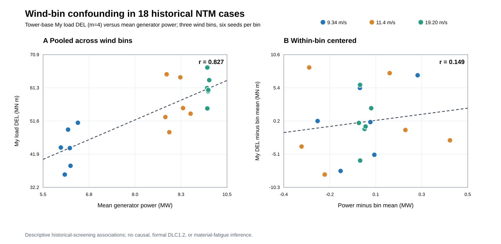
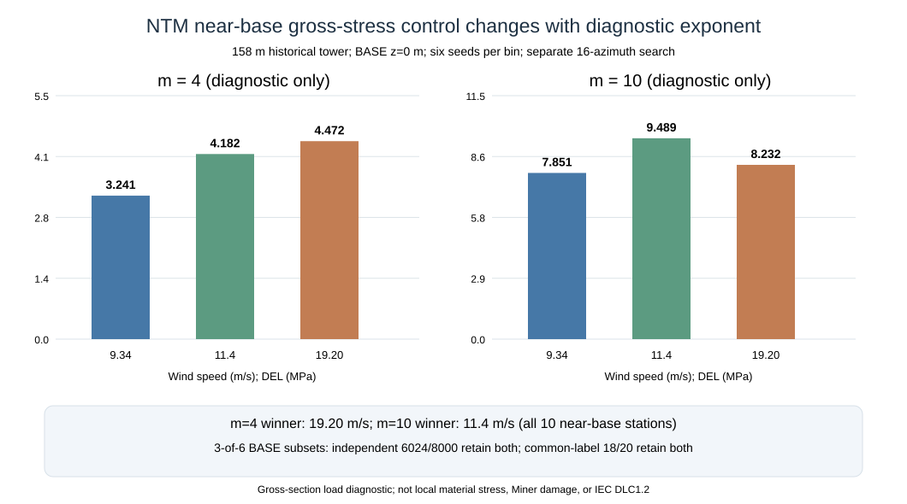
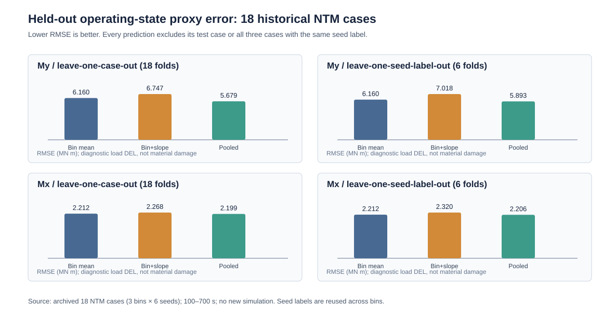
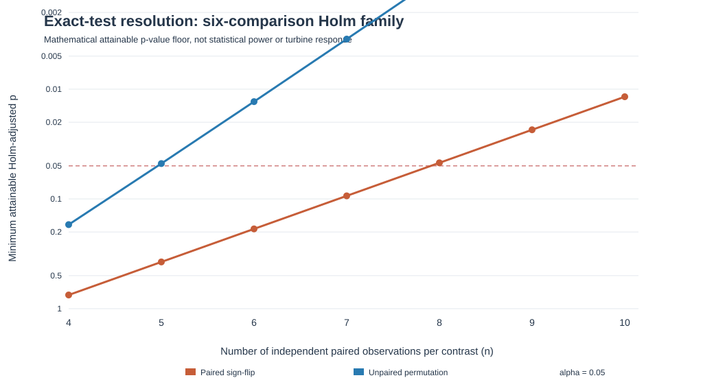
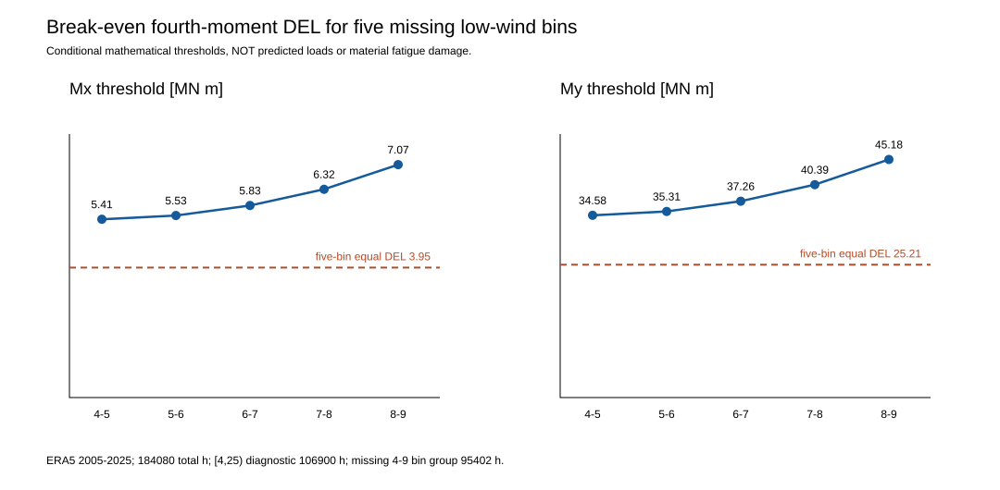
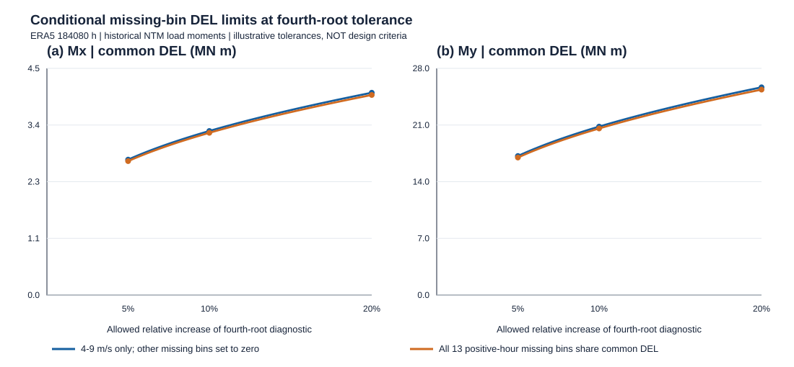
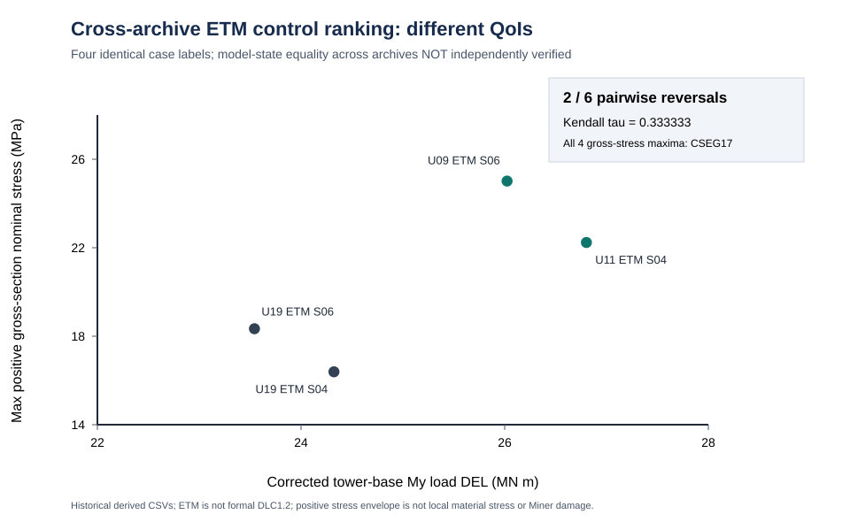
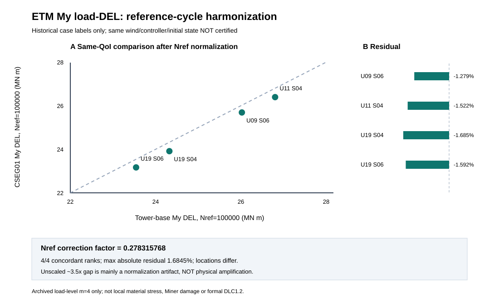
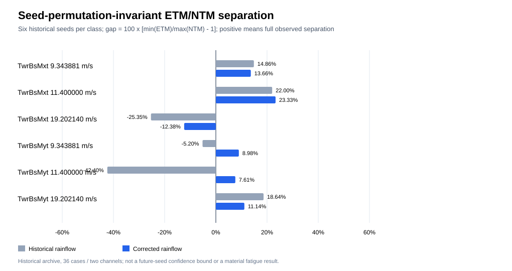

# Supplementary evidence and secondary analyses — archived working material

> Retained from the previous 161,027-character integrated journal working draft at Git blob `6fc14ce410a128c80177af5709ce9d6ccbf4bb2d` (branch baseline `77fc7b659cd190ee1259472f113e04fa19856bf3`). This is an **evidence-preservation appendix**, not a finalized journal supplementary-information PDF. Historical subsection/table/figure numbering is retained solely to trace original scripts and source claims; it is not part of the condensed main-paper numbering. The original full working draft remains recoverable at its immutable Git commit.

## S-A. Secondary methods (historical §2.6–§2.23)

### 2.6. Counterfactual priority-ranking experiment

To test whether the frequency-only ordering uniquely determines which missing wind bins deserve new load data, construct the explicitly counterfactual score
\[
S_b(q)=H_b[(b+0.5)/U_{\rm ref}]^{4q},
\quad 0\le q\le2,\quad U_{\rm ref}=9.343881\ \mathrm{m\,s^{-1}}.
\]
Here \(b\) is the integer lower edge (m s⁻¹), \(b+0.5\) its center, and \(q\) an **assumed** growth exponent, neither a fitted wind-load law nor a material S–N exponent. \(U_{\rm ref}\) cancels from all rankings. Compute normalized shares \(S_b/\sum S_b\) at \(q=0,1,2\), then locate every pairwise score crossing analytically:
\[
q_{ab}=\frac{\log(H_a/H_b)}{4\log[(b+0.5)/(a+0.5)]}.
\]
Retain crossings inside \((0,2)\), sort with endpoints and evaluate each interval midpoint to determine the upper envelope. This exact crossing method avoids arbitrary discretization of \(q\). A scenario score is **not** an estimated missing-bin load or fatigue contribution. The exercise tests the logical sufficiency of frequency-only ranking, not an optimal production-run plan.

### 2.7. Source admission, error controls and limitations

The source-admission contract requires exactly **36 distinct cases × two channels**, unique case/channel keys, recognized speed/class/seed labels, 64-character hexadecimal original OUTB hashes, finite positive DELs, and third-party/corrected DEL agreement within the archived **10⁻⁵ kN m** tolerance. Both channel rows must have the same original OUTB hash. The archived 10-row seed-subset and 26-row missing-bin threshold tables must retain their channel/bin counts and numerical identities. Duplicate/missing rows, altered channel labels, nonfinite values and corrupted third-party DELs are rejected rather than repaired.

In this Methods pass, the connected GitHub source was directly reread for **72 + 10 + 26 derived rows** and checked with **eight positive source-level invariants and three malformed-source refusals** using JavaScript V8. The initial negative-test harness failed its expected count because its third predicate did not actually mutate an input; this *test-harness failure* was corrected by corrupting a third-party DEL, after which all three refusals passed. This is not a claim of native Node CI or physical validation. Source SHA256s were inherited from archived byte-level receipts; this pass's connector reads return Git blob SHA1, which must not be mislabeled SHA256.

**Input provenance:** T062 72-row legacy/corrected comparison SHA256 **12dabbb1273ce03d3920aedda3f72f9fa1d75b671e01a1db145c0a972ffe15e2**; 10-row seed subset SHA256 **f7d9427d15b378661aaebf2fdf0feb1e5eea07cefb3721088a98439265320cf1**; 26-row threshold SHA256 **69fe2ba8077df9cfe9122f1aafb03f315cd143f8313a557763954560b5870b60**; inherited 31-row ERA5 source SHA256 **e4058620a36b23bb218103875d4dc5b0711fc45d418b23a2208c2fc9c16c9102** and six-row NTM fourth-moment source SHA256 **d43f963fb30e16a33e87acdf6e9571710826974eee89d1f3527ab6504d85f695**. Reproduction uses the existing T062 scripts for rainflow-rank robustness, NTM subset enumeration, missing-bin identifiability and counterfactual sampling priority; exact paths and earlier test receipts are in T080 PROCESS_LOG. The archived six-seed aggregates and DELs are **load diagnostics only**.

Unquantified error sources include ERA5/site representativeness, controller and operating-state identity, incomplete wind-bin coverage, the unseen-seed population, tower-local-to-global coordinate interpretation, local stress transfer, material S–N laws and seismic initial-state compatibility. No joint confidence interval is justified. A future source-complete study must independently validate missing-bin operating load histories and held-out seeds before reporting a climate-weighted lifetime load statistic; **material-specific Miner** additionally requires verified local stresses and material-specific mean-stress/fatigue models. The 2026 hybrid-tower wind–earthquake [6] and earthquake/prestress [7] studies rule out generic novelty claims for those phenomena. Source [6] is abstract/metadata-only in this archive; selected original PDF pages of [7] were previously examined, but the two studies have not undergone a complete side-by-side methods/data comparison. The current IEC 61400-1 and IEC 61400-6 consolidated-edition product pages [8,9] are catalog-level evidence only; their authorized design clauses have not been audited here.

### 2.8. Wind-bin-conditioned operating-state association

An exploratory proxy test paired the historical 18 NTM operating-state summaries with tower-base My/Mx fourth-power load DEL by identical case and original OUTB SHA256. All 18 records have 12,001 samples at 0.05 s over 100–700 s, three wind-speed bins with six seeds each, and the archived active-operation heuristic. Generator power (kW) and DEL (kN m) were converted to MW and MN m. Pooled Pearson correlation was contrasted with Pearson correlation after subtracting the six-seed mean separately from predictor and DEL within each wind bin. The centered cross-product was exactly decomposed into between-bin and within-bin contributions. Eighteen leave-one-case-out recalculations re-estimated the bin means. This is a descriptive, noncausal finite-archive test, without p-values or claims about future seeds, DLC1.2, or material fatigue.

### 2.9. Diagnostic-exponent sensitivity of near-base nominal-stress screening

A separate sensitivity analysis uses the previously archived 2,880-row, source-locked 18-NTM gross-section stress-rainflow table (three wind speeds, six seeds per speed, ten stations between 0 and 2.751 m, and 16 candidate local azimuths). The original OUTB files were SHA-verified in earlier work; this analysis re-reads the derived table and an independent 30-row six-seed control table, not the original binary histories. For each diagnostic exponent \(m\in\{4,10\}\), the six-seed score at each wind bin, station and local azimuth is \(\{\sum_{r=1}^{6}D_{m,r}^{m}/6\}^{1/m}\). The maximization over azimuth and wind bin is repeated separately for each exponent. Neither exponent is assigned to concrete, prestressing steel or any other material.

At the BASE station, the full-six-seed controlling azimuth is 0° for both exponents in all three wind bins. Holding this azimuth fixed, we exhaustively enumerate all 20 common-label three-of-six seed subsets and all \(20^3=8000\) independent-within-bin subset combinations. These are finite-archive combinatorial counts, not independent experiments, confidence intervals or probabilities for new turbulence seeds. All comparisons use the same 600 s reference-cycle normalization within each exponent; no cross-exponent numerical DEL magnitude is interpreted as a damage ratio.

### 2.10. Held-out operating-state proxy test

To test whether the within-wind-bin association in §2.8 improves **held-out** load-DEL estimates, the same 18 SHA-paired historical NTM records were used without adding or generating simulations. Two pre-specified scalar predictors were examined: mean generator power (MW) for tower-base My load DEL and mean pitch angle (degrees) for tower-base Mx load DEL. The responses are fourth-power load DEL (MN m), not local material stresses. Three estimators were compared: (A) the training-only mean response of the target wind bin; (B) that bin mean plus a single within-bin slope estimated from the sum of within-bin-centered predictor–response cross-products over all training bins; and (C) an unstratified pooled linear regression. All means and slopes were **re-fitted after excluding the held-out observations**, avoiding use of the test response to calculate bin means.

Two deterministic splits were evaluated. Leave-one-case-out (LOCO) removes one case (17 training cases; 18 test predictions). Leave-one-seed-label-out (LOSO) removes the same S01–S06 label simultaneously from all three wind bins (15 training cases; six three-case folds). LOSO is a conservative grouping check for labels shared across bins, **not** evidence that identical seed labels represent independent or physically matched turbulence realizations. Each of the 18 observations contributes once to the out-of-fold RMSE and MAE. We do not interpret these 18 correlated errors as independent samples or calculate confidence intervals. The predictor summaries and DEL are computed from the same 100–700 s history; this is a diagnostic proxy test, not prospective prediction before a wind simulation.

The input is the previously audited 18-row case/OUTB-SHA-matched table (SHA256 `4abf76252fa34b2c12635d409e5abc23c4a7d6f759b66dbec12b1932379f4bea`). The new source-locked program, 12-row summary and Fig. 5 are archived under T062. No original OUTB was reopened in this pass. Model comparison is descriptive and does not establish causality, population generalization, a formal DLC1.2 fatigue load, or material life.

### 2.11. Exact six-seed randomization sensitivity (S10 EXACT SEED RANDOMIZATION 2026-11-08)

Six predeclared contrasts (three NTM wind-speed pairs × My/Mx tower-base load-DEL) were evaluated using two distinct, hypothetical null randomization mechanisms: all C(12,6)=924 unpaired six-versus-six label allocations, and all 2^6=64 sign patterns of six same-label paired differences. Both tests use an absolute mean-difference statistic and count both tails; each six-contrast family is Holm corrected at 0.05. Neither cross-speed exchangeability nor physical same-label pairing is established, so the p-values are conditional design diagnostics, not confirmatory physical inference.

An independent future design must first have sufficient **discrete testing resolution**. For n nonzero paired differences under a two-sided exact sign-flip test, the minimum attainable raw p-value is 2/2^n. For two untied, unpaired samples of size n under complete label exchangeability, it is 2/C(2n,n). For m=6 Holm comparisons, at least one rejection is arithmetically possible only if m times the raw minimum is at most 0.05. This is a necessary condition for any rejection, **not** a power calculation, an IEC seed requirement or evidence of valid exchangeability. The source-locked independent program evaluates n=4–10 and checks the existing six contrast rows, including sign-flip counterexamples and corrupted-input rejection (Supplementary Table S2 and Fig. S2).

### 2.12. Break-even fourth-moment thresholds for unsampled wind bins

A coverage fraction alone does not identify the relative fatigue importance of unobserved wind bins. We therefore construct a **conditional, falsifiable load-level threshold**, rather than extrapolating the available three wind-speed realizations. Let \(p_j=n_j/184080\) denote the empirical all-hour ERA5 probability for bin \(j\), and let \(\overline{L_{c,j}^{4}}\) denote the archived six-seed fourth moment of the 600-s, \(N_{\mathrm{ref}}=600\) tower-base moment DEL in channel \(c\). The *known-bin partial moment* is \(K_c=\sum_{j\in\{9,11,19\}}p_j\overline{L_{c,j}^{4}}\). For an unobserved bin with \(p_j>0\), define the break-even load DEL \(L_{c,j}^{*}=(K_c/p_j)^{1/4}\). Thus, if the unknown bin's fourth-moment-equivalent DEL were exactly \(L_{c,j}^{*}\), that bin would contribute as much to the all-hour weighted fourth moment as the three archived bins combined. For a group \(G\), an **assumed common** DEL has the analogous threshold \(L_{c,G}^{*}=(K_c/\sum_{j\in G}p_j)^{1/4}\). These are algebraic sensitivity boundaries, **not predictions of missing-bin loads**, IEC design limits, or material-specific Miner damage. The all-hour denominator is held fixed throughout; no conditional-operation probability is multiplied by the operation fraction a second time.

The calculation reads the previously archived 31-row ERA5 bin table and six-row partial fourth-moment table, checks source SHA256, unique bin identities, total hours, source status and cross-table consistency, and refuses malformed inputs. No wind or structural solver is invoked.

### 2.13. Finite-archive deletion sensitivity of the identified fourth moment

We assess how the three observed wind-bin fourth moments depend on the six archived seeds. For each channel \(c\), \(K_c=\sum_{j\in\{9,11,19\}}(n_j/184080)(1/6)\sum_{s=1}^6L_{cjs}^4\), with ERA5 bin hours \(n_j=(5736,1426,2)\). We delete a common *label* \(s\) from all three bins, recompute each bin's fourth moment using the five retained records, and propagate \(K_c^{(-s)}\) to the conditional five-missing-bin equal-DEL threshold \((K_c^{(-s)}/(95402/184080))^{1/4}\). Shared labels do not establish cross-bin physical pairing; this is a deterministic sensitivity experiment on an existing finite archive, not a bootstrap confidence interval or a new DLC1.2 ensemble.

### 2.14. Inverse tolerance envelope for unobserved wind-bin fourth moments

An equal-contribution threshold answers when missing loads match the known contribution, but does not specify how small the unobserved contribution would need to be for a *predeclared precision target*. We invert the diagnostic fourth-root relation without fitting any missing wind load. Let the known three-bin contribution be \(K_c=\sum_{b\in\{9,11,19\}}(H_b/184080)\overline{L_{cb}^4}\) in \((MN\,m)^4\), and let a hypothetical group \(G\) of unobserved bins share the same fourth-moment-equivalent load DEL \(L_{cG}\). If every other unobserved bin contributes zero **solely for this scenario**, then \(E_{cG}/E_{c0}=[1+(H_G/184080)L_{cG}^4/K_c]^{1/4}\), where \(E_{c0}=K_c^{1/4}\). Solving \(E_{cG}/E_{c0}-1=\delta\) gives the conditional threshold

\[
L_{cG}^{\mathrm{limit}}(\delta)=\left\{\frac{184080K_c}{H_G}\left[(1+\delta)^4-1\right]\right\}^{1/4}.
\]

We evaluate two deliberately distinct groups: the five contiguous 4–9 m/s missing bins (95,402 h), with the other missing bins assumed zero; and all 13 positive-hour missing bins **within the diagnostic [4,25) m/s interval** (99,736 h), assumed to share a common DEL. The latter still omits wind speeds outside that diagnostic interval and is **not** a full-year operating-load model. Targets \(\delta=5\%,10\%,20\%\) are illustrative *research precision budgets*, **not** IEC/GB acceptance criteria. The inversion is monotone for \(K_c>0\), \(H_G>0\), \(\delta>0\); the result is a conditional ceiling only if the equal-load and zero-outside-group assumptions actually hold. No measured or simulated load is imputed to any missing bin. A source-locked Node program reads the archived 31-row ERA5 and six-row NTM fourth-moment tables, checks their SHA256 and 184,080 h identity, recomputes \(K_c\) from integer hours and rejects inconsistent bin identities or source-status flags.

### 2.15. Cross-archive ETM screening metrics and the identity gate

To test whether choosing a single tower-base load-DEL case also selects the largest *positive gross-section nominal-stress envelope*, we joined **four previously archived ETM case labels** across two distinct derived sources: the corrected 72-row tower-base My load-DEL rank table (SHA256 `1bf750ba3ea33153dbe4b23e87a1b973ca73ab41e446b2d9d5f3fac2881238a9`) and the four-case × 31-section continuous-azimuth gross-elastic envelope table (124 rows; SHA256 `6002f69286eb9941265697732ec7acd961ac6b5757d7472423d91e0374288f21`). Within each ETM label, the stress endpoint is \(S_j=\max_{i=1}^{31}\max_{t,\theta}\sigma^{\mathrm{gross}}_{j,i}(t,\theta)\) in MPa; the load endpoint is the previously corrected fourth-power \(L_{4,j}^{My}\) in MN m. We ranked the same four labels independently by these two *different* endpoints and counted strict pairwise rank reversals among \({4\choose2}=6\) comparisons. Ties would be rejected rather than silently ordered. The calculation is a **cross-archive case-label comparison**, not a verified pairing of the identical OUTB bytes, controller trajectory, reference frame or structural initial state across both historical processing branches. Its four ETM cases are a selected subset, not a random sample or the formal normal-turbulence DLC1.2 set. Positive continuous-azimuth gross-section extrema are not fixed-material-point stresses, stress-cycle ranges, or Miner damage.

The source-locked no-dependency Node program `experiments/T062/s12_cross_qoi_etm_source_gate.cjs` (SHA256 `66c9b20712ecd83485c57c8eb9e460061daa2dc8ca03923091a635032c768f61`) validates 72/124 rows, four unique case labels, 31 unique sections per ETM label, 12,001 samples per section, required stress-status flags and both input SHA256 values before computing the table and SVG. The current pass executed its pure computation in V8 against the actual GitHub CSV texts and rejected five deliberately corrupted inputs; the native Node CLI/CI was **not** executed.

### 2.16. Tolerance-aware azimuth selection and independent wind-field units

The archived 2,880-row near-base NTM gross-section table (SHA256 `d45f047f5d622fb834d63728c13cead49b614b6cf42e598918e55242ed45f94b`) comprises **18 distinct seed-cases**, ten correlated stations per case and 16 azimuths per station. To avoid interpreting a nearly tied diagnostic DEL maximum as an exclusive material-point selector, we define at each case–station and diagnostic exponent \(m\in\{4,10\}\) the admissible set \(\mathcal A_m(\epsilon)=\{\theta:100[D_m^{\max}-D_m(\theta)]/D_m^{\max}\le\epsilon\}\), where \(\epsilon\) is a declared *percentage decision-indifference tolerance*. We evaluate 0, 0.01, 0.05 and 0.10%; count multi-candidate sets separately for m4 and m10; and report whether their intersection is nonempty. The union is retained as a conservative candidate set, not as an estimate of local material damage. A tolerance selected for decision analysis is **not** a measurement error, confidence interval, validated discretization bound, S–N slope or physical stress-transfer uncertainty. The 16 azimuths are discrete and the ten stations are not independent seed replicates. A source-locked Node program validates source SHA256, 18×10×16 coverage, case/bin/seed identity and positive finite DEL, with malformed-source refusals and input-order invariance. No original OUTB is reopened.

### 2.17. Affine extrapolation leverage and seed-case-level predictive loss

To explain **why** the historical three-bin leave-one-wind-bin-out (LOBO) linear predictor may be unstable, we analyze its deterministic interpolation/extrapolation coefficients without fitting a new model. The response is the maximum-over-16-azimuth **gross-section nominal-stress DEL4** at each of ten near-base stations, measured in MPa. For each held-out wind-speed bin \(u_h\), the two other bins \(u_0,u_1\) provide six-seed training means \(\bar y_0(z),\bar y_1(z)\) at the same station \(z\). The archived predictor is

\[
\widehat y_{\rm lin}(u_h,z)=w_0\bar y_0(z)+w_1\bar y_1(z),\quad
w_1=\frac{u_h-u_0}{u_1-u_0},\quad w_0=1-w_1.
\]

We define the coefficient sensitivity \(A_h=|w_0|+|w_1|\). For any bounded perturbations \(|\delta\bar y_i(z)|\le\eta\) in the *two training means*, the resulting prediction perturbation satisfies \(|\delta\widehat y_{\rm lin}|\le A_h\eta\). This is a **worst-case algebraic amplification bound**, not an estimated training error, model curvature or physical uncertainty. \(A_h=1\) for interpolation and exceeds one for extrapolation. We separately summarize the observed **paired** seed-case mean-squared-error contrast \(d_{hs}=10^{-1}\sum_{z=1}^{10}[(\widehat y_{\rm lin}-y_{hsz})^2-(\widehat y_{\rm near}-y_{hsz})^2]\) in MPa², where the nearest-bin baseline uses the nearest *training* bin mean. The independent wind-field unit is the seed-case (\(n=6\) per held-out bin); the ten nearby stations are nested, correlated measurements, not 60 independent observations.

The previous S11 analysis exactly enumerated 64 conditional sign flips of the six high-bin \(d_{hs}\), all \(6^6=46{,}656\) ordered held-out seed-case resamples **with fixed training means**, and 12 single-training-seed deletions. We inherit those numerical results rather than re-running or claiming a newly calibrated confidence interval. The present source-locked affine analysis cross-checks the archived 18-case, three-bin and 12-training-deletion CSVs (SHA256 identities in §6), verifies the interpolation identities and reports the coefficient bound and paired losses. Six malformed-input refusals and a row-order invariance test check the small calculation. No new OUTB, geometry DOE or formal DLC1.2 simulation is performed.

### 2.18. Exact retrospective subset budget for three competing tower-base load objectives

For the 18 archived NTM wind-field realizations, three SHA-matched native TwrBsMyt quantities are compared per case: time-mean moment, positive peak moment and rainflow DEL4 (m=4, Nref=600), all in MN m. The original 1,080-row rainflow table and the independently derived 18-case mean/DEL table are joined by exact case identity and 64-character OUTB SHA, with 12,001 samples at 0.05 s over 100–700 s. For each wind bin, let q* be the observed maximum of objective q among its six seed-cases. For a retained subset A, define

\[
R(A)=100\max_{q\in\{\mathrm{mean},\mathrm{positive\ peak},\mathrm{DEL4}\}}\left[1-\frac{\max_{s\in A}q_s}{q^\star}\right]\%.
\]

All 63 nonempty subsets are enumerated; for each cardinality k=1,…,6, the minimum R is compared with three single-objective top-k rankings. This is a **finite-archive oracle** using responses already observed, not a policy for choosing future random seeds or a replacement for formal fatigue sampling.

### 2.19. Channel-specific exposure weighting and rare-hour influence

The last analysis asks a different question from the missing-bin identification bound in §2.5: **even within the three bins that do have matched load histories, does the same rare ERA5 exposure affect the two bending channels equally?** The source contract is the archived 31-row ERA5 hourly-bin table (SHA256 `e4058620a36b23bb218103875d4dc5b0711fc45d418b23a2208c2fc9c16c9102`) and the six-row, two-channel, three-bin historical NTM fourth-power table (SHA256 `d43f963fb30e16a33e87acdf6e9571710826974eee89d1f3527ab6504d85f695`). The source-derived six-row cross-check table is `S10_ERA5_KNOWN_SUPPORT_TAIL_INFLUENCE_20261109.csv` (SHA256 `349c7633a79eb20b8cafb47dfb14ac588bb48c706d5ad9dca49a489df3544a8c`). All are derived sources; neither original hourly ERA5 values nor original OUTB binaries were reprocessed in this manuscript revision.

Let `c` denote the **separate** tower-base Mx or My load channel, `b` the observed lower-edge wind bins {9, 11, 19} m/s, `H_b` the ERA5-derived number of hours, `N=184080` the number of **all** archived hourly estimates, and `Q_cb` the arithmetic mean of the six historical seed-specific fourth powers of the load DEL (units (MN m)^4). Define

\[
K_c=\sum_{b\in\{9,11,19\}}\frac{H_b}{N}Q_{cb},\qquad
S_{cb}=\frac{(H_b/N)Q_{cb}}{K_c},\qquad
G_c=\frac{Q_{c,19}}{Q_{c,9}}.
\]

The normalization is deliberately **unconditional** over the full 184,080-hour archive. The fractions `S_cb` sum to unity only **within the known-load contribution** `K_c`; they are not shares of a complete climate-wide moment. For a fixed-total-hours counterfactual that transfers exactly one hour from bin 19 to bin 9 while leaving the historical bin responses unchanged, the algebraic relative perturbation is

\[
D_c=100\,\frac{Q_{c,9}-Q_{c,19}}{N K_c}\;\% .
\]

The dimensionless cross-channel ratios `G_Mx/G_My` and `|D_Mx/D_My|` measure heterogeneity of these two **load-channel diagnostics**, not the ratio of material fatigue damage. This is a deterministic finite difference, not a measured classification error, confidence interval, estimate of annual fatigue damage, or claim that one-hour shifts are independent. In particular, two recorded hours at 19–20 m/s cannot support a stable tail-probability estimate, and the other 99,736 diagnostic operating hours without matched NTM loads remain unidentified.

### 2.20. Joint sufficiency conditions for translating screening to material damage

The final synthesis distinguishes four *different* evidence levels, rather than treating success at an upstream level as validation of the next: (i) correct cycle extraction from a specified load history; (ii) stability of a decision across independently sampled turbulence realizations; (iii) coverage and unconditional weighting of the complete operating/parked wind climate; and (iv) synchronized local stress-cycle transfer with a material-specific fatigue law. Let $j$ denote a fixed material point, $b$ a declared wind-speed bin, $o$ a physically verified operating state, and $s$ an independent turbulence realization. If $p_{b,o}$ is the **unconditional** fraction of *all* hours in state $(b,o)$, $T_{b,o,s}$ is the simulated exposure in **hours**, and $n_i$ is a rainflow cycle count, a possible annual Miner estimator (subject to an independently justified damage model) is

\[
\widehat D_{j,\mathrm{yr}}=8760\sum_{b,o}p_{b,o}\,\mathbb E_{s\mid b,o}\left[\frac{1}{T_{b,o,s}}\sum_{i\in(j,b,o,s)}\frac{n_i}{N_j(\Delta\sigma_i,\sigma_{m,i},R_i,\theta_j)}\right].
\]

Here $N_j$ is the material- and state-appropriate cycles-to-failure function, $\Delta\sigma_i$ the **local** stress range, $\sigma_{m,i}$ its cycle mean, $R_i$ its stress ratio when defined, and $\theta_j$ the calibrated material parameters. The nominal 8760 h/year convention must be reconciled with the calendar-year exposure and downtime model in an actual application. This expression is a **definition of a future estimator, not a result of the present study**: the archive lacks verified $p_{b,o}$, full-bin independent seed histories, and local $N_j$ inputs. The observed tower-base moment diagnostic $L_{c,b,s}=[\sum_i n_i(\Delta M_{c,i})^4/N_{\mathrm{eq}}]^{1/4}$ does not contain the stress-cycle means, local transfer or material fatigue parameters needed to evaluate the displayed estimator.

The non-identifiability can be demonstrated without a speculative material-damage number. For a fixed multiset of moment ranges and counts, changing a local mean-stress history by a constant $a$ leaves the **moment** DEL unchanged, while $\sigma_{m,i}\mapsto\sigma_{m,i}+a$ can alter $N_j$ for a mean-stress-sensitive material law. Alternatively, different local transfer functions can produce different $\Delta\sigma_i$ from the same (\Delta M_{c,i}). Thus a universal mapping $\widehat D_{j,\mathrm{yr}}=f(L_c)$ cannot be identified from moment DEL alone. This is a conditional mathematical counterexample, not proof of a particular fatigue mechanism or a measured change in this tower's material life.

### 2.21. Within-case azimuth screening with a declared DEL indifference band

A source-locked **within-case, within-station** comparison uses the 1,984-row ETM gross-section table: four case labels, 31 concrete-tower stations per case, 16 azimuths at 22.5° intervals, and 12,001 samples per archived history at 0.05 s. For each pair let $D_{\max}=\max_\theta D_4(\theta)$ be the largest fourth-power **nominal stress-range DEL** (MPa), $\theta_D$ its azimuth and $\theta_P=\arg\max_\theta\sigma_{\max}(\theta)$ the signed-peak winner. The paired DEL loss $\ell_D=100[D_{\max}-D_4(\theta_P)]/D_{\max}$ (%) and peak gain $g_P=\sigma_{\max}(\theta_P)-\sigma_{\max}(\theta_D)$ (MPa) compare two **different** screening objectives on the *same* archived case and station.

For an explicitly declared indifference band $\varepsilon$ (%), the DEL-near-optimal set is $A_\varepsilon=\{\theta:D_4(\theta)\ge(1-\varepsilon/100)D_{\max}\}$. The minimum retrospective band admitting the peak winner at every station of case $c$ is $\varepsilon_c^*=\max_{j=1}^{31}\ell_{D,cj}$. We report exact inclusion counts at illustrative $\varepsilon=0.1,0.2,0.3\%$. These bands are **not measured physical uncertainty or pre-registered design tolerances**. Thirty-one heights in one case are correlated, and four ETM case labels are not a verified climate sample. The gross stress excludes effective prestress and constituent-level stress concentration.

### 2.22. Exact two-bin permutation and one-seed-per-bin deletion

The three archived NTM wind bins each contain six wind realizations with a common tower-base My fourth-power load-DEL convention. For each pair of bins A and B, the observed mean contrast is $\Delta_{BA}=\overline{DEL}_{4,B}-\overline{DEL}_{4,A}$ (MN m). Enumerate all $\binom{12}{6}=924$ allocations of the twelve pooled values into two labelled groups of six and calculate the two-sided exact conditional permutation fraction $p=\#\{|\Delta^*|\geq|\Delta_{\rm obs}|\}/924$. Holm's step-down procedure adjusts the three predeclared pairwise contrasts. As a separate retrospective stability test, delete one observed realization from **each** bin in all $6\times6=36$ ways and record the five-versus-five mean difference range. Cross-bin superiority counts the 36 pairs with $DEL_{4,B}>DEL_{4,A}$; these are **not** 36 independent trials.

The permutation interpretation assumes exchangeability of pooled case labels under the null, which may be invalid if controller states or cross-bin seed dependencies differ. The test is a conditional finite-archive diagnostic, not a future-seed probability, an IEC wind-load criterion or a material-fatigue result. No prospective confidence interval is inferred.

### 2.23. Componentwise Pareto dominance and exact minimum coverage

We used the same 18 original-OUTB-derived NTM cases, each with six tower-base force/moment DEL channels and a 100–700 s analysis window (Nref=600). For each diagnostic exponent m=4 or m=10 separately, a case dominates another only if all six channel-wise DELs are no smaller and at least one is strictly larger. This partial order is invariant under positive unit conversion within a channel; no cross-unit addition or synchronized vector maximum is inferred. All 262143 nonempty subsets of 18 cases were enumerated to find the smallest retrospective set attaining each of the six observed maxima. The calculation is an archive screening test, not a material fatigue model.

## S-B. Secondary results (historical §3.3–§3.20)

### 3.3. Wind-bin confounding of operating-state/load-DEL associations

For the 18 source-matched historical NTM cases, mean generator power and tower-base My load DEL had pooled Pearson **r=0.827168** (R²=0.684207). After wind-bin centering, the coefficient was only **r=0.148564** (R²=0.022071). The between-bin term accounted for **98.9421%** of the total signed cross-product. The three separate bin coefficients were 0.500028, -0.003276, 0.162506; the within-bin coefficient varied from 0.007570 to 0.377205 across 18 leave-one-case-out checks. Mean blade pitch versus tower-base Mx load DEL similarly changed from pooled r=0.968215 to centered r=0.315669. This is a wind-bin confounding counterexample, not evidence of controller causation or a material-fatigue mechanism.

**Table 3.** Descriptive associations of operating-state means and fourth-power load DEL, three bins × six seeds. Between-bin percentage is a signed cross-product share, not a variance-explained fraction.

| Load channel | Operating predictor | Pooled r | Bin-centered r | Between-bin covariance share | Bin-centered leave-one-out r |
|---|---|---:|---:|---:|---:|
| My | Mean generator power | 0.827168 | 0.148564 | 98.942% | 0.007570–0.377205 |
| My | Mean rotor speed | 0.835976 | 0.292446 | 98.015% | 0.135925–0.546127 |
| My | Mean blade pitch | 0.688601 | 0.250498 | 99.423% | 0.114886–0.645439 |
| Mx | Mean blade pitch | 0.968215 | 0.315669 | 99.776% | 0.139893–0.493501 |

**Fig. 3.** Same 18 historical NTM cases: (A) pooled mean generator power versus My load DEL and (B) both variables centered within their six-seed wind-speed bin. Dashed lines are descriptive fits. Original derived source SHA256: operating-state CSV `0f577f3197870a1350c740c2e0c118073fb9b6f796b4c471765c6f616d5a1b04`, load-DEL CSV `95de6578cf379d1b2e1d99a68c26954a68e93cc8bfc4bdcd63dd324ae2999a0f`; reproducible figure SHA256 `a0c4bce68e90143198bcbeedbe8c0625a27c31e8377fe6167a52ddcf4bd50adf`. No formal DLC1.2, causal, or material-life inference.

### 3.4. Control-wind-speed reversal under diagnostic exponent choice

The gross-section six-seed stress scores reveal a control-bin reversal (Table 4 and Fig. 4). At BASE, the 9.343881/11.4/19.202140 m/s bins have \(m=4\) scores of 3.241072/4.181816/**4.472304** MPa, whereas their \(m=10\) scores are 7.850583/**9.489058**/8.232228 MPa. Thus the largest diagnostic score occurs at 19.202140 m/s for \(m=4\) but at 11.4 m/s for \(m=10\). The winner-to-runner-up margins are 6.9465% and 15.2672%, respectively. This same reversal occurs at all ten near-base stations; their proximity means they are not independent structural replications. The original 30-row control-table oracle agrees with the independent 2,880-row aggregation to within \(6.83\times10^{-12}\) MPa (\(m=4\)) and \(2.46\times10^{-11}\) MPa (\(m=10\)).

**Table 4.** Gross-section nominal-stress diagnostic exponent sensitivity at BASE (historical NTM; not material fatigue).

| Wind bin | Diagnostic \(m=4\) stress DEL (MPa) | Diagnostic \(m=10\) stress DEL (MPa) |
|---|---:|---:|
| 9.343881 m/s | 3.241072 | 7.850583 |
| 11.4 m/s | 4.181816 | **9.489058** |
| 19.202140 m/s | **4.472304** | 8.232228 |

**Fig. 4.** Source-locked six-seed gross-section nominal-stress DELs at BASE, with separate azimuth optimization for each diagnostic exponent. This is neither a material-specific S–N assessment nor a design-life damage comparison.

The independent three-of-six subsets preserve **both** full-six-seed winners in 6,024/8,000 combinations (75.30%), while the exponent-specific winners differ in 6,258/8,000 (78.225%). Common-label subsets preserve both full-six-seed winners in 18/20 combinations (90%), yet the two exponents select different bins in all 20. The different counts reflect the subset construction, not different underlying wind simulations. No new OpenFAST run was performed.

### 3.5. Held-out tests of operating-state proxies

**Table 5.** Out-of-fold RMSE (MN m) for two load-DEL channels, with three estimators and two splitting rules. All 18 test errors are evaluated once in each row; smaller is better. Source: 18 archived SHA-paired NTM cases, program and 12-row output in T062.

| Channel / predictor | Holdout | Bin mean | Bin + within-bin slope | Pooled linear |
|---|---|---:|---:|---:|
| My / mean power | One case | 6.1602 | 6.7473 | 5.6788 |
| My / mean power | One seed label across bins | 6.1602 | **7.0176** | 5.8935 |
| Mx / mean pitch | One case | 2.2124 | 2.2676 | 2.1994 |
| Mx / mean pitch | One seed label across bins | 2.2124 | **2.3201** | 2.2057 |

For My, adding the within-bin operating-state slope **increases** held-out RMSE relative to the wind-bin-mean benchmark by 9.53% (LOCO) and 13.92% (LOSO). For Mx, the corresponding increases are 2.49% and 4.87%. Thus, in this finite archive, neither pre-specified operating-state covariate demonstrates improved held-out accuracy **after conditioning on wind bin**. The unstratified pooled regressions achieve smaller RMSE in this particular archive (e.g., My LOSO 5.8935 versus 6.1602 MN m), but they also exploit between-bin differences; this does not overturn the confounding analysis or establish transfer to unobserved wind speeds. Because each bin contains only six seeds, the result is sensitive to individual realizations, and no new-seed uncertainty interval is available.

**Fig. 5.** Historical 18-NTM held-out load-DEL errors for a wind-bin mean, a wind-bin mean with fitted within-bin slope, and a pooled linear model. RMSE is in MN m; the figure is not a structural or material-fatigue validation.

### 3.6. Exact finite-seed inference changes with the assumed design

Unpaired label permutations produced five of six Holm-adjusted p-values below 0.05 (each 0.012987); hypothetical paired-label sign flips produced zero of six (all adjusted p=0.187500). The My 11.4 versus 19.202140 m/s contrast had mean difference 4.721442 MN m, 158/924 extreme unpaired assignments (adjusted p=0.170996) and 25/36 cross-seed wins. The six observed conditional results are preserved in [Supplementary Table S1](../experiments/T062/S10_NTM18_EXACT_SEED_INFERENCE_6PAIR_20261108.csv) and [Supplementary Fig. S1](final-thesis/figures/FIG3_S10_NTM_EXACT_SEED_INFERENCE_20261108.svg).

**New exact-resolution result.** With six pairs, the two-sided sign-flip p-value cannot be smaller than 2/64=0.03125; the smallest possible first-step six-comparison Holm-adjusted p is therefore 6(2/64)=0.1875. **No possible values of the six paired differences could have yielded a rejection at 0.05 under this specified design.** The observed 0/6 paired result is structurally forced and cannot support a null wind-speed-effect interpretation. By contrast, the six-versus-six unpaired minimum is 2/924=0.002164502, giving a first-step Holm floor of 0.012987013: rejection is mathematically possible but the required exchangeability remains unverified.

For the same two-sided six-contrast Holm family, the smallest paired n allowing even one rejection is **eight**: n=7 has a Holm floor of 0.093750, versus 0.046875 at n=8. The analogous unpaired floor first falls below 0.05 at n=5 (0.047619). Eight equal positive paired differences attain raw p=2/256=0.0078125; the constructed equal-magnitude case of seven positive and one negative difference instead has p=18/256=0.0703125 (six-fold first-step product 0.421875). Thus n=8 is a **resolution necessity, not a sufficient sample size or power guarantee**. These are exact mathematical examples, not additional wind-turbine simulations.

[Supplementary Table S2: seven-row exact resolution results](../experiments/T062/S12_EXACT_TEST_RESOLUTION_7ROW_20261108.csv) and the [independent source-locked Node program](../experiments/T062/s12_exact_test_resolution_gate.cjs) provide the full n=4–10 calculations.

**Supplementary Fig. S2.** Smallest mathematically attainable six-comparison Holm-adjusted p-value versus observations per contrast. The paired sign-flip and unpaired allocation curves depict test resolution, not statistical power, validated pairing, wind response or material fatigue.

### 3.7. Break-even thresholds quantify how little is identified by low-wind exposure alone

The archived bins at 9, 11 and 19 m/s represent 7,164 of 106,900 diagnostic operating hours. Their known partial fourth moments are \(K_{Mx}=125.606637744\,(\mathrm{MN\,m})^4\) and \(K_{My}=209257.299447601\,(\mathrm{MN\,m})^4\). The five missing bins from 4 to 9 m/s represent 95,402 hours (89.2442% of diagnostic operating exposure). **Table 6** gives the single-bin thresholds and the separate hypothetical equal-DEL group threshold.

**Table 6.** Conditional DEL values at which a missing wind bin (or five-bin group with identical DEL) would equal the weighted fourth-moment contribution of all three archived NTM bins. Values are MN·m; they are not estimated loads.

| Missing ERA5 bin (m/s) | Mx break-even DEL | My break-even DEL |
|---|---:|---:|
| 4–5 | 5.413247 | 34.583967 |
| 5–6 | 5.527486 | 35.313819 |
| 6–7 | 5.831495 | 37.256056 |
| 7–8 | 6.322811 | 40.394960 |
| 8–9 | 7.071769 | 45.179880 |
| **4–9, common DEL assumed** | **3.945622** | **25.207654** |

**Fig. 6.** Single-bin and five-bin equal-DEL thresholds computed from the ERA5 exposure archive and the existing three-bin six-seed load-level fourth moments. Curves are algebraic boundaries, not wind-load predictions. A missing-bin DEL below its individual threshold would contribute less than the archived three-bin total; above it, more, **provided the same fourth-moment definition and wind-bin state apply**. This conditional comparison does not establish actual operating states or material fatigue.

### 3.8. Observed-seed deletion changes the identifiable fourth moment

The six-seed known-bin baseline is \(K_{My}=209257.299446\,(MN\,m)^4\) and \(K_{Mx}=125.606638\,(MN\,m)^4\). Deleting one common seed label changes \(K_{My}\) by **-10.6845% to +8.0452%** and \(K_{Mx}\) by **-10.6997% to +11.4025%**. The corresponding five-missing-bin conditional thresholds span **24.505532–25.700039 MN m** (My) and **3.835559–4.053584 MN m** (Mx). These intervals are *six observed deletion outcomes*, not probability intervals. The mean of the six leave-one-label-out fourth moments equals the full-six estimate exactly by linearity, providing a reproducible numerical invariant.

**Table 7.** [Fourteen source-derived baseline/deletion rows](../experiments/T062/S10_NTM18_WEIGHTED_M4_SEED_DELETION_20261108.csv), two channels × (reference + six deletions). **Fig. 7.** [Fourth-moment and conditional threshold sensitivity](final-thesis/figures/FIG3_S10_NTM_WEIGHTED_M4_SEED_DELETION_20261108.svg). Source/algorithm SHA256: `4abf76252fa34b2c12635d409e5abc23c4a7d6f759b66dbec12b1932379f4bea` / `7f1d7794696af77549f8ecfb9b3b0c8e47abd845161bb01ed037ef2049d2ba56`; CSV/SVG SHA256: `91b78929363f828bc7eae87ddb9539d0b5c5fd4d94ae8ec937c41c515cfd8036` / `308bb1a205ef2f943acf8845c5ea3dd93de8ea6ce13866ee766f2f6e250db284`. V8 checks: four independent baseline values, 16 algebraic invariants, eight malformed-input rejections and permutation invariance; no native Node CLI or original OUTB reread.

### 3.9. Missing-bin load ceilings implied by an illustrative diagnostic precision target

The independent source tables yield \(K_{Mx}=125.6066377435\) and \(K_{My}=209257.2994476005\, (MN\,m)^4\). The known-bin-only fourth-root diagnostics are 3.347751 and 21.387999 MN m, respectively. Table 8 gives the inverse tolerance envelope. For example, if **all 13** missing positive-hour bins in [4,25) m/s had an identical fourth-moment-equivalent My load DEL, and loads outside those bins were zero, a common DEL of **16.985322 MN m** would raise the total diagnostic fourth root by **5%** above the three-bin-only baseline. The analogous Mx threshold is **2.658623 MN m**. These values are **not estimated missing loads**; the current data do not determine on which side of either threshold the real system lies.

**Table 8.** Conditional common missing-bin DEL at selected increases in the fourth-root *load* diagnostic. All values in MN m; illustrative \(\delta\) is not a design tolerance. Source: archived ERA5 31-bin and six-row historical NTM moments, re-evaluated by the S12 program.

| Missing-bin scenario | Channel | \(\delta=5\%\) | \(\delta=10\%\) | \(\delta=20\%\) |
|---|---|---:|---:|---:|
| 4–9 m/s five bins only; all other missing set to zero | Mx | 2.688316 | 3.256629 | 4.016299 |
| 4–9 m/s five bins only; all other missing set to zero | My | 17.175026 | 20.805844 | 25.659197 |
| All 13 positive-hour missing [4,25) m/s bins; common DEL | Mx | **2.658623** | 3.220659 | 3.971938 |
| All 13 positive-hour missing [4,25) m/s bins; common DEL | My | **16.985322** | 20.576036 | 25.375783 |

**Fig. 8.** Source-derived inverse tolerance envelopes for Mx (a) and My (b). The curves compare two *hypothetical common-DEL group definitions*, not predicted wind-load distributions. Their proximity reflects the additional 4,334 h outside the five low-speed bins, **not** convergence of any physical fatigue model.

A fourth-root tolerance should not be confused with the fraction of the fourth moment contributed by missing bins. At \(\delta=5\%\), the missing-to-known fourth-moment ratio is \((1.05)^4-1=0.21550625\); the missing contribution is already **17.72975%** of the scenario total fourth moment. At \(\delta=10\%\), that share is **31.69865%**. These exact identities hold for both channels because \(\delta\) is dimensionless. The 12-row CSV and independently executable Node source reproduce all numbers and figure curves; the historical source files are derived archives rather than a fresh original-OUTB or hourly-ERA5 read.

### 3.10. Four-ETM cross-QoI rank discordance despite a stable nominal-stress control height

The corrected tower-base My load-DEL order among the four historically recovered ETM labels is U11p4_S04 > U09p343881_S06 > U19p202140_S04 > U19p202140_S06. The **maximum positive gross-section nominal-stress** order is instead U09p343881_S06 > U11p4_S04 > U19p202140_S06 > U19p202140_S04. There are **2/6 strict pairwise reversals** (descriptive Kendall \(\tau=1/3\), with no statistical p-value). All four stress maxima occur at **CSEG_17** (gage height approximately 60.026 m); stability of the *screening height* does not imply stability of the *controlling case*. In particular, U11p4_S04 has a **2.9938% larger** tower-base My DEL than U09p343881_S06 (26.802478502 versus 26.023386818 MN m), whereas U09p343881_S06 has a **12.4856% larger** positive nominal-stress maximum than U11p4_S04 (25.013489806 versus 22.237063660 MPa). These are differences between distinct response metrics, not conversion factors or local-fatigue effects.

**Supplementary Table S3.** Four archived ETM case-label comparison; both endpoints are source-derived and independently ranked within these four labels only.

| ETM label | Corrected My load DEL (MN m) | Max positive gross nominal stress (MPa) | Control station | My rank | Stress rank |
|---|---:|---:|---|---:|---:|
| U09p343881_ETM_S06 | 26.023386818 | 25.013489806 | CSEG_17 | 2 | 1 |
| U11p4_ETM_S04 | 26.802478502 | 22.237063660 | CSEG_17 | 1 | 2 |
| U19p202140_ETM_S04 | 24.323114873 | 16.390908468 | CSEG_17 | 3 | 4 |
| U19p202140_ETM_S06 | 23.542402409 | 18.338015480 | CSEG_17 | 4 | 3 |

**Supplementary Fig. S3.** Four historical ETM labels plotted against two *different* source-derived screening endpoints; point labels are not a proof of cross-archive identical simulation state. Source-level [four-row CSV](../experiments/T062/S12_4ETM_CROSS_QOI_RANK_20261108.csv) SHA256 `0ab09a0067745c9bdb0ee155da8f1aef7d78931511a0afd9a0a1225e1d33982d`; figure SHA256 `2b88d3e427c5166f329b53e1b5542640d4acde829208986ee9f3826b513d8f4d`. The historical 31-section positive peaks also have noncoincident times (U11p4_ETM_S04: 541.45–628.30 s across stations), so an along-height envelope must not be read as a synchronous stress field. This result is a **candidate-selection warning**, not evidence of material fatigue-control reversal, a same-state cross-QoI validation or annual load reliability.

### 3.11. Harmonizing reference cycles before comparing archived same-QoI load DELs

A second, **same-QoI** comparison exposes a confounder hidden by the cross-QoI analysis in §3.10. The T062 corrected tower-base `TwrBsMyt` load DEL is reported for `m=4`, `Nref=100000` and MN m; the separate T077 four-ETM 31-gage archive reports `CSEG_01/My_kNm` at z=1.763393 m with `Nref=600` (600 s at 1 Hz) and kN m. The consistent conversion is `DEL_CSEG01,100000 [MN m] = 0.001 × DEL_CSEG01,600 [kN m] × (600/100000)^(1/4)`, with factor **0.2783157684**.

**Supplementary Table S4.** Four historical ETM case labels; same load-level My DEL and common `Nref=100000`. Residual is `100(CSEG01/base−1)%`.

| Archived ETM label | Base My DEL (MN m) | CSEG01 original, Nref600 (MN m) | CSEG01 harmonized (MN m) | Residual |
|---|---:|---:|---:|---:|
| U09p343881_ETM_S06 | 26.023387 | 92.306914 | 25.690470 | −1.2793% |
| U11p4_ETM_S04 | 26.802479 | 94.836550 | 26.394507 | −1.5221% |
| U19p202140_ETM_S04 | 24.323115 | 85.921775 | 23.913385 | −1.6845% |
| U19p202140_ETM_S06 | 23.542402 | 83.242012 | 23.167565 | −1.5922% |

The raw unharmonized CSEG01/base ratios range from **3.5325 to 3.5471**; after harmonization, residuals are only **−1.6845% to −1.2793%**. All four labels retain identical same-QoI ranks (**0/6 pairwise inversions**). This eliminates a demonstrable reference-cycle normalization artifact, but **does not establish identical wind, controller or initial-state histories**. The two channels are at different elevations, the original 36-case OUTB branch and the 31-gage Actions branch have not been matched by original BTS/controller/state hashes, and differences in rainflow implementation are not excluded. The residual therefore has no validated physical error attribution. The same-QoI rank agreement also does not negate the conditional 2/6 *different-QoI* reversals in §3.10 and says nothing about local material fatigue.

**Supplementary Fig. S4.** Same-QoI My load DEL after reference-cycle harmonization and four residuals. [Reproducible Node source](../experiments/T062/s06_etm_base_cseg01_nref_harmonization.cjs) SHA256 `c10c4a95dc81fa6210856375c1d64129596ff7406a68fada0d23828c8a686a95`; [four-row CSV](../experiments/T062/S06_ETM_BASE_CSEG01_NREF_HARMONIZED_20261108.csv) SHA256 `b538a3f44030bcdf09e9d620f67326b40aea0475c5c10893467721cadf82466b`; figure SHA256 `e69436a2482aea2206ce35e569984f43b8d243ccf67b65403d8132b044a446ae`. The T077 31-station histories came from separate A/B/C/D runs, so shared clock labels cannot establish a synchronous full-tower field. The U11 CSEG11–12 86.10 s peak-time difference is within batch B and remains a valid *within-batch* noncoincidence counterexample; the full 31-station 86.85 s spread is an archive-level descriptor.

### 3.12. Exponent-dependent azimuth switches become near-ties under small decision tolerances

**Supplementary Table S5.** Candidate-set sensitivity in 180 correlated case–station groups nested within 18 seed-cases (full 16-row bin-resolved CSV in T062).

| Decision tolerance | Strict m4/m10 argmax switches | m4 groups with multiple candidates | m10 groups with multiple candidates | Union multi-candidate groups | Groups with nonempty m4/m10 intersection |
|---:|---:|---:|---:|---:|---:|
| 0% | 10/180 | 0/180 | 0/180 | 10/180 | 170/180 |
| 0.01% | 10/180 | 0/180 | 10/180 | 10/180 | **180/180** |
| 0.05% | 10/180 | 20/180 | 10/180 | 20/180 | **180/180** |
| 0.10% | 10/180 | 50/180 | 30/180 | 50/180 | **180/180** |

All ten strict switches belong to the same high-speed realization `U19p202140_NTM_S03`, not ten independent wind fields. At \(\epsilon=0.01\%\), the m10 admissible set at each switched station includes both 0° and 180°, restoring a common candidate with m4 at **all 180** groups. At 0.05%, the 20 m4 ambiguous groups occur only in two high-speed seed-cases (`S03`, `S05`); the ten m10 ambiguous groups occur only in `S03`. Neither of the two lower-speed bins has a multi-candidate group at this tolerance. At 0.10%, the corresponding counts rise to 50 and 30, all at the high-speed bin. These are exact finite-table counts, not probabilities for future turbulence seeds.

The earlier ten strict-switch penalties are at most 0.031234% (m4) and 0.004492% (m10), while the two selected BASE azimuths differ in *time-mean gross nominal stress* by 15.835855 MPa. That mean is not a rainflow cycle mean or effective prestress. The archived sample-quantization bound is not a propagated error bound for DEL ranking. This motivates retaining opposed candidate azimuths pending independent local-material stress-cycle validation, without asserting a material-fatigue ranking reversal.

### 3.13. A quantitative extrapolation mechanism behind the grouped holdout failure

**Supplementary Table S6.** Exact affine coefficients for the two-bin linear predictor and paired, *seed-case-level* squared-loss differences; historical three wind bins only. Coefficients are dimensionless, loss differences are MPa² and the RMSE ratio compares the linear model with the nearest-training-bin mean. The table is not a structural design-sensitivity result.

| Held-out wind speed (m s⁻¹) | Training wind speeds (m s⁻¹) | \(w_0,w_1\) | \(A_h=|w_0|+|w_1|\) | Mean paired MSE difference (MPa²) | Linear worse seed-cases | RMSE ratio |
|---:|---|---|---:|---:|---:|---:|
| 9.343881 | 11.400000, 19.202140 | 1.263533, −0.263533 | 1.527065 | −0.158209 | 0/6 | 0.920265 |
| 11.400000 | 9.343881, 19.202140 | 0.791432, 0.208568 | 1.000000 | −0.428850 | 0/6 | 0.777354 |
| **19.202140** | 9.343881, 11.400000 | **−3.794596, 4.794596** | **8.589191** | **+10.317368** | **6/6** | **7.611405** |

For the highest bin, the linear prediction extrapolates **7.802140 m s⁻¹** beyond the upper training speed from two training speeds separated by only **2.056119 m s⁻¹**. It therefore assigns a negative weight to the lower-speed mean and a weight greater than four to the upper-speed mean. The worst-case training-mean perturbation amplification is \(A_h=8.589191\), compared with 1 for the interior-bin interpolation. This algebraic sensitivity **coexists** with a measured mean paired squared-loss penalty of +10.317368 MPa² across the six high-speed seed-cases; the smallest and largest case penalties are +7.276106 and +13.475626 MPa². At both other held-out speeds the mean paired loss is negative, so the simple linear predictor is **not** uniformly worse across the archive.

The previous high-bin RMSE values are 3.240152 MPa (linear) and 0.425697 MPa (nearest bin). The conditional one-sided six-case sign-flip enumeration gives 1/64 = 0.015625, while the fixed-training \(6^6\) resampling yields a ratio percentile range 5.092034–14.372340 and the 12 training-seed deletions yield ratios 4.985518–11.257295. Those figures are **conditional descriptive diagnostics**, not independent prospective tests, calibrated population confidence intervals or an established physical cause of the prediction error. The program and exact three-row CSV in T062 reproduce Supplementary Table S6; the earlier S11 SVG depicts the RMSE ratios without presenting correlated stations as independent realizations.

### 3.14. Three-objective historical case retention requires a metric union

**Supplementary Table S7.** Minimax missed fraction of the observed six-seed maxima in mean, positive peak and DEL4 of tower-base My. The percentage is retrospective regret, not a population error rate.

| NTM speed (m/s) | Mean winner | Peak winner | DEL4 winner | Optimal k=1 regret | Optimal k=2 regret | Smallest zero-regret k and case set |
|---:|---|---|---|---:|---:|---|
| 9.343881 | S02 | S01 | S01 | 1.115066% | **0%** | **2: S01+S02** |
| 11.400000 | S02 | S06 | S04 | 2.594271% | **1.357063%** | **3: S02+S04+S06** |
| 19.202140 | S03 | S04 | S04 | 2.120187% | **0%** | **2: S03+S04** |

At 11.4 m/s, all three observed maxima arise from distinct wind-field realizations, so two retained cases cannot recover all three maxima; the best two-case regret is 1.357063%. At 19.202140 m/s, even the top three mean-ranked cases miss the peak/DEL4 winner S04, incurring 9.763438% worst-objective regret, whereas the two-case union S03+S04 recovers all three historical maxima. At 9.343881 m/s, retaining the two highest mean-ranked cases misses 24.561180% of the observed DEL4 maximum. The 63 subsets per bin are strongly overlapping combinations of the same six cases, not independent replications.

### 3.15. Identical exposure, unequal Mx and My fourth-moment leverage

The 31-bin ERA5-derived archive contains 184,080 hours; 106,900 lie in the diagnostic [4,25) m/s interval. Only 7,164 of those operating-range hours belong to the three matched historical NTM bins: 5,736 at 9–10 m/s, 1,426 at 11–12 m/s and **two** at 19–20 m/s. Their exposure shares *conditional on known support* are 80.0670%, 19.9051% and 0.027917%, respectively. Table 9 reports the directly source-derived, **channel-specific** contribution shares; the full operating-range contribution is not calculated.

**Table 9.** Observed-support fourth-moment attribution and fixed-one-hour sensitivity, computed from the 31-row ERA5-derived bins and six-row historical NTM fourth-power table. `G_c` compares bin-19 to bin-9 seed-averaged fourth powers; `D_c` is the percent change in `K_c` from a hypothetical one-hour 19→9 reclassification. Neither quantity is a material fatigue response.

| Load channel | K_c ((MN m)^4) | Share from 9–10 m/s | Share from 11–12 m/s | Share from 19–20 m/s | G_c = Q19/Q9 | D_c (one hour) |
|---|---:|---:|---:|---:|---:|---:|
| Tower-base Mx | 125.606638 | 56.477350% | 40.793436% | **2.729214%** | **138.593379** | **−1.354761%** |
| Tower-base My | 209257.299448 | 59.138157% | 40.786853% | **0.074990%** | **3.636753** | **−0.027185%** |

The same two rare hours therefore have very different normalized diagnostic leverage: the Mx/My **ratio of bin-19-to-bin-9 fourth-power growth ratios** is 38.109103, and the **ratio of the magnitudes of the one-hour relative changes** is 49.835025. These ratios are dimensionless cross-channel comparisons, not uncertainty estimates. The corresponding fourth-root load ratios between bins 19 and 9 are 3.431118 (Mx) and 1.380952 (My), so the difference is not an artifact of expressing results in fourth-power units. This result **does not** establish a monotonic wind-speed law, because only three nonuniformly spaced historical bins and six seeds per bin have matched loads. No interpolation or extrapolation into the 13 missing positive-hour bins is performed.

### 3.16. Cross-level identification test using the archived fatigue-screening evidence

The source-locked rainflow comparison identifies **102/630** My and **12/630** Mx paired rank reversals after correction of the cycle-closure implementation (§3.1). Exact three-of-six retrospective seed selection changes the My controlling wind-bin identity in **760/8000** observed subset combinations (§3.2). Climate support then fails at a *different* unit of analysis: **99,736/106,900** diagnostic [4,25) m/s ERA5-derived hours have no matched historical NTM load record (§3.15). These are, respectively, comparisons of paired **algorithms**, overlapping **subsets of a finite wind archive**, and **hours of reanalysis exposure**; they are not exchangeable observations and cannot be pooled into a common error probability.

A fourth, material-transfer boundary is visible in a separately archived **ETM** gross-section cycle dataset (1,574 rainflow rows; SHA256 `646065838456b6465e321c4c6fd24966f180f275df99c615000577557219ff83`). Its three previously source-audited control-point summaries have fourth-power nominal-stress DELs of **7.052731838**, **7.037161801** and **7.169089049 MPa** (maximum/minimum spread **1.874722%**). Nevertheless, the fraction of counted cycles with $\sigma_m+\Delta\sigma/2>0$ is **100.000%**, **99.807877%** and **0.000%**, respectively; the third point has a maximum gross nominal cycle upper bound of **−1.730100857 MPa**. These control points belong to **two different ETM cases and different segments/azimuths**, not synchronized stress histories of one material point; their contrasting signs are a **descriptive witness that a near-equal range-only DEL does not encode mean-related upper-stress exposure**, not a controlled causal test or a material damage ranking. The three-row source is `experiments/T077/recovery/S10_ETM3_CYCLE_MEAN_M4_CONCENTRATION_20261109.csv` (SHA256 `2f688a4448a8441c3b0851213d833d57261124ffb24ec8b0e983c12ab4f88aac`).

**Table 10.** Evidence-level separation for the 158 m historical archive. A PASS at one level is not transferable to the next; the final column is an explicit prospective rejection observation, not a completed test.

| Evidence level and observed quantity | What is actually established | Additional variable not identified | Independent rejection observation |
|---|---|---|---|
| Cycle algorithm: My 102/630, Mx 12/630 rank reversals | Corrected-versus-legacy load-ranking discrepancy for identical archived cases | New wind-field variability and local stress transfer | Independent rainflow implementation disagrees on cycle multisets or predeclared ranks |
| Seed decision: 760/8000 retrospective three-seed subsets change the My control bin | Finite-parent-archive selection sensitivity | Error rate for genuinely new independent turbulence seeds | Frozen selection rule misses held-out control identity or exceeds fixed load-amplitude tolerance |
| Climate exposure: 99,736/106,900 diagnostic hours without matched NTM loads | Observed-bin fourth moment plus unknown nonnegative missing term | Unobserved bin loads, actual operating/parked-state occupancy | Newly measured missing-bin contribution violates predeclared load-moment precision |
| Local material: three ETM nominal-stress DELs within 1.874722%, positive-upper count shares 0–100% | Range-only DEL does not encode these observed cycle-mean/upper distributions | Effective prestress, material-point stress cycles, $N_j$, annual Miner damage | Independently paired local material damage reverses a frozen load-DEL ranking beyond a calibrated uncertainty budget |

### 3.17. Paired ETM azimuth conflict and exact case-level inclusion thresholds

All 1,984 archived derived rows were regrouped by case and station, and the 16-azimuth DEL4 and signed-peak maxima independently recomputed. Six numerical fields per pair matched the existing 124-row derivative (744 checks; maximum difference < $10^{-7}$ in source units). All **124/124** paired DEL and peak winners differ by 180°, with strictly positive $\ell_D$ and $g_P$. The maximum observed DEL4 penalty for retaining the signed-peak winner is **0.266934366%**. At illustrative bands 0.1/0.2/0.3%, the peak winner belongs to $A_\varepsilon$ in **27/95/124 of 124** station–case pairs. A 0.3% band therefore admits every *observed* peak winner **post hoc**, but cannot be claimed as a calibrated tolerance for another wind case.

**Supplementary Table S8.** Four archived ETM case-level summaries (31 correlated stations each). The negative-peak column counts DEL-winning azimuths with a negative maximum signed nominal stress throughout the recorded history.

| ETM case | $\varepsilon_c^*$ (%) | Median DEL loss (%) | Median signed-peak gain (MPa) | Negative at DEL winner (of 31) | Peak winner admitted at 0.1/0.2/0.3% (of 31) |
|---|---:|---:|---:|---:|---:|
| U09 S06 | 0.177078310 | 0.127515883 | 19.525874486 | 0 | 7/31/31 |
| U11 S04 | 0.246829515 | 0.140743477 | 22.864904068 | 31 | 6/23/31 |
| U19 S04 | 0.266934366 | 0.201040452 | 17.166239972 | 30 | 1/15/31 |
| U19 S06 | 0.223591320 | 0.112367351 | 17.021888662 | 22 | 13/26/31 |

The DEL winner's maximum nominal stress is negative in **83/124** paired station–case groups. The [four-case source-derived table](../experiments/T077/recovery/S12_ETM4_AZIMUTH_EPSILON_CASE_SUMMARY_20261109.csv) (SHA256 `3bdd50b64d75b006dbcc075213ecebd05621e59c6cd35debe1078359af18565a`) and **Supplementary Fig. S5** show the retrospective decision thresholds; they do not quantify material fatigue, lifetime exposure or a new physical simulation.

### 3.18. Six-seed deletion stability does not guarantee strong between-bin evidence

The 11.4 and 19.202140 m/s historical NTM bins have six-seed My DEL4 means **56.611754 and 61.333196 MN m**, respectively (+4.721442 MN m; +8.340039%). All **36/36** deletions of one realization from each bin retain a positive mean difference, ranging **1.893097–7.657070 MN m**. However, only **25/36** cross-bin realization pairs have the higher-speed DEL above the lower-speed DEL. Under the declared conditional exchangeability null, the two-sided exact permutation fraction is **158/924=0.170996** (Holm-adjusted 0.170996). Thus the observed mean ranking is robust to single-seed deletion while the conditional permutation test does not reject exchangeability at 5%; neither result identifies future-seed ordering.

**Supplementary Table S9.** Exact three-pair six-seed comparisons of historical tower-base My DEL4 (MN m); LOO deletes one realization from each bin (36 deletions).

| Bin A → Bin B (m/s) | Mean B−A (MN m) | B>A pairs | Two-sided exact p | Holm p | LOO difference range (MN m) | Same sign |
|---|---:|---:|---:|---:|---:|---:|
| 9.343881 → 11.4 | +12.910597 | 34/36 | 0.006494 | 0.012987 | [9.647037, 16.042639] | 36/36 |
| 11.4 → 19.202140 | +4.721442 | 25/36 | **0.170996** | **0.170996** | [1.893097, 7.657070] | 36/36 |
| 9.343881 → 19.202140 | +17.632039 | 36/36 | 0.002165 | 0.006494 | [14.916714, 20.323130] | 36/36 |

The smallest attainable two-sided p for complete separation is 2/924=0.002165. The first and third contrasts reject the stated exchangeability null after the three-comparison Holm adjustment; the middle contrast does not. This does **not** prove equality or justify pooling the bins. The [source-locked program](../experiments/T062/s10_ntm18_exact_bin_permutation.cjs) and [complete CSV](../experiments/T062/S10_NTM18_DEL4_EXACT_BIN_PERMUTATION_20261109.csv) preserve exact counts and source values.

### 3.19. Exponent-dependent six-component screening counterexample

For m=4, U19p202140_NTM_S04 is the **sole Pareto-nondominated case** and controls **6/6** tower-base component DEL maxima; one case is sufficient for exact retrospective coverage. For m=10, three cases are nondominated (U11p4_NTM_S04, U11p4_NTM_S06, U19p202140_NTM_S04), and the unique exact minimum cover requires **two cases**: U11p4_NTM_S06 plus U19p202140_NTM_S04. The former controls My m10 DEL at **150492.197792 kN m**, whereas the latter controls the other five channels and has My m10 DEL **122739.602475 kN m**, only **81.558781%** of the observed My maximum. Hence retaining only the m4 champion misses **18.441219%** of the observed My m10 maximum. The unique minimum-cover result also persists at the 95% per-channel threshold. Supplementary Tables S7/S8 and Figure S7 document the six maxima, all 18 Pareto labels and the normalized component ratios. This is not a prospective capture probability or a Miner-damage estimate.

### 3.20. Pairing-free ETM/NTM separation changes after correcting rainflow closure

A class comparison based only on seed labels can hide an important limitation: ETM seed S01 and NTM seed S01 are not necessarily a physically paired turbulent realization. We therefore used a **permutation-invariant finite-archive contrast**. For each wind speed \(v\), tower-base moment channel \(c\), rainflow implementation \(a\), and the six archived realizations per turbulence class, define

\[
G_{c,v}^{(a)}=100\left[\frac{\min_{s=1,\ldots,6} DEL_{c,v,ETM,s}^{(a)}}{\max_{s=1,\ldots,6} DEL_{c,v,NTM,s}^{(a)}}-1\right]\%.
\]

If \(G>0\), **every** observed ETM DEL exceeds **every** observed NTM DEL at that speed and channel, regardless of seed relabelling. If \(G\le0\), complete separation is not established; this does not imply that an identically labelled seed reverses sign. This is an exact finite-archive property, not a confidence interval, causal ETM effect or future-seed prediction.

The calculation reads the same 72 historical-versus-corrected paired moment-DEL rows used in R1 (36 cases × two channels; SOURCE SHA256 `12dabbb1273ce03d3920aedda3f72f9fa1d75b671e01a1db145c0a972ffe15e2`). It does not re-run OpenFAST or the original rainflow extraction. The six-speed/channel groups yield the following **old → corrected** worst-case margins (percentage points): Mx at 9.343881, 11.400000 and 19.202140 m/s: **+14.857 → +13.660, +22.005 → +23.331, −25.351 → −12.375**; My: **−5.200 → +8.984, −42.400 → +7.613, +18.644 → +11.142**. Thus the number of My wind-speed groups with complete observed class separation increases from **one of three to three of three**, whereas Mx remains **two of three**. In contrast, ETM exceeds NTM for all 18 *same-label* seed comparisons in each channel under either implementation; same-label sign invariance therefore does **not** certify separation under arbitrary cross-seed matching.

The method is reproducible from [the six-row source-derived table](../experiments/T062/S06_ETM_NTM_PAIRING_FREE_RAINFLOW_GAP_20261110.csv) and [the source-locked Node program](../experiments/T062/s06_etm_ntm_pairing_free_rainflow_gap.cjs), which rejects malformed headers, duplicate cases, incomplete seeds and nonfinite DELs. This result is a **negative control on an overbroad interpretation**: rainflow correction can change whether class ordering is robust to arbitrary reassignment of the *observed* seeds even when no same-label ETM/NTM sign reverses. ETM is not assigned a long-term NTM fatigue occurrence probability here; local material stresses, new independent seeds and formal DLC1.2 remain unverified.

## S-C. Secondary interpretation (historical §4.2–§4.20)

### 4.2. A counterexample to frequency-only sampling priority

To make the ambiguity falsifiable without inventing missing OpenFAST outputs, consider the explicitly counterfactual score \(S_b(q)=H_b[(b+0.5)/9.343881]^{4q}\), with integer lower wind-bin edge \(b\) (m/s), recorded hours \(H_b\), and an assumed load-growth exponent \(q\in[0,2]\). The reference speed cancels from the ranking. This is **not a fitted wind-load law**, and \(q\) is not a material S–N exponent. At \(q=0\), the most frequent missing bin, 4–5 m/s, ranks first with 26.9983% of total missing-bin scenario score. At \(q=1\), the 8–9 m/s bin ranks first (20.1072%). At \(q=2\), the 10–11 m/s bin ranks first (19.4334%), despite representing only 3,149/99,736 = 3.1573% of missing hours. Conversely, the 4–5 m/s bin's scenario score share drops to 0.1891% at \(q=2\). The latter two scores differ by a factor of approximately 102.75. These are computed from the 13-bin source table, **not** from simulated or measured loads at those bins.

The exact envelope of the 13 positive-hour score curves has six winning intervals on \(q\in[0,2]\): lower bin edges 4, 5, 6, 7, 8, and 10 m/s, with changes at approximately \(q=0.104072,0.320496,0.565269,0.894407,1.274197\). Therefore a unique sampling order cannot be justified from occurrence hours alone unless a defensible load-growth or uncertainty model is specified. In particular, the 4–9 m/s group accounts for 95.65% of the missing hours but need not dominate a high-order load moment. Conversely, selecting rare high-wind bins solely on a speculative power law would also be unjustified.

### 4.3. Seed-selection uncertainty and the risk of double selection

Within the *observed* 18 NTM records, the corrected six-seed My fourth-power aggregate is 17.157449 MN m at 19.202140 m/s, with only a 7.0023% margin over the second-ranked bin. Exhaustively drawing three of the six archived seeds independently in each of the three wind bins selects the wrong bin relative to the six-seed internal reference in 760/8000 combinations (9.50%). Choosing the same three seed labels across all bins produces 0/20 such reversals. This difference shows that the sampling design matters, but neither frequency estimates an out-of-sample mis-selection probability: the six-seed reference is itself estimated from the same small archive. The earlier corrected-versus-legacy rainflow comparison further showed 102/630 reversed My case pairs, demonstrating a *distinct* algorithmic selection error. The two fractions must not be multiplied or interpreted as independent error probabilities.

Together, the observations identify two separable selection mechanisms: (i) uncertainty about which wind-speed bins contribute to the long-term load moment, and (ii) uncertainty about the controlling realization within the bins that have already been simulated. Neither mechanism alone establishes a material fatigue-control location, and their combination cannot be resolved by adding the missing-hour exposure to the existing three-bin DEL table as zeros.

### 4.4. Evidence-tiered decision rules for independent validation

The results support three **retrospective** statements, not three confirmed predictive hypotheses. For R1, the same case-channel histories and independent cycle-count reference make the corrected-versus-legacy rank change an algorithmic observation: My has 102/630 discordant pairs and a changed maximum case. The 630 pair comparisons share 36 cases and cannot be assigned a binomial standard error as though they were independent trials. For R2, the 760/8000 disagreement count is exact for the archived independent-within-bin three-seed subset design; the 0/20 common-label result is a different combinatorial design, not an out-of-sample replication. For R3, with nonnegative fourth powers and no observed missing-bin loads, K <= K+X but X has no finite data-supported upper bound. The conditional break-even and tolerance envelopes describe what *future measurements would have to show*, not a confidence bound on X.

For **H1**, the unit of comparison must be a *wind bin* with an independently observed load estimate, not an individual ERA5 hour or a reweighted copy of the three existing bins. Before any new loads are inspected, fix the 1 m/s partition, [4,25) m/s diagnostic domain, operational/parked-state exclusions, the three-bin top-set criterion and a deterministic tie rule. Then acquire independently sourced histories for each previously positive-hour bin, with an appropriate seed-uncertainty interval for each contribution p_b E[L_b^4]. A resolved top-three set mismatch rejects the strict H1 ranking claim. If intervals overlap at the decision boundary, report an indeterminate result rather than agreement. Because the 77,180 hours below 4 m/s are excluded from this diagnostic domain, even a confirmed H1 cannot establish a full-year Miner estimate.

For **H2**, the statistical unit is an independently generated turbulent realization within a fixed wind-bin/operating-state stratum. Predeclare the seed-generation scheme, k, comparison family, the control-bin rule, a relative amplitude tolerance and the independent holdout before generating or viewing test outputs. Evaluate control identity and fourth-root amplitude against a reference based on *different* realizations; never call the observed six-seed mean population truth. Common seed labels across wind speeds may be used as a paired design only if the stochastic construction actually justifies pairing. The previous exact six-pair Holm analysis has no rejection resolution at alpha=0.05, regardless of effect size; its minimum adjusted p is 0.1875. Eight independent valid pairs merely permit a rejection mathematically and are not a power calculation or an IEC-prescribed sample count. A held-out identity reversal or tolerance exceedance rejects the predeclared H2 criterion; absence of either within a small sample does not prove universal stability.

For **H3**, the comparison unit is a *matched design, material and wind-climate weighting* with synchronized local stress-cycle histories and a justified material-specific S–N/mean-stress model. Preserve the identity of concrete, reinforcement, tendons and steel separately; do not pool their Miner damage or substitute m=4 tower-base load DEL for any material's fatigue slope. Rank differences smaller than the combined stress-transfer, rainflow, seed, wind-climate and material-model uncertainty budget are indeterminate. A resolved reversal of material-damage ordering relative to the corresponding load-screening order rejects the proposed universal proxy. The analytic §4.7 counterexample proves that such transfer is not guaranteed in principle, but does not supply a measured reversal for this tower.

The practical decision sequence is therefore **correct algorithm -> independently assess finite-seed stability -> complete wind-bin exposure-to-load pairing -> validate local material-stress transfer**. Each arrow requires a new kind of evidence, not a smaller p-value calculated from the same archive. The approximately 160 m wind–earthquake work [6] and the 163.24 m prestress/seismic study [7] already address multi-hazard or prestress questions; neither is a substitute for these wind-screening tests. The present archive contains only abstract/metadata review of [6] and selected original-PDF pages of [7], so absence of an identical method in those papers has not been established. No novelty claim about first wind–earthquake coupling, first prestress seismic enhancement, or a proven material-fatigue optimization is warranted.

**Provenance and remaining uncertainty.** R1 uses the archived 72-row corrected/legacy comparison (SHA256 12dabbb1273ce03d3920aedda3f72f9fa1d75b671e01a1db145c0a972ffe15e2); R2 uses the 10-row subset enumeration (SHA256 f7d9427d15b378661aaebf2fdf0feb1e5eea07cefb3721088a98439265320cf1); R3 uses the 31-bin ERA5 exposure (SHA256 e4058620a36b23bb218103875d4dc5b0711fc45d418b23a2208c2fc9c16c9102) and historical three-bin load aggregation. Original OUTB and hourly ERA5 binaries were not reopened in this revision. Integer pair/subset counts are exact conditional on those derived inputs; rounding in reported DELs is much smaller than the unquantified original simulation, seed-population, operating-state, climate and local-stress errors. No licensed IEC/GB clause, material damage, same-state W/E/WE response or full-source design validation is asserted.

### 4.5. Why the diagnostic exponent cannot be treated as a material model

The exponent-induced reversal is a concrete counterexample to the assumption that a single generic load-screening exponent selects the same critical normal-operation wind bin as an alternative high-order stress diagnostic. The result is observed in **gross-section nominal stress** computed from synchronous force and bending-moment histories, not in material integration-point stress. It does not demonstrate that a particular concrete, reinforcement, prestressing-tendon or structural-steel fatigue law would reverse the ranking, because local mean stress, reference prestress, S–N definitions and the full wind climate are not available. Moreover, ten adjacent near-base stations provide spatial consistency within one source model, not ten independent validations. A falsifying independent test would apply predeclared material-specific stress-cycle and fatigue laws to new seed histories across complete operating wind bins, and check whether the same reversal persists.

### 4.6. Held-out proxy failure and the limits of pooled correlations

The within-bin correlation test in §3.3 identifies a potential ecological confounding mechanism but does not by itself quantify prediction error. The additional held-out experiment supplies a falsifiable countercheck: if a mean operating-state proxy truly captures useful **within-bin** information, the training-only bin-plus-slope estimator should outperform the training-only bin-mean baseline on unseen archive members. It does not do so for either pre-specified channel/predictor pairing under LOCO or LOSO. This is a negative result in the archived sample, not proof that power or pitch can never predict loads. In particular, same-window operating means may encode operating-state information only weakly, and the small six-seed bins do not identify nonlinear interactions, turbulence features or future-seed generalization. The pooled estimator's favorable error for My cannot be interpreted as causal evidence: wind-bin membership changes both power and load. A stronger test would pre-register an independent new-seed holdout across a complete wind-bin grid, then compare against the same bin-mean benchmark before claiming a transferable proxy.

### 4.7. A constructive limit on transferring moment-DEL rankings to local material stress

Even if cycle counting, finite-seed selection and wind-climate coverage were fully resolved, a larger tower-base bending-moment DEL would not **necessarily** imply a larger local material stress range. At a fixed elastic section and a chosen fibre, consider the elementary signed stress relation σ(t)=N(t)/A+M(t)/W. For synchronous sinusoidal cycles with identical mean axial force, the signed range is Δσ=ΔN/A+ΔM/W. This equation is used as an **analytic counterexample**, not a validated local-stress calculation for the 158 m tower; a related section-force-to-stress relation was inspected previously in Huang et al. [3], original publisher page 6, Eq. (1).

Take the **same hypothetical section** in two cases, with area A=1 m², section modulus W=1 m³, mean compressive axial force N₀=5 MN, zero mean bending, and one full counted sinusoidal cycle per case (N_eq=1). In A, ΔM=2 MN m and ΔN=−1.5 MN; in B, ΔM=1 MN m and ΔN=0. Both axial-force histories remain compressive. The moment DELs rank A:B=2:1, yet the stress ranges at the selected fibre are **0.5:1 MPa**. The ranking reverses despite identical section properties and mean force. For an *illustrative* fourth-power range score, not a material S–N or Miner model, A/B=(0.5/1)⁴=**1/16**. Removing axial-force fluctuations in both cases restores matching moment and stress rankings (the illustrative range-score ratio becomes 16:1).

**Table 12.** Exact single-cycle analytic counterexample, not a physical turbine response or material fatigue life.

| Case | ΔM (MN m) | ΔN (MN) | Moment DEL (MN m) | Local stress range (MPa) | Illustrative (Δσ/1 MPa)⁴ |
|---|---:|---:|---:|---:|---:|
| A | 2 | −1.5 | 2 | 0.5 | 0.0625 |
| B | 1 | 0 | 1 | 1 | 1 |
| A, fixed axial force | 2 | 0 | 2 | 2 | 16 |
| B, fixed axial force | 1 | 0 | 1 | 1 | 1 |

A sufficient **restricted** condition for rank preservation is that every counted local stress range equals its corresponding moment range multiplied by the *same* nonzero coefficient c, with matched cycle counting, equivalent-cycle normalization, exponent and no unequal mean-stress weighting. Then stress DEL is exactly |c| times moment DEL. That condition is **not established** for this tower: synchronous axial loads, joint transfer, effective prestress and material-specific mean-stress laws remain relevant. The example refutes a universal load-to-material ranking implication; it does **not** establish an actual material-control reversal. H3 requires matched, independently verified local stress-cycle ledgers and material-specific damage with a predeclared ranking uncertainty budget.

The analytic program `experiments/T062/s12_rank_transfer.cjs` (SHA256 `fba182d17003b9f7e931dd32987286c3c91e052b8dd10f346bd124325c00d652`) and four-row `s12_rank_transfer.csv` (SHA256 `509158e29c0f3a732df81a875aca9f9cd67a9f3a83432cb60b3eb8fbab61c66d`) reproduce Table 12. Native Node v22.16.0 passed five exact analytic invariants and seven invalid-input refusals. This is a **mathematical-method test only**, not a new physical RUN.

The source-level four-ETM comparison in §3.10 provides an additional *observed* but narrower counterexample to using one tower-base My DEL as a universal selector for **positive gross-section nominal-stress extrema**: two of six case-pair orders differ, even though the maximizing station is CSEG_17 in all four labels. This does not test the material-damage hypothesis H3. The two archives were generated through different historical processing branches and the shared case IDs have not been independently certified as byte-identical wind/controller/initial-state histories; their comparison is therefore conditional on a future cross-archive identity check. Moreover, an instantaneous gross-section azimuthal envelope is not a material point or a rainflow damage metric, and ETM must not be weighted as if it were DLC1.2 NTM. The earlier U11p4_ETM_S04 86.85 s spread of station peak times separately rules out interpreting a stitched 31-station peak profile as a synchronous response. A genuine local-fatigue rank test would require synchronized stress histories at the same physical material points, validated source identity and material-specific mean-stress/S–N rules.

### 4.8. Statistical significance is not a physical wind-bin gate

The unpaired/paired contrast is not evidence of contradictory wind physics. The paired 0/6 result is **mathematically inevitable at six pairs** because the smallest family-adjusted p-value is 0.1875; interpreting it as evidence that wind-speed effects vanish would be a design error. The unpaired 5/6 result is equally non-confirmatory because wind speeds and operating states differ deliberately and the necessary exchangeability is not established. Common S01–S06 labels do not prove physically matched turbulence seeds.

For prospective validation, the comparison family, estimand, wind-bin definition, operating-state stratification, independent seed generation and multiplicity adjustment must be specified before examining new data. Under the retained two-sided six-comparison paired sign-flip family, fewer than eight **valid independent pairs** cannot produce any Holm rejection at 0.05; eight is only a discrete-resolution floor, not a power-derived recommendation. An independently justified effect-size and power analysis, exchangeability or symmetry evidence and new held-out realizations are still needed. No present p-value determines local stress, Miner life or DLC1.2 compliance.

### 4.9. A testable low-wind information gap, not a low-wind fatigue claim

The derived thresholds sharpen the partial-identification result in §4.1. Under the *explicitly hypothetical* assumption that the five missing low-speed bins share the same fourth-moment-equivalent My DEL, a value of 25.207654 MN·m would make their aggregate contribution equal the entire observed three-bin My contribution. The corresponding Mx value is 3.945622 MN·m. The thresholds are lower than the archived 9 m/s six-seed DELs (44.641262 and 6.907503 MN·m, respectively), but that comparison cannot be used to infer the actual 4–9 m/s operating load: low-speed controller states and turbulence statistics remain unverified. The exact counterexamples are a zero unknown-bin load, yielding zero missing contribution, and an arbitrarily large unknown-bin load, yielding an arbitrarily large contribution. Both are compatible with the current archive. Consequently, neither exposure frequency nor three-point load extrapolation identifies the dominant fatigue bins.

This test differs from the published 160 m hybrid-tower wind–earthquake and prestressing/seismic studies [6,7]: it evaluates the *identifiability of archived wind-load screening*, not multi-hazard structural response, PT effectiveness or a claimed first wind–earthquake analysis. It remains a load-level result, and the next decisive test requires genuinely sourced low-speed NTM cases and a justified operation-state/seed protocol. No local material stress, S–N law, annual Miner damage, or life estimate follows from Table 6.

### 4.10. Known-bin seed variability does not resolve the missing-bin identifiability gap

The observed deletions change the known contribution by roughly 8–11% in either direction depending on channel and label. Taking the fourth root attenuates the variation in the *conditional* missing-bin equal-contribution threshold to a few percent. This attenuation is mathematical, not evidence that the unobserved 4–9 m/s loads are predictable or that material fatigue uncertainty is small. The six deletions share most records, and the same seed labels across speeds have not been shown to represent physically paired turbulence; their extrema must not be reported as confidence limits. The missing-bin contribution remains nonnegative but unbounded above by the available data. A future source-complete DLC1.2 study must separately assess wind-bin coverage, independent seed convergence and local material-stress transfer.

### 4.11. Precision budgeting is conditional, not an identification result

The inverse envelope converts a desired *load-level diagnostic* precision into a falsifiable missing-load magnitude. It does not transform an unobserved load into an observation or establish a physical upper bound. The apparent 5% precision requirement in Table 8 permits a 17.73% share of the fourth-moment scenario total because of the nonlinear fourth-root transformation. This illustrates why reporting a small change in equivalent load alone can obscure substantial missing high-order contributions. In contrast, the historical six-seed deletion experiment quantifies only the *observed-bin* variability in \(K\); its overlapping deletions cannot bound the unobserved \(X\). These are orthogonal sources of uncertainty and must not be combined as independent confidence intervals.

The two group definitions deliberately expose a failure mode: the five-bin calculation sets the remaining eight positive-hour diagnostic bins to zero, whereas the 13-bin calculation assumes a common missing DEL; neither assumption is validated. Moreover, 77,180 ERA5 hours below 4 m/s fall outside the selected diagnostic interval. Their actual operating, parked or idling state is not identified by this analysis, and they are not implicitly assigned zero structural loading in a full-year fatigue model. Therefore, **even a measured DEL below a conditional Table 8 threshold would not certify annual fatigue accuracy** unless all omitted states and the load-to-local-material-stress mapping were also justified. This is a deliberate negative identifiability conclusion, not a claim that the five low-speed bins physically control fatigue.

A prospective rejection test would (i) specify operating and parked-state classification and the complete wind-bin partition before viewing new loads; (ii) collect independently traceable 600-s wind histories and seeds in the missing bins; (iii) compute the same channel-specific fourth-moment estimand without mixing all-hour and conditional weights; and (iv) compare the observed missing-group contribution against the predeclared \(\delta\) boundary. A violation rejects the claimed load-diagnostic precision for that operating-state definition. Only a subsequent matched local stress-cycle and material-specific S–N assessment could evaluate whether such a diagnostic criterion is relevant to Miner damage. The 2026 hybrid-tower wind–earthquake and prestress/seismic studies [6,7] do not supply this missing source coverage; this narrower load-identifiability contribution does not claim novelty in wind–earthquake coupling or prestress-based seismic resistance.

### 4.12. Near-tie ambiguity is not a confidence bound

The new source-level result reconciles an apparently sharp m4/m10 argmax reversal with its negligible diagnostic score penalty. The strict reversal is confined to **one of 18 seed-cases**, and a declared 0.01% indifference tolerance produces a common admissible azimuth for every case–station group. A 0.05% tolerance retains both opposed azimuths in the implicated high-speed cases. These decision thresholds are hypothetical, not calibrated numerical uncertainty; reporting 10/180 as ten independent confirmations or treating 0.05% as a physical error budget would be invalid.

A prospective falsification test must specify two fixed physical material points, matched local range–mean–count histories, validated effective prestress and material-specific S–N laws, an independently justified error budget, and genuinely new seed realizations across complete wind bins. A one-sided selector is rejected if it excludes the independently observed controlling material-damage point beyond the declared uncertainty budget. This is a screening-method hypothesis, not a new wind–earthquake or prestress/seismic contribution relative to 2026 prior studies [6,7].

### 4.13. What the high-bin failure does—and does not—identify

The new coefficient analysis supplies a **mathematical instability mechanism**, not a causal explanation of the actual aerodynamic response. When the two training bins are close relative to the extrapolation distance, the affine coefficients can amplify errors in their estimated means; the high-bin coefficient norm of 8.589191 makes such amplification possible. But the observed high-bin error could also arise from nonlinear wind-speed response, a change in controller operating regime, or ordinary stochastic variation. The three-bin archive does not identify the relative contributions of these mechanisms. Conversely, the low- and middle-bin results show that linear prediction can beat a nearest-bin baseline under the same retrospective protocol; it would be incorrect to generalize the high-bin rejection to all wind speeds.

The six high-bin seed-cases share one held-out wind-speed bin and ten spatially correlated stations each. The exact 1/64 sign-flip result is conditional on a sign-symmetry/exchangeability argument and a fixed comparison; the high bin was inspected alongside two other bins, so treating this one-sided p-value as an unqualified confirmatory discovery would be inappropriate. The percentile range is generated by resampling the **same six** held-out cases while holding training means fixed and cannot quantify new-seed, model-form, structural-design or climate uncertainty. The 12 training-seed deletions overlap heavily; their ratio range is not an independent confidence interval. A prospective falsifier of the specific linear extrapolator is a *predeclared* whole-bin test using newly sourced operating wind histories at speeds beyond the training range, with new independent seeds, a fixed response/metric definition and a nearest-bin comparator. The actual test must report errors by seed-case and separately assess training-set variability. Passing that test would still not establish material fatigue, geometry optimization, a complete DLC1.2 matrix or state-matched seismic response.

### 4.14. Retrospective information retention is not prospective seed selection

The three-objective budget test formalizes why historical control-case selection should use a union of response-specific winners. However, its optimal subset requires prior knowledge of all six responses. Zero retrospective regret cannot establish convergence of six seeds, safety for new wind fields, or a reduced formal DLC1.2 simulation matrix. The positive My peak is not the absolute resultant bending moment, and no load-level metric alone determines local concrete, reinforcement, PT-strand or steel Miner damage. A prospective falsifier must freeze a seed-selection rule using disjoint training cases, then evaluate missed three-objective maxima on newly sourced independent seeds and wind bins with independently checked controller states. The current archive cannot perform that test. The present contribution is therefore a falsifiable **finite-archive screening counterexample**, not a claim to first discover combined wind–earthquake response or prestress-related seismic effects already studied in the 2026 hybrid-tower literature.

### 4.15. Why a rare-hour tail cannot be screened with one universal bending-channel proxy

The conditional support calculation supplies a concrete limit on **frequency-only** or **single-response** case selection. The 19–20 m/s bin contributes only 0.027917% of known-support hours, but 2.729214% of the known Mx fourth moment and 0.074990% of the known My fourth moment. Thus neither the most frequent bin nor the most amplified rare bin can be assigned a universal importance score across response channels. The 38.109-fold difference in the 19-to-9 fourth-power growth ratio is observed in the archived load diagnostics; it does not show that Mx controls material fatigue, because the physical stress transformation, mean stress, cycle rates and material-specific S–N response are not available. The positive My peak, the My time mean, and My DEL4 also selected different seeds in the 11.4 m/s historical bin (§3.14), reinforcing that even **within one channel** a single load statistic is insufficient to represent all subsequent decisions.

The apparent numerical precision must not be confused with precision of the wind-climate inference. At 19–20 m/s, reassigning one of the two ERA5-derived hours changes the **observed** partial Mx moment by 1.354761% while changing the observed partial My moment by 0.027185%; this is a controlled perturbation of the *tabulated* hours, not an error bar on ERA5, and certainly not an independently sampled annual event. The 21-year series may contain temporal dependence, and only two tail hours cannot identify a reliable exceedance rate. Further, 99,736 of 106,900 hours in the chosen diagnostic operating interval are missing matched NTM load sources. Those missing bins can contribute nonnegative fourth moments of unknown magnitude. Consequently, the conditional shares in Table 9 cannot be converted into climate-wide percentages, and no finite upper bound on a full-climate fourth moment follows from them. Reweighting the same 18 existing load cases does not manufacture the missing 13-bin response surface.

A falsifiable *prospective* design would first pre-register the operating-state definition, 1 m/s bin edges, coordinate/sign conventions, the Mx and My fourth-moment estimands, a fixed controller/model identity and an independent set of wind seeds. For every newly populated bin, it would compute the two load-channel moments and test whether the predeclared single-channel ranking preserves the other channel's high-contribution bins. A counterexample would reject that transfer rule. A separate material-level test would then require synchronized local stress range–mean–count histories and material-specific fatigue laws; a mismatch between load-level and material-damage rankings would reject the stronger transfer claim. This design must not select seeds or bins after observing the held-out responses. It is not yet executable from the present archive, and it does not supplant a formal DLC1.2 matrix, independently checked turbine operating states, or state-matched wind–earthquake validation.

### 4.16. Evidence hierarchy and the falsifiable transfer test

The three primary results resolve different questions. R1 is an **algorithmic paired comparison**, not a physical-response change; R2 exhausts subsets of the **same six observed seeds**, not future independent turbulence realizations; R3 identifies the observed wind-bin fourth moment but leaves the contribution of unsampled bins nonnegative and without a data-supported finite upper bound. They cannot be pooled into a common reliability percentage. The secondary diagnostics further show that a near-tie in nominal range-based DEL need not preserve signed tensile-peak location (§3.17), and that the two load channels assign different influence to the same two rare-hour observations (§3.15). Neither result supplies local material stress or damage. In particular, the three ETM cycle points in §3.16 come from different cases and locations; their positive-upper-cycle fractions are descriptive, not a controlled material-fatigue comparison.

The prospective test is therefore sequential and predeclared: fix the complete wind-bin and operating/parked-state definition, source-identical tower/controller and time-coordinate conventions, independent training/validation seeds, material locations, mean-stress/effective-prestress assumptions, constituent-specific fatigue laws and a physically justified ranking tolerance **before** observing new responses. Test H1 on newly populated bins, H2 on genuinely independent seeds and H3 on matched local stress-cycle histories with complete climate weighting. A resolved held-out material-damage ranking reversal beyond the combined uncertainty budget would reject a universal load-to-damage selector; agreement in the three archived NTM bins would not validate it. The paper does not claim novelty in wind–earthquake coupling or prestress seismic resistance, already studied in the 2026 literature [6,7]; the full text of [6] remains unreviewed here.

### 4.17. Near-equal nominal DEL is not location interchangeability

For the ideal circular-section mapping with an axially constant offset, opposite bending fibres can have identical rainflow **ranges** while their signed tensile maxima differ. The four archived ETM cases exhibit a 180° separation between nominal DEL and positive-peak winners in all 124 correlated case–station groups, with a maximum DEL penalty of 0.266934% when retaining the peak winner (§3.17). This is compatible with section symmetry but does not identify the cause of the small nonzero DEL differences. The retrospective 0.3% inclusion band is selected **after** seeing these data; it is neither a measured numerical uncertainty nor a guaranteed future screening tolerance. The only defensible present use is retaining both candidate locations for later source-matched material analysis.

### 4.18. Deletion stability is not a future-seed inference

For the 11.4-to-19.202140 m/s My DEL4 contrast, all 36 deletions of one observed seed from each bin preserve a positive difference, yet the exact two-sided 12-label permutation fraction is 158/924 = 0.170996 (§3.18). This contrast concerns a different estimand from the 760/8000 three-bin control-identity changes (§3.2). Moreover, exchangeability of different-speed labels is **not established**: the permutation fraction is a conditional diagnostic, not a calibrated population p-value or a demonstration of equivalence. No deletion, permutation or historical subset calculation substitutes for independently generated seeds and verified operating states.

### 4.19. Falsifiable limits of one-case selection

The observed m4 dominance cannot justify a universal single-seed selection rule: the m10 My counterexample rejects it on the same original wind histories. Componentwise load-DEL dominance does not imply that component extrema occur simultaneously, that any 31-segment local stress is bounded by the same ranking, or that the material S–N exponent equals m4 or m10. Only three historical wind bins and six seeds per bin were observed. Independent wind bins, future seeds, model state and local material stress histories are necessary prospective falsifiers. The 2026 wind–seismic and PT–seismic prior studies do not establish this particular historical DEL ranking, but this result also makes no claim of first wind–seismic analysis.

### 4.20. Distinguishing seed-label dominance from class-envelope dominance

The corrected My data exhibit complete ETM-over-NTM separation within all three observed speed groups, whereas the historical rainflow implementation exhibited complete separation only in the highest-speed group. This does not demonstrate a population-level stochastic ordering of ETM and NTM: the statistic is based on only six realizations per class and is deliberately sensitive to the single smallest ETM and largest NTM observation. Its virtue is **logical robustness to seed-label permutations within the finite archive**, not sampling precision. Future independent seeds could break the separation. For subsequent case selection, the screening decision should therefore report both the turbulence class and the rainflow implementation, retain the original case identity, and avoid inferring material fatigue life or annual ETM frequency from this finite-archive load contrast.

## S-D. Original source-to-claim trace (historical §6.1)

## 6. Data availability, source-to-claim trace and limitations

The quantitative evidence consists of archived **derived** T062 source tables, not a newly executed formal DLC1.2 campaign. The paired rainflow comparison uses 72 case/channel rows (SHA256 12dabbb1273ce03d3920aedda3f72f9fa1d75b671e01a1db145c0a972ffe15e2); the six-contrast randomization diagnostic uses a derived CSV (SHA256 293c45563b2bd78d77e8145d5011e501e7ed7cced3b21812f1210ad14a8ab0f9), which is independently checked by the new exact-resolution program. Table 13 identifies individual claim sources, reading depth, outputs and limitations. The cross-archive four-ETM comparison additionally uses a 72-row corrected My rank source and 124-row continuous-azimuth gross-section envelope, with source SHA256 and an explicit unverified cross-archive identity gate; it is not a material stress-cycle test. Historical original-OUTB and ERA5-hourly provenance is inherited, not reopened here. No authorized IEC/GB clauses or new turbine physics were validated by this editorial/method increment. HOLD: formal wind-bin/seed coverage, local material stresses, Miner damage, state-matched W/E/WE and externally validated optimization.

**Grouped wind-bin extrapolation extension:** Supplementary Table S6 and the source-locked affine-leverage program use the 18 seed-case MSE table, three-bin summary and 12 training-deletion rows (SHA256 `4771569cb0812406c57992f5a0573964fa47345ff2d6390b88cac8ab1ac75e75`, `e4b30bdc14b35406f5e59d978c82aabcc0a78f21d931d2acc4ed2615d287ec0c`, `4131486fc04a78c16d4098fbea6ed26fda548873c2d41eada2d52db49bb344e3`). The program SHA256 is `8e4ae6296713073a5d82081f0116085b3153d2c15e159a20ae65019617246c67`; the three-row CSV SHA256 is `eeeb9ab9a123c9f44bece06d4f8a79510483ced3cb2fbfb7b1147c3eda329718`. Original OUTB not reread; no native Node CLI/CI executed in this commit.

**Azimuth selection extension:** Supplementary Table S5 is derived from the archived 2,880-row table and reports decision indifference, not new physical simulation or material damage.

**Next falsifiable test:** on an independently held-out set of validated operating wind cases, determine whether the load-DEL ordering predicts material-specific Miner-damage ordering within a predeclared uncertainty budget. A discordant ordering would reject the use of load DEL as a universal fatigue-control proxy.

**Four-level synthesis provenance:** the added §3.16/Table 10 uses existing corrected-rainflow 72-row evidence, the 8000 finite-subset enumeration, the 31-bin ERA5-derived coverage and the archived 1,574-row ETM nominal-stress rainflow source SHA256 `646065838456b6465e321c4c6fd24966f180f275df99c615000577557219ff83`; the directly reread three-row derived summary is SHA256 `2f688a4448a8441c3b0851213d833d57261124ffb24ec8b0e983c12ab4f88aac`. The 1.874722% spread is recomputed from the three displayed DEL4 values and is **not** a confidence interval. The new annual Miner expression is a *method definition only*, not a run or a material-damage output. Original OUTB and ERA5 hourly source files were not reprocessed for this synthesis.

**Six-component source-to-claim extension:** original-OUTB-derived 1080-row T062 CSV SHA256 `95de6578cf379d1b2e1d99a68c26954a68e93cc8bfc4bdcd63dd324ae2999a0f`; source byte-level OUTB admission inherited from 2026-10-31 receipt, not reread. [Source-locked CJS](../experiments/T062/s06_ntm18_sixcomponent_pareto_cover.cjs) SHA256 `eb5d62feb16dfaf2f128ed56aa116124fbfd27c2f709b209fba25301acfb476a`; [six-channel CSV](../experiments/T062/S06_NTM18_SIXCOMPONENT_MAXIMA_20261110.csv) `0d674312fe6e19323cb030d43799b668d1667e6748df20859e4f053a208c0ecd`; [18-case CSV](../experiments/T062/S06_NTM18_SIXCOMPONENT_PARETO_20261110.csv) `82251fb62e471e6cc0413d11ea0142998a751762015f4da168505968db76fba3`; [Figure S7](final-thesis/figures/FIG3_S06_NTM18_SIXCOMPONENT_PARETO_20261110.svg) `5b5d2082a064055ca68b36e1f7bbfc24d420c95cfa8f2d26028b3863b9413f40`. V8: 3 real/structural assertions, 8 malformed-input rejections, order-invariance PASS. Native Node CLI and new physical simulations NOT_RUN. SOURCE-LEVEL NUMERIC PASS; IEC DLC1.2, synchronized six-component physics and material Miner HOLD.

### 6.1. Source-to-claim and figure/table trace

**Table 13.** Claim-level trace; “direct” refers to a source read in this research archive, not a new original-OUTB read in the present manuscript pass.

| Claim or method | Internal source and SHA256 / primary literature | Reading depth | Paper output | Status |
|---|---|---|---|---|
| Reference rotor and 158 m prototype | REF001 Bak 2013 [1]; REF008 He 2024 [2], original thesis PDF SHA256 `85fb7d2e35a039e38e4b442deadab6ce7ddbf8bf0e57885de0238d92113f511c` | Official reference report and selected thesis geometry/reinforcement pages previously verified; not reopened here | §2.1 | SOURCE-IDENTIFIED; no design validation |
| Material-specific fatigue is downstream of load DEL | REF018 Huang et al. [3] | Previously audited full PDF; **not reread in this pass** | §§1.1, 2.2, 4 | METHOD CONTEXT; no local Miner result |
| ERA5 exposure source and source-bin coverage | REF062 CDS [4]; T062 31-bin CSV SHA256 `e4058620a36b23bb218103875d4dc5b0711fc45d418b23a2208c2fc9c16c9102` | Official dataset documentation + archived derived bins; original hourly file **not reopened** | Fig. 9; Table 11 | DERIVED SOURCE, not site measurements |
| Paired rainflow case ranking | T062 72-row CSV SHA256 `12dabbb1273ce03d3920aedda3f72f9fa1d75b671e01a1db145c0a972ffe15e2`; new 72-row rank-transition CSV SHA256 `1bf750ba3ea33153dbe4b23e87a1b973ca73ab41e446b2d9d5f3fac2881238a9`; earlier independent rainflow 3.2.0 check | Direct derived CSV; original OUTB verification inherited; 5 positive and 10 malformed-source refusals in V8 | Table 1; Fig. 1 | ALGORITHM/SOURCE QC; no material life |
| Exact finite-seed sensitivity | T062 10-row CSV SHA256 `f7d9427d15b378661aaebf2fdf0feb1e5eea07cefb3721088a98439265320cf1` | Direct derived CSV and source-locked enumeration | Table 2; Fig. 2 | FINITE ARCHIVE ONLY |
| Missing-bin fourth-moment thresholds | T062 26-row CSV SHA256 `69fe2ba8077df9cfe9122f1aafb03f315cd143f8313a557763954560b5870b60` | Direct derived CSV; underlying 31-bin and six-row aggregation inherited | Table 11 | PARTIAL IDENTIFICATION, not prediction |
| Counterfactual bin ranking | T062 13-row CSV SHA256 `a89ff922b2442fd6aa666374e2a76150a65d326d7856c0dea3f634fa5d70e939` | Direct derived CSV, analytic score-crossing method | §4.2 | ASSUMPTION-SENSITIVE, not actual loads |
| Operating-state/DEL wind-bin confounding | T062 18-case operating-state SHA256 `0f577f3197870a1350c740c2e0c118073fb9b6f796b4c471765c6f616d5a1b04` and 18-case original load-DEL SHA256 `95de6578cf379d1b2e1d99a68c26954a68e93cc8bfc4bdcd63dd324ae2999a0f`; 18-case paired CSV `4abf76252fa34b2c12635d409e5abc23c4a7d6f759b66dbec12b1932379f4bea`, 4-row summary `f4a3cc059cc39cc343d83c30a4927362ff18796d2542c059eee4dbcca50173be` | Direct source-derived CSV and case/OUTB SHA match; original OUTB not reopened | §2.8, §3.3, Table 3, Fig. 3 | DESCRIPTIVE ONLY, no causation/material life |
| Wind–earthquake / prestress novelty boundary | Ishihara [5], Wang [6], Wang [7] | [5] selected original author PDF pages previously reviewed; [6] publisher abstract/metadata only; [7] selected original publisher PDF pages previously reviewed | §§1.2, 4.4 | PRIOR ART; not a complete systematic review |
| Tolerance-aware azimuth candidate sets | 2,880-row source SHA256 `d45f047f5d622fb834d63728c13cead49b614b6cf42e598918e55242ed45f94b`; [Node](../experiments/T062/s12_ntm18_azimuth_epsilon_indifference.cjs) SHA256 `ec63ad7e5c9c900456d09b55a20824385ad3220bec956bab9a9a27f12f538d0c`; [16-row CSV](../experiments/T062/S12_NTM18_AZIMUTH_EPSILON_INDIFFERENCE_16ROW_20261108.csv) SHA256 `05061cfee97068510b98cbcbc23f6dca62a2fe013336d31c847d2167844c251b` | Direct derived CSV, 18 independent seed-cases, 180 correlated groups; 5 numerical checks, 7 malformed-source refusals, order invariance in V8; no original OUTB or native Node rerun | §§2.16, 3.12, 4.12; Supplementary Table S5 | DECISION-TOLERANCE ONLY; not Miner or confidence interval |
| Grouped wind-bin affine extrapolation mechanism | 18-case source SHA256 `4771569cb0812406c57992f5a0573964fa47345ff2d6390b88cac8ab1ac75e75`; 3-bin source `e4b30bdc14b35406f5e59d978c82aabcc0a78f21d931d2acc4ed2615d287ec0c`; 12-training-deletion source `4131486fc04a78c16d4098fbea6ed26fda548873c2d41eada2d52db49bb344e3`; [Node](../experiments/T062/s12_ntm18_lobo_affine_leverage.cjs) SHA256 `8e4ae6296713073a5d82081f0116085b3153d2c15e159a20ae65019617246c67`; [3-row CSV](../experiments/T062/S12_NTM18_LOBO_AFFINE_LEVERAGE_20261108.csv) SHA256 `eeeb9ab9a123c9f44bece06d4f8a79510483ced3cb2fbfb7b1147c3eda329718` | Direct derived CSVs (18+3+12 rows), 4 positive/6 malformed-source refusals + order invariance in V8; original OUTB and native Node CLI not rerun | §§2.17, 3.13, 4.13; Supplementary Table S6 | DETERMINISTIC COEFFICIENT BOUND + FINITE-ARCHIVE PAIRED LOSSES; not model-form attribution, Miner or DLC1.2 |
| Channel-specific known-support ERA5 tail influence | T062 31-bin ERA5 SHA256 `e4058620a36b23bb218103875d4dc5b0711fc45d418b23a2208c2fc9c16c9102`; 6-row NTM M4 SHA256 `d43f963fb30e16a33e87acdf6e9571710826974eee89d1f3527ab6504d85f695`; derived 6-row cross-check CSV SHA256 `349c7633a79eb20b8cafb47dfb14ac588bb48c706d5ad9dca49a489df3544a8c`; source-locked Node SHA256 `8ed18c9d6cd2c585cade247270ccf8e2e59eab9848558f53621332fb2ff87381` | Direct 31+6+6-row derived-source comparison; cross-channel ratios independently recomputed from decimal source values; no new original ERA5/OUTB or native Node CLI | §§2.19, 3.15, 4.15; Table 9 | CONDITIONAL KNOWN-SUPPORT LOAD DIAGNOSTIC; not full climate, Miner or a statistical CI |
| IEC applicability | IEC 61400-1/6 consolidated-edition catalog entries [8,9] | **Product metadata only**, no licensed clauses | §§2.7, 4 | HOLD: no standards compliance claim |
| Diagnostic-exponent control-bin reversal | 2,880-row 18-NTM gross-stress SHA256 `d45f047f5d622fb834d63728c13cead49b614b6cf42e598918e55242ed45f94b`; 30-row independent control SHA256 `619e28d6ae2b76292224df999efc04e0650dcf4e001353647e75b9536d7cecd6`; 10-row result and 2-row seed table in T062 | Direct derived-source re-read; earlier OUTB SHA receipt, no binary re-read this pass | §§2.9, 3.4, 4.5; Table 4, Fig. 4 | DIAGNOSTIC ONLY, not material life |
| Held-out operating-state proxy test | T062 18-row case/OUTB paired CSV SHA256 `4abf76252fa34b2c12635d409e5abc23c4a7d6f759b66dbec12b1932379f4bea`; source-locked LOCO/LOSO program SHA256 `3c29dd33f3eeb339b22a2d6d89567d23a1f8b8a5b6de7f5855beefaa42dbcc3b`; 12-row summary SHA256 `6c154ded694eac40c12bb43e0bb8aa6361386b9d476ccaf4bb8a5618b782a0f7` | Direct 18-row derived CSV; earlier OUTB receipts, no new binary read; 4 positive / 5 rejection checks via V8, no native Node CLI | §§2.10, 3.5, 4.6; Table 5, Fig. 5 | FINITE-ARCHIVE NEGATIVE RESULT, not independent future-seed validation |
| Analytic moment-to-stress ranking counterexample | T062 Node SHA256 `fba182d17003b9f7e931dd32987286c3c91e052b8dd10f346bd124325c00d652`; four-row CSV SHA256 `509158e29c0f3a732df81a875aca9f9cd67a9f3a83432cb60b3eb8fbab61c66d` | Native Node 22 exact one-cycle arithmetic; five positive invariants and seven invalid-input refusals | §4.7, Table 12, §5 | ANALYTIC ONLY; not physical material damage |
| Exact six-seed randomization and future-test resolution | Existing six-contrast CSV SHA256 293c45563b2bd78d77e8145d5011e501e7ed7cced3b21812f1210ad14a8ab0f9; [program](../experiments/T062/s12_exact_test_resolution_gate.cjs) SHA256 7cf71f75979a45099e489be3e44480d931b226617e8fc7e29ee5652e29c7402a; [7-row CSV](../experiments/T062/S12_EXACT_TEST_RESOLUTION_7ROW_20261108.csv) SHA256 b6e5283044bf1ceca15a65da8cc0d9784e46dc218f65913cb7a847fb922cbbbc; [SVG](final-thesis/figures/FIG_S12_EXACT_TEST_RESOLUTION_20261108.svg) SHA256 cf006dc0652556e03bb609bae9503002f898b7fa7057e11daba4bb57de3fc94e | Six derived contrasts, seven analytic n-values, 5 corrupted-source refusals and paired-sign counterexamples tested in V8; no original OUTB reread; native Node CLI not run | §§2.11, 3.6, 4.8; Supplementary Tables S1–S2 and Figs. S1–S2 | MATHEMATICAL RESOLUTION ONLY; n=8 necessary for any six-Holm paired rejection, not a power or physics result |
| Missing-bin fourth-moment break-even sensitivity | ERA5 31-bin SHA256 `e4058620a36b23bb218103875d4dc5b0711fc45d418b23a2208c2fc9c16c9102`; historical six-row partial load moment SHA256 `d43f963fb30e16a33e87acdf6e9571710826974eee89d1f3527ab6504d85f695`; T062 Node program SHA256 `6ccf56928b2674884692d398b729d030909a7b67c17ca5951bf7c7e217d0dbae`; 12-row CSV SHA256 `e4160f9419c76eec459491dc704c3150339e77183dc1cf827d6ebd2fc28cd40f`; SVG SHA256 `2ced2991132a5ac9453bce64b71b2fa19540b2645782be09d4554b8d5cf1850c` | Derived-source reread, 12 identity checks, 2 channel oracles, 4 malformed-input refusals in V8; native Node CLI not run; no new OUTB/ERA5 workbook read | §§2.12, 3.7, 4.9; Table 6, Fig. 6 | CONDITIONAL LOAD-LEVEL BOUNDARY ONLY; missing-bin loads and Miner HOLD |
| Common-label seed deletion of known-bin fourth moments | 18-case derived input SHA256 `4abf76252fa34b2c12635d409e5abc23c4a7d6f759b66dbec12b1932379f4bea`; Node `7f1d7794696af77549f8ecfb9b3b0c8e47abd845161bb01ed037ef2049d2ba56`; 14-row CSV `91b78929363f828bc7eae87ddb9539d0b5c5fd4d94ae8ec937c41c515cfd8036`; SVG `308bb1a205ef2f943acf8845c5ea3dd93de8ea6ce13866ee766f2f6e250db284` | Direct 18-case derived CSV; four independent baseline oracles, 16 algebraic checks, eight rejection tests and row-order invariance via V8; no native Node CLI or original OUTB reread | §§2.13, 3.8, 4.10; Table 7, Fig. 7 | FINITE-ARCHIVE SENSITIVITY, not a confidence interval, material life or missing-bin prediction |
| Inverse missing-bin precision tolerance (Table 8, Fig. 8) | ERA5 31-bin SHA256 `e4058620a36b23bb218103875d4dc5b0711fc45d418b23a2208c2fc9c16c9102`; historical six-row NTM SHA256 `d43f963fb30e16a33e87acdf6e9571710826974eee89d1f3527ab6504d85f695`; Node `experiments/T062/s12_missing_bin_tolerance_envelope.cjs`; 12-row CSV and SVG in T062/figures | Direct source-derived table reread; two independent numerical oracles, 12 inverse identities, six monotonicity checks and two malformed-source refusals; no new OUTB or ERA5 original read | §§2.14, 3.9, 4.11; Table 8, Fig. 8 | CONDITIONAL ANALYTIC SENSITIVITY; not design tolerance, missing load prediction or Miner |

| Cross-archive four-ETM My DEL versus positive gross-stress envelope | 72-row corrected My rank SHA256 `1bf750ba3ea33153dbe4b23e87a1b973ca73ab41e446b2d9d5f3fac2881238a9`; 124-row 31-station continuous-azimuth stress SHA256 `6002f69286eb9941265697732ec7acd961ac6b5757d7472423d91e0374288f21`; [program](../experiments/T062/s12_cross_qoi_etm_source_gate.cjs) SHA256 `66c9b20712ecd83485c57c8eb9e460061daa2dc8ca03923091a635032c768f61`; [4-row table](../experiments/T062/S12_4ETM_CROSS_QOI_RANK_20261108.csv) SHA256 `0ab09a0067745c9bdb0ee155da8f1aef7d78931511a0afd9a0a1225e1d33982d`; [SVG](final-thesis/figures/FIG_JOURNAL_S12_CROSS_QOI_ETM_RANK_20261108.svg) SHA256 `2b88d3e427c5166f329b53e1b5542640d4acde829208986ee9f3826b513d8f4d` | Direct derived-CSV re-read; 4 case labels × 31 stations, 5 malformed-source refusals via V8; original OUTB and cross-archive identical state **not** reverified; native Node CLI/CI not run | §§2.15, 3.10, 4.7, §5; Supplementary Table S3 and Fig. S3 | CONDITIONAL CROSS-QOI SCREENING ONLY; 2/6 reversals; not material fatigue or same-state physics |

| Same-case four-ETM azimuth DEL/peak decision band | 1,984-row gross-stress source SHA256 `16c9864ef7a344e5b97338c31ce26de6adb86c0f0f64942ef894fe9983926b2b`; 124-row paired derivative SHA256 `158d03443f0854fc9ff72a0f09d221d3574b68dee41f962013a07374d1758c5d`; [4-case CSV](../experiments/T077/recovery/S12_ETM4_AZIMUTH_EPSILON_CASE_SUMMARY_20261109.csv) SHA256 `3bdd50b64d75b006dbcc075213ecebd05621e59c6cd35debe1078359af18565a`; [SVG](final-thesis/figures/FIG_JOURNAL_S12_ETM4_AZIMUTH_EPSILON_20261109.svg) SHA256 `0b9dba90be3a1c593c42e4d72b1d9007e328b1853c24a041d310d297479005bb` | Direct derived-source regrouping; 744 independent-field cross-checks, zero mismatches; no original OUTB reread | §§2.21, 3.17, 4.17; Supplementary Table S8/Fig. S5 | NOMINAL SCREENING ONLY; not calibrated error or Miner |

**Supplementary Table S7 source-to-claim trace.** Original 1,080-row rainflow table SHA256 95de6578cf379d1b2e1d99a68c26954a68e93cc8bfc4bdcd63dd324ae2999a0f; matched 18-case table SHA256 2afd6a7bbfc053c625d61d761eef35832cf4332cbee03f015885e23bf08ae3ec. Exact-subset Node SHA256 3f56c3429d48e6f76479b309351dc8f893fbe653f8df8b4c2f3675441ffe3a37; output tables SHA256 cf17f4ed29310c649fbceba236a8be5aefc6953e40659f12bd85771404fc87fb / 7dfa42dfb7d458aa55eeae90c48a7fe2da1c3dd9da3ec061e8bab0ec82a63678; figure SHA256 8b02db273e0926fedb9aac384d3a3537dcb6e2cf8f395890ddb395f520e75dce. V8 same-source 4 positive, 8 malformed-source rejections and order-invariance PASS; native Node CLI and original OUTB re-decode NOT_RUN.

**Six-seed contrast provenance:** §2.22/§3.18/§4.18 and Supplementary Table S9 use the archived 18-case [OUTB-derived CSV](../experiments/T062/S06_NTM18_THREE_QOI_18CASE_20261109.csv) SHA256 `cf17f4ed29310c649fbceba236a8be5aefc6953e40659f12bd85771404fc87fb`; [Node program](../experiments/T062/s10_ntm18_exact_bin_permutation.cjs) SHA256 `9be7e1f619a49cb2aa0c610c74b3ad1a84097a3c2bce87bdaa53c74ee5d10d79`; [three-row CSV](../experiments/T062/S10_NTM18_DEL4_EXACT_BIN_PERMUTATION_20261109.csv) SHA256 `5910fdde4dbe7a9401fb8c6d17369927fe0589a8b4b7a102abe69aa613252711`. All 924 allocations per pair are enumerated, not sampled; no new OUTB or wind production simulation is claimed.

Bibliographic items [1]–[9] are given in the condensed main manuscript. All secondary claims remain retrospective and must not be promoted to material Miner, full DLC1.2 or same-state W/E/WE validation.