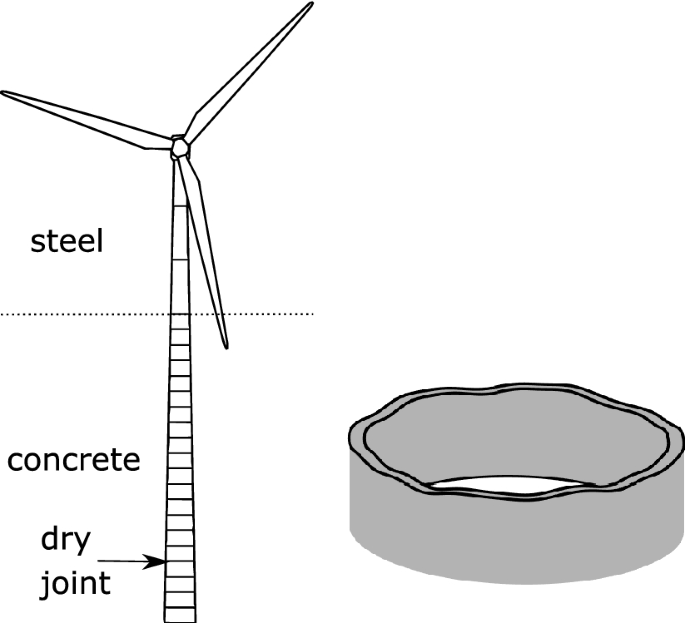
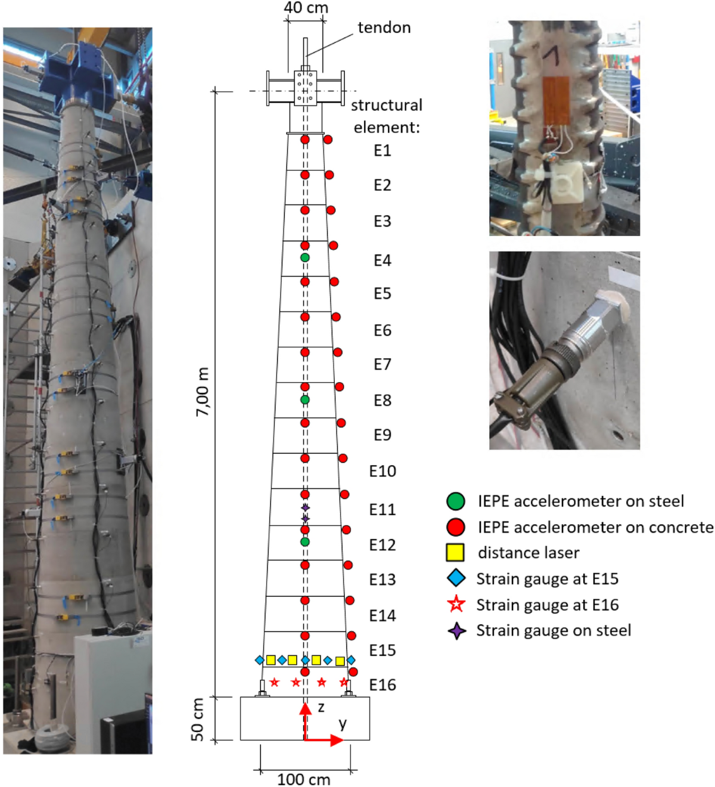
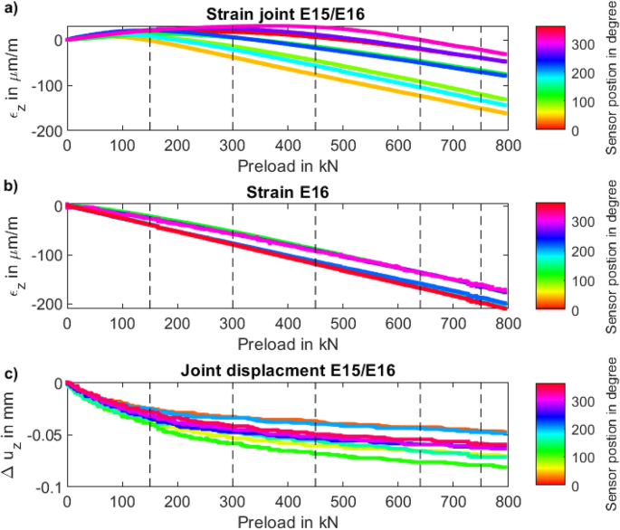

# 158m混塔｜水平接缝：期刊原图资料馆＋研究方案（T086）

**2026-11-16｜图源/许可/原图SHA256可复核｜本轮不是Abaqus物理PASS**

这里直接展示已下载进GitHub的**三张出版方原始PNG图像**，不是库存示意图。另两张MDPI图的镜像下载失败，只提供官方链接，绝不假称已入库。

## 真实原图 A：预制混凝土塔干式接缝结构，Jonscher et al. (2023) Figure 1

来源：[出版方论文](https://doi.org/10.1007/s13349-023-00693-6) / [原图PNG](https://media.springernature.com/lw685/springer-static/image/art%3A10.1007%2Fs13349-023-00693-6/MediaObjects/13349_2023_693_Fig1_HTML.png)；授权：[CC BY 4.0](https://creativecommons.org/licenses/by/4.0/)；原版字节未修改；SHA256 17e1a145d187fa918793a5be9242809d777f10ea1b28616d0189296de5fd1d80。**研究作用**：比较干接缝与真实BF1尚未查清的灌浆/胶层构造，不暗示我们的塔必然是干缝。

## 真实原图 B：大型试验混凝土塔及测点，Jonscher et al. (2023) Figure 4

来源：[同篇论文](https://doi.org/10.1007/s13349-023-00693-6) / [出版方原图PNG](https://media.springernature.com/lw1200/springer-static/image/art%3A10.1007%2Fs13349-023-00693-6/MediaObjects/13349_2023_693_Fig4_HTML.png)；[CC BY 4.0](https://creativecommons.org/licenses/by/4.0/)；未经修改；SHA256 8aca154112ecc1d73947240d157b1582f09b4bacf72a8dabe6c4240e772958bd。**研究作用**：未来设计本塔局部接缝变形与全塔低阶模态的实验验证布点。

## 真实原图 C：接缝预压状态变化，Jonscher et al. (2023) Figure 6

来源：[同篇论文](https://doi.org/10.1007/s13349-023-00693-6) / [出版方原图PNG](https://media.springernature.com/lw685/springer-static/image/art%3A10.1007%2Fs13349-023-00693-6/MediaObjects/13349_2023_693_Fig6_HTML.png)；[CC BY 4.0](https://creativecommons.org/licenses/by/4.0/)；未经修改；SHA256 2eeaa9e8db8b8b599d6942da33539fa0c1c9f26ffbf466789e7e6e71f2b78e05。**研究作用**：接缝预压、变形和振型联动；不能把原实验数据当作我们自己的ODB。

真正GitHub原始文件字节：Fig1=60624 B、Fig4=888087 B、Fig6=198713 B；[下载哈希账本](FIGURE_SHA256.tsv)；[逐张授权/来源记录](figure_manifest.tsv)；[自动验真下载器](download_licensed_figures.py)。

## 另外两张出版方原图：暂仅在线展示，不冒称GitHub已保存

- Dong et al. (2025), Buildings 15(20),3786, DOI [10.3390/buildings15203786](https://doi.org/10.3390/buildings15203786)，[Figure 2出版方原图](https://www.mdpi.com/buildings/buildings-15-03786/article_deploy/html/images/buildings-15-03786-g002-550.jpg)：塔体与钢混过渡几何。
- 同篇[Figure 6出版方原图](https://www.mdpi.com/buildings/buildings-15-03786/article_deploy/html/images/buildings-15-03786-g006.png)：数值与试验对比。文章CC BY 4.0，但本次下载未成功，**REMOTE ONLY**。

其他原文图：Fürll et al. 2024 [10.1002/suco.202300873](https://doi.org/10.1002/suco.202300873) 关于干缝摩擦与弯扭试验、Wang et al. 2025 [10.1186/s40069-025-00800-5](https://doi.org/10.1186/s40069-025-00800-5) 关于灌浆层（标CC BY-NC-ND 4.0）仅保留原文链接，未核授权前不将他们的图片镜像；何泽瑜2024原PDF已在[用户原论文档案](../user-provided/He_Zeyu_2024_hybrid_tower_thesis.pdf)，不臆造其不存在的接触算法。

**T087来源纠错增量（2026-11-16）：** [5项作者元数据修正、Ren2025八试件循环压弯扭遗漏文献、期刊审稿人六项否证门槛](T087_BIBLIOGRAPHY_CORRECTIONS_AND_PUBLICATION_GATES_20261116.md)。当前文献矩阵24条；三张已入库原图保持不变，另两张仍未下载。仅文献核验，不代表新Abaqus计算成功。

## 阅读顺序：直接用完整文献矩阵和方法规划

- [**T086完整研究方案与期刊创新门槛**](T086_RESEARCH_BLUEPRINT_20261116.md)：当前全塔接触失稳的真实证据、干/湿缝未定的风险、M0弹簧/M1原生摩擦/M2经实验标定的C/C++自定义摩擦，G0–G6验收，学位论文继承与两篇期刊拆分。
- [**24篇原始文献逐项矩阵（T087新核1篇）**](literature_matrix.tsv)：年份、期刊、DOI、作者（未核作者标TBD）、原文方法、水平/纵向/干/灌浆界面、证据等级。
- 核心实验：[Klein 2022](https://doi.org/10.1002/suco.202100710)、[Jonscher 2023](https://doi.org/10.1007/s13349-023-00693-6)、[Fürll 2024](https://doi.org/10.1002/suco.202300873)、[Tan 2025](https://doi.org/10.1016/j.engstruct.2025.120443)、[Tan 2026](https://doi.org/10.1016/j.engstruct.2026.123195)。
- 必须防止创新重复：[Wang 2026 强风/地震Hard+Penalty摩擦μ0.6](https://doi.org/10.1016/j.rcns.2026.03.002)、[Wang 2026风震同时作用](https://doi.org/10.1080/13632469.2026.2671807)、[中国干接缝抗扭积分2025](https://doi.org/10.19912/j.0254-0096.tynxb.2023-1771)。

## 论文主线和当前已验证状态

科学问题：**水平接缝开缝—压紧—滑移的可信局部本构，是否会使158m预应力混塔W/E/WE响应、局部材料疲劳热点和优化控制工况相对传统弹簧模型发生可重复变化？**

G0核施工图干/湿接缝 → G1原BF1母本保留且M1全塔Gravity/PT/Modal求解 → G2独立试验压剪扭/开合验证 → G3外部数据标定及独立留出 → G4可选FRIC_COEF常数等效验证与实证μ(p,滑移) → G5同态W/E/WE → G6分材料真实S-N疲劳与鲁棒性。

**真实状态**：原BF1旧T082 Gravity/Modal已成功；新模型μ=0.5 J20局部轴压静力用户报告24增量PASS；**新全塔Gravity仍FAIL、PT/Modal HOLD**；μ=0对照、切向滑移/开合未完成；FRIC_COEF自定义软件未编译/验证。因此**不能把C++处理Abaqus数值错误写成论文创新**。只有实证新本构使预测改善、物理不确定性可解释才可能写“二次开发创新”。

## 图像来源与转载版权

三张已入库Springer原始PNG出自同一篇CC BY 4.0期刊论文，原作者与DOI/图号/许可俱全，文件未修改。Wiley/Elsevier等许可未确证的论文只保留原文链接；禁止去水印/伪造原始试验曲线/把第三方图称为本论文原创。图像入库需要publisherURL、作者图号、许可、SHA256与取得证据；具体脚本见本目录。

研究分支 research/t080-seismic-integration-gates-20261022；PR #42仍Draft；工作流只归档公开许可原图，**不运行Abaqus**。